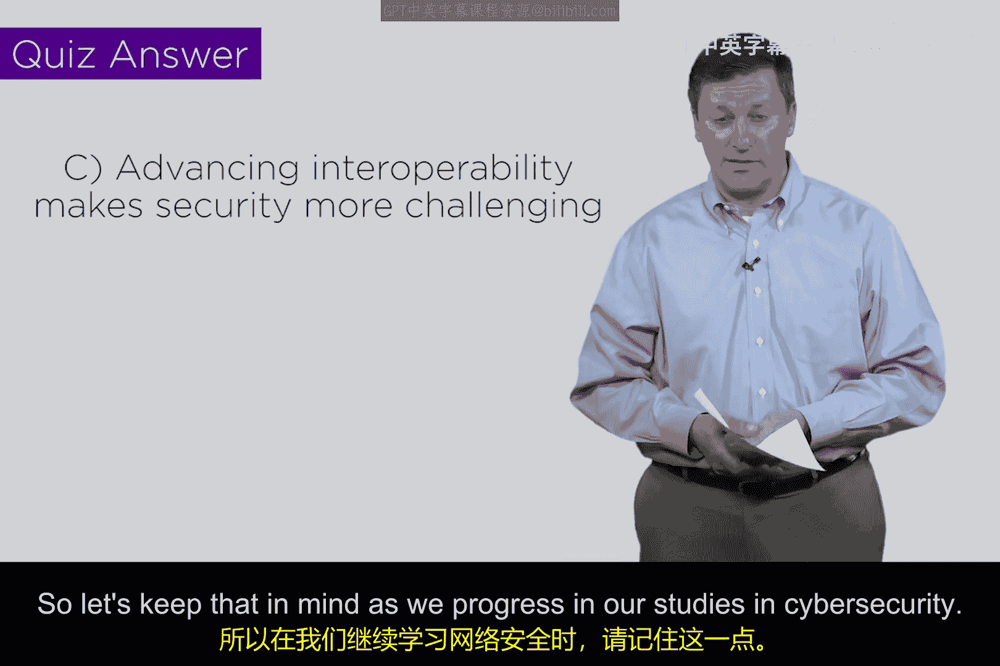

# 纽约大学《网络安全｜Introduction to Cyber Security》中英字幕（deepseek p92 3_TCP-IP演变与安全.zh_en -BV1TFLZzYE26_p92-

Hi folks at Emmarroso， and I would like to talk to you in this video。About TCPIP。

 the protocol suite that really is the language of computing， I think I've told you before。

 I'll tell you again。If you don't understand TCPIP， you really want to dig in and look。

 and we have some suggested readings that you've probably seen us suggest。

 but you want to make sure that TCPIP is something that you're familiar with。

 because our whole infrastructure is driven by TCPIP。

Protocol suite and all the attend services and utilities that come with what we would shorten to just IP or internet protocol but I want to give you a little bit of a history lesson here that will help you understand the security implications of this massive deployment of IP across the world if you turn the clock back to the 1990s and for some of you may not have been born then I was I was working。

 here's what you had in the 1990s most businesses， government agencies， different groups。

 organizations that were running a network，We're using protocols different than TCPI。 In fact。

 a company called Nol， an extremely popular product called Networktware and it used a protocol called IPx caused a lot of confusion。

 it's a very similar name to IP。 but it was different than IP meaning if we were a little business in the 90s we're running the business boom。

 we were running a protocol that's different than IP。 And if we wanted to get out onto the Internet。

 we had to translate the protocol。 So effectively you had a local area network。

 you had a protocol translation box and you had some other land or the internet or whatever you were connected to that might have been IP。

 It was sort of like if you were driving a truck and then you hit a barrier where now there's water。

 So if you want to continue you've got to go from a truck to a boat and you can see how that become slow。

 turned out there were no good standards for that and clearly non interoperable。

 So if you had a hacker sitting back in some land who wants to attack something over。Internet。

 it wasn't just a matter of running a scan and finding things。

 you had all these protocol non interoperability issues that in a sense would slow down hacking。

 it would slow down computing。But it would slow down hacking now。What have we seen since then， Well。

 the whole world kind of decided， why are we doing these noninoperable things。

 Why don't we run our networks， our campus area networks， our enterprise networks。

 our government networks， are big public networks is run I。

 run the same protocol that we're running across public infrastructure。 So what that did。

 eventually is it got rid of that idea if you're driving a truck， and then you need a boat。

 Sudden everything is just open highway。 and now you have a situation where typical local area network running TpiIP。

 hits a router， not a translation box that doesn't have much meaning anymore。

 hitting a router even running TpiIP the router is happy to push things wherever it is that you're telling it to push or wherever the router has been extractstructed to push based on the information you provide。

Think about what that means from a hacking perspective， suddenly everything is in scope。

 suddenly you can from wherever your vantage point is。

 you see everything's in internets in business and so on and you'll see as we go through our discussion in this course that begs a protection mechanism that essentially referred to as a firewall you'll see that there's a lot of different nuances on that but for the most part you can think of it as a firewall being put in place where previously these protocol translation boxes and maybe you could do some security there。

 now you just have a router， so we're going to have to learn to do something there now there's a kind of a message here。

 this idea that diversity might actually be a good thing for security。

 it's not a good thing if you're a CIO chief information officer for a company。

 you want low cost from anybody using the same tools。

 you want interoperability you want nondiversity。W to train everybody on the same thing。

 there's companies that do it like that。 Like if you're here in the US。

 there's an airline called Southwest Airline。 and and I'm pretty sure they run one type of aircraft a Boeing 737 jet and I always posit my mind What would happen if that got grounded。

 know the whole company would be grounded that's a nondiverse decision business decision now it lowers their training cost。

 everybody flies the same stuff。 Everything standard。 I get that。 But from a security perspective。

 you， the security engineer going to have to think through as you're doing design。

 Is it better to have everything the same or to have some things different。

 That's going to be a decision you'll have to make as an engineer。

 that a kind of test your' understanding as we often do have a little sample quiz here that will pop up on the screen。

 So if you think about that C is the obvious answer right Adv interoperability certainly does make security more challenging。

 I mean， it's a fact。 It's one of those cases where。

Infrastructure decisions are somewhat at odds with security decisions。

 you'll see as you continue in your studies of computer security that that's not always the case。

 for example， as we advance virtualization and cloud which most chief information security officers and chief information officers both like so people who want to propose better computing with cloud virtualization also are proposing things that are better for security。

 so it's not always the case that things are at odds but with interoperability and security。

 we have to admit that when we make it easier to do computing。

 we make it easier to do attacking so let's keep that in mind as we progress in our studies and cyberse I'll see in the next video。

