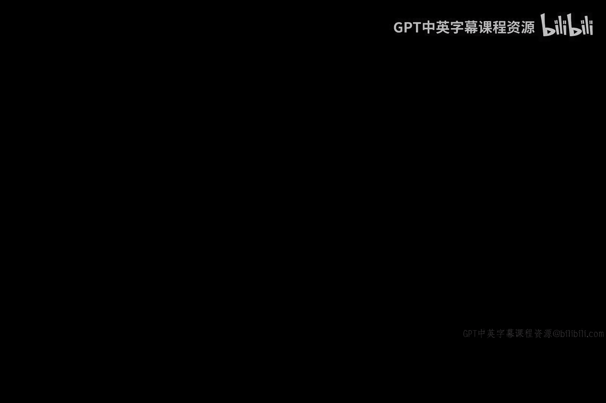
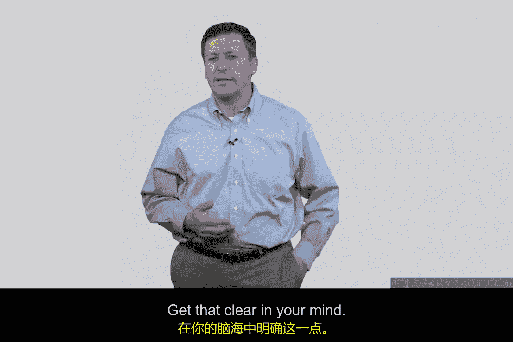
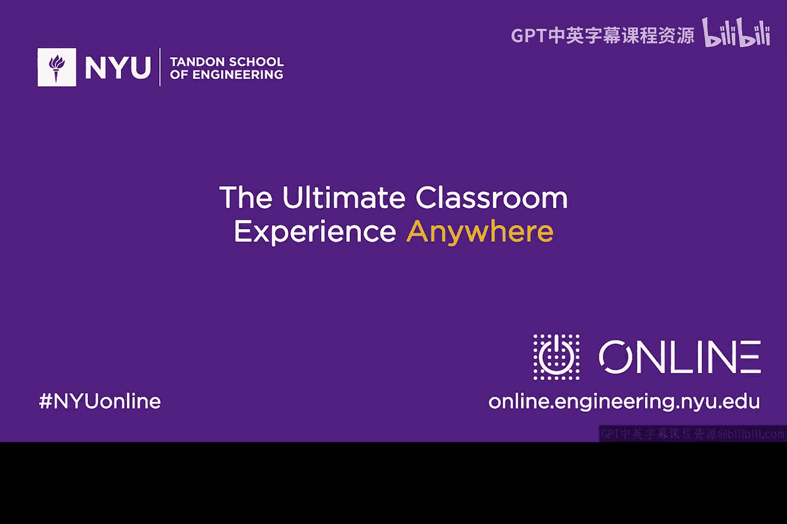

# 纽约大学《网络安全｜Introduction to Cyber Security》中英字幕（deepseek p93 4_TCP-IP概述.zh_en -BV1TFLZzYE26_p93-

Hi folks， Ed here， and in this video what I want to do。Its actually kind of challenging。

 I want to just give you an overview of TCPIP Now look in a few minute video it's almost crazy to suggest that I could give you an understanding of TCPIP that's not going to be the case here but I want to highlight some aspects that you can use as you're listening to me to get an understanding of whether you get this or not if you don't and you have some work to do this is something you need to understand look outside the context of cybersecurity if you want to do computing if you want to be a computer scientist you want to do software and engineering。

 software development or just technology management。

 this is something you have to understand it would sort of be like saying you're interested in a career in chemical engineering or chemistry or biochemistry or something and deciding that you had no interest in the periodic table that would be akin to being ignorant of how TCPIP works So let me give you a few just basics just to kind of get the rhythm here。

And as you're watching， test yourself and see if what I'm saying makes sense， so first off。

There is this classic concept in TCPIP where you is five tuple。

 there's five pieces of information that in a sense， characterize a TCPP flow or session。

 and what we're going to do is we're going to assume that when Alice is sending something to Bob。

 say a packet。 we'll call that a flow。 okay with that， So Alice to Bob， that's a TCPIP flow。

 And when Alice and Bob are involved in back and forth， we can call that a conversation or session。

 okay with that， So as you would expect， a flow goes from this direction to that direction。

 another flow goes from this direction to that direction。

 if it's Alice and Bob carrying on a conversation in a computing sense。

 we call that a session okay so that's the nomenclature that I'll be using in all subsequent videos just so we're consistent。

 sometimes people use other terms。 but I think that's reasonably standard now。

The five pieces of information that characterize a flow we call a TCPI5 tuple。

 and here's the information。 So first， here's Alice Alice is going to have an address。

 an IP address probably issued to her by either an ISP an Internet service provider。

 say at home if you're on broadband then your ISP is providing that Internet protocol address for you or maybe an administrator at work。

 network administrator might be issuing that sort of thing， but is' not something you do yourself。

 It's something that is provided to you in the context of where your Internet access is and correspondingly Bob will also have a destination IP address。

 So source IP address， destination IP address and in a conversation they'd flip for the other flow。

 but we'll just talk in terms of one direction。 source IP destination IP in both cases issued by the ISP or network administrator。

 Now in addition， they're going to be computer programs that are running on。

These machines that are communicating like if you're doing a browser session。

 you have a browser over here and on your website okay so those programs by convention are given a number that's just how we do it that's how administrators set it up on computers So your local operating system let's assume it's a browser is going to go get one of these numbers which we call a port number and there's all scheme for how these port numbers are assigned it's actually kind of complicated or hard to remember but I'll give the idea there's a block of numbers that are greater than just remember this greater than 1023 that go up to about 65K that for the most part are ones that we're going to use for clients now there's a block in the middle that are used for certain types of programs for now we're just going make things simple and say that when a client is grabbing。

Por in order to initiate a session， it's going to grab a number greater than 1023。

Now on the server side， you're probably running something that we would refer to as a well known service。

 okay， it's one that everybody understands and uses HTTP being a perfectly good example。

 and the number less than 1023， for example， for HTTP， it would be port 80。

Become the destination port， and those are assigned by whoever's doing administration on that computer。

 Do you follow the programs that are running a client port sometimes you hear the word ephemeral。

 meaning temporary because they're going to be using this port to do web browsing whatever when they turn the web browser off。

 the port goes away。 That sourceport goes away， but destination ports are nonephemeral。

 they stay with a service。 port 80 is going to be port 80 is going to be port 80。 Now dove。

 if you wanted to be weird， you could probably put an HttP server on some other port。

 but the Internet works by these conventions where we all agree to follow the same rules。

 and you can see how that could have security implication。

 The fifth piece of that fivetple is kind of obvious in this context。

 It dictates the protocol that's being used and that's TCP on top of the Internet protocol。

 There are other options。 There's a lighter protocol called UDP that's often used from multimedia。

Aspect， some of the robustness aspects of the TCP protocol are not in UDP。

 we won't spend a lot of time on UDP， but for the most part。

 I think you should understand what I just talked about in terms of the fiveT now。

Here's second thing you need to understand， and this is again， specific to TCPIP。

The way the handshake works to establish a TCP session or connection is that Alice first throws a packet over to Bob。

 and it's called a S packet because in the TCP header you're going to have all these different bits called flags and like Christmas tree lights。

 they become zeros and ones depending on what the packet is。So your protocol stack。

 the implementation， the software that implements TCPIP is setting those little zeros and ones very carefully depending on what the packet is doing So the first one has a S packet and Sin bit set to one Now it turns out there's another very special bit in there called act that we're going to get to in a subsequent video because really important for security but for now just it's a syn packet and also generates a random sequence number and whips it over to Bob Bob then says。

 oh okay I see sequence number it sends a response syninAC packet Set act set and that Sinac packet basically says。

 yeah I see your sequence number and here's another sequence number that I'm going to generate randomly and then Alice takes a look at that and goes okay and sends an act back to Bob saying okay I saw your second sequence number Now Alice and Bob know each other IP addresses they know the source。

Sport and destination port for the conversation that's going to take place and they can exchange data。

 and that kind of cool。 That's how it works。 Now there's so much more complexity around that like a typical TCPIB book I that that right so you can study there's all kinds of protocols that go around that you manage it how you set it up how routers work it's really quite satisfying and just sort of as an additional consideration here as you ponder this video and think about it I want you to think through why in your mind you think it would be important for a security engineer to understand all those different steps pretty pretty profound implications if you do not understand that I want you to think through why you get that clear in your mind so we'll see in the next video。

