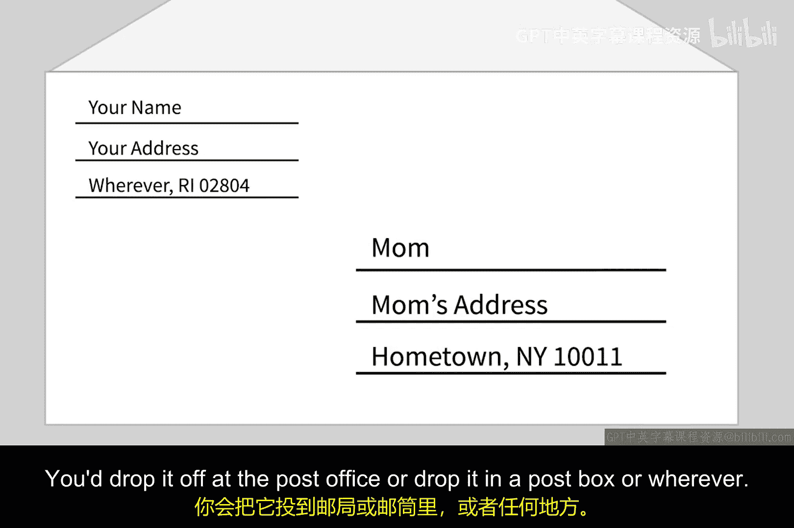
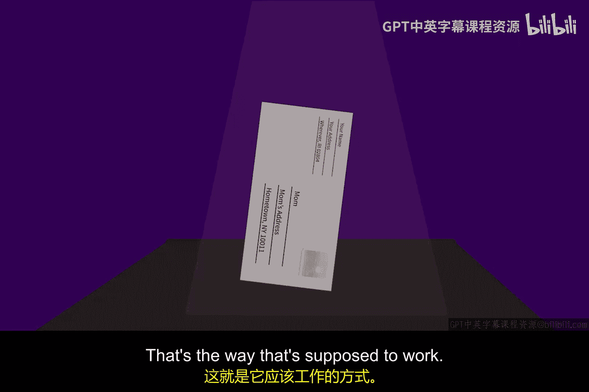
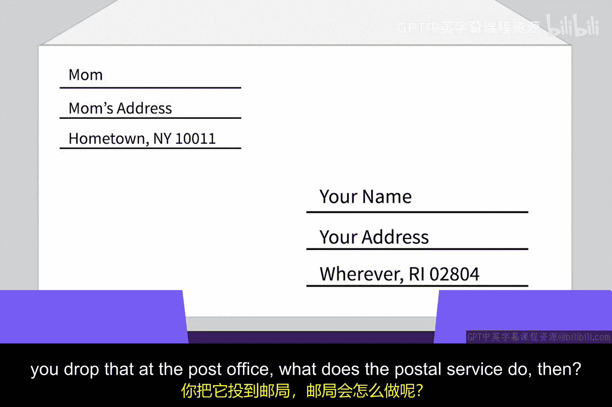
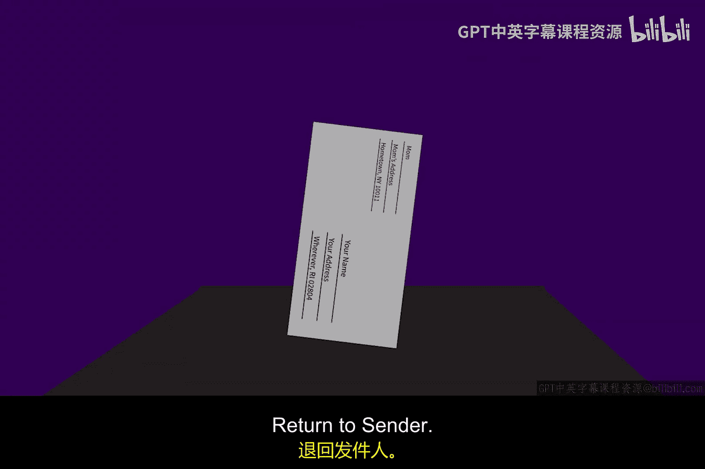
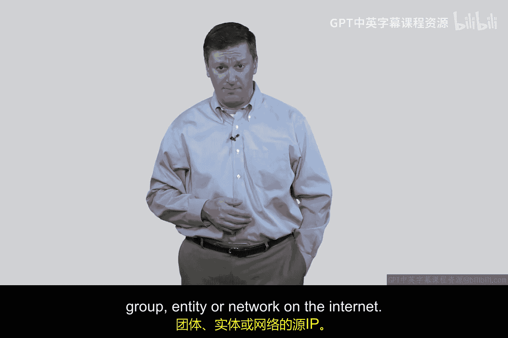

# 纽约大学《网络安全｜Introduction to Cyber Security》中英字幕（deepseek p94 5_IP欺骗.zh_en -BV1TFLZzYE26_p94-

Hi， everyone Ed Amarosso here。 I want to tell you a little story here in kind of as an introduction to this topic。

 which is essentially spoofing or Lying about your source IP address。

 back in the 1970s on a little kid。 There was this very popular book。 You don't have to buy it。

 but I'm going mention it。 It was written by a guy named Abby Hoffman who was here in the United States it was like a hippie the 1960s long hair and a revolutionary guy counterestablish。

 I think is what he would refer to himself as I wrote a book called Steel this book It was cool little book。

 I remember we pass it around on the bus because it would tell you how to do funny little things to frankly。

 to either break the law or steal some of them like he used to sell how you could get a free meal at a diner know or how you could rip off the government。

 all this crazy stuff。 But one thing that sort of struck me as interesting that I remember reading as I was a kid。

 he would say。You should do the following say if you want to mail a letter to your mother then the normal approach to mailing a letter to your mother。

 I think this is true in just about every country， certainly here in the United States is that you would put your mother's address in the bottom right part of the envelope you'd write it out my mother address city you know whatever numbers or meaningful here in the U it would be a zip code and then in the top left of the envelope you would write your name and where you live you'd put some postage on it。

 youd drop it off at the post office or drop it in a post box or wherever the mail person takes it。

 sees where it's coming from， sees where it's going to sees the postage。

 probably stamps it or something and sends it off on its way that's the way that's supposed to work but Abby Hoffman said why don't you do the following he said get a letter。

And by all means， don't put any postage on it。 But instead of putting your mother's name in the two section of the envelope and yours in the from。

 reverse them。 So what happens is your mother is the from。You are the two。 You've put no postage on。

 You drop that at the post office。 What does the postal Service do then， Well， back in the 70s。

 what they did is something called return to sender。 In fact。

 there's a very popular song Ba was Presley called Return to sender。

 So what would happen is you want to mail something to your mother。 You give it to the post office。

 You lie about the source。 You lie about the destination。 The destination is less important。

 You're lying about the source。 What happens is the return envelope goes to your mother。

 doesn't come back to you， goes to her。

Postal Service does different things now， you know they'll set that sort of thing aside。

 they'll you know there's a big delay there， they made it very inconvenient to do that sort of thing。

But it still may work in some places and look it works in TCPI。

 One of the decisions that was made by Bob Khan and then Surf as they were inventing TCPI is they decided that it was going to be okay to lie about your source IP。

 they just made that decision。 I've spent most of my career in telecommunications and an old circuit switch telecommunications wasn't the case you had endpoints that were meaningful。

 but the fact that you can lie in TCPI or in IP allows you to do the following you can have someone with a real source IP would pop up a diagram up here that'll show essentially some fake source IPs。

 10。10。11。12 so that's your real source IP， but you can craft a source IP in a packet。

Put it in the header。 And it doesn't have to be your real source at big B 192。1。2。

3 when it gets to the destination， if， let's say it's a syn packet。

 If the destination then wants to send a synac， Where does the syn act go， it doesn't go to you。

 It goes to 192。12 3。 Do you follow， that is something that's so fundamental。

To the way Internet security is dealt with in our world that I really wanted to highlight that here。

 I mean， I know it's a simple concept。 And some of you are probably going。Yeah， yeah， I know that。

 but you need to recognize how foundational that is to so many problems that we have in our infrastructure and internet security in general and how how much misconception exists around that point。

 for example。When you hear that a storm of packets might be emanating from some source at some destination。

 maybe creating a denial of service condition with sin packets， sending a bunch， you say， well。

Looks like they're coming from just name some country the country and my favorite cartoonist Dilbert Scott Scott Adams。

 a friend of mine actually he writes these Dilbert cartoons。

 he made up a country called Alboneia so we'll use that and I'm not to offend anyone so Id say wow it looks like his attack is coming from Alboneia。

And you， the security engineer know that that's probably not right， you know。

 nobody's going to attack from your own computer that's kind of dumb。

 you're probably going either break into somebody else's or spoof their source IP or whatever so keep that in mind this idea that we can deceive we can tell lies we can spoof the source IP of some other individual group entity or network on the internet keep that in mind and we'll see you in the next video。

