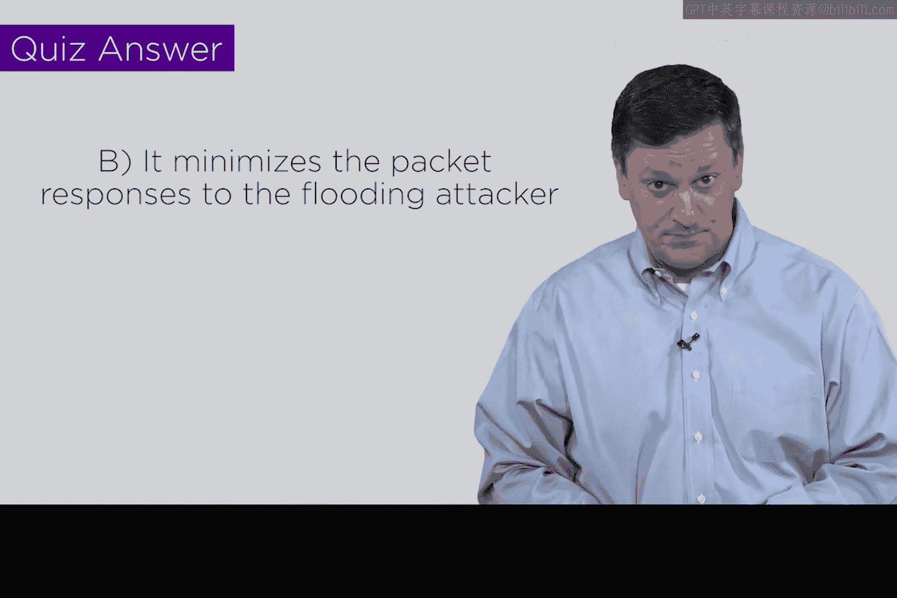

# 纽约大学《网络安全｜Introduction to Cyber Security》中英字幕（deepseek p96 7_数据包洪泛.zh_en -BV1TFLZzYE26_p96-

Hi， everybody at Emmarosso here， and I want to talk to you today about something called a S flood。

 S SYN being the first packet in the TCP three step sequence now。

In the context of distributed denial of service attacks， theres so much misconception。

 particularly in the popular media and even amongst technologists about where denial of service attacks come from。

 and we all know for the most part that there's botnets involved， we get that。

But there's really two cases。For any type of entity trying to flood another and in the context of TCPI。

 let me tell you what those two cases are， the first case is where you're not willing to give up who you are。

 you're not going to say it's really coming from me。

 you're going to lie about your source IP address。And in the second case。

 you're going to be perfectly comfortable saying， yep， it's me。

 This is where I'm going to set up a session。 Now， let's think about the pros and cons of those two。

 Now， if I'm only willing。To just send a packet as somebody else then that's as far as I'm going to get I'll put a diagram here up of a bunch of sins。

 A's source IP address is 10。1。2。3 but uses the source IP address of some other thing 1921，2，34。

 So what happens is I send a sin。 I send another sin I send another sin that's the essence of a flood or denial a service attack I keep sending them。

 think of it as like a gun boom boom boom boom boom。

 I'm sending these sin packets where the response is going they're not coming to you to going somebody else Now the irony is sometimes that is the ultimate victim。

 Sometimes you think I'm going hit you you're gonna respond to him and that's what I'm trying to dedos like if you're DNS server and I want the DNS response to come back that's sometimes the purpose。

 other times you're the one I'm trying to attack with a sin flood and maybe I'm changing up my source IP so you're spraying out all the responses。

all over the place， you， the internet attacker， I hope you're not an internet attacker。

 but you get the idea whoever is designing these things is to think through what do you want to do so the first cases is you're lying we call that a sin flood the second case is much more powerful。

Because if I send us in， you send synac， I send a， we have a session set up。

 I can now do applicationle things I can log into you。 I can send commands。

 I can ask to download stuff， whatever， depending on what it is your， let's see your web server。

 I get on now I start downloading things to try to create a very busy condition for your website or whatever。

 but I'm doing it， I'm exposing the source IP。 So generally when that's the case。

 it's always proceeded by first breaking into someone else's machine and that's how botnets are set up as we've discussed and as how I'm sure many of you very familiar with。

 if I've got a well botnet that's designed and and create it and recruited and I can have all my bots do that。

I really don't care that they expose who they are， it's not my computer scattered around the world。

 probably。So you know that it's， you know， somebody's mom's PC connected to broadband that's attacking。

 What are you going to do again， in the popular media。

 there's this misconception that when you see these attacks coming that are exposing source Is。

 we'll just hack them back。 But in a botnet who are you hacking。

 you're hacking somebody's already been hacked and it's probably innocent。

 probably unaware that it happened。 And in many cases， you're just making it worse。

 Suppose it's a children's hospital that's been you know。

 infected with bot software and is now attacking you， what are you going to do attack them back。

 So it's a symptom of great ignorance that I hope as you study cybersecur is we go through these lectures。

 we can help to rectify。 So keep that in mind now。Got a little quiz that'll test our understanding of this So think about those three。

 I think you'll come to the conclusion that it's the middle answer to be right so the response synac packets for flood are going to go somewhere else。

 So it gives you nice and comfortable if you lie about your source IP。

 you're not getting all these pesky synaxax coming back you could actually have the the result of maybe making your own connection a little busy better to make somebody else's connections busy as part of the attack。

 So I hope you don't do these things， but it's important for us as we learn cybersecurity to know the difference between the different elements of these attacks I'll see you in the next video。

