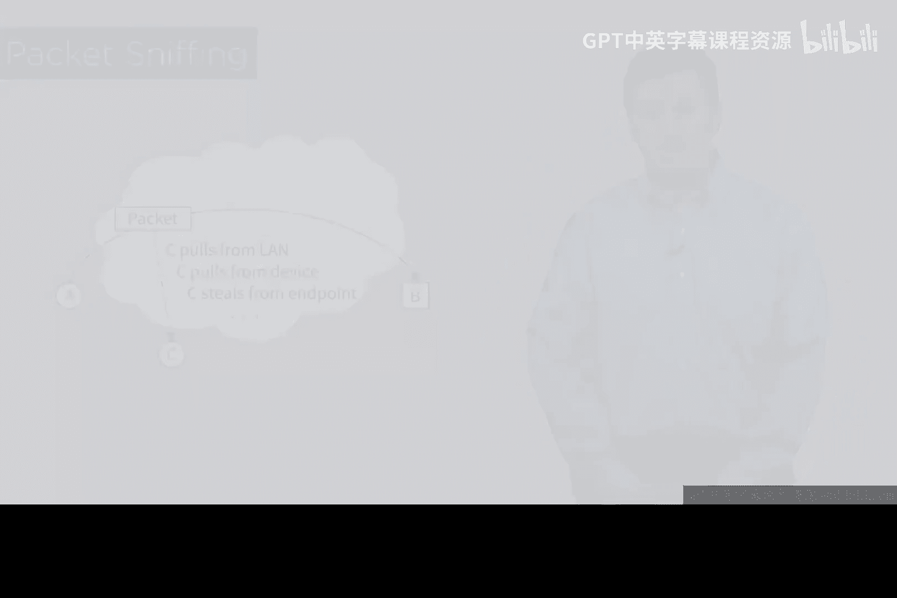

# 纽约大学《网络安全｜Introduction to Cyber Security》中英字幕（deepseek p97 8_数据包嗅探.zh_en -BV1TFLZzYE26_p97-

Hi， everyone at Emmarosso here。 I want to start by telling you about something that we had in telephony many years ago。

 It's called a party line。 Now I don't mean party as in you know having candy and drinks and so on。

 but rather it was a kind of thing where a community would use telephony in a way that if you picked up the phone。

 you could hear somebody else's conversation。 that's sort of how it worked。

 everybody potentially could be part of a big group。

 and you just had good manners and you knew that if your neighbor was on the phone。

 you just didn't use it， I know that sounds crazy， but something that existed many years ago。

 Now turns out that a lot of the layer2 or local area network protocols。

 layer 2 meaning in the context of the very traditional OSi stack， which also by the way。

 if you don't understand the OSi layered protocol stack layer 1 to layer 7。

 take some time and take a look at that， makes sense for you to go off do a little bit of research to understand that。

 but at any rate。At layer 2 where you've got protocols such as Ethernet the way these things were designed always reminds me of that Now more modern incarnations fixed a little bit of this。

 but here's more or less how Ethernet was originally conceived imagine a big wire in front of me and there are all these little connections to me to other computers let's say I'm a computer and we're all connected to this Ethernet local area network。

 here's how the protocol of Ethernet was designed to work an entity called a frame would be created to a little different packet with layer2 the frame would be created。

 it'd find its way out onto the wire and you'd go to the first interface and say hello am I for you and whoever's at the other end would go no or no or were you whatever'd but most part you'd say no it would have an address and we call that a Mac address and you'd say no so go to the next person there are I for you you go nope not for me and it comes to me let's say。

I'm a security hacker and I like to read everything and I like to see everything， comes to me。

 it doesn't have my address， as it might for you and I go，Yeah， you're for me。

 want I say yes to everything， it's called sniffing。Now。That's not a great situation， right。

 I'm sure a lot of you have gotten on trains or have gone to have a coffee and a coffee shop in your town and you jump on a wi-fi local area network and people have probably told you。

 hey， be a little careful when you do that and the reason is because for the most part somebody can more or less do what I just said。

 subject to security that might have been overla and we're going to spend time in our course here going through。

 but I just want to show you the base technology and give you the raw situation before we put security that makes sense。

 a lot of times people go now you can't do that and you go well why so well。

 because I put the security well， you put the security。

 that's the whole point if you hadn't you'd have a very different situation So most layer two protocols。

 do not have embedded in them the kinds of protections that you would want to make private your conversation。

 say on a train or something。We using Wifi， that's another problem。

 and that's that the native protocols that we use at almost every layer。Are not encrypted。

Now you can encrypt them。But they're not natively encrypted， meaning we designed all these things。

 we didn't design it。at conception time， it's sort of like if you're building a house and you want to wire it。

 let's say you want to put some wires in your home for whatever reason。

 you don't think w-fi is good enough you want to put Ethernet。

 well would it be better to put that in when you're building the house while the walls are still off or would you want to do it after you've built the whole house and then you overlay in cybersecurity we call that retrofit。

It's a term that describes an activity that you don't want to do in security。

 and the problem is in a local area network setting， for the most part， the security， the privacy。

 the confidentiality has been retrofit。So the attack here is called sniffing and that just means positioning a piece of equipment。

 software， whatever onto a network you can see our little diagram you have Alice and Bob on a little network and we see a packet emanating from Alice to Bob and you see C sitting there。

 just pulling from the land， pulling the whatever whatever packet I come， you just take it。

 as I said earlier， you have to have that in mind when you're doing network design。

 when you're doing cybercur， you have to assume。And there's a little awkward term we call it in some sense。

 a naked packet and I might be snickering little but but you get the idea。

 meaning there's really no protective clothes around it。

 protective clothes being the encryption so you have to make that assumption and we have to take the steps to add encryption confidential in privacy they're not natively built in to the base infrastructure that comprises both public internet and also the enterprise networks that you might be using at school at work and government and military where whatever your whatever networking you're using the native case tends to be insecure so let's keep that in mind as we think this through native base case generally insecure we tend to retrofit on top of it if we had our choice I'd rather design the security in from the start so we'll see on the next video。

