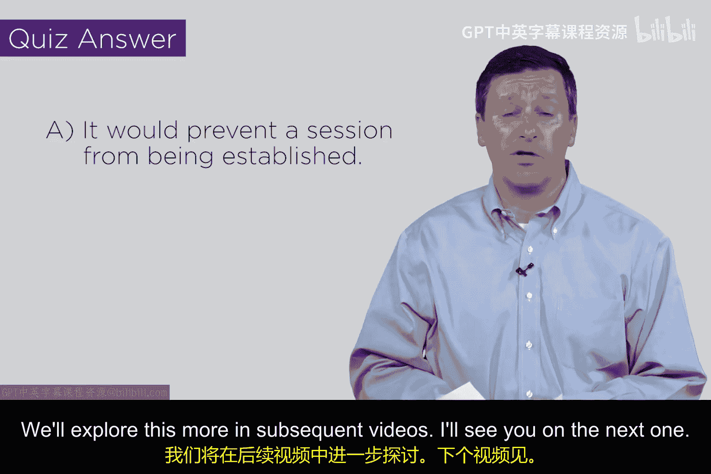

# 纽约大学《网络安全｜Introduction to Cyber Security》中英字幕（deepseek p98 9_用于访问控制的SYN数据包.zh_en -BV1TFLZzYE26_p98-

Hi folks at Ammarosso here。 If you've been watching these videos。

 you may remember one of the videos that you may have seen。

 I talked about something called a reference monitor concept I'll just sort of repeat here because it's kind of important to understanding where we're going here from a technology perspective and that's toward firewalls。

 the idea of reference monitor introduced in the 1970s by James Anderson is that Alice wants to do something with Bob。

 and I put this thing in the middle that's going to watch what's being requested and make a decision about whether it's allowed or not。

's really simple but it's so fundamental to the way computer security works and cybersecurity works。

That it's worth repeating so take that concept and now let's take what we understand about TCPIP and let's think about the three step handshake that we have between Alice and Bob to set up a session Alice goes hey。

 here's Sin packetet， Bob goes hey， here's SynAC， Alice goes hey， here's Z。Now， that first packet。

 the first initiating packet， the sin， it turns out that in TCP。

 we got really lucky in the way that thing was designed。 I'm not entirely sure that surff and Khan。

 the two inventors were thinking security when they did this， I doubt it。

 but they were certainly thinking about establishment of a session。

 and what they decided was that first packet in that TCP sequence would have the act bit set to zero。

 all subsequent，Packets going back and forth， including all data transfer。

The act bit would be set to one， how cool is that？So what that allows you to do。

Is you can put a little piece of equipment， think of it as equipment， it's not going to be equipment。

 but think of it as equipment。It's sittingtting there。

Between Aliceice and Bob and all it's doing is watching packets come in。

And looking at the act bit and saying。Acbit 0。 and if it is， you go， oh， wait， wait， wait wait。

 hold on。 Act bit0。 Hey， everybody， somebody's trying to do something here。 Now。

 let's look at the full five tuple。 It's coming from here。Go in there。 we go with that。 Okay。

 it's this source port going to this destination port。 go with that All right and it's protocol。

 everybody good with that。 Everybody's good with it。 Okay， we allow it to proceed。

 and what's going then happen is the syn Act and the act and so on。 But if that act bit set to zero。

 that packet hits and we decide for whatever reason that we're going to drop the packet。

 The session never happens。 Bob never gets the phone call， never gets the connection。

 never gets the packet。Do you see how powerful that is， I mean that in essence？

Is the embryonic beginnings is the embryonic birth of a firewall。

 That's how it comes thats what comes from that。 Youve probably the good firewall no big deal。

 put this thing in between them。 but that's where it starts like the packet hits and you know that all right。

 it's going to port 80 and it's coming from a source port greater than 1023 from an internet address to one of my address。

 Oh， I see somebody's trying to surf my website。 We go with that。 yeah。

 it's all ideas why we have a website Come on in。But if it's some other port， let's say it's port 23。

 that's an old one， that's when we see use this protocol called tool called TNe where you log on somebody's computer nobody's going to let you do that now so now I see when ins port 23 and you go well not a minute what are you kidding me？

Destination port 23， what you think I was born yesterday， forget it。

 no way you're going to tell that onto my machine， boom drop， you get the idea。

 just using that one packet， we can make some pretty powerful decisions now。

To test your understanding here of this a little bit， I've got a little test quiz。

 so the answer is a， if you do that。There's no session when the way TCPIP works is that if you're not expecting something and a packet hits with the Act bit1。

 you discard it or whatever。 depends on the implementation。

 you'd like to think that your router is set up to do that。

 And as we get into firewall design and security design， you'll see we'll be watching for weird。

 stray things and making sure we have rules in place to catch stray garbage that may be coming at you。

 So in a modern design， you wouldn't get away with that。 And even if you did。

 you would' be able to set up a session。 So I hope this has been useful。

 I hope you got an a good understanding of how that act bit has been so useful for firewall designers for many years。

 we'll explore this more in subsequent videos。 I'll see you on the next one。

