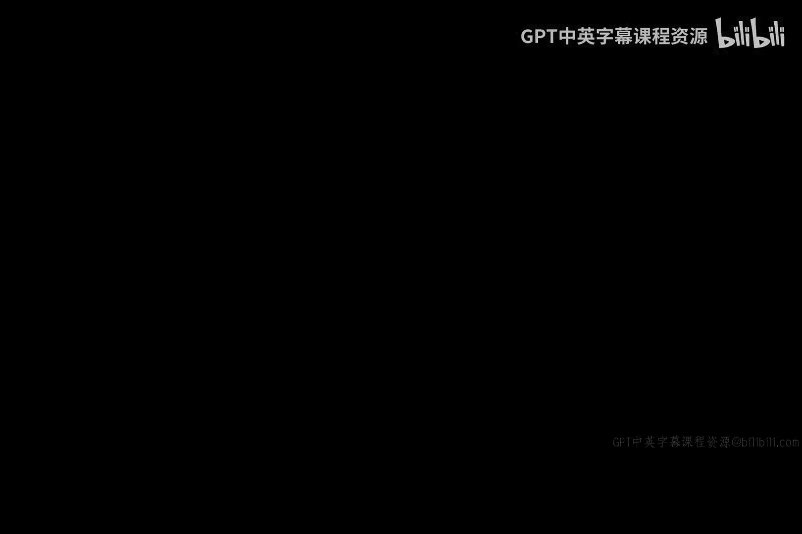
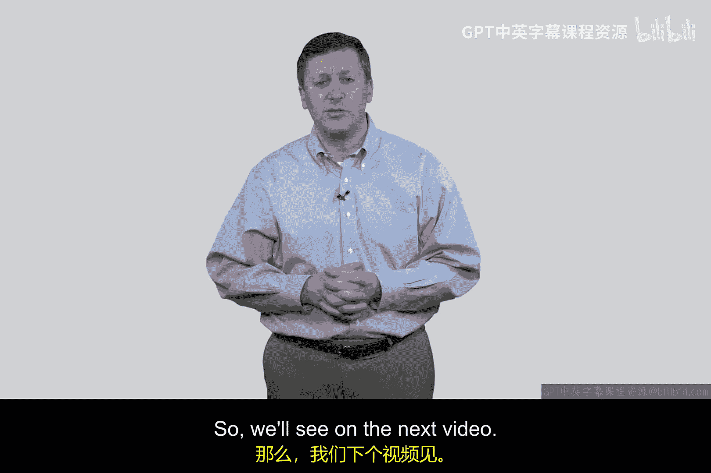

# 纽约大学《网络安全｜Introduction to Cyber Security》中英字幕（deepseek p99 10_防火墙的定义.zh_en -BV1TFLZzYE26_p99-

Hi everyone at Amarosso here， I want to tell you a little story that'll motivate our topic this video just firewalls。

Back in the late 80s， there was a worm that bounced around。

 I think I've discussed a little bit of this on other videos you may have seen it's called the Morrisrisorm thing was bouncing all over the Internet。

 It was trying to in some sense test， but the designer。

 young man at the time had miscodeded it and the things started taking companies and infrastructure just cascaded all kinds of ways。

 but one thing。That was's sort of interesting is that where I was working at the time。

 Bell Laboratories。The worm didn't get in like there was something that had stopped it。

And at the time I was doing cybersecurity。 again， we didn't call it。 that was computer securityity。

 I wanted to know how come it didn't get in what is it that we were doing And I met these two wonderful people。

 Steve Bellivvin is now professor at Columbia and Bill Cheswick who a lot of people referred to as in some sense。

 the father of the firewall。 And these guys had written some software that basically would sit at the gateway to Bell Labs。

 inspecting things that were coming inbound packets and making decisions about them。

 It was the embryonic beginnings of firewalls at the En。 It's an interesting concept。

 And years later， I was writing my textbook I wrote my first textbook and cybersecurity 1993。

 It actuallys funny story here。 when I sent to the publisher。

 a popular publisher at the time called Prentice Hall。 I sent them the proposal。

 I said I'd been teaching。 I got a textbook， big fat thing， I wrote 400 and something pages。😊。

Without even a publisher， and I liked it， and I sent it as a proposal。 And here's what they said。

 they said so in 1993， they said， well。There are already two books on cybersecurity。

 one that had been written in 1986 and another that had been written in 1989。

 Dorothy Denning and Mauurri Gasser had written something。

 and Chuck Flleger was also working on a book So there were like three books。

 It was like do we really need three Book in Cysecurity。

 and I remember saying I think this might be a growing area， and I kind of talked them into it。

 So my first book came out， it's called the Fundamentals of cybersecurity technology， don't go by it。

 It's out of print， but the reason I tell the story is because around the time I was writing the book。

Cheswick and Bellovvin， the two people I just mentioned were writing a book on firewalls。

 and we kind of compared notes。And I love their book。 My book， graduate students bought。

 I don't think anybody else bought it。 While some did。 It was in print。 It was in print recently。

 but at any rate。😊，Their book was on firewalls， and it was one of the most popular。

 successful books ever。 But get this。 They were kind enough or just by accident。

 They liked what I was doing， and they referenced it in their book。 So they had maybe 20 references。

 I was one of them。 I did more sales because they referenced my book。😊。

But whatever their book was on firewalls。 and here's what they did。

 they came up basically with a definition that I think has stood the test of time。

 Here's what they say。 Basically five things that define a firewall。

 First thing is it's going to separate two or more networks。

 So you're going to use firewalls between networks as a separation point。

And usually administered by one we'll get to that in a second。 Second is that it enforces policy。

 So somebody decides somewhere what the darn thing is going to do， what it lets through。

 what it doesn't let through。 So that's a second。 The third is that some network administrator is going to take care of this It's going to be adminrate but generally by one or the other of the networks。

 Now not always sometimes an ISP might sit in the middle and do some arbitration between networks。

 but for the most part， administered by one or the other。

 fourth is that you can't tamper with this thing So it has to be bulletproof and the most difficult requirement。

 the thing has just been almost impossible to deal with is the problem of making sure that it can't be bypassed and that just has turned out to be the most difficult requirement in firewall design firewall implementation。

 firewall deployment。 this idea that going to put it in place， you can't go。

round it now think about how silly that is probably where you are right now if you're at school say watching these videos or you're in office watching these videos and let's say at work。

 somebody decides that a gateway that you can't look at Facebook for whatever reason because I want you to be distracted by being on Facebook what are you going to do reaching your pocket and grab your smartphone and go on Facebook。

 you go right around the local area network gateway that's imposing policy to keep you from being distracted but you distract with your phone you follow like it's easy to get around these things and it's turned out to be just spectacularly difficult to impose uniform policies across large groups of people using firewalls but I get ahead of myself I still have to spend time with you explaining how these things work and in some subsequent videos will start establishing rules building access policies I'll show you exactly how it works we do it more or less for route。

But itll works the same way for any device that takes rules and makes decisions about what's allowed and what's not。

 so we'll see you in the next video。

