# 【精译⚡算法与数据结构】PavelMavrin p16 p15 A&DS. Time Complexity of Union-Find (inverse Ackermann function) -BV1NLB8YfEMq_p16-

，🎼嘟嘟嘟嘟嘟嘟。🎼The。Okay， so so before we start So why we having these lectures。

 Because there are a lot of。Different topics of algorithm andency data structure。

 which are not covered in any courses， so I can I just can't find any video lectures about these topics。

Yeah， they are covered in some papers， but nobody read papers。 Yes， it's 2021。

No one is reading any scientific papers。 know everybody is watching YouTube videos。

 so I just want to fix this and just transfer some classical。

Algorithms works to the YouTube social so anyone who is interested in compute in algorithm data structures can find these lectures on YouTube and。

啊， just。Learn something interesting。Okay， so today we discuss。

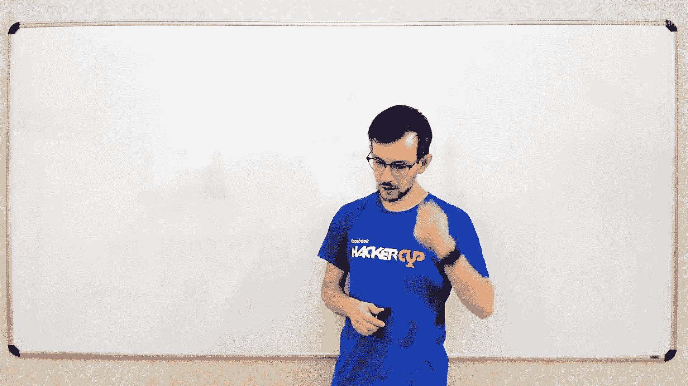

A classical work of Robert Tajan about a union find data structure。

I posted the link to the paper in the block in the code forces block， so。

You can even open the same paper just too。フアと。It is a little bit， no it is very cool paper。

 so I highly recommend for everybody to read it but at some point it's a little bit over complicated so I will try to simplify it a little bit I just get rid of any corner cases and any not very important constants and so on so just to make the proof more simple but if you want to read the real article I highly recommend this release this paper paper is great。

嗯。个。So what are we talking today today we talk about union kind structure all in Cam programming sometimes is called the digitalet Union so what is data structure you have two operations you have operations。

是永远。Exll Y， and5。And the current state of your data structure is some sets。So we have some sense。

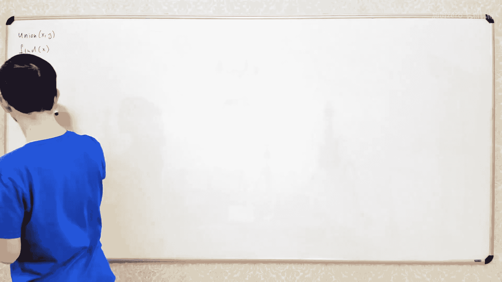

So fine operation returnss the set which contains element text element text。

And fine operation gives you the set which contains element X。

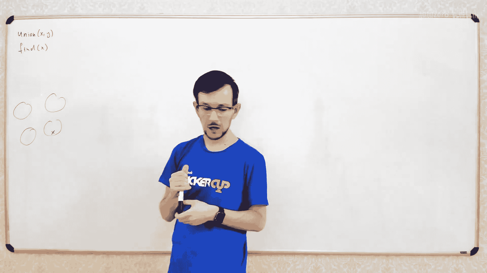

And union operation just make union of two sets， so you have。Two elements， x and y。

And when you call the union operation， these two sets will combine into one。

 so youll merge these two sets into one big set like。So these are two operations here on and find。

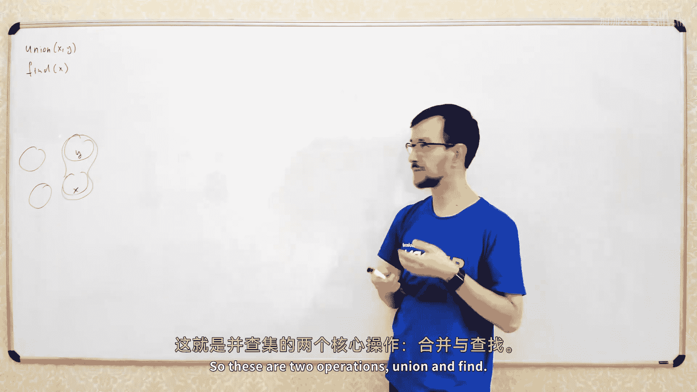

🤧啊。How do we implement the union Finded structure？Again， like we discussed in the previous lecture。

It's great easy。We will implement the union find instruction in the following way。

 we will maintain each set as a tree。

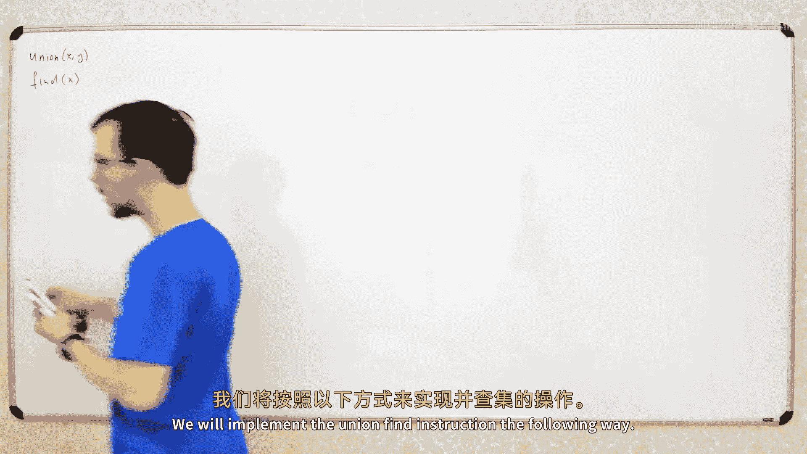

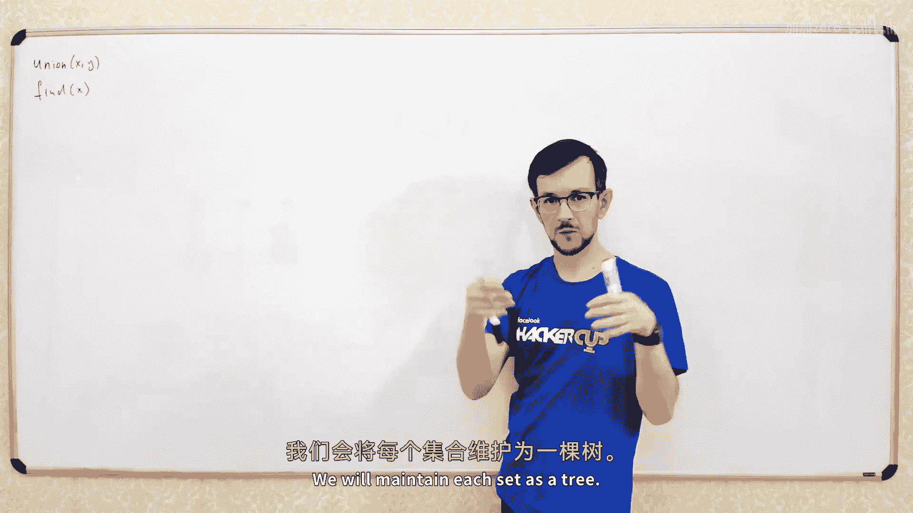

嗯，然。Okay。Okay。

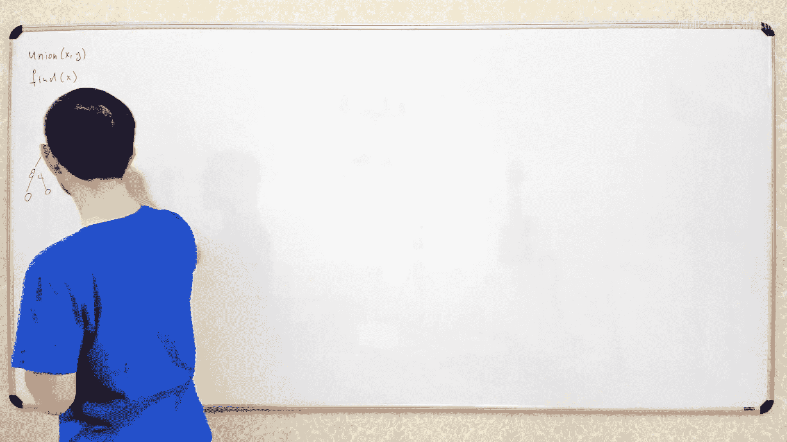

So here we have two sets， we have one set of one to three。

 one set of five elements and another set of three elements。

And the root of the three is the representative of this set。

Uual usually you have to to hear something。So this element is very representative of the set。

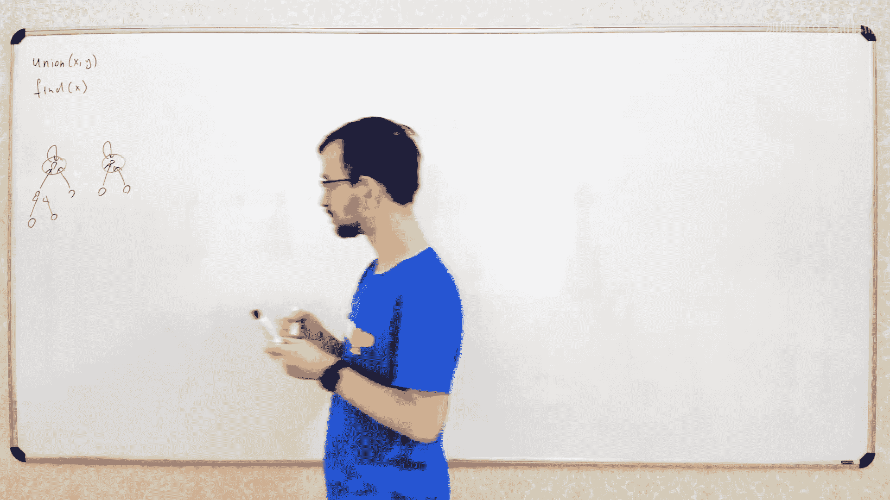

Now， how do you implement operations union on find for operations file？

You simply go to the root of the tree and this tree represents the set which contains element X for operation5。

 you simply take the element x and follow the path。

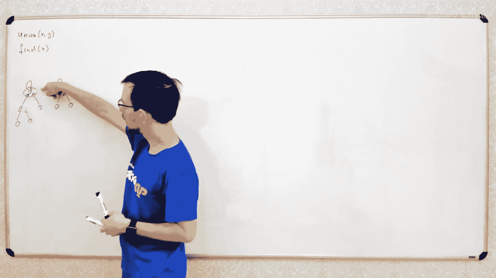

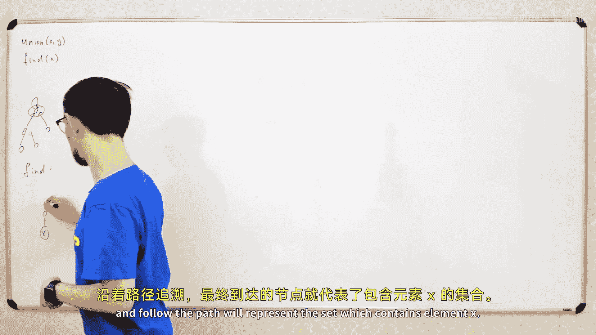

To the root of the tree。And these elements。We will represent the set which contains element text。

How do you make Union operation？

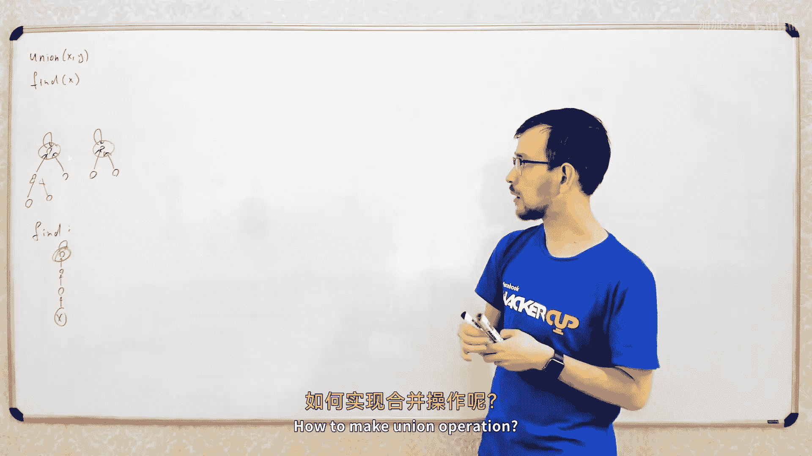

First， you find。There rules of correspondingent of your first fighting， I you。So you have element X。

 element Y， you follow the path to the root。You take a0 of one tree。The road was another train。

And then you just make link from one group to another， just make it。Like this。

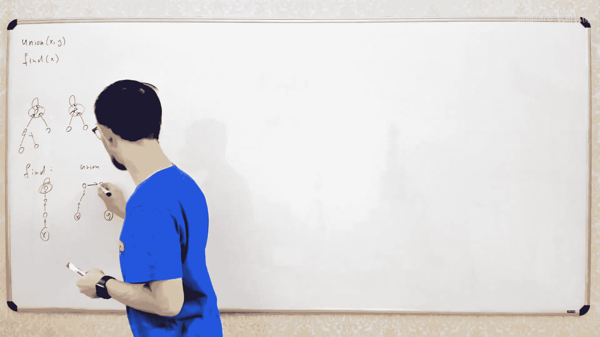

And now these two trees combine into one between， right？

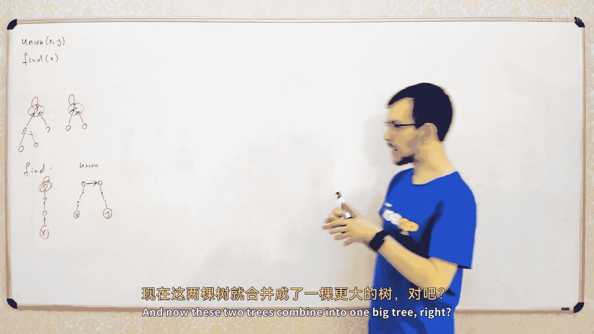

have like like one big one tree， another tree， you have x here， you have Y here。

 you follow back to this root， then you make this link now you have one big tree， right？

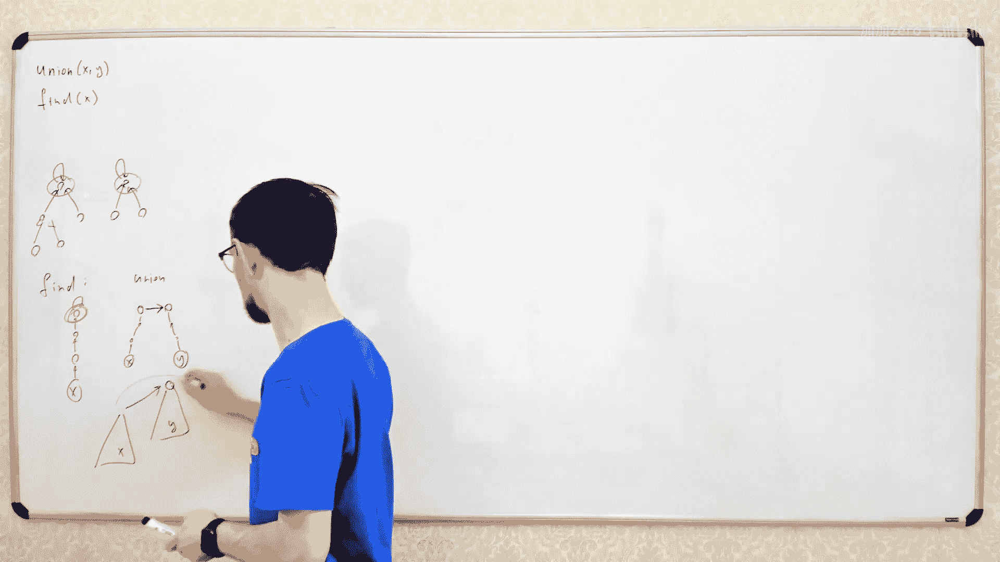

舒。は。

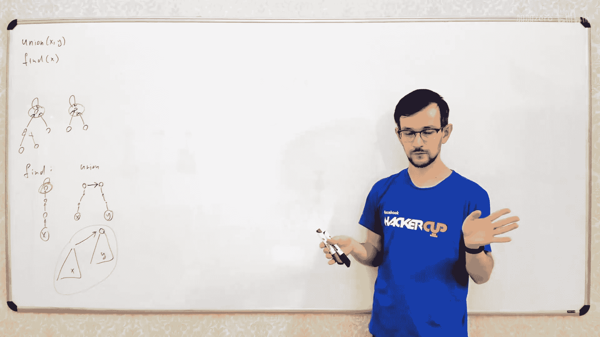

That's basically all you need to know about you find destruction。

 it's very very simple to quote the algorithms is actually one of the simplest algorithms we learned during the first semester。

😊，That's好 that's好我说。And now we apply to make it work fast。😡，We applied two heuristics。

 first heuristics， first heuristic we used was the rentistic。응 응 응 그。嗯嗯。Huristics， heuristic。嗯。

English was difficult。啊。Well。So。When heuristic work works like this。

 we try to make these trees balanced。So， well we。Make union of two sets。

We need to make this link from one tree to another tree。

 we will always make the link from the smallest tree to the biggest string。So we're the main thing。

So let's see we have one tree is small， and another three is big。We will calculate this height。

This cable called the rank of the train。And now we' will look on these two routes。 Sha。

 we should have smaller strength。And if rank of X。Its Excel his wife。

If a rank of x is less or equal than the rank of y。Then it will make from x to y。

So we'll always make link from small tree to big tree。Right。啊。

This heuristic power help us to maintain all the three balance。

 so if we always hang small to big trim。The tree will always be kind of balanced okay so the rank will be up to log and so on。

こ。And the second rust we used was petth compression。

Bas compression works like this when we call fine de。おこ。

So we start from X and follow the path to the root of the tree。

We at the same time change all the leagues。To the root from the parent to the root。 So we just。错了。

For each edge from the node to its parent， we remove this edge and add edge。都 the本。And do it for。

And yourre soul。So we remove all these edges。And make the edges to the root of。

Let's call the pathth compressionistic。Pretty simple， right？Okay， everybody's on the same page。

 right？Everybody know what's going on。Cool， any questions by now？Ran is the height of the tree right。

 yes， the rank of the node is the height of correspond toson if you have vertex x。We have some tree。

 so this height of the tree is the rank of x。And you can maintain these ranks when you make the union variation。

 So when you how to how to change ranks when you。No this rank is do not change when we make pet compression。

 so this ranks are。We don't maintain the real height of the tree。 Yeah。

 so when you make pet compression， you change you may change the real height of the tree。

 so you have like here you have。嗯。Here here you have vers。Of rank2， if you call fine from here。

 you will apply pathth compression。And you will change this link to here。

When we do something like this， we will not change the ranks because it's complicated。

So we will leave the rents as they row before we apply all the pathth compressions。

So these ranks are not affected by these PE compressions。Thats。点点点点。

Yes you can do the same heuristics based on the size of the tree yes。

 you can calculate the size of both trees and link small three or smaller size to three and bigger size。

That will also give you the same asymptotics。I just need the rents for my analysis so I will keep the rents。

 it's easier to make the analysis of this algorithm when I have this rents so I will have the ranks auristics you can do absolutely the same when you calculate the size of tree。

 you can calculate the size of these trees and connect small tree to big tree。

 it will give you the same time complexity right。嗯。这这这这这这中这这中。저드르띠르띠 떠르띠 떠。Do do。Do嘟嘟嘟嘟。

My coating work is said does work is wrong。That's strange， it should work remote。

if you look at the risks， they do basically the same。😡。

They try but they try to keep the tree balanced。 If you。

 if you blink three of small size to three the big size， you have the same。

The balancedness of the tree， let's see this。So you can use size theistic as well。

 it will work exactly the same。Maybe you have some bug， I don't know。It rock。兔。No。

What is the plan for today's lecture？Today， we will prove the time complexity of。

The following first will prove that if you use only path compression。不不。不。

Then the time complexity is good。That's the， what is good we will talk about a bit later。啊。

And the second thing we we will learn is that if you apply both these characteristics， if you apply。

Around heuristic。Bluose。With compression。왜大西。I'll give you the exact formulas in the end just。

They're kind they are not that simple。So usually during the standard course。

 we prove the following10 complexity balance， we prove that if you apply。Weth compression。

 the time complexity is log。 So usually what we do during the。

Normal gross soil proof that here is is so。And here it is。ビオオフ一倍だとわかります。

So usually I perform only this computational post because it is very simple to prove them。

Today will prove slightly more accurate than complexities。Okay。ho。嗯。😮，Yeah there  it looks fine。Oh。

Okay， that's the button。That's the plan。Radio， let's go。How first， let's make some。

Look some preparations to make the analysis easier and I will do the following， please。う。啊。

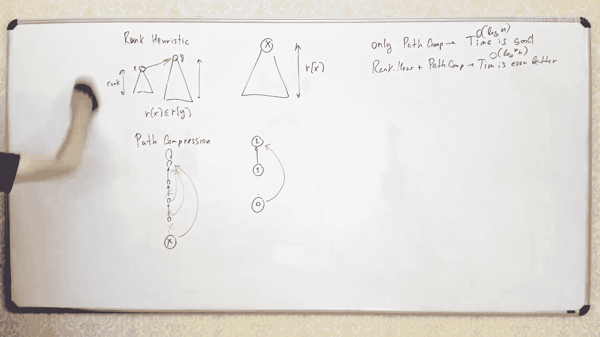

啊。First， I will calculate only the total dimension， what happens you have some。

 you have n elements and you apply you have n elements。And you apply m operations。

 but the number of union operations always n minus1 yeah。And minus1 unions。

So the number of union portion is always the same there are some n elements every time you combine two elements。

 the number of sets is decreased by1， so you cannot have more than n minus1 union portions。

But the number of fine operations may be different and we will add another variable to see have M fine operations。

反一词。And our time complexity formula will depend on two variables。

 so we have first variable is the number of elements and another variable is the number of fines。

Here in this。To basically we have only L here end here and here。That's kind of boring， yeah。

 because the true power of this data is that the time complexity is decreasing when you make more operations。

 like more operations you make。The last time complexity is offered deperation， so if you apply like。

If you have a small number of elements and youll play many， many fine operations。

Then because each time after the final operation， you kind of make this tree better and better。

 then the time complexity is decreasing when you increase the number of operations。

So I will make the time complexity， I will prove， which is some function of n and M。

 which is decreasing when M is increasing so when M grows。The damp will be decreasing。哦。

No I will explain what does the make of my function。見て見て。です思たい。We all do everything No。

 I will explain other thing。That's the point of this lecture。Let's go。So。First。

I will calculate only total time of all fines。单 off all。Fs。This is the only thing I will talk to it。

Wh is the one thing， because unions are simple， you have only n minus1 in unions。

And time complexity of union is constant。 have you need to make two fine， and then you make one。

 So so union unions are simple。If you optimize the fines， you will have the first union。啊。

And I will calculatecolate only the total time， not the time of every single operation because I try to calculate the amortized time。

Then these are are these same complexities。So when I need to calculate amortized time complexity。

 I will calculate the total time， then divided by m。十以q一直都好低。Then divided by M， we will have market1。

Well yes， you can include all these unions and fines yet。

 you may think of M as the sum of all unions and all fines like total number of operations。Yes。

 and for simplicity and for for simplicity， I will think that。M is。At least N。

ButBecause if you have less than n operations， it's kind of strange。

 there are some elements which you didn't access at any time， you may just remove the elements。

And it is atmost than Square。And because if you have more than N corporations。

 then after each union you get more than n fines， it's kind of strange。

Oh if you get if you call find from the same node twice。

 the second call will work in constant time because you already make this link from here to here。

 so if you between two unions， make two find of the same x so you have this union then you have find。

Of x， then another find of x and then another union。

This second unique find will obviously works in constant time because you just during this find。

 you make this thing from here to here， so this fine focus in constant time。

So if M is more than n squared， it's also not interesting。啊。So I will assume this。

Just for simplicity of the proof， because at some point I will try to take a logorative of M by n。

And I want this algorithm to be positive because it's kind of strange to have negative time complexity that's all。

嗯。So that's only to make this proof a little bit simpler。

 just to avoid all the coordinate cases and so on。It's not that important that this data structure works even if M is less than m or if it is great as an n squared。

 it still works。啊，哼哼哼。😊，那。좀 뛰 뛰죠。The easiest way to calculate this total time of all fine operations is to think about it as a whole。

 let's first make all the union operations yeah so let's start with we start with single nodes and then perform all the union operations one by one so in then we'll have some big three of all elements。

冇。哦。

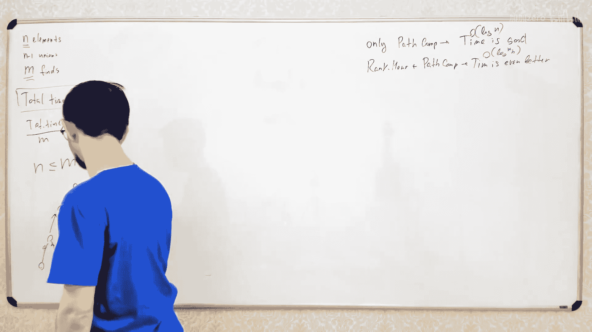

So let's first make all the unions we need to make。Just for analysis again， the algorithm is simple。

Now I'm talking about the analysis， you don't do this in your code it's only for analysis so let's think about how data is actually like this if we first make all the unions we need to make。

Let's walk on this tree。Let's apply all the ranks so we build this three and find the ranks of our okay rank0。

 rank 1，0，2，0，1，0，2。

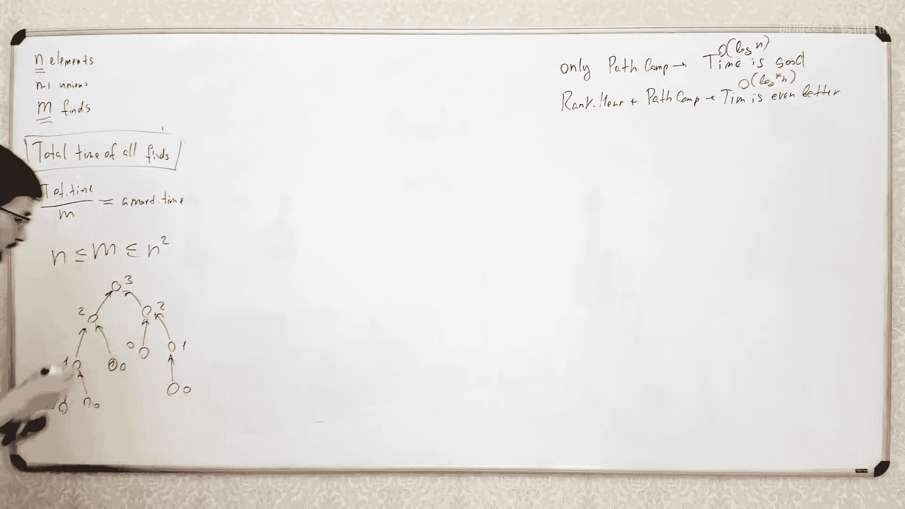

So let's build this tree， again this tree is the tree which is we have in the end of the data structure。

 so we start from single nodes， we make all the unions in the end we have this tree。Now。

 what happens when we make fine des and so at some point we will make some fine des？

So wait to just take this robot and call the find operation。What happens when we call finite a？

We follow the path to the root， but not to the root of this final tree， but to the root of the tree。

 which was when we have this final version。When we call this fine de， we don't have this final tree。

 we have some part of this tree， so we start from these vertex x and follow the path to the vertex which was the root of the tree when we call this fine de。

Great。嗯哼。😊，Oh yeah， go going and think about like， this is like here。嗯。

Like this is the sketch of the final three。So this is the sketch of the final tree。

 you perform some operations， you put from some fines and some unions。

 so at some point you make some。You might like you enough base to ver。Then you face about system is。

Then let's say this union yeah， we to start from what。From this room， this room。Oh。

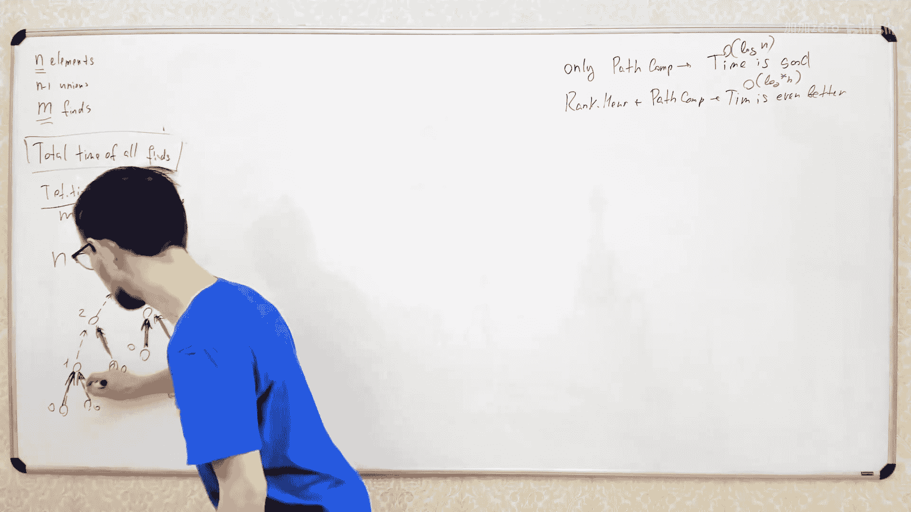

So these bold edges are defined as the current state of your data structure， right？给 this。

That may be little bit more complicated lecture。I hope hope you are fine。

 So well we call this fine de， we have this state of data structure。

 So these bold edges are the edges which are really in your data structure and these dash edges are the edges with which we will add later。

😊，Well。So what happens when we call fine operation from some node？We follow the path to the verex。

 which is now the root of this tree。嗯。And apply the pathth compression， so well follow this pathth。

And apply the pet compression。做会。Change this links to here。Yes's we're going at。So， again。

 how do you call file operation？Find the bridge like this orotic steps， we have some。AReal ages。

And some will have some more。And here's some dash edge， no。So when we call find from here。

 we follow the path。Until we first dash edge。And then apply path compression。

Change all these edge to here。It order here。おさきですた。哦。嗯。Cool，'s that's basically all we need。

Now to calculate the total time of all fines。We need to calculate the total length of all pairs which we travel when we multiple file versions。

 so when we make finite the plane operation， we travel with this path。そう。This Bethth。

The length of its bed is added third time complexity here。嗯。Let's see。So they'll the。

So you need to add the length of this path to your total time complexity。Right。来唱歌了。

And this is what we try to calculate， we try to calculate the total time of all fine operationss。

The time of fine operations is the length of the breathth。

 we travel when we start from vertex x and and in some vertex。

 which was the current root of the tree which contains element x。So we start from vert x。

 travel some edges。To the root and then apply pa compression and this length is added to the time complexity。

Oh。That's all the preparations。Now we'll actually calculate them computing system。그거。Again。

Stick here little bit more， so how will calculate this time complexity。

 we need to calculate the total lengths of all paths。So instead of doing this。

We will calculate this sum as following， we take vectors x。This is parent of effects。And。😊。

For each this edge， we will calculate the total total number of pers。Which include this edge。Yeah。

So for each H， we will calculate the total number of times we travel through this edge。

Actually for each x。It little dislike like this？We will calculate， we'll take each vert x。

And calculate the total number of PEs， which go through the cerx test。そ感そ服了。For this vers。

 we calculate call how many times。We travel through vertex x when we perform some fine operation。

 sorry we have this vertex x at some point we perform some fine operation from here。And go some here。

Will we follow this path？We walk through this edge， right。

So Google just for this age will increase time complexity by one so here time complexity will be increased by one。

 right？So we will calculate for each vertex x the number of times we travel through this H when we perform some fine de。

That nose。That's exactly what we'll Google it right now。Got it。Okay。Hope it's clear now。Noで是か。Now。

The call great tank complexity， we do the following。なずこ？First， we'll pick the value。

 so we'll pick value B。And values that。Vue G will be equal to m over n。

 and the value Z will be equal to。Loarithm n square over m divided by logarithm m over M。啊。へ。😊，Okay。

 now now things got a little bit。Acccord by now， but that that's。That's fine。There is。

I can just pick two values and then make all the calculations， then pick a list of values in the end。

 but it's easier to think about this like they got from some magic。

So let's pick these two magic values。Yeah。So these two values are pe to make the final time complexity good。

😡，I just know what what that final will be， so I know how to pick this values。

But you can make all the same calculations and then pick these two values to find the optimal time complexity in the end。

 but I know what this time complexity will be so I will pick this value before okay。

And now we' will do the following。Let's write the following sequences。 Let's find。 Let's see。

Let's do it like this。bit like this。人。Now， let's speak the following sequences。

Let's have the sequences0。 It will be 0，1，2，3， and so on。브렌트 심부？Sequence1。Will be be。

But zero so start from from zero。Z， b2 B，3 B， then so。Ts2 will be 0。

 b square2 b square3 B square and so on， and so on so。The sequence number J。

We'll be the home start from zero， then see B in power J， then 2 B power J，3 B power J and so on。

Yeah， so so we make。I will make that such。Sequences。Okay。It looks like magic for now， but it's fine。

I will explain everything just in a minute， so the final sequence will be zero B power Z。

2 B power set，3 B， power set， and so。如と。Now， let's look on some。H， so let's have vers。X。And。

We have the H to its parent expression y is the parent of x。How would did Tahan come to this。

 I have no idea。This all it looks like is a simple magic crowd。嗯。

That's cool because the code is very simple， but the proof is like magic。Now。

 let's look on this edge。 Let's assign classes to all edges。 So let's say for this edge。

 have some class equal to KO， so let's say。Okay， let's say edge。X， Y， have class。Okay。酷。

If the following is if。Let's look on ranks of x and Y。So these two nodes have some ranks。

Let's say that this edge belong to class k if this ranks。

Both can be fit between two consecutive valuess。Of the。Of the case sequence。

So we take sequence let's say G。Let's， let's save some some letters for future。 So if we have。

Let's look on this。Sequence number J。If we can fit a ranks of these two vertices。

Between two consecutive valuesius of this sequence。

We will say that the rank of this edge equals to J。So this minimum g。お。

Such that these two ranks may be fit between these two， and let's see。So let's see。

So the scale multiplied by B power J is less or equal than rank of。X less than rank cooked Y。

Less or equal than K plus one biology。What happens if these numbers are not integers that's a good question I think you need to round them now I told you I will avoid all the details if you if you want to review your you I think you need to round this values down Also I don't want this B to be equal to one because it's kind of strange so I maybe want to have。

So in the real world， I think you need to have something like this。嗯。So。

Maybe you need something like this。To avoid all the coordinate pieces。

 when M is too small and this number is close to one。

So I think it's better to have something like this in the in the real you can read it real paper let's check。

Let's check what beast you have here。不不不不부부부부부不不不。嗯，也志中。走这 two two two中。嗯。어 느 들든 느 좀。嗯。

when do you introduce the be。呃。I missed the department。 the bees introduced。뿜뿌라이 또뽕뽀 뽀뽕뽀뽕。

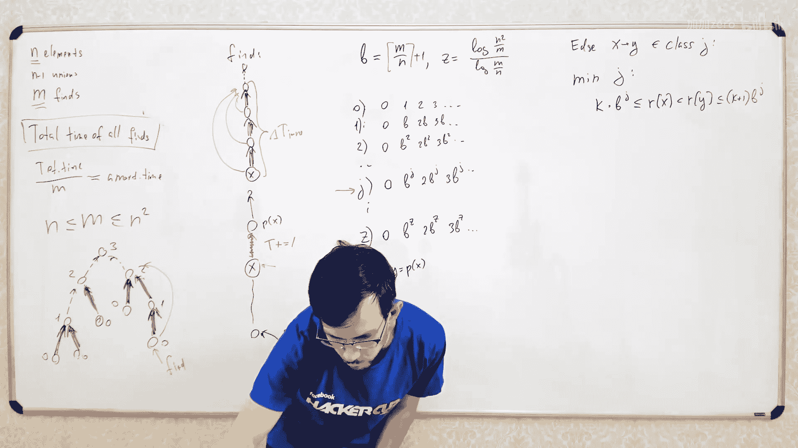

嗯。That's very lazy， yeah。That's not lecture which was prepared like a few years ago。

So I will sometimes consult the paper。Why I missed this book？

I think it should be something like that。Again， this corner case are not as important。

 so if M is small， it's obviously burden。It's not that important。

But if you want to have a good paper， you need to avoid our station because。No， I just missed this。

你为支 true。그 저지지 해야지。So when do you introduce be。嗯嗯。爱了咯。At some point， it should be variable being。Pュ。

Sorry， I can't find it。응 응 응 흐 응 응 응 응 응。Fixed later， okay， later， okay， let's check later。Okay。

 they do like like I discuss in the first place， so they first make all the calculations for some integers B and Z。

 and then in the end they pick the correct values of B and Z。啊啊啊。But where is it？

So at some point you need to pick is it？哦。Yeah， I was， I was close enough。So they。

They pick it like these。不。Yeah。Yeah， and here we make a maximum of this and one。

Surrounded up very not。Like this。So you need to make someあ correctれ。

Ts when you want to your formulas work for small values as well。

I will just avoid all stuff like this just for simplicity because this is。

 I try to simplify this proof as much as possible， okay？So in the real paper。

 you need to do something like that to avoid all these corner cases。Okay， let's go back。

Let's go back。嗯。No。Healed。啊。This is how we assign the classes to all ages。So again。

 you take some edge， you find the ranks of these two nodes。

And you find the smallest J such that these two ranks may be between two consecutive relative of this sequence。

the easiest way to think about it is like the following。Well， let's say， for example。

Let's say be equal to。For example， so case you have。Numbers 1，0，1，2，3。4，5，6，7，8。This' for。

 seconds number 0。Then next you will have sequence。1，2，4，6，8。Then you have sequence 1，4，8。

 then you have sequence 1，8 and so on。嗯哼。😊，So it's not selected。And now you have some H。

This edge have two ros， you find the ranks of these verse and find the smallest number such that these two ranks can be fit between of。

So this is rank of x， this is rank of y。So you need both these ranks to fit between these two consecutive values。

And if you can see that here， then。This is。Gloss。off。Is it clear by now？Again， what's going on。

 we take some edge。Calculate these two ranks。You may think about these ranks as the segment on the line。

 so if you have this line。没说别。This is the excess of all possible ranks you have rank of x and rank of y you find the smallest layer such that this segment is between these two partitions so you make you have partition here partition here they split all all the numbers line into some segments so you need both these。

At to be in the same segment。嗯哼。😊，If we go far enough in a single sequence of the this sequence because 2。

 we won't be able to fit around between this。P。I don't get it if we go far enough in single sequence。

 let's say sequence of cost1。你关咗挂度。won't be able to fit in between that sequence。

 let's say we go tilll B in terms that cluster of2 bes the number。嗯。Don掉。Ohいいやい。For some ages。

 we cant assign classes like this if the spread between x and y is too big。

 it may be not possible to find the correct sequence J。啊。出出出冲。This J should be from zero to Z。

So we want to find one。One of these sequences。It is possible that the difference between these two ranks is too big。

 so we cannot fit both these ranks inside one of these sequences。It's possible。

 so if there is no such J， we will assign the class equal to2 z plus one。は。sort衣服 this。嗯。

If there is no such。J， that class。Will be equal to Z plus one。

So we will add all these big edges into one separate cloth。嗯哼。😊，Yeah。嗯。You， so。We take each vertex。

 look on this edge。And try to assign some class how we assign the class to this edge。

 we look on these two ranks and try to find the first sequence such that we can put all both these ranks between these two partitions if we put them interprets and we find the smallest such class then we assign this class if we can put these two ranks between two partitions in all these Z sequences then we say that the class equal to that plus one so we will put all there are some。

There may be some really big。So this is certainco x。 This is rank y。If the segment is too big。

 we can put it anywhere， so we just assign plus the qua one。や。那种。That's all。这。

Now let's calculate the1 of。あかきた。So what happens when we make pine production？So， here's X we。

Call the find operation from this X。So we'll follow this path。嗯。To some current route。

Let's look on the classes of these edges， so all these edges have some classes。

Well let's say class 2，3，1，3，2，4。Is it possible to have such？No idea。 Maybe it's possible。second没。No。

 no， no， no， no， the difference of the strengths may be more than one。

The rank of y is always greater than the rank of x。So rank of y is always greater than rank of fed。

 that's true。But the difference is not always one。Rnk is not changing at ranks are always the same。

Rannks of all vertices， we pick the ranks when we build the final tree。

 so we make all the union operationss then pick the ranks of all vertices。

 we will never change the ranks of the vertices。So everybodys have some fixed rent。조 조 저冲冲。

두뚜 돌뚜 돌뚜 도。Okay。So these ranks are fixed。We will never change the rank of the Los。

 assign the ranks when we build this final tree， so we build the final tree after all the union operations and then assign the ranks and we never change the ranks of the Los。

Okay。Now we're assigned these classes。Let's look on the classes of the edges， so we start from here。

 go to the root and look on these classes。First。Let's take their last edge from each class。

For example， we have here， let's look all edges of class one， so we have one edge from class one。

Let's take these。From class2 we have here and here so let's take please。From class free work。

 I please send list the take。嗯。さてだ。To make it more interesting。

So these edges are the last edges from their class。Okay。is never changing class may be changed。

Class will change a rank will never change yeah。Okay get let's go back。

 so the rank of the vertex is fixed， right？The class of the edge will change its。

After we apply some fine operationss。Because we make some PE compressions， so parent is changing。

 so fortics X。The vertex y is changing because we are linked to different parent。

 so vertex this parent of x will change， so the class of x will be changed but the ramps are always the same。

嗯嗯ふう。I did not use any property of the ranks by now， the only property of the ranks I use is this。😡。

That the rank of the parent is greater than the rank of the child。

That's the only property I use right now。嗯哼。So let's go here。Again， I want to calculate for each age。

 the number of times I go through this age during the finite predictions。

So let's look first on the last edge from each class。Let's calculate these edges first。

How many edges。啊。On this path are the last edges from the corresponding class。3。itration after what。

 when we call fine operation， will change the longer temperature to。어去 어。Okay，で。哦。啊。

We assign ranks based on the tree without any PEth compressions right so we make all the unions。

 then assign these ranks。嗯哼m。😊，그가。So when were assign the shs， we used this not compressed string。

And then we fixed all these strengths and we will not change them in this proof。Again。

 this all is just for the proof， yeah， that's not how you're supposed to implement your algorithm。

 it's basically just to prove that algorithm moves works fast。

You don't need these classes in your out don' you need these strengths if you want to have soistic。

 but。This proof is not used around characteristics。

 this proof is only compression actually so you don't need ranks in your algorithm。

 you don't need classes， this only for the proof of quantum complexity。啊。

What about fine functions in this union。어케お願しま。Hope it's good。

I don't know how to explain it more carefully so again what happens you build this final tree after all the union operationss if you make union operationss without any puff compression。

Again， this all is about analysis this not how you're supposed to make algorithm。

 so if you make all the unions involved of compression， youll have some tree in then。

So in this final tree， without any path compression， you assign these ranks。

And now we look what will go on in this node compressory after we applied PE compressions。

So when we call fine operationss from here， we follow this path and then apply path compression。

And now we will look what's going on when we apply Per compression。呀仓库中。Okay。Okay， hope it's more。

So let's go back again， we call find operation from this x， we follow this path。

And then apply puff compression so to calculate the time complexity。

 we need to calculate the length of this path and to calculate some of all these lengths。So first。

 let's calculate the sum of all final edges。From each class， so for each class。

 we take the last edge from this class。Like we have this is the only h from x1 for class 2。

 we have this and this， so this is the final for class 3 we have this。

 this and B so this is the last edge from this class， so we take only the last edge from this class。

Now let's go the sum only from these edges， so how many edges。

In this pair at the last edge from the corresponding class。 No， it's easy to see that there。

We have Z plus one classes。有。So we have at most z plus one final edges。

So we have at most Z plus one final edges。NoWhat's lost here。 lost here。嗯。嗯。And。Yes at this。Right。😊。

So let's add all this edge all these last edges to the final time complexity here so we have。嗯。

Finine operations for each operation， we have the final edges， last edges。So， we have。呃，你多도。그。どど我fi啊。

诶，食天王。Equal2 a multiplied by z plus one。中款。So this is the first thing we will add to the total time nu。

So for the total time complexity， first roll deploy all these。Last edges from tolaosis。This， this。

 this， this number。Now， let's go co lot of us。So if let's take some edge from not the last class。

Let's have someage。So we have some H from class J。And it is not the last edge from this class。

 so at some point we have another edge from class J。And here we have abouts X。

Here we have those white。So this edge from x to y belongs to class J。

And this this is not the last edge from this class。

 so we have this edge from class J and here another edge from class J。Now。

 what happens when we apply path compression？We will link this x to some vertex here。Here。有1个。

Which is above this verex here。 let's let's call some so let's call this vertex so' say you。

Its the V。This will be。Let's see white bread。So x was connected to vertex y。

 and this edge was in class j。And this was not the last edge from this class。

 so here we have another edge from the same class。So after we apply path compression。

 this X will be linked directly to this。Vorts my prior， right？嗯哼。酷。

Now let's look what happens with the class of this age。哎，没个 let's stop here。But listen。

 what happens to the classes of the edges if you？If you have this vertex x。

 it was connected to vertex y， and after pathth compression， it is connected to some vertex y prime。

Wow， your Russian is much better。Each week。Your Russian is better and better。嗯。O。So。

If we have this edge and after path compression， we have this edge。

 what happens to the class of this edge， Let's compare the class of this edge and class of this edge。

 Will the class be increased， decreased or stay the same， What do you think。

how will the classes change in the time sorry？哼ん。The answerra it may increase or it may stay the same。

 but it will never decrease because。Here。No， it may never decrease because the rank of y prime。Here。

 the rank of y prime is always greater than the rank of y。嗯哼。😊。

So first you have segment like this and now you have segment like this。や。我。

So the segment becomes longer and longer。So if the left border is the same and right border is to the right。

 then the class will be only increasing。嗯哼。But if may stay the same。有。

You might have something like this to your cr。You have。Rnk of y here and rank of y is prime here。

So first you have this segment and now you have this segment。So it belongs to the same class。

It also is also possible， so when you make this fifth compression。

 this rank this class may be increased or may stay the same。Okay。嗯。那。

Let's see what happens when it stays the same。So we have some energy。And。Here we have。

This so this is x， this is y。This is a rank of x， this is a rank of y。😡，For simplicity。

 I will avoid this this this R this is rank of x， this is rank of y。

 and this segment belongs to this layer have。Something here or something here so here。Well。

 these are two consecutive numbers in this sequence。Good， 오셨。

Simplify this picture as much as possible。啊。😀呵嘿嘿。😊，てかど。😊，Okay。

That's very strange timing to read me in parting。O。It's not very beginning for the lecture， sorry。

And it's the middle of the lecture。So now what's going on， we have this h from x to y。

Yeah this edge belongs to class J， it means that in the sequence J。

 this x and y are between two consecutive valuess， so we have this sequence J and we have two consecutive valuess here and this x and y are between these two consecutive valuess。

Now， if it is not the last edge from the same cross， then we have another edge from the same class。

 this edge UVv。So we have another H。又得行了。And then。Above this vertex v。

 we have this new vertex y prime。So after we make this path compression。

 we connect this x directly to this y prime so we have。Yeah。M哼。😊，Again， this is what happened。

When you make path compression。We never change the ranks， ranks are always fixed。No no no no no no。

 ranks are always the same we change we change the classes。

 the class will change with when we go from here to here the class will be increased。

 ranks are always the same。嗯哼。응  응。嗯哼。嗯。No， let's see。

So the rank the class of this edge may stay the same so if we have this edge and this edge then we have now we have this edge so the class of this edge is the same but it may not happen very long time because let's see if this edge belongs to class J it means it is not belong to class j minus1 minus let's look on j minus1 so we assign class J to this edge xy。

 it means we cannot put them between two consecutive valuesius in j minus1 sequence it means that in sequence j minus1 these two ranks。

Belong to different segments， right， So we have some partition here。

 So we have the same partition here with that symmetry。

 but we also have some sum of elements of sequence J -1 is between x and y。 So it's somewhere here。

嗯哼。And the same for this edge UVv， it also belongs to class J。

 it means that we cannot put it in class J minus1， it means that in class J minus1。

 there is some partition between。Your enemy。嗯哼。So in the previous sequence。

 these two ranks are not in one segment and these two objects are not in one segment。

 so there is some element of the previous sequence between x and y。

 and there is some element between y and U and V。So there is some element here and some element E here。

 so after we make this path compression， we connect this x directly to this white prime。

 so now we have at least two elements in the previous sequence。

So now we have two elements of sequence J minus1 between x and y。

So after you make marked compression， the number of elements of previous sequence between x and y is increased。

Let's write this here。So when we go from here to here， number bare of elements。Of sequence。

The sequence。J minus-1 between。X and Y。He is increasing。W。Okay。That's the most complicated part。

Again， what happens we have this edge， we have this edge， and we connect this create to this。

Both these edges belong to class J if they belong to class J， j is the minimum s。

J is the minimum sequence we can put between two consecutivequis。So we cant put this。😡。

X and y between two values on the previous sequence， sorry in the previous sequence。

 if you look on x and y， they will be divided by some element of sequence J minus1。

And the same for thesees， for these thees in sequence J minus1。

 there is some element which divides them。So after we make this path compression。

 we connect this x to this y prime， and now there are two elements of the previous sequence between x and y。

And so on， after each each time we go through through this edge and apply the pet compression。

 the number of。Of these elements of the previous sequence will be increased between x and1 so we have x。

 we have one here we have one element， here we have two elements。And so on。

 each time we apply the PE compression， the number of elements will be increased。

And the number of elements here。Here is B minus4。Aみ goes。For each next sequence。

 we have the previous sequence with step equal to B sorry， I' here。

Here we have the same elements as here， but we're typical to be。

 so we take first element then we have。Be element and so on。Oh again。

Heres the element K multiplied by B power J， this is K plus1。Be power play， and。

So this element is K B。B power J -1， and this is K plus1。B。Multiplied by J beaman power， Jman swan。ね。

How you your alive？That stuff is a little bit a little bit complicated， a little bit complicated。

 so yeah， let's work on this in the sequence chain this。

Two elements are between k multiplied by B powerj and K plus sum by B power J just by definition here。

So if you look on the previous sequence。嗯哼。嗯哼。You have the same values here because this is divisible by being power to J minus1 and this is divisible by being power J minus1。

You also have these two elements， each new sequence is sub of previous sequence。Right。嘿。😊。

I just give you some time to talk what's going on。So you have the same elements。

You take some elements from previousview sequence and get only them。嗯哼。

So in the previous sequence between these two elements， there were another b minus1 elements。

Because you take each element with step to B you take this element and this element。

 but you didn't take these elements。So here we have another b minus1 elements。

Between these two elements。어。that's basically all。 So here each time。

You increase the number of elements between x and y。

And there may be at most b minus1 elements between x and y。

So if you each time you increase this number， you may do it at most。比た。はい。到。嗯。Yeah。

 this is subsequent of this。Again。我在去弄。What's wrong？Yes， each sequence is sub of previous sequence。

Here I take all the numbers divisible by B in power2。

 next will be all numbers divisible by B in power free。응 응 응 응 응。Okay。What。

You have some strange sequences。Again， well let's move here。脱衣服。You b equal to2。

So zero subs will be zero or。0，1，2，3，4，5，6，7，8。1 will be1，2，4，4，1，4，6，8。They are the world and so on。

And you've been on for812，16，2024 and so on。Each next sequence is a sub of tris。

 so here you take these elements。嗯。Here you take on only these elements。要送送。

So each time you pick every second element from the previous sequence and get the new sequence。Okay。

嗯哼。So if you look on two consecutive elements of some sequence and find them in the previous sequence。

There will be another d minus1 elements between them right here。

 if you take two elements like four and8 here， if you take these two consecutive elements。

And find them in the video sequence。There will be one element between them。嗯。😊。

You have some strange sequence。There is no powers of。How do you get this？Now。

 each sequence is as simple at medical progression。嗯。

But the step of progression equals to being in power。😡，嗯。Yeah，きるす。Okay。そう。Again。

If you take two consecutive values and find them in the previous sequence。

There will be b minus1 ratio between them。And every time you apply the pathth compression。

 the number of elements is increasing， so you may apply path compression for this age at most B times。

After you apply at B times that。Adge from X will be moved to the next class。

So if you have this edge in class J and you apply be。

Weth compression to this age at at least B times。Then the number of these values between x and y will be more than b。

 it means that you cannot't fit this edge in between these two values。

 so the class of this edge will be increased。走。哼。ho。

So let's calculate the total time we do all these。So we have anortices。For each reals。We make。

B5 compressions。And then this edge is moved to the next class。

We can move the edge to the next class at most that times， sewing it and B and then multiply with it。

Oh。Right？So again， we again， we have standardtices for each vertx。We have this edge。

 we apply b times， apply per compression， and then the class of this edge is increased。

They are at most Z classes so we can increase class at most Z times。

So we apply puff compression B times， move to the next class， apply puff compression B times。

 move to the next class。Total number of operations will be n multiplied by demos by present。 true。

Okay， this is complicated lecture， it's okay if you don't understand some details。

there the goal is to make some just some impression of of the proof。

 you can revoach the lecture later。こ。finally， good question， good。The only problem is。

This all is true well we have not the final class we have the fixed number of classes。

 we have these normal classes and then the click class Z plus one。

 which is kind of different Yeah so we have these Z classes so this is true for all classes so these are last edges。

Okay。These are not mask。Of form classes。shape and now we need to calculate the non last ages for class Z plus one。

有。Let's calculate so if we have。我 to算 plus was。And it is not the last edge on this cluster。

 so we have edge on class z plus1 and another edge on class Z plus one。What happens to this class。

 exactly the same thing for this age， when we apply compression。

 the number of elements in sequence that。Will be increased。If it has close it+ one。

 we'll have the same。So they are in class Z plus one is close set。

So if this edge x Y is en class z plus 1， it means we cannot feed it in close Z。

 so in class z there is some value between x and y and also between U and B。

 so after we apply by compression there will be two values in sequence z between x and y。

So let's try to calculate the total number of elements in sequence that。

So let's look consequence sequence that we have these values。

These values are different ranks right so we need only values which may be a rank of some birds。

 so we need only values。At most， M。Com。So let's look on this final sequence。

And let's find all the values which are at most。そっか？Yeah。Because rank is at most n。这 two冲。Yeah。走。

We need to feed some of these values between rank of x and rank of y rank of y is at most end。

So let's find the number of elements in the last sequence， which are no Mom M。弄为7行。여 저쩌 저 저쩌죠 에스。

It钱没。Right。B。嗯。When we plan pair compression B times， what happens to the actually？

In a single particular what we reach at the route directly， we may reach the route directly。

 why not am which。Yeah we walk not to the real route of the three。

 but to the current road we work until we reach some dash edge。Here you have some future edge。

So we walked through it here and then apply back compression。日日。It's okay。

 this's really complicated this stuff。That's why it's not in the main course。Okay。Now。

 let's calculate the total number of non final edges from class z was 1 for class z was 1 each time if it is not final H where apply by compression。

 the number of elements from sequence Z is increasing total number of elements in sequence Z is at most this。

送。嗯。CepD free。For each ver。When it is in class that plus one， we can make at most this many。Right。

等时啊。Looks fine。Most of these mania。Apppers。Right。他数便不数面。So these are not must。呼。That's all。

So the total time complexity team will be combined of three parts， first part。

 the last edges from each class， we have that many edges。

 then we have non last edges from all classes except the final class。

 we have this number of edges and this is the number of last edges from plus the plus one。

Now we just take some of all these values and get the final complexity。嗯。不么子工？

So the final time complexity will be。T1 plus T2 plus T3。Well， let's see， so it is。And that。Plus M。

Plus。And multiplyied by B， b equals to this。And z equals to these。嗯。Okay。And plus these at the end。

그 저。Looks fine， okay， so it is n squared。Divided by。Am over。好好玩。Blog m m。It looks kind of of trying。

Is it free？Whats这个。Okay， let's do it。嗯。Oh， this is also said， this is from。So， we can。Change this。

Yeah， so we have MZ plus MZ。This it。So this is MZ Poel。Well。

 I can I can skip this M because I need onlyympotics right， so this is MZ this is MZ so this is。

And it。嗯。Plus of this。What happens to this？This is MZ， M， this is MZ。系。So' just keep all this。嗯。

Now to hear what happens to here？啊。So I need to M divided by M in power。So what it will be。

I am not go to mathematics。Okay。Let's see I have and power this。嗯，哼哼。呃忘 over remember。

Okay别 to you right。So here， if you take M over n。Power one or log M over N， you will have to， right？

So you take M over M。And take it into the power1 divided by log m over M。So this part。

It's actually two。And now you have two in the power log of n squared over m。

So I have two in power log square of n。 you have n squared over n， so this hole is n squared over n。

 right？Right and now you divide n squared by this and you have map。やぱい。吐。So again。

 this is big O of M multi by Z。Okay this is the final time complexity is this。啊。Yes。Let's song。Okay。

This is the final time complexity of the。Of the path compression without tra。

 so if you just apply path compression。Without without re。You will have this time complexity。呼。

Are you alive？😀へへへ。😊，Okay， let's。Let's look in this just a little。

 so what does it mean it means again， it's a function of n and M。

LetLet's have some corner pieces so what happens if。No， no， the next part will be much easier。

 we'll do the same but with aman function。The idea of the next half will be the same well just everything the same。

 but it a function， it It's not the middle of the lecture。 it's more like。

Free free force of election。 That's good。 May good。啊。So let's go here， so if you don't apply rank。

 you just make unions in any way and you make on the path compression。

This will be a total 10 complexity。Let's see。 for example， what happens if。

Let's say if M is about equal to M。So what will happen here you have some constant。And here you have。

loggan， yeah。So if M is about n， the time complexity is loggan。嗯。If m is about10 squared。

And then what will happen here we have some constant， here we have some constants。

So tank complexity will be constant。What does mean it means if you have a lot of queries of fine queries to your union find data structure。

 even if you don't make any heur， you make only path compression。

Then if the number of your fine operations is at least n squared。

 then time complexity of each fine operation will be constant。That's what I was talking before。

 like if you make more many operations with the structure it became faster， faster and faster。

 so if you make small number of operations， time per will be again， if you make many operations。

 time per will be constant。If you make something in between， tank next will be something in between。

Okay， you're ready for a month。ho。Okay。Let's take the final step。Now we'll do everything the same。

 We'll do everything the same， but for the balance stream， if we apply。

Aran characteristicss and path compression。啊。I need to really everything because。

If you have any questions， ask them now。H。Okay， let's go。送。응 응 응。

That's why we have some slight only you don't want this gene to be equal to to0 and right。

 so if M equal to n， then here you have log of one， you have zero， it's kind of strange here。

So you need to have something like that yes， so you need this constants to avoid the situations。

こうマずか。ho。Yes， if m is about n square， you also have some zeros， you need to adjust some constants to。

To avoid all these corner cases， yeah。Okay。Now we will do all the， all the same things。

But these aret characteristics。So when you apply anchor， you have some balance tree。

And the only property we need about balance tree is the oil。Let's look on the balance tree。

 let's look on the ranks。衣 we looking空。Viテクス。衣服的。Ratic of x equal to k。唔睇啊。

The number of purposes here。E at least。Go about working？嗯哼。And it means that in three。

 there are no more。With an M over 2 in power of k。Rope pieces。Africa。

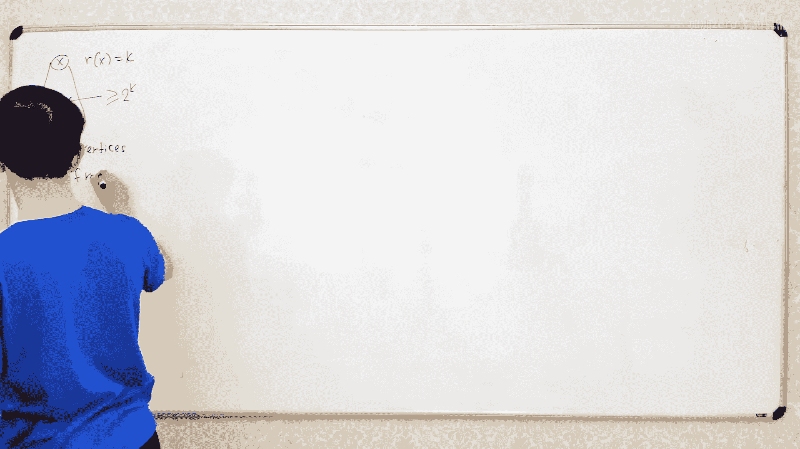

That's the only property we need from the balanceness strategy， so if you apply rank characteristics。

 the tree will be balanced。嗯。And if it will be balanced， you will have this property。嗯。

It's quite for Bruce。I think we discussed this when we talked about。啊。Okay。

 so that's the one thing we need about。😡，Evenvan characteristics。Now let's go。

We will do all the same tricks。But we will use different sequences。So in previous proof。

 we use only simple sequences， so each sequence with some arithmetic progression here we'll use some more complicated sequences。

Let's see。So there are different ways to introduce a command function。

 I will use the same way as in the paper I suggest you to read。So let's address something like this。

Let's5。Let's sequence0。Sequence zero will be like this you have。Integers，0，2， four，6，8。

the weather 그랬어。Very simple sequence。No。Now， every next sequence will start with zero and2。

ゼ 또 zero 또 zero 또 zero 또。And now strange now to fill all this part。

We will use the following return for。嗯。哇。J will be equal to a。I minus what。All。제 많이어。

Now we will use this formula to feel all the values in these sequences， so for example。

 in this sequence。What value should we put here， We take。That this is。The value to the left。

 so we take this value。And go to the previous sequence。And find the element with this index。

 so we go to this value， use it as an index。And find the element of this index in the previous sequence。

These are answers。嗯哼。Very simple for now， so we take this number find in the previous sequence the element of this index。

 so it will be index2， so it's4。And put this for here。嗯。

Here we take four find this sequence element F 4。And both。Okay， we take this eight。

 find the element of index 8。 It will be 16。This comes from this is standard definition of Raman function。

Next clip。That's how how the acroman functions by it。 There are a little bit variance。

 but basically this is how the acroman functions by Acroman function is。

I'm not sure where it was reduced first。It has some fundamental properties。

 so it is some kind of fundamental function in mathematics。So I a shoe。

Where exactly it was Str first， but。This is not a malfunction。Yeah。

 that's exactly like dynamic programming。But we don't need to calculate these values。

 we just need to write them for this analysis。So the first sequence is just arithmetic progression。

The second sequence is powers of two。So we have powers of2 have 16 here we have 32 here we have 64 and so。

What happened to the next sequence here again， we take this number two， go in the previous sequence。

 take element of index 2， it will be formed， actually all elements here will be formed。啊。Now。

 here we take number 4。Take the fourth element in the sequence， it will be 16。6。

Now we need to take 16th number in this sequence。So 16th number。

 so this sequence contains powers of two， so this will be two in power of 16。

And here we need to take in this sequence the element with index equal to 2 in power 16。

 so this element will be2 in power of 2 in power 16 like this。SoAnd so on。

 so here will be two in power of two in power of 2 down 16 and so on。So again。

 this sequence grows very slowly， this sequence grows exponentially and this sequence grows very fast。

What happens in in the next sequence， or it grows very fast Now here for this value。

 you need to take。Fourth value from here so it will be 2 in a power of 16 and here you need to take a value from here with index 2 and a power of 16。

 so you need to take like the tower of this powers of length equal to 2 and a power 16。

 so it is very big。And in next sequence， even this number is very big。

 so you need to take fourth number from this sequence which just say this number。

 it is already very big， so you will never get this。そあで。

Each next sequence grows much faster than the previous sequence。Well。

 I can publishbolish that in 1926 to 28， okay？O。거잖아。そう。That'错。Now again。

EachEach next sequence is sub of the previous sequence， obviously， right？

 so each element is some sequence of sequence i minus1。

So you take each time you take some elements from the previous sequence。

Now we will apply all the same technique。We will see。嗯哼哼。Well， first we have these sequences，0，2，4。

let's put them closer。We have the zero，2，4，6。😔，112。146 so， here we have0。读书。816 and so。嗯。嗯哼m。😊，So。

 this is sequence zero， this is sequence1， sequence 2， sequence 3， and so on。

And we will write that session。We'll pick some numbers up。And we will write that such sequences。

And that。Will be equal to in reverse second function of format。嗯。

that will be the final time complexity here， spoilers。Okay。

 let's speak first Z sequences from this table。And then we do exactly the same as the previous proof。

We take some edge and assign the class， so we assign class K。So if we can put this text， this is y。

 if we can put x and y between two consecutive values of some sequence of sequence k。

Then we say that this edge have class K。Exactly the same definition as before。嗯哼。😊，That's all。不错我继去看。

Now let's go go everything。So how to go create total time complexity。 Again， we have。Let's hope some。

 we have some。From x。On this part， we have some classes for each class。

 We have some last stage from this class and not last stage。 So let's go create them all。

 So let's get T1。Let's go the last edges from each class。😡，We have Z classes。

So we have that final edges。So will be for each query we have at most the final ages。Yeah。

this is last edge from each class， from each class we take only the last edge。啊。Okay。Now。

 let's go create north plus pages。What happens when you go play front stage again？

You have some plus plus。's you have some edge on class J。嗯。

What happens when it's a plus class you apply with compression， then you have another H， UVv。

 and this Y prime， so you represent you2 here？こし。Just write it here。What So in sequence J。

You have this。X and y。Between these two values。Uh。😊，So this value is a。嗯。Let's， let's make it I。

 So if plus equal to I， So this is I J， and this is a。All right， J plus one。So衣服。

If the class of this age equals to I， it means that these two res are between these two res。Yes。

 if we use rank risk， the rank will be at most organic that's true。

This will reduce but not significantlyly， Yes， we'll adjust this alpha222。Okay。

 let's adjust this off。This alpha will be。Will be the minimum。嗯。I such that。诶。I。

M over N is at least loggan。breath this。He will use the I think it's not。

I think it's not important but。ねこな。With love。Let's go back's not important but this this is interesting so let's go back。

If we have this edge on class I， it means that both these ranks are between these two values。그 형。

And it is not in class i minus1， it means that in class i minus1。

 there is somewhere you between x and y。So when this edge is not the last edge from this class。

 it means there is another edge from the same class。And this is why prime so after path compression。

 we will have this and we will have another value here。Again， like like before， if would have。

Two edges from the same class after apply PE compression， we link this x to this y prime。

 so the number of these values from the previous sequence is increased。Right。

So what is the number of elements？Here。Let's calculate the total number of elements in sequence i minus1 between AIj and AIj plus1。

No， it's quite easy。If you look on this segment of this element， so this element。Is actually a。I。-1。

A， I J。So if you look on this element， it's indexed in the previous sequence。그。E is AIJ。

Let's medit the minute， okay。What I want to do， I want to apply all the same technique as in previous proof。

But for different sequences。How did we make it last time we calculate we have three parts of Al complexity here。

 last edges， not last edges from all class except z plus a， and we have class z plus one， of course。

And class of must found there are all edges， which doesn't fit in these claw。

Noown last stages is from classes up to Z， and we have known last stages from class to Z plus one。

Exactly like like from。啊。そ。2。How complete and complexityplexity we look when we make not when we see when this age is not the last age from the same class from class I。

 then there is another H from the same class， then there is some element E。

 some element here so the number of elements between x and y is increased。

So to calculate total dynamicacy， we need to calculate a total number of elements between these。

we have partition here， we have partition here， we need to have a number of all partitions in the previous layer。

What is this number， this number， I claim this number is at most。AIg。I it clear。Is there。No。

 because of this， because this is how this is exactly how I define this number。This number。

 this number equals to this， so it is element of the previous sequence with this index。哼。嗯哼。😊。

So again， again this AIj is the index of this element in the previous sequence。So actually。

 no AIJ is this number of all elements before this。

 actually it is no number of in this segment is no more than this。嗯。嗯。Okay。

 give give give give you some time。You don't need more strict upper bound that will be enough。

 yeah yeah you may have difference between this and this but this will be enough。

I claim that's good enough upper bond。Yeah， it looks like like it's not strict enough。

 but it actually， it is good enough。Now， let's go。Let's go go ahead。

Let's take all notes in this range， let's take all notes。With ranks between this and this。

What is the total number of nodes between this and this？对。啊。So we plan be at least a I。

And less than 8。I最个诉。What will be the total number of nodes in this segment？No， it will be some。4K。

フロ。AIG。2 aア Jと one。啊。For each rank， let's calculate the maximumim possible number of nodes on this rank。

 it will be up to this。嗯。So it will be no more than this play by n。不问发吧。嗯。And that's no more than。

不管嗯。To n。Our。し。Right。So I have this， I have this geometrical progression。😊，I just。

Change it to an infinite progression and then convert this in infinite progression 2 to M。So2 be2 n。

And just have this。一。嗯。Looks fine。Are you still here？哦。What is these are in the exponent this key。

So I try to find the total number of nodes between these two values。

WithThis ranks between two two words， so it are all possible ranks in this segment。

And for each rent plate the maximum possible number of nodes of this rank。So it's。

Then I make the upper bound， I change this with plus affinity。Have this series。

 convert the series to the 2N and have 2 n divided values。Looks fine。Thank。

So this is the maximum possible total number of nodes in this second。Now。

 for each note in this segment。We may need to make。This number of path compressions。

 so we take all these notess。And apply this number of PE compressions to these notes。手对。都都南不。

So we do the following。 We make some for all I。From zero to Z。嗯。

So we right through all layers for each layer for each class for each class。

 we take all elements in this segment。嗯哼。😊，And apply this number of iterations。So we take of this。

S4 J。From zero to， I don't know something， not important。And for here we iterate all classes。

 iter all segments， for each segment， we take all nodes in this segment。

 it will be to n over to empower AI this many nodes， and for each node。

 we need to make this number of operations。ho。That so now again。

 this sum is just some serious you can this is some constant。Yeah， this is。

No more than some to n multiplied by some。X divided by 2 in power of x。嗯。

This sum is sum of something divided by2 in the power of something。嗯哼。😊。

So I will change this sum with this series and the sum of this series will be because of n。

 don I'm not sure about constant， some constant doesn't matter。嗯，嗯。So issue。Each sum like this。Yes。

Is actually linear。So就大不。Big all of them the M。ふ呵。😊，ふ。Okay， this may look like I mentioned。😊，Okay。

It's actually pretty easy。Well， if you think about it， it its all happens because because of this。

 because the number of。Notes of class K is the post and over tone bar K。

So if you look on number of nodes in some range of friends。

 if you take some range of rent and take the sum of all nodes in this range。

 you will have some sum of geometric operations， so it will be still constant。谢试。

that's all it true So because of this we have here we have this sum of gen corporation。

 so we have linear something linear here and then we take this。

Put it here and again we have some sum of progression so we get some linear something linear here so in the end here we have something linear here we have something linear so for each layer we have something linear sum so total number of non finalal steps in each class will be linear。

え。Here is the fact that the sum of expression over those ING would itect us is lesser than the sum of expression。

一一一一一。So here I have the sum for sum values here and here I shall add all other values x and take sum of all possible x's。

 so this sum is less than this sum。that's all。 That's almost all。多て。It's more than two hours。Good。

Okay， final， final step。Again， we have。There's T1， we have this T2 and we need to have T3。

 it will be non last edges on on the class z plus one。

 so this class z plus one is again is a little bit different。呃。

I will prove only I guess in this lecture， I prefer only the upper bound， yes。

 you can prove it the lower bound well。Thats。Again， I highly suggest you to read the paper。嗯。

Let's go back。So we have this T1。 Its the last edges。 And here we have non last edges of Frank。

Not last from a class。U to that and now we need to calculate the number of edges on class z plus one。

 this class plus one special class whereas edges which don't fit in these classes again this will be simple for each edge in class z plus one each time we make the path compression。

The number of values from sequence Z will be increased。

 so we need to calculate a total number of elements in sequence Z and the total number of sequence that like here。

Will be at most M over N。In sequence。In sequence Z。We need on the elements， which are no more than。

Logan， yeahep，And we especially pick the Z in such a way that in sequence Z we will be no more than M over n elements。

 no more than log n。All the rest， again， all the rest。Les than looking。So in the last sequence。

 we only need elements up to log n， and we have no more than m over n elements in the last sequence。

So in the last sequence。It's true。嗯嗯嗯嗯嗯嗯。Yeah， so for each for each node。

If it is not last note in the sequence that so we will have。Up to N M over N。や会。

So these are not stock in one the bottom。Again， this is because of this。

We especially pick the number of layers in such a way that in the layer set。

There will be no more than M over M。呃呃V no more than log。ho。That's on here we have Mz。

 here we have Nz， here we have n。그 거。So we have this plus this plus this， and it will be。

So total time complexity will be of phenomenontman。啊，别走。嗯。嗯。Isn't that great？喂。Okay。

 if you miss some details， you may reverse the lecture later。

That's not some topic which you may understand from the first try， but。I highly again。

 I highly recommend you to read the paper。And reverse the lectures if youll miss some tale。Okay。

 thank you for a cool bonus lecture， I hope to see you again。うう。

