# 【精译⚡算法与数据结构】PavelMavrin p20 p19 A&DS S02E03. Fenwick Tree, Sparse Table -BV1NLB8YfEMq_p20-

，🎼嘟嘟嘟嘟嘟嘟。🎼The。Today will discuss two more data structures related to the previous topic。

 so it's kind of related to segmentaries， but it's a little bit different。

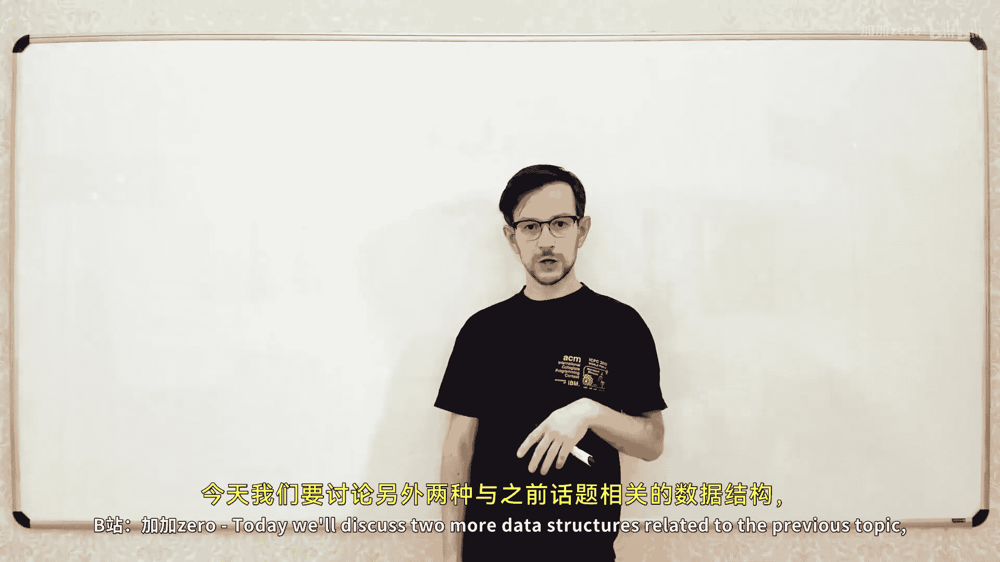

Let's go， so the first data structure we'll discuss is fe。

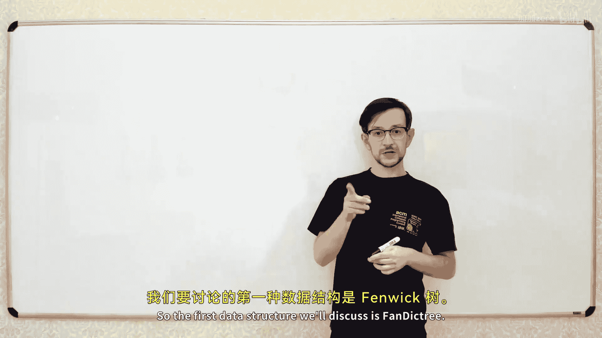

嗯。Sorry。Let's take another one。

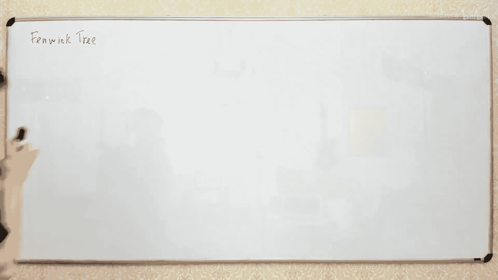

啊。What is phrine？Red black trees all's not about red black trees。

 red black is red but binary search trees。

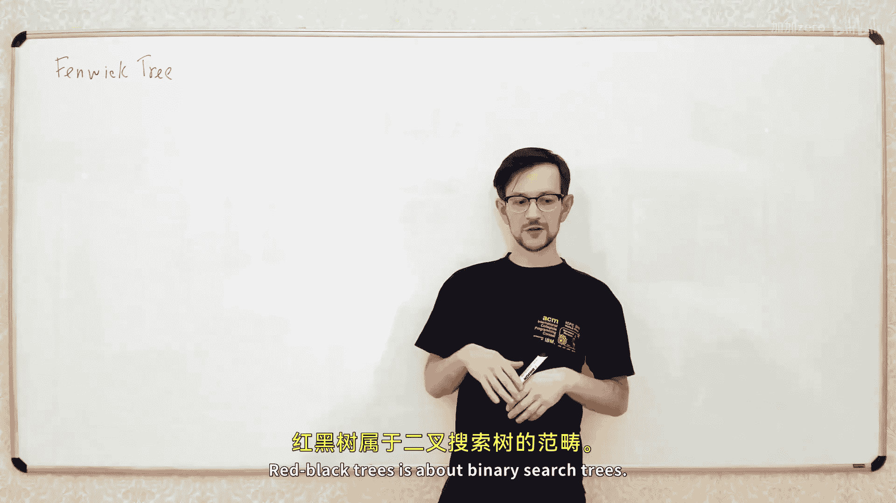

Can the tree is something slightly in。Different directions， so we'll move。There some。

 I'll explain it。So Fendic tree is it's not exactly a tree it's named Fenddic tree。

 but we will we will not draw a tree in this data structure。

 but its it may be represented as a tree if you if you kind of wish let's go。 So what is feic tree。

Mmineally you want to have a data structure。And you want to answer two types of questions。

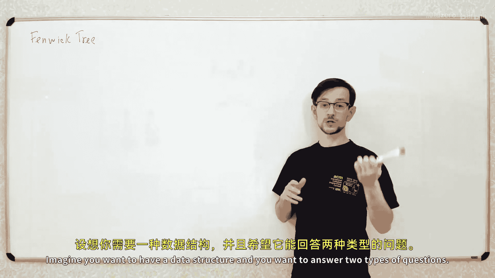

W before you have summary。嗯。And you have two types of queries， First queries to change element。

 Second query is to find some segment like we。 So first query， let's say let's have a different way。

 So let's have increment。Eleement eye quit。It will increment the value of one element of the ray bi。

Make something like it's classical。And second query is to find the sum second。

like before you just return the sum of all elements from L to r minus1。

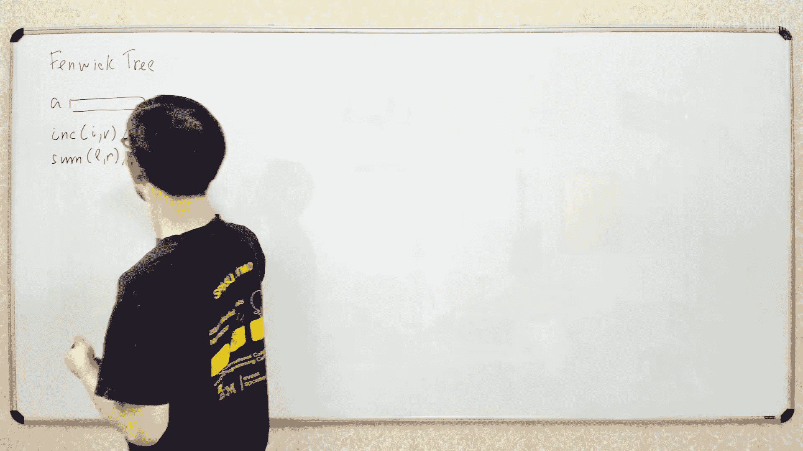

And thin tree allows you to make both aspirations in loggentail。Have both time complexities for them。

You may kind of recognize this situation we start this situation in the first lecture of the semester so in the first lecture of the semester we had the same two operations but we had set operation say just assign one element of the array but it's actually it is the same situation we have two operations one operation is to change one element another operation is to find the stand on the segment。

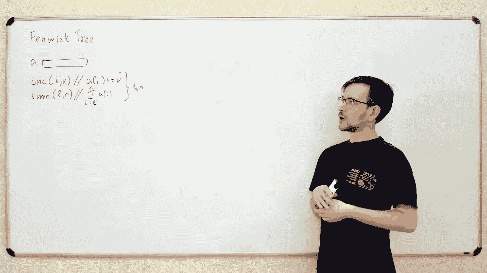

And we already learned how to do it using segmentaries in log end time complexity。

Why do we need add structure， that's complicated question。あ。

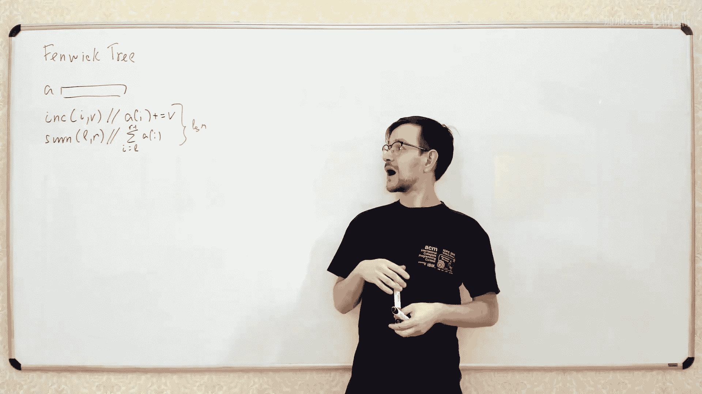

Opio science is that this structure is better than the segmentary。So the time complexity is the same。

 but it it it is the same as sympathetically the。Constant factor is less actually in this data structure。

 it works faster in constant factor comparing to segmentsries， but still it is better in practice。

And the best second thing why structure better than is segmentary is because it uses less memory and that sometimes is crucial because sometimes you kind of have a short amount of memory and you don't want to spend another like n elements of the segmentary。

 how many elements do you need in the segmentary in segment three。

 if you have segmentary for if you have array of size n。

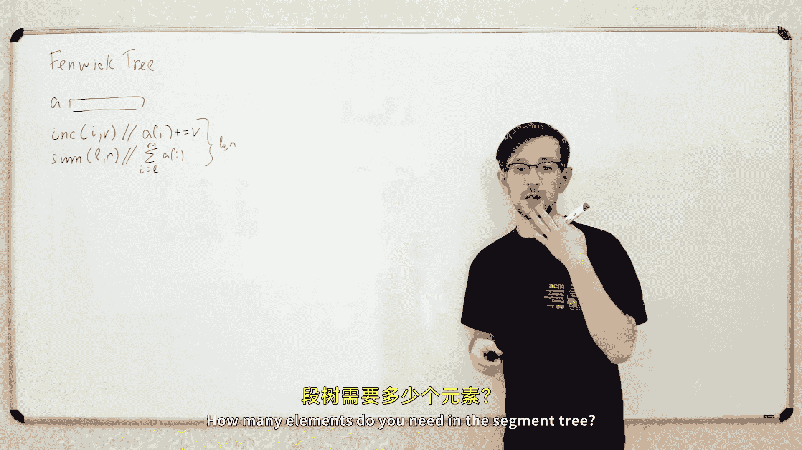

Look， if you do it like we discuss in lecture， then you actually need to increase the size to closest power of two。

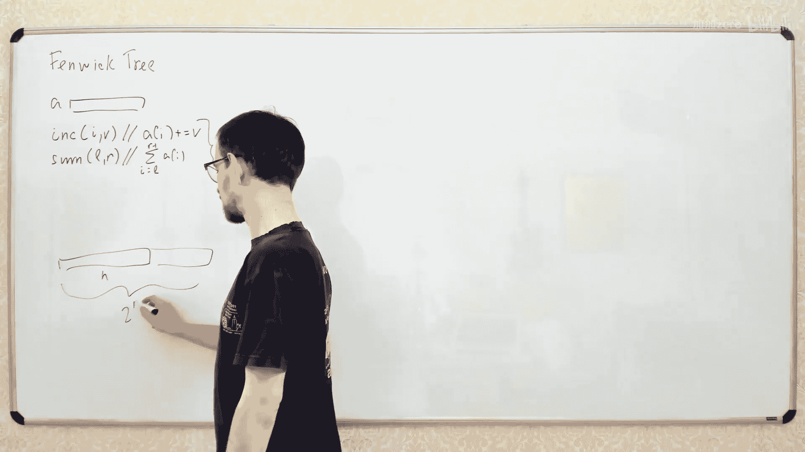

And if n is close to one power of two， then you need to add another like n elements。

now you have two n elements in your array and then you build a segmentary on top of this and then here you add another n node to create this segmentary to2 n。

So you have two n elements e to n， so you have satellite4 n elements in your segmentary in worst case。

 so if this n is close to the power of two， then you increase it to the next power of  two。

 you add another nM so I have two n elements here， two n elements e four n elements in total。啊。

It can be improved actually， you can modify your data structures so in such ways you don't need to increase the size of your array。

 so you can modify the segment three in such a way that you don't need this。

 but still even if you have 10 elements in your array， you need these and elements。

To maintain all the sums on all the segments， so the total number of elements will be 2 n。

So if n is small it's not a big problem， but if n is big so if you have like billion of elements。

 yeah， so you have a array of size of billion so you spend a gigabyte of data to maintain this array and then you maintain another big gigabyte of information to maintain all these nodes。

This let me， maybe not what you want in your。Program because you don't want to spend another gig of data and spend another gigaby of memory。

So in Fdic3， all we will need is just one array of size n so for this fedic tree we will have just one array of size n so basically we don't use any additional memory comparing to the array we need so we will not we will not even store these elements of array A we will just have some magical and elements and and elements will give us all we need to maintain these operations。

The two problem。

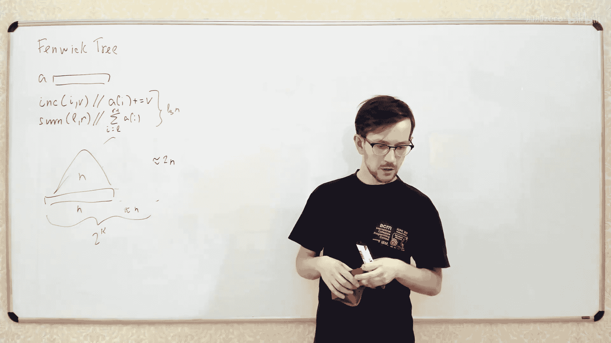

Yes， M plus 5 is asypoically assembly。 Oh， no， additional factor is no。

 additional constant is not a big problem， so。

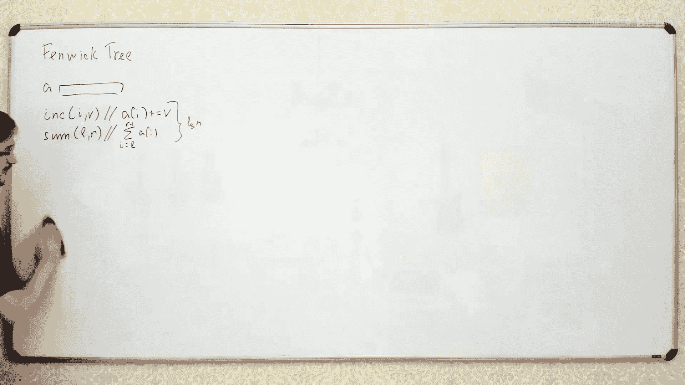

Let me show if you have n elements and n plus five elements it's not a big problem it it's obviously the same so you just spend five additional elements it's not a problem problem is when n is big so when n is small it not it's not a problem you when you have one version one this says n another five n。

That may be hurtful because when n is big again， when you have n equal to billion。

 here you have one billion。You might have $1 million or you have $5 million， yeah。

 that's kind of difference yeah， if you have million dollars and million and$5 dollars。

 it's not a big difference。😊，でsか。😊，Let's get into the idea of this so this constant factor may may be not what you want in your。

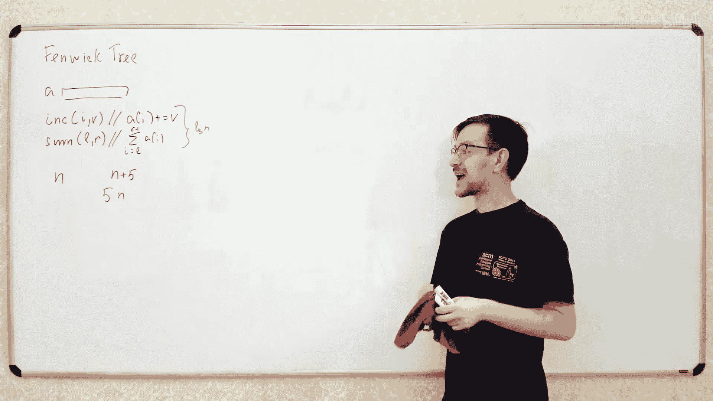

Program when you have a big amount of weight will data please。Plus constant is not a problem。

 but when you multiply by constant， it may be a problem。

We usually don't talk about this because we just measure theyotics of the algorithm。

 when when you discuss the algorithms， you only measure theys of the algorithm， Yeah。

 because when you want to specify the constant factor。

 you won you want to specify your computational model more like when discuss my first lecture so when you specify your computational model。

 you kind of fix all the constants and then you may want to optimize the constant factor。

 but it all depends on your computational model。So foot in theory， big it's not something important。

 but in practice， if you optimize your memory five times， it is something important because again。

 okay。嗯。喝总。那。So how Roman in fery？We will maintain one array， let's have a array。

Of size M and each element of array F will maintain sum on some segment of RA A。

So element in position I。Will you maintain some。On the segment。啊，From。From something。

 let's say B of I two I。So we will fix some special function。we will I'll explain this later。

And each element of RAF will maintain some segment。Of very8。That's all that's the whole blend。

 that's the only array we'll maintain。 So all we need in this data structure is this array F。Now。

 how will implement these data when you want to calculate sum from L to R？

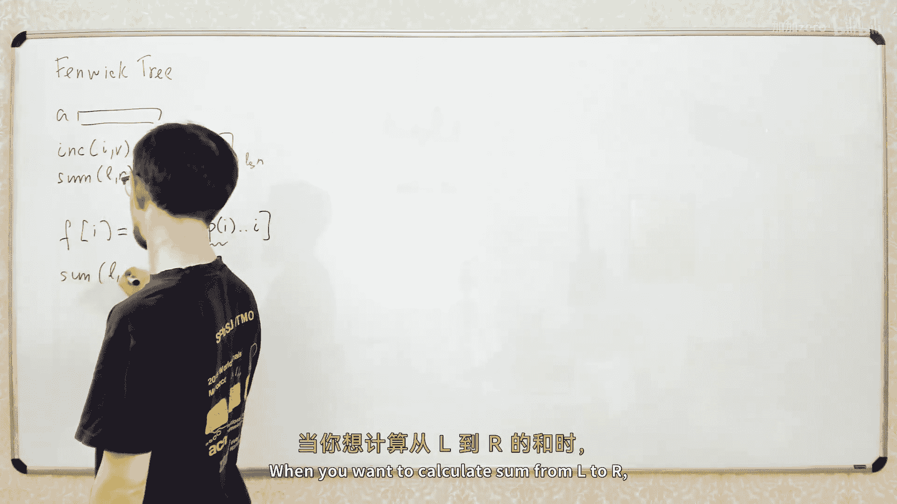

First， we'll split the sums into two sums and prefacees。

 So we say we'll say this sum is equal to sum。Fromゼとア minusワ minus三 fromゼロと lマワ。

Then we'll calculate these to sum separately， then subtract this from this and get the result。嗯。

Now how will calculate these sums， It's pretty easy。 So you have this ray egg。

You wantt calculate sum on sum prefix， so you have this prefix from0， let's say2 x。

How to calculate this sum， let's look at this element of array F。

 So this element of array F contains the sum of sum segment like this。

So look at this position in array F。In this position of RA F， you have some segment from P of x to S。

Now you add this sum to your result， and then you need to complete some of this pair。

 So you look in this position， get this sum。 Now you look in this position， get this sum and so。

So that's the whole plan again， how we calculate the sum on prefix we look in this last element of array F this this element of arrayF contains sum on sum segment of array A。

 so we take this sum。Now we look on this position， this position contains sum on this segment。

 so we add this sum now we look here， take this sum。

 then we take some of all these segment sums and then we'll get this sum on the whole pre。Good。

Discipline。Now how will incr the value。 So when you need to increment the value。Yeah。Okay。

 you have here we have position I and you want to change the value of this element。

To change the value elements， we need to calculate some of the segment sums。

So you need to find all the segments which contains these elements inside the segment。

And also find so you'll find no， starting from this position。 So this position contains some element。

 when this position contains some this segment， this position may contain some this segment and so on。

 So you try to find all the segments。Whi contain。Eleement I。哦哼。So you'll find all these segments。

And just in increase。Thes sal on each segment by。Makes sense。Y you are too words。

 just say something at least every 30 seconds。Yes see。Just to give me。啊。

Its it's working right now no no stream is working Yeah， I'm kind of nervous and stream is down。

 so just keep saying something just。Okay。Let's go， let's the couple one。Now。

The magic part is to find a good function P such that the both of this separation can be done in loggan time。

 so I just put some function P here。But not all functions are good， so if you take P equal to I。

 then you will have a lot of segments here。If you take pi equal to zero。

 then you will have a lot of segments here。Makes sense so you need to find some good function P and good function means that in both these operations。

 you have small， small number of segments， So you need to have small number of segments when you calculate the some graphics。

 So this number of segments should be small。And also， when you modify the element。

 number of these segments should be small， so I want to find some function P。

 so number of these segments。Oh。Is about loggan and number of these segments is about loggan。

And the full magic is about how to find this good function P。过。Square root of n。 yeah。

 if if you make P of I equal to you can make it not no square。

You can make let's see if you equal to I minus squared of。

I think that's what you need so if you do something like that。

 then in both cases you will have square ofel。So you jump with step equal to square root of n。

 you have square root of n segments here， and when you update。

 you have square root of segments to update。So if you make this function。

 you will have square root of n in both cases， but I I want log n。Logan is less than squared， okay。

Now。啊。That。There is some intuition behind this， but I will show you the magic its easiest way to understand what's going on is just present this function and prove it is correct。

You can think about how you can come to this function if you don't know this function。

 but I will just。For simplicity， I will just show you the function and explain why it's working so the magic function works like this you have this number I。

Let's look on the binary representation of this number。 so let's number I is just。

Some vector of bits。啊。We will construct function P informally。

Well we will look on the number I if we have a number I let's find the right most zero in its binary innotation。

 so in this binary innotation let's find the right most zero so here we have some ones and here we have the zero let's find this zero。

中就中志中。So we have this zero， we have some ones here， and here we have some pres。

The value of P of I will be calculated will take the same pre as here。

And we will feel all these six with zeros。ああオッケです。That's how it calculatedulated。Oh for example。

 if you have I equal room。What's saying。0，1，0，1，10，0，1，1，1。Then p of I will be calculatedd。

 so we we find this zero， we have the same pre here。And we take zeros for these last bits。

Yeah bunch is very simple， you take this last once。And change then the zeros。

Let' all this's the whole gl。Good。呃， now。Let's try to calculate this function using some bit magic so we'll use some bitwise operationss to calculate this number P of I So how can you calculate this number P of I using some bitwise operations Okay you have some bitwise logic so you have bitwise or bitwise n bitwise so and so on。

And you want to use these separations， we discussed it when we discussed some dynamic programming right。

 so you want to find some magic bit by separations which will give you this number from this number。

Mmhm。😊，Any ideas？But the I is pretty simple you need so you have this number I。

 so you need to take this last once。And change this 15 zeros。So you need to find some another number。

 which is kind of the same as I。But with zeros in the end。

 so you need some operation which removes these last ones。Any ideas？Do， any questions by now。や。ゴ。

So it can be calculated very simple way。Take this number I and calculate the bit twice n with number I plus one。

W its important， because in number I plus1， you have so if you let be show this。

In number number i plus1 looks like this。Number I plus one， you have these same graphics。

Here you have one and a lot of zeros。Now when you calculate bit twice end of these two numbers。

You will have the same prefiex here， but all zeros in these positions because no this position will be zero because here is zero。

 these positions will be zeros because here are zeros so all these positions will be zeros and these positions will be the same because we have the same pres here。

So this function is very easily calculated。And now we will show that if you use this function。

 you can actually handle both expressions in loggan time。Okay。It looks kind of like magic。

 but it's fine， it's the easiest way to understand what it's going on。

 you can think about how to come up this。It actually， it's actually quite simple。

 So if you think a lot about。If you think about to find some way to， again。

 what do you want you want in both these cases， to have the number of segments to below again。

So if you think about how to make a number of segments about log n。

 you kind of need these segments be to have a length of like powers of two。

 so you want each next segment to be a bigger power of two。所Q还。

So you have some one par then bigger power to also。因为有。think about it。

That's actually interesting thing to think about， but not today。🤧嗯。好。

You might use I and minus I I and minus I。No， I believe it's different。 If you。

 if you take I and minus I， you will have。Now you will find the close power of two is something like that。

Right。No， I and my explain， give you something different， I think。

Yes you you may build on the structure which is index from from one if you have the first index equal to one。

 you may have some different forms here yeah。い。Good point。Now， now， let's go。 now this， this， this。

 this is the function we need Na let's implement these two functions。 First implement some。 So again。

 you have some of。Again， if you have sum of L R， we will just return some of r minus1 minus sum of L minus1。

And。Some of our will looks like this。Okay， this is the prefix of first R elements。

We say x equal to R。And then we just make like this， so we take this position X。

 add this to the result and move to here， So its a result equal go to zero in a while。X at least0。

Increment result by this value in position x and move to the next position we' move from here to here。

 so x will be moved to p of x minus1 P of x is this， so it will be x and x plus1。マ-1。Yeah。

 I believe you can modify this formula belower。어呃 어 어 어 어 어。Yeah。

 I believe you can mag this formula to look like a type like in your。It does matter actually。

You going use another bit magic to calculate this for。And now， no， no， no， no， just return this off。

그 good。Thats all that's a full function which calculates the salmon prefix。

Now let's make the second function， second function is to increment the value。

 it's a little bit more complicated， so how to increment the value to increment the value。

 we need to find all the segments which contains the this elementment。So， we have some。

So we have this element I。We need to find， let's write it here， So we have this element I。

 we need to find all Js such that。Let's just write this。We need to find。All values J。

 such that I is on this segment。 So if I is on the segment， it means that P of。

J is less or equal R less or equal。嗯。Let's look what's going on here， what's going on here。

 so we have this number J。You have number I， you have number B of2。This is less or equal。

 this is less or equal than this。Yes。So this number of J， this is number P of j。

 so these two numbers have the same version here， like here。所以还有历史。Common preference here and here。

And in number J， you have zero in。Some once in number p of j。

 you have zero and the same number of zeros5。And now we need our number I to be between these two numbers so how to find numbers between those。

Between these two numbers， any number with prex， so if you take any I with the same pre here。

And then zero here and something here。This number will be greater or equal than this number and less or equal in this number。

 right？Because here we have all zeros， here we have all ones。

 so it will be between these two numbers。Let's take a whole picture。And now， we need to。

Find this number J from number I。 So we we have this number I in this function。

 so we need to find this numbers J。This number J is constructed from number I one we detect this number I。

And now we take some suffix of this number and change it with old ones。

 so we take some bits in the end of the number I and change these old bits to once。

And that's how we will produce the number J。WellFor example， let let control。啊。

Its this white bars looks a little bit small for something that and I tried to feed the whole fe on one of white bars。

Little bit too too small okay， so let's set here， you have this number I。

 let's have some numbers because011，0，0，11，0 like this。Let's find all possible Js。

 such as find this in equation。So again， how to find this number J from number I。

 you need to take number I， takes， take it suffix， change all bits to one。

And this will give you some number J。Now we will increase the size of this six。

 so we'll add more and more once in the end and we will produce all possible js。Right。

So how to control possible。Let's present from smallest to largest just。

 so let's start from the smallest possible J， smallest J is just equal to I。

Well just start from number I。嗯哼。This is the smallest numbers satisfying this in equation。嗯。

Is it clear why the smallest number because each next number will be just you add once to your bit blind annotation and when you change zeros to once。

 you just increase your number， right？So the smallest number。

 which satisfies this in equation is just I。Good。And now we'll increase this number and find the next values of J。

 so to find next value of J， we just need to swap some zeros in the end of number I with once。

회끼는 여 또구 와야지 형。You make it me your since it's not good。So we to find the next number J。

 we need to find this rightmost number0。And change it through while so next time button J will be like this。

So we find this zero。全去住讼。嗯。J always， no， no， the first value of J may have zero in then。

But every next value of j will add zeros from right to left because how that's how it's working。

 So when you go from number I to j， it is the same number， but this tail is changing at once。

So we start from number I and then add once from the end of the by the annotation of I。

 so each time we take the right most0， change it to one。Find the next value of J。

 then to find the next value J together， we find the right one zero here。And change one。 So we have1。

1，1，0，1，0，1。And then to move to the next one number again， we're find the right move0。

 change it to one this one。I'll again， find the right zero in on。

So this is how we will construct all possible Js which satisfies these in equations。嗯。Yeah， good。

 So how to move from one value of j to the next value of J。 It's very simple。 We need to find。

The right more zero。And change it to one， we do it the same way as we do it here。

 we just calculate J plus1 and make bitwise or of this two number。

 so when you move from here to here， you take number j or J plus1。我。Yeah。そ。Yes。

 so so the only value of J， which has0 and then maybe be the first one。

 So all next Js will have less be equal to one， just because each time will increase number of ones in the end of tail。

Let's go， let's just implement this。 let's just implement this。 So again。

 we'll have J equal to z to I now while。This j is less than n。

 we just increment this value and we make F j plus equal V。And then move to the next value of Jake。

J equals to J or j equal0。他的。That's the whole code of the familyrine。Theyre just。

So this is how you calculatelate the sum。This is how you implement the video。没错。

Now let's think why both these operationss work and log in time。Now let's start from this operation。

 why this separation works in loggan time， because each time you add one。

One bit in your bind annotation， you have up to loggan bits in this binary annotation。

 so each time you increase the number of ones， so you may have maximum logan ones in your binary annotation so this。

While Luke works at most loggan times logan。Same thing here， so if you look on this one。

It is also increasing the number of ones because when you move from I。

 you move from x to p of x minus-1。 so you move from x to p of x。 if I have this。

 and then if you calculate。If you calculate p of i minus1。You have all this beautiful one。So again。

 when you move from I to p of i minus1， you increase the number of1 bits in the tail of your binary binary presentation。

So you may increase number of these ones at most loggan times。

 so this while also works at most loggan iterations。That' song。On average， no， it。

 it's about lo time。 you may have less than you may have。So， I think， I think on on average。

 you have like。Half of your bits equal to zero， so it's something log n divided by2 on average。

嗯个先份 here。But still， if you just look on this code and compare it to the code of the segmentary。

 we implemented it。From previous lectures this code is much simpler so the all operations here are very simple operations in the segment you have this all this recursion you calculate you some of the go here you go here go to this node go to this node here just make this simple cycle all operations are very simple so it's actually like。

Few times first of than the same operations in a segment。Just because they call the symbol。

 all operations are simple。And this number of iterations is actually about the same as in segmentary。

 but air iterations is much faster than in segmentary。Okay。

Segment3 is more powerful that that's correct In segment3。

 we discussed you can do much more interesting things in symmetry this structure。

 the first of all we used。Then you have some operationions， or you have this single operation。

So it only works when you have inverse separation in in your sum function。 So it you you can adjust。

 you can sometimes， but not exactly。 It's not as simple to adjust it when you don't have this inverse separation。

And second， you don't have these mass operationss， you cant increment the whole elements on the segment and so on。

 actually actually you can， but's that's complicated。

So it's not that simple to modify these data structures to work with other functions。

So usually you just use it when you have these two functions。

 you can increment and you calculate some in a second if you have something something more complicated functions then。

You may may want just to move to segment three because segment three is very powerful structure you can you can just use any associate operationss and it will be just it will be just work here is something some。

It's tricky。SoSometimes you can adjust your data structure to work with some different functions。

 sometimes it's begin。嗯。ちち。No no， no no again you can't do laser propagations here because how to make laser prop again。

 I think you can modify it， but still if you want to have laser propagations you need to have two arrays。

 so you have one， you need to have one array。Of these sums and another array of these propagations。

 and I don't know how to make propagations here because。嘟嘟。It's not obvious。No。

 I think you just can make propagations here course。Yes。

 because you may have up to loggan children industry。You may think about this。

Just just leave it for your asm exercise。🤧啊，对。So this is the first data structure。棒。

Second data structure is actually more important， second data structure is sparse table。Okay。

That's school instruction。そう。Let's start again with the same problem。

You have summary and you want to calculate some functions on the segment。But this time。

 we will not change the array。 So array is fixed。 So its because cause static problem。

 So you have the same array。all right， a。And the only function you have is to calculate the sum on a segment。

嗯。So you don't have the separation which changes the element segment。 the array of this the same。

 Oh elements will always be the same， but you want to calculate the Samsung sum segment。没哼。

So how to calculate this sounds？The we discuss this， how to calculate these sum when you。

Have this static so well。When you don't need to change the elements of the array， you can actually。

Calculate these sums without any。Segmentries， feic trees or anything。

 so if you just need it which calculates this sound the segment。

 you can do it without any segmentaries feicries there， you can just use perfect sum。

So if you want to calculate sums on the segment， you going to calculate all perfect sums。

so whether you need to calculate sum on graphics， you take this perfect sum minus this perfect sum and then calculate the sum on second。

So you can calculate the sum segment in constant time。

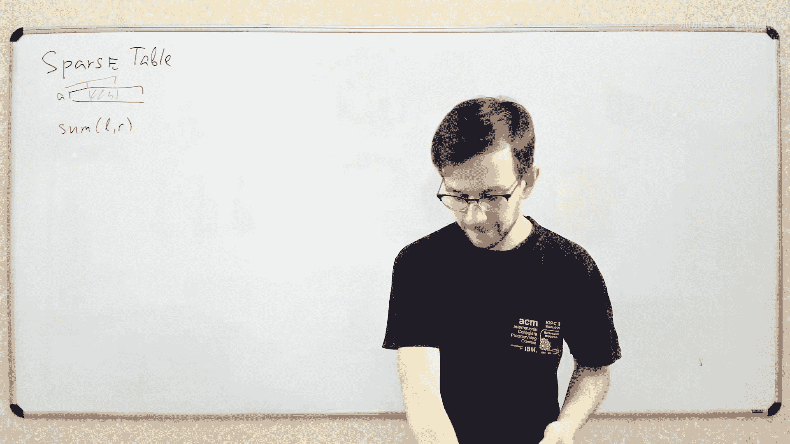

嗯，嗯。But before you can calculate this before you can make the separation you need to precalculate all the perfect sums so we will kind of split the time complexity into into two parts first part will be time of precculation so when we take this array and we do something to calculate some strange sums。

And then we will answer the questions okay， so we'll split time complexity into two parts first part will be time we spend for precalculations。

Yeah。Now in this case， for example， we need to precoclate all perfect sums to calculate perfect sums we need to spend like linear。

Lan your time to make these precaculations。啊。And then after these pair calculations。

 we will answer the queries。And if we calculate allographic sums。

 we can answer all the queries in constantsantine。Okay。So in static data structures。

 it's always works like this， so if you have some static research so you don't change the state of your data structure。

Time complexities is always looks like this so you have two parts of your time complexity first you spend some time to prepare all your data and then you answer queries so you have like。

You kind of want optimize both these parts。😡，🤧啊，Let's go。

So if you just need to calculate a sum it's easy， you calculate perfect sum and the sum an interesting part is when you want to calculate some different function。

 for example， what's going on if you want to calculate humanss。

So if you ever to go minimum one second from the。Now it's certain。啊。

The first one you can do is just to apply the segmentary， so you may want to take segmentary。

Construct the segmentary， and then you can enter the queries to find the minimums in the segment。

Why not secondary is perfect data destruction？So。How much time do you need to to prepare the segmentary from the given array。

 So if you just have the right。How much time do you need to build the whole segment？I want to。

Beyond for this whole segmentary。お。It's strange segmentary， but it' this fine。

 so if I give you this already and you need to prepare this whole segmentary。

You can build segment three from the given rate in linear time， so you just go from bottom to top。

 calculate all the minimums and in linear time you will calculate。

You can do it in analog loggan time as well， but it actually can be done in linear time。

 just straight from bottom to top and calculate all these minimums。你不我可没点的。Okay。

And if you have segment 3， you can answer all the queries in loggan time Ob。This is a segmentary。啊。

And now I will。We will present down， so we will talk about spa table， Sp table can make。

The same request and number question。Yeah。We will build a spae table in analogloggane。

But we will be able to answer all the queries in constant of time。ち不と。

And now the question is this is possible。Now the question is what's better？So what situation is best。

 what do you think？No， it's three question。's because it depends on what's going on， so。

When you need to choose what data structure to use in your program。

 you kind of need to think how many ques do you have if you have m queries。If you have mquis。行。

Then in if you use segmentary， the total 10 complex here will be， so you first your spend。

And operations to build the segmentary。 and then you use。And low gain operations。

To answer all the queries。 and if you use spa table， then you spend N log again。

Time to construct your spars table。And then you answer all the equations in constant time so it be plus m。

So when you choose which structure to use， you kind of need to look about what is better。

 it depends on the number of variations， so if this number ofquerries is big。

Then you kind of need to use Spe table if M is small。

 then actually this time complex is better than this because here we have n plus something small loggan。

 here we have n log n plus M。So depending on。On the number of operations。

 one of these data structure may be maybe be better than the destruction that happens。

Sometimes you have several data structures and you need to choose which they producing in your。

In your case。🤧啊。Spoilers， it's actually possible。To solve this problem in an optimal way。

 So it is possible to to do this in。course linear。Pre calculation time and。W want stand。Qu thing。

We will discuss this in few lectures， I think in like four lectures， so in about a month。

 we will discuss how to do this。So just keep it in mind。But not today today。

 we'll just discuss this simple instruction。哭哭。Let's go。Before we start， let's do something simple。

 let's do simple data structure， let's build this data structure with these complexities。

 so if I want n square time complexity for percal and constant time complexity for query。

How to build this data destruction？Can you do it it's quite simple。

So if I can spend n square time for precalculations。

What should I precalclate to be able to answer all possible queries and constant time？Yeah。

 in M square time， I can precoclate all possible minimums。So if I if I careful。

This time to precocolate something， I will just precolate all possible minimums。

So I will create very M of L and I。 It will be minimum。On segment from L to R。

I will just calculate all these minimums， put them in summary and when I need to answer this square。

 I just go to my array， find this value and output this value。Quite simple blend。

And now we will slightly improve this， so we will precocate minimums on some segments。

 but not all possible segments， but on some segments。

The idea is to precalccate segments on only of segments of length equals the power of two。

So you have this array A。We will precoculate the minimums on all possible segments with then equal to power of two。

So is these？So if you take some segment。From L to R。买锁。I'll just make minus one everywhere。啊。そ。

I want the length of the segment equal to power of two so square this this be the L plus2。Well。

 K minus-1， right？And I just put all these minimums into summary。Let's say A。Ij。

Will be equal to minimum。No， I have a already， right。What's her favorite thing？

AMium on segment from I to I last2 power of j minus1。哦。

I will precalculate minimums on all segments with length equal to power of shape to22 power of shape。

不送不送。那。Twogressions。I need to precololate all these values in analogloggan time and second question I need to be able to answer all the queries in constant time using these minimums。

So let's do this both operations first， let's try to precalculate all these values in analogloggan time。

Again how many values do we need？Here I。I is from 0 to m minus1 and j is from0 to loggan。

 so we have n loggan values。嗯哼。And I want to precocolate all these n loggan values in n Logan time。

 so I kind of need to calculate precocoulate each minimum in constant time。

How can I do it it's actually easy。So let's look on the segment。So we have this segments。

The length of the segment is a power of two， so this is two power of。It's too。

How to calculate minimum on this segment it's quite simple。

 we will just split the segments into the par it's called by the release。

So you split the segments into two parts。You can collect minimum here， minimum here。

 so length of both segments two power G minus1。So we will calculate this minimums by increasing the value of j。

 so we already reccalculated all segments of length2 and power j minus1。

 now we take two such segments and calculate this minimum on this segment。Yeah。

 we will discuss the same operation actually we will talk about by on the trees。有。

It's kind of common operation when you know。It's a way to like double the length of your step so you calculate the value when you have this step now you make two steps。

So you like increase the size of your step twice。We will。

We'll use the same approach when we will talk about three requests about LCCs and stuff。

In in just again， in a few weeks。啊。ま。またるの。Yeah， so you just it over of。But first， if j equal to0。

So laser straight for i from 0 to m minus1。啊。First， the first layer of this Spanishe table。

 you need to assign my， you need to assign value of MI02 a item。

So this is the minimum on a segment of size1， so if j equal to 0。

 then a segment from i to I so one L element minimum is equal to a1 and now we apply this formula so you it。

For all J from1 from1 from1， from1 to log n， H rate for I from0 to n minus。us two power of shape。

And then calculate this minimum， then MiIj will be minimum。Of these two elements are。Minimum of。

I J minus1， it is this left element okay。This segment from I of length for J -1 and minimum。

Of this segment， it will be I plus 2 power J -1， J-1。Ex great。不'走。

That's how you precoculate all these minimums and enloggan time。

 so total time complexity here is envelopeloggan。All this precalculation works an elegant thing。う。人手。

And now we need to calculate minimum on a given segment in constant time。啊，そ感。Qu of this already。

You are given some segment from L to R。And you need to find the minimum on this segment。

P provide me on the segment。あ、どうでそ思？Let's go create the length of this second。

The length of this segment。Will be just our minus。Now let's find the maximumim power of tube。

 not greater than this length。It's fine maximal K。Such the tooling power of k is no more than thislam。

And now let's use the segment of size 2 in power of k。From this live proposal。

 let's take this segment。Of plants to power of cake。Aco goith minimum in this segment。

The segment is just M L。Okay， right？Well let me just write the cold。

 I'll just I'll write to complete。And now we're no minimum on this segment。😡。

And we need to have minimum on this segment， so we need to find minimum of these elements as well。

And now we will do very easy trick， we will take another segment of length2 in power of k。

And start from here。So we will use two overlapping segments each segment of size2 and bar k。

Now we no minimum here， with no minimum here， so if we dont want to have minimum on this whole segment。

 we can take minimum of these two minimums。And it will be equal to minimum whole segment。我不去。啊。

It's like it is the cold， so we need to take off look two of1。And here we just return。あ，ミニも。

Of two values of MLLK。And am。Am to。Like this。That's how were do it in constant time。Little bit。

Actually this。This separation is something strange because here I kind of use logarith and I just table with I can calculate logarith in constant time。

 it depends on what's going on so in practice。You can calculate log difference using some process operation。

 so but basically you need to find for integer number of the largest power of tools so basically basically what you need here。

 you have this lamb， right？And you need to find the largest power of two greater answer。

 you can need to find this largest one in your binarynotation。So you need to find the index of this。

Of this leftmost one in your binding meditation。Usually your processor can do it in constant time。

If it can in theory， it doesn't matter because you can precalculate these log variabless for all possible values of k。

 so this value of k this value of lamb。Is up to n， so you can prericklelate for all possible lengths。

This case， so you can just just case make another array which will give you this。

Good value of k for a given value of lamb this land is up to n y so you can make array of logs for each value of lamb and you can precolate this array in integers in the entire time so it doesn't matter。

But usually it's not a problem， usually you can just calculatelate this。응。

Miniums and ph is complicated， you can talk about it， you can think about it， but。

Now the problem is F usually works with some prefixes in when so in a calculation segment。

 you can just split split minimum into parts。There are various techniques。Just。Just right。

Usually the easiest thing is not to use fan trace when you need five minimums。

 but this usually is not worth it，YouYou can拽。啊啊啊。Do we have time or wake have time。That's all。Yeah。

Let's try to use the same technique for different operations this technique。

Is only useful when you have minimum function and we kind use that the function is exactly minimum when we complete it here。

 So here we can use any approach right here you can apply any。

Associative operation and it's fine so you can here we didn't use any special properties of minimum。

 but here we did。HereHere we use a special property of the minimum。

And especially we use that you can overlap these two segments here。

And calculate minimums for this elements twice， and it will be the same as if we have each element exactly once。

 it happens because minimum is the important operation is。Because if you have minimum of x and x。

 it will be equal to x。And it is the same basically， here you need the to be， let me think。

You need it to be commutative and important。And if it's like a minimum because I calculate value from here to here。

 then I move here calculate to here and I have the sample so if you have commut for operation that's fine for example you have binary or binary and grade command device stuff like this again all the stuff which looks like minimums。

If you have any operation。Oh like， like this。 Then you can apply all all this technique to this separation。

What happens if you don't have these properties， if you have some。Some usual呃。把小事就说一声。

Can you do it in the same way， it turns as especially you can。

So we can achieve the same time complexity for any associate operation。

Actually even better than complexity， but not today。So if you take any associative expression。

 let's calculate from L to R。啊。We'll try to do the data structure with the same time complexity。

For any associative。Operation， like in searies。맞か。走好 to度。That's kind of complicated。啊。

What is the plan that lets me a little？May I raise this？O。I hope you don't have any questions。Okay。

I hope you didn't have questions about this because I'm going to raise this。

I need some space for you。Let it's go。什多手。Let's have some array。 Let's have。

Let's get of the size power of two just for simplicitying。So let's have some array of。A点。

So this is array A。嗯。Firstt。Let's split an array in the middle， so let's play array here。

 split the array here。So we split into two h it's like a dividediding conquer technique very simple we split array and then we recurively will go do the same very simple so we split array here and now we calculate the sums on all suffixes here and all the prefies here so we calculate the sum on these segments。

On all segments like this and all segments。I'm explaining the same data structures with the same dynamic complexity here。

 but for any associative operation。So I want to have spare sta time complexes here for any associative operation。

 not only for minimums。Let's， let's plan。

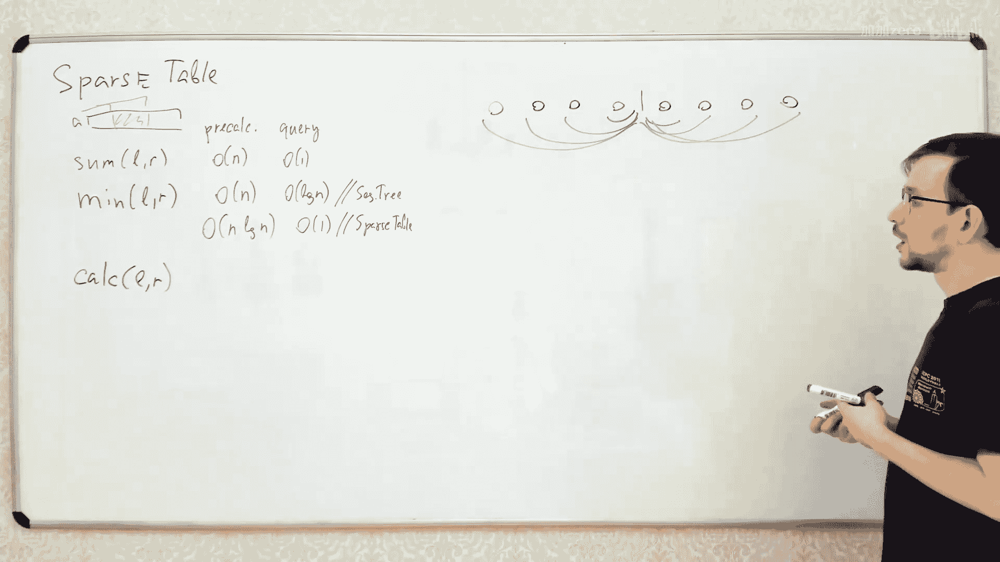

嗯哼。So we split right here， calculate all these sums， calculate all these sums。

I can do it in linear time。Right。So I just calculate these sums from right to left。

 calculate this sum plus the this sum plus this this sum plus this this sum form and the same when I calculate this sums calculate one element plus this。

 this sum plus this element， this sum plus this element this sum so I can calculate all these sums in linear time。

What's them mean summary？嗯。啊。No， I can answer a lot of。Different queries。

 So now if someone asks me to find some on some segments。 So if you want to complete some。

Please second。You and just， look at your array。And find two precalcoated sums。

 you find least precalcoated sum。And please speak on。

Then you take this plus this will be equal to the summon your segment。嗯哼。

And you can do it in constant time so again， you are given some segment。总要躲。

You look in your precalcary。Find the sum of this segment from L to middle and sum of these say from middle to right。

Take some of these two segments。And you will get this sum on the whole segment。Pretty simple不滚。嗯。Cl了。

Let's cut some real。Let's have some array， let's see why。2，1，6。E5，4。So this is three a。

I will use function plus just for simplicity。 You can do it for any operation。

 So I will have operation plus， so I will calculateulate some on the second。

 It's kind of strange because I can calculateulate some on constant time。Just for simplicity， okay？

So I want to to be able to cook sums on some segments。I can use product， but。Some is simple。 Okay。

 so I Ill use some。So I want to complete some of some segments。Again， I split。

 I split this segment array here， calculate sums on these segments， calculate sums on these segments。

These sums will be 6，7，9。14。 and here the sums will be 7，10， 15 and 19。

So I can do it to the leader of them。I complete these sums from right to left。

 these sums from left to right。Those are just perfect sum and s sum，Now。

 then I need to answer the query。When I need to answer this so I want to find some on this segment。

嗯哼。😊，I find the sum on this segment here and sum on this segment here。So now I take this plus this。

 so for this segment the total sum will be 7 plus 15， so the result will be。想个事点好对。That's all。Now。啊。

These all warps。Then these segments。Interssects the middle of the array so if the left border of the segment is in the left half of the array and the right border is in the right part of the array。

If， if you have segment。Like this， so it's completely inside the left part of the array。

Then I kind do the same trick， yeah， because I can split the segments into two and precal clayates。

 so I don't have this some precalated。嗯哼。So what to do when the segment is inside one of the h for the array。

 just do the same we do the same thing recursly so we'll precalculate the same thing for the left part and the same thing for records for the left part we can re split the left part in two。

And try to precallate Samsung these segments， so we have these segments and these segments。

And for the right part， we have Sp2 incorporates Samsung these segments and these segments。嗯哼。No。

 I can subtract no， if I have some storage， I have plus， I I， I surely can subtract。

But if your operation is not reversible， you can subtract。

 I just show it for plus operation because it's easier imagine you can subtract just for simplicity so you don't have minus separation in your language。

 you only have plus。So that's what we want to do。嗯。So we calculate these sums， calculate these sums。

 So these sums will be2 and 7。 these sums will be one and 7。 and here we have three and10。

 and here we have five and9。And target if your segment intersects this middle point。

Then you can construct the sum of your segments using two sums like this。

 so you hook here to take this segment plus this segment。And you will grant the result you need。

If it's not， then again you split your segments into parts， Google go on the next level。

 on the next level you have something and you have just one element。

Well you have this square split here， this split here， this split here， this split here。

So we have this four。Second of size 2， you split each segments into the classroom。さは。W。いく。

That's also you need three layers of recursion。So this is layer  zero， this is layer 1， layer 2。

On each layer。You have n elements， you can percoulate all these n elements in linear time。So we have。

Here you have。Logan lives。And on each layer you have n numbers。

 you can prerickate them in linear time。So total type of precallation will be enloggan。

 so you can precalcolate all these values in enloggan time。And now when you need to answer the query。

How to answer the query， you need to find the smallest layer。

Such that a jaw segment intersects the middle on this layer。

So on each layer you have this special points so so on this layer you have this special points on this layer you have this special points on this layer you have this special points。

So for your segments， you need to find the smallest layer such that you have some of the special points inside your segments。

嗯。😊，And if you do， then you just go to this layer， find these two segments。

 combine them and get this salmonial segment。That's the whole plan。

Now how to find the corresponding layer， there are different techniques。啊。The most is technique。

 works like this。嗯。嗯。我 have不 to说了还 number number， you have number， L number啊。Let's look on there。

Be wise representation。Like here here， all indices have three bit numbers。

 we have indices from zero to seven， they have three bits。お。

So we have this left index and right index。They both have free bits in binary representation。

What do you think？Not really connect to a spa table， it's kind of have the same type of complexity。

 the structure is really different， right？The structure is different， but time complex is the same。嗯。

到啊。Let's look on this。Two borders of your segments。

 how to find out if your borders are on different sides of this position if if your left border is here。

And your right border is here。What does it mean， it means that your first bit of your binary representation is different right so here you have zero and here you have one。

So if the leftmost bit is different。Then on the first layer of your structure。

 you will find your answer。And if both and L and R go in the same half of this array。

 then the first bit will be the same so。If you have L and R here。

Then you will have first bit of LNR0 and second bit will be different。

So if the first bit is different， then you will find a result on the first layer in the second bit is different。

 you will find your result on the second layer so so to find the corresponding layer。

 you need to find the leftmost bit which is different than L and R。And a bit。O L andR。

So how to find the left was different bits， it sees him。

You calculate sort of bit sort of these two numbers。And then if in this bitwise sort。

 find the leftmost one。Soと play least。This L， this is R， so if you calculate L so R。

So here we have this same prefis， here we have zero particular one。

So if you calculate sorry you have a lot of zeros here and here we have one。

 So you just need to find the leftmost one in the bit twice representation of。So of this LR。

That's the easiest way to do this。😡，There are more complicated ways。

 which doesn't involve any bitvis magic。😡，It's also possible you can do it without any bit magic。

 but it's kind of more complicated。 it's actually easy。

 let me show that you can do it just you need to find for this segment， the smallest layer。

 which intersects this layer。So you can just build the phone。For each。Position。

 you find you build the layer which theectist position so forth。 Like you put 0 here。

You put one here， You put two here。And now to find your layer。

 you just need to find the minimum on the segment。That's that's the easiest way。

 which doesn't need any。Bit my check。 So we just create this。All right。Again。

 this array corresponds to these split points and for each split points。

 you put the layer corresponding to this split point。

And now you need to find the smallest split point in your segment。

 so it's just minimum on this segment。And we already know how to calculate minimums。

 so we use this to calculate minimums。In constant time， now we'll find the。Layer。

 and in this layer we use these two summs to calculate the sum of the segment。

That's another way to do it without any bit margin。That's all。嗯。We're actually fit diling。Okay。

 let's do it again， okay if you。So what I want to do， I want to have data structure。

W whichch will allow me to find this to find the value of some bit separation。

 associative bitper on any segment， like the same like in segment。

 but the array never changes so every static。And we have variation which compates the value on the second。

So how can we do it， we will combine the value of the segment from two precalculated segments。

We will always have two pre cod segments， we will combine these two values and have the the sum the whole second。

So how to find the segments we need to precalulate， we will use some the right converse technique。

 so we will find the middle point of our array then in the left part。

We precalculate some on all suffixes， and here we precalulate some of all prefixes。M哼。😊，闹衣服。

We in this square， if we have to find some on second， which contain this middle point。

Let's writeite it again。The request。Contains this middle point。

Then we can combine these segments from two segments and for both things， we precalculated the value。

 so we have precalculated value here the precalculate value here， precalculated value here。

So we take this sum plus this sum， and it will be the result of this segment。

If this segment does not contain this middle point。

 then it belongs to one of the house of this array， so we do the same thing recursary。

We do the same thing because we here and here。So again， we split each segment into two house。

 we calculate sixes here， pre here， six privacy and so on。

Until we reach the point when we have segments of size1。And so now when we're given some segment。

 we find the smallest layer， which contains the middle point。

And then we calculateate our sum just around this middle point， so we take some suffix， sum prefix。

 and the sum will be equal to sum in a segment。哎，嘿嘿。😊，What do you mean destroy and S stables。

 What does it mean。哪点。It actually can be improved like we discovered on the lecture on Wednesday。

You can shift actually bit1 complexity here。Just using simple ideas。

 you can split your segment not in one segment， not in halfs， but in separate segment。

 sorry you can split your segment not in two parts， but in many parts。

So this depth of this recursion will be smaller and you actually can achieve much by the tankac so you can just get rid of this logan factor and change it with a function。

But it's complicated， I will not do today。Can we try to code this it's actually quite easy to code really。

 really， it's really easy。Easies way to do is is it' phone you just take you away。Right。

Then iterate all layers。For each layer。don't make any recurs here。

 just just simple four cycles you to all layers for each layer， you to all these middle points。

Just by simple formula loop from left to right。So go from left right find this middle point for each middle point。

It's right to the left， one for a loop to calculatelate these suffixes。

 another for a loop to calculateulate these prefacees。So we have one for loop， second for loop。

 third for loop， okay we have free force。That's simple。That's all， that's how we calculate this。

Just try it and it's actually it's very simple data structure and when you enter the query。

 you could create sort of this element R， find the right leftmost one。

 it will give you the number of the layer then you go to this layer。

 find these two elements just by indices Yeah you have index of this element index of these element so you find these two indices。

 find these two sums。Make plus。 And that's the results。 It's，'s yeah， it's actually。

 it's actually very easy structure。 You can， you can implement it like in。I think like 50 lines。

 of course， maybe less。I think 30 lines of code。嗯，对就就就就就就停。Yes， yes。

 if you want if you want to do what what I was talking about。

 So if you want to get rid of this logarithm， you need to split your segment into several segments。

Do we have time？Just from the。For the final thoughts。

 so if you split your segment into several segments。What you can do。What do you need to do。

 you need to be able to answer queries which you want to be answer queries like this to answer queries like this。

 you need six， this graphics。And some of these segments。So you， you may precolate all prefixes。

 all suffixes。And then you need some data structure。Wwhich allows you to calculate sum on blocks。

 so you have some blocks on each block you can precculate the sum。

 total sum of all elements in B now， and now you need to calculate the sum on segment of blocks。嗯哼。

for example， if the size of this block is login。Then you have N over log and blocks。

And now you can use the same data structure。To calculate perfect Samsung blocks。

No pre or Samsung segments of blockss。So we just use the same technique。

To calculate sums on these blocks。That's all。And now you can answer all the queries which have borders in different blocks。

And if borders are in the same block， you do itcurment。Sounds like that。

That's little a bit more complicated。But that stuff is very simple。Okay， that's all for today。🎼啊。

Next week we will start to talk about binary research no no no。

 next week we will talk about two dimensional requests。Yes， sweep lines and stuff。

 and then we'll move to binary research trees this plan。嗯。🎼う。

