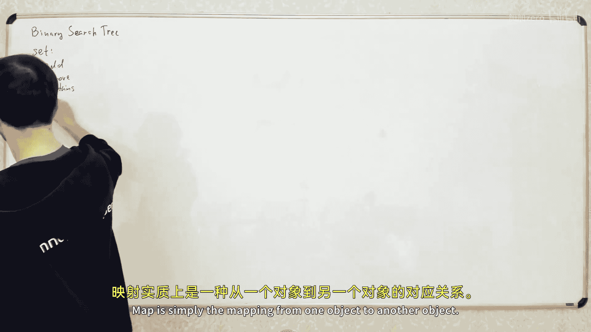
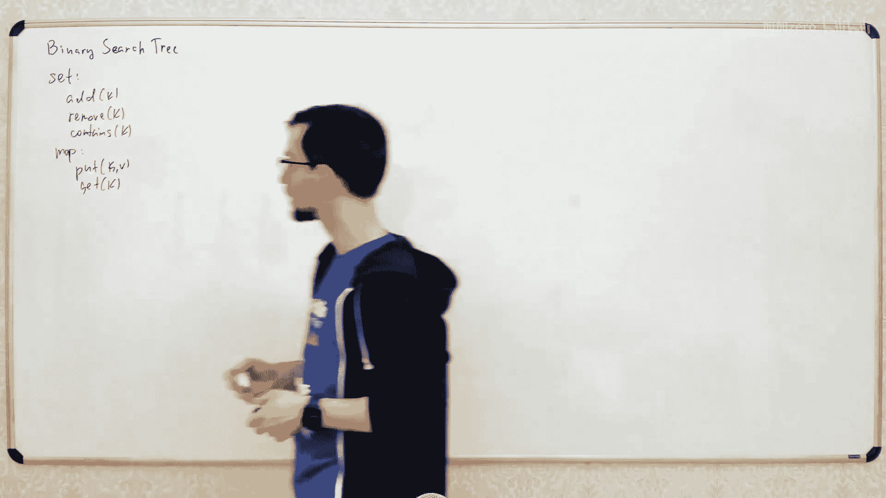
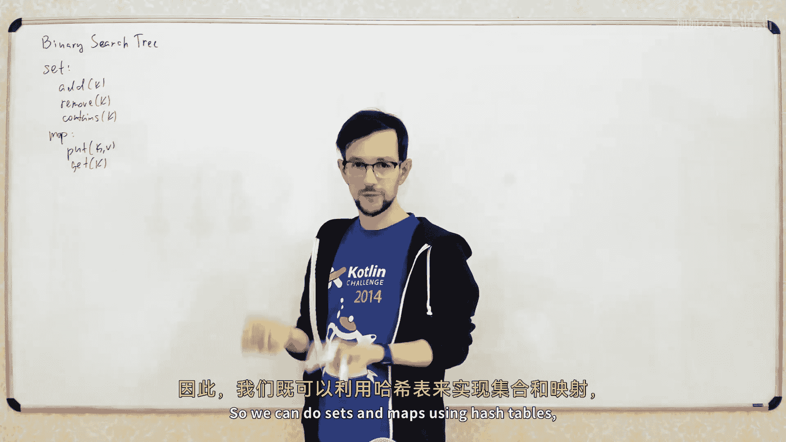
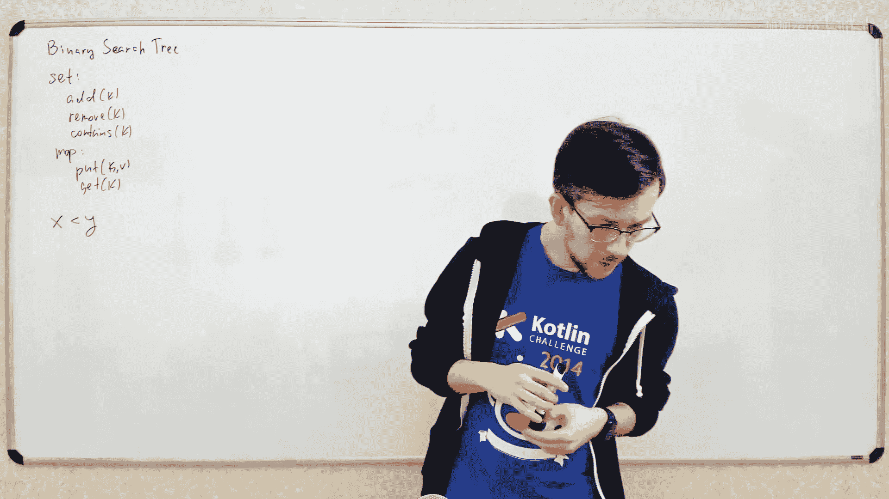
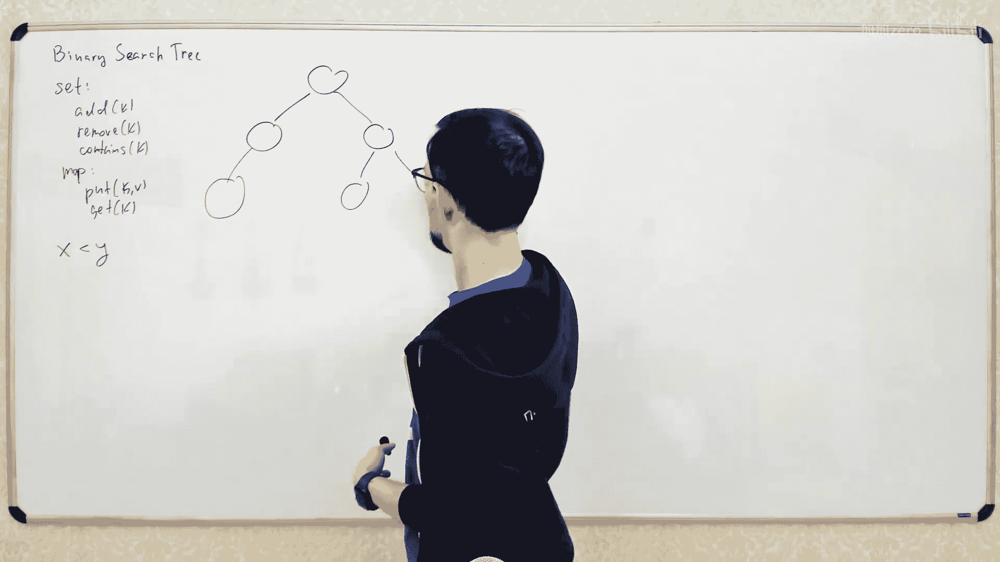

# 【精译⚡算法与数据结构】PavelMavrin p22 p21 A&DS S02E05. Binary Search Tree, AVL tree -BV1NLB8YfEMq_p22-

，🎼嘟嘟嘟嘟嘟嘟。🎼The。So today we start talk about binary research trees and this lecture and a few。

More lectures。 I believe you have like free lectures about binary research trees。

 So we discuss where it is different。Bin searchries and very different implications of these brain searchries。

啊，でき？ここ。So what is a binary research tree， binary research tree is very important。

Data structure in the whole computer science。Like a base for。

Many different data structures and for very different algorithms。

So what can you do with the binary searchies， most often applications of binary searchies are maps and sets。

呃， so。You have set data structure set basically contains some set of elements。

 so you can add element， you can add element， you can remove element。

 then check if element is in the set。And there is a map， the destruction。诶，我。

Map is simply the mapping from one objects to another objects so。oo， let's make it like in Java。

K value and yet very very。This。嗯。嗯。

So these are two basic data structures which can be implemented using binary search trees。

We already learned。They have structures which。It can be used to implement sets and maps。

 and it was hash tables。So we can do sets and maps using hash tables and we also can do it using it by search trees。

So why can we use actually use binary research trees binary research are much more powerful than the fresh tables in some way。

 so these are only basic operations we will add more operations here if I had an a room on this pointboard。

呃。If you just need these operationss， then。Most often them。え。Fgetable is。It iss first。

 usually my firsttable is faster， and it is。Much easier than binary research trees。

 but if you need some more operations which we'll discuss later。

 you may want to use quantum research trees。啊啊啊啊啊啊啊啊啊。Go。まずか。

So what's the binary search trees to implement binary research trees。

 you need to be able to compare two different keys。

 so each all the keys stored in your binary search trees you need to be comparable with each other。

 so you need to have some way to check if one key is less than another key。If you have some numbers。

 it's easy just compare to numbers right， if you have some objects。

 you need some way to compare to objects。For example， if you have strings。

 you can compare string slexaographic stuff like this。

 so you need some basically function which takes two arguments and tells if the first argument is less than second argument。

Like in C++ so if you know how implement sets and maps for different objects in C++。

 basically when you implement set for some specific structure， you need to implement a comparator。

 It may be inside functionss and maybe some separate function which compares to elements complete So you need you need some way to compare to elements。

With each other。こ走。

How's work， so binary is basically a binary tree like it mentioned in the name。

 so is it is a binary tree。By three means each node of the tree have two children node。

 it's left child and right child so each node have two children， one child is left child。

 another child is right child。Some of children may have some some element may have only left child or some element may have only right child or。

Or it may have no children at all， but like here it has no children， something like this。

So that's how the binary tree looks like so each element private most two children and these children are named。

 so one child is left child， another child is right child。What problem。嗯。Do we have in the。

Binary history。We have very simple property， simple property is if you have some element X。

In one of the node of your binary search tree， then all elements in the left sub if you take the left sub。

 the whole sub， then all elements in this left sub are less than x。新的。

And all elements in rate actually are greater next。Very simple property。

 so it's not like it is in in the in。In the binary he， Yeah， like in in in the previous semester。

 we discussed the binary hips in binary hips， all elements in both subaries are greater than x。

 So we have all elements here， greater than X all interior theory X here we have slightly different property。

 Then all elements here are greater than X all elements less that。

 it will help us to find the elements。 actually。 So let's。Make some example。

 let's say we have some number then here， let's grab something like。5 here one here。

So all elements in this left sub are less than 10 and all elements here must be greater than 10。

 let's say we have 25 here， like 13 here。F to hear and like。Dwin期AT。

So that's nice by the research tree。酷。So how to use binary search tree。

 the basic operation is binary search tree is basically the defined element， so how do we implement。

The operational companies， let's stop with be separation。

So how to check if the given element is in your binary search tree。어不 simple。So let's。

 let's say we're trying to find key。What's确。そう。Let's say we're trying to find the key 13 in our binarynosur tree。

 how to do it， we start from the root， so we start from the root of the tree。

And check what key is in the root of the tree in the root of the tree this key is equal to 10 and we are looking for element 13。

 so if element 13 is in our binary search it must be in the right subre because it is greater than1 so we go to the right subre and look here。

Here we see element 25， so 13 is less than 25， so it must be in the left sub of this element。

 so we go to the left sub and look here。Here we see element 13， it is equal to 13， so okay。

 we find the element。Thatol。Pretty simple procedure so again， it is a recursive procedure。

 no it may you can do it recursive way you can do it at that res basically so you start from the root。

And each time you'll know in which sub to row so if you're looking for the element greater than the element in your current node。

 you go to the right sub， if it is less than your element， you go to the left sub， it is equal。

 you find your element。Very， very basic operation。😊。

What is the time complexity of the separation time complexity is basically depends on the height of the tree。

そ。And complexity depends on the number of elements you visit in Europe Accursive procedure。

 so so you visit this element， this element and this element。

 the total number of elements you visit depends on the height of your tree。

 Heate is like the maximal distance to the element in the。😊，So so so just so this number of。

Elements you visit on the longest path from the rot to show is called the height of the tree。

Let's is。 let's do some。Ma， may just use H for simplicity。We can do both， no。

 you don't need breakfast search， no breakfast is from another。It social was useful here。你个。

YouEvery time you only have only one option， you never go to both sub， you go。

 you know in which sub to go so。Your cursion have only one recursive code。

 you can implement the alter recursion actually， so you can start on the road and each time you go two to two two two to the left of or to the right。

 you never go to both subs。Very simple。So you don't need any death， pre， any of these。啊。Okay。

 what happens if the element is not in your street， you， how you find out that example。

 let's try to find element。Let's say two， so what happens if we're trying to find element2 in in our sub again。

 we start from the root。So please。We start from the root。 We're looking for element 2。

 so it must be in the left sub。 we'll go to left sub here。 the element two must be in the left sub。

 You can go here。Here the element two must be in the right sub， so we try to go to the right sub。

And see there is no child in the right sub。So we know that there is no element 2 in our tree。

 because if they have element  two， it must be here。And this sub is empty。

 so we know there is no element 2 in our tree。啊不蹦蹦不不蹦。We'll discuss trips in the next lecture to do。

Lets just wait a little， we'll talk about it。And so that's how you find element in your binary search tree you start from the root。

 each time you go to one of these sub trees， the total distance you travel in this recursion is depends on the height of the tree。

The height of the tree is like the distance to the forest element from the root， very simple。Let's。

 let's stop here for for Leon is。Yeah。😊，First， let's discuss all other operationss。

Let's keep it in sums。Like like let's keep a couple like a plan。

 So how to implement all aliberations， for example， how to add new element。To our balance history。

Takeick it。We try to add some elements， let's try to add some elements。For example， let's head。

Something。Let's hit。18 point。So what happens when you add new element in your binary issue？啊。

You simply again， you try to add element to some position of your tree yeah。

 so you try to find the good position for this new element。

 how to find the good position in the same way， we start from the root。

 see that we need to add element 18 element 18 must be in the right sub。So we go to the right sub。

Here we see element 25， so element 18 must be in the left sub go to left sub three。

And here we see element 18 must be in the right subject， so there is no right child in this note。

 so we just add new child here。And put our new element in this position。

That's also it is the same recursive procedure we have from the root each time we go to the left sub or to the right sub when we see there is no element in the current position。

 we just add new element in this position， that's all。그렇습니다。

Should I write the code or is it clear by now or？Let's write the cool。Just' what do。

Let's try a publish find。find。So x。So x is your current node like this one。啊。I。Currentrant。Yeah。No。

find。Okay element。こ。두금게졌。我不起。That simplifies was we need to find find find find K in the sub we need to find。

K in sub 3。X， so we have element x， we have this sub， we need to find k in this sub。

How to implement there are different way to implement this。

It depends on your language basically is sometimes you can just use objects so you can make make object for each node so you can create like class。

Note。It's Java style and each node have two pointers to the left node and to the right node。

We have this in the key。And。Noed。Left and right。Like this。So it's like。

It's more like Java way to implement this。If you want something more efficient， because in Java。

 usually you don't want to have a lot of small classes。Well'。

Depends on what you want to achieve if you just want to have some pretty fast data structure that's fine if you want to be very efficient like in combative programming。

 most of you are from code forces or programming。Then slightly more efficient way is not to have the。

Big number of small classes。 but just to have this eraser， you can， again。

 you can assign some indices to all the notess and just have the two arrays carefully in。

Yout already ready。Of left pointers and in rate of right pointers。

So if you take the index of the node， then the index of the left child will be left of S and the right child will be right of x。

Now you only need these two integer arrays。Far more efficient than have this array of small classes。

 but small objects， but again it depends on。It depends on what your hold is you can try to implement it in various ways and check which implementation is actually better。

I don't want to talk much about implementations。一つ。

It kind of depends on what you're looking for actually。

 you can try to implement it in various different ways。Just。

But I just leave it to you I I will implement it in some pseudo code if you want to achieve some faster implementation。

 you can try to implement it like this， for example。

So I just to So how to find the element in the key。

 So this fight will return the note corresponding to the。Good， key equal to k。

So how to find elements， so we will， so it will return old。ロシンああ、そう。If the jury is empty。then very断。

That's simple in the M3 there's no key K， obviously。If x k equal to k。

It means we found the node we're looking for so we just returned。あ。If it is not。

 we try to look in the left subject or in the right subject so if K is less than our king。

Then we look in the left of three。그。H。Exle left。And else we look in the right sub train。

Sounds like that song。Not the best implementation， but good enough。这呢。Again， I just。

Just remember too。To say everything is clear， at least every 50 seconds。

I will just I will repeat everything again if you don't say me， everything is clear。

Okay go so that's how you find the element if you want to add new element。

 it's basically the same but。Let me change it。if you need to add new elements。All right。

 listen Ill pocketless。That's another one。So when you need to add new element。

The easiest way to implement the function， which adds new element in the subject。

Is to make this function return the new wrote of this tree。 so we will。お。So this function will add。

K K2 sub。X， and return the new route of this sub。No， since we don't need to balance anything。

 so this is simple， we just again， the start to see key if the trees emptys here。

We just create a new tree of size one， so we create a single three of this single element。

So we just returned。诶。Nord of like this。So create a single note and make a single tree or three of a single element and again。

 if k is less than xk。Then we go to the left sub， add this new element to the left sub。

 and then if the root changes， we add this new route as a new left sub which which like this。啊啊啊。

うんううん。こ。Yeah。てさ。And if it is greater， we'll do the same way in the right section。嗯哼。😊。

By now it is kind of strange with well return on x。

 we'll return x here and we return on x here and here we'll return you know。In future。

 it will be slightly more complicated because we will need to balance the tree by now it's kind of simple。

嗯，再给。He is clear， again， you stop Tommy me with everything his clear I am kind of confused。嗯。Thats我か。

哦。こそ。That's how you check that elements in your sub so make this， we make this now let's。

Let's try to remove element from tree。A removing element from the binary search tree is slightly more complicated。

嗯。The easiest way to remove the element is the following。😡。

So let's say you have some element X and you want return to remove this element。

 so you want to remove this element X。The problem is that if you remove this element。

 the element have two children， so you need to deal with these two sub so you have some sub here。

 you have some sub here， if you just remove this element。

 you need to do something with these two subies。The easiest way to handle this is the following。

 let's find the next element after the x， so let's find the closest element to the x in these subes。

For example， you can go to the right sub。And find the minimal element in this subre。

 So to find the minimal element， you simply go straight to the left until you reach the。

The minimal element in this sub。That's all perhaps here。Let's work on this element why。This element。

 Y is the smallest element in this right s。So what you can do now is to swap this element x with this element y so you just are。

Let me throw。Let me draw this。So when do you need to remove。Yes。

 you just put this way into this position。啾出啾出出出。P this y instead of x。Let's summarize this to A。

 this is B to C and D。And here here you。Left， everything the same。 And this。

This right satri just put it。Instead of this element y， so you just put this sub3 B here。C and。

That's the easiest way I know to remove the element from the binary search tree。

How to remove this element， you go to the right sub， then follow to the minimal element in this sub。

Then take this minimal element， pull it instead of this element X。

So we put this y here and then this element have only a right sub。

So you just replace this wire with this right sub so put this be here instead。Andそ。

Slightly more complicated than the Ed element， but still it's not reconciance， so it's pretty simple。

It's little it needs a little bit more cord， but it's still pretty simple。诶滴滴。Yes， yes， yes。

 we'll go to the balancing right now， let's just wait a little。아 분이 뭐요。Sorry。

My theory told me she didn't understand what's going on。めましょ。Okay， let's go now。

We know how to implement all these free operationsations。

And time complexity for all this preparation depends on the height of the tree。嗯。

So all these free operations。あ。for these operations it's pretty simple for the remote operation again。

 the time complexity depends on the number of nodes you visit。

 so you need to visit all nodes on the path to the x and then all nodes on this path so the total number of nodes you visit is again linear on the height of the tree。

So all three operations are linear on the head of the tree。Now。

 what may be the height of the tree if the tree contains n elements。

 no it depends on the structure of the tree。So this height depends not only the size of the tree。

 but on the structure of the tree。So if three is bad。啊。

What what what may be the maximal possible height of the tree。

 No it's obviously the maxim possible height of the tree is when all elements belong to the same long path。

 So you have somethingite。You have a long coffee。 So for example。

 each element have only one child So for something like this。

If you have binary research tree like this， the height of this tree is obviously linear。

 so the height equal to l。Mmhm。😊，That's bad。So if you have。

A tree like this then all operations just work in linear time you can you can make a set with linear time complexity for operations using simple array here so if you just。

If you just need a set with linear time complexity for our operations， we just use simple array。

 just use linear search to find your elements and that's not good。

 let's let say it let's say it's bad。Okay。啊。What is the minimum possible height of the tree Minim possible height is when you have a perfectly balanced tree like we have in them。

In the binary heaps。So if you have perfectly balanced binary the research tree。Something like that。

Then the height of the tree will be a logan， right？And that's the minimum possible head of the tree。

Obviously， right？이제 또 볼吧。You， you stop。Just write something in the chat， you keep me yours。

I don't like when the chat is quiet， just say something， okay？If you don't want to say。

 just say something that that will be。Better than nothing。こ。So that's what we want to have。

 we want our tree to have a head of flowloggan。So this tree is bad， this tree is good。

The problem is we cant keep the tree always perfectly balanced。No because when you add new elements。

 so if you try to change this tree， you try to add new element here。

 you kind of need to rebalance the whole tree to keep it perfectly balanced。

 Yeah so so if you just add element here， you need to swap everything so you need to change like here。

 here， here， move it here， move here， so everything will be changed。

So you can't keep the tree perfectly balanced all the time when you add or remove elements to your tree。

 so what we will try to do is to keep the tree somewhat balanced。

 so the trip will keep the tree not a perfectly balanced but balanced。

What does it mean that we will try to build something like this。

 so we'll try to build almost balance tree something like that。So it's not that bad。

 but not perfectly balanced， such that the height of the tree will be no more than some constant bigraogram。

If we manage to have this head of the tree， then all operations here will work in log time。Best one。

 best one。So again， the blend is。读。Implement all operationss。And then after each change of the tree。

Somehow。Keep the tree in the balance like here， so we we'll try after each operation to check if the tree is not balanced。

 we will make some special tricks that will keep them。In the balance stage。How to do it right？

Like hundreds of different ways how to keep the treebald。

 so if you look on the Wikipedia page about balance search trees。

 there is a list of various different algorithms， how to keep the rebald。あ、そう。We in this course。

 we will discuss like three different maybe before， maybe before。But mostly three。

 three different ways how to how to keep the tree balanced and today we'll start the first。

First algorithm on how to keep the tree balanced is the evil tree。s。嗯我再 try it here。Okay。

AVL3 is one of the simplest way to implement the balanced binary the research tree。Yes。

 I need to right everything。ます。I need some space to draw all the pictures。嗯。こ。

So balance in operation in aveL3 is based on rotations。So what's rotation？

Rotation is a very simple operation which modifies the structure of the tree。

 but keeps it a valid binary search tree， so we want to make some simple operation which changes the structure but keeps the keeps the same set of elements and keeps the three current binary binary search tree。

So how to make rotationation， you have two nodes， basically you have this x and heavens y。え？

And they have some subris here。Subft3 here and sub3 here， let's say A B and。그。

So that's some part of your tree， you have this node X and has child node Y。So how to make rotation。

 rotation is very simple creation， so you take this node， take this node。

 or take this edge and kind of rotate this edge。What happens when you rotate the S H。

 you make this y， the root of the tree and make this x the left child of this tree。Of this wide。

So when you make rotationation， you make this y， the root and make the x the child of the y。

And now we just put all these sats in the same order so you。You put a here。Be here and see。

So this this y is now the root of the tree。没错。Now， let's see。

This separation keeps the the valid binary search tree。

No let's see why let's look on the ordering of the elements the main point is to keep the key element in the same order。

 so if one element is less than another element it must be in the left sub if it is greater it must be in the right sub yeah so we take we need to care about the order of the elements in the string。

😊，So what is the order of the elements in this in this， we have all elements of substrate egg。Yeah。

 so these elements are the smallest element in our sub， then we have node S。

And now we have all elements in this sub3 in this sub3， we first have elements in sub3 B。

There we have elements away。And then we have all elements in sub C。

 so this is the order of the elements in this subject。These elements are the smallest elements。

 then we have x， then all elements here are greater than x and these elements in in sub 3 B are greater than x。

 about smaller than y。 Yeah so between x and y and these elements in sub3 C are greater than x and greater than y。

 So we put them look here。And now if you look on this sub， we have the same order of the elements。

First we have elements of A then X then B then Y then C。

So the order of elements in these two subs is the same， but the structure of the tree is different。

That's the main point so we change the structure of the tree to keep it balanced。

 but the order of the element is the same to keep it the valid balance of tree。

And so that's the whole plan， now we will try to apply the separations in some strange order to keep3 balanced。

こ。很狗。そう。啊。The main point of all balance tree is how to know if your tree is not balanced。

 so we need some properties in some invariant which holds in your tree。Wed you keep it the balanced？

And we need some way to check if the property is satisfied。In aerial tree。

 the purpose is very simple， so if you take some note of your aerial tree。

And look on two subies of this node， so we look on the left sub and look on the right sub。

And now we look on the height of these two sub， so we look on the head of the left sub that's H1 and on right sub。

呃。The property is very simple， the difference of these two must be at most one difference between H1 and H2 must be at most1。

It means that we have either the two sub of the same head or we have two sub of head which change by one。

嗯。And this property must be satisfied for all nodes of your tree so for every single node。

 if you look you have some not only for the root， but you have also something here。

 so if you take any note of your tree， look on the left up you look on the right sub tree。

 the difference must be at most point。Look， let's write some。Example again。You， for example， we have。

So this is the root node。Let's have something here。😔，不是。嗯。This is perfectly balanced。

So the height of the left sub is free， so we have three nodes here right。

 so the height of this sub must be。From 2 to 4。 So let's say。Let's let's say four。

 so let's try to build three of grade four， so it's four。

 so must be children let' something like that and three here right？Yes。Yeah。错。

That's perfectly normal aerial tree。So let's see whats the height of each subject？

Let's look on this note， these node have two children。

 they both empty so we have empty sub here and sub here。

 so the height of this sub is 0 hit disappear be0。So this node is balanced。Same thing here。

For this node， left sub have1 and right substrate is 0。

 the difference is1 is one is okay for this sub left substrate have head one right substrate have head two so again this this node is balanced。

We think here's him， zero，0， Hes 1，0， He0，0，1，01，1。0，0，01 for this note， let here two here here two。

For this sub， left sub update。2， right subject has hit free。So this node is also balanced。

For this sub， left sub your head free， right up headphone， so each node is balanced。

It means we have a correct a tree。That's错。Now， if you look on this tree。

 it doesn't look like perfectly balanced。Tre， right。

 So it's not as pretty as the tree in the binary heap backwards。We will proof。

That if each part satisfied， then the height of this tree is like2 log n。

 so this tree is linear on the log of n。嗯。Let's see。

Why this property is enough to keep the tree balanced let's see how will prove that the height of the trees is look a very simple way。

 so again let's。Do have enough spaces。I plan to。Have enough space on the single whiteboard to explain everything about a treatment。

This example is China。Okay， I'll try， I'll try， so let's try to put this proof here。

And all rotations here。书病了你书病了。So let's prove that if this property is satisfied。

 then the height of the tree is global everything。How we do it， So we want to prove that。可以等下东作。

So this we want to prove that haze is at most some constant factor biogram。

What we'll do is to change this in equation to the integration of n。

 so if we just move this C to the left。And then calculate power of two of these。

 it is the same as one to prove that n is at least2 and power of h over C， something like that。So。

This is clear enough， so I move this C to the left and then to power of two of both these sides。不。

And now。I will just。His group， yeah。I我 just。Put this C inside of here so it's two in power wall over sea power edge。

 like this。Call this alpha， so I need to prove that n is greater or equal than than alpha power H。

Now， instead of。Instead of proving this， I will prove this。😡。

So I will prove that if I increase the height of the tree。

 the number of elements will grow exponentially。That is enough。

 so if the number of elementss growth exponentially when you increase the height。

 it means the height is logaric of the size。嗯。Obviously， okay。Let's prove this。

How to prove this by induction use very simple induction， so if the height of this。

 let's look on the height of the screen so。嗯哼。Let's say F of H is the minimal。Number of notes。

In three， a real dream。Of hate。嗯 응。H。Let's look if we have this tree。

 so what is the number of nodes on this tree， the number of nodes on on this tree is we have one node for the root。

Plus some notes in this stream。Its。F off。So that's sorry if the rate of history tree is age。

WellWhat's use。G bar here so if the height of this tree is H。

 then height of one of the tree is H minus mod and height of another tree is at least H minus2 okay。

大丈た。So it's h minus2 plus f of H minus1。嗯哼。No， and this function grows exponentially。

 It's pretty obvious。 Now let's let's prove it some simple weight。

 Let's just say this is greater equal than 2 F of H minus-2。And this is obviously gross expansion。

 right？So F of H is at least squared of。都包而。Now it to say I is equal topher chromnour？

Good enough proof。共。So we just proved that if。Somehow we have these properties satisfied。

 then the height of the three will be aiththic so all these operations work in log time。

That's that's the whole purpose of this balancing。 so we need to keep some。Property of the tree。

 which keeps the tree balanced。For example， in avi tree， we have this property here。😊。

So we we can need some property， which is which keeps the balanced and also which can be。

Preserved when you make operations in your binary tissue， when you add or remove elements。

 you need to kind of to be able to rebalance the tree to keep this property satisfied。过。あぞ。た。哦。

So how to keep the sources satisfied a very simple way， let's see。

What happens when we so you have some balanced aveL tree now you make some change so you add or remove some element from your binary search tree。

 What will happen It may happen that this property will no longer this So some this difference of these two hits maybe more than one when you add so for example。

 go in this tree， if you add new element。Where。For example， here， if you add new element here。

Then the tree is not balanced because for this sub， the left sub page2 and heres 10， here is 00。

 so this note is unbalanced now。For this note， the less sub is two right sub 0。This problem。

 we need to somehow fix this problem for this node。Again， you're too quiet。You keep it yours。

 that's not good。Let's train。Just write in the chat that everything is clear because just write something in the chat。

哦。No， no no， 애 봐ジ。Just write one postal chat。咳。😊，There are much more of you here。

For 20 people watching。Okay。Just just keep doing keep doing it like every minute or every five minutes at least just。

Okay。Go， so what happens so somehow now became unbalanced， we need some way to fix this。

We will fix it by using dissertations。Let's see， so we have some nots。If the trip became unbalanced。

Then this difference is more than one。But since we made only one operation。

 so we made one simple operation， we add one element or we remove all elements。

The head will not change by more than one。You can prove this by so when we make one simple change。

 this h1 or will change by at most one， so this difference will change by at most one so it must be at most two so when they became unbalanced this difference is two it can be more than two。

So let's see， let's note x at some point。This tree became unbalalanced， for example。

Add something in this right sub， so this left sub have H， let's say H and this has H H plus 2。

Something like this happens。啊。Let's see， let's see， let's look closely in this right sub。

 there are two options。up let's look on this bigger substrate。

 so let's look on sub of8 h plus 2 let's see which one of these。sub sub is is the critical one。

 So which which one of these sub is great。 So if this right sub is big。

 so if this right sub head H plus2 plus part plus one。Okay。Yes。aC。

So if this right sat have hit H plus 1， we will perform something which called in this case。

 is right rightor。嗯。嗯。しそ。So this sub have H h plus one， these have h plus1。

 so this sub3 must be H or h plus one。 so it's H or h plus one，Look。

 because it can be less than H because this is h plus1 and it can be more than h plus one because this is h plus 2。

聞こう？Let's see， to keep this rebalanced， we will make simply one rotation。

 we will make rotation of this edge。So we'll rotate this edge。And the situation will be like this。

 so y is the new root here we have x， here we have a， here we have B， here we have C。别错别错。

Now let's look at and now the tree is balanced， let's see the height of the H is H。

Hit of B is H or H plus one。Heate of C is H plus one。

So the height of this left of sub x is either h plus1 or h plus2， so if this is H。

 then this is h plus1， if this is h plus 1， this is h plus 2。In both cases。

 we have a balanced search tree。So this node is balanced， this node is balanced。

So now everything is balanced。That's， that's on。By rotation， mean I mean desperation。

So I just use this separation to make this。嗯。It's the same picture， so watch here and here。

 it's the same picture。嗯。If ver B will not go to sub of x， what do you mean？응 응 응 응 응 응 응 응。I断でるる。走。

Again this separation。 just make one node balanced。 So we look on these node X。 Now it is unbalanced。

 And after dissertation， we have the same three， but all all nodes are balanced。

 So these node X is balanced。 this not Y is balanced， so everything' is balanced。

Inside these subries， we just assume that everything inside the subies is okay。Now we'll simply。

 when we make a expression here， we simply go from look， it let's skip so。After you add one element。

 some nodes became unbalanced right so some nodes on this path may become imbalanced， so for example。

 this node became unbalanced and this node also became unbalanced so for this node we have one and three。

Both these not became balanced。So what you can do is just apply this balance in operation from bottom to top so you start from bottom to top。

 find the closest unbalanced node， apply balance in integration to this node。So yeah。

 when I go to this node， I just apply this separation to this node。

 not it's the same term but symmetrical light you have I have the left subre and the left satre of this left subre is too big。

So I apply this same operation lake here。But like mirror。So I apply par here， I rotate this edge。

So I will have situation like this。And now this tree is balanced， so this node is balanced。Yeah。嗯。

A these old is balanced。お。그래서 저게요。Make some par， which changes the tree and makes it imbalanced so you add some note or you remove some node。

 so now your tree is unbalanced。You follow the path through the closest unbalanced note。

And apply the separation。This separation makes this note balanced。

Now you follow the path to the root， find the next unbalanced node and make again balanced impression。

After you go to the root， maybe you balance the root， you will have the balanced panestces。嗯。

That's all。Okay， this that's the first one another。And now the situation is when， again。

 this only happens when this trihacate h plus1。But there may be another situation。 maybe。

 If you have note X， you have this note is Y， and this left note， then I will。

 I will need special name for this note note。There may be situation that this left node have hit h plus ones。

This is h plus1 and this is H， h plus2。Like please。嗯 have this we AB，C， and。 for this notes。

 they have hits， let's say， H or H。HR H -1 doesn't matter。if these don't have h H plus 1。

 then one of the children must have hit H， another may have hit H or H minus1。不爆了。

So if we have a situation like this， so we have this left subre。Ibalanced， so this left are too big。

AndThen it will up light。Another terms of the。It works like these。We will take this。

Notowe that and make it the root of new circuit。 So make this。Not that， put it in the root。

Now we put x here， y here。And put all these sub in the same order， so we have A we have B。

C眼 we have不厉害。So you can check that this separation this separation actually do not change the order of the elements。

 so in this we have elements A then x then B then z and C I and D and here we have A X V with Z C I and D so they go and say more。

 you can think about this ratio like about two terms sorry it may you need to rotate this edge and and then rotate this edge。

So if you， if you make rotationations， make dissertation， and then make dissertation。

 then you will have this。Te。You can try it by yourself。

 I just make it through one operation for simplicity。When you implement this。

 it's actually usually easier to make a operation rotate like this。

Which just rotate this element and recal But because you you kind of， to check this property。

 you need to maintain some additional information in each node for each node。

 you need to keep this height of this sub。And you need to reculate the height of the current subre each time you magify something when you make this rotation。

 you need to reculate the height of these trees。So it's usually better to have special。

Function which just make one rotation and here just call this function twice you rotate this H and then rotate this H so you will have this picture and all heights will be。

🤧呃。出就就就就就出出。Yeah， if you the if you just have the tree and you need to check if the tree is balanced。

😡，Then you need to coerate all Hs， so you need to spend linear time to iterate all elements of this trick。

 co all the heights and so on。The trick is to keep this information when you change something。

 so for each sub， you keep this number inside this no for each sub， you know the head of this sub。

And when you make some small small changes in this tree。

 you recate only the height will that was changed so when you change when you change something you go to the root and recoate this heights so you update only the heights on this path to the root this path perfectly logarithmic length so you only need to update logarithmic number of nodes。

Lesplan， so you just keep these numbers。And update then they change。That's the plan。

What are some practical users we'll talk about this in a minute。

How child of Y became child of X after rotationation。

 like we don't care about what element this child of what another and what？

What we do care is about the order of the elements。So this let's let's look on these elements。

 so let's look on elements here， so in this sub。We have some elements。

 these elements must be greater than x， but less than y。嗯哼。😊，What happens in this situation？

In this direction we have elements here are less than y but greater than x。

 it is the same set of elements。So， we can make this。Aporation and the tree with steel will be。

Cocurect binary research tree。嗯。So we can just reconnect some trees to another so we can make a child of one note the child not。

 That's fine。That's fine as soon as we keep the order of the elements the same。嗯。Okay。

Let's go back here。啊。Again， if you have this left sat of the right that is too big then we apply this term and after this term let's check that everything is balanced。

 so a this is H， this is H or H minus1， this is H or H minus1。

 this is H so this three have H plus1 and h plus1。So all notes are balanced。T。F so。

So this node dis balanced， this node dis balancedd， this node dis balanced， everything that。别葱跟葱。说点。

How to implement this， you make the same operation like we did before。

 so you make a cursive precision you go to the some point of sort， for example。

 when you add the new elements。You will add new element to your start from the root。

Go to some positional。Of your tree。Then add the new element here so you add new elements。

To some position of your tree。Now you go back from your recursive function and go back and recalculate all the heads of these trees。

No， the only trees will change your head are these also only these notess will change the height of the tree。

 so you go back and you calculate the heads。Then at some point。

 if you see that some note is unbalanced， me know， you go here and see that here you have H plus 2 and here plus 2 and here you have H so if you find some unbalanced note。

When you go back from your recursion。Then you apply one of these balance vibrations。

You apply this balance integration， now this node is balanced， everything below is balanced。

So this fine you just go to the next node and so until you find the next unbalanced node。

 if if you find the next unbalanced note， you again you apply one of the separation。

 this node is balanced， everything below is balanced， go go go go go go go next。

And that's until go to the root， if roots are balanced， you balance the root and so on。

 in the end you will have the whole trees balanced。Lets管。

That's all there's basically the whole ailing。So， all operationsations are the same as the standard binary research tree。

Get your current state of the binary search tree and either add element or remove the element of the binary tree。

After you make this simple change， you go back from the recursion。

 apply this balance impression in the end， this property is satisfied。

 so the height of the three log。嗯。Can you see in order traverseal of the three should be the same yes。

 yes， yes you can specify the order elements by traversing the whole tree。

 yes if you just render all elements by following to the left sub then the root to the right sub and look on the order of the elements that will give you the ordering of the elements yeah。

 and it should be the same after you make thissertation it is the same here on these two cases on these cases。

But that's all you need to check that the order of the elements is the same after you make this rotation。

 yeah。If you try to implement this。I highly recommend you to have the special function which just checks that your current state is consistent。

Just make special function validate。Which just triggers the whole tree and check that all properties are valid。

 So so just validateate your。Left tree have elements less than x right greater than x。

Just check that this this properties statistics fight and so on。

 just just check just all properties or everything is correct and just call this。

WhenWhen use bargain this。By the string just call this function after each operation。

You' see if they have the buck。Call this for the date and so on and so。

SoIts easiest way to find the box in this description。If you make some。Small bucket in dissertations。

 you may end up this some not valley tree or something so some too most may have linked to the signal。

 so you have change links so you have these trees。Let's' if you have link from here to here。

 for example。Just forget to a link to here so you'll make the right link to that。

So this tree becomes invalid tree， just not tree。And now all operations which assume that this is three will do something very strange。

 you may either have cycles， so you may have this y the child of X and here this y is child of X and X is child of Y so if you forget to change this link you you may have this y the child of Y something。

So we have cycles。And that will be a problem when you apply more provisions。

So I highly recommend if you're trying to implement this just to write special function。

 which checks that the current state is related。Good。嗯嗯。Any more questions？So。

 this is one of the simplest way to implement the balanced binary stream。Let's add some more push so。

はい。I announce you some more operationss here， so let's try。啊。If you only need to have set or map。

 you can use hashet or hash mapap。You don't need binary if you need settlementment。

You can do it with it binary research， but。Hsht block actually works in constant time。

 but this works in login time。啊。What's good about bin trees is there are a lot of various different des。

In addition to this set of math operations， for example there。

One of the most useful operation is to find the closest element to X。

So if you just need to find element equal to x， it's simple， you can do it at hash table。

 but if there is no element equal to x。You need to find the closest element to X， for example。

 let's like in C plus plus we have the lower button version。Oh。X。When C++ set。

 you have lower bound versions， it's called lower bound。

 I will just use C+ presentation here what does it finds the closest element to the right format so it fines。

Minimal y greater or equal than x。So in your in your tree， you need to find the smallest element。

 which is at least x if there is x in your in your in your tree。

 you will just find this x if there is no x， you find the closest element to the right from the x iss like。

Like in binary research， when we discuss binary research。

 we have almost the same operation when we need to find the closest element to the GN X。우죠？Oh。

 where it is， cool。hello是吧。We discuss our healthies。嗯 go。So how to implement this function？

This is something you can implement in the hash tables right so in hash tables you can find the closest element to going x if you need to find x。

 you need to find x， you calculate hash of this x， try to find this hash。If you have something。

 which is not X。You can't find because you don't know the hashty sal。

basically basically has tables doesn't know anything about the order of the elements。

 doesnt know about what is greater or equal means， it just knows how to call it this hash。

 it doesn't know anything about how to compare this elements。

So how to do it using binary research trace。今日それです。なんです。How to do using binary searchries。

 very simple way， again， let's start from the root。Yes。We have K here speak here。

Just for consistency here here。This is why I don't know what this is why it means。嗯。

So we start from the road。行。In the root， we try to find the element which is at least king。

Look on the road if the road key is less than key。What does been。

 it means that all elements in left are three。啊，我数系生奇。嗯。So if x is less than k。

 and all elements here are less than x， then all elements get less than k over this name。

And you're looking for elements very communicate all of these elements are bad， yeah。

 so don' you don't need to go to the left sub because all elements here do not fight this property。

So you need to go to the right up， so you go to the right up？

And try to find your element in the right sub。So again， if the root element is less than k。

Then you go to the write Supreme。And try to find your element in the right section。我。

이服 road is great。We better一。Then what's happens？First of all this element is good this element is a five here in equation。

 so this element is a good candidate for this minimal element， so let's save them。

 let's save this element。This element is good now all elements in the right substream。꼭 알십시오。

I also good。All elements here are good。But this element is better because we're looking for the minimal element。

 so all these elements are greater than x， so if we need to find only minimal element。

 we don't need to go in the right sub。All these elements will be worse than this element。嗯哼。

So we don't need to go to rice sub， we only need to work in the less sub。

So if the root element is greater than， okay， we go to the left sub。And try to find something here。

if we find some other elements in this life， well we just update our results。

 so if we find another candidate it will be better than x if we don't find anything here。

 then x is the result。That's all。That's the hope limit。Co。

That's one of the important functions for the balance search trees sorry in balance search trees you can find not only the existing element but the closing element to basically what does mean。

You have some sequence of elements in increasing order。

Like we discussed when we discuss binary by binary search and you want to find forgiven k the position in this sequence。

 so you find this K so all elements you less than K or unless you're greater equal than K。

So you want to be able to find the position of key in the given array array in given source array。嗯哼。

And also you're able to add a remove and remove elements to this array。

 so you can add or remove elements into this sorted order of elements。

That's what we can do with the arrays right so if you just need to find this element。

 you can use binary research on the array， but if you want to update your arrays so you want to add elements or remove elements。

You need to have binary research brief。と。Okay， final thing，s let's have one more。

One important thing about binary trees。Yeah。We不。We will try to implement segment trees using binary search trees。

So we spent like。Threee or full lectures discussion。Sigmentaries。

Let's try to do all the same operationss using bind sisterries。Let's write some three let's say this。

在发什么。I don't remember what to do 285。Yes。I don't remember what numbers。Okay， that't matteram。嗯。不。嗯。

Oh。对是。So let's remember the searies。In the segmentaries。We had very cool operationss。

And particularly we was able to find the function on some segment of elements so if the segment restart it was not fargo。

 so we try to find for example， sum of all elements from L to R。Let's try to do the same。

Using the balancer trees。So if you look on this。Numbers。

 let's think about these numbers like indices in the cemetery。嗯。😊。

So what we'll try to do is to find some of all elements。With keys。Yes。From L to R。뭐。나면。嗯。

So let's take some segment of vidices of all four keys。嗯哼。

And try to find the function of all elements inside this segment。So in segmentaries。

 we have segment of indices in the array。Here we don't have the array， we have some tree。

 but in this tree， we have this。我钱。Let's if you look on this tree。

 it actually represents the order of elements， so we have these elements1， five。嗯对。125， 28， 32s， 45。

So we have all these keys。And what we want to do is to take this sequence of keys as an array。

Try to find segment in this array。And find some function on this segment。Let's see you。でるね。

But you have from here to here。For example， you want to calculate some of all elements from 8 to 24 to 28。

How you do it using binary search trees？In the same way you do it when you do it when seary。

What you want to do is to split this segment into some small segments and calculate function for this small segment。

And again， small segment means it's sub3 in this case。So you will coate the function for all subies。

And then just combine these subies。To make the whole。Let来 it elephant sure。What happened？

You start from the root。嗯。嗯哼。😊，Now see for no for each layerogram for each tree。

 we need to first precalculate the segment corresponding to this tree。 So let's for each tree。

 let's calculate the minimal and maxim element in this tree。So he will have one and one。

Here we have9 and9。 Here we have oh let's。Let's right Lake segment。

Each each sub3 represents a segment of keys。 So here we have keys from 9 to 9。

Here we have keys from one to one。 Here we have keys from 8 to9。Here we have keys from one to9。

F 3 or 13。Oh。208 208 sub 45 to 45。28 to 45。シチと45イ。1 do44。

So I just to go ahead at the minimal and maximal key in each sub。

You can keep these various when you make call rotations and stuff。

Now when you want to calculate the sum on the segment。

 you just make the same thing you do in the segment three。

 you start from the root and try to make a recursive function。

 which calculates your sum so you start from the root see if this segment is completely inside you just add the sum in the segment to your result。

 if it's completely outside you just add nothing just return。If it is something else。

 then you make two recursive calls。 So we start from from the root see that first of all。

 this element is inside the segment。 So we I add this。

Element to our result and then make3 recursive calls here recursal here here we go to the left。

 see this element5 is outside。For here。This are an outside。

But it corresponds to segment from one to9， this segment。Intersect with your。

 this note corresponds to this segment。In this segment。

 there are some elements you need in the O sum， so you make two recursive calls like in segment three。

 so you make recursive code here。This segment is completely outside。

 so youre also from a recursor go here， this segment is completely inside so this segment corresponds。

这。This segment is completely inside。So one segment completely inside， you just take this sum。

And add this sum to your result。And so now we go back back， go here， here， add this to your result。

 and now go back here add this to your result。Okayか。なんです。That it was boring。那个。

This kind of border you add these elements one by one。嗯。Not interesting。

But if you have something else， less than it's one， let's get。here so when you go here。

This corresponds to segment from 11。213 then this this note contains the sum on this segment。

 so we take this segment。And this segment together。So here we have this signal。

That so total time complexity will be loggan by the same reasons like in the segmentries because each time you split when you split into two recursive callss。

 it means that you contain one of the borders of the segment。

 you have only two such segments on each layer， you have loggan layers so on each layer you have at most two so you have at most two loggan knows when you have two recursive callss and stuff。

 so。So total number of three course， of course， will be aogram。

And that's actually interesting because now you can。

You can do all the same stuff with it in the segmentary， but you can also pull new elements。

Like in between of the all existing elements。So you can calculate the sum on some segments and also you can put new elements like in the middle positions of your right。

再一次。啊。Also， you can make operations on segments。 You can can you。

 you can make lazy propagation like in segment 3， but in the。By their history in the same way。

So each node may contain some operation which should be applied to all elements in this sub when you go to this element。

You just propagate this separation down to your children in the same way， like in the series。

So you can make also changes on the segments of elements。不走。

And this is kind of important which we will use later in some more advanced data structures。哼哼呵哼哼。😊。

Okay， I think it's enough for today。🎼。🎼The。🎼。🎼。