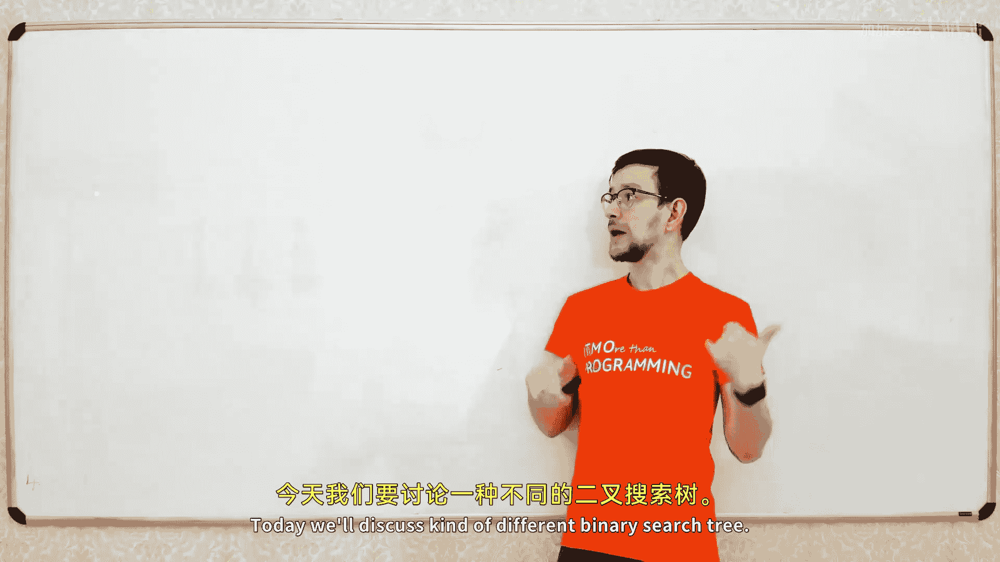
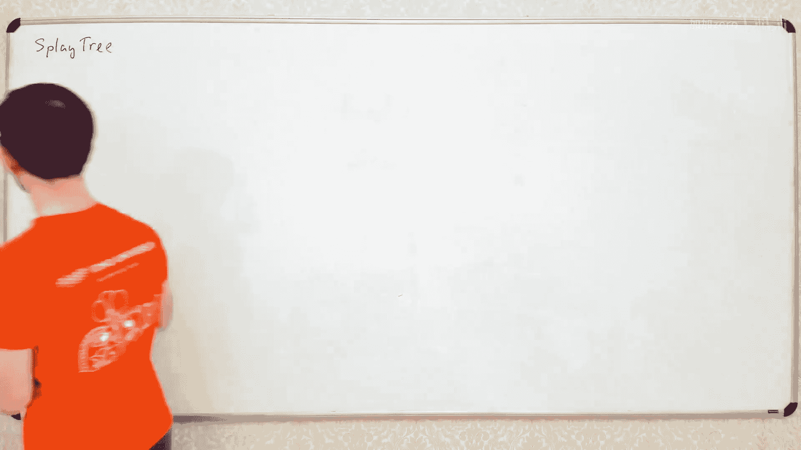
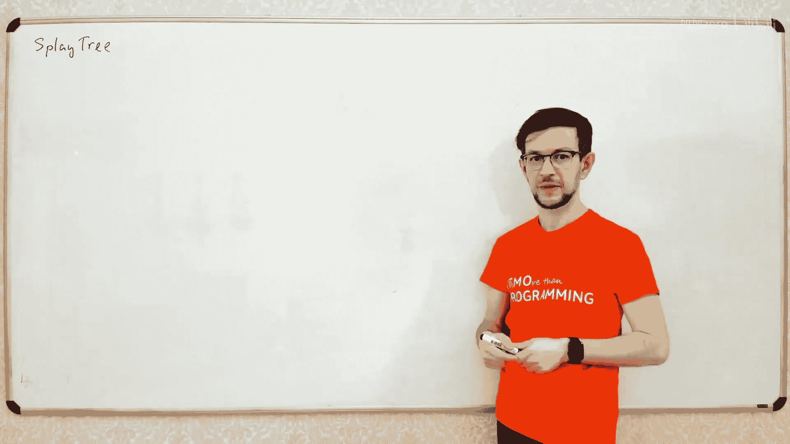
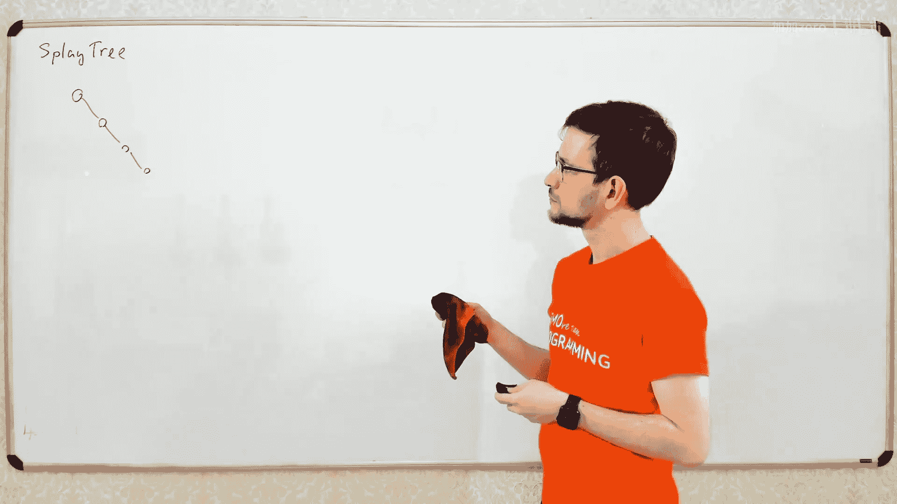
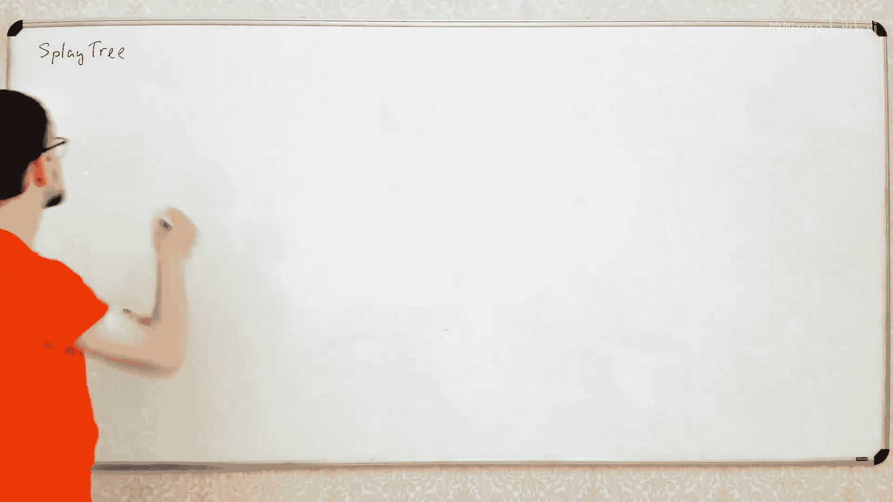
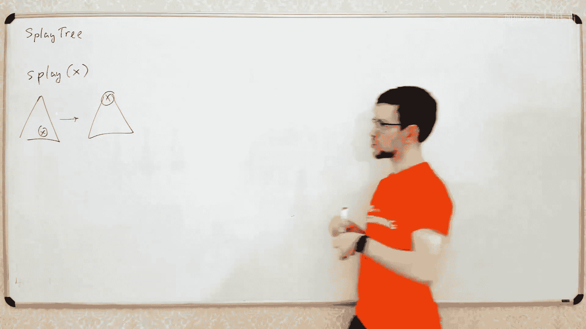
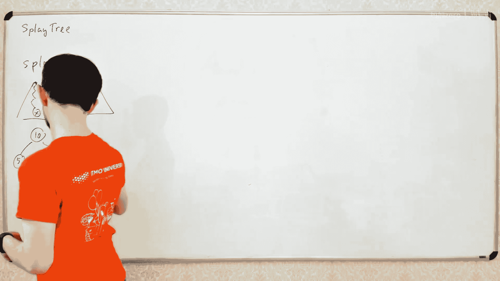
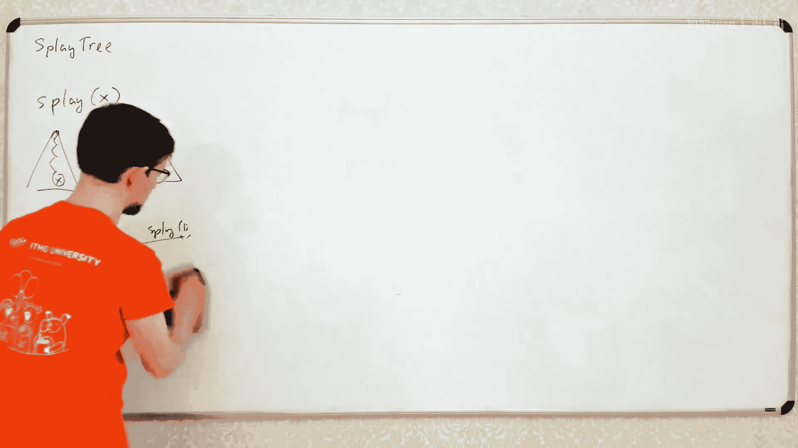

# 【精译⚡算法与数据结构】PavelMavrin p24 p23 A&DS S02E07. Splay Tree -BV1NLB8YfEMq_p24-

，🎼嘟嘟嘟嘟嘟嘟。🎼The。So today we'll discuss one more binary search tree and this will be a kind of different binary search tree so we'll discuss aviL trees aviL trees is like standard binary search tree it's very simple。

 you have simple property you kind of make all disertations to maintain this property and this property guarantees easier you that the hate always be logar。

We discussed trips。 tripp is also kind of。Simple little structure you have a tree you maintain very simple property and by making random some by assigning random keys to your notes。

 you maintain the height of the tree， the expected height of the tree laboratory today is kind kind of different binary search tree it's called Sp tree。

P tree is very cool。We will not maintain any properties。

 we will not save any additional data in our notess will not have any special keys。

 we will not remember the height of the tree， will not remember the weight of the tree will not remember anything。

 well just build binary the research tree and this tree will balance itself using some internal major。

Absolutely magic。So so any binary research tree is a valid display train。 So at some point。

 your display dream may look like this。おそ。This is a valid sp tree every tree is a valid split tree if your tree is like this it means that your sp tree think that this tree is best possible tree for you right now so in each point of time your sp tree maintains some structure。

Which kind of optimize your current situation？And some internal magic keeps this tree balanced for your current situation。

So like that。No， sp， display， Sp is kind of strange work Im。I'm not exactly sure what does it mean。

I believe I never saw this word。In any book other than about Sries。Yeah。嗯。

So how this working the main operation in this play tree is Sp， so that's why it's split play。

Splay operation is very simple to have a operation display。

Okay。Ex。This separation takes some node of your tree。So we have some three。

And you take some node of your tree。And by some rotations。

 you transform your tree into the same tree， but this x is now the root of the tree。

You make display variation and now you have the same tree， but this x is the root。と。

You can do making some rotations， here， so you have this pen。

You have this path to your root。And you make some rotations of these edges。

 so this x will became the root so every node may be the root of the binary search tree， right so。

You上 you have some。Here， five here， eight here。hoop。

So any element may be the root of the tree， yes， so you for example。

 if you take this 12 and call the s from this。12， you will have three something like this。

 so 12 will be the root of the tree and all elements will be somewhere here。응 수 수 수。

Something like that。안 돼。So you can again， look what happens， You take some node of your tree。

And make some rotations to make this element a root of the treatment。没事管。Now。

 how all other operations work， all our operations work very simple。I don't need a pizza truth。不。

I will draw a better tree。How will all operationss work。

 so let's we have separation operation findings。So what happens when you need to find some note in your tree。

 you start from the root？Yeah。And then follow the path to your element。Yeah。It was pretty simple。

 we discussed it on the first lecture about stories。

So start from the root each time you look on your current node。

 check which key is so if your key is greater than the key in the current node。

 then you go to the right sub， if it is less you go to the left sub and so on until you find your element。

So you find your element and after you find your element， you make this operation。そ you。

Go all the way down to this node X。 and then after this， you called display operation。

For these note days。That's the whole plan。 That's the whole plan。So。

 and this is how all operations in reward in all operations， if you need to access some node you。

Travel all this path， all this path。All this path through your note X。

Then take this node X and call display operation， Play operation must moves this node。都だ죠。

All operations work like this， so this fine you do。Youll do something， something。

 something in the end， you may explain。That's the whole plan。

 That's the whole plan of this binaryary search tree after。Any operation in the binary search tree。

 if you need to go down to this note。Then in the end。

 you take this note and call Playration for for this note。 This Playration will。

We will move this node to the same path up to the root and make this element the root of the tree。

Coook。Let's all。Now啊。I will prove。The time complexity of all these separations is loggan。

 but's not exactly， I will prove that amortized time complexity is loggan so。

I will prove that am is some complexity of this finite direction。你说的。Let's remember。

 what is a marized tang complexity， a marized tang complexity means if you have a sequence of operations。

If you have some sequence of operations。嗯。Some caps。Then the total time complexity of these caps。

 total time complexity of this。Deparation schools，1，2，3，4， and so on。

So you have sequence of K operations in your display tree。So if you。

Call this sequence of operations the total time you spend。Is no more than k loggan。

I want buy some foams。That's what amortized and complexity means。😡。

So every single operation may be long so if you have three late。And you try to access this note。

Then time complexity of this separation will be linear， so you need to travel this path。

Plus this path， so total time complexity will be linear。But it may， it may。

 it may not happen all the time。 So， so some operations may be long， may be how cold， maybe too long。

 but total time complexity will be no more than。Look at here。P's the plug。

 so this watch come up and complex to。How I will prove this， I will prove this very simple。

 I will prove the time complexity of this， so if you look on how this finite operation works。

 you need to travel all this path down and then you call split and this play travel all this the same path。

啊，所在。Time complexity of this find is actually the same， no more than。

Let's say two by time complexity of display operation。Right。So split version。

Travels all this path from bottom to top and fine operation travels all this path down and then throw all this path up。

So you need to make twice number of。Porruptions， right？

So I will prove that tank complexity of this is Laic。And if time complexity of flavor is very thick。

 then time complexity of wine is also very。And also all time complexity of all other operations is like everything。

 so if you need to access Sun node。You can do it in logarithmic time。

 you travel down and this node makes play operation and because of s operation we will prove that ammart time of Sp operation is logarithmic。

 then ammartized time of all operations is logarithmic。Go。That's the plan。オ。嗯。どか緒場の。Now。

 how to make display operation。Splay operation啊。So， we will。

Do it in three different steps so each time we will look on the node X。And two parents of this node。

 so we'll look on these two nodes， so this note will be P。So this is the parent of you know。

 this is a grand parent of。Average height may be no。 No， what what's my average height。

 Average height will not be very quick。 So at some point， you may。Build a tree like this。

That's absolutely normal， so that's normal， it basically means that you don't need this node if you don't access this node。

😡，The your plate tree may decide that this node is not important and put it in the bottom of your tree。

 that's fine。But after you access this note， you make F and this node will be moved up to the tree。

です。So if you know how the caches work， it's of absolutely kind of the same。

So when you access something， this element is moved in the front of your queue， something like that。

So something similar happening here so when you access some node。

 this note is moved to the top of your tree， so all the node which were recently accessed。

Move up to closer to the root of the train， so they they may be accessed faster and if some node is not accessed。

 it may drone down to the bottom of the train， that's fine。嗯哼。够。So how this play works？

We will look on two node on the parent of the snow and the grandpar of snow so look at these note two node。

And let's consider three possible cases， case number one。If node X has no grandparent。

 it means that we only have this parent and this parent is the root of the tree。

So we have this X and it's parent。Here is the root of the train。Oh。あ。Yeah。sAB。So in this case。

 how to make x the root of the tree， very simple， we will make rotation of this edge。

So I make one rotation of this edge。So after we rotate this edge。

 we have x as the root of the tree P is going here。Hey， BC go here，行。That's all。

So now X is the root of the tree。Very simple。This operation is called zig。Now。

 if x has a grandparent， So if if x is not a sign of the root of the tree。

 So if we have two more nodes。On this path。So let's consider two different cases， one case if。

At least。Two parents are in different size of x， so if you have x， and for example。

 p is to the left from the x and G is to the right from x like this。

So x is the right child of p and p is the left child of G。All the other opposites。

So the direction of these two edges is different。A。比。C and the。

Then how to make this x the root of this sub so this G is this G is sum of something so we need to make this x the root of this sub it's very simple with the magnetic x the root of this sub now we need to put this P and G as the left and the right child。

Of x。And here we put all other cis。Oh。嗯。要从。Again， this is the same tree this。

 it contains the same set of elements in the same order。

But here this x is the root of this sub because that was the plan。啊。

You can make this separation by making two simple rotations。

 so if you rotate this edge first and then rotate this edge。

you can do it by yourself so you can just yeah yes it's just two zig operations。

 you make simple rotation of this is H and then rotation of this edge you will okay you will have this big picture。

So the easiest way to implement this is to。The easiest way to implement this is to make a function which makes one rotation。

 so you create one function which makes this rotation and here you simply call it twice you call it for this pair of node and for this pair of things。

And finally， finally。The third case is， if。These two edges have the same direction， so for example。

 you have X。Ex' parent AP and parent G like this。Yes， this portion is called Zigikaza。

Yes this is the final case， so if you have like this。Then you make a expression like this。

 you'll make this x at the root of the tree。Put P here， put G here。

 and assign single all the three here。对对。That's the same if you make again， two rotations。

 but you need to first make this rotation and then make this rotation。So。First。

 you make rotation of this upper edge and then the ratio of this boat range。That's all。

 that's the whole algorithm。こ。Again， how to implement this you implement it a very simple way。

Your date is not X and。While this x is not the root of the tree。

 you make one of these free actions so you take your current node x。

 you see what is the parent of x and what's the grandparent of x。

If you have no grandparent if P is the root， you make this one rotation， if you have two parents。

 then you look on direction of these two ages， if the direction is different。

 you make this separation， if this direction is the same， you make this separation。

Every time you move this X up to the tree， so every time you have no。

You have this sub and now after the separation x is the root of this sub。

 so every time you move this x two positions up to the root。Let's make some example here。

Let's go some big example。Then it's because of 15 here， it's made it down here。Let's make something。

哦。你。Do we need two more direction？Let's make tomorrow let's make 24 here and 2 free here。Yeah。

 this holds zika z correct。And that's if you want to access this node。

 So you want to access this way。 So you may you go down to this note and then callsplay。this note。

 what will happen so you look on this note， so now X is here。Your look on two parents knows。

 this is Pe， this is dream。Now you see the direction of these two edges is the same。

 so you need to call zig zigig operation， so you make this zigig operation。

 how to make zig operation， you make this node the root。23， 2425 seconds。23 and then here。

 24 and here 25。So this X moved up to the root and now again。

 you look on this note look at two parent nodes this。Here this is June。

You see the direction of these edges is different， so you need to apply this。ZZigzag operation。

 so you apply this zigzag operation。21， 25，37，21，23， 27。So you make this。

 the left child of this is let released this is。Now X is here。그？And now finally， you have this x。

 this is the parent of x。So you need to apply this one zig operation。

 so you apply this one z operation。So 23 is here， 15 is here， this is now the left child。

 this is now the right child。That's so now 23 is the root of the tree。嗯。以上。Let's all， let's all。诶。

And now we have an hour to prove。That time complexity is actually organ。啊。Cool。

 so now actually if you want to implement this it's very simple。😊。

's that's all the picture you need again， what happened you make this all this separation in the end of each operation。

 you call this operation display operation symbol it's like while x is not the root。

 you look on two pair apply one of these operation each operation is actually the combination of two rotations so you implement this rotation and each time you just call this rotation and make one rotation or these two rotations this rotation this rotation or these rotation in this rotation and so。

They's actually like three lines of code。Maybe less if you are。啊。Good coding， let's on， let's on。

Now the tricky part， we will prove that ammarized stem complexity is a logar if we will actually prove。

诶。But better the I context it will proof。ALittle bit。Most we'll put a little bit。

 a bit more important inequality。We'll talk about later。Liろ。そ。How to prove the amorttan complexity？

Look， if you remember we discussed a martan complexity in the previous semester and usually to prove the martan complexity。

 you use the potential methods， you have something like that。

So usually when you need to prove the amortized time complexity here。

 you just say that amortized time equal to a real time plus change of some potential function。When。

 this fee is some potential function。好听。这啊。So we will assign some potential function to the current state of our display tree。

And then when we call display operation， we will look about we'll look on how much time do we spend to make this play and what is the total change of the potential？

And if potential is increasing， we will say that ammartized time is more， potential is decreasing。

 we will say ammartized time is less。And there。The idea is to make such potential function。

 so when we make some long aration， so when this x is deep in the tree so when we make very long display operation。

This potential should be decreasing。 Yeah， so we need to find some good potential function。

 which is decreasing when we make some long operation in our。Splay train。

How do by and Java send no pointers。In Java， you have pointers， Java you have only pointers。Yes。

 all objects and Java pointers。That's not a big problem。

If you then if you don't have pointers in your programming language。

 you can just assign some indices to old nodes， so you can assign some numbers to each node。

And just instead of pointers， you have the index of this node in your big array。

 you make a big array of all your nodes and each instead of pointers， you have index in this array。

So if you don't have pointers in your language。And the strange。2025， 21。

If you don't have pointers you still can implement binary research trees。嗯。What is this？嗯。😊，I'm not。

I'm not a real streamer， I had no idea what this mean， but thank you anyway。嗯。嗯。ご。Now let's go。

So again， the trick is to find a good potential function。If let me explain it once again。

 we we already discussed it in the previous semester。

 but it was a long time ago let me discuss this lets explain this again。

 so why is this is the good amorized time complexity because if you look on this sum。

So if you look on this。Total no let's take the sum of amartsan complexities for all these equation if you have sequence of correction。

 let's look on the sum of old Ammartan complexities。

 it will be the same as the sum of real time plus total change of potential this total change of potential will be non negative。

We will assign such potential， which is not negative。

 we will use only non negative potential functions。does to keep it simple。

That total time is no more than total amized time。And then I will prove that this amortized time is loggan。

 so this sum will be no more than klogan。That's the plan。

I will assign some special potential function such that this amount time。Is no more， some clo。Thats办。

I will find the function fee。Such that this amortized time is no more than kilogram。

 I will just prove this and if I prove this， then the real time will be no more than kilogram。

Because this sum of real times is no more than sum of amortized time minus this。

Dot change your perception。嗯哼。Mmh哼m。😊，嗯哼。嗯哼。😊，オッケーコプみ。So if you missed this in the previous semester。

 you can check the previous semester we would talk about。Fhiipbonachi hips。

 it was much more complicated destruction， this is easy destruction。故。All flips。プずこ。

So again the key is to find the good potential function。

How we will construct a good potential function， we will construct a very simple way。First。

 let's assign some rates to all their notes。 So let's say that。B off。X is the faith。哦，弄。

And today I will consider that all the ratess are equal to one。嗯哼。

Just today we will prove today will prove very simple than complexity if you want to prove something more interesting。

 you may want to assign different weights to different nodes。

 but today we willll prove only it is low complete complexity so we will prove the very simple case。

O。Now， let's say that。Let's say S of x is the weight。O suffering。So look at this X。

X is the root of some sub， so the total weight of all nodes in this sub is。Yeah。S of this X。두뚜두 투뚜。

Sorry， my chat is broken。哦。故。到。And finally， let's call that the red of this x is just log page2 of this s。

No， it was broken， but。え。😊，Also， it was quiet， but but it was working。😊，嗯。共。

That's all that's the all preparation now the potential will be just the sum of all rank。That's sold。

 that's the hope plan。That's how we construct the potential function for sries。哦。

It looks like kind of magic and it is kind of magic。So all these heroes went by Tarjan and Slater。

 actually， Dennis Slater is on code forces， you may find him on code forces。

Sometimes he make some comments in。For some problems like。

 you know that this problem can be solved using the trees which I invented。빨り公解。

He's also a coach of Carningbel IPC team。You may meet him in some word finals if you ever attend word finals。

So he's really cool you can find cons。And she invented all this theory。嗯。I believe in。80s when wasn。

I am not sure。Let me check。Just。To be sure。this paper was in the。Yes，85。This is 985。

I was one year old。😀へへ。😊，够嗯。嗯。So this proof looks a kind of magic。

 so you we build some strange function， then assign this amorized cost。

And then I will prove that if you use this function with the amized cost， that time complexity。

 you will be linear， sorry。Can you not interrupt me during the lecture， please。Thank you。こあ。Now。

 that that， that's all that that's this advanced function。 Now。

 I'll apply this potential function with this Amized cost and prove this this Am cost is not me。

 Thats the one。Now， what will I prove actually？I will prove the following inequality。

 I will prove that。ハマた coast。Of display operation。Yeah。Is no more。then。

One plus3 multiplied by difference of these ranks。です。So this is the new rank of x。

 this is the old rank of x you stand point。You take this X and make。Make it the root of history。

 so this is the older end of x。This is the new conference， best plan。First。

 let's see that this is enough， so if we prove this。😊。

Then we prove that this am has caused this logarithmic no， that's simple。

 So let's prove that this is no more than logan。Can you prove this？

So what is the new rank of x so new rank of x is the logarative of the total weight of all these nodes。

 total weight of all these nodes is n right so after you make this preparation for this node x。

 so since this is the root of the， this total weight is n。So this new end is logarithm of this size。

 the size is m， so this this is log end。And this stuff is negative， so this is no more。

Then one plus free logan。This is a big open， Logan。So that's simple。But actually。

 this inequality is much much more cool， so we will use。😡。

This again inequality later in this course so this is much more interesting。

 So it basically says that if you try to display some node。

 time complexity depends on the current rank of this node So if you try to display some tree which is closer to the root。

 so some node with big rank so if this rank is big。Then this difference is small。

 so actually time complexity of displaying the nodes which are closer to the root is less than log n。

 so if you try to display some big nodes which have a lot of children， time complexity will be small。

Okay。Lets hook one let's move to the proof now I will just present you the proof from this paper。

 so if it also looks like kind of magic， we'll just apply all this。Make some strange。

Abraitions and C that is it is correct。 We'll just see this correct How will see this。

I will prove the same inequality for all different operations， so I will I will。Do before。我して is。

I will prove it。If you look on every simple operation here， thenplex will be like this so for this。

Zig operation time complexity will be。No more than one plus3 rank x minus rank。

And for these preparations。Okay。Zig zg or z z。Yes。Will be no more than just free。

R x minus R X like this。Now， let's notice that I have this plus one here。

 but I don't have this plus plus one here。 So here I have this。

Difference of ranks plus one for this zig operation， but for these two operations。

 I have just these three multiplly by difference of ranks， I don't have this plus one。

That's important why it's important because this time complexity of split。

Is actually the sum of these time complexs of all these separations。

 so if you start from for some node X。You have this pad and you make some operations。

 you make some zig zig or zigzag operations。 So you have this zigzag or zig zig you have。

Some number of these operationss and finally in the end you have maybe one seat operation。あまだ。Now。

 if you look on this time complexity of all separate operations。

 then time complexity of this first zig zig， let's say is around two minus strand one。

T of mixture of the second is rank3 minus rank two is rank4 minus rank 3， and so on on final。

 we right minus k minus1。So if you calculate the sum of all these un complexplexities and here you have。

1 plus。Right minus1， minus-2 chi minus。Okay， minus arch chi minus minus1。

if you complete the sum of all the same complexities。

All these middle rents will be eliminated so this we have R2 minus r1， r3 minus r2 and so on。

 so all these。的。All these intermediate ranks will be eliminated。 So you have。 in the end。

 you will have one plus R K minus R1 like this。Okay。

That's why I can only have this plus one in this zig in both these operationss。

I can allow this plus one。Because if you have plus one。

 then in this sum you will have some of all these ones。

 so total like will depend on the number of de separations。

 but if you don't have this plus one it's just difference of these ranks。

 then if you have some of all these separations you will have only this last rank minus first rank。こ。

I need to already say everything， it' it clear about that。

NowNow it's the time when I erase everything and just show you the proof。Let's wait lets wait。

 let's wait one more。Let's prove this， I don't need a lot of space to prove the operation。SoFirst。

 let's prove this。Time complexity of Zig operation， it's simple， let's look on this picture。

 so time complexity thing。Of Z operation is time plus change of potential。Timeme is just one。

 we need to make one rotation， so this is one。And what is the change of potential。

 change of potential is， again， potential function is sa ofpho ranks。

Let's check which nodes actually change the ranks So all ranks here are the same or ranks here are the same。

 So inside this subaries or ranks remain the same， so the only two nodes which change the ranks are this x and p so this deelta p is new rank of x minus rank of x and。

New rank of P minus rank of P。M哼。😊，那我行。Now why you just playing them。

This difference is less than zero。嗯哼。So this is normal more。No more than one plus。X minus X。

And since this is greater or equal than 0， it is no more than one plus3。X minus0。对。

Good enough so it's simple so for this one sec operation again how do you calculate the10 complexityity you see what is the real time of this operation and what is the change of potential real time is just one and change of potential is this so you have this node and this node for this the rank has changed for all other nodes。

 the rank has not changed so you look on the change of rank of this node x and change rank of this node P to this this is negative trailer here we have this oh that's very simple very simple。

그。But that's only for this z operation， this e operation is simple because we allow this plus one。

In these operations。We don't allow this plus one， so we we will need to kind of get rid of this。

Plus constant， so this will be tricky， but for this z operation it's actually pretty easy。呼。Rium。

 now let's move to list operationss。I will need some space。가져마！Well let's start with some。

 let's start this exact operation。 What happens when you have the exact operation？

I's do a picture again， you have this up。We have this X， this B， this。Do we have some note here。BC。D。

Now we have play zig z， so this x is now the root。B is here。 G is here。你。第音。行。系 돼。开し。そ在直さ。No。

Lets time complexity。 So let's look on this time complexity time complexity will be。

I'll just make it in one step， so we need two operations to make zigza， yeah。

 so weve made two rotations。Plus changed of the potential。What is the change of potential again。

 all the nodes here have the same rank， they only only these free notess。Change the ranks。

 so let's look on the change of ranks of these three node。

So it's new rank of x minus rank of x plus new rank of E minus rank of B plus new rank of G minus rank of G。

Oh。嗯。Makes sense。That's all。Can't we make something， what does it mean？I don't get it。Sorry。

 I don't get a question。So thiss simple exactag operation， yeah。

 this 10 complex of the exag operation。Well let's simplify this， let's simplify a visit。Let's see。

 first， let's see that。This node and this node have the same ranks。Again。

 a is just the log of the size， so this G。Al G and this U x have the same size。

So this node contains all these nodes， node contains all these nodes。 So it's the same set of nodes。

 they have the same set sum of weights。 So the rank of list to nodes is the same。So we have these。

Plus new rank of x and minus new rank of G。They just eliminated because they are the same。Right。Now。

I need to get rid of this， I need to get rid of this。So this' old random of beads here。

So this old rank of pe。哦。I。Great than- so rank of P is greater than the rank of x。そ。

This rank of P is greater than the rank of p。So if I have this minus rank of p is no more。

 than minus rank of x。Right。那手子是呢。So all this is no more than2 plus。おととん？慢。

inus2 ranks of x this minus random and this minus x。Plus， new rank of P and plus new rank of。对。对。

And now I will prove that this sum is no more than2。Neur rank of x minus rankov x。

Here I have two instead of three。Because I know that that's how the proof works this is more strict equation。

 if we prove this， we will also prove then the same the three because this thing is not negative。

 so I'll just prove more stricten equation。Because I know this how is working， I know the proof。

 if you don't know how to prove this， you may spend some time to find this button。

I have no idea how they get somehow they found this proof， that's cool。嗯。Okay， so let's prove this。

So we need to prove this， let's move this to the right and this to the left。So we have two R X here。

 and we have。-2 rx here， and we have minus-2 Rx here and minus-2 Rx here。

So these two will be eliminated， we can eliminate this and this。으으。

Now we'll move this two to the left and to this two to right and this to the left so。

New rank P mine plus new rank G-2。 New ranks of x is no more than-2。还有的还有 with me。😊。

By now there is very simple， very simple transformations。

Sip some non important parts and move everything from left to right and visual okay。

Quite simple transformations。꼭！And now let's do something intelligent。

 So now let's remember that these ranks。These ranks are actually logative of these sizes。

So what happens if you have some of logarithms， some of logarithms is just logarithm of the product？

诶 so。This thing is actually just logism。Of the following thing， so it's new size of P。

Multipliied by new size of G。And divided by。Ill just write it twice new size。

New size of x applied by new size of x。And I need to prove that this logarith is no more than minus2。

嗯哼。😊，That's wrong basically。Now I will split now I will remove this logar。

 So I need to prove this logar is no more than -2。 That's mean I mean。

 I need to prove that this is no more than。1舒。And I will split these two fractions。来再走。Let's走。

 and now then tell part。Now let's look now let's look why this is correct。Let's see。

 So what happens here。 The first fraction is the size of。The three pie is this size。

Divided by the size of x， so it's divided by this mix。Right。

And here we have the size of this right part。Divided by least size of x。不。Let's assign some。

I need free letters。Well， let's have I okay， okay， let's have alpha birthday thema。

So the first the first fraction is。I think divide by gamma， and second is better divided by gamma。

And this gamma is actually the sum of this alpha gamma is greater equal than alpha plus beta。So。嗯哼。😊。

Now let's see these two fractions。Have some no more than one。

 so if you look on the sum of these two fractions。It is。Let's circlele in the one。

because this gamma is just the sum of this。You can think about very easily so this is the fraction of the size of this set divided by this whole set and this fraction is the size of this small set divided by the size of this horse so the sum of these two fractions is no more than one。

嗯哼。滚。啊。And these are these two fractions， this is fraction this size of left divided by size of the hook。

 this is the size of this right， divided by size of the hook。😊。

And now I just claim that if you have two fractions。

And the sum of these fractions is no more than one。

Then the product of these a fraction is no more than one fourth。No， why is this correct。

 not Because if you look on the maximum two of this product。

 the maximum of this product is when these two fractures are equal。So this product is maximized。

 then I have two equal fractions so and if the sum is no more than1。

 it means that both these fractions are no more than 1。5。

 it means that the product is no more than one。That's the magic。Let's all。So again。

that's the whole proof So how how did we prove that the tank complexity is what we want we just write this tank complexity so this is the real time。

 this is the change of potential。Now we just transform it a little bit to get this fraction so and here we just remember that this rank is a logarative of the size。

 so this sum is just the product we modified to make these product or two fractions and now we just look on these two fractions see that the sum of these two fractions is no more than one。

 it means the product of these two fractions is no more than one for。哦。没错。Okay。

 let's prove the second one。Now we'll just prove the second type complexity in the same way。

So what happens when you have a CZ operation？Then you have this X，B G。And all these subies， A B。

C n d。And when you make zig operation， you make this x the root of this tree， you make P here， here。

And all the tree here。没。Now just do all the thinking。😡。

Let's see that amortized time is to plus change of potential。

 change of potential is the same as new rank of x minus all rank of x plus new rank of。

ピン minusイオラ ofピー plusスにラ of gー minusイオラ ofチ。Now we'll transform it to remove everything is not important。

 so this older encodegy is the same as neuroen of x when remove all the encodegy I remove neuro end of x。

Now I yet to get rid of this P， this P is no more than rank of G is greater or equal than rank of G。

So this minus rank p is no more than minus rank x。Now I need to remove this rank。

 this new rank of P is actually less than rank of x。

 so this new rank of P is no more than new rank of x。Right。

Oh just just removing an unnecessary sorry it feels it does no more than two。

Mus rank of x minus rank x minus2 rank of x。ププププププ。Plus new rank curve x。Okay。Plus。

Last new rank of G。嗯哼。😊，Nice。And I need to prove that this thing is no more than3 neuro round x minus f x。

Again， do the same thing， just move this to the right， this to the left。I move this two to the right。

 this move to the left so what happens here， I have plus near end。Mus three neurons。

 so it will be minus-2。Nance of facts。Here I have minus two ranks。Plus free ranks。

 so it will be plus rank of x。And this will be plus new rank of dream。

There's no more than minus storm。Again， I I don't remember this， this rank is lower more size。

 So it's， again， I just just do the same。 So it's size of x divided by。

New size of x multiplied by new size of G， multiplied by new size of x。嗯。No。Not too fast。

I just do the same thing。I need to prove that this is no more than one form。

And I prove it it the same way， so let's look on this in equation， on this， so it's fraction。

 so this is size of x， so it's size of this century。And this is size of this section。

And this size of x is size of this whole tree。Now again。

 you see that this big tree consists of these elements， plus these elements， plus element。B。

So the size of this big tree。It more than some of these two sizes。嗯哼。So again。

 we have product of two fractions， some of these fractions is no more than one。

So use the same trick as here and see this product is no more than one4。Let's说 let's松。고。통 트럭트록터톤。

That's basically the cool proof。I'm just waiting for your questions if you don't have any questions。

I can talk about any advantages。啊。If you just need if you just need to have some by the research tree。

 it's actually usually not very important which is poetry and its。In practice， it's。

Not so widely use I me think because it's aized cost because of the amized cost in every3 you have guaranteed the worst time can complexities loggan so it's always working logan time these trees sometimes some operations may take a long time。

So since this time complexity is amortized， so some par actually works too too long， but so it's。

I believe not not so cool to use it in some very fast data structures when you need a first response for all your operations。

 but if you have some algorithms， it's widely because that。

Sometimes this's work faster than than login time， but let's talk about this。Let's talk about this。嗯。

抽紧。事です。啊。早。啊。So in the first lecture， on the first semester。

 we discussed that we only measure the time complexity in the worst case， right？But。

Sometimes you have not a worst case， sometimes you have some some case。

 you don't know if your case is the worst possible case W time time time complexity is good because it guarantees you that all cases are not。

In all cases， your data structure work fast。Sometimes you think that maybe your case is not the worst case。

 so maybe in your case it's actually worked faster than the worst case。Let me explain。

 so for example， let's have some sequence of operations and the sequence tries to access the same node multiple times so you have this operation。

You try to find some node and you do it multiple times。So youど it形態？

So just try to access the same note multiple times。

And now if you use some some Euro binary tree like AL tree or trip， so if you have some A tree。

Or rep or trip or anything what will be the time complexity it will be Kloggan because each time。

You walk to this node， so you need to spend log time to find this node and you do it each time on each equation。

So totalix will be cable again。Now， what happens in this play train？こ。

So what will be the time complexity here if we just try to access the same node k times in a row？

Just just in sequence， each time you try to access the same node。

 what will be the total time complexity of all these separations？not exactly Loan。

You still need to access this node all is right all this time， so it should be loggan plus k。

 which is that's more correct。Okay。Oh because in Play3。

 you try to you spend login time to make the first play。

 so first the first plays you spend login time。After this first operation， you make display。

 so this x is now the root of your tree。So all these are the operations。Don't need to make any place。

 they just go to the route to find x and finishes， so all our operations works in Contantine。Do。

 F Ra will be this。So it turns out that in some special cases。

spries actually have the better time complexity here than some other standard binaryse trees。

And there is a very cool theoryor， I will not explain it， but let's just take us。Take a look。

There is a cool theoryorum which tries to understand not only the worst case， but all possible cases。

Yeah。嗯。This here works like this， let's have some sequence of operations。

So imagine you have some sequence of operations。Let's find the best possible binary search tree for this set of operations so if you have some special binary search tree which works specifically for this set of operations so you know all these operations in advance you may do any rotations you want。

And you do anything just to optimize this set of operations。So if you have this binary search stream。

 let's say that the time complexity of these operationss will be the optimal。Mal time。For all。

Bin is your trees。's just check all possible binary search trees and find the optimal binary search trees for this specific set of operations。

😡，嗯。Now let's call the same set of corrections in a split train。

You will have some seat display display。The question is what may be the max possible difference。

 So if we just take the difference between this。我 so。

What may be the maximal difference between the time complexity of display tree and maximal possible theoretical like theoretically optimal time complexity for some binary search tree for this set of operations？

And that's an open question nobody knows。啊。What people know？😮，Actually， this is a hypothesis。

This thing is no more than constant。啊。Why it may be correct， why it may be correct。😡。

Because there are some special cases， what's the problem， how to prove this。

 how to prove this you need to find for some set， some set of operations。

 the optimal binary the search tree。We don't know how to find the option binary research stream。😡。

Yeah， so it's kind of it's very， very this is， very difficult prove。But for some special cases。

 we actually know the I complexity of the ozone binary cellstream， for example。For example。

 let's say you try to access nodes in the sequence。 so you try to access node one， then find node 2。

 and so one then find。Not so if you make this sequence of operations。

We know that we can do it in linear time right no we just move this one。

 then move the next element and so on， you can do all the separationations in linear time。Now。

 if you look on display tree and try to run the same sequence of correction inplay tree。

 you may prove that this time complexity of display tree is also linear。그。

And that's interesting because S3 doesn't try to optimize this set of operationss。

 it just make all these play operationss try to rebalance itself somehow。

 and it turns out that it still works in linear time。For these set of operations。

And there are other special cases， for example， if you have different。We that like here。

 if you access some elements。More frequently than another set of elements。

 these frequently accessed elements will be closer to the root。

 so the time complexity to access these small set of elements will be smaller than time of access all elements which are not so frequently accessed。

So somehow this play tree maintains the frequent Texasas elements closer to the root。

So the time complexity is kind optimized。So so people trying to find some case when these split rewards actually worse than some optimal binary industry and they still didn't find any。

So they tried some strange set of operations for which we know some optimal binary the research tree and in all these cases。

 it turns out the plateatory also works in the same time complexity。Nobody knows why。

맛s your welfare thing。啊。He and Roman fri play operationsions in such cases like no push and the node uppers and the next throw there still many operationss。

So the trick is we don't need to optimize S3， play3 already works optimal。😡，Nobody knows right。

But it turns out if you have some set of operations， split risk somehow how optimize itself。啊。

Sometimes it's happens for some other sources，It's known， for example， for optimal caches。

 So if you look on how cash works， Op cash， then there are some。Care strategies。

 which is known to be optimal， so there's no that you can't look it like constant factor。

So the difference between some cash strategies and the optimal cash strategy is no more than constant so sometimes for some data structures this happens so maybe it still maybe it happens for theries but。

It's very hard to prove because again， you need to prove that for all possible trees。

 the optimal time is this。And you kind of need to prove the lower bound for them complexity and so you need to prove that all possible binary research trees works not faster than this。

 that's hard to prove。こう。Okay， the final thing I want you to remember till there。Three more lectures。

 like in three weeks， maybe maybe in four weeks， maybe in four weeks。

We will need this play trade again。And we will need it to optimize another data structure。

 which is Li capture。How we will optimize the linkka。

 we will optimize the linkka in the following way， we will make some data structure。

And we will use play trees inside the destruction and the time complexity of sum operation will be calculated as sequence of split。

 So we will make some split rules play。S X， then the。X1 X2。It's free and so on。

So we'll make the sequence of space。And if you just say that each is works in log and time will have log square。

 but we know that the time complex of play is actually not more than one plus。

Change of difference of these ranks。变收 on。So we'll use this instead。

Then calculate the sum of all these differences。And it turns out that this sum is normal more than loggan。

That's the plan for the future lecture。So， Google。We maintain some。

Weights of some potential function with the same potential function。And。

When we have the sequence of some split operations。

We will calculate the sum of all these time complexities。And this sum will be no model loggan。

And if you just use the regular binary search tree。

 you will have loggan in all des and so this sum is will be log square。

 so we will optimize another structure using this plaries instead of regular binary search trees。

So let's plan for the future。Any more questions？It'Tooo fast。Maybe never forgot something。嗯。

I them think so。I don them think so。Again， you may have all operationsations you need in the binary search trees。

 so you need operationsations you need to you can find the elements。

 you can find the closest element， find the minimal element。

 find the maximum again how to find the minimal element， you just go to the minimal element。Oh。

And then make play of this minimal element when you need maximal element。

 your row to the maximal element， then makes play of this maxim element。

You can make split operations， merge operations， you can think about this that's justing。

 I will put it in the home task， but you can think about now can make。Split operations。

 merge operations， all operations you need for the binary search trees you can make with split trees。

Very cool structure。嗯。Or is it free missing， whats missing， what missing？喂。그。What of them is？爱0清。

Okay， I think it's all for today。