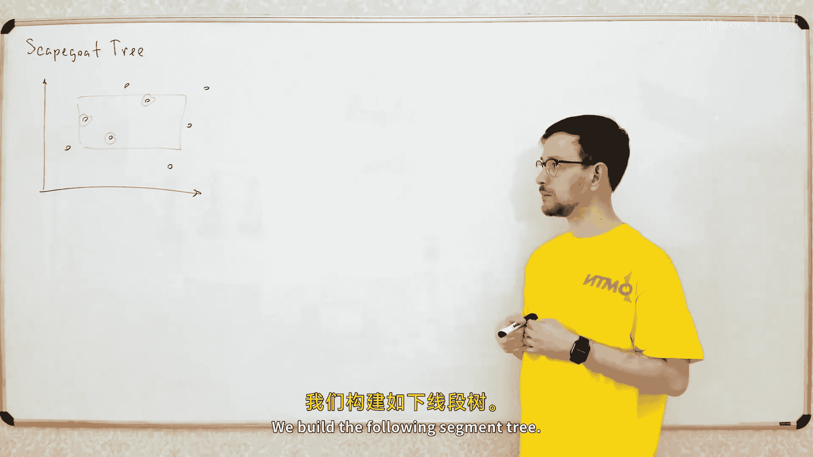
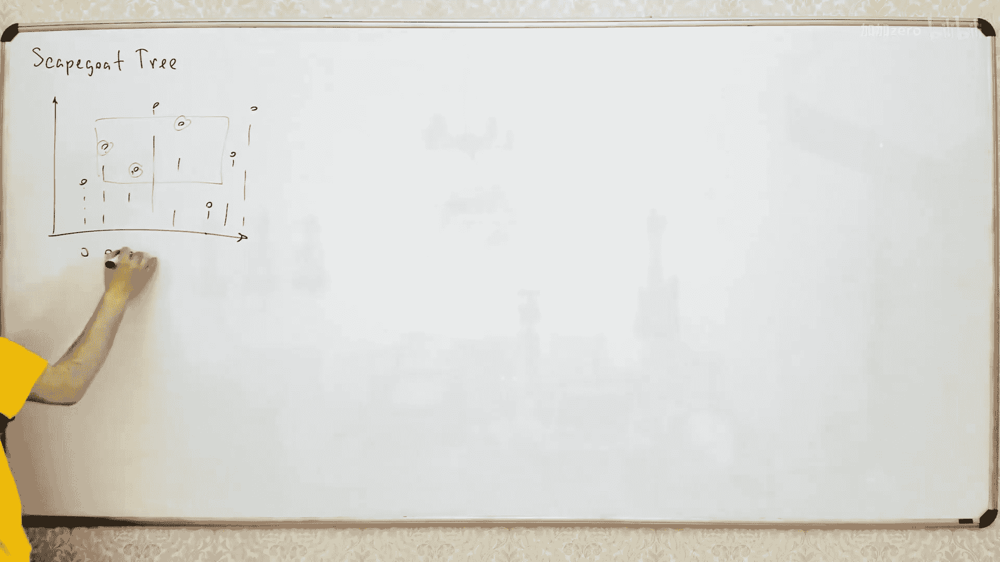
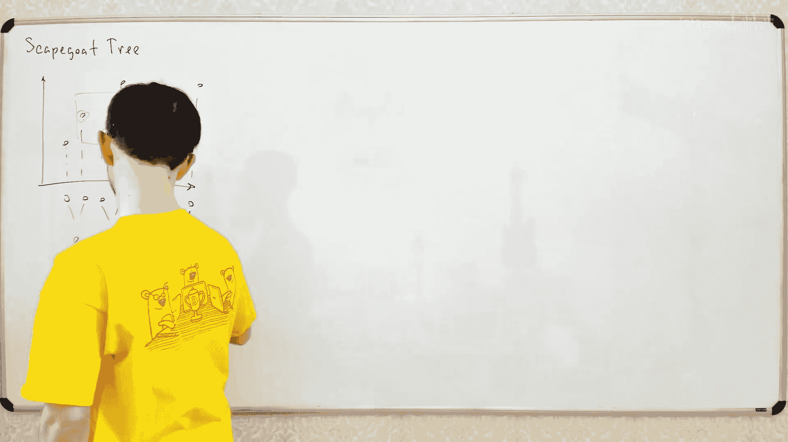
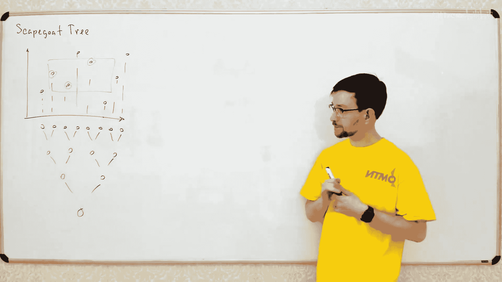
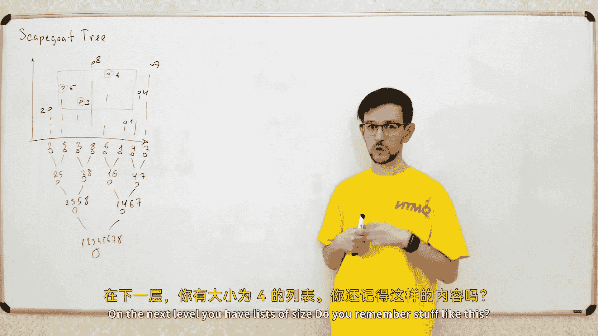
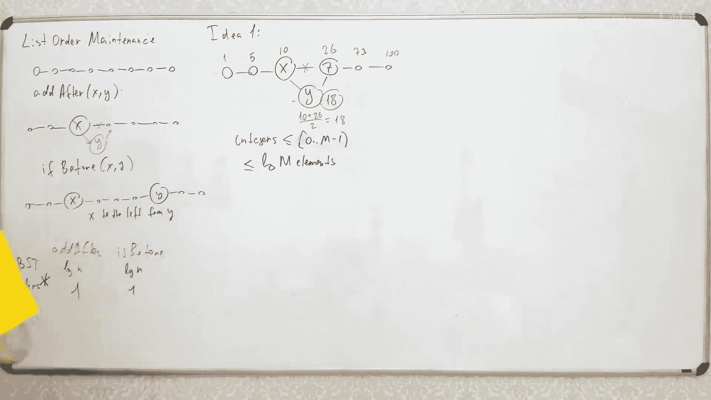

# 【精译⚡算法与数据结构】PavelMavrin p25 p24 A&DS S02E08. Scapegoat Tree, List Order Maintenance -BV1NLB8YfEMq_p25-

，🎼嘟嘟嘟嘟嘟嘟。🎼The。So today we discuss one more binary research tree。

 I promised the last time that it was the final binary research tree。

 but no I care one more binary research tree to discuss and this why final this is the last binary research tree we'll discuss in this course。

All right， this binary search tree is kind of special。

 it allows you to solve some special problems we will discuss all these problems today and this binary tree is called cable。

Oh。Oh。

Yeah。So let's try discuss the situation so let's start from the beginning。

 so in what situation like the usual binary actually like ave trees。

 plaies and all other trees can be used。

Let's remember the problem from the。Like three lectures ago， you know。

When we discussed two dimension problems on the。Segmentaries so when we discussed two dimensional problems in single press。

 we had problems like this we。We have a set of points。Let S have eight points。

What this。You have set of points and you want to be able to answer the queries like forgiven a rectangle。

 find all points inside these rectangles。それたの。And you need to find all the points inside the rectangle。

 maybe you remember this problem from。It was when they discussed two dimensional problems about segmentsaries。

Yeah。If you don't remember买L。I'll just refresh everything in your my right now so how we solve this this problem using segment3。

 we build the following segmentary， we build segment3 by x coordinate so we。

Just have all this。X coordinates of all points。

And build the segment tree over the exate。So we build old segment two like this。어 응。

Just see some space。

So we built segmentary like this。

And now in each note of this segment three， we maintain the lists of all points inside this segment sorted by y coordinateordinator。

 so we take all y coordinates of all points。let's say they have one coordinates like this is one。

To free。4，5，6，7， and 8。

Just for simplicity，s let's have all way different and small。And then， in each。

Note of this of this segment3， you maintain the list of all points in this segment sorted by white coordinate。

 So here we have something like。2，5。Create。6，1，4， and 7。On the next level。

 you have lists of size two， so here have two and five。Here have three and8。 Here you have one and 6。

 Here have four and 7 On the next level， you have lists of size 4。 So you have2，3，5 and 8。

 and here have one，4，6 and 7， and here you have list of all。こで。嗯哼。😊。

Do you remember stuff like this huh？

Again， I need someone。To say something in the chart at least every minute， okay？Yes。

Just to keep it alive， okay？So how we solve this problem again， if we we can build this tree。

In andlogganine， yep。So we we build this tree from bottom to top so we start from this bottom layer of your tree。

 build all these elements now on each next level， we just merge these to sorted lists in one sorted list。

 we can do it in linear time， so the total time we need to construct this segment tree is andgan。诶。嗯。

아。や。Now how to the query， to answer the query， we take this rectangle， take its projection on x。啊And。

Have this segment。 So we have this segment by export need。

 Now we make a standard request in this segment3 and find。they。Segments。Which inside your segment。

 So we again we make a requesting this by in this segment three again we start recursing here。

 go here here make back back back back take this Now we need to take these three segments by F coordinated and now in each segment we find all points inside these range by y coordinates using two binary searches。

 So we make binary search by this。诶。This worker lets find them in this list and all values inside this segment are inside your rectangle because they are inside your X segment and they are inside your Y segment。

So we can look at how we do it， we make one recursive request from here。

 we start find these segments in each segment we run two binary researchers to find left border and right border and all points between in our segment so we need to have these logan segments in each segment we run binary research so have we spend log and time in each segments so we have log segments。

 log time for binary research so total time will be。Qu it will be O Square。

And we will also discuss how to update it to work in loggan time using cascading。

It's not important today， it's not important today。

 so let's just say that it's possible to do it in log square time。Now。

This structure is very cool when you have a fixed set of points so if all points are fixed。

 then you can spend this analog and time to construct this segmentary and then you just work with this segmentary。

 but what happens if your problem is dynamic so when you need to change something in your set。

 for example， if you want to change y coordinate。Let's say you take some point。For example。

 let's take this point。Let's take this point and move it down， let's say，282。

We have two points with the same cognitive， it's not a big deal also。

So we take one point and try to change the y portion of this point。How can we do it Very easy。

 We need to take all the lists。Which contain this point and update this white version for this list so take。

This list， this list， this list and this list。And in all these lists， we need to remove6 and add two。

 right？So we remove this six F2， we remove this6 at2， remove this6 F2 here。Remove 6， add two。

So that's how updates work。We again we all lists which contain these six。

 so we have like loggan lists which contain this value here。

 and in all these list we need to update this value so we will remove the previous value and add the new value in this list。

How can we do it。Policing， we need instead of lists。

We need some data structure which maintain the sorted order of the elements。

And it capital tool to remove the element and add new element， so we need some data structure again。

Which will maintain this list for this list， we need to be able to remove element and to add new element and we need to maintain this list sorted。

What data structure do we need？Any ideas？We discussed like three of them。

You need some binary research tree。So if you maintain these lists in binary search trees。Or set yes。

 set is basically binary the research stream。Yeah， C++ set is basically binary research tree so there is a red black tree inside this C++ set。

So instead of instead of having these lists， we will maintain binary search tree in each node。

 sorry each of these list is actually a binary search tree。Now how to update the value。

 we take these four binary search trees and each binary search tree will remove one value add one new value。

嗯哼。😊，속 도로 than complexity。Change Y， let's see， willll be look square。

And after this separation we still can make this request because what do we need to make this request。

 we need to get to reiterate all these notes in each node find left and right border of your segment。

 you can do it in binary search tree in binary search tree。

 you can find all values between left and right border in loggan time。

Like it's like in segment three， it's the same way you find the left border recursively。

 find the right border recursively all values between are the values。不。

So changing y is not a big deal we just have。B the search trees in each note instead of this list。

This video will be new all videos are available on my YouTube channels。

If you don't know my YouTube channel， its link is like in description。啊。那。That's easy。

But what will happen if we need to change x coordinate。

 So if we need to take some x coordinate of some。Point and change it。

The yeast is motor here because when we change X coordinate。

 we actually change the order of these elements， so we need to reconstruct the whole tree。

That's complicated。Or what happens， for example， if you want to add new point to yourself。

 you have these a points？Let me move this just remove this updates。这。点中。Six here， six here， six here。

 six here。So what happens if you add one view point to your set？If you add new point to a set。

 you need to reconstruct this segmentary， right？But you came to construct the whole segmentary。

What we'll do？We will do it the way we will just maintain。This segment three， note。No。

 not if we're perfectly balanced set。Bineary tree， but we will allow to make it not so cool。

 not so beautiful。 For example， if we add new point， let's add some new point。let's at point here。

 for example， at point we've got at time。So this point is between six and one right so between these two points we need to add one new point9。

How can we do it， We will just add one new note。So here we add new note with volumeun name。

Yeah let's split this notes so in this list in this leaf we have only six and now we need to have six and nine。

 so let's split this leaf into two notess。s生嚟。えう。And now we add9 to all nodes in on this path。

 So we add9 here， add9 here， add9 here， and add nine here。这个。What happens again， you have your train。

You have some leaf and you have value X here。You want to add one you value。😡。

I don't care I I don't want to have really挖。Let's看 value A and value B죠。你会不会有A here？

And you won't insert value B after this value A， so what you can do。

 you can split this leaf node into two leaf nodes， put a here would be here。

And now you can add this be to Hope Pth。So you have all this node。To the road。

Now we just add this B to all nodes on this spread。Yeah。こ。Now again， you can make the same requests。

 but now it's not that beautiful， perfectly balanced。Binary tree， it's kind of ugly。

 but still you can make all requests right， so again each note represents some segment of your x coordinate。

In each node contains all the points in this segment sorted by white coordinateator so it's still a nice tree yes you can make requests like like before so again read all this three each node represents some segment if you need this segment you take this segment run to binary researchers find two borders and so on and you can answer the same requests right。

Right。So what's the problem？咳。Again， this is how you add new points to your set。

 right when you add new points to your set。You take the closest leaf node。Add two node here。😡。

And add this new value to all lists on this path throughout。Oh you can update X to update X。

 you just remove point and then add new point， so when you need to remove point。Look listen。

sLet's move some point instead of adding this point。This picture became。Money okay， that's fine。

 so let's move some point， for example， when we need to move。Yeah。Let's take this point in five。

And try to move it here。So we need to remove this point。And add new point here。

 so we add new point here。Add this new point to all the lists here。

 so we add five here and five here and five here， and now we remove this point。

And we can remove point in the same way we just remove this point。

 we can collapse no we just we can just remove it from all elements here， we can remove it from here。

 remove it from here， remove it from here。And we also can collapse these two leap into one if we。

If you want to save some space， you can also collapse these to nodes into one you can just remove this node。

So now this node represents two and we just remove this five to。Again， let me show you again so。

So you have these two，5，3，8。6，1，4， and 7。 you will have2，5。 Youll have three，8。 You will have one，6。

4our， seven， two， three， five， eight， here we have one， four， six， seven。

 and here we have everything。是。And now when you move this five。Here。

What will happen you remove it from here， so you remove it here， remove it here， remove it here。

 remove it here， so now you have this note。土。And here we have three and eight。啊。So much space song。

8ight。And now you need to add this five after this six， so you split this six into two nodes。

You have 5，6 here。5ive here， six here。And not if I like Wi56。広。He is the same。嗯。응。

I can we recover all。This is how you update the extra coordinate you remove。😡。

You remove one note of your tree and add one new note to your tree。Okay now5 is here。🤧咳。And again。

 you can do it in log square time right so you remove five from all these lists again all these lists are just binary search trees so you need to remove these five from all these binary search trees。

And now you add this new value here。 So you just add this value。All these binary the research trees。

So you need to make log n removals from binary search trees and log in and sort some binary search trees。

Look cool right， what will be the bubble？😡，嗯。Any ideas？哇。Space node。

 space is still linear so we have linear number of nodes again。

 we removed one node and we add one node。So the total number of nodes is the same。Right。Okay。

 let show so I want this separation to work in log square time。😡。

I want this operation to work in log square time， to work in log square time。

 why this operation works in log square time because I have log n layers。And when I make apoation。

 I need to make operationpoation on each layer of this tree。Right。

So when I make some change or I make this request， I make one operation on each layer of this string。

And since this tree was perfectly balanced， I have loggan layers， so the height of this tree is log。

哦。嗯。Yes， so if you make operations like this like you you see here。

 I just increased the height of the tree and if I make many operations。

 the head become not logic so if I make many changes and all changes need to insert some elements。

Close to this。多阵す。Here six here square。If I move elements close to single so if I take this two。

 move it close to this six， then again I will split this leaf node into two nodes and so on then I take another node and move it close to this six then again I split this six so each time I will increase the height of the tree。

Okay， now if I move some another node to this text。

 so I can remove this seven and again split this six。

And then I can take some two and split again this note。

My board is not enough so each time I will increase the height of the tree。

 so the height of tree is not not logarithmic， I need some mechanism to balance my binary search tree。

 right？Great。That's the problem we when we can binary research trees， we can binary research trees。

 if we perform some strange set of operations we may have unbalanced binary research tree。

 so we need some mechanism which will balance our binary research tree。Look。

 we already solved this problem， right？😡，Let's。Use some balancing mechanism， for example。

 let's use avele trees， so let's try to balance these trees using the same mechanism as an avele trees。

What will be the problem so if we try to rebalance this binary search tree using， for example。

 aveil sort。Tecnic。What will be the problem， the problem will be that when you make rotation。

 you need to update these sorted lists。And you can do it because look， let's see you have some。

You have some node X。And you want to perform binary search rotation right so we want to rotate this engine。

Here we have some sub A， here we have some sub B， here we have some sub C。

So when you make rotation of this note。You have x here， you have P here， and you have this sum a。

B and C here。嗯。So when we try to balance our binary tree， we need to make rotations， right？

To rebal it。But what will be the problem， The problem is that in these notes。

 we need to maintain these lists。😡，Of all values in this sub。For example， in these apps。

 we have a list。Which contain all elements in Sub 3 A in sub 3 B and x。

 so we have A B and X in some sort of order。And here we have all elements in sub A here we have all elements in sub3 D。

 here we have all elements in sub C， and in this node we have a big list of all elements in sub A， B。

 C， and also X and B。Mmhm。😊，Just say something at least every minute， if you have any question。

 ask any question， if you don't have any questions， just say I don't have any question。

Just see something， okay。I'm really nervous when the chat is silent。啊。

So when you make this rotationtation？有ニと。Maintain this list for these notes。So now in node X。

 you need to have lists of all again， of all elements of IBC X and P， but we have this list here。

 so which we can just copy this list from here to here， but in this node P。

 you need to have list of all elements from subaries BC and node P。And you don't。

You don't have this list， so this list。It's impossible to construct this list in login time。

W it's impossible because you need somehow to merge the lists from B from C and add P。

So you need to merge these two lists into one list， you can't do it in login time。

 you can't merge two separate sorted lists faster than in linear time。

So that's the problem that's why you cannot use the techniques we discussed before in this binary search stream because all the techniques we discussed in previous lectures uses these rotations。

And we can make rotations because in each note， we need to maintain these lists。

And when we make rotation。We need to build this list and we cant build this list faster than in linear time。

A should also be deleted， Y should be deleted。No， or can take this list and remove a。

 you also cannot remove elements from this list。😡，You cannot just split this list and remove the whole suby。

 So a is is a whole sub。 So there are a lot of elements here。

 You can remove all elements from this list faster than in linear time。は。This。That's it。

It means that we cannot balance these trees using our standard techniques。

 so we cannot build this tree， we cannot balance this tree using all the techniques we discuss because all the techniques we discussed before uses rotations in aerial trees in tribes in sp trees。

 all the trees uses rotations to maintain the tree balanced。

 but we can paint rotations because we will break all these lists。That's it。送。What we'll do。

 we will make another binary search stream。😡，Which uses another balancing technique and these balancing technique do not need to make rotations。

That's important， so we will make some strange binary search stream。Which kind reance itself。

 but without rotations？That's the plan。And this three is ascapewalking。ま。Just write it here。

Let's go on， so how we balance binary research three Vals， very cool technique， very cool technique。

来什。So we will use one simple property to maintain threebalanced。

We discussed the same property in the home in the previous contact if it was on discussion so we discussed the same problem。

 so the property is very simple if we take some node X L is parent B。

And let's look on the number of elements in this node。So we have some number of elements here。

 some number of elements here。We'll take the size of sub3 x is no more than alpha multiplied by size of sub3 P。

诶这这。Update X when we have a common node before rules or remove and insert must be aware of this。

I don't get it。No， if if you want to update something， you can remove and end。

 thats always that's always okay。The solution when we need to update something。

 so if you can remove element and add element， then you can update element。

 you just remove the element， update it， and push it back。

So I will mostly discuss how to add new element and how to remove new elements。

And we you need to update， just remove， update and add back。没得。So that's very simple property。

 we will take some constant alpha， alpha will be more than one half and less11。

So let's take some constant alpha， so let's say， for example， alpha equal to 1。7。Nice sponsor bread。

And we will maintain the property that if you have some child of the nodeob。

 the size of the child size is the total number of elements。

 or the total number of elements in this sub3。Is at most I multiplied by the size of this hole。

Is it obvious that this property will guarantee that the height of the trees over everything？说对不是问题。

What's put？This property guarantees that the height of the tree lagor why。

 because if you look on some path from the root。To some leaf。Then the size of the root。This M， yes。

 you have n elements in the whole tree。Then size of this node will be no more than alpha n。

 size of this tree will be no more than alpha square n， no more than alpha。Cp Cubale and so on。

So will know more than I for power N so if the fate of the tree is it。Mmhm。😊。

But we have at least one workshop， so we need alpha power H and B， at least one。

It means that alpha power edge should be at least， no at least。

we need our power H to be at at least one or m。just a is negative from this right。嗯嗯嗯。

What does mean it means that H。Yeah， because alpha is less than one， y， it'。

 log one of alpha of n breaking。Well， it decrease not it decrease not a house if you have a perfect binary binary tree。

 then alpha equal to。😡，1 half， but。If I is 1。7， it's still balanced binary research tree。

 it will be not perfectly balanced， but somehow balanced。😡。

The height of this tree will be located from base1 divided by alpha。It's still by the history。Okay。

Now， let's build some， let's build some boot。Skate book chain。お。큐트 끝 끝트。对う。ちちち。Okay。그 배。그咳咳停。

Let's build some goodscapegoat trading， for example， again， let's use 1。7。So we start from the root。

We have some elements here。I'll just， I'll just try to draw some trip。Something like this。😔。

So here I have three vers， here I have four vers。4 multiply by 1。7 is great entry。

 so I need to one more here。Here I have free。Let's check。 Let's check。So I have one，2。

3 here I have five，5 multiplied by size again l is 1。7。 so here I could be at most5 multiplied by 1。

7。It's 3。5， right， so it's good。Let's a go。So this node is fine for this node I have7。

 so this node should be at most 7 multiplied by 1。7 it's 4。9 so this node is too big。

Let's add something here。So now it's eight。Now it's a， so this node should be at most8 by 1。7。5。6。

So this node is fine。This node is fine。 What we have here we have one，1 free，1， 5 again， that's fine。

5 and three school。 Yeah， and this node has to have 13。 we have 14 here。

 so this node should be at most。14 multiply by 07。别吃了要。Look at again， let me show。

This tree is a valid scapegoat tree for constant alpha equal1 or 0。7。So for this constant。

 this is a valid scapegoat tree， why this is a validscapegoat tree because if take if we take each node and look on the size of this node and size of the parent。

So here we have8。 So the size of this node should be。No， more than 8 multiplied by all7。

8 multiplied by 0。7 is 5。6。So5 is less than 5。6， so this node is valid。Now let's look on this node。

 this node should be at most 14 multiplied by 1。0。7。I hate maths。So it's 7 plus 2。6 so it's 9。8。

 right？So8 is less than 9。8， so this node is okay。And so on so for each node。

 you just just check that everything is called， if everything is called for each node。

 then the height of this tree will be at most thisloc。Go。嗯。嗯。Just say that they were in school。

Co right。送。Very simple property now we' will try to maintain this property when we change our binary search tree。

So what happens when we add new notes to our binary research tree， for example， if we add。

Let's say if we add new note here。So we had this binary research tree， it's balanced， it's cool。

 and now we just add one new note and just ruin an everything。啊。아랫플 0ポ。Now。

 what will happen when we add one new note， we need to update all the sizes on this pad。

So we just walk this path to the root and update all the sizes， so this size is now one。

 this size is two， this one is free， this one is four， this one is6。Next one is known。

There one is 15。We can do it in login time， right？😡，I'm trying to do everything in loggan time。

 that's the plan。So again， I add new note how to add new note in the binary search tree again you find the place where you need to add new note and add the new leaf in this place so just add new leaf here now you walk to the root and update all the sizes you can do it in log in time because height of the tree is log in。

Right？そう。Now let's try to maintain the property， let's find all the nodes which are invalid now。

 so let's find all the situations when this constraints not dis necessary for example。

 this note for this note。This node should be no more than 4 multiplied by 0。707。So it's two point。

Okay。just说。And its size is free， so free is more than 2。8。

So this this no dis valid for this note we have。This sun is too big this。

 the size of this sun should be at most 2。8 and the size is free。So this no thist valid。

Now let's look on this node， this node 6 so this should be no more than 6 multiplied by 0。7， it's 4。

2 so this node is fine this node here we have a9 here we have 6。び别别别。9 points is the first。

It's 6 point。3 man so this should be at most 6。3 so this is fine for this note let's see this should be no this fine again it should be at most 15 mice phase。

We want create matrix， so it's 10。5， right？啊。So again。

 we walk to the route and check if the property is satisfied for each node。

If the property is not satisfied， let's just mark this node， this node is not now invalid。😡，嗯哼。😊，Now。

 how can we validate this so we need to change this node to make it valid again。

 so we need this property to be satisfied again。We will do it in a very simple way without any rotations。

 without any stuff， what we'll do。We will take this whole drink。And just rebuild from scratch。

Very simple plan， so we take these four notes。Cut them from the whole tree。

And just reviewed them to make a perfectly balanced binary search string， so we cut these four notes。

And make another binary search stream like this。そう。So we take fornots。

 how to build perfectly balanced by the research tree of fornotes， we take a root。

Then we need to so those must have size four。And now we need we need to put three mode nodes。

 let's split them even way， so we' split， for example， two nodes to left one node two right。So。

 let's put。Two notes here and one note here， and here we have one node here。嗯。嗯。

And now we take this perfectly balanced binary search tree。

And just put it back instead of this binary search so we take this whole sub tree。

 cut it away this from the binary search tree， reveal it from scratch。

 and put it back instead of this sub。やりかコピー。De build this from speech and then put it back here。😡。

So now here we have this。Who balanced by the search tree？系。That's the whole plan。

 That's the whole plan。That's how you balancedscapego tree。Draw some pictures to what happens to you？

Add new notes to your binary search stream。 So this is new notes。This is the path to your root。

After you add this new note， some notes may become invalid。😡，Some notes that invention。

Let's take the topmost invalid note，😡，Let's take this node and the whole sub of this node。

 so we take the whole sub of this node。Look at this note and something here。And so on something here。

 So this is no disability。Let's take the whole subre。And just build another sub of the same size。

 but perfectly balanced。Buildilt very cool， perfectly balanced binary the research tree。Like this。

Very balanced by the decision。And now just put this。

Perfectly balanced binary those short street instead of these Spanish。That's all。

 that's the hope one。But let's try one small。So let's add one more ver here。

 so let's try to add one more vert here， so we'll add one more load here。😡，So now， here we have。1，2。

3，5。7 and。16。So this isn't very down。So now this no dis melt。Because this should be at most 7， 0。

7 it's 4。9， so this node is too big。So if this note is valid， we just take this hole。Subary。

And just rebuild the whole sub。How， how can you rebuild the whole sub。

 We need to build sub of size 7。 So let's take this sub。

And build a perfectly balanced binary search tree of size7 so we'll take this seven。

We need to make two children， so children must have size。

So we want to have the children of the equal size so we have。

We need to have six elements or put three elements。

 three three elements here Now in each of these sub three， we need to take two children here。

 we have two children。王西王西王。得等。That's all。That's how you update thescapego tree you again。

 you add new element。You add new element。It you render all parents of this element。

 if you have some invalid node， then you take the whole sub tree。

Build a perfectly balanced sub of the same size。And put this perfectly balanced substrate instead of the obvious subjectuction。

Again， you stop。You stop talking in the chat。Continue I just repeat myself， so。

 let's hope everything else to my not。Let's all，'s the hopeland。

So now let's calculate tank complexity， let's complete the tank complexity。

What will be the time complexity lower seen？What time we need to recalculate the whole tree to if we have three of size。

え。Let's see we have an old view。An thattic equal。we go通。Size or three， let's say it's text here。

So let's say we need to recalulate this note， the size of this note is x。

So to rebuild the whole sub tree， we need linear time to build this by5 bounds binary search tri。

 we can build this tree in linear time， so we built in linear time， so time will be the of x。啊。Now。

How often do we need to recalulate the whole tree， let's see。

After verticalicle create the whole trim， we well verticalical create the whole tree if the size of this string es。

Then since it is perfectly balanced by an research tree。

 the size of both children is at most X over  time。Okay。说。

When will be the next time we need to rebalance the same note， so let's look on this note。😡。

We just rebalance this node， built a perfectly balanced binary search tree let's see when will be the next time when we need to rebalance the same tree。

So when we need to rebalance the same tree， it means we need to add。Some more elements here。

 so we' need some add some more elements here。So the size of the tree became more than alpha x。

 right？So now the size is x over2。And then to make this node invalid again。

 we need to add some elements here so the size of this tree will be more than alphax。

YouOr you need to remove some elements from here same way。😡，So how many elements do we need to add？

To make this， so we need to add it。At least。Alpha x minus x over two elements。Before next on prevail。

哦。Great。So again， now tree is perfectly balanced。 So the size of the trees。

 it is no more than ex overone， and we need。When we need to rebalance this x again。

 it means that the size of this sub3 is more than alpha x。So now it's this and it should be this。

 so we need at least add this number of elements to make this note in again。So this is some constant。

 So this is actually。So it's i for minus1 over 2 x。

Now let's calculate the time complexity for single operation。

 so we will to calculate the amortized time we need to spend to make all these recalculations so amortize time。

ammarized time is basically the time divided by number of operations， Yeah。

 so how ammartized time is called we calculate a total number of operations and divide by number of all operations so we spend。

Ex time。So's time the number of operations。Right， so it's x divided by alphaus。XSo it。

One divided by i for minus1， so it's some constant。

So sometimes we need to make some long operationss， so sometimes the tree became completely invalid。

 so we just cut the whole tree。IRebald it and paste it back。This is long operation。

 this operation takes linear time to perform。But after you spend linear time from the separation。

 you have a perfectly balanced binary search tree， so the next time you need to rebalance the same tree is after you make this number of operationss。

And if you divide the total time by the number of operations， you will have some constant。嗯哼。😊。

It means that if you just take the martized step， so you can use a coins method from the amortized analysis。

 So if you remember how we do amortized analysis， you can think about it like if you add new elements in a sub。

 you just put a coin in each in each node you add in your sub So when。

Point is when you need to rebalance the whole tree， it means you have a lot of coins in your subre。

 right？Because this tree is unbald， it means we added a lot of new elements here and if you put coins in all new elements。

You add in your sub。Then the number of points in this sub is enough to perform this separation。嗯哼。

Okay if you forgot how to make a Marez analysis， you can go to the previous ce story。

 we discussed a lot a Marise analysis on some scched diss like yes。

 like we discussed a Mar analysis when we discuss play right so maybe youll remember how to do it。啊。

你走。Oh， that's actually not completely correct， that's not completely correct。

I divided the time complexity by the number of times I added new element in a sub。

 so this is the amortized time of the operation insert something in a sub。Actually。

 when you insert new element in your binary search tree， so when you insert new element here。

 you actually insert it not in one s but in all s， sorry you actually insert the new element in all these subies。

So you make all these subies closer to the next balance operation， right？

So when you add new elements here， you make all these subes worse than they are now。

 so theyre one step closer to the next rebalance separation。

And this one step closer actually costs your constant。amount of time so when you add new element。

 you spend constant amount of amortized time to make all the future rebalances of all these node。

 so actually the time complexity of one a deter。你说我呗。Ohol， that's all。

That's how you make ascapego trip。Very cool， very easy。Still log at。Why Chris， it actually。嗯。

Because no， it's not exactly like this。Let's。Yeah， it it it the， the optimal。

 the optimal value of alpha should be somewhere between 11。531。 So actually。

 that's this kind of root。Because that's not accurate enough。Because when you add some elements here。

 you actually increase the size of salt okay。Actually， what you need to calculate。

 so when you need some number of elements aK here， so you need this x over 2 plus k should be more than alpha multiplied by x plus k。

So that's the more accurate way to calculate the number fundss I just say that I need alpha x that's not exactly correct because when you add alpha elements here you increase size of this tree and also increase the size of the whole tree。

So this constant is actually different。哦。That's not that important there is some constant number of elements you need to add in this sub3 and this number linear depends on this x。

So this constant before this x is actually kind of different， it's not a big deal。

 some just some another constant， So this constant is optimized when alpha is is in some middle value between one or two and1。

So this formal is not exactly correct， should be some different constant adherence， not a picture。

So the optional value of alpha should be with somewhere about 0。7。酷。

Now no no no no no no let's go back to the problems to the problem we discussed what will happen when you have these lists when in the problem was discussed before in each node of your tree。

 you have this list of elements of your substream so actually in each node you have this list of elements。

And so each node contains the list of elements inside this sub。啊。

What will happen when you add new node here， you just add this value to all parents。

So you add new value A here， you just add this value A to all your parents。Just note。

 add this video to all your parents。This goes to log square then。Now。

 when you need to rebuild the whole tree， you actually need to rebuild the tree and also reconstruct all these sorted lists。

And you can do it in X。Log X time。So if you need to maintain all these lists。

Then the time of reconing the whole tree is actually not x， but x log x。

because you need to construct all these lists and so on， so total time will be X。

So total 10 complexity will be not log n， but log square。Yeah。But square log square is good enough。

 that's the same complexity we had with all other persons right so lo square is a good time complexity。

That's that's how you make a escapego trip。고。Okay， we have。What。Last thing to discuss Li。

 the last topic will be the following， I will discuss one more data structure。啊。

It's kind of close to all the topics we discussed before so it's close to all these binary research tree data structures。

 but it's kind of different。嗯。Let's go。Don't have any more questions， can I raise this？我孙。

So the final topic we'll discuss is list of the methods。Yeah。Okay。2。

What's list of the maintenance it's very cool data structure。

 it allows you basically to maintain the list and maintain order in this list。Very so。

So this name is actually。😊，欢方去啊。So what will be do， we maintain some lists of elements。

So we have some list of elements。We like linked list， right？

And we want to maintain two types of operation first operation is to insert new elements in the list。

Let's say end。After。This separation takes the node X， so the node X is somewhere in your list。看。

And insert the new value Y after this node X。😡，So put't you know why。我 here。

Oh if you remember the linked lists。😡，It's standard the direction for a link list。

 right so when you when you have link list you just。Take this point up to the next element。

 put it here， put point there here， and so on now you insert new elements between x and the next element。

And the second operation is interesting。 Second operation is checks。 which element is before。

 So it's some comp。Let's say is before。You have， you have two elements。Somewhere in your linked list。

And you want to compare the positions of these two elements。

 so want you want to check which element is to the left in the sorted order of this linked list。

So this element is to the left。A芙 white。嗯。That's all we have two operations again first operation。

 you take your link list， take some note and insert another element just after this element。

 so between this element and the next element。And second operation checks the order of two elements。

 so we take two elements of your list and check which element is to。

 which elements is to write it's like compator of two elements in the linked list。Well first of all。

 let's see what we can perform these two operations in loggan time using binary research trees。

So we can use。Binine the research tree and make both the operationss work in long and time。嗯。そ。

Let's write that like this。After there， and is before。If we just use buy the research tree。

We can add after。In。我跟担。And which we can check if one element is before the map element in loggan time。

はい。Ws quite its a very standard technique in binary search tree。

 So when you need to add element after you just add element。

In in corresponding position and rebalance everything when you need check for all elements4 you can find the index of each element in the sorted order。

 we did this in the home task so we you can calculate the index of x index of y compare this to indices。

 check which element is before so it's。It's quite standard operations in the binary search tree。

Right。Does everybody understand how to implement both the separations using binaryly search trees in loggenile？

So what I was trying to do？Is to make the separations faster， obviously。😡，か。

So I want to run both inspirationspirations faster than Logan time。こう。First idea， very simple。

Let's maintain some numbers， sorry let's each node of our linked list contains some integer number。

So we have we' have some notes。So this will be x。Yes。

Let's put some integer number in each note of our list。And put things 5，10，26，73。

So let's try to maintain some integer numbers in all。😡，Not of our list。now if we need to。

Check which element is to the left which elements right， we just compare this number。

 So if we take some two elements， we see this element have integer 10。

 these elements have in00 so this element is before this element so we can compare to elements just by comparing this these numbers。

These numbers will always be in the source of order。

 so element to the left will have smaller number than element to the right。

And now how to add new number。Where do you add new element here？

We will just put the average value of these two integers。

 so we will put here integer equal to 10 plus 26 divided by 2。So it's 36 divided by 2， it's18。

So we'll put integer A in this node。So if we put average value in this node。

 then the sequence of integers will still be inserted order， right？That's the whole one。

So we maintain some integers in all nodes when we add new element。

 we put the average value of these two elements here and now again all integers are in the sorted order when we need to compare two elements。

 we compare these numbers。The element with a smaller number is always to the left。Right。😊，大笑。我。

Let's call it number three。So so we can。Add new element in constant time and。

Check your phone and wait， eating cost some time。Right。Now all operations work in constant time。

 we add new element put。Average value here， we can calculate it in constant time， put it here。

 edit in constant time and so on， when we need to compare to elements， we compare to integers。

 we can compare to integers in constant time。Where does the trick？It's too easy， right？

So there must be some problem here。But's it's。Alga like this never works in this in the easy way。

 so there must be some problem here。Yes， the problem is we will run out of integers。

 so at some point we add 18 here when we add some element between them， we put 14 here。

 when again we put notes we put 12 here again we put some element we 11 here and now we need to put something between 10 and 11。

And we run out of integers， that's said。So at some point if we add。

A lot of elements in the same position， we will run out of integers。没头还不。啊。But let's see。

If we can use integers up to M。So if we use。Inteers。Up to M。No， let's see， let'。

 let's see from0 to M-1 like this。So we have some range of integers we can use。

How many elements can we have in our data structure to guarantee that it's always possible to pick the correct？

Interger。If we start just we start by putting00 and m right minus1 then here we put m over2 right。

 then here we put m over4 and so on。How many elements？

Can we add to guarantee that there always be enough integers to put new value？

Now I want to guarantee that for any sequence of insertions。

 there will be a good integer between these two。Again。

 what is the worst case worst case is when when I have two integers 0 and m。

 then I add something in between so I have here M over 2。

 then I add something between this I have M over 4。

 then I add something in between I have M over8 and so on。

So how many elements I will add until I ran out of integers。Oh it's actually much less than M。

我 see if I have here I have 0 here， I have。Let's say twin years。本当に。就。6。

And first I will add middle element is 128 there a middle element 68 then so on so I will add about eight elements until I run out of ins。

 so it's not M slogan yeah。So， I can end。嗯。No more than log M elements。

So if I have at most slogm elements， I will be fine because there's always be at least one integer between two integers in my。

Ne structure， right？볼 수었어。

We have no more than log M elements。So thats argument method when you have a small number of elements。

 if you have small number of elements and you have big integers。Then you can do this。第。Now。

 what happens when you have a big number of elements？

Then you need to do something much more intelligent。Let's go。

what happens when you have a big number of elements， we will use kind of the same technique。

 we will assign integer value to each element。But we will assign them in a different way。

 we will build ascapego。Let's build this cave book tree。Like this。あ変か。Okay。

 you have some seven elements， you have elements， A， B， C， D， E， and F。

So I have some list of elements。So each note of yourscape got  three represents one element of him list。

Maybe8。B c。The。Yeah。난 어어。So we will represent this list as a scapego tree。

And now we will assign the special numbers to all elements。The special number work local like this。

To assign the number to the element， we will look on the path from the root to this element。

Let's open on this path。And construct the following binary number。We will go to the left。

We will add two zeros to our binary number。あ？So for this element it will be so for this element it will be000 for this be000000。

Now in the end， we will add01。And we'll。We then in the same slide this。嗯。

So these are some binary numbers which we will assign to these elements。So again。

 how this binary number is constructed， we will look on the path。From the root to this element。

So we need to go to the left， then to the left， then to the right。

 then the binary number assigned to this element will be00， then 0，0， then 11。

And in the integral edge。01。Just to mark that we finish here。So for this element， we go to the left。

Then， stop。For this element we go to the left， then go to the left， then stop for the left。

 left left and stop for this element we go to the left， then go to the right and then stop。

So it's left， right stop。For this element， we'll go to the right， then go to the right， then stop。

So right， right stop for this we go， no， it's just right。Right， that's all。

For this Im go to the right， then go to the right and then stop。Yes， before the road。

 we're just stop。ですよ one。어。So that's how I will assign the numbers to all elements。

 so this number assigned to the element。Depends on the path from the root to this element。

So each time when I go to the left。I add two zeros When I move to the right， I add two ones。Now。

 when I stop， I add0 and1。And then I will just add zeros to make all the numbers of the same length。

F have x2。No。No， all integers have eight bits， right？I have eight bits here， eight bits here。

 eight bits here， so I'll just add zeros to make all integers the same length。

 so I have all integers are now eight bits length。No， so what numbers do I have， so here I have。

So it's 2，4，16，'s 2，4，16，32。No。嗯。No， that's right something。嗯。1，2，4，8，16，32 3664。

 so this number is 64。This number is。2 4，8，16。 So this number is 16。This number is。

For this number is the one。This number is， it's trickying。So it's 32 plus 16， it's。48。Plus 4。

 So it's 52， right。Oh。This number。I。64 plus hundred twenty8 its。Hundred and。So it's plus 64 is。

190 to write and plus this。This is。This is 16， this is 16， right？So， it's。200。A right。Right。

I hate the refmatictics。I hope it's so soft， so this binary number respond to this decmal， right？

And this number is actually。With's 255 minus this， minus this。This wise is48-11。 So it's 244。

Book book。That's all。Yeah。So these are the numbers we will assign to each note。

I claim that these numbers are sorted from left to right。

No why is the number sorted because all numbers to the left started to zeros。

 all numbers to the right start the two ones and the middle number started01 sorry。

If you look on some note。Here you have0，0， something， here you have one， one something。

 and here you have0 one。So all elements here will be less than this。

 all elements here will be greater than this。So all the numbers will be sorted from leftite。

That's the Faland。Now what will be the length of this number。

 how many beats do we need actually to store the numbers。

 so the length of this number is two multiplied by height of the tree height of the tree。Again。

 if you pick， let's say， pick alpha for equal to one or square root of2。

That height of the tree is no。Then pull log again， right？

Then the size of this number is at most full again。Okay， so we need follow again bits to store this。

Numbers4 again is good enough。You can store Fgan bits because if you have inputs of size N。

 it means you can count at least up to n， right？So usually I assume that I can count all the numbers in the input rate。

 so if you can count all the numbers in the input， you can count up to n。If you can count up to end。

 you have integers of size， at least loggan。So follow that this good。

Why not float because float numbers still have some precision problems？

Floage and point numbersmbs are not in Phoenix。😡，If if you try to pick number in the middle。

 very soon you will reach the maximum possible precision of your。F point numbers。

So you can just divide floating point numbers infinitely at some point you will pick two consecutive。

4 important numbers。M hope hope so so what we do。的。

Idea is to assign some numbers to all elements of our linked list。

 so we may take this link so we have this linked list。

We will assign some numbers to all elements of this linked list。

We will assign numbers like this using this scapego tree。

 this is a scapego tree with alpha equal to one prime this doesn't matter with some alpha。

We will maintain thisscapego tree， we will maintain these values。

These values will be like correspond to position of this element in this linked list。啊。No。

When we need to share if one element is before another element。We will take these two numbers。

 compare these two numbers。Element to the left will always have the smaller number than element to the right。

别总。So， we will。So we use skipboard trip？We can maintain this before in constant time。

But when we add new element， we need to add new element rec values and so on。

 so adding new element escapecapboard tree still cost you more time。は。

It's clear by now and it's complicated stuff， that's not something， it's not trivial at all sort。

If you have any questions by now， it's a good time to ask them。Again， the idea is pretty simple。

 we try to assign some numbers to all elements。To be able to compare to elements just by comparing these two numbers。

 and this is just the way how we assign these numbers。

 we assign these numbers using the structure of thisscapego tree。

So we we build this Kgo tree and use the structure of this Kgo tree to assign these numbers。

And it will help us to maintain this number sorted。😡，5。Why we need scapego tree。

 why don't you use just some aviial tree， something like that？So I just said I will use Sgotry， but。

It looks like I only need some well and search tree I need to use especiallyscapego tree。

 why can I use， for example， avail trees， strips， display trees， any other binary search tree。Well。

's actually like before because in all other binary trees， we need to make rotations。

When do makeorization。や。Very good， let's rotate something。You have this node X， you have this node B。

We' make this small here。け微し。没思。If you look on some note inside this sub signal here。

Then the path to this node will change after this rotationt。

 so if you take any node inside this subris。And look on the path， so here is perfect like this。

 and now the path is as different。So the path to this element is changing after we make rotationtation。

So we need to change the number assigned to this element。And there are a lot of elements here。

 a lot of elements here， a lot of elements here， so we need to recalculate all the numbers and all these subaries。

 there are a lot of numbers we can make quotations。But inscapego we don't need to make rotations。😡。

We only reculate the whole tree from scratch。So and we can do it when we need to recalcoulate the whole tree。

 we just again， we crack the whole tree。Make perfectly balanced binary the research tree。

Put the corresponding numbers in each node and then paste。The balance your street back。

And doesn't change all the numbers in all other nodes。

 so all if you once you put something in the scapego tree the place of this element is fixed until the next balance。

So when you put some elements here， it will stay in this place until you rebuild the whole sub。

 but when you rebuild the whole sub， you can assign the new number。

because you're spending your time when you make rebal， you can assign these numbers as well。

So instructions like this， when you can make rotations。

 you can use Sgo tree and it will allow you to do alterations you need， but without rotations。Okay。

 the final point。Final point。I still have thislogan。I don't like this Logan。

I want to have both operationserations in Constantine。So the final thing。

How to make both operations the constant time？Very simple actually。We little good， so let let's。

 let's hook on our。So this is our linked list。Let's split link list into blocks。😡。

The size of each block。😡，Will be at least loggan divided by two and at most logan。

So these are the elements。We need to maintain here， we will split these elements into blocks。

And now for each block。We will have one element。Of our escapego。For each block， we will。

Create one element and we will buildscapego of these blocks。Also something like this， let's say。

So each element。一。Like this。So each element each element of this scapego3 corresponds to some block of elements in our list。

不总。那。How to compare to elements， you have element X。And you have element way。对。

How to check if element X is before element y， let's find two blocks corresponding to this element。

 So each element have linked to this element。Cresponds into this block。

 so we have these links from here to here。So each element have linked to this node of the S or trick respond one。

So we take note X， take the link to this node。Take element Y to include result。

Now we just compare these two notes。😡，Using this technique。So if x and y belong to different blocks。

Then we check which block is actually to the left in this order。So this block have some in number。

 this block have some number if they belong to different blocks。We take the number from this block。

 number for this block， compare this to numbers， see which element is before。

If x and y belong to the same block。😡，Then we need some technique。

To distinguish elements in the same block， but in the same block， we can use this technique。

Because size of the block is at leastlog。So we can use this technique inside block。

So inside each block， we will just maintain these numbers and assign the average of value when we add new number。

And between blocks， we will use this to him。It's called micro microeistics actually that's techniques like this when you split something into small chunks like about log and size and then use some technique inside this block and some techniques when you create between different blocks。

啊。别错。Now again， what happens？You split your list into blocks in each block。

 you can compare to numbers using this technique。Because the size of the block is at least the mostlog。

😡，So you can assign numbers up to n inside this block and you will be right。

When you need to compare to blocks。よよ this techniqueニック。You just put each， you put all blocks。😡。

Intoscapego 3。And maintain these numbers in a scapegorie。When you x and y belong to different blocks。

 you take these two numbers， compare these two numbers and see which numbers are small。嗯。

Now what happens when you insert new element， when you insert new element？我's行。そ again呃呃。

You can now you can compare two elements in constant time， this。So'scapeboard3 plus these numbers。

Again， you can compare to elements in constant time if two elements belong to the same block。

 you use this technique， if they belong to different blocks to use this technique。不从。

Now how to add new elements， So you have some number X here。Let we get here。

 so we have some number X。And you want to add new number。外形。After this X。You just ask you。

I need I need to。Slowly bigger。So you have some block of elements。Hero have element X。

 He have elements it。I want to add new element after x。

 so I want a new element y here between x and that。So I put new elements between these two elements。

And assign the number as the average of this accent result。Let's all。If this block become too big。

Pqu one and say1 equals to x plus Z， right？So it's step one。

I add new elements and assign the value equal to average of these two now step two。

 when block is too big。So when I have block more than log inside。

Then I will split this block into two blocks。あて。And when I split block into two blocks。

 I need to add you。Element in this cap got。Not I have one element here。

So this element corresponds to this block， I have linked to this node from all elements of this block。

 right？So now when I split this book， I have the same element here。

But I need to create a new element corresponding to this second one， so I create a new element。

P links to this element here。And I need to you and。This new note intotoscapego tree。Right。

So this separation costs me loggan time。So this I can make in constant time。

So I can add element in the middle assign this value in constant time。

 but this separation costs me logan time， so when block is to be， I need to split this block。

Create new node， make the links to this new node， and then put this note in the Sgo tree。

 this operation cost me logan time。Right。But the amortized time will be constant why because let's see if we make this split。

 then each of these blocks have size log n divided by2。

So it's half the size of the maximal possible size。

So both these blocks are far from the next balancing operation again。

 we will split these blocks only after we add log n over to more elements in the same block。

So both these blockss are log and over two alters。Before nes。嗯。Right。

So the amortized time of of one air separation。Is log n divided by the number of this version。

そs constant。Basically， what we do， we we try to make this social。😡，I this。

We use this technique with Sboard3， but the insertion this in thisscapeboard tree is。

It's expensive yes， we spend log and time to make new insertion in this f tree。

 so we try not to make insertions each time we add new element。

But we try to make these insertions only when we need to， so we split all elements in the block。

 so each each element of thescapego trick responds to some logan elements。In our linked list。

And now we need to make insertions only after like log operations in our link。

We make operations in the linked list。But when the block is too big。

 we make the split and then we need to make one operation in a scrapgo tree。

But it happens every loggan it， so every loggan operations。

 we need to spend logan time to make this split。So the average time of one itration will be constant。

我总。Okay， let's。That was actually high level。诶。Data structure。嗯。

So it's kind of a little bit more interesting than a regular binary research tree。But's steal it。

That's something interesting， so not all algorithm reasons。意思。Yes。

Like simple e stuff at this song sometimes you need to make something more complicated and that'ss actually not no that's not the most complicated data structure we'll discuss in this course actually。

O嗯。I believe that's so for today。🎼嗯。Yeah。