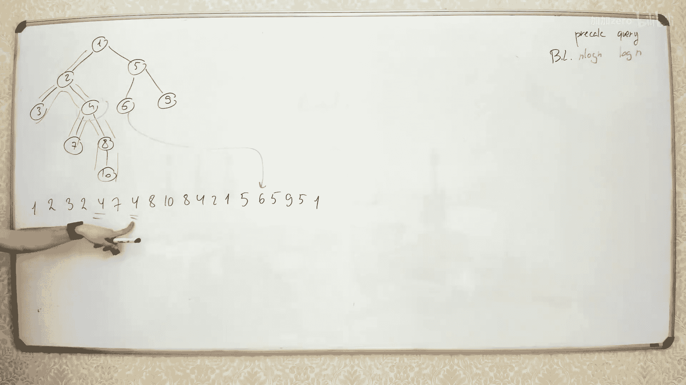

# 【精译⚡算法与数据结构】PavelMavrin p26 p25 A&DS S02E09. Binary Lifting. LCA. Farach-Colton and Bender Algorithm -BV1NLB8YfEMq_p26-

，🎼嘟嘟嘟嘟嘟嘟。🎼The。So today we'll start a new topic。We finished to talk about binary search trees。

 and today we'll start to talk about slightly different trees。So， this week， and。Maybe。

For more weeks， we will talk about general trees。So what is the tree？3 is basically a cr dog cycles。

 if you have。You could craft some undirect d。Like this。

If you have some graph without cycles， it is a tree， so this is a tree。嗯。

Sometimes you have another type of tree。 It is a rooted tree。 So this tree is not rooted。

 So it is just some graph。 All vertices are equal。 So we have some just some graph without cycles。

And sometimes you have a rooted tree。 A rooted tree is the same tree。

 but it's mostly like the tree we discuss when we talk about binary surge trees。

 So this trick has a root。And all girlss connected to this route are the children of this note。

 Each note has some children。やそ。Something like that。

응 thats 그냥 프리 just도。Unlike binary trees， the number of children is not limited。

 so each node can have a better number of children。For example， for this node。

 you have three children。The number of children may be any number。 for example， this is a also。

This is also a perfectly fine tree。8。So。꼭あそ。Thank you。

So trees are quite important They destruction structure。

 treeses are commonly used in various different。ToInvari for problems， for example。

Sometimes you most commonly you have something like this。

 you have some rootr tree A rootr tree usually describes some irarchical model， so if you have。

 for example， three of directories in your file system or if you have three of versions in your virtual version control system or something like that。

Or some。Or you have some structure of your， I don't know， company。 So you have like a big boss here。

 And heres this the the employers are here。 So here this vertex is both of this vertex and so on。

So rooted trees are widely used in various different complications， but。

True trees like these are also used not so commonly so just graph without cycles。

 So when you may have graph without cycles， usually if you have some graph。

 you have cycles in this graph， but sometimes in some graph algorithms。

 you actually need to deal with trees because you take your graph。

And it turns out that for your algorithm， it's only important to think about a tree。

 so you build some tree inside your graph and then you work with this tree instead of the whole graph。

So trees like these are also used in some algorithms。Mostly about mostly in graph algorithms。

 we will talk about site algorithms in the next semester。Go。嗯。

Roouted trees are much more comfortable to deal with because rooted tree have some structure。

 You have this root。You have leaves。 You have this orientation。 So rooted trees are much more useful。

 So usually the first thing you can do if if you have anrooted tree like this。

 usually the first thing you do this tree is to root this tree。 So how to root the tree。

 you basically take。Any vertex of your。RoOf your tree and declare this vertex， the root of the tree。

 and then just orient all edges from this root。 For example， let's take this tree。

Let's put some numbers。This book as well。2。3。そう。おっぱり。Yes。seven why not。6 and。And9。For example。

 if you take this tree and declare the first ver its the root of the tree。Let's。

 let's say that these topics。This the root of the tree， so how to build a rototic tree。

 just just take this vertex， make it at the root of the tree。

 Now all the neighbor verticusees are the children of this node so we have children two。6 and 9。

And now you do the same thing recurarsal。 So for this node 6， you have 7 and4。7 and4。

Okay here are free。For this9， you have。8 and 5， and so on。So it's quite simple transformation。

 So if you have unrooted tree， you can take any note of this tree， declare this root that this node。

 the root of your tree。 and then just。A sortrtal theertex from this root recursively。没从。

Now what operations do we need to make when we have a tree。

 the most useful operation with the roted tree is to find the lowest common ancesstor of diversity。

쭉쭉척 소리지。Well see， it lowest。Guoeng。On sister。What is this separation。

 separation separation takes two nodes of your tree。Andrew on the lowest。

Of like the name says the lowest of all common ancestors of this node。

 So if you take two nodes of your tree， that is。3。And now， look on all ancestors of these notes。

 You have some ancestors of note， you。So this is the route of your training and look on all ancestors of node V。

So these node are answers of node V U， and these node are answers of note V。Now。

 if you look on this node。So these notes are common answers。Of you， And。Right。Again。

 every 30 seconds， you can say everything is fine just to keep me a calm， okay。Now。

 if you look on all these common answers， we always form some chain there is。

If some node is the common answers， then all its answers are also the common answers of U and B。

 So if you look on those we two like to declare to define this set。

 we only need to take care about this lowest answer。This note。

He is the lowest common ancestor of you and me。Yeah， I like this is cool。啊。Let's all。

That's one of the most important operations in rout trees。

 why it is important because there are a lot of different implications of this operation。

Mostly this operation is important because of the structure of paths in the rootr tree。

 because you if you look on the path from node U to node V， the path is always looked like this。

 you go up。Until you reach the lowest common ancestor， and then you go down to verex v。

 So every path from U to V。Is constructed like this。 You go up。And then you go down。

 and this middle point is exactly the lowest common ancestor。

 So if you want to deal with paths on your tree。呃。The easiest way to do it is to split each path into two parts。

 this part and this part。 And both these parts are exactly the path from node to the lowest common ancestor。

ho。yes， this is the same lecture as two days ago in not English。Exactly like always。

 every Friday we have exactly the same lecture as and Wednesday， but。あいでしょ。For example。

 if we want to calculate the distance between two nodes。You have。We have one node here。

 let's say and another node here。And we want to calculateulate the number of edges we need to travel when we move from U toV。

If we will move from here to here， we need to。Walk。These three edges。

 so distance from here to here is free。How can we calculate a distance if we know the lowest common ancestor。

 pretty simple。Again。We need to have distance from here to here。

This path can be split into two parts， this first part and this second part。

Let's calculate the distance of this pattern， and this path。啊。How to calculate this。

 this length of this path。s pretty simple。 You calculate。 So if you want to calculate this length。

You take the length from route to note you。And then take the length of root length of the path from root to this low common sense。

And now you subtract this length from this length， and you will get this length。

 So length of this part from you to lowest common ancestor is just the difference of depths of these two nodes。

So you take death of this node here， take death of this node LC。 Let's， let's mark it。

Let's call it doubleub you。So length of this path is difference of depths of these two nodes， yeah。

So this node， this， this length is actually depth of node U minus depth of node w。And similar。

 this length is depth of node V minus depth of first w。So the length of the whole path is。

distance from U to V。Is equals to。Deb of U minus depth of W。So this is the first part。Plus。

Death of V minus Death of W。The W is LC C A of U N B。

That all that's how you calculate the distance in the tree。

 So if you learn how to calculate the node， which is lowest common ancestor of two nodes。

 then you can easily calculate the distance between two nodes， for example。That's one of them。

 one of the easiest application of the LCC， but there are a lot of very different applications。

 Like again， mostly when you， when you think about pathth from one node to another。

 you just split this path into two parts and calculate this in so。Okay。ここ。そう。

How to calculatelate the lowest common ancestor。We will discuss two different techniques。

 both techniques are very important because they have a lot of different applications beside this LC LC is pretty simple function actually。

 but a lot of different more complicated problems and sometimes you need to use one of these techniques。

First technique is called the binary thing。Meicテク， medical techniqueク。So what is the idea。

 idea is to be able to move from any node to the root。Faster than just situation or all ancestors。

 So if you start from this U and try to move to this node V， not W。

You will need to travel all this path， you go to your parent to your parent and so on， this too long。

 so let's just try to move faster up in your tree。How to do this we will。Pcalculate some pointers。

Lets。嗯 응。嗯 응。嗯 응 응。我知道。So let's not not V。So let's take some node V。

And look on this path from V to the root of your tree。What we will do。

 we will precoulate the ancestors of node V。啊。At a distance， equal to powers of two。

We will calculate we calculatelate。Let's call a jump link。I like to， I like to call this ray jump。

 just because。I don't know what。So we will precalculate jump from note V。

By the power of K by2 power of k。 So it is the node。no。On distance。嗯。2 power of k。From Nor B。嗯。嗯哼。

So if k equal to 0， then we just need the pointer to the。Com so so it's。2 power of0。

 So just this point or to our parent。Next pointer is here。 It's2 in power of one。

 Next pointer is here。 It's2 in power of2。Next pointer is here。2 power of free and so on。衣服。

If there is no。Ancestors on on this far so。 So if vertex v is closer to the root than the two power of k right different ways to maintain this。

 we can say that this pointer is no， just just so it's just just say if if there is no node on this distance。

 then they say lets just put now here or minus-1 or something。

Or we can put all these pointers to the root of the tree。 That's， that's actually。

That's just just implementation trick， because。In all our in all in applications。

 we try to go up to the route。 So if we， if we reach the route and try to go even even。

Up up from the root， we actually may stay in the root so will。Yeah。So if you， if you think about it。

 like if you have this。Errows moving up to the root。 if you just make a loop here。

We may say that if we reach the route and try to go even after it。

 so we will just stay in this route。So theres just another way to think about it。

 It's just implementation details。 You can， you can do it in either way。 you can。

 you can put now pointers if you don't have these answers or you can make all the pointers to the root if you don't have the corresponding answers。

Good。그找 봤스本。So this plan。How to calculate these pointers。 We will try to calculate。 first。

 we will try to calculate all these pointers when we have this tree。 So we have。With a tree？

And we need to precalculate all these pointers for the given tree。

What is the how fast can we do this， How fast can calculate all the pointers for all the nodes。嗯。

Don let's see。 So how many pointers do we need here， So V is up to n so that I。And， and bonus。

 we have。And vertices here。And this K may be up to log n because the distance to the root is up to n。

 So this K shouldn't be more than log n。So we need N log M pointers to precalculate。

And we actually can' precalculate all these pointers in allogan time。

How to do it is but are various ways to do it。The easiest way is to use the same technique as we used in the spars tables。

So we will precalculate these pointers by increasing the value of k。

 So first we'll calculate all pointers for k equal to 0。

 then they calculate for k equal to 1 and so on。 So we first it's array not for lets。First。

Let's calculate all the pointers for k equal to 0。 So if k equal to 0， then we just。

It right for all V from one to n。형 안도 from  zero to n minus one 그냥。Well program I sort。

So let's iterate with all notes。And pre is the first pointer。 So this ifk equal to 0。

Then did this jump。From v to 0。Should be just the parent of your note， right？

 So this first jump is just jump to your to your immediate parent。

 So jump with0 is just the parent of them。Okay here I use V as an object here， I use V as an integer。

Yeah， that's fine。It's purely， right。So here you take the parent of this note here and you make the jump to the to the parent of your note。

 right。And。No。We will use the previous jumps to calculate the next jump。

 so how to make it the next option you have this own view。And this is the root。

 This is the perfect to the root。We want to make a jump from here。

two game so how to make jump from here to here look。Let's say something。 Okay， how to make this jump。

Just check。Anybody just understands what's going on。So how to move from here to here。I'll wait。 Just。

 just say something。Gu。やしい。減てます。Okay， you can do it faster so to make this jump we will make two jumps on distance two power k minus1。

 so we'll make jump from here to here。Okay，-1。 And then another jump。On the same distance。

So we'll move here and we already precalulated these jumps。So we know how to move from here to here。

 we know how to move from here here， so make two jumps and move to here。

So let's make click so 4K from1 to log n。We'll just iterate for all notes again。

And calculate collect these jumps。じ样。From node V to power of K is just these two jumps。

 So first jump。East。So this note is。Jump of V to k -1。

 And then from this matrix we need to make another jump of this to power k -1 series。Jump from jump。

From V to power K-1 power。-1 love this。Oh。네 그。Thats so， that's how you pickrick coate the binary00。

M not really。别's从。So what is the time complexity of this？Of this precalculation。 obviously。

 here you have。And here you have log n multiply by n。 So total time of these two loops is n log n。

 obviously， yeah。So total then complexity here is on again。Nice， that's all。

That's how you pickate the binary climbing by binary victimss。now。How to use this。

Poiners to actually calculate the lowest common ancestor。I will manipulate this。Let's go。So again。

 you have two notes。 You have notes you。Do go meet long。You have this node U， you have this node V。

And you want to move， you want to find the low lowest common ancestor。 What is the plan， The plan is。

To move to the root until we find the lowest common ancestor and we'll do it in like binary search way。

 So we'll try to make these big jumps until we will find exactly the exact point where there is lowest common ancestor。

 if you look on the common ancestors。Then like somewhere here are common ancestors。

 and somewhere here are not common answers。 So our， our goal is to find this point。

 So we' try to find this point using something like binary research。So if we jump too high。

 we will find that we have some common ances。 if we jump too low。

 we will find we have different answers。So this， that's the idea。共。あそうあ。

I'll write to the code just the code is pretty simple。 So how to how to move。

From this knowledgech to this point。First。Let's。Look on the depth of these two nodes and find though find the deeper nodes and try to move from the deeper nodes on the same level as the。

For example， if the depth of note v is greater than the depth of note U。

 we will try to move from this node。To sound note。s you problem。阿手。

First step is to move from here to here to have two nodes on the same level of your tree。

 So we'll move from here to here。Like this。嗯。That's better。How to do it using binary Claton。

 Pre simple。 We will make these jumps。And try to reach the note on the same level as not you。

Well make big jumps when we when we make small jumps and so on。 So if the distance。

Distance between these two levels is this So。 So this is difference with。

Let's say if D is difference of depths。Of these two notes。

Then we just need to move these steps up from node V。 Yeah， how to move these steps up。

 We will use these binary binary termss to just make。Basically。

 what we need is to split this D into powers of two， right。

 so we can move in the distance of power of  two。 So if we split this D into some powers of two。

 we can move from here to here。And we can split any number in log n powers of to。 like like you can。

You can split any number in log n powers of2 just you can just look on the binary representation of this D。

And just for each one in your binary representation， you take this power of the array。So again。

 we will split this D into some powers of two and make these jumps。So to make this jumpmpoo。

Move like here， here and so on。 So each of these jumps is power tool。

And the number of that jumps is loggan， because we can split any number in loggan powers of term。

 right you can do it just greedily。You can do it just greed。

 You go from big powers of two to small powers of two。

And each time if if D is greater or equal than your power of two。

 you can just make this jump and decrease D by this power power of two， right？Click， okay。

So first step。嗯。Well， let's em this one。Please， so if D is difference between D and。Of course。

 let's say that this。First， let's see which of the twoverses of city is deeper sorry。Sa， if。

Is less than the of you then we swap them。Now V is the deep so we start from here and move here。

 the C is the difference。にマイまス here。Mus D U。And when they just move from here to here， again， you。

 you can do it in grly。 You can do it greeizzly。 You move from， you move from。

Big power software to small power software。 And each time you make this jump if you can make this jump。

So Ill just move。4 k from Loan。2，0。And if I can make this job。If。

TD is greater or equal than two power K。Then I will make this jump。

 So I might jump from here to here。 the vehicle to jump。Jump from V to power of key。and Christie。

응 응 응。嗯哼。You can actually simplify this。And because you know that this D is something。 so can。

 you can just make these jumps if the next vertex is not higher than this not you。

 So you can re it like this you can just。removeve this。Yeah， instead of completingulating this D。

You can make this jump with things。The prime is jump。From coffee to power came。And if this。

Death of reprime is greater or equal than death of you。 Then you make this jump。Like these please。

Same， actually， this the same procedures before， but we just don't calculate this G and don't calculate this powers of2 and so on。

 So it's a little bit。 Its a bit easier。Okay， now we moved from here to here。

Now we actually will make a binary search before we make binary search。

We will check one special case when we have the same node。 So if we reach the same note。

If you equal to v。It means that you was the parent of V So we moved from node V to the same level as U and move directly to node U。

 It means that we that you was the parent or ancestor of V。If you was the answer of thee。

 then the lowest common answer is you。So艺思我想是不是加水炖牛？Or really they have the same。こ。

And now we'll make binary search how to make binary search。

 usually you make binary search when you have some array。

 so you have some array or you have some function or something。

 and you can like take any element of your array and calculate function in any point and go to left segment auto to right second。

Here is slightly different。 We don't have any array。 We don't have any function。

 but we have these pointers， and we will use these pointers to to make a binary search。

 How to make binary search when you have these pointers。It actually。

 is' the same way like we did in the usual binary research。 We will maintain a simple invariant。

 Simple invariant is the notes U and V are different。 So if you start from here。

And look on the answers system here。Your ancestors are different。

 so if you take these levels on these levels。As ofQ andV are different。So， here， they are different。

And here we are the same。Yeah。And what we need to find is。

 like a split point between these two areas。 So in this area， all parents are equal。

 and in this area， all parents are different。So what you need is to find this split on。

So how to do it using by the research。So we start from these two notes。

And try to make a big jump above so。 So you start from these two points and make the biggest possible jump。

呃。So you take the largest power of two and make the jump on here。T here。If you find the same note。衣服。

You make this big jump from here， big jump from here and find the same ancesor。

It means that you reach the like upper area， so the area where all pair all answers are same。So。

 what you need is to。It means that your lowest common ancestor is somewhere below。

 so you need to find your answer in this area。So let's try to find it in this area。

 Let's make a smaller jump。So is smaller jump。If you find the two different answers， also you find。

Some answers， and you find two different notes。It means you。

 you are in the lower part of of your binary search。

 So you need to find your lowest common answer in this area。So， if， if you find the same node。

 you need to search below。 If you find different node you need to search about， that's all。

So how we will implement this very simply。 we will educate。

 we will it all powers of two from high to to lowest， so find 4K。From logan to 0。

And try to make these jumps。So we make the jump on two power of k。 so we say U prime is。Jump。

From you。V prime is jump。From view， power of key。If you find。The same note。That means you。

Stay in the same nose， but just decrease the。This cap。

 So you need to make a smaller jump from the same two positions。

 If you find the same different nodes here， it means you need you need to move through this area。

 So I will move this two nodes here。And start the same procedure in this area。

 So if these notess are different。Then I will just move my two point。That's all。

That's my by the research。Now， what happens in the end。 So in the end of this binary search。

I have some two notes， U and V。And in the end binary research， it turns I cannot make a jump。

2 which moves me to two different or sorry every jump moves to the same ancestor。

 Even jump distance to to power of 0。 So even my parent is the same。

 So even parent of these two nodes is the same。 What does it mean， it means。They move here。

So for example， I move here， I have the same node。And then you make， again you make again。

 a small jump。And I have two different nodes。 so again， I move here this U thisV。 and so in the end。

 I have nodes U and V in some positions。And every jump moves to the same ancestor。

 so it means that my parent of these two node is the same。If the parent of the most is the same。

 it means this parent is the lowest common answer obviously。So in the end， I just return。어不不不不不不。

You빠 for example。嗯。That's all。 That's the whole code。

So that's how you find lowest common answer when you use this binary lifting technique。

 So this code calculates the binary liftings and this code calculates the lowest common answer。

It can can， you can make it shorter I just。I have too much space here。

 so you can squeeze this a little bit but this。This actually is the pretty simple code。

 which calculates the lowest common ancestor of two notess。So what is the time complexity again。

 No obviously time complexity is loggan because I have these two loops。

 Each loop takes logan operation。 So time complexity of this function is loggan。So what do we have。

 We have an。We have a technique which have endlog and precoulation time。And then loggan querying。

Let's put it in the corner。So again。These techniques are used when you have a static tree。

 So you have some static tree， you make some preccs and then after these preccs。

 you answer the questions。 We discussed data structures like this when we discuss， for example。

 sparse tables， stuff like this。 So when you have some static structure。

 you first spend some time to precculate something and then you spend some time for each query to answer the query and structures like this。

Have two complexities， right， you have complexity of precalculation and time complexity of each query。

This's what we will measure。 We will measure time complexity of prickle collection。

And time legacy of each query。So this first technique by the original technique。Ha time complexity。

 e loggan of realulation。And look in for quick。Nice。Any more questions by now， I will just。

 I will erase everything。In few seconds， if you don't have any questions， I will just raise it。

So this technique is quite important。 It quite powerful。 You can use this in， again。

 you can use in various different applications。 You can calculate some stuff。 But basically。

 what you do， you travel the whole path from you to B。 So when you， when you make this binary。

But by releasing you move from here to here， you move from here to here， you move from here to here。

 and so actually you travel the whole path， you travel it in the big jumps。

 but you actually travel the whole path， so you can use this technique when you need to calculate something on this pattern。

So when you move this， when you make these jumps， you can also， you can also calculate something。

And we will do it in the home discussion， next week。Okay。No no more questions that's strange。

 you are too quiet again。Okay。Let's come next？The next technique is next technique is very different。

Willll use completely different techniques。And we will get。Some bettery， actually。Cool， so。確しか。ちちょ。

The next technique uses it。A brought you go to it。Or through oil through approach。OhSo what we' do。

 I need to draw up three。Let's draw some tree， let's draw some tree。嗯。嗯。😊，嗯。아 그러나 그러나。Okay。

 let's back。왜 그러나。let's have some tree。What is the idea。

We actually learned a lot of data structures which calculates something when you have a array。

Or least。 Yeah， So if you have some linear structure like list or array。

 you can calculate a lot of stuff。On this linear structure。

 So what we will try to do is transform our tree to something linear to some array or some list。

 something like that。 and then we will transform our request to this to do some request on this linear structure。

And because we have a lot of。Data structures for this linear。Things。

 we will be able to calculate something on a tree using some query on this linear structure。

 that's the plan。So how to make linear thing out of the。We will do it using the oil to production。

 willll recursively iterate or over the whole tree。

So let's recursively enter all nodes of the tree starting from the root。 So we start from the root。

And we'll just iterate all children of the current node and recursively iterate old nodes inside this sub。

 So we start from the road， go here， go to this though， then go back， then go here， then go here。

 then go back and go here and here so。So if if you know how， how the oil tree works， it's the same。

 So if you。If you duplicate each edge and try to make the tour of this graph。

 you will have something like this。So you travel to do some sub。

 then recursively it's read over all nodes inside the sub tree， then go back and so on。

So it's the path， which is retro each edge of your。3 exactly twice。 So you go down this edge。

 then iterate everything in dust inside this sub， then go up the same edge。

So let's make this a alter and then write all the vertices we visit on this path。So what's going on。

 so we start from node one？Then we go to note 2。Then we go note free。Then we go back。Then we go here。

Then do not save then back。Then note 8，10。 then we go back to 8，4，2，1。

So now now we're here and now we need to visit node 5 and everything below。 so we go to5。

 then six back to5， then to9， back to5， back to one。That's all。That's the oil of this。3。

That's the whole blend， that's the whole blend。So again， we take this tree。

Make simple recursive procedure which it eras or all nodes of this tree and write down all the nodes we visit on this path。

We will get this list。고 코。Again， you making me nose。へへ。😊，If you have any questions， just ask them。

Good。Okay， I think it's just too simple technique， so everybody understands everything。

I am still so suspicious， Okay， so now。No。What we'll do next？We will。Okay， let's listen。

 For each note， we will precalclate the position of this note in this path。Yes， its def search。

 So if you know how def search works， it's exactly like this。

 So you start from the root and make a def search or a dream。In the tree。

 depth of search is pretty simple because you you can't visit the same note twice。

 So depth of search is three is simply recurs you start from the root。

 You don't need to mark anything because it's simple。Yeah， but it is it is it。 it it it it it is it。

An。まあ。For each note， we will precalculate its position in this order。For example。

 you have this node6 for this node 6， you precalculate its position here。So， each node。

Knows its position in this order too。Some notes have different positions， for example， this note。

I don't know。 This note for。So you should take this note4。It has。Two occurrences in this or two。

 So we will maintain any any one of this。

Positions for this node for， for example， this node for me remember this position and so on。

 So any node remembers some position in this earlierator where where you have this node。 For example。

 leftmost position， right mode position， usually， usually when you implement this。

 you remember the leftmost position or right mode position， but it doesn't matter。 You。

 You need to remember any position of this node in this earlier term。啊。No， no， no， no， no。

Let's have something， let's pay pause。Oh's我， okay， let's。It this。我给了我。Good enough。 you have。

 you have three positions。 actually。 Yeah， you have four in this three position。Second。

 you remember any of these three positions in this note for。 So again。

 you remember the position for each node contains the。Like integer， which is position in this list。

 or you may you may have pointer to this element and so on。 It depends on what。

 So if you have pointer machine model， you may remember the pointer to this position if you have list only if。

 if you don't have a array。大是 matter了。No。For example， now you have two node。 You have this node you。

And this don't fit。Let's look on positions of this two nodes and thiss this position of node U。

 this position of node V。Let's look on this segment segment from here to here。

So also one segment of this list。Noble like， Let's serious stuff。嗯。

Let's look on this segment from here to here。What does the segment represent。

 this segment represents that？Pef from node view to node Vi。

 If you look on this segment of your oil tool。This segment from here to here actually represents some path from node U to node V。

 So if you look on this segment， so what's going on here。Race。And right still him not important。

So this segments。I what， so you start from Note4。Then travel to node A， then to node 10。

 then go back back， then go here， here， here， here， and end in node V。

So it is some per in this tree from node U to node V。That's not the shortest path， usually。

So shortest path will be to go directly here back， but you may visit some additional nodes on this path。

 It doesn't matter if it's some path from node U to nodeV。And now the idea is simple。

 Your lowest common answerces is somewhere on this path。

 So if you take any path from node U to node V。Then you will definitely visit the lowest common ancestor。

Because again， any path from node U to node V。Includes the lowest common ancestor of these tonos。

 So the lowest common ancestor of these tos is somewhere on this path。Okay。Now how to find it。

Very easily。Let's write down all the depths of this note。 So for each note。

 let's write this depth in this string。ちょっととちょと。So the depth of node1 is0， de of node2 is1， here's2。

1，2，3，2，3，4，3，2，1，0，2。3 to，32。の？对你s亡。1，2，1，2，1，0， yeah。

So this array contains the depth of this no if you take any node。

 you can precalculate this depth from the ur tree like before。

And you write down all the depths of these notes。All the same is very A is already。

And now we will make a simple observation。 sorry if you have the path from node U to node V。

Your lowest common answer is just the highest node in this on this path。

 So it's the enough minimal depth in your tree。If you look on this path from node U to node V and take the note with minimal depth。

Like this。 So this is the minimum。嗯。Good implementation。 I think my implementation was quite good。

 actually。So you can just use it。 You can Google any implementation。 There are a lot of libraries。

if you， if you need it for competitive programming， a lot of nice competitive programming libraries。

嗯。Again， back to back back back to the store。Again， the idea is pretty simple。

 If you look on the path from node U to node V and take the note with minimal depth。

Then this note is the lowest common answer of the column。So this is actually LC C。Of you bit。

Let's take some different notes。To make it more interesting。 for example， let's take。This free。

And these stem。So if you take notes3 and 10。Then， free is here。And that is here。

So to find lowest common answers for three and 1， you need to take this segment。Of your list。

And find the note with minimal depth on this segment。 note the minimum depth will be here。

 So this is the minimum on this segment。It means that nose2 is the lowest common an。Good。

Should we approve this？It's actually quite easy to prove。If you look on the path from node。Thank you。

You have this path from node U to node V。Thats。So you have an old view， you have an old V。

And you have some pet from U。Some to show something here， go somewhere here， somewhere here， go here。

 here， here， and so on and so on and so on， visit something here， visit something here， and so on。

 and finally you reach an old V。Well first of all， you will visit your lowest common answer so please note。

You will definitely visit on your path。Why is the white notes have the minimum possible there。

 because if you move from this node。Afterp to to to to its parents to so to the note with small。

 smaller depth。So if you move from here。Ohp here。You will never move down， because in this， in this。

To tour you you each note， you first move down and then move up。For each for each edge。

 for each edge of this tree， you first move move down to this edge it's right everything below and then move up So if you move up here you will never move down here because。

That just how。Re records of drawer。嗯哼。So you will definitely visit this node and you will not visit any notes above。

It means this not have the minimum possible death on this path。Good。

That's actually quite formal proof。嗯。I didn't write it any formal， but that's quite formal actually。

If you， if you like formulas and stuff， you can actually formalize it very easily。啊。Co。That's all。

That's the whole technique。Again， how to find lowest common ancestor First， you take your dream。

You build this for your tour。Then you create this secondary， secondary， just got， just。

Contains the depth of these notes。So this all precalculation。Now。

 when do you need to answer the query。To find the lowest common answer of two notess。

You find the position of these two node in your order。 Find this segment。

 Find the element of minimum depth on this segment。And this。

 this minimal depth corresponds to your lowest common answer。 That's all。故。

So how to find minimal element on the segment， we discussed two data structures which allow you to calculate the minimal element on the segment so again anyone tell me two data structures we discussed which may help you to calculate the minimum element on the segment。

And I will find the marker。We have two very cool data structures。Both are very important。

You scare me。 Just say something。How to find the minimum in segment。

We spent a few weeks discussing stuff like this。Segmentary， nice。

 segmentary is perfectly structured to find the minimum in the segment。So if you use segmentary。

If you use segmentary。Then what will be the term complexity， so we use order2 plus segment3。

What will be the time of precoculation？So how much time do we need to prerate everything？

So to prepare this arrays， we actually spend linear time。So we just make recursive。

It's reverssal off the whole tree。Right and we write this array， this rate have linear size。

 we can precocate it in linear time so we can do all these preparations in linear time and now we need to make a segmentary out of this array。

We can make segmentary out of given array in linear of time again。If you have an array。

 you can prepare the segment3 linear time。 like no we did before。 So you you make the bottom layer。

 then you make the next layer and so on。So you build it from bottom to top and the total time complexity of this build will be linear。

So we make all these。All these preparations and linear time。

 then we build the segmentary in linear time， so the total time of all these precalculations will be linear。

Now what about query query again， each query is we find these two positions and find the minimum on the segment。

In segment  three。You can find the minimum in logan time。Right。So again， you find this。

 find this final minimum in loggan time， you spend loggan time for the whole operation。

 so the time complexity of query will be loggan。Cool。Now。

We actually discussed another data structure， which help you to find the minimum of the segment faster than login time。

 right。Right。Anybody。There is another cool data structure。

Which is specifically made to calculate minimum on a second。And it works faster than login time。

 So you can make queries faster than login time。嗯嗯。嗯ん。Anyone。Okay， it was like month ago。

Maybe more than the month for going up。嗯。That said。Yeah， this was the question， yes。

I asked what another data structure can be used to calculate the minimum of the segment faster than the loggan time。

That was a specific question。Cause we spent another。唔系。Discussing some data structure。 Sprs table。

 cool。 Finally， this， that is sparse table。 Sprse table is a cool data structure。

 which is built specifically to find the minimum segment in constant time。

 So if you use spars table instead of this segmentary。😊，啊。Part table have the same。

So it's this segmentary。7ary。If we use a use for two plus spa table。If use spars table。

 we can answer this query in Con time。Right。WellBecause all， you。

 you find this position in constant time because you have this position here。

 You find this position in constant time。 And now you need to find minimum in constant time。

 You can find minimum constant time using sparsse tables。

So the total time of your request will be constant。啊。But the precoco time will be bigger。

 so so to precocolate the sparse table， you need en loggan time because the size of sparse table is N log n。

So again， this whole precal correlation is linear， but to build this parse table。

 you need to spend another enloggan time。 So precal correlation time will be enloggan。Oh。Now。

 we have a lot of options。Here we have three different options。

To calculate lowest common answer we can use one of these three options。

 We have these simple options using binary binary lifting。

 It requires n loggan time to precalculate these binary liftings and then you spend loggan time to calculate the lowest common answer of two points You can use this method and use segment3 to calculate the minimum of segment。

Then you will need time time to prerickcolate everything。

 and then you spend log and time to find your。너브 거 만 쓰。Or you can use the same technique。

 but use sparsse table instead。 And then you have all loggan time for pre calculateculate sparsse table。

 but you will able to calculate minimum in constant time。 So total time of this。

AQuery will be constant。空空。Discipline。Cool， now now we have 20 minutes to explain final time。Now。

 for the final。For the final part of this lecture， I want to build， I want to join actually all this。

I want to make another data structure， which is capable to。

HaveSo which I want I want better data structure。 I want data structure。

 which have pre calculationculation time linear。Bob can answerqueries in constant time。こ。

And the interesting fact is it is that it is possible that。

Sometimes it is possible to make data structures， which is better than earn the bill。

 so we will try to combine some techniques and to build data structure which have linear time to precalculate but constant time to answer query。

Let's go。So the plan will be the following。 We will use the same technique with the sparse tables。

So we will try to update this。So we'll use these technique of spa tables。

 but upgrade it a little bit。 We will upgrade it to make this preculation time linear。I am through。

To to decrease this precoclation time well use the same technique as on the previous。

 so if you watched the previous lecture， we actually made slightly similar approach we to avoid tried to get rid of one loggan factor。

And we will use slightly， slightly sensitive。So I always spent。But the cake is very simple。

When you try to get rid of one log in factor， what you can do is to split your data structure in blocks of size loggan。

嗯。So what we will do， we will split this array into blocks。Off size of it。还把我说感。

Let's fix some constant， let's fix some constant B。 let's say free Free is nice constant。

And split this array into blocks of size B。One block， another blockke， another blockke。

 another blockke， another block， another block。 this is slightly small block。嗯。응 hu。

And now to find the minimum segment， we will try to find this minimum， not not all elements。

 but all the blocks。All， it's here。So you have this already。

And what we need is to be able to find the minimum segments， given some segments。From you doing。

And you need to find minimum this。Now， when you split this around blockslos。So have these blocks。

What you can do is to look on these blocks， which are completely inside your segment。 these blocks。

Are completely inside my segment。For these blocks， I only need to take a minimal element。

From each of these blocks。I only care about the minimum element of each block。So what I will do。

I will take the minimum element from each block。嗯。I say this， this is minimal element of this block。

 This is minimal element of this block。 This is minimal element。 Princes。

 this is minimal element of here。 This is minimal element here。 This is minimal element here。

 is minimal。So I will take minimal elements from each block。And build another data structure。

Which can answer the same queries， but only for these blocks。

 So I will put these minimums into separate array smaller array。不不不不等。Let's give this 0，1，2，1，0，1，0。

the same be。嗯哼。And now I will build data structure， which can answer the query for these blocks only。

 not for the elements， but for the blocks。嗯哼嘿嘿。😊，So in each block I have this minimal element。

 so I will be able to find the minimal element over these all blocks。😡，So again。

If find no minimum element in each block。I will then find minimum of all these minimums。

And this will give me the minimum of7， from here to here。Mmm。After this。

 I need to take care of these small parts here and here。

 So I I need to take care of these small small parts of books。 but for this whole segment。

I can use this small data structure。This data structure allows me to calculate the minimum on the segment which contains of the whole blocks。

こ。You stop saying everything is clear。This scares me into itそ。I want again， I want to data structure。

 which can answer the query of find the minimum of this statement again。

 no I want to answer the query of lowest common ancestor。But after I build this structure。

 I need to answer required to find the minimum on this segment。How to find the minimum segment。

 I will split everything into blocks。Now， I need to find the meaning of these whole blocks。

And something else。 So， so， I need to find this。Small， small parts in in in the borders of my second。

Up to5 minimum in this area。I will take minimum of。And of each block。

Build a small data structure for these blocks。um。😊，嗯。Again， let's take some samples。嗯。So。

 for example， if I have second from this4 to this6。So this segment。Consist of these three blocks。

I know minimum here， minimum here， minimum here， so minimum here is two minimum here is1 minimum here is 0。

So to find in on these segment。I need to take these three blocks。And find minimum of all。

 of these three minimums。So medium here is two medium here is1 medium here 0。

 So these are these three blocks。So when I need to find minimum on this second。

I actually need to find minimum this small second。Mhm。😊，Now howco premium from this molded structure。

 very simple way， I will build this sparsse table。😡，Sparse table is a cool。

 So I will take this small。Ay？And build a spark table in this。

What will be the size of this sparsse table， size of this spars table will be n over B。

Logue and overviewbeat。Yeah， the size of this small spa table will be like this。

And if B is about log。So if the size of the block is about log。Then this actually will be linear。

This's the plan。I have another data structure， which have precation time and loggan。

So make how will I get rid of this loggan， I will make a small de structure。

 I will just decrease the size of the destruction by logan factor。

And build part of this small structure。So the size of this move， the structure will be an logogram。

So the tank complexity of precoculation， this small spars table will be linear。

Can I get the maximum value on the pad between。 Yeah， you， you can get the maximum value。

 But maximum value is not not not that interesting。The maximum value on the segment is just。

너 돈 벌지 육구 때 먹 싶은만 됐었어。But yes you you can use the same technical maximum maximum minimums as the same expression。

 basically。嗯哼嗯哼。Discipline， so again， I will build this structure for these blocks。

This infrastructure structure will be small。So I can。 so I can。

Build the spa table for the small structure in linear time。

 just because it's sgging smaller than the originally。No， you can do it the same。

 if if complete maximum on segments， you can do it in the same way。It's absolutely the same box。

I I no idea why you need to have maximum on this path from one note to another。互闹。

Let's move back here。啊。We already precalculated， so we precalated Disney structure so we can find minimum on this segment from here to here。

But we already， we also have these two small。Segments， which are just part of the block。

 so we can't find medium here and find medium here using this structure。

 This structure only take care of the whole blocks。So we need somehow to find medium here。

 minimum here。嗯。If， if each note has a value， you can create milestone the above。めめめめめ。

I'm not sure about this。I'm sure about this here I use these values are actually the depth of this node。

So if you have some random values， it's slightly different。Will think about it next lecture。啊。

Let's finish this。let's finish this。So now what I need to do is take care of these small segments here and here。

And to take care of these small segments， I will use that the segments are very small。

 so these segments are very small us。我这。It turns out that the。These segments are almost the same。

All segments are pretty much the same。 For example， if you look on these two segments。

 let's look on these segments。This segment in this segment。These two segments are actually equal。

 So if you look on the first first blocks， if you look on the block 0，1，2， and another block，1，2，3。

These two blocks are pretty much the same。It means that if you， if you。

If you try to calculate any request。In one block， you will coate the same request on that。

 if you find minimum on this segment。It will be here。 And in this block， it also will be here。

So these two blocks are equal because each。requestquest， give you the same result。

It happens because they these two segments different by the concept。

 So if you take this segment and this segment， the difference between each element is exactly one。

So if you take minimum each segment。啊。The minimum will be different between two minus will will be one。

 and the minimum will be in the same position。Like here you have this。 and here you have this。

So here are the 0，1 two。 so。You need to find minimum in this line minimum on this line。

 It will be in the same position because these line are the same， but just moved up by one。嗯哼。

So what will do？We will find all different types of blocks。

 So we we'll say that if two blocks are different by by the constant。

 then these blocks have the equal type。So these two blocks have equal type。And now we will split all。

 all box into several different types。And we will calculate wait How my。

 How many different times do we get。No， let's， let's pick some other blocks of the same type。

Let's say， for example， if this block have type one， let's take let's see。

Let's say these blocks are off type 1。 So we have this block。1，02 of pipe。SoSt 1。

This one to three has the same type so difference is one。This2， three， four is also the same type。

These blocks are also equal。This is different type， so let's say it's type 2。

So this is the same as this。 So this also have type of one。This one to one is different。

 it's not like this， it's not like they sotract free。No， okay， what last block is not important。

 So let's see how well is not important。We will just precoulate types for each block。

So how many different types are in。If you have block of size B， if you have blocks of size B。

 how many different types of blocks can we have？It turns out we need a small number of these blocks。

Sorry， I lost the line of your。😔，Discussion。嗯。Okay， hope it's not about。Okay。Think you are good。

 okay。啊。So I want to find the number of different types of blocks。So how to define the type of block。

 It's pretty easy。 So we start from the first number in the block。

Each next number is difference between two consecutive numbers in the block is always one because this array is array of depths of these nodes。

 So each time when we travel this co， we move up or down。

 So the depth of each next node is either plus  one or -1。From the previouss， for example。

 from from here to here， we have plus one and then plus one。

 And here we also have plus one and plus one。And that type of block is all all always defined by this plus or  minus-。

 if you take this block 3 to one。So the type of minus minus， so if you take this block one to one。

So it's plus and minus， so。そう。This plus minus define the type of your block。

So each block is defined by this string of plus and minuses of length B B -1。

So the total number of different types is now more than2 in power B minus1。Yes， yes。

 we spend too much time to， to get rid of one log in。 This usually happens in computer science。 Yeah。

 when you in algorithm theory， there are a lot of cases when there are some last log different factor and everybody spends like 10 years to just get rid of this last loging factor。

😊，This's quite common situation， actually。So you get some something like this。

 And then you spend another 10 or 20 years to get rid of this last algorithm。 That's， that's。

 that's quite common。That's almost it。 That's almost it。 That's almost it。Now。

 we will pick the B small enough。Do have this number of types， smaller enough。

So if you pick B equal to log n。Then we'll have if p equal to loggan。

Then doing power of B -1 is actually about n。 So， so if B is no n。

 then we have up to n different types of segments。 So this number is pretty small。

My that's not small enough。Because what I will try to do next is to iterate all possible types of segments。

And for each type of segment， I will precoculate the answer to all possible queries。

So I will create the following tables， I will send us so also a minimorization table。

So I will create the big table， which gives me the result for each type。For each request from L to R。

It will be minimum。On segment。From L to R。For block。哦大た。タイpo。So I will it all possible blocks。

 all all possible types of blocks for each type of block， I will。Try to era all possible segments。

And for each segment， I will precalccate the minimum of this segment。Is governmented。

This will give me the。3 dimension table like this。So the total size of this three dimensional array is obviously to in power of B by b square。

Y。It。So again， what I want to precalclate， I want to it all possible types for each type。

 iterate to all possible segments， and for each type for each segment I will precalclate the minimum of this segment。

Just Je。 Sorry for all possible request I may have and we calculate great results for all possible request。

Cool。No。Now you've beat equal to log in。Then here I will have n multiplied by loggan square， right。

But it's bigger than N。So to make this timeline， I want to make this time linear。Because I want。

 I want this precoculation to be linear。 So to make this precoculation linear。

 I will use B not equal to log n， but log n divide by 2。So let's say that B equal to loggan。Or cool。

 like this。So if you， if you take the size of the block equal to half of the logative of n。

Then theナロ。Different types will be not n， but square different。嗯哼。So if you pick this size of block。

Then number of different types will be a square root of n。

And the size of this memorization table will be square root of n multiplied by log square of n like this。

And this is near。That's all。Okay。The whole algorithm works like this。First you make a preculation。

 you build this arrays， split each error into blocks， calculate the types of each block。

 calculate this sparse table for this small array of blocks。

You precalculate this par table in linear time， you precalculate this table in linear time。

 That's all that's all your precalculation。 It all takes you some linear time。

That's better than later， but we。This precalculation is linear。

 so it's I just will just get upper balance of this。嗯。That's all， that's all pure calculation。Now。

 how to answer the query。To to query， you need to find minimum on this segment to find minimum on this segment。

Use take these whole segments inside your big segment。

 Who blocks are fine minimum among these blocks， using this spa table。In constantine。

And now you need to find me on these two small parts of of block。And to find these two minimums。

 you use this memorization table。 So you find the type of this block for this type of this block。

 and for this request， you know the result of your you know， where is the minimum。So you know。

 whereas this medium， there is this medium， you will create this medium calculate this medium calculate the whole medium and so on。

 So the total time will be constant。 It will be big constant， but too constant。那从。Yeah， that's。

 that's， that's， that's， that's how you make the data structure。

 which works in legal pre time and constant time。Not given you one to No。

 I have not given you welcome， sorry。I don't have this much。 this many。

 this many problems to have a whole contest。嗯。嗯。Do do do。I don't see any more questions， okay。T。Nice。

 that's the hope one。O，那那我 find个 name。Let make to the final point。What we can do。

This all is for the LC problem， so we can come together。

So final result is that we can find the lowest common ancestor of two nodes in the tree。

In the static treat， when theory is not changed in constant time with leader temper calculation。Now。

 another trick is that you can use the same technique to find the minimum on the segment。No。

 you think we already know how to find minimum segment。

 but here we use slightly different problem here we try to find minimum segment。

 but this error is specific， very specific because each number is different the difference between two kinds of numbers is exactly one。

So， we try， we learn how to find minimum1 segment， but only in this special array， so we used。

That this array is very special。But using the same technique， you can find the minimum in any array。

In constant time， with linear type pre calculationc。嗯。So if you take any array。Let's have some array。

5 free。嗯。7，2，6。For。8s。9，7，7。不了나。そ。Maybe you have some a egg。

And you want to be able to calculate late minimums on segment。You can do it using sparse tables。

 It will take you any time to precalulate then custom。But you can。

You can do it in constantical connection， you can use the same technique。

 to make this same complexity。And the way you do this is quite interesting because to calculate minimums on the segments in some literary。

 so you here some literary。And you want to be able to complete mes in the segments。What we'll do？

I to reduce this problem too there。Finding of the lowest common ancestor。

 because we already know how to find the lowest common ancestor in the dream。

So we'll take our array and build it three from this array。

And then we will use all this technique to calculate lowest common answer in this tree。How to do it。

啊。Actuallyally quite simple。 We will just call。 We will just build a trip from this array。

 So if let's take this array and build a trip。Like， like we did on cruise like song。

So these two will be the roots。Here we have three。 Here we have five。Again。

 tree is very simple data structure。 The root of the tree is the minimal element。

And then you recursively calculates trip in the left and trip another。Sa here。6。7 and 8。That总。

So okay， you take your array and build a trip from this array。 and like were in the home task。

 you can build the trip from the given array in linear time。 So in linear time。

 you can construct this tree。And now I claim that the request to find the minimum 1 segment is the same as the as the request to find the lowest common answerces。

 So if you want， if you， if you take some segment。If you take some segment of your tree。

系空 here都 here。And try to find the minimum of this segment。 What you can do is to take these two node。

So one will corresponding to the left order， another will't respond to the right order。

And find the lowest common ancesstor of these to nodes。And this law is common answer。

Will be exactly the minimum the second。Again， so so how to solve。The arrangement me quite a problem。

You take your away。Create a trip。Then implement all this technique。

To find the lowest common ancestor。And now you can。

 you can answer the query finding the minimum by just。

just just calculating the lowest common answer of of the border elements of this segment。

 It will always be the minimum of the segment。Yeah。

 so we kind of used range Q power problem to solve the lowest common answer problem and then use this problem to solve the range minimum query problem。

 that happens。Okay， that's solve for today， I think。Thank you for Jamie， today。

