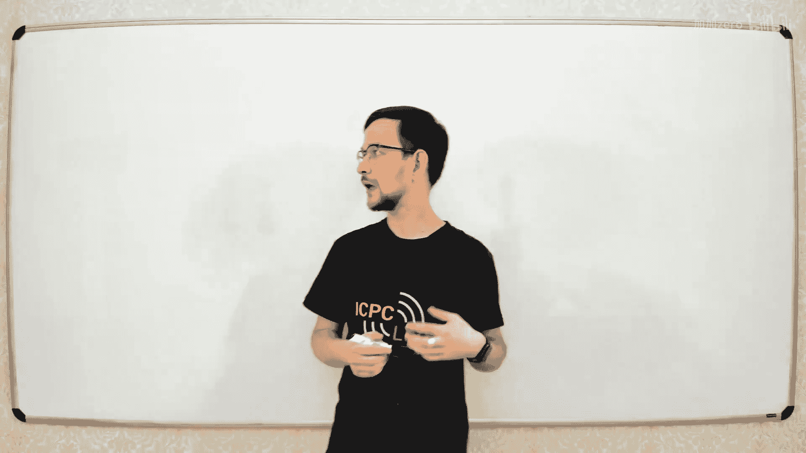
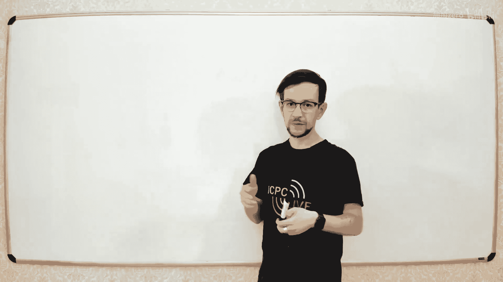
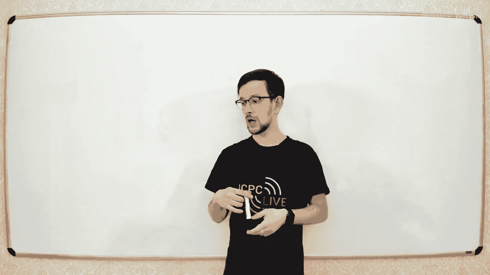
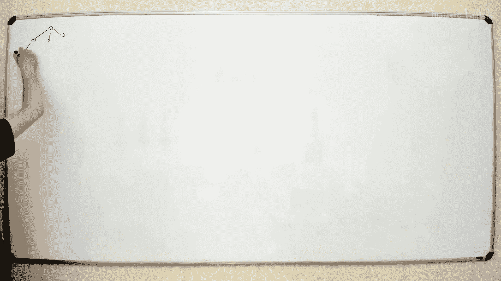
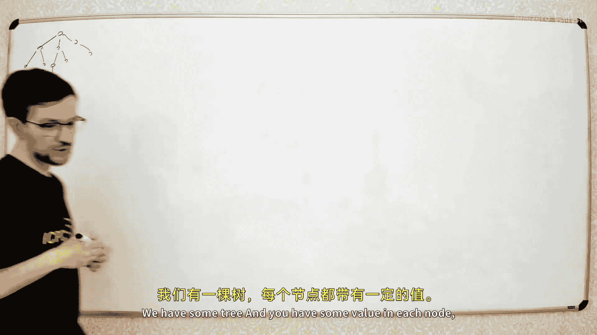
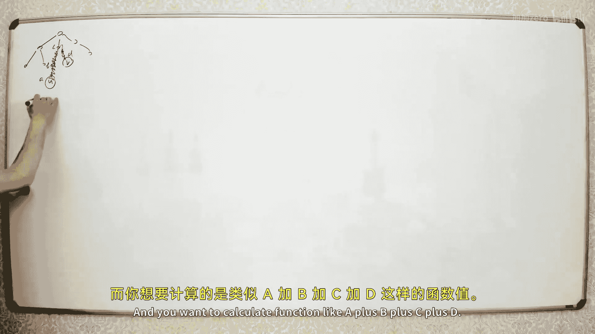
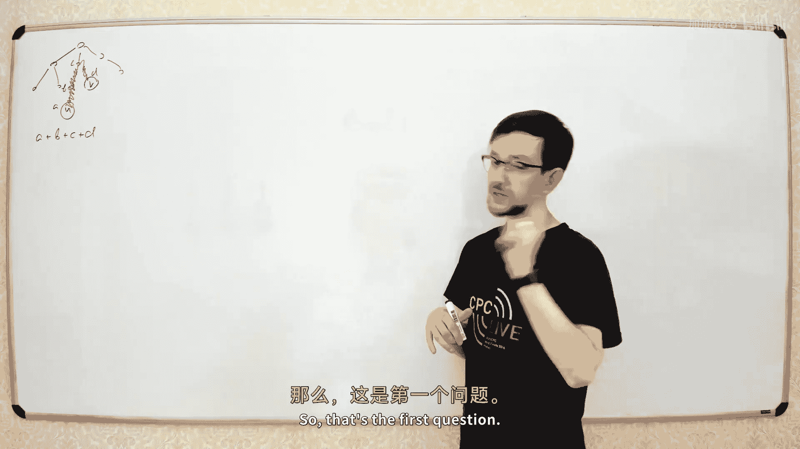
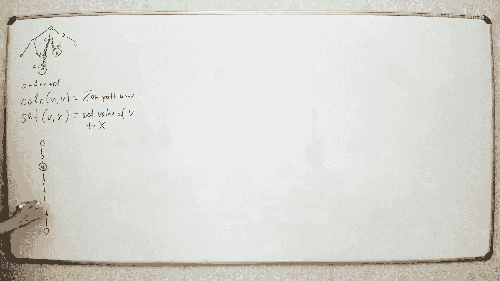

# 【精译⚡算法与数据结构】PavelMavrin p27 p26 A&DS S02E09. Heavy-Light Decomposition -BV1NLB8YfEMq_p27-

，🎼嘟嘟嘟嘟嘟嘟。🎼The。So we continue to talk about trees。

Last time we discussed the problem LCA problem when we have a tree。

And we learn how to find the lowest common answercesor of two given node in log and time using binary lifting and also using order tool and some data structure to find the minimum on segment。

Today， we continue the topic and we discuss one more structure about trees。

And the problem will solve is the following。 You have some tree， again。Let me draw some small tri。

Look have some tree。

And you have some value in each node。And what you want to do is to calculate some function on some path on this string。

 So youre give to nose。Not you and not be。And。Look on the pad from U to。You look on this path。

And try to calculate some function on this path。 each node has some radio。

So here's another version of like A， B， C， and D。And you want to cook a function like A plus B plus C plus D。

So this plus is some associative function， like we discussed in the second。아 뭐 하 아이프노 아이디 봤 이 마시。

Draw a cat in the middle in some places。We'll have a break in the middle and I will robotex if you ask again。

So。That's the first version， again。

You you you need to think this this where Kk or see Kk from U to B。And the result is some on pathth。

A from you to me。公。We can solve this problem using binarys。

 and we we didn't discuss it in previous lecture， but it was in the home task。

So we will discuss it tomorrow。 when we will test your solutions for the home desk。

 It's actually quite simple when you， when you learn how to use binary liftings。

You can not only find the lowest common an， but also to calculate some function on this path。

It's not very hard。 So we will test tomorrow。 when I really expect some of you to solve all these problems。

 So we'll have something。 Please。But so if you have only this。Requests。

Then you can use just binary liftings and using these binary liftings calculate any function on any pad。

But what happens if the tree changes so if you have another request。

 which changes the value in the node？It is said。L X。set volume。Of node， V to X。

So we'll have two requests， first request will change the value in some node。

 and second request will calculate some function on a path in history string。做个资本。Okay， it's clear。

Let's go。 So before we， before we start to solve this problem on the tree。

 let's try to solve this problem on some special cases。

 So that's usually one of the first thing you need to do when you have some problems。 So we have。

 when you have。Some task。 and you want to solve it。

 Let's try to first solve some special cases for this problem and see if we can solve these special cases。

 if we can solve these special cases， then we obviously cant solve the whole problem， right。

So the simplest case of the tree is a bamboo tree， so if you have a tree like this。Thats obviously。

 tree。So let's try to， let's first try to solve our problem this range。 if we have tree like this。

And we have these two requests。 So first request changes the value in some node。

 and second request will create some function on a path in this tree。You'll have some notes。U N V。

And you need to calculate your function on on this bag。What a structure can be used。

It turns out it is quite familiar with section， so we will we you see this data structure and where see this problem。

In some previous lecture。So in some of previous lectures， we actually have exactly the same problem。

what the structure is？Again， you have two different queries。

 First query is to take some node and change the value。

 and second query is to take two nodes and calculate some function on this path。Yes。

 you can take segmentary。Thiss obviously a segment this this three is just an array of nodes。

 so you need to change the value in one element of your array and you need to complete function on some segment of your array。

So we just use second3。The solve is problem in the soul。呃。And now， let's go back to the three。No。

 first， if you see that you need segmentary in this small in this simple case。

 you obviously need at least something that complicated to solve the problem on a whole on a regulatory because even for this simple case。

 you need segmentary。 So for this case， you need maybe something even more complicated， right。五。

So how's solve this problem， We'll solve this problem in a very simple way。

 We will try to split our tree into some。Paths， and when will use。These segment， trees。

Dle great function on each path。And well， they will combine all these results to get the whole result of the function on this given second。

That's roughly roughly the name we have today。So the technique we'll discuss is called heavybilite de compositionposition。

Okay let's draw another tree。 I just like to draw trees。So let's have some tree。

Something here something。Here。And something more。There maybe something here。And something again。

And something more here。Let's have some big dream。嗯。네 그렇 자。So let's have some nice cream。Now。

 what will do。We'll look at all edges all on this stream and we'll split these edges in into two classes。

 We'll have heavy edges and light edges。How to say if， if the edges light or or heavy。그 it。

Were looking at each note。Look at child of this node， all children of this node。

So it should not have some children。Now， for each child will calculate a total number of nodes in this substrate。

Be below each each child， there is some subject。Some sub three here， some sub three here。

 Some sub three here， Some sub three here， some sub here。Will look at all these up。

And find the larger subject。Lge is just just by number of nodes。

 So we'll calculate a number of nodes in each sub and find the largest one。And so。

 and then we will mark this edge as head edge。 So this one edge will be the head edge。

That's all this a plan。 So for each note， we'll do the following。

 We'll calculate the size of all subies of its children。

And then take the largest one and say that this age the edge to the largest to the largest child is the heavy edge。

Let's try to mark all the head edges in this picture。Yeah。There' is another way like。

 there is there are two schools of heavyly de compositionposition。 Okay， First schools is like this。

 Another way to define the hyperly compositionposition。

 Maybe you see it in other lectures is to say that the child is heavy if。

 So so the size of this is X。 So say thats。Chard is heavy。 It's its size is at least。

Half of the all elements industry。In this definition， some note may have no heavy children。

 So So for some note， there might be no heavy children at all。 And if you have any heavy child。

 then it have only one heavy child。That's basically all the properties we need。This also works。

 this also works。That's just an alternative way to think about hydr composition Sometimes it's more comfortable to do it like this in most cases in practice it's more comfortable to do it like this。

Just don not to think about this those。This properties is， this properties is cool。

 but this is much easier to， to， to， to。To check and easier to how to say， to implement。

So this definition also works。But I will use this definition just because it' it's more comfortable for me。

 okay。Both these finished will give you the same asympotics。

 This is actually a little bit faster because you kind of want to have many heavy edges。

 the more more heavy edges you have， the fasterier the structure will be。Sorry， if for some node。

 you have no heavy edge like if you have this node。

The size of both these children is less than half because the size of this is three sizes is one and one。

 so one is less than three water。And you have no heavy children。

And you kind of want to have as as many heavy children as possible。那被告死他还没。Hey， ages will be。Yes。

 we we will calculateco it faster than light ages。 sounds forget。

So I will use this definition of heavy edges。 This also works， but it's kind of slightly。

 slightly slower。 So I want kids。Okay， let's go back。

So we'll take our three and we will mark all the heavy edges。ric， we not the here。

You need recursion to to like iterate all age over all nodes of your of your tree and to calculate all the sizes。

Can anyone No， I have only one heavy child。 It is the heaviest。The childil。

 theres there's always if the note is not a leaf， then there is exactly one heavy child。

 It is the largest sub of， of this， of the children。

if you have several several trees of of the same size， you just pick one of them。

 say this is the largest。If so， if， if you have several trees of the same size。

 just pick one of them。 say this trees is heavy。So there' is always exactly one heavy child of each node except of lives。

故。こ。So we'll take this stream。And first， first what， we need to do calculate the sizes of all subies。

You can do it recursly。 Yeah， you can you can do this。

 recursor functional cols the size of the substrate。So you call it recursion。 it goes here。

 here here stops here。 So size of this Sa is one。 size this is 2， it's 1， it's4， it's  one it's2。

 it's。Who b who did the 7 and so on。So you just call recursi function to calculate the sizes of each subject。

And now you actually can do it in the same recursive procedure you can call the same recursive procedure to calculateulate all the sizes and also to find the largest child。

 Now for each note， you find the largest sub of all children and mark this edges heading。

So this edge is heavy， this edge is heavy， this edge is heavy for this is right edge is heavy。

And so for each， for each note， you take one of the children。And say， this age is heavy。

This is heavy。 This is heavy。 This is heavy。 No one of them doesn matter。

For least not lease is here that's all。And you do it。嗯。not any of them。I I left one。One。right。

For the root， left one by， honestly right。一种一种一种。Also everyone。

 we just started to talk about heavy light condition。嗯。P all， let whole plan。 Again。

 you can do it in laundrycur code。Well basically， what do you need to to how you do it。

 So you call this。F， let's say go of x。 So take this node x。

You can create the size and then find the largest chart also see say。Let's say size equal to one。

 Then you iterate of all children。Of X。Calculate the size of this。 So this is why。

Lally the size of white， let。See， we go through。Go of y S plus equals C。 So if C greater than best。

And then best equal to y equal equal to C。诶。That's not by。 that's marketing。

If see is greater than the marks。then marks equal to C and heavy。Of x equal to y。넌 왜。Its like this。

Despite simple recursive procedure， you iterate for all children calculate the same function。

 This function returns you the size of the substream。You add this size to the size of your substrate。

And also， find the maximum size of the option。So this maximum max child will be the heavy edge of your node。

 So for this note X， the heavy edge will be white。Here you find the heavy edge of low test。

And also in then， you return the size of your searching。It's quiteite simple， right？응 응 응？Goodd。😮。

That's错。嗯。Andひ現で。Cool thing that you can do it in linear time。

 So this recurs procedure is actually in linear and linear time。 So total time of the will be。

So in linear time， we can split all the all the three into some。

 you can split all the edges into light edges and her edges。こう。Now。Let's look at this heavy edges。

 So let's look go only at the heavy edges。This cave edges form some。Beaths。obviously。

 because each node have only one heavy edge to the channel。 then these heavy edges form some。

 no from some paths。 So if you start from some heavy edge。And try to go down， you go down here。

 then you have only one heavy edge。 So you take this heavy edge。 then you take this heavy edge。

 this ca and so on so you will walk to some heavy path。

So the whole tree will be splited into some heavy paths。Let's。Daw is best。Have these。Hey bath。

You have this small heavy， this small he。 these he。And this one。 and also， this one。

And this one and this one， I， I don't know here。The saw。Like this。嗯哼。😊，So have some heavy beds。Also。

 you have some single horse like this。 We will say that every is ver like this。

 which is leaf and doesn't have any heavy。Heavy edge well just say that it is a heavy path of size one。

 so it's heavy path of single vers。So this is small， heavy baths。That's so。

Now we just split all the nodes of our tree into some paths。That was the plan。That's all。

 That's how you make heavy light decomposition。No。Let's go back to the function。

 So to to to these request。How will we calculate these requests， So imagine you have two nodes。

 you have some node。No， let's take， for example， this note。So this is node U。

 And let's say this is node V。And you try to click click function on the path from here to here。

How will you do it？Let's see。Let's look on the path from YouTube。

This pair consists of some segments of heavy paths。So we start from here。

 We need to take this whole heavy pad。 So we use take this。W habitat。

 Now we go to here and from here， we need to go up to the root， so we need to take the this。

Segment of this long hair path。 sew to travel there up to the route。Now we go here。

 I need to go to this the， so we go here。Use this use this segment of this k path， then go here。

 take one this note and they list one this note。I like this。没。Its not。

Not that clear because I just used too many hatchings here。そう。

So this variable heing is the node we travel when we move from U to V。 So this is V。So again。

 when we travel from U， we visited all these nodes。

These notes form some segments of these heavy paths。嗯hu。

Can we just combine the light each heavy path with one light Hbo。Okay。But why。I want to split nodes。

 not， not edges。YouYou can if you want to split edges， you can add this last edge to your heavy path。

 That's right。But I want to split nodes， not edges。 So I don't need to split edges。嗯行行行。Mm。😊。

I have no idea。It's from the world finals in Phuket。2016。But one time ago。I make these T shirt。

I believe it's something from Indian mythology。耐啲。I am not that good in。嗯。Gong。So。What next。

 What next？Let's try to calculate the number of different heavy puffs we visited when we travel from here to here。

 So let's move on some path from YouTube。It turns out that the number of different heavy puffs is pretty small。

How to prove this。Let's look on the pad from YouTube。Again， let's split this path into two parts。

 which when they travel from U to V， they travel from U to this LC。 So this node is LC。Of U and V。

 So we travel from U to LC C A， then from LC A to V。

 So let's look on the number of different heavy paths on the path from U to LC C。

To do this will calculate the number of hair paths from you to the root of the tree。

 So let's look on some node view and look on this path from you。To the root of the train。

AndAnd let's calculate the number of different light edges on this path。

W turns out this number is pretty small， why this number is small。

 because each time you each time you travel each time you take this slight edge。

 it means there is another edge which is heavy edge。

So when you start from this note and go to the root， lets see let's see if this node is heavy。

 this node is heavy， but this node is light so you take some segment of the heavy path and then you have this light edge when you have the light edge it means that for this note there is another edge which is heavy。

So you have。So this edge is hidden。If this edge is heavy。

 it means that the size of this subry is greater than size of your sub。So， if should take。

You take this sub and your subre。If your side have size X。

Then the size of this heavy sub is greater or equal to x。어哼。

And it means that the size of your parent of this note of this。Size of this tree。Is at least two s。

Right。这个。You go from U to to the root if you see some light h。

 it means that you move from subsaty of size x to suby of size at least twice。Yeah， so。

 so the size of this sub of of this sub is at least twice bigger than the size of this sub。嗯。

Also's on， now just look on the sizes of this substrate so size of this fruit。E M。

And size of this shoe is one is at least one。So you start from the three of size at least one。

 and each time you see a light edge， you increase your current size twice。In the end。

 you must have a size M。So you cannot increase your size twice more than log and times。So。

Number of flight H can it be more than log M。M， clear enough。这个。Why is it loggan。

 Because each time you see a light h light here， each time you see a light H。

 it means there is another subre and size of this subre is at least as big as the size of your subre。

 So when you go from here to here， you go to this tree of size at least twice bigger than the o。

And you cannot do it。More more than logan times。Like in do correct。

 basically we have like almost the same explanation and it's discuss the joy。It here is a little bit。

 Heres a little yeah。Live before interesting。 So if you start from Ro 3。

You take your size of these trees。So here your size is one。 now you see this light edge。

 the size is free。 So it's at least twice bigger。 Now you go here。 The size of this size3 is。4，5，6，7。

8，9 10。So again， when you move from here to here， the size is increasing at least twice。

 then you go here， here， here， so here size you when you take heavy edge。

 your size is not decreasing。The size of this sub3 is at least 10。 No Actually， it's more than 10。

 It's 10，1，2，3。 It's 39。Now when you move from here to here。

 this size of this substrate is at least 28，26 and。It it should be big about。Not the pretty。 So okay。

 every time you see a light edge， you increase your size twice， you can do it more than loggan times。

 So the total number of light H on your path is no more than loggan。不。Now。

How it will help us to calculate the number of heavy paths。 No， it's quite simple。 So if you take。

 if you look on the light edges， these light edges are simply the border between two segments of different heavy paths。

 So if you look on the path from you to the root。You have these light edges and all other edges I here this you。

You have this pad。Some edges are light。 Some edges are heavy， So you have some heavy edges。

They form some segments of your hair pet。And if you have no more， then log in。Light edges。

Then these loggan light edges will split your pathth into segments of entrymod log n segments。

So each of these， so you have no more than lowgan segments of different hair paths。

Do you have any bounce number of decomosposed baths in general。I don't get your question。But if you。

 if you split your tree somehow not in heavybilated style。

But just split your tree into segments in some way。 You may have many。Dres newa。

So if you don't if you use some decomposition into paths， not have light decomposition。

 you may have more segments in the path U， I'll put it in the home task。

So it's important that we use this heavyized style to decompose our tree because we used here we used if the edge is slight。

 then there is another heavy edge， so this size and increased rice。에 에 응 응。不好意思了，哎呀。Actually。

 what we need is to calculate number of wes from U2， right？So perhapss from YouTube to， but。

If you compare from you to B， then you go from you to this LC C A on this segment。

 you have no more than logm， different hair paths。 and also on this。Part of this pipe。

 you have no modern logan pipe， Lo different pipes。 So you。Get your start from you， go to LCCA。

And then， go to V。So here you have up to loggan。Heavy puffs。 And here you have up to again。

Heavy puffs， so total number of these pes will be up to2。So on this path from U2 view。

 you have up to two log again， he best， right？No， these heavy puff are actually not like this。

 So you have some segments of hair puff。 So this view is something like this。

 So you have some heavy puff here， you have some heavy puff like this。 You have heavy puff like this。

So that's basically how this station looks like。You start from node view。

And you need to take this segment of this cur path。

Now we take this segment of this hair pair of this。5。Okay。And that's almost pop。Now。

 how to calculate a function to calculate the function。

 we simply need to calculate a function on these segments。

 So we'll calculate a function on each segment。And then。

Calculate the sum of all these sum to get the total sum on this pad。So to cook some on each segment。

 we will simply use a segment3。手不住。Look use this technique。So for each he。

 we will build the segmentary。This segmentary will give us the sum on each on on any segment of this pair。

嗯。Pice is here。EFor each5。So for each path， we will build a segmentary。

The number of segmentsaries will be up to n here。 So you may have up to n segmentaries。

 but the total size of these segment trees。嗯。Total size。Of these segmentaries will be linear。

 No because each node belongs to one of these segmentaries。

 So the total size of all these segmentaries will be。lingingang。嗯哼。😊，And now， when you complete the。

A function from U to V。What you do is just to split again， you find this LCA。

 you know how to find LC C， so you find this LCA， you take this path， this path。

 calculate the function on both this path， how to calculate function， you start from on U。

And try to go to LCA， you take your current He path。

 look on the top node and this path is this notice below LC then you take this whole segment and go to the parent。

If this top note is above the LC A， then you。Just try to you。So what， what happened？

 So you have this on you。This is your LTE。You're taking this stone to you。Look on the heavy path。

 which contains nodium。 No you can make us for for each note。

 you can you can remember the pointer to the segment。

 Let's know how it should be implemented by by By the way。 I just， I just explain what's going on。

 I will later explain how to implement it。To， to， to make it much less painful。

 it can be implemented very easy way like this。 So， So this function is pretty easy， Right。

 So all this data structure can be implement quite easy。 I will explain it a little bit later， but。

Let's just try to transcend what's going on before。 I， I will try to explain what's going on。

 and then we'll go to simple， very simple implementationation of this。ああ、まょ。

So we take this note here。This note U belongs to some segments or222 sum。黑板。

Let's take the top note of this ca。If this node is below the LC。

 then we just take the whole segment of this helip pair from here to here。Add this sum to the result。

And then move here。AndThen again， we take this note， find the。Have path， which contain this snow。

Take the top node on this cur path。See it is below LC C A。 So we take this sum。

Add this sum to the result， and so on。At some point。We'll take the kind path。Like， please。

And the top node of this here will be above the LC。 So then let's notice above the LC。

 We just take all the notess from the U LC。 So we take a big sum of these segments。Andber走。嗯哼。

Just it's quite。Quite simple code。 actually， we start from audio view。

Take the top note of of this heavy path see if this below LC we added to the result and go here if it is above the LC。

 then we take the sum to the LCA and thats all。So it's simple while。It' actuallyly quite simple。共。

That's all， that's all。 So you calculate this sum from U to LC， calculate the same sum from V to LC。

Now， you you just add one sum to another and take the whole sum on this pair from YouTube。그 다음 그래서。

What will give total 1 complexitying？啊，我行。So what is do10 complexity。

 we start from nodeU and go to LCCA on this way， we will visit up to log n different segments。

 different heavy paths。そう。On each heavy app， we need to make these requests。

Each of these requests is just a request to the segmentary。

Request will secondary cost you login time， right， So each of these requests costs you login time。

 So you need to make up to login requests。Each request cost you log and time。

 So total total time complexity will build square。And's all。 And how to update values。

 So we didn we need to make。2 requests， right。 First requests calculate create a function。

 Second is to update the value in one node。 Now， update is pretty simple。

 So when you need to update your value in some node， So you take some node。

 So you click the V and you want to update value here。 How to update the value。 No。

 you take this segmentary。The segment tree is correspond to this heavy path。 So you take this node。

 you take this heavy path。 You have some segment tree assigned to this heavy path。

 So you take this heavy path。 Take this segment3 and update value in this position。That's all。

 that's So update costs you log and time actually。 So this is the count function。

And you have log and time for the set bank。嗯。You can do it even faster， actually。

 And on the next lecture， we' will discuss how to make this even faster。

 So you can use the technique， which is link at3。 And the next lecture。

 we will discuss link at trees in link at trees， you can calculate function in log and time amorized。

So linknk work in log and amortize time， and it actually allows you to do even more。Operation。

 so in link country， you can not only。Complete this on on a static tree。

 but you can modify your tree so you can cut the branches of your tree and。

P to link them in in other positions and so on so。 Next lecture will discuss much more sophisticated the structure。

 which will allow you to modify your tree as well。 So this structure is fixed for your tree right if you change your tree。

 you need to rebuild the whole structure But in link a tree can adopt to the changes when you change your tree。

 It will adopt and rebalance itself to match your current state of the tree and also it will work in logan time for this complete。

Will discuss it on late next， next week。ho。And now I want to， ya， I want to spend some time to。

Discuss how to implement it。Because。It's kind of look painful to implement this。

 but it's actually not。 it can be implemented quite easy way。

 So especially some of you came from code forces。 you may be interested about how to how to implement this in the contest。

 So it's quite easy。Quite easy data structure。 So how to what is the easiest way to implement this data structure。

 Let's see。What I will do first。I will use not many small series， but one big seary。

So instead of having many small segment trees is just complicated。 Yes see。

 if you have small segment trees。No， it basically means that you， you need some data structure。

 you need make some structure segmentary。 big array of this data structure。

 make pointers from node to the corresponding segment3 and so on。 it's just complicated。

So instead of doing this， I will my I will use only one big segmentary， how to do。Let me。

I hate to join another treat。Let's have some cream。I need some labels for the notes。

 So I need another one。No，2，3。Let's say，4。5。s。7even。8ight。哦。What's what's have 9。对。

He need to stop at some point。 Okay， let's good that。So now what I want to do。

I want to iterate this tree。In such a way that first， I the heavy sub and then all other subs。

So I already marked the heavy sub trees for each node， so let's do it。So for each note。

 I know the heavy sub3 of this node。These three these。Any of these， let's say this。Now。

 for each note， I know the heavy sub of this note。And now， I will simply。Again。

 I make a recursive reversal of this tree。But in this recursive procedure。

 I first make a recursive call for the heavy node and then recursive calls for all other nodes。M哼。

So I start from the root。It's not one。Then I call the same function for the heavy substrate。

 heavy substrate is this， so I I call thecur function for this node2， so I go to node2。

Then from here， I go to the heavy sub 7， then go to the8， then go back back here。

 Now I recursively visit all other subies， except the heavy sub。 So I also have this sub4。

 So I go this sub form。Let's go away。 Let's go another。Yeah。Who make it more interesting？

Now for this note 4， I go here， I go 12， then go back， back back。

Now I start from root and visit the heavy subre， so now I just visit all other subies three there。

 so I take these two subies and visit both of them so I go to here sub to sub3 so I visit sub33 and then go to six then go back。

And then go to this subrial s5。Here I visited 9，11， then back back and then that。That's， this one。

Now。Let's look on this sequence。Okay again， can you can collect a sequence in very simple recursive procedure。

 right， Oh let me try it to。So let's re P。 So it's we go to fix， okay。I'm not very creative today。

 So this how you do， you first iterate over the hair sub you you make。😊。

So if children is if children。嗯。So first， you put your note in in V。Then if is not empty。어 어때지。

Then trust you recursively iterate into your hair re。And then it render all other subes。

Let's say if Y is located。We call。Something like this。嗯。Okay。

 it's simple recurciive reverseers of the tree， but it's just modified to first go to this heavy sub and then to all other subaries。

Anyway you， you get this sequence of nodes。Now let's see。In this sequence of notes。How this。

Hey pipes are laid out。 So sorry， if you look on each。Hey Per， this carry Per。

Form some segment of this sequence。But first you have this 1，2，7，4，7，8。 It is some he pair。

 So you have heli per 1，2，7，8。 Yeah， it correspond to this to this hairper。Now you go to Worldtex 4。

 you have this heap 412， you have this heap。Now you go to mode three。

 you take this heif 36 is another he path。 Now，5，9，11 is。

Another hairy puff and in then you have this hair puff for front off。

So every heavy path is a segment of this sequence。嗯。You stop saying everything's fine。ああ、そう。Yeah。

I just want to make the simplest implementation of this data structure， right？嗯。So in theory。

 you can do all this stuff， you can split， make this small segment trees and so on。

 you will get this time complexity here， that's fine。

 I just want to make a simple supplement for you to use in the contest。嗯嗯哼嗯嗯嗯哼。😊，Don't waste。

 it depends， it depends。Actually， we don't， so we the total size of all these small segmentaries is also linear。

So the total number of nodes in these small subaries and in this one B subaries will be the same。

 So you have no no， if you have three of n elements， you need up to n up to2 n nodes in total。 right。

 So if you have segment three of size n。Then you need something like n。 So if， if you have n leaves。

 you need any more nodes here to make the segmentary， right。

 the total number of nodes in the segment is like 2 n。

So total size of this small sub of these trees will be 2 n and total size of this victory will be 2 n。

You may lose something when you make this recursive when you make these calls。

 when you make these calls。You made like if you use this small subris。

 it will be low of size of this。Of this path。 And here， every request will be lower of N。

But you can make the segment three from bottom to top。 if you make segment three from bottom to top。

 then every request will cost you the logive of the size of your request。

 So it's the same time complexity。So actually， no， you don't lose anything here。

You just make it much more simple， actually。And the time complexity will be will be the same。

 and the constant factor actually will be less because you don't have all these smaller issues if you have only one degree array。

So it's much simple。嗯。没错。Now， how to use this， how to use this。You use the CP very simple way。

 You take each node。 So when you want to calculate some。Some slow。Some on the path in the he。

 some on the bed in the heavyy。Beth。Some on segment in the head there。

So you have some hair path and you want to calculate some on some segments of this path。

So you we want to create some from these two to this eight。You just take notes 2 and 8。

 find them in this sequence。 So here we have 2 and 8。

And just calculate some between these notes in this big seary。

So you don't need to remember which no corresponds to which heavy path。

You would just take these to those。Find them in this sequence。 Well。

 basically you need to find index for each node in this sequence and calculate the sum between these two indices。

And this will be the sum on the segment of corresponding heavypa。No。Now what next will be simplified。

 I want to simplify this。LC， because like what you can do。

 you can use the bind liftings or other methods to find this LC C， but you actually。

You don't need to。You can use this heavy light composition to calculate this L， as well。

And just do it on the flight。 You don't need any special code to calculate this LC C，A。

You can calculate can calculate this LCA just using your heavy edge composition。How to do。

Lsard like this。What's the plan。What日本。Yeah you， you， you have two notes。 You have no。You and nobody。

嗯。Let's look on the segment on the heavy paths， which contains node U and node V。

 Each heavy path can be simply。So she to the top node of this。 So for each node。

Let's make a pointer to the top note of the corresponding。Hey back。 So from each node。

Let's have a pointer to the top node of the corresponding heavybe。So all these notess have。

Poiner to here。 All these nodes have pointer to to here。 All these nodes have pointers to here。

 and this。So for each note， let's calculate the pointer to the top node of the corresponding heavy path。

We can do it in the same regard procedure。 I will just not do it。

You can you can do it right here when you build these heavy path。

 you can also precalcolate these links， or you can make another cursor precision as you wish。

 it's quite simple。 So each node must know the top node of the corresponding heavy path。if you have。

If you have some toilet pie。어 대왕 투도。I to haveポ to don' know of this。For all nodes of theカ haveポイント。

To the top note of this Philip bags and it itself。 So it will be top。

Of X so top of top of x is the top node of the heavy path contains node node X。🤧咳。No。The algorithm。

 So you you take these two notes。And you want to calculate the function on this path。

Let's find two heady pairs， which contains these two notes。 So we have one hair pair。Contains no。

 you and another heavy pet contains no。Let's take these two。Pope notes。 Let's say excellent。Heavy。

 no， no， no， you have no heavy no。 You have heavy edges。

So every node one of the edges is heavier it correspond to the heaviest child of this node。

 and these heavy edges split all your tree into some paths。So you have these headed paths。嗯哼。

And for every heavy path， I have a pointer to the top note of this heavy path。No， that algorithm。

So we start from no view and no view。For each of this node， we know the top node of this he。

 so for node you， we know the top node is x。I'll just write the code So X is the top node of。Are you。

And why is the top note of。No。First。If this not are the same， So if。X equals to y。What does it mean。

 It means that U and V belongs to the same segmentary， belongs to the same hepath， right？

So if x and Y is the same， it means that you have situation like this have。大金総長。You and V sorry。

So you try to find the top note of this hair。And go to the same note here。

 So this note is x equal away。So if U and V belongs to the same heavy path。

 then you just calculate the sum on this segment。So you take this segment from U2 B。

 calculate the sum， and that's the result。啊，所谓的。Add to the result。Some from U to me。

So this is called to the segmentary。So you take this segment3。

 find you and the vehicle plate this sum。So this is the call to the segmentary。能么说。

If X and Y are different。Then what we'll do， we'll take the depth of these two nodes。

So we's take depth of x and depth of y， depth varies distance from the root。

So let's welcome the distance from the root to X and from the root to Y。And take take， take。

 take the deepest one。 So， for example， if de of x is greater than de of y。Then。Then I claim that。

LCA is above node X。So all these nodes below x are not LC of U and V。

 So the pair from U to V contains all the nodes from U to X。 So I can take all these。N on this path。

And just add them to the results。Not why it is true， not because if you is， if y is is above。

 it means all notes from X and below are different。

So if you take pathth from V to LC and from U to LC， right， so somewhere here is LC。

So your part contains of this part this part。And all node from X and below are different on these path。

啊哼。Well because here you have why and on this level， you have different parents。

 It means on have have all parents from this level and below are different。 It means that this。

 all these node belong to the like。This this path of this path from U to， right。Clear or not。So。

 if you take deepest of these two node。And then you can add all these notess on this path to your result。

So， you just add。The sum from U to X to the result。And move the node。

 So you added these node to the result。 Now you can move you to this position。嗯哼。很少。

Wve you as a parent of x here。That's all。 Now， you continue。そ那么见。You have node U and node V。

 You calculate the top nodes of each hair path。So you take this he path。And this heavy path。

So this notice X。At least all is white。Again， you calculate the depth of these two nodes。

 take the deepest one。 You here y is deeper than x。 So depth of y is bigger than depth of X， right？

So if y is bigger， then you take all these notes and add all these notess to your result。So， else。

You end。From white to。V to your result。 So actually， if you。

I just say some and plus because I calculate。 If you have some associative function。

 you actually need to take care about the。Ass the orientation of your， like the the。

 the direction of your path。 So if you have。If you have some associative function， it。

 it it's not it's not always commutative。 Yeah， so if you take part from you to V。

 it goes like this first is go up and then it goes down。So when you calculate functions。

 so on this part， you need to calculate function from bottom to top， and on this part。

 you need to calculate function from top to bottom。So for different associative function。

 it may be different， right。So you actually need to calculate two different segmentsaries for function like this and for function like this。

So these two parts should be calculated separate collection。So you you just need two second。

One segment three to calculateulate the left branch and other signatures could to calculate the right branch。

Just small details。嗯。If function， if your function is commutative， it doesn't measure。 Yeah。

 if you have minimum sum or something else， it doesn't matter。 if you have something strange。

 which is not commutative， like matrix multiplication， something like that。

 Then you need two separate series， one to calculate left range another to calculate right range。

Let's like。So you add this to the result and then move V。What's smooth。水个太。

So you add this to the result and move V。 Then at some point， at some point。

 this U and V will belong to the same。2听行。That's the whole code。So at some point。

 you and we will belong to the same heavy path。Then way it belong to the same car pet。

Then these conditional has been special， so you go into this if。And you just add this result。

 Add this sum from you to B to the result。Andther John， that so。

So that's basically the whole code of the heavy composition。 It's not that not。

 not that that's curious。 So sorry if you。If you have the segmentary。

But you should have segmentary in your inventory， right， So if you already have your segmentary。

 then that's basically the whole code you need to add。

So you need some code to split your tree into segments。 You need some code to make this sequence。

And now， based on this sequence， you build your segmentary。

And that's the whole code basically to calculate the function on its on the path。 Here。

 you make two callss to your second train。And that's that's whole。So it says it says's not。

 not not as scary。 It's quite simply destruction。Well discuss much more complicated structures。我。

