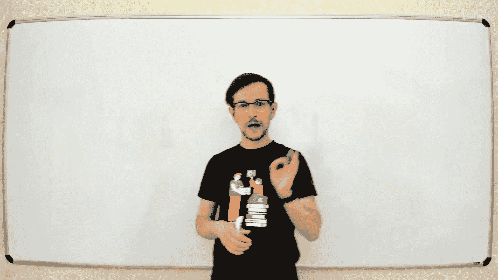
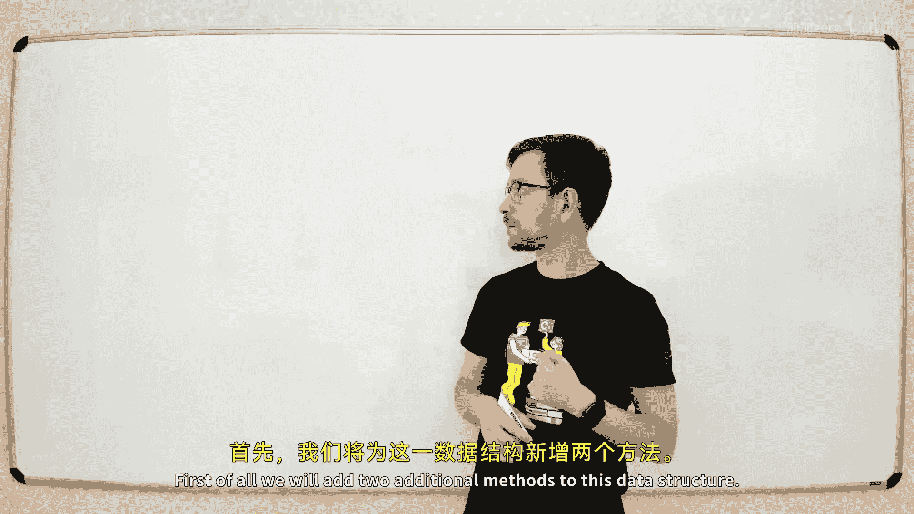
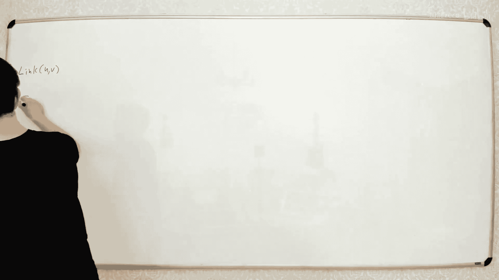
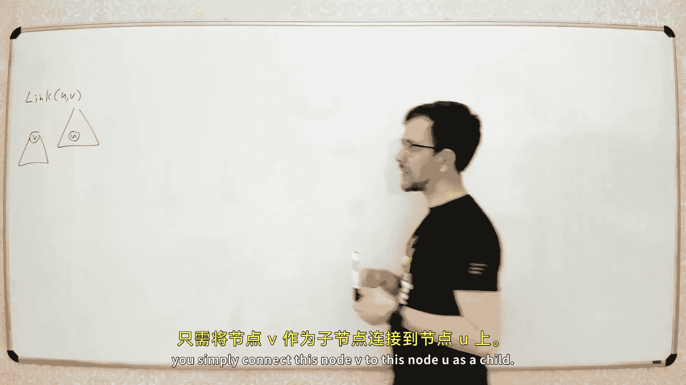
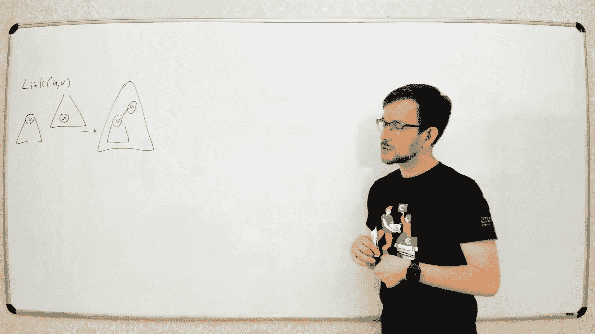
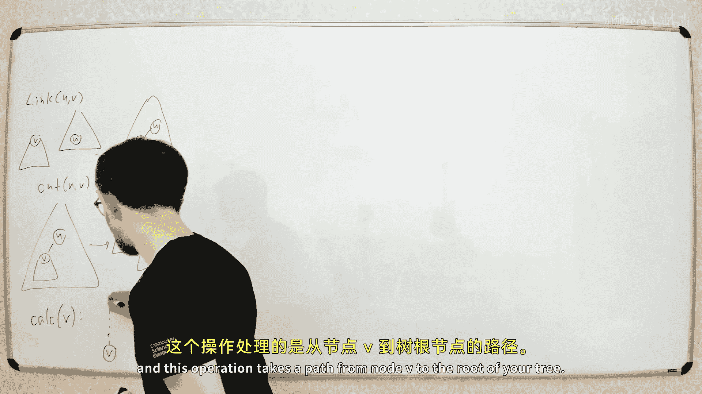
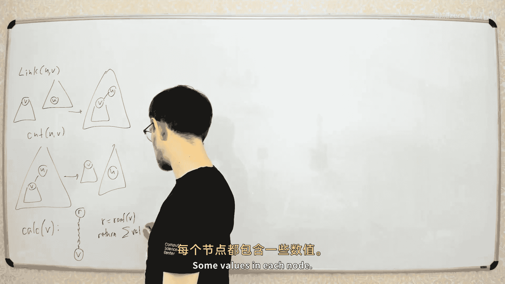
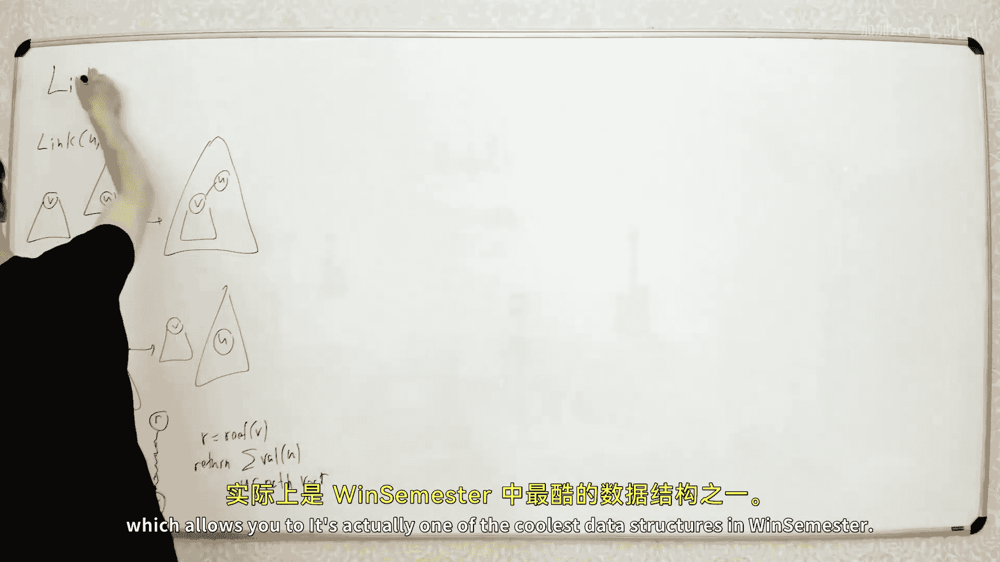
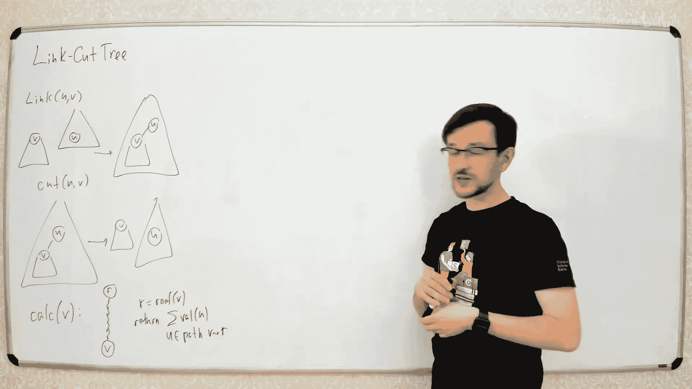
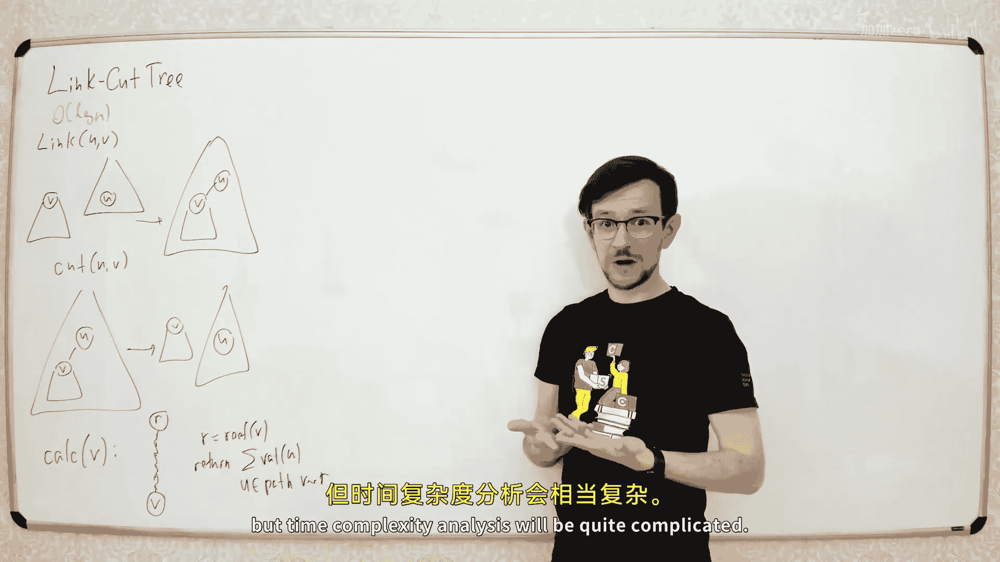

# 【精译⚡算法与数据结构】PavelMavrin p28 p27 A&DS S02E11. Link-Cut Tree -BV1NLB8YfEMq_p28-

，🎼嘟嘟嘟嘟嘟嘟。🎼The。So today we continue to talk about trees last week we discussed the heavy light de compositionposition thats data structure which allows you to find some function on a path in a tree。

 so you have some tree， you have two nodes of this tree you find a path from U to V and you want to calculate some function in this path。

This week we will upgrade this data structure in two ways， first of all。

 we will add two additional methods to this data structure these we have two two additional requests。

 these requests change the structure of your tree。

They called blink and cut link operation。Yeah。M problem， you have two separate trees。

 one tree with root， V， you have some some tree with root equal to Norwe y。

 and some another tree with no you。

So no the view is somewhere inside the street。And when you make link operation。

 you simply connect this node V to this node U as a child。

So you will have this node V connected to you。And lease will be a big， nice tree。

So the link simply connects two trees， you have one tree， you have another tree。

 you connect this root of your tree to this node of another tree， and you have this one big tree。

嗯嗯。The second operation is cut。 cut is basically the reverse operation so cut。Just in obvious ways。

 you have this big tree， you have this note view， you have this child V with this tree。

Then you make this card， so you have two separateies， you have one ribbon。

 we have no VN all other nodes are in an artery。It's simply the evapo of the deper。

And as usually want to calculate some function on the path。In呃。Just for simplicity in this lecture。

 I will assume I will always calculate a function on a path to the rules， just for simplicity。

 you actually， you don't need this if you want to calculate a function on some path from one node to another node。

 it's also possible it's quite simple， but I will only consider paths to the rules。

I need another farm show。Clk for the。And this operation takes a path from node V to the root of your tree。

So this is the path。 So air is the root of P。And I will calculate some function on this path。Simple。

Some some on this。Yeah。You have some values in each node。我水开封了。

Some radioius in each note when you belongs to path。

From V to R like this。So this operation is the same as in last lectures when we talk about probability composition。

So you have this path in each node， you have some value and you want to calculate some functional。

 special。 some minimum， I don't know。Bit wise and。Any associative function。

 these two operationss are you， these operationss change the structure of your。3， right。

Baically basicallyically you don't have one tree， you always have a like set of trees。

 and you want to be able to link these to trees or to split two trees。那总。That's the full plan。

And the data structure， which allow you to do all this separation is link up to。

Section is one of the coolest day structures in semester。Again。

 it was made by Roberta Jan and Dens Slater like S if actually uses Sries inside if you don't know how to use Sries。

 you may go back to the lecture about Sries， we will use S trees actually if you don't remember how actually Sre works is not a big deal。

 we。

You can watch later if you forgot how to make play trees。

 you may think about play trees like a special binary search trees。

 you can actually use any binary search trees， but the tank of will be not that good。

Speaking about time complexity in heavy light composition。

 we learn how to calculate function on a path in log square time。In this data structure。

 we will upgrade it。We we will learn how to make this operation in log and time。 And also。

 both the separation will also log work in log and time。 So all these free operations will work in。

老人的。Let's all this is plan for today。啊。Let's go。 So some people are afraid of linkka trees sometimes it's even in competitive programming so it can cause some cold forces problem。

 you may find some problems which require something like that like some something like linkka trees some people afraid of linkka trees is actually not that difficult structure So the algorithm is pretty simple。

 we will learn how to make all these operations and the code will be quite small。

 if you have already implemented your s trees if you already have a play tree additional code quite short but time complexity analysis will be quite complicated。

 so I will spend some time to you grab the algorithm and then I will spend a lot of time。

呃。Trying to prove you that the time of legacy is actually log。Radium， whats go。

So how this structure is structure solid have you have some tree， let's build some tree。まこれ。

So have something like a there there。Let's have some more notes here。I made it so much。

Let's add one more here。So you have some tree。And， this is the root of the three there leaves of the tree。

 but as he own not like normal drink。Let's put some labels， let's see。嗯。Its 1，2，3，4。5， six， seven，8。

9 then11。嗯。Good look at some normal rot tree。What we'll try to do is to make a decomposition of these tree so we'll decompose this tree into some paths。

 like invariite decomposition。But instead of making some special properties like in heavy like position。

 we decompose it some heavy puffs， so we declare some edges heavy and we try to maintain some special properties and these properties will help us to make a good time complexity in there。

In this data structure， we will not care about any constraints， so we will make some decomposition。

AndThat's the plan， we will build some decomposition and will allow this decomposition to rebalance itself like in sries。

 So we will make some operationss。 These operationss will affect this decomposition。And magically。

 in the end。We will prove that the time complexity will be low。Exceolute magic。

So what is thecomposition？Hi，I need some special work， please。嗯。

Let's use some marked H for each node V。ok thank住都咁。😊，And I really miss this reminders here cool。

 so for each node， we will mark one of the children so each node have some children。So for each note。

 we will mark at most one of the edges to the child of this doson。As will be marked。So for example。

 here the this will not put any constraints， any edge can be marked。For example， in this tree。

 we will mark， let's say for this rule， let's mark this node， but this edge for this node。

 let's mark， I don't know this edge we mark this edge for this node， for example。

 we can mark no edges， it's also possible some node may have no marked edges and for this node we have these edge this。

ち准备。So that's the perfectly fine composition of the tree。So again。

 white is decomposition because if you look only on this marked edge。

 then your tree will be splited into some paths。We have this path。You have this path。

And you have these small breath。Bs of single money。That's the composition of the tree。Now。We will。

Want to calculate some function on these paths。 So like in previous lecture on each of these paths。

 we need to build some data structure。Which allows us to calculate function on the path。Like seary。

And。Now it no no now it's difficult but we need to modify this decomposition。

 so at some point we will need to modify this decomposition。For example。

 we need to be able to mark the edge or unmark the edge。So， if。

Let' see what let's see what's going on with this decomposition when we change the state of some edge。

 for example， if some change if some edge was marked， so if you have some marked edge like this。

This marked edge belong to some pen。So have some breath。Going through this edge。

What will happen if you unmark this edge， so if you unlockmark this edge？

Then you'll have station like this。Now， this edge is not work。

 So you have this part of your of your pet and this part of your pet。

So simply what's happened is that this path is split into two hals。

 so you have this part of your path is one segment of your path and this part is another path so here you have one single path。

 but after you unmark this edge you have two separate paths like these upper part of this bottom part。

嗯。Oh。That's what happens when you unmarked some H， so it was markeds。 Now it's unmarked so this。

A path of contained in this edge now split it into two parts。What happens if you mark the edge。

 opposite one opposite。 So if you mark the edge。Then the opposite thing happens If you have unmarked H and then you mark this age。

 then you need to merge these two paths into one。 You have these two separate paths。

After you mark this edge， you have one single path。Cool。And so。那。

Let's combine this what do we need for each path？We need the data structure。

Which allows us to make three types of requests。 First type request is to calculate function on a path。

And second and third are to split the path into two paths or to merge two paths into one single path。

嗯哼。So right it。So， for each path， so let's you have this path。We is just a list of notess。

 so you have notess。You need to be able to do free requests first request is to calculate function on the path。

 second is to split the path， so we need to be able to split the path。Whats that。Slelit annual。Okay。

 who watched the previous lectures， what data structure do we need to make these three types of operations？

Yeah。My all of this spoil， right。I already spoiled it before， but。Sa something。What is structure。

Allows you to make these free operations。嗯。Cool， yeah。

 we simply need any type of knowledgeigable binarys trees。Drapes or caresan trees or s trees。

So we need any type of binary search tree which allows us to make splits and motors， for example。

 trips are already defined， trips will not give you this complexity yet but。They are also good。

 we will use actually display trace。Reators。No， the whole one， the whole one。

We will build this data structure in Holway， we have this tree for each note we will market most one of its children。

And now the whole tree will be splitted into pests for each path， we will build a sp tree。

Now we will be able to modify our decomposition， so when we unmark the edge。

 we simply split this play tree into two plate trees。

 when we mark the edge we merge these twoth play trees into one split tree。That's the whole one。

For example， let's build the composition for this tree。So for this tree we have， for example。

 here we have one this pen， so for this pen， this is the path of four nodes。

 so we need to have a split tree which contains these four nodes in this order。For example。

 we may have something like that and we have， let's have  one，9。4 and seven。

Was's little build like please。So， so this display tree。Corresponds to this path in this path。

 we have this node in this or we have node9， one， seven， and4 in this order。In this play tree。

 we have the same node in in the same order。 So if you go if you it era all nodes from left to right。

 you have node 9，1，4 and 7。 So the order of these node is the same as the order of these nodes in this tree。

So this play tree corresponds to this path。故。Oh， here， here is node8。

 node eight simply is simply a s three of one node。simple。その的えと。Now， for this。But。

 we need to remember the。A parent of this path in in this whole decomposition。 So this。

Pth is connected to this node1， so we'll remember that for this path is connected to node one。

 so we'll make special pointer here。Like this。This special pointer will say that this tree is connected to this node。

Cool。Now let's build it。 so here we have note three， simply it's three of one node so we need。So。

 we need free。And it is connect the end note 9。This node2 connected to Note 3。Here we have。

A path of free node，108 to 10，6 and 11， so we build a display three of free notes。

Make something like this。Okay。It's nice play tree， and this path is connected to note free。

So we'll remember that this path is connected to node three。

 so we'll make a pointer pointer is always from the root of the tree。

 so where you take the root of display tree。And connect the route of display tree to this node。どこ？

And what left this node 5。 You also have this node 5。It alsoかなと。That so。

So best this is the structure of your s tree， so internal structure of this sp of your link country is very simple。

 you decompose your tray into paths for each path， you have a split tree。

And from the root of this tree， you have a pointer to the note。Which is attached to your string。

 So each each path， except of the rot strength。 So each path except of one root is attached to some node of the tree。

 So from the。So this path corresponds to this play tree。

 so for the root of this play tree you have a point or to the node which is attached to your own path。

别错。Clear enough。Cool。That's the whole plan， thats how it' that's the whole structure。

Very simple it structure。なお。The key operation of this of the link tree is exposed。嗯。

Expo is very simple operation， So you take this node V。You have this path from V to the root。

Expo simply makes all the not all the edges on this path。

 marked edges so you simply need to mark all the edges on this path。Do you have this spell。

You just need to mark all the edges of this bag。You also make de touch some personals。

It also made to unmark all children of the team。Just for simplicity。

Actually actually don't need to about okay。So after you call the exposed operation of some node。

UpAll edges on the path from a V to the root of the tree will be marked。不と。

That's the whole point of this approach。Cool， now how this separation will help us to calculateulate the function in a very simple way。

 when you need to calculatelate function。In your link country。

So you need to calculate function from some node to the root。You take this note。

 call the exp operation。 this note。 This exp operation will make all the edges on this path marked。

 So now all these edges belong to the same path。So this path。Will be stored in some display tree。

So in the root of this， you will have the result of your function。

So to calculate the function industry， you simply called the expose。In some note。

 have this path in a single split tree， and in this single split tree。

 you find the result of your function。That' simple。Now how to make Lincoln and caration。

 Lincoln and cas are actually pretty simple， so when you link to trees。

 you simply connect one tree to another tree with some unmarked edge so you connect the roof some edge and you have this edge unmarked。

That's simple， the decomposition will not change， so we simply connect。

This you need to have some another three， you simply connect it。And。Make this parent link。

Select this。So link operations is pretty simple when you need to link some tree to another tree。

 you take the root of this tray connected to another node。When you need to make cut。You just。

Unmark the edge you want to cut if it is marked， you just unmark it。Let up make this split。

And then let remove this edge， That's all。So link it and cuts are pretty simple there。

When you need to calculate， you make expose and then use this whole path。通过各一的方式。别错。Look。

 let's try to explore something。😡，Let's take some note and try to call expose function this。

 For example， let's take this。都。So let's quote expose。Aration for this note 11。How to do it。

Very straightforward， we will it all unmarked edge on this path and make them mark。

That's the whole plan， so we will display all these ages and mark all these ages。

That's the whole one， so how to find the closest unmarked edge。It's quite simple。

 let's take this node V， and this node 11 belongs to some s train。Right do this split3。

We need to find the edge， which is this path is connected to Sun node。

So we need to find this node V in this structure。And now find this play tree and find that this play tree is connected to this node free。

😊，So the next edge we need to make mark is the edge which connects our path to note free。

 is this edge。So how to do it pretty simple。 first thing you need to do when you have a split tree and when when you find some note in display three is to make display version。

 So we find this note and make a display variation in this play tree。

So what happens when we make play less。 So first we make play。O11。this is。Log of expose 11。

 So what happens when you call expose of node 11。So first you display this node 11。

What happens so no if you remember how pla trees works。

 you just make one zig operation here so you need to rotate this edge。

 so you rotate this edge now 11 is the root。6 is here，10 is here。Next。

 now 11 is the root of the train。Now you need to find this edge。

 this edge is simply this pointer to your to your next。

To the next node in to the note which it attached to your path。 So you need to find this。

ThisThis note is free， usually simply take this pointer from here to here and you know that the next edge is connects your path to not free。

 so take this edge is this edge。그 so。This link respond to this edge。

You take this edge and you need to make this edge mark。So how to make this edge mark。

 you need to make the edge mark， you simply need to make more separation。

So you take this note and now you need to merge this tree and this tree。

How to merge those play trees， pretty simple。 Do you need to display this not free。

But it's simple because it's all over the old。And now you attach your tree as a right child of this snow free。

 So you simply take this play tree。 now three is the root。

 you attach your tree as a right child of this tree。So simply like like。That's all。

Now these edge is marked and you have these。我服。Four months again， now you have this pair，3，10，6。

11 is here，3，10，611。 So this plate d responds to this path。没错。Now， you need to。

 Now you need to find the next。Edge， you need to， you need to mark。

 This edge will be the edge which connects your path to the next node in in this tree。

 So this edge is simply at this pointer。 So you need to find this pointer。

This pointer corresponds to this edge。Now you need to make this edge mark。How to make this edge mark。

 No first before you make this edge mark， you need to unmark this edge because each node may have only one marked child。

This note9 already have this。Age marked。 So you need to first unmark this edge and then mark this edge。

Let's start bymarking this edge。 So first， we need to unlockmark this edge。

 how to unlockmark the edge。 we need to make split operation。 So we need to split this play tree。

After nine， so we need to make9 and everything after nine。How to make make this pretty simple。

 how to split Sp trees， you call play operation。Of these 9。AndYou will have something like that。Now。

9 is the root of the tree。 so to split everything。 So everything after9 is the right branch of this9。

 So this right branch。Is this part of the path after node 9。

 So this has node9 and everything after this node 9 is the right range of this node in this playthrough。

So to split your split， where you simply need to cut this right branch， so you cut this right branch。

ち。And now you split this path into9 and 14，7， so you have this nine and this one17，4。买不吃。

Must be must be simple。你听到。You need to pay attention。 Sometimes they make stupid mistakes。

So you split your path into nine and everything after nine。

And then connect this path with this parent thing。嗯哼。So now we simply unmarked this page。

This edge is not marked， so we have this path and this path。お。

And now we need to mark this edge to mark this edge， we simply need to take this play tree。

And connected to9 as a right branch again， so all these nodes must go after node9。

 so we take this node 9 and connect this whole tree as a right branch of this nine。

 so we take this three。And connected as the right branch of this night。Let me move nine here。

 so this three will be a right range of this line。嗯。Okay， this picture is a little bit messy， but。

Like please。That's all Now this age is more。That's whole方。Soインデアンインデアン。

After we call the expose of this note 11。This whole path from the route to 11。

Is contained in this one single display。 So this display tree。Canresponse to this path from 9 to 11。

Okay， let's check。 So in this path we have node  nine， free，10，6 and 11。

 and here we have nine threes， 10，6 and 11。In the correct order。

 So the order of this nose again from left to right is the same as the order of this nose from root to the left。

嗯哼。嗯。You're not asking anything。 that thats。Dangerous。

Either you don't anything or you to send everything。That's a speech。Okay。一重一重。

That's the whole function we need fiction。Let me write some code。

 So what happens when you call expose function of node？So it take the note be。

Call this play of this note。Okay。Then you make a quick phone， so you have this node V。

 this node V corresponds to some belongs to some。But so you need to find these node to node to you。

In find this age。This edge you we call this call this cosplay to node V。 Now V is the root。

 So this node V， you simply get by using this link。 So you use this parent link。Of node V。

There is a special term for this， but I don't remember this。ねね。Like a path pattern。

 something like this。That's all now you need， you need to take this node you。

 this node belongs to some。喂。First， you need to split this path and afternoon you。

So to split this path afternoon not， you your first call Sp。Of no deal。Now。

 this park is simply the right branch of you。So you take the right branch of fuel。This that way。Now。

 you need now you need to split your split tree after no。

 You can split your split tree by simply removing the right range。So you remove the right branch。

Let's say。不要了。るるき。And。Weent of。W will be you。Okay。So again you take this W。

 you split your split3 after O。F this。And connect this W to you using this here also you have this link and here you have this link。

Now we simply have both this path connected to you using these parent things。And now you。

 you make this node and this edge mark by simply connecting your display3 of node V to the3 of node U。

You simply need to connect as the right branch。Okay。You know that there is no right branch right now。

 so you simply connect as a new right branch。You may simplify this， but I will know。

So here you disconnect。嗯。This is the split， y。And now you connect your notice this。

And let's remove the parent here。That's all。 Now this edge is marked。

So you simply connected these two paths into one B。That's错。And now you do the same for node U。

And just put it into why。よし。You do it while you have a parents。嗯。Yeah。

That's the whole code of the link up tree actually。 So if you already have it display tree。

Iplemented， yeah。So firstly if you want to implement this， first try to implement playries。

 it's not that complicated you just。You need to implement all these Z operations exact as Z。

Every operation is just like five layers of lines of codes， pretty simple。

And now when you always implemented display trees。That's the whole code you need to add to implement link appreciation actually。

So it's quite simple data structure。Try not to be afraid of this it may be hard to debug or maybe I put some bugs here some minor bugs for example here you you may have no right over if this W is now then here you will have no point or exception。

Small small bug， but you will fix them The idea of this code is that simple。

So you can just implement it and then run some stress test debu it， and so on。See that's not that。

It's not that bad。Mmm。😊，So that's how you make explosive。And that's all you need。

 So when you need to complete play function you call exposeos it and you call expose。

Now this whole path is a single display tree， the root of this tree will contain the function of this。

没错。Cool。And now I will spend。The rest of this lecture too prove that the time complexity is actually as expected。

嗯。Oh， let's go。Now it's time to prove the term complexity。😡。

Maybe we'll have some more examples before now。Do we need some more examples of expose function？嗯嗯。

密吗？We may call it like expose for some of。No， don't need to。こ你。I will not draw back。Okay。

So let's let's， let's make one more， one more。 Okay， let's make one more。 Let's call expose。

 for example， for this node 5。 So what's capital when we call expose for this node 5。

We call this mostly it not5， we need to connect this five to this play tree。Of contain this pair。

 So this node5 is here， it's connected to free。So we need first to call display for this free。Now。

 this free will be the route。And this line will be below。So this connected to free。

 this connected to free。Thisiss connected to 9。 disconnect connected to9。嗯。

Now we detach this right child。Now again， we split this three into two trees， first is 9，3。

 second is 10，8，11， and 611。And now we attach this five as right channel of three like this。

That's all in that end， we have。Situation like this。So you have this path， 93，5， it's here， 93，5 its。

The bath for， which is in this play train。故。Let let's go to some time complexity analysis。Go。

So now I will try to prove that the time complexity of this exposure function is loggan and actually not they could them complexity。

 but the amortized1 complexity， so ammartized time complexity。Of this expose function。你是我人。Yeah。Okay。

 let's run what is the time。 Amise time means that some operations may take a longer time。

 but if you make a serious operation， then the total time of your。

Of all of these operationss will be。 you know。 So if you start with some。Starting position， when。

 for example， some position you have like single notes， so each single note is a separate。

Lnkka and make save series of operations。 Youll make operations。Its like0，2，0，3 and so on，0 M。

So make ca operationss。I'm serious。And try to calculate the total time of all these separations。

It will be no more than some constant by M logan。That's what the summarized cost means。Yep。啊。

And I will prove it's using potential methods like before。

 so we will introduce some potential function。And we will define the amort time。

As the sum of actual time plus changed on the potential。

And then we will prove that a cost will be lower。What does it mean？

It means that if you have a serious of operation。全でとうとうアマたスタイム。Will be no more than the CL Lo。

And this total amized style here。Is total time plus change of potential。 So this is greater than0。

 So it's greater or equal than the total time。 So we will prove that the we will introduce some potential function。

That's the key。That's the key idea of all this amortized analysis。

 you need to introduce some good potential function and using this good potential function to prove that the ammartan complexity is log。

And if you prove this。Since this potential is not negative。

 then your total amortized host is greater equal than your total cost。

Because your amortized cost is some of your actual cost plus change of potential。

 So if we prove that the amortized cost。Es less than Mlogan。

Then the real cost will also be less than emlogon。Because amt cost is always greater than the total real cost。

So that's the real cost of your operation， that's the am cost。不。We've already discussed this before。

 so just if you're not familiar with all this am analysis。

 you need to go back to the previous semester when we discuss some am costs。五。

So now we'll need to introduce a good potential function。

How do encourage go a good potential function。嗯。Let's start first， let's prove there。L Square。

So first proof。This bond of the temper， let's first prove that the amorized time is no more than log square。

 it will be a little bit simpler。And does require any display 3 magic。So first let through this。嗯。

I forgot I forgot more。Let's prove this type of oxygen。啊，How do。To prove this than complexity。

 less's use the following potential function。So let's say that the potential function。Is the number？

O。可以的。And Mark E。Multipliied by logo。What does it mean？Let's look on some tree。We have some tree。

In this tree， we may build some heavy light decomposition， like in previous lecture。

We will not build this in this algorithm in this algorithm， we don't need any heavy light magic。

But for this analysis， let's imagine we have some heavy light decomposition。m。

So you have some heavy light decomposition。Some of the heavy edges are marked some of your heavy edges belong to your yoic composition。

 some not， so let's look at all heavy edges which are not marked in yoic composition。

So this potential will be just a number of these edges。Let's try。 have some more tree。

We'll have something like this。Imagine you have some tree and you have some decomposition of this tree。

 so your linkka tree meal may build any decomposition of your tree。ね、そい。

You may call these exposes in some order， So any equationation is possible。 For example。

 you might have something like that when we have this edge， this edge， let's say this edge。And also。

 this edge and this edge。 So you have some decomposition of your tree。さ子なて。Now。

 let's build some heavy light decomposition。For example， for this node， handy edge is。The left one。

 So， so this edge is heading。These edges heavy。Now any of these。

 well let's see if these edges heading， so any of these two edges make heading。

Here this edge is heavy， these edge is heavy， and let's say this edges here。

So these red edges are heavy edges。And these purple edges are the edges marked in our decomposition in this decomposition。

So let's try to calculateulate the number of heavy edges that are notmark， for example。

 this edge is heavy， but it's not blocked out the composition this edge。And this stage。

So these three edges are heavy aller edges， not mar al position。

So the potential of this tree is freeloggan。嗯。公。Let's， let's how。

 let's how we defineine the potential function。Now， using this potential function。

 I will prove that the amount lifetime complexity is log。L square。

We will later upgrade it to to to2 again。 but now let's prove that it's slope square。

How will prove this。Very easy it。Let's calculate the real time of this separation so。

What is the real time of this exposed direction？Oh。let's see we have this exposure function here。

 it's quite simple。So what is the time complexity of the separation。

 What is the real time complexity， So how many operations do we make in this。boom in this function。

我知得。So in this function， we have some number of these loops who have this wild loop。

What is time complexity of single threshold of this？While路。Isn't too fast。Let's stop here for those。

あ。So I want to calculate the real time complexity， so the real number of operations。

We need to to implement implement this。Expose version。

So this exposed operation consists of several iteration of this while loop。嗯。

So on each direction of this while。What is time complexity of all operations inside。Let's wait。

No out。First， let's mark all these simple operations so these are simple operations。

 so we have one operation here， one operation here， one operation here， one operation here。

 one operation here， one operation here， So all these operation costs you constant time right So this all as you has basic operations。

 you take some pointer， assign some pointer。Thank。So all these operationsations。

Actually have constant time complexity， right？What about this display operation is the only comp operation in this whole loop。

 So all operations except display。A pretty simple operation。 you just。

Assign somebody video you or get somebody room。Very simple。 What about display。

 What is the time complexity of display？哎，我贵。Say something。哦。So again， on it of this while。

We simply mark one of the edges。In our decomposition。

 So we take the closest andmark edge and mark this edge。Mmhmm。So to make it to mark this edge。

 we simply need to make split of two two split trees and then merge these two two split trees。

Just care me。1。Where is everybody doing？H。H。이제 뚜컴팔게 됐。Cool， at least one。Nice display operation。

It takes slogan time。 thank you。还有多。This Frank him。

Thisplay is one operation of s trees by basic expression。

 so all other operations depends on display variation。Actually， takes the takes log and time。

To calls， two cold display brushing in display train。

Now each loop of this or each separation of this loop costs you logan time。

So what is the total time complexity of this expose。

 it actually depends on the number of edges you need to Mar if you have this path。

From vet root on this path， you have some edges are markeded， some edges are unmarked。

 so you have this。These edges are markeds， these edges are marked。 You have this part plus this part。

 plus this part plus。So the type ofplex depends on the number of edges you need to mark。

Let's say you have。Let's say you have K edge here。So let's say you have K edges on this path。

 which need to be marked。So to mark all these edges。You need to spend loggan time for each edge。

 so the time complexity of this expose will be K multiplied by loggan。嗯哼。别走。

Now what is change your potential？Let's see the potential is the number of heavy un marked edges。

So how this potential will change if we mark some edges on this path。

Will it be increased or decreased？Single question。So we're looking for the number of heavy and marked edges。

Yeah， and just like these。So they are heavy edges， but the says do not belong to object composition。

So if we mark all these edges on this path， will potential increase or decrease。Oh喂。嗯ん。Okay，那 this。

To， this， you doesn't。 you don't need any。Information from the previous lecture Newton said what's going on。

So if you take some note and mark all the edges on this path。M哼。😊。

And potential is number of heavy unmarked edges。So will the number of unmarked edges decrease or increase when you mark all the edges on this path？

嗯。Okay， let's let's make it， let's make it more simple。 Imagine you have heavy edge here。

 if you have heavy edge。You call expose of this view。So now this heavy edge is unmarked。

And when you call expose， you will mark this edge。So what happened Will the potential function。嗯。

So if you mark this heavy edge， how it will affect the total number of unmarked heavy edges。Okay。

 that's simple。哎。Maybe I do it a little bit too first。And again。

 I will I will repeat that until you until you get what's going on again， this potential function。

Is simply the number of heavy and marked edge， so you have your tree。

 you have some edges marked and some inches an old， you find some heavy edges on your tree。

And this potential equals to the number of these and markeds。Mm哼m。

So if you have some heady edge here。And now it is unmarked。Mmm。

But when you call expose of this node V。You will mark all the edges on this path。

 especially you will mark this image。So it was a mark and now it's marked。

So how it will affect the total number of unmarked ages。My， you scared me。谢ふ。Okay， try your guess。

You're just getting right。啊， once again once again。Maybe， alone。 Let's take this。 Let's。

 let's take this train。Now， potential is free。Yeah， because we have free and mortgage。

 so we have one。2，3 heavy marked edges。If we call expose， let's say for this node。

 So if we call expose for this node。We will this node will be unmarked and this node will be marked。

 edge will be marked。嗯哼。Don't be scared。 Just just say something。Then you are enough。

At least one of you。Willll guess the correctly。Yeah。only two options will be decrease or increased。

 so。You need to guess one of two。 So if are 10 years。

The probability that none of you will guess is actually quite small。

So at least one of you will guess。And will look like a small day。😀呵呵呵。😊，Again。

 equal expose for this note。Yeah， but then function was free。And when this edge is marked。Yeah。

 the total number of unmarked ages。Will be two， right？You scared me。

You don't need to be scared I might I need to be scared。嗯。That's not good。 That's not good。

It is decreasing oh， at least one yes you're really MV of this lecture， yeah， I agree。😊。

So so when you have heavy edge on this in this thing you will decrease the potential because this edge is now marked it was unmarked and now it is marked so before we call this expose it was counted in this number of heavy and marked edge and now when we call this the expose。

 this edge is marked so potential is decreased by one。嗯。So each heavy edge will。

Decrease the potential by one。And what if we have light edge， if we have light edge。

 potential will actually may increase because if we have another edge。

 so we have another edges heading。And it is a mark。 So when we mark this edge。

 we first unmark this edge。So when we have light edge here。We need to unmark this edge。

 so the number of unmarked heavy edge may be increased。So if we have heavy edge。

 potential will be decreased。When we have light edge， potential may increase by one。

So the total change of potential depends on number of heavy edges and number of light edges。

 so let's split this key。Into two house So So say we have X heavy edges。And why light stagess？

So what will be total change of potential， so when we have head H， we decrease the potential by one。

 so it will be a minus x。When we have live edge， we increase potential by one。

 may increase it by most one。 Let's it's normal。B white。So each heavy edge decreases your potential。

 each lady it may increase your potential。呃，我感觉。Because it'sloggan here。Right now。

 let's flip this case。 So this case is actually x plus y。And so now let's calculate the Mar cost。

 total Mar cost will be a real cost plus change with potential。So we need to sound this and this。

You will have。Xpl plus Y log。Plus， minus x plus Y loggan。

Now you simplify this here we have e x here we have minus x， so they will be eliminated。

 so we'll be eliminate this and this。So in the end， well have just。2， white log and。特别爽。那从。

And now I claim that this number is at most look square。

 not why it is so low because this y is the number of light edges on the path。

 number of light edges is never more than broken because it's heavy related composition。

So why is never more than look。Yeah。's some heavy light composition in any heavy light composition that there is no more than wide light edges on any path。

 So have on this path， you have no more than wide light edges。So this y is no more than log n。

 so this is no more。Then two log squared。That's whole， that's all。 That's the whole proof。

So complicated。Okay， the the idea is that if you， if you。Make a lot of operations in this loop。

 It means you mark many edges in your tree。If you mark many edges in your tree。

 most of these edges will be heavy edges。Because on any path， there is at most loggan light edges。

 So actually， if you make a lot of operations in this loop。

It means you mark a lot of heady edges in your tree。

So your decomposition is closer to the heavy light decomposition。It happens。No， you need to you made。

 So all lectures are on my YouTube channel。 so you can reverch all previous lectures。

You actually don't need。 You don't need previously like just here。Okay。

 you may you you you may need to know how how how to。how these binary search trees works。

 but that's all。Yes， about heavy light competition。 Yes， if， if you missed previous lecture。

 you may be not familiar with heavy light competition。 So what is heavy， What is light。

So you may need to revotch the previous lecture about head light condition。It's fine。哦， 사실ちこ痛。

That's almost all。 Now we need to prove the final 10 complexity。

 So here I prove the 10 complexity is log square， but it。

 it is actually not log square Its actually loggan。 Let's prove this to prove this。

 we need to go deeper in the s trees。In display3， time complexity of display operation is actually not login。

It's not log。 It's one plus the change of the potential。 So it's one plus。

changenge of potential of this change of rank。So if you watch lecture about s trees。

 maybe you remember something like that， so the actual tank course of display preparation is not always slogan。

But it is the difference of the ranks of the node before and after your。

we prove this when we learn aboutries。So what we'll do， we will use this。

T complexity bound to prove this time complexity。To do this。

 we will simply more more carefully calculate the total time cost of this operation。

 So what is the total time cost of this operation。嗯。

Let's look on all notes we might play in this loop，What happens in this loop。

 We make play of node U when we make another， another loop， again。

 take the node U make make display and so on。 So if each play cost you some。

Change of this strength the per po。Let's look this。Second version cost you change back of a second U。

Anwl。So the total time complexity is actually can be calculatedulated as some of these。嗯。So this U1。

 U2 U3 is variable U on different iterations of this loop。

 So on first iterations we have U1 these nodes。So this is you1。 This is U 2。

This is Eup free and so on。 So when you when I call expose。

 we first go to this you once play this note， then go heres， play a piece， then go here。

 play this note and so on。Let's complete total number to total and complexity of all these operationss。

Is this。So this is1 first collaboration， tank second collaboration， exploration versus and on。Now。

 let's go with this sum。 So this sum is pretty simple。So some of these ones is K。

Because because we have K directions here。And some of these changes is actually no more。

This sum is actually no more than difference of final rank。Of last node。

 minus first rank of the first node。It just like teleoscopic sum。 So sorry。

 did these sum stack together in one big sum。This happens because there。

A rank of each next node is no more than the。Next， the rank of the previous note is no more than the rank of the next note。

Rannk of new rank of you。 I is。No， more than all rent of you I plus one。So each medium node。

You need to have greater Orrena than the previous note。

So they display this node display this node display make this node So each new node will have。

Great rent than the previous note。 If you we need to introduce good rents for this， but we'll do it。

So in this sum。You can take this new rank of your one and previous rank of your2 and just eliminate these two。

And then you eliminate these two and so on。 So in the end。

 you only left the last chunk of the last node and first chunk of the first。

 So you have this difference。Of the rent。And this difference loggan。Mmhmm。Okay。

 this look like a magic。This may look like a magic cr。So yeah， what I tried to do。

 I'm trying to calculate this time complexity more carefully than just some all these logan operationss。

 it actually turns out that。It's never possible that all these display operations work in loggan time。

If you have series of display operations。The total time of all display preparations is no modern than cave glass logan。

Not came multiplied by Logan。 So the actual time cost is Xk plus Logan。Because you use playries。

And it means here you have。X plus y plus logan。So now you just remove this load info。

It must move again from here， and moves from here。And in the end， removed from here and from here。

You're just possible mention。Sounds like that。Like this。That' the whole idea。嗯。Okay。

 that's complicated stuff， I know I agree， that's not the simplest data structure in this course。

 of course。啊。Last thing I need to prove this actually well let's prove this just to make this lecture complete。

 let's prove this to prove this， I need to introduce a good potential function for displayries。

Let's remember how this rank calculated in a， in a display tree， rank of the node。

This simply a logarithm of sum of all weights。お。Ws。Of you in sub dream。All reason we have node V。

 we have its sub。 We calculate total weights of all nodes in this sub。

And rank is just located more for its volume。So to make this true。

We actually need to introduce good weights for all nodes， so the weight of the node。

If you're told they we。The weight of this node will be total number of all nodes connected to this node using these parent links。

 so we have this node V。You have some trees connected to this V。Using these parent links。

And something that materials。So let's say the weight of this node。

Equal to the total number of nodes connected to this node using these links。That's all。Okay。

That may look scary。And if you introduce rates like this， then the ranks will be up to log n again。

And when you。Go from one node to the next node。 sorry it happens like this。 You have this to be。

 You have this you。This view is connected here。Then the rate of this node will actually include total number of nodes in this section。

 so if node V is connected to you like here because U is the parent of V。

 so U is always the parent of V， so the rate of this node will actually include the all nodes in this section。

It means that the rank of this node will be greater or equal than the rank of this node。

 So in this case， the rank of U will be greater than the rank of the。

But just because the weight of this note includes all the notes of this section。不冲。And this。

 this actually。This proof of this。In equation， and this in equation goes with this and this problem with this and so。

Okay， this maybe be a little bit too much will that。

Maybe you will rewatch this lecture in a few weeks and understand the more it's pretty complicated for the first try。

 so it's not as simple as data structure so some data structures you need to watch lecture several times to understand what's going on so if you're not familiar with this playries and so on you may go back and rewach the lecture about Sries lecture about heavyly decomposition and then we simply just combine a few tricks from several data structures so we combine some tricks from heavilyly decomposition some tricks from sries and build this whole data structure。

But's most the hopeland。O。Thiss all today。🎼，🎼，🎼Yeah。🎼，🎼。🎼，🎼，🎼，🎼这样。

