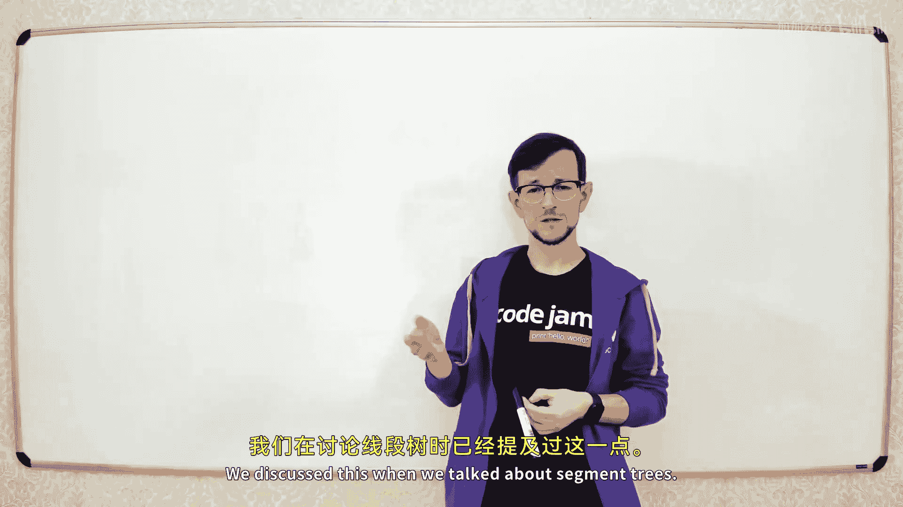
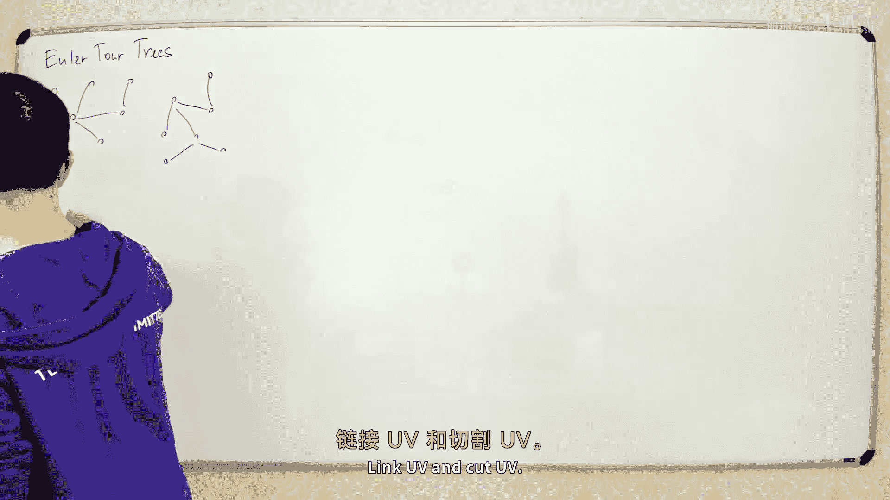
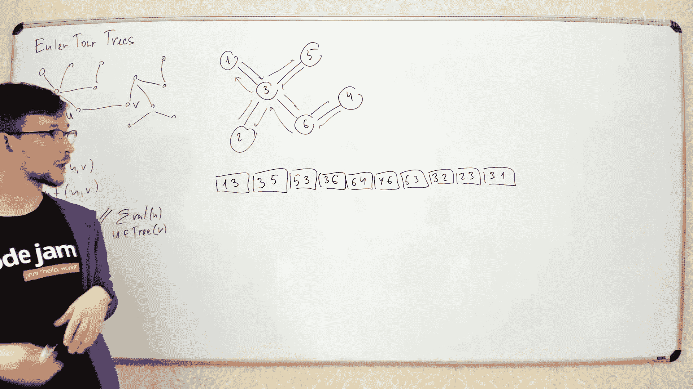
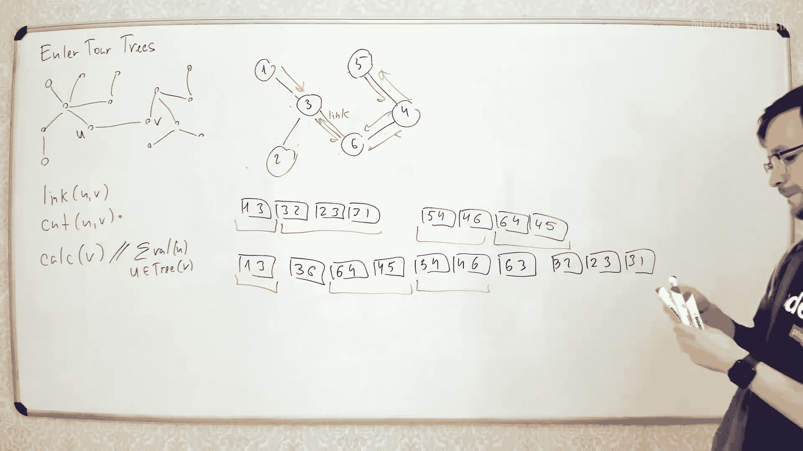
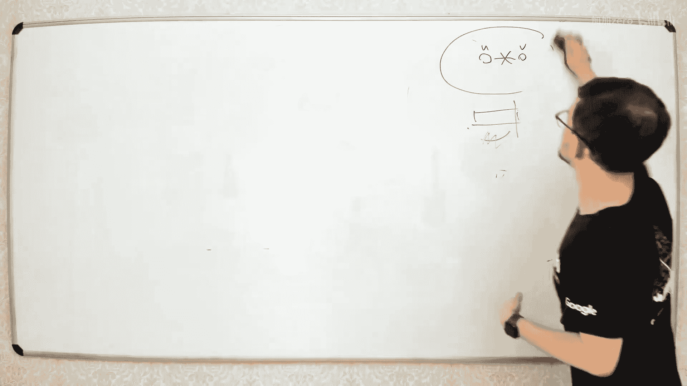
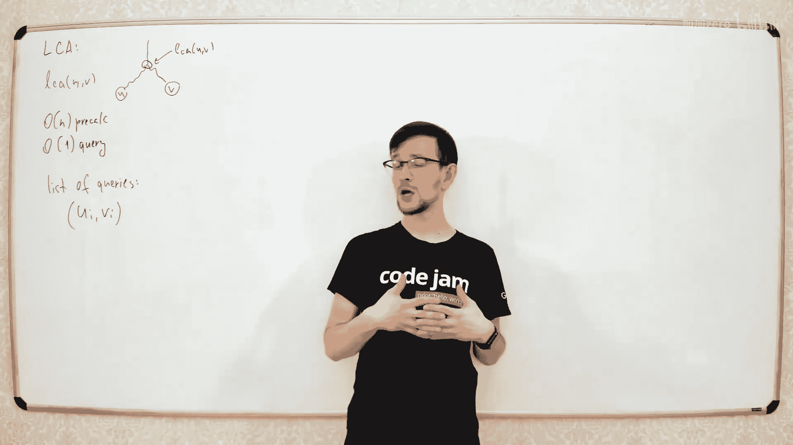
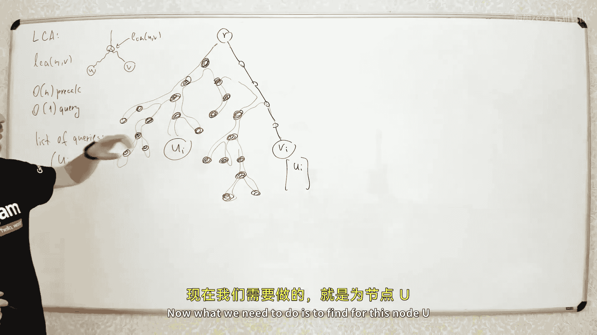
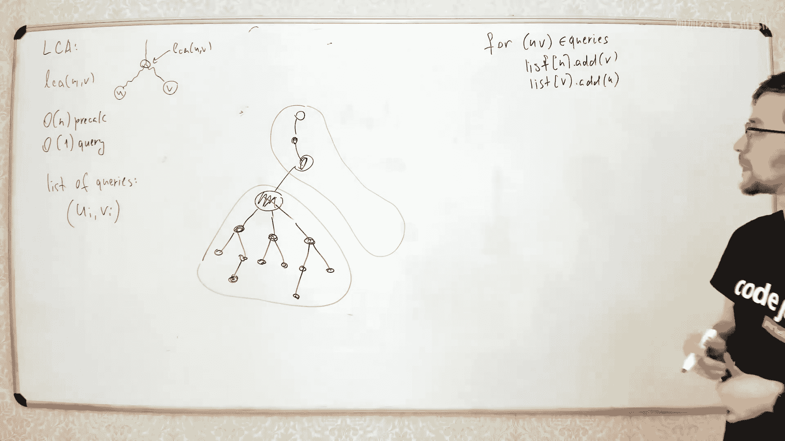

# 【精译⚡算法与数据结构】PavelMavrin p29 p28 A&DS S02E12. Euler Tour Tree, Tarjan's Algorithm -BV1NLB8YfEMq_p29-

，🎼嘟嘟嘟嘟嘟嘟。🎼The。So today we learn another structure about treess。It's not the last lecture about trees。

 next week we'll have another lecture about trees pure resistance segment。

 no we talked about segmentaries， you can do segmentaries in persistent way。

 we discuss this when we talk about segmentaries。

So this lecture in the next lecture will be the last lectures about trees。

And then we'll go to the end of the semester。 We'll talk inab sum。And other stuff。嗯。

This lecture this year will discuss order countries。So what is this one， When do you need oil trees。

 Let's have some tree。 This time， well have not a director tree， but undirect tree。

 So you have some tree。And it does not direct soul。There is no some specific route of history。

 There is no some specific parents， ancestors and stuff like this。So we have trees like these。

Let have some multiple trees。So I have some trees like this。

And you want to perform three types of requests。 First two types requests are the same as a link up reasonson you have operation link and cut。

Yvi。And concerting。And they pretty much as the link tree， So like in link tree。

 link operation simply connects two separate trees you have two separate trees you have。呃。Two nodes。

 U and V， and you simply add an edge between these two nodes and just connect two trees into one big tree。

So your ends with this edge。And now， instead of two separ trees， you have one big trip。

And the second operation is part it simply removes an edge， so you have some。

 again you have some tree， you take some edge and remove this edge from your tree when you remove the edge from the tree。

 you get two separate trees， one tree contains nodeD you and another tree contains nodeD。

So it's like two river separations on a tree， one connects to tree into one second is separates one big tree into two separate trees。

So it basically act the same as in link up tree。 but this time we don't。

 since we don't have a specific route， we will allow these two nodes to be any nodes of your tree。

Now actually， you can do it in link a tree as well if you solve the home task for tomorrow。

 you know that in link a tree you actually can change the root of your tree So if you if you want to connect to nodes which are not the roots of your tree you can change the root of one of your trees to make this node the root of your tree and then connect it using standard linkage tree operation so you can do this separation and link at tree as well。

 but the next separation is slightly different in the next separation。

 what we want to do is to calculate some function on a tree。まその。And these functions。

 you won want to calculate a function on a whole tree。

 So you want to take like if every note of your tree contains some value， you want to。

Cochcoite likes。Usually it is some community functions because you don't know the order of your notes。

 Yeah， so in this function， you calculate some function like minimum or sum or something。

 So like the sum of values。For all nodes belong to the tree。Containing node V。

 So you take this node V， take the whole tree containing this node V and calculate some function on all these nodes。

Or edges does't matter。 So you may have some values in nodes of your tree。

 You may have some values in edges of your tree doesn't matter， actually。That's the whole planet。哦。

Again， you couldn't do it using link。It's kind of complicated。

 but you actually do it to make this function link a tree。

 you kind of need to usually link a tree you can call a function on the pathth。

You can combine the whole paths into one simple you can for each node of your path。

 you can precalculate the function on everything which connected to this node and then for this path calculate the sum of this sums and in the end for this main path contained in the root of your tree。

 you will calculate the total sum in the whole tree， but it's kind of complicated。

 So this time we willll discuss much simpler the structure which allows you to make the separations。

And it is the oil filter。That's all。So let's go。 So how to form this operation to form this depers we will。

Do the same trick we did when we have LC function。 So when we calculate LC function。

 we kind of transform the tree into list by calculating the oil of the given tree and we will do the same trick here。

 So for each tree。We will compute the oilator of this drill and then use this oilator as a necklace。

Like a representation of your tree。It like the joke。So you have some dream。 Let's say。One。3re。Oh。唔四。

Sound like this。So imagine you have three like these。What do you want to do。

 I want to find some oil through of this tree so I start from some node of this tree no let's take some node like any node。

 let's take node one for example， so we start from some node of your tree and then iterate all edges of your tree like like if you double each edge you will have an oilgraph so you can build the oiltop like it's exactly like we did when we calculate to the LCA。

We start from some node and like。 So go here， then go here， then go back， book， go here， go here。

 go here， go here， go here。And now let's just write all the edges we we visited on this path。

 So we start from here。We visit note1 free。Then we go here。 we take no H 35。Then we go back。

Then we go here。Let me go here。Then go back。Then， go back to free。Then go free to， then back。To free。

 and then free one。So this is the sequence of edges we visited when we perform the oil through of this graph。

 so start from node one and then we go here， here， here， here here。

 and that's the sequence of the edges we visited on this path。こ。

That's all， thats。That's basically so this is the representation of this thread that we will use in our data structure。

No。How do we perform these operations？ No， let's start with some operation， let's say cut。

So what happens when we have cut operation？So what's that properties。

So when we need to cut some edge， for example， let's cut some edge。3，6， let's go to this age。

What happens？Look， let's see。 Our tree will be separated into two parts。 we have。

This part of the tree。And let's use another color。 and we have this part of the tree。嗯。

I'm not sure if you can see the colors， but these colors are kind of different。啊。

So for both these parts， we need to build all two of these。Small tree。So how to build this or。

 no let's see what will happen。They。Lets example this O tour is just the part of the whole order tour of this big tree。

So let's find the point when we go from3 to 6。 So here we go from 3 to 6。

And now we walk into the second tree。So we'll iterate all edges of this second tree and then go back。

So the oil of this part is simply the segment of this orderor between these two h。

 so between we go from three to6 and back from6 to three。手 here。Here we go from three to six。

And here we go back。So the oil of this of this small tree is simply this segment。off you好。

So when we need to build the toilet of this part of the of this。Of this two three。

 which we get after we cut this edge， we simply cut this part of the sequence。

 and this part of the sequence is the water of this small tree。啊。

The second part is a little bit more too tricky。 So how to build all of this part。 No。

 we simply need to take。These prefis。요。Then we go to note to note 6。Then the wait are open edges。

Inside this tree， then we go back， and then we continue。To it over all ages of the firstcar。

And what we can do is to simply connect these two parts。 So we take this part。Plus， this part。

And we'll get the oil of of the first tree。 It's true。 It's true so we can connect。

Tre from here to here， because this， this note is the same。 So here we have node free。

 and here we have node free。 So we can simply take this part and merge it with this part。

 and we will get the order tour of the first tree。So when we make cut。

 we simply take this part plus this part， so the first order will be one free。3，5，5，3。And then，32。

Do free。Rwa。So that's the oilator of this part and the oilator of this part will be just this segment4。

4，6。Me， we just to think。Let me againel write this。So these two part melt them in into one big list。

 You have this order。And you take this needle part， and it will be the oiler tour of the second tree。

That's all。So to make these operations first， we need to maintain these lists in such a way that we can split this list and merge this lists。

We can do it using binary search trees with split and nu operations like des， like spries and so on。

😊，So cancel each of these lists。Will be a， let's say Sp tree。

 So each of this list is simply a split tree。嗯。No let me draw this play tree。Once again， so for for。

 so this list is actually not a list。 It is a split tree。 So these edges are in this order industry。

 Let's build some split tree。 Let's say we have this。6ix， four。

 And then in the left we have this see  three，5。He we have one free。here， for example。

 we have three6。Here， we have5 free。So it's so it's the whole left part。 So with now we here。

 we need to make play three of these。Let's have， for example，6 free here。4，6 here。And so， on。

To free here。 free to here。Rwa。So this is representation of this list。

And this list is a representation of this tree。Li's all， so wait。We take this again。

 What's happening。 We want to work with this tree。To work on this tree， we built its solar tour。

 It's here。And to work with this oil tour， we maintain this oil tour as a s train like this。

That's the hope plan。And now when we want to cut this edge， we take these two points。In the order to。

 split our。Spplay tree in these positions and connected like this。Like let's make some split。

 How to make split。 So we need to make split before and after this three6。

 So we take these three6 make split operations in our split3。

So we did need to display this node to make to display this node。We make a zigzag operation here。

 So we have36。 Oh， let me So36 will be here。This will be left child。 This will be the right child。

Like this。This will be the right child。 This will be the right child， like this。

So I call display operation on these 36。 Now，36 is the root of the tree。

I simply need to to split before and after this 36。

 So I just separate the left and right branches of the strip like this。Something wrong。Yeah。

 this triplet must be here My bed， my bed。Now， this tree represents。This segment。And these three。

This stream represents this segments， from here to here。Now we need to do the same of this edge 63。

 So we we make display of this node 6，3 to make play。 We need need to make one z operation。

 right So we make a z operation here。 So freeze so 6，3 is here。 It's left。 It's right。

 It's right like this。So now63 is root of the three again we need to split before and after this63。

 so we take the left branch is everything to the left and right branch is everything to the right so let simply remove this。

 remove this。And that's also， this tree represents。This middle part。

And this tree represents this last part。Mmh。😊，And now I need to merge first and the third part。

 So I need to to make the display tree of these oiler tour。

 So I simply need to merge these two trees to merge those sp trees。

 You take the maximum value in one of the trees。 For example， in the left tree。 you take in this way。

 take the maximum maximumim element here， make play of this last element。

So I split this maximal element here， so it's53。And now I simply connect this first tree to this first tree。

Like like these。嗯哼。That's so and now I have two play3。

 once play3 represents this orderor second play3 limit represents this order two。

 so this orderor represented by this big tree so one，3，3，5，5，3，32。

31 on and the second tree represents by this play tree。Mm哼m。Yeah。Again。

 I need someone to say everything is clear at least once in a minute。Oh。That's the open them。

Now how to make clean preparation， to make lean preparation。You need to do reersspiration。

Let's make link operation。 So what happens when you have。嗯。

What's my exactly interesting So let's build some other trees。WellLet's have something like this。

네 고등학교。So we have two separate trees for each tree we will。呃。

Build the plate where which represents the oil tour of district。你思。So for this three。

 let's say it will be one free。Then，3 to。Then， do free。B for you one。And for second trip， it will be。

 let's say，5，4。Then4，6。L 6，4。4 five。So we have these two oil tools。And now we make link operation。No。

 let's say we connect this freegrs like this。So we connect this3 and 6。Now。

 how to build order tour of the big tree。も。Let't just build it。

So what happens when we try to make e tour of this big tree， we will start with this note。

We will travel along the first tree。Until we find this not free， so we take some part of this tree。

Which ends in in the note free， for example， this parcel。Let's take these from。

So it will be part one， so we travel from here to here。

Now we will go to the second and iterate all notes on the second。So let me write it here。

 So first we。Use this part of the first string。Now， we take this note 3，6。Pdge for6。

And go to the second tree。In a second trick， we need to iterate all nodes starting from the note6。

So we take the part of this oiler tour startinging from the node 6， so we start from here。

And take this part of this order tool。 So we start from node 6 because we are now in the node 6 and use this part of order filter iterate all edges in this part。

So take this six form。4，5。This part。Now were at here， so we go here， then we go here。

 then they go here。Now we need to go back from here to here。 So we use this part of this order， too。

どぞ？To go back to note 6。So we use this5，4， then for6。Now， we are back to note 6。

And我 go死 stop here here。Then so now we read all notes in this second tree。

 and now we simply go back and finish the first letter so we go back。너데 헤어 트레。Using note 6，3。

And then finish the order tool of the first graph。 So we start from the position when we finished last time and use this segment to finish the order tool。

3 two， do， free。Free网。

Look so， that's the whole blend。And now we have the order tour of the resulting graph of a resultant tree。

Second， how we construct this oil tour， we take the oil tour of the first tree split it in position when we visit node U node。

No you， this non being。So we split it here。We take the orderor of the second graph。

 split it in position and we have node V， so we have node V。So we split it here。

Now we have these four segments，1，2， three， and four。

And we simply use the segments as a constructor to build this whole order tool。

 So I take this first first part of the first order tool， then go to the second order tool。

 then take this fourth part。 then they use this third part。

 then go back and use this second part to finish the order tool。Oh， that's a good question。

 how to find the split points。 That's a good question。呃。

So all these separations are pretty fast you can split and merge in loggan time The only trick is how to find where to split so in both these oiler tools we need somehow to find these points where to split this oil tool。

There are two solutions， one solution， one solution is do not do not need to change anything。

 another solution is a little bit。A little bit more tricky， but it's actually easier to implement。

First solution， how to find these points， what you can do， you can take the node to you， for example。

So you can take this node U and find any edge connected to node view。出き。So you have this node you。

And this don't be。You can take node view and find any edge connected to node view。Yeah。嗯哼。

And now in your first order， too you simply find this edge X U。In this soil balloon， for example。

 here， if we take note3， we can take H1 free。Find the position of the edge。Okay， for each edge。

 we simply have a link to its position in this order tool。 So each edge have this。Poイン to thisの。

For each edge， we have simply the pointer to the node in display tree。

So you don't need to find the position of the edge inplay dream because you have the pointer to exactly the node of your split dream。

So so you take this， you take this edge for each edge， you know。

 the node of display tree responding to this edge， and you simply split after this position。

And this place will be exactly where you have not you。

So you take the order of this graph of this trim。At some point， you have note you have H X U in this。

我这と。And now you can simply split after this position， like right here。

And it will be the position when you have no you。And the same way here， you can find any H， B Y。

 So in this auditory some in some place， you have node U Y V。You can split this。

One of in this position。Again again， the whole algorithm is like this， you take the node。😡。

Each node contains the list of the edges。So you take the first list first edge from this list。

You take you have this edge for for each edge， you know。

 the pointer to the node in display trick corresponding to this edge。And now when you have no。

 So for not you， you take this edge for this edge。 you take this note and you split after this note。

You can store all the edges in a mop。You don't need this。 No， no， no， no， You don't need this。

 So you can implement it like this。So for each vertex。You have a list of edges。

 let's take the list of let。I'll implant it in Cha away， mostly list of edges。Like this。

And for each age。You simply have the pointer to the corresponding note in the link capture in in the display screen。

の。Note。So this is not to train。や。So you don't you don't need any maps here。

 You just take the pointer from you to this edge and pointer from this edge to the node of the sub tree。

 So you don't need any maps here。We just use these pointers to make this in constant time。

This edges host have to be deleted。 You ask your new。

 you need to delete section right when when you cut the edge。

 you need to delete this edge from this list。You can 요 canど지。You can remove the edge from the list。

So you can use linked list for example， in theory， in theory， you can you can use linked lists here。

 if you want to remove it in constant time， if you use vectors。

 you also can remove from the vector because you don't care about the order of this edges in this list。

 So if you want to remove from the middle of the vector。

So if here you just use the arraylist like inja。So if you use array list and you have this。

Ege in the middle， when you want to remove this， you simply s it with the last element of the list and then remove this last element。

So when you don't care about the order of the elements in the list。

 you can I simply use this list as a set， right。I just need I need to maintain the set of the edges and I maintain in the list。

Because I I don't need to find anything。 I need two operations。 I need to I need to insert elements。

 remove elements and iterate all elements。I can do to you using simple array list。 Yeah。

 so when I add element， I added as the last element of the array list。 When I remove element。

 I simply swap it with the last element of errorist， and then they move the last element。

And let's all。But you find she will。Yeah，不。そうそ you need to haveポ to do thisね So you。嗯ん。嗯。Okay。

 this no， thiss why， that's why I suggest another method。goYes。啊。When you remove the element。

 you want to know the index of this element in this list。So for each element， for each h。

 you want to maintain its index in the list of the edges of the corresponding nodes。Yeah。

 you you you don't want to find the So So finding the element in the list is。Pretty expensive yeah。

So you don't want to find elements in the lists。 So instead you for each edge。

 you can maintain its index in this list。So you can easily find the index of the elements using this point to the list。

So it's possible using using very simple structures。 you don't think need any complicated structures。

 but it's kind of trickies。 you want to maintain point to here to here and then back pointers and so on。

 If when you remove， you use this reverse pointer and then use here to here to remove this。

It's possible。 you can you can think about as an exercise。

 It's a good exercise about actually just simple programming pointers and stuff。

So so it's possible to do all the separations in constant time using only simple data structures only lists and stuff。

 So you you don't need anything special here。This kind of trick。There is another way to do this。

 let me show you another way to do this to make everything， much， much， much， much more。

So to make everything much more simple， we， we will。 we don don't。 We don't。So for each edge。

 we'll maintain the pointer to the node。We don't need this list anymore what we。What we will do。

Is to maintain the positions of of the notess。So for each for this boiler tools。

We will maintain not only positions of the edges， but also the positions of the nose。

 So for each node。We will remember its position in this order tool and simplest way to do this。

These to add more elements to this list。 So let's。Add to this list of edges。 Also the nodes。

 So we'll have two types of elements in this list， edges and nodes。For example， here。

 we start from the node1， let's put node1 here。When we go to node three？Let's write note free here。

Then we go to node2， let's put node two here。 Then we go back to node3 and then one。

 So for each note。We can maintain its position in this order， tour。So now， instead of。

Instead of having these four elements， we'll have these seven elements。好的。

So we have this list in this form， so we have this one， then one free。Then let's say free， then32。

Then 2， then 2，3。We already have three so we every node contains take only one position。

 so if we sit node several times we maintain only one position any position。Then， go back to。Fee网。

Like this。And for the second tree， we're do the same。So we start from node 5。

 let's say we start from node 5， let's go to 54。Then we have four then4，6。And we have 6。

 then go back。嗯。Like this。 And then we already have four。 We don't have amount4，4，5。And for example。

 in the end， they have five， because why not？We want to maintain any position。

 any position of the node。So again， this。These two lists represent the oyators of these two。

 two trees。Each of these lists easily represent as a split tree。

 So I just draw them as a list because it's easier to show。 Yeah。

 but actually each of these two lists is actually a split tree。

 So we so we will be able to split and order them。And now now it's much more simple。

 much more simple。So for each node， for each vertex。

 we will also remember the node of the split frame。足足。

Each vertex of this tree have some node in display tree。

 and each edge have some node in display tree。Now， what happens when we want to link。

 So I want to link。3 and 6。 I take this note free。Find the corresponding node of the split tree。

 So I use this pointer to have this node of the split train。

And now I take this note 6 and use this pointer to take， to find this note。

And now when I know these two node， I know where to split these two orors。 So I need。

 I simply need to split。Like around this position before or after that doesn't matter。So I can split。

 for example， first tray， I will split here。So I split the first tree here。I have these two parts。

And I split second tree here。比較ピしと。s let's pick it off。Just to make it。Don make it the same。

So I find these two positions using these pointers from the node from the vertex of the tree to the node of the split tree。

嗯哼。Can I split these to order through just just near this position。

 just before or after this position doesn matter。嗯哼。That's all。And now I construct this。

B order to using this。Four parts again， I start from these parts where I go from one， then one。

 three， then three。Then use this edge to go here，3，6。Then use this part to it measureable secondary。

 use the six， four，4， five。5。Then go back。Then use the baggage to go back to free。And then。

 finish this。Orrow the short craft。So again， this is。The first part， then we go here。

 When we take this part， then we take this part to here。 Then we go back。

And then we use this part to finish the bag。We found this trick when we tried to implement this actually。

😊，At some point， we tried to implement this technique。

And it turns out this is the easiest way to implement this。The code is really simple when you。

 when you do it like this。So this basically but basically the whole code。

 so for each Norex for each edge， you have the node of the display train。

And now when you need to make link， you use this pointer， this pointer makes split split merge。

 merge， ver merge， that's all。So the code is really like like 10 lines of code when you have already your sries or something like this。

And the cut operation is the same。 So when you cut the edge。

 you take the pointer to this edge from this edge to the corresponding node of the play tree and cut around this position。

 the only problem， the biggest problem of this algorithm is like this。

 When you make the cut operation So you have this U， you have this V。And you want to cut this edge。

 so what actually happens that in this oil tool you have at some point you have UVv and then you have VU。

And the only problem of this implementation is to find the like the order of these two edges。

 so you need to find which of these two edges is first and which is second。I don't know how。

 how to make it very easily， but。In my implementation， you do it like please you take this。First。It。

 like any of it like U V。Slelit。Your all your talk here。Then you have two playries。

 one playry contains this， one playry contains this。

And you simply find which of these two parts contains edge video。 Again。

 by making display of this note， you make display of this note。

 check of these two which one of these two trees contains this video。And then you make then。

 then you need to make two，2，2，2，2 like make if if they like this two。For these two cases。

 you need to make like slightly different code。 So if UV is in the right part。

 then you split this right part。Like this。 And then combine this first in this third bo。

If view is in the left part， then you make the same in the left part。否的。

That's the most tricky part of this implementation， but all other implementation is very simple。Now。

 how to calculate。Fun。 So that's how you make split and link and calculations。

How to calculate the value almost pretty simple since。

Each of your tree is simply contained in a single sp tree。

When you need to cocoate some function on a tree， you simply calculatecolate this function using this split tree。

So if you have values in the nodes， for example， some each of these nodes contains some value。

So this。These nodes of display tree contains some values。

When you need to calculate some of these values， you simply use your s tree as a segmentary and for each note。

 calculate the sum of your。Subre。Then in the end， in the root。

 you will have the function on this node。If you， if you have one co function on some edges。

 then you do the opposite each edge contains some value。

And then you use the same s tree to to calculate some on all edges。The same way。

 just the implementation differs by when you have values in these types of nodes or in these types of nodes。

啊。That's all So you can if if you won't try to implement this， it's quite easy。

 you just put neutral elements in all these positions。 So you calculate for example。

 when you calculate some of all elements， you just put zeros in these nodes and real values in these nodes and then calculate some of all elements。

 some of all elements will be some of these values in the vertices on your tree。こ。That's all。

That's the order two three。啊。One of the coolest application of this。Trees is to perform the。

Dynamic connectivity to solve the dynamic connectivity problem so you can use this tree to maintain the connect components of your graph。

It's kind of tricky， I will not do it today because since I don't have much time。

But one of the coolest problem when you use solar two three is when you learn how to maintain the connected components of your graph。

So you want to， you have a graph you add and or remove edges。

 and you want to check if two nodes belong to the same connect component。

You can do it by maintaining the spinning tree of the spinningning forest of your graph。

 So for each connected component， you maintain some spinning tree of this connect component。

And you can use this tree just to check which connect component this one。

 So when you add the node add the edge， you just merge these two connect components。

 when you remove the edge， you need to find another edge which connects the same connect components you can do it using order to trace。

 but it's kind of complicated。Previous luxury video is all luxury videos are uploaded on YouTube。

 The link in the description。 Like always。嗯。い。Let'sか some。Let's have one motor pixel。 since we have。

 yeah， we， we have。More time。 so let's discuss one more topic。

 I didn't mention it in the lecture about LCA， but it's kind of important technique。

One more important technique， which we skipped when we talked about。

LC problem is that the channel driven to find the LC C of。That's。す discuss。

Police already from the home。So when we talked about L problem。😡，We managed to solve this problem。

 actually quite。It's quite fast when we discussed the LCA problem。

We managed to solve this problem in constant time using linear time pre calculation。

And it's pretty hard to beat this。

越哎。So let's go back to LC problem。So we want to be able to calculate the lowest common answer of two given notes this LC of you and V。

And simply you take this U， you take V。To take this part， this part so this snow will be healthy。

There's quite important problem for whole33 algorithms。 So it's used in in many situations。

 you want to find this LC。 Usually it happens when you want to calculate something on the path from U to B。

 So if you want to look compare from U to B， like if you want to find the distance between U2 B。

 you want to find this LC and then split your path from U to V into two parts。

 So when you go from U to V， you go from U to LC and then from LC to V。AndWe discussed it like。

A fewew lectures ago。What I want to do now is to show you another algorithm， which is。

Practically very important。 So we learned how to use far cotton blend， get blend algorithmating。

To solve this problem in linear temp calculation。And constant time for request。Allqua。啊。

But these algorithms was pretty complicated。 So let's remember what we did to to achieve this time complexity。

 we split， we take our tree， built a oil tour of this tree。

 then split it O tour into into blocks of size login over2。😊，Then we built。

Spa staple on these blocks。 And then inside each block。

 since we have not so many types of this block， we precollect for each type of the block。

 All the requests。 We have this。P pre preation table， we have this big sparse table。

 and then we use this sparse table and this pre H table to make the cr constant time。Yeah。

 this short summary of the one of the previous lectures。So it's kind of complicated。

 that's what I want to say。It turns out in practice， there is much easier algorithm。

Which achieve almost the same time complexity。But the constant is so the algorithm is pretty is much easier。

 and you don't need all these complicated data structures。

 So the constant constant free algorithm will be。Much， much smaller。 So it's actually in practice。

 it's faster than the alternative breeze comes there。So we'll talk about this。

 So it's it's called Tchan algorithm， but Tchan invented almost all algorithm it's one of the dark channel algorithms。

Let's go。Yeah， one。Small detail to perform this ultra algorithm。

 We need to have all the requests in advance。So imagine you it's called offline technique。

 so you have all these requests。So I have least。All requests ofqueries。 let's say query。これやいです。

And for each query， I need to find the answer。 So I have in this technique。

 we have these requests one by one by one。 So we take the query， find the answer， take the query。

 find the answer。 and each query is canceled in constant time this technique is different。

 And this technique， we need to have all these requests in advance。 So first。

 we have all these requests。What's the difference difference is what in this technique we can choose in which order to us answer these queries。

 Sometimes it's important we already have data structure like this。

 so in some data structures it's important that you have all the requests in advance so you can choose the order when you in which you answer all these requests that's one of these data structures。

Brillium。So let's go what we'll do， we'll do very simple， very simple out。So what have these。

Pears of notes。For each， we will make one reversal of the whole tree。 So we'll start from the route。

And make a simple recursive traersal of the whole tree like depth ofoc algorithm rhythm if you。

 if you know how to know we will discuss depthos algorithm rhythm in next semester so it's mostly referred to the graph in the tree。

 theos search is basically traversal of the whole tree。

 so you make the recursive traersal of the whole tree。And when you make this reversal。

We will answer this queries。So imagine you， imagine you have this node UI here and some node VI here。

So this is one of your requests。This is one node of your request。

 this is second note of your request。We will answer this query。When we visit the second note。 So we。

 we， we make a recursive reversal of the tree。 Like， so so we start from the root。

 So this is the road。We start from the root and make the standard recursive procedure which it erasor all eight nodes of your tree。

 So we start from the root and recursively call for each。

For each child of this route and so on for each note。

 were carefully call the same procedure for all children of this node。 So we start on here。

 we goes here， then go here， visit some base notes， with some base note， go back with some this note。

 at some point， we'll visit notes you。Then me go back， visit some monos， some go here， some go here。

 go here， visit something here， visit something here， and then we'll find this note video。呵呵。😊，Yesす。

Abstract speak okay。Now， basically， this is the part of the Eer tour。

 which ends in the North V right？So we start from from the root and make like find the oil tour of this tree base。

 so first we visited U and then we visited V at this point。We will try to answer this query。

Thats the about。So how to answer this query first will we need to maintain this query for each node。

 so each node will maintain the list of queries which uses this node as one of the nodes of this  queryries So for each for this node。

 we will remember the list of queries。Connected to this node。 No， for example。

 we could want this query。 So for this node node， then we visit this node。

 we need to calculate the answer for this query。So each node have a list of queries which uses this node。

Okay。So you can do it in reccalc time right， So for each。

 you simply generate all queries for each query， you put this query into this list。

To simply maintain this list for each note， you can do it in linear time。谢谢。That's it。

So now how to answer the query。Let's take this note view。And find all there。

All ancestors of this node view， So this node V。Have some number of answers。Like this。Now。

 what we want to know is to find the one which of these ancestorors is actually the ancesor of this nodedu。

How how how how how how to do this's see。Let's mark all the nodes which already finished this recursive traerssal。

 So when we already finished the traerssal of the sub of the node。

 we will mark this node ass So these nodes are black。

So we already finished the reversal of these notes。So these nodes are marked black。Like police。有。

So for these notes， we already finished the reversal， so these notes are marked。

What we need to now what we need to do is to find for this node U。

呃。Cllosest unmarked ancestor of this museumd。So if you start from No U。

 you see these answers are marked and these answers are marked truth。かし。Not interesting。

 Let's make it。 Not the road。So we start from node U。

And go up until you find the closest unmarked ancestor， right。

Closes and also what happens you start from node UI。And it with all its ancestorors。

This answer is marked， this is marked， this is marked， this is unmarked。

So the first unmarked ancestor of note I of not you is the L C of U N B。

This note is LCCA of U I and P。嗯哼。😊，So that's the full idea so again， again。

You make a recursive reversal of the tree。 because you visit node U， then you visit node view。

When you visit node V， you look on the node view。The closest unmarked ancestor of this module is your L CA。

Now how to find the closest Armark answers， we actually had the same problem in the home desk last week。

You can do it like this， you maintain the sets of the node of the same result。Let's couple like this。

Oh so we we have this bag。전에서 나오 게。2。If you look on the。Notes with the same。Reult So look。

 so all these nodes have the same answer as this note。 So if， if you is inside this set。

 the answer will be this note。Let me show this。嗯。If you is inside this set。

 the result will be this note。And that's what we'll do we will maintain this set with the same result's。

Actually， if you is this notice are also the same。Let's add this node for all notes， you。

 if you is inside this set of nodes， the answer will be this node。And that's what we will do。

 Google maintain these sets for the same result。 This set are basically this trees。Like these。

So we'll maintain these sets。Each set knows the top note of this set。

And now we need simply need to check in which of these sets belong to not view。

 So we look on the node view if node view is in this set。Then the LC of U in V is basically this。

Top note of this set。That's all。And now to maintain this set， we use。

 we will simply use the union find the structure， so we'll use union find data structure to maintain these sets of visited nodes。

And when we visit some mono note， well just unite this sets。😊，So what happens when you？你属续。

So what happens when you finish the reversal of some notes， you have some node？So mode X。

Let's use some more letters。So let's have some note X you。呃。You start from this note。

 you recursively traverse all the trees or all the subre of this X。 In the end。

 each sub tree is sunset。No 손 좋겠겠지。Orice， if you want big set right。

So when you finish the traersal of this node X。All nodes in its subaries are actually a marked。

 so all these notes are marked。So these all are mark notess。

So if is inside any if you is any of these nodes， the result will be x because x is the closest and marked answer of all these nodes。

 so these all these nodes。Comose one， it' one set。For all nodes in this set， the result will be X。

Now， when you finish the reversal of x， you need to mark this x。

 so x is no longer the one of the possible candidates， so you mark this on x。And now。

For all notes in this set， the result will be the closest node above X。So you take the parent of x。

And just unite your set with the set of your parent。

 because for this this parent is inside some another set。So for this parent， you have some。

So this is the closest unmarked node for your parent。So now for each notes in your set。

 the answer will be the closest unmarked note for the parent。

So you simply need to unite your set with the set of your parent。

This is basically the union operation in the union find。

So you make the union of your set and the set of your parent and thats all。So， let's。

Let's write the whole code。Ho Hong will be very simple， so first you try all grs and less's。

WellLet's look my face。I will put this query in both nodes。

 So in the left node and in the right node。 But when I visit left node。

 I will not answer when I visit the right， I will answer the query。do。 so its allqueries。嗯。Yeah。

I will take list of you， and add。V， and I will take list of V and add。

Because I don't know which of these two node is left， which is right。

 so I'll just add it into both lists。

And now I simply make the recursive revsal。 so I make the goal of x。So now I have this node X。Y X。

 let's have V。没东西。So I it to old notes。Ofi。嗯。Yeah， right。 first read over this list。

 So I will this you。A list of green。If you is not marked yet。If you is not marked。Yes。

Then just keep it。No it means that my note is the first one， so I want to find this you。

 which is already visited， so I need to visit this you and them this way。So if U is not marked yet。

 it means that minor is actually first， so this Vvis you。So I cannot answer the query right now。

 I will answer the query when I visit the second one。And now if you is already marked。

 then I will just say result。For query， no， let's make the U like this。E。那也不知道。

So this is a result of the query UV。No， you may also remember the index of this query or something。嗯。

You will find out all the details。 it's not that hard。

 So the result of this query will be the top node of the set。嗯 哼。Ctain。

 which containss reed resources。トプ？No对。Of you like this。

So this separation is simply it takes the top node in this again， to take this node to U。

 node use is inside some set， you need this node of your set。

You can do it using you find the destruction。Great。Like for each set。

 you can maintain the top note of this set。 It's like minimum and the set or something。 It's easy。

응 배。Cool， and now simply all of all children it。不不不不Let's say X。要は。So sometimes I have this。

 sometimes I like you。Sield ran of V。So it's like all children of me。Call the same。

 accept price this note。And then the in the end， when I finished。They are driverss of this tree。

 I will simply unite these two sets into one。그죠。So that's simple。 sorry that's the whole。

 that's the whole algorithm。What is the time complexity again， time complexity of union is constant。

 time complexity of this operation is actually inverse like fraction of family。

No if you watch the bonus lectures。I can't explain No in in the first bonus lecture of the last semester。

 I can't explain what this means。And why the working time of the。

Union find the structure is in the secondcra function。We all need to mark V in the end。 Make sense。

 Make sense。응 응 응。Okay， so you， you can find you can find like in in you can find the structure。

 you can find the representative of your set in in in your second map。 and for each representative。

 you can maintain the pointer to the top node of your set。

So this separation is simply fine the in given fine fine separation to have them complexity in a command function。

So the whole time complexity will be something like。And plus am I friend。Like this。Lets。

 let's compare to the。In the previous lecture， we discussed our in constant time。

So if you look on the total10 complexity， it will be n plus1。

This time complexity is n plus n multiplied by Nor command function。

 so it's strictly worse than this theoretically speaking。

 but in practice this in command function is very small。

 So this north function is always not more than let's say three or four usually。

So this north factor function is pretty small and the constant factor is pretty small because all alterations here are pretty simple。

 So all alterations are simple and。Asytos is good。So the the real time of this of this algorithm is actually better than old。

This how complicated stuff。So it's quite good in practice in practice。

 you can just use this algorithm to find L of the big number of pairs。 if you have problem like this。

😊，Also， if you watch the second。Bor' lecture of the last semester。

 You know that you can use the same technique。Like in union。

 find the structure to make the link caval structure when you make， when you link。

Elements of your tree and also calculate the function on on tree。And you can use this technique here。

 so you can take this link caval structure from this bonus lecture and use it here。

 and it will help you not only find the LCA， but those are the calculates on function。

So using this link about the structure， you can not only find。

This top node but also calculate the function on this path。

 so you take the node U and calculate the function on the path from the root to the top node of your set。

And using this technique， you can not all not to calculate the LCA。

 but also calculate any associative function on a segments or on the paths in your tree。That's all。

So in the end， can you can calculate a LCA of any pair of nodes and also function on any pair in the tree in this time complexity using this type order。

