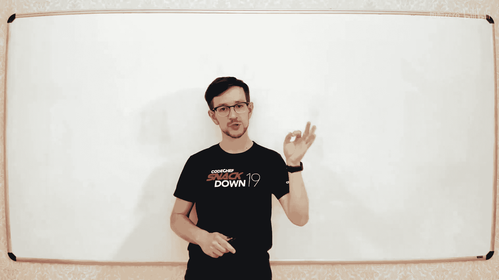
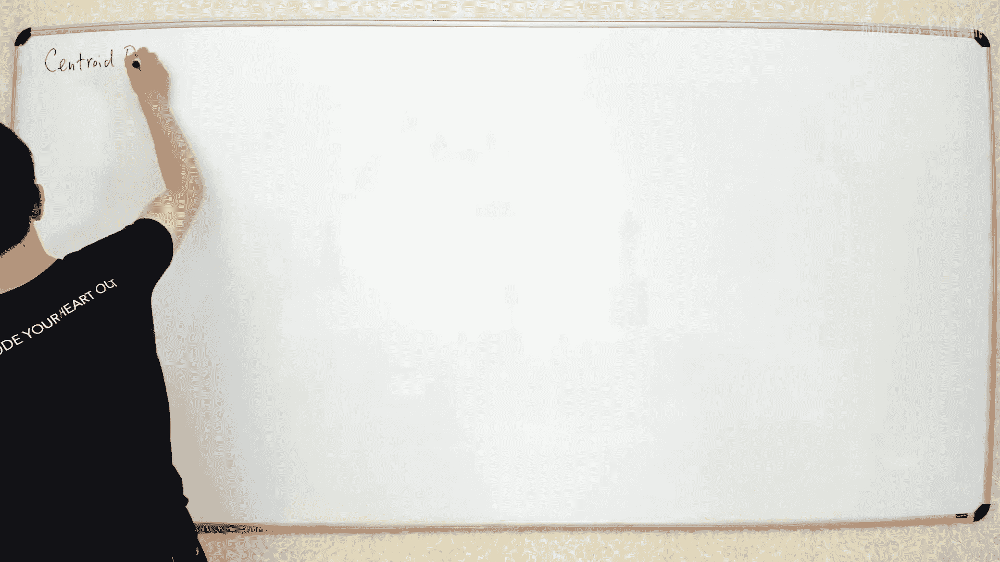
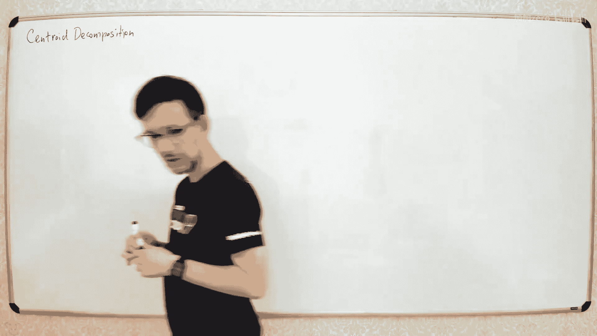
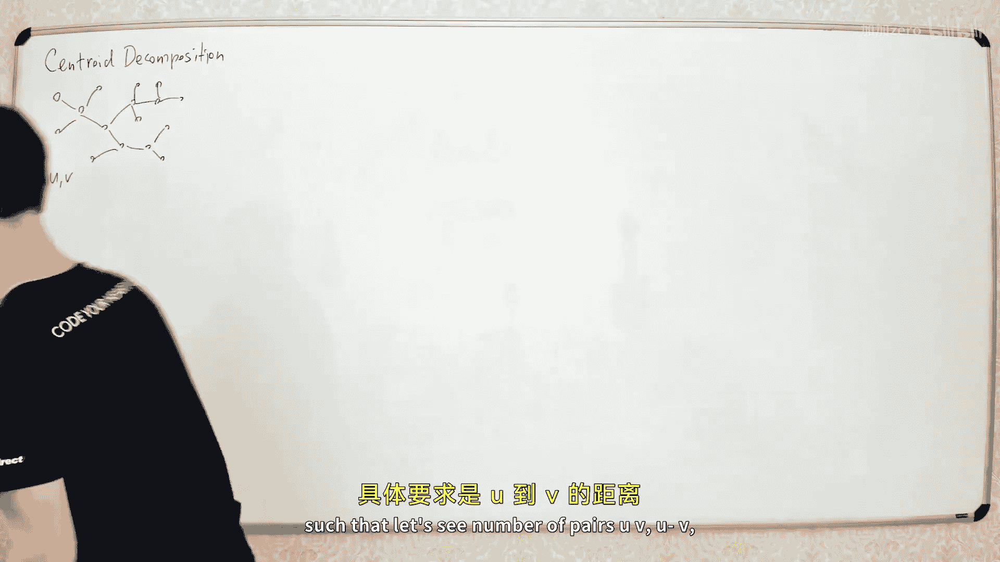
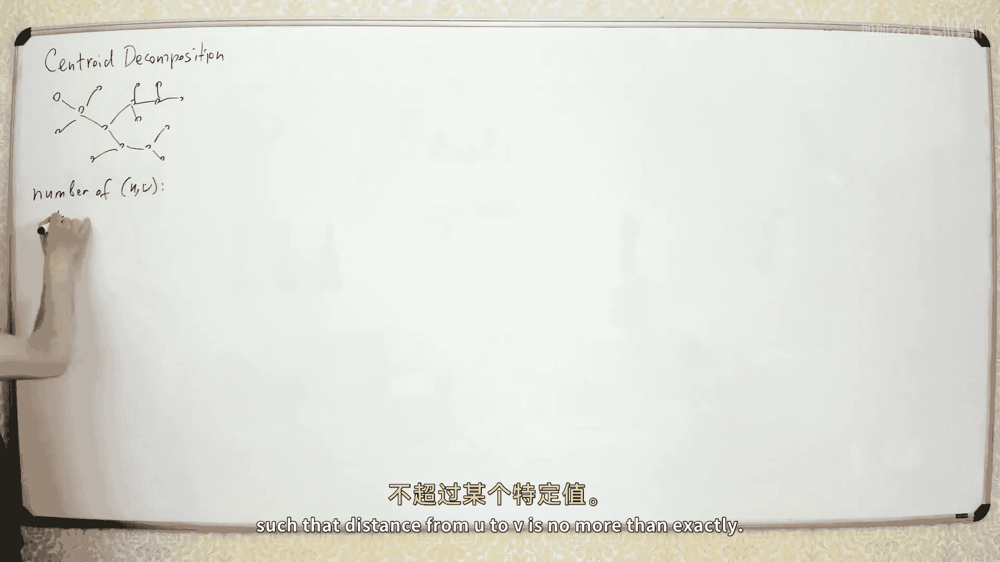
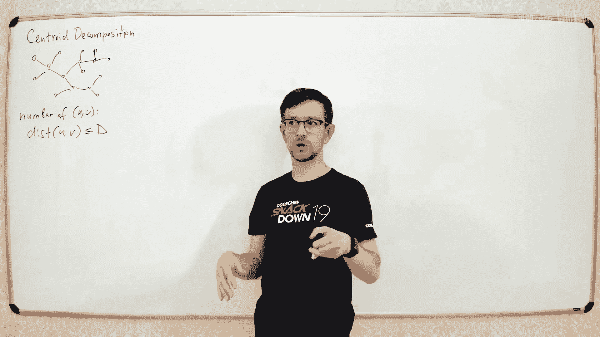
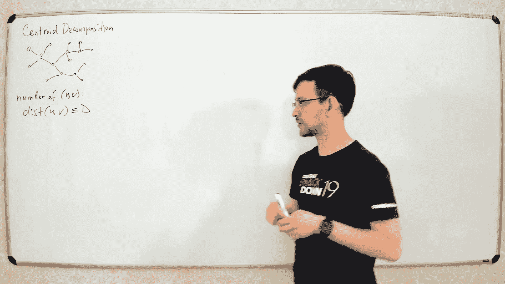
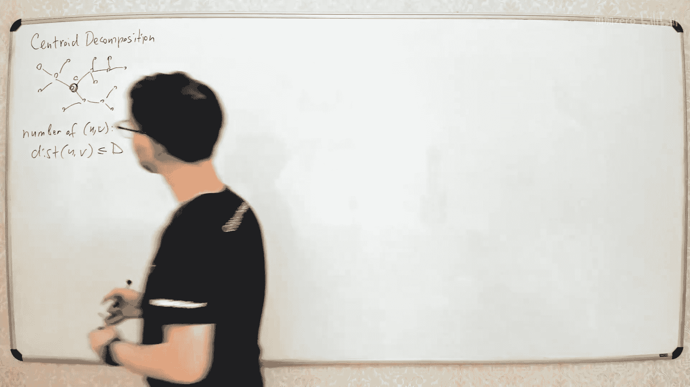
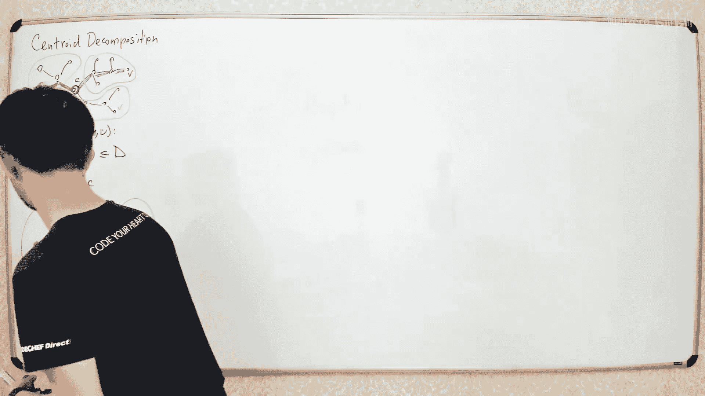
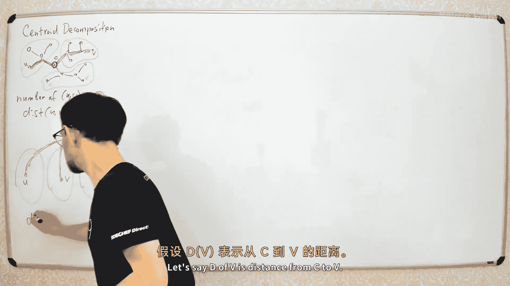

# 【精译⚡算法与数据结构】PavelMavrin p30 p29 A&DS S02E13. Centroid Decomposition -BV1NLB8YfEMq_p30-

，🎼嘟嘟嘟嘟嘟嘟。🎼The。Hello， so today we talk about one more data structure about trees。

 It is the last data structure about trees。 we have two more lectures we cover some other topics other than trees。

Because everybody is kind of tired of trees， but this is the last lecture about trees today we discussed and enjoy the composition。

So what is the Android decomposition and when do you need to use Android decomposition？

There are two types of task when you may need centroidposition。 We'll discuss both of them。

 First type of tasks is something like that。 You want to look on all postss。 You have some tree。

 let me。Let me draw some three。I just like to door trees。So we have some three。

And you want to make the phone。 You want to look on all possible paths in this tree。

 So you want to look on all pairs。Youvi。And look on all these paths。 And for all these paths。

Calculate something just to calculate number of some good paths or calculate the optimal path along on all possible paths in the tree something。

 Let's solve something simple So just to show you the technique。

 I will I will solve a very simple task。 in this task。 you want to calculate the number of possible。

Pears U V， such that。let's see。

A number of pairs， U V， U V， such that distance。

From U to V is no more than。呃。Exactly， this problem can be solved without centraltic composition。

 Actually， you can solve this problem by just making a recursive procedure， which just。

When you transfer the elements from smaller set to the bigger set， something like that。

I don't know the correct night for this technique， but actually exactly this task can be solved without Androidroid composition。

 but I will solve it using synroid composition just to show you how to implement Androidroid composition。

So what is Android decomposition and how how to use the third equation to solve tasks like this Basically what you need is to make something like divide and conquer algorithm so we will try to apply divide and conquer technique to the tree。

Small large motion。Is it the name。Okay。嗯。It's a nice name， it's self explaining， I like that。😊，Soあ。

Now， what I will try to do， I will try to apply divide and conquer technique to solve this problem。

So you have this tree。I will fix one of the notes of this tree， let's say。

What's let's you this。So let's pick one verex of this tree and say this ver。是。

And now I will split all possible paths into classes。First of all。

 let's look on all paths which do not cover this vertex C。

 So if I have some path from U to V and this path do not include these node C。

Then this path is inside one of these sub。So if I have pair from U to V and this pair doesn't include this node vertex C。

 then this。Pth is completely inside one of these regions。So if you and the。

Both inside one of these regions。Then this pair do not include this noting。And。Now。

 I need to consider only the paths which goes through this note C。

If the path is includes this node C， then I will split this path into two smaller paths。

If I carry some pet from U2 V like this。Then so the path from U to B goes through this verex scene。

Then this pair can be splitted into two segments。 So I will have segment from U to C。

Like this and another segment from C2 B like this。嗯哼。Messterical plan。 Now， what I will do。

 I will pick one of the vers of my tree。他。Remove this vertex from the tree。

The tree will be split it into some subies Now for each of these subre。

 I will call the recursive procedure， so I will recursively calculate the number of good pairs in all in each of these subies。

And now in the end， I will calculate the number of vertices。

 which so that the path includes vertex C。To calculate paths like this。

 I will split this path into two parts。And then calculate number of presss like this using some and other special techniques。

 again， what do you need to do。First， you pick some note。Then you split your tree into some parts。

 recursively call the same procedure in all these subies。 Then in the end。

 you want to calculatecoulate the paths， which includes node sea。

 So how to calculate these paths including node sea。 more。 we have this node C。We have these sun。えく。

え。What， what， what。No， you're too fast。 It's not like this， but。It's some close。

It's not always split it in three parts， sometimes it may be split it in two parts or in four parts。

 just in these three， I split three into three parts。And they are not exactly the same size。

 let's wait a little。Now， I want to calculate number of pairs Uv。

 and let's use the same markers again。 So I want to have vertex U here and so let's say vertex v here。

And the sum of these distances， these distance。Plus， this distance。书比能好更低。

So how to calculate a number of such pairs， well what we can do。

 we can calculate the distance to all vertices。We can call。 We just call that stretch from this。

No vertex C and calculate distances from C to all nodes in this。 Let's let's say D of V is distance。

From sea Pu。We can precculate all these distances in linear time just just you just start with a recur from node C and calculate distances to all nodes in this subject。

 right？嗯，那。Now， when you precoculate this distance， what you want to do。

 you want to find number of pairs you V such that distance to V。Plus。

 distance to you is no more than the。Now， if you fix one of these ver， for example。

 if you fix node U， then how to find node V， node v is such node that distance to V is no more than d minus distance to U。

So what we will try to do， We will fix one of these node。 We will fix not you。 And for each note。

 we will find all possible node V， such that these。Some of these two distances is no modern than D。

So how to do it。Very reason。 one of the small， small problem is that we need to find the number of。

Pairers such that this U NV belong to the different subies。So it's a little bit more complicated。

 So we don't need to find all possible pairs， but we need to find all pairs which belong to different subies。

行。But let's forget about this for a minute if we just want， let's solve this problem。

 let's solve this problem。 For example， you have some array， yeah， so you have some array。

And you want to calculateulate number of pairs， UVv。Such that D U plus D is no modern than D。

So how to calculate this pretty simple actually。 What you can do again， you you use。

 you iterate all node， you fix some node you。Fix some element of your array。

 And now you need to find number。Of notess。V such that distance to V is no more than D minus d。

How could we get number of such notes， pretty simple。 you can， yes， you can just do binary research。

 Yeah you sort this array。And then all the node you going need to find is just the prefix of thiscer。

 So youll make a binary research。In this array， and find that。These are all possible notes V。

You need to find。 So you just iterate again。 what you do， You it all notes of A。For each note。

 you bake a binary research。And we calculate this preface。

So all notes in this preface form a pair with no view。You just need to have a number of these node。

 It's just the index of this node，So you can do it in analogloggan time。嗯。You know。

 you can do it using two point the methods， but you still need to sort the array。So。

To sort this area， you want to spend and log in time。 so you can use binary search as well。

Even if you use two pointers method， you will still need and loggan time to sort this variable。

 But if if this tree is not weight。 So if all。weights of edges are equal， y。

Then you can actually sort it using count and sorts stuff like that。

 so if these weights as weights of your edges are all equal to one， then you can use linear term。

like。If you have some different weights on on on edges。

 then you kindly need to sort this array then spend an organ time。よ。オケー。那。In this problem。

 we need to make slightly different thing。 In this problem。

 we need to calculate number of U such that they belong to different subaries。W different。

 different ways to solve this problem。 first way is to use the following method。 We can。

We can do it like this。We can use a let's say， binary stream。To have kind of sort right。

But by that is say tree it kind of sortedatory， yes， you can insertly remove elements in log in time。

So we can instead of these sorted array， we can use a binary search tree and we can just add elements from left to right。

 so we will first take the first subre， add all elements of the first sub tree。

Into the binary the search tree。Then it all elements of second sub。

And find in this binary search tree， all elements less than this， yeah。

Now we'll calculate all pairs from first and second sub。

Then we will add the second sub to the binary to the same binary search tree。

 So we will iterate all elements of this sub create all pairs like this。

 we will call all pairs like this。 Then we will iterate all elements of second sub and add them to the binary search tree。

 So these elements below。And now we iterate through all elements of the float sub。

So we take elements from the field sub3 and find in this binary research research tree。

 all elements less than these。And add them to the result。 So we'll go great old pairs like this。

Now we add all elements of the third substrate to the binary research tree and takes fourth sub and and so on so each time we take the next sub3。

All previous subies are in our binary search tree。So we take the next sub3 and find this binary the research tree。

 all elements less than this。And and again， for each element you spend log time to add element to binary search tree or to remove element from binary search tree。

 So each for each note， you spend log time to calculate the number of pairs。

So still you have this time complexity。what。Is about lecture held in this what do you mean it's a university course Yeah if it's a one。

 you can also have a bucket of yeah， yeah yeah if always's a one you can you can use buckets instead of this you just basically you you do same point count counts or trade。

What about notes in the same sub。 you just not notes in the same sub。

 you just call recursive procedure for for each of these sub。

 you call the same procedure which calculates all pairs inside this sub。

 So we have this recursive procedure。 You give this procedure some sub。

And it calculates all possible pairs。嗯。Now， you have some pairs inside this sub。

 So you call the same re cursive procedure in each sub。

And then you just need to calculate pairs from different subies and you can calculate these pairs using this method。

This stream can be safe place， as usual， in my YouTube channel， yes。Okay。

Another way to calculate the same thing is just by subtracting the values you don't want to calculate。

So what you can do。Is just no let's take some note here， so you take some note here， it's here。

You want to calculate number of different nodes V， which have G no more than this。

 And this V belongs to to all other subaries。Excluding this sub。

So what you can do is first to calculate all possible notes using this sorted array。

And then subtract。The number of notess inside your factory。Yeah。嗯白。So for this node U。

 I want to calculate the number of nodes v， such that the sum is not more than D。

 and this node V should belong to all subaries except these sum。So what I can do。

 I can precalculate this array。For the whole， for all puzzles might one be great， sorted by。

By distance。And for each of the subies， I precoulate the same small， array？

Because smaller rate for each of these actually。And sort them all。Total again。

 polym elementslaments is n so I can precoulate all this in emmbgen time， right？And now I want。

 I take this node to you。I calculate total number of notess。With this distance。

 it will be the pre of this order。 Sorry。 I calculate past pre。And now I just subtract the elements。

 which I don't need to calculate。 So I will subtract the elements which are inside my sub。

 So I take my small sorted list。And make another binary short。Xue。

And just subtract them so it can make plus B and minus these。This little bit more。

 this is it actually easier than it looks。So again， what， what， what you need to do， You just。

Youd take some notes in。呃。It your ever all sub trees。For each sub。

 you just make a difference search that's just to all notess and calculate the distances。

 you can make it using simple recursive precision， right？It's called Defation。

 we' will talk about defation next semester， but that' it。啊。Now。

 you precococate all the distances and form these arrays for each sub， you just create this array。

Now， you sort all this arrays and make one big array and sort this big array。That's all。Now。

 how to calculate number of pairs， you take the node U， take this big array， make a binary search。

 count this number of nodes in this prefix， then take your small array。

 make again make another binary search， calculate this prex and subtract it from your answer。

That's all。 And now you will get the number of possible pairs。Which with paths which go along。

 which includes this without vaccine。Going to implement this code？

I think I'll do it in the and again。The code is pretty simple， actually， I will do it in the end。

 Okay， so I just。Should I do it now。No， let let's do later。 just first， I will draw some pictures。

 and then in the end we。We get a lot of pictures。 So I will。R or some code， okay？Tt。Important thing。

 right。 Important thing is how to choose this notesing。

So the tang complexity depends on how good is your node seeing， because if you pick the wrong node。

 you may have a brown tang complexity。So how to pick a good note again。

 when you use a divide and quantum technique， you kind of want to split your structure into several。

Parts of the same size， right， basically， when you have a divine contrast on on a。

 So you want to split it in the middle。 So you split it in the middle。 you have left part。

 right part。 So T of n will be 2 T of n over 2 plus n。 So it will be。And look at something like that。

啊。In in this case， we'll try to do something similar。

 so we will try to pick some vertex C such that the size of these trees will be about an anvert。

 so the size of all these components will be no more than half of the size of the whole tree。

It took us as so as possible。Definition。This android is the vertex。

We say that vertex C is the central of the tree。 If， if we remove this vertex from the tree。

 the size of each。Component is no more than an order。嗯。And now the small observation。

 it turns out every tree contains at least one centroid。And it's quite easy to find this Detroit。

So first observation， every two contains at least one Android。And second observation。

 it's very easy to find the Androidroid。そうあ。I will do both。

 I will I will show you the algorithm which finds this Android it and also。

And this is algorithm and will prove that this is right exists section。So how to find the centroid。

Let's know the phone。 Let's pick any note of the tree。 So we'll pick any note of the train。

let's throw some tree。Or something like this， and something。う。something small。2，3，4，5，6， the 8，9，10。

11，12。嗯。Let's put more here。Yeah， good enough。 good enough。So we have some trim。

You pick any note of the tree。Like the most， the one you you look first。

 you find any note of the tree。And start deposition from this node。When you start doing the search。

 you calculate the size of each sub。 so you kind of make a rooted tree with this。

With any element as a root and calculate the size of each subre。

 so we start a recurs from recurs from here and calculate the let's say，1，1，1，4，1，2，6，7，8，1，10，11。

To than them 4， right。It's 15， it's 1，2， 15 button and 17 is 18。

So just pull a def from this root of your tree and precculate the size of each subre。

Now how to find the centralroid， we need a vertex。 So we know that the size of the three is a 18 right。

 so n is 18。So let's look on the root of the tree， let's check if this root is essentiallyed。

This route is not theroid， obviously， because the left subre is more than an over。

 This left sub is more than an overjoone。No simple observation， there is at most one child。😡。

With size more than n over two， because if you have two children of size n over two。

 then the total size is more than n。 Yeah， so you have at most one child。Which is too big。

So let's go to ob beast child。 So let's go to ob beast child。Let's check if this child is centroid。

How to check if the child is ecentroid and we will look on its children and see if if all the children are less than ever an hour two。

 No it's not because the left child is more than an hour two an hour two is 9 and this left child is 10。

 So again we have this child which is more than an over two。 So we go to this left child。

Let's take these node。 check if these node is centralroid。 How to check if the noise right。

 Well look at its children then see that both， both children are less than N over2 so。

 This is an over N over2， and this child is no more than N over2。And if it is true。

 then this node is a cent， not why it is a cented， because for this node， if we remove this node。

 then all of these sub trees are less than n over2 and this big subre， so this subre， this subre。

Is also less than over2。No wise less than n over2， not because this sub is more than n over2。

So this is everything except this sub。So this appears more and also solve this。

Partth is also less than an orn。That's all。So that's how you find Androidroid。啊。

If you want to implement this， it's even simple。 So let's write some code。 So how to。

 how to write a code which finds this sensor。 What you need， what you need is to find the node。

 which has。응。I want to rank it in one the first box。 I need to calculate this size， right。

Let me think。Okay， let's do。 Let's make， let's make。2。

 to to the first the will find the number of nodes。 and this three second will find the cent rate。

Can I do it in one， Let me think。Can I do it in one D F S。Actually， I can。 if I know the size。

 if I know the size of the tree。I don't want okay， let's make into the effect。

 So first the effects we will just find the size of the tree。So， let's wait。M。

 you can do it with while loop， but still you， you need to remember all these point first and remember all this size it's too complicated。

Let's， let's make it mys let's make it see saw。 Let first the F which which calculate the size of the tree。

 whichs F S1。我说。Very the nice names， okay， let's go through this。Let's make。

 let's make it a little bit more self explaining， Let's make the first size。

So this effects will just calculate the size of the tree， how to make the effects in a tree。

 you have your current node X and you have your parent。

 so you stay in the node X and your previous note is P so you go here。Now from least node X。

 you want to go to all possible nodes。Why accept this note P。And it will return the size of the trim。

So it size equal to one。 Then we itator all possible。Ys from then， let's say G of x。

Still affect all neighbors。Of wax， y。So we rate all neighbors of X except note being。

So if y is not P。When we just call JfS from this note you twice so case we'll say。S plus equal DFs。

또 또。The size of for。I still try to feed it in 20 lines and then this return。Yes。Okay， okay。

 this procedure just calculates the size of the tree because I need this size。

And now how to find the centralroid。야 됐어。The FS cent。And central it。Secondly。

 first will find the center of the tree。So we'll find just， again。

 the centralroid is the note which have size more than n over two and both children have size less than n over two。

So again， we'll do the same。 I just want， I don't want to save these sizes because I save the memory for some reason。

 I don't know why。I love it。If you don't need to save the memory， you just need。

 you can just preate all these sizes and save them。 and just， I'll just calculateate them twice。

Again， for why。Let's。Let's sing。多く？그니까 어쩌죠。Then Ill iterate over all wives from neighbors of Peex。嗯。

I try to save lion， but okay， I will not try to save lion。 I'm trying to feed it into20 lines。

 as I promise， but I will not。You can do it， but I equal to Gf。Okay。If y is not P。

 then you say S Y equal to。D， F S。Sentroid of Y X。Then I calculated the size of y size y。

If size y is more than an over2。Then， O， is false。S plus equal Sy。Then， if S is。

Less than I or to them， okay is false。Now， O， O means that my note is the centroid。 So my note。

 the centroid， if all。All my children are less or equal than N over2。

 and I am greater equal than N or2。That' sold sold out few times a choice。Then send。Theset。とです。

Can you spot a new box。嗯。No looks fine actually。So again， how to use this， how to use this code。

 You just first you complete and as the DFS。Size。Of。Let's say node v minus-1。

And then you find that centroid。Of sounds like this。And now you find the sensor。Yeah， it looks fine。

Where we're saying in centrals， we're seeing it in some global variable， we have global variable。

 I want global variables。So I will save it in some special variables， etc。Again。

 I use the effect size just to calculate the size of this tree because will this is not the size of the whole tree。

 but the size of my part of the tree again again this is thecurrosive procedure right so I will I only work in this area of my tree So this area of my tree where I work and I want to calculate the size of this small area。

And then so n is the size of my area of the tree。And now in my area of the tree。

 I went to find Androidroid， and I use this code to find it Androidroid。呃不不不不蹦。

if S is less than n over two， then I'm not a central， maybe you can skip this。

 maybe you can just reassign all possible。No， you can't。 No， you can't。Again again， this。This check。

Is required to check if so when you remove this note， you have these parts and also this part。

So to check that this part is less than n over two。

 you need to check that n minus your part is less than n over2。This checkzech assembly checks that。

And minus S is less or equal than n over2。So size of this part is and minus size of my part。

So it's n minus this part should be less than n over2。

 It is the same as S should be greater or equal than N over 2。 If S is less than N over 2。

 then I am not essentially because this part is too big。Make sense。That's all。

 let's how you find the center of the tree。No okay。You can can simplify this a little bit。

I'm just trying to make a clear code。哦哼。So this procedure is obviously linear。

 so I can find the central rate of the tree in linear time。不。嗯，脑袋够够的哈哈哈哈哈哈。😊。

How the whole code looks。 This looks kind of the same so you。Yeah。I don't like this。

I want to remove what the problem is I want to remove some notes。 So when when I pick this old C。

 I want to remove it from the tree and I don't want to remove anything from the tree because it's kind of when you remove the element from the T。

 you need to remove all the edges from these lists and it's complicated。

So I will just mark all the notes which I removed。Let's， let's put here。 let's say if Mark。

Ex then return。0， and here。What this。Yeah， good enough。 So again。

 I need to skip the central its already files again， how this code works。I have this tree y。

So that's my treat。First， I find the Android industry， so I find it Android。Now。

 this tree will be splited into several regions。 so have this。Mi subaries。Now。

 in each of these subjects， I will call the same recursive procedure。

 So I need to find the central it in each of these parts and to find the central it。

 I want to remove this node C from the tree。 Yeah， but instead of removing this here。

 I'll just mark this node。 So these both the will not go inside this node C。

So I'll just mark this note C。And now call thefs from these f nodes。

This device will find the centralroid of this part of the tree， again。

 I will split the tree into some regions。Now I will remove this note。

Couldol difference from this notes and so on。it will still build in your。

It's not linear of the size of your current tree。 but yes， you， yes， in this the， you。

 you will access these removed nodes， but you will access each ribbon nodeex at most once。

 So the total time will still be linear。Is it the correct。Let me you。 Let miss you。응 흐 흐 흐 흐。Yeah。

If you look on the total number of iterations of all these devicess for all these components。

 the total time will be linear。that's definitely true。所都从系没收两个。No， let's write the message so。

 So how to find these syn。No do it like this。嗯。I need to write some code on let's guys as a soul。

For mode。So so node V take some node V。And solve the problem for the component。

 which contains this node。So we will first find the centralroid it。 So again， we'll do this。

 let's say n equal to DfS。Size of v minus-1。 then we'll find the cent。D F S Androidroid。Or p minus1。

 Now we know the centroid。Now I will remove this Android from the tree。嗯。

So I removed this function and might be same for these components。No， now actually in this part。

 I need to calculate a number of pair。Let's calculate。

So here you call the I you wish do all this stuff， so you need to calculatec all these pairs。

Of this normal see so here you do something intelligent， right。

 so here you actually solve your problem。And now you just call the same procedure for all this。

So yeah now you iterate for all nodes U， which are neighbors of V and see if not。Mark。

You then you called the safe。嗯。So， you take this node see this off off。Xin。You take this node C。

 remove it from the three， now take all neighbors of this node C and call the same procedure for each of these partss。

No， Android and center is different nodes are different nodes。 we will talk about this in the next。

Practice， so center is center are different nodes of the tree。

 Centerer is just the middle of the diameter of the tree。 So it's a vertex， which is。

Which minimize the maximum of distances to all possible nodes。

 and cent is node which splits the tree into equal parts。So it this， these different terms。嗯，好。

So that's basically oh， okay， it's stopped 20， but。Pretty close。Hi。

 so this is the first type of tasks you can solve using centraled decomposition Yeah what happens in this type of tasks you need to look on all possible paths in your tree and calculate something。

 find the optimal paths or find the number of something of some paths or some of something so you calculate something among all possible paths in your tree。

And you can do it using using this synroid decomposition to apply its synroid decomposition。

 you what you need to do is to solve your problem only for pairs， which includes one vertex。

 So if you fix one vertex of your tree。And then you can solve your problems for all puffs。

 which includes this。Specific a vertex。 Then you can apply your this centralroid decomposition technique to solve your problem for all possible paths。

 Again， again， what what happened， You take some specific knowledge， which is centroid of your tree。

🎼And now you solve your problem for all pers， which includes this， so you you find some pers。

Something like these。What happened。还都吃肉太。稍分啊。You fix some node and then calculate all possible paths。

 which go through this。Verexy。And now you simply call the same recursive procedure for all these parts。

And again， if you can calculate your function for all paths。Which go through this node C。

 then you can then apply this divide con technique to solve the whole problem for all possible paths because all paths are split into these groups。

Yeah， yeah。 Let's talk about time complexity。 What is the time complexity of this。Of this thing。 No。

 let's see。 So this。This part works in linear our time。Allright。

This calculate is actually in our approach works in em time， so let's use this。

And here you simply make recursive calls， right？Now it's about the same in the simple divine control technique。

 it's a little bit different because you don't split your set into into two equal sets。

But it's kind of the same。 So let's look so we have this first recursive call in first recursive coal we spent like N Logan time。

 so it's N Logan。And loggan time for the first recursive call。

 Now we split our tree into several parts。 this part and this part and some small parts here。

 So we split three into several parts。 for all these parts。

 we call the same recurs three and spend n loggan time。 So on each layer， we spend n loggan time。

 Now on on the next layer。 we will split each of these parts into some several parts again。

 So we split this。 we split this。 we split these somehow。Maybe split these。And so on。

The depth of itssion will be at more Lo。So we have atmost login。recursive calls in this stack， right。

 So the total time of total time we spent on each layer is enloggan。

 So on each layer of this recursion， total time was spent is en loggan。

 and the number of layers will below n。 So the total time complexity will be N log squared。

If you can calculate this in n in linear time， then total and complexity will be n log n just so if if here you have just n。

 then using the same using the branch you create the total time will be n log n。

W it's like always it's。Usually it's how it works。 So if you use some divine conquer technique。

 if you can like conquer in in some time， then total time will be this time multiplied by logan because you have loggan layers on each on each layer。

This is your time complexity of your。go不可以 function。You know。

 it's hard to play master theorem here because we don't split into equal parts。

 Master theorem is usually applied when you split your problem into some equal parts here you're splitt in split is not equal parts kind but it is the same。

 it is the same。お。Let's all let's all。So that's how it applies in compositionposition when you have a problem like this。

Pice。The second type of problem is a little bit different and the second type of problem when you use Android composition is when you need to answer some requests。

So we have some queries。And these squareries are something like this like me。Let me era something。

Can I write this code， right。I think you will force me to write it again， but。嗯。Okay。

 I will not write this quote again。Because it's too long， actually not very intelligent， but。😊。

I may write this code again。不带理错。So the second type of problem is like this you have some queries on your tree and queries look like this。

 calculates something in the area of some node。三同嘅咩。For example， let's solve the poll problem。

 you have a tree again， you have some tree。And you。Again， I need something you will use。

Tell me something you can buy in your area。 So you what what is the idea of the problem。

 You have requests like this。 You are given some note V。Again， let's draw some tree。

When I don't know what to do， I just draw trees again， so I will draw another tree。So have a dream。

And you have a request like this， you're given some node V。have some node V。And some distance D。

Let's see how of V and。 Let's， let's make。见。And let's say you're leading in this note。

And you can travel on distance at most D。 So D， So you' youre living here and this is maximal distance you can travel so you can travel from this node on distance at most D。

For example， here the if， let's say if D equals to2。Then you can travel here， you can travel here。

 you can travel here， here， here， here， here， here， here， here。

So these are all the notes you can visit。Ifジ公速。Basically。

 you have some vers of your true and some radios so you can travel from this note not far from these radios。

And what you want to do is to calculate something in this area。 For example。

 you want to buy something and you know， prices in each node。 So each node have some price。

V is the price。Of something。电员。I' am not creative enough price in。verorts。Vex。

I have problems with literacy of your text。Yeah。Mask， all， you still have problem with masks？

I don't know， I't know in Russia， you can buy mask like litter everywhere something they litter everywhere。

What problem with masks。Few months ago， but now it's。Maybe because nobody uses them anymore， I know。

😀Yeah。But not so long maybe you have just some problem with vaccination。

 so you might have different vaccination spots in this area。

 you want to find the closest vaccination spot in this area， something like that。Again， okay。

Something like that， you have some area and you want to calculate something this area。

 just the closest node， number of different nodes， minimal nodes， something like that。Again， what。

 what what want to do again in this problem， Let's just find the minimum price in this area。

 So we want to find。AMimal price。In order use such that distance。From V to U is no more than D。没错。

Can you use by heavy dimension no， you usually there's different types of problems。 again。

 in heavy composition， you calculatelate something on pathth。

 So you have path from here to here and create some function on this path in central position。

 you have some area So you have some node and error around this node and you wont calculate something in this area。

 So it's call like different types of problems。I actually don't know if there is a problem which can be solved by both techniques。

Maybe there is， but its。Very different techniques， So I。응 응 응 응。No， I can't imagine the problem。

 which can be solved by both thickness。It's kind very different。そ。Let's solve this problem。 again。

 in this problem， what we have we have requests like this。 You're given some note and some distance。

You want to find all the nodes in this distance from this node V and calculate， for example。

 minimum price in this area。Is clear。So what we willll do， we will solve this problem using。

Sent for position。そうあ。If you want to answer queries in your central composition。

 you need to some preca。So what we'll try to do， we will do all this in the precalculation phase。

 so we'll first take our tree， run all this incursive procedure and precalulate these centroids in these areas and so on。

嗯。I need to draw half three。Let's try it along the truth。Or just。Most space for now in victory。

Just to make container， I need to draw a big tree， so I will draw a big tree here。Well， let's go。

To have something like this， this， this， this， this。Here， here and go here and something like this。

 And also here。And these。And something here and also here。ご都 my点も。So you have some tree。Now。

 if you want， if you want to solve it offline， you can do it without precalculation。 You you can。

 if you， if you， if you want to solve it offline， it's actually a little bit more easier。

 but I will answer this queryries online。 So I will， I have this tree。And have this way fixed。

And then I will make some precculation and after this precculation I will be able to answer this queries online。

 that's the plan。It actually can be modified through or also apply some changes。 So if。

 if these rates are changed， you still can use the same technique， but。you can do it in practice。

So I will say that the tree is fixed， all weights are fixed， but these squareries are online。

 so I answer the square is one by one。You have this tree， yeah， so what you do。

 you can apply the same algorithm to this tree， you'll find the centroid split the into groups。

 find the centroid split nes and so on。 But instead of completinging something。

 you just remember this decomposition。So you take this tree， find the global centerroid。

What is the center of this stream， Let me think。3，4，5，6，7，8，9，10，11 here。

Theature' just sked a little。1，2，3，4，5，6，7，8，9，11，11 here。 Okay，1，2，3，4，5，6，7，8，9，1112。そ지も？Okay。

Ad world for 13，14，15，161717 here。 total number is 12 plus 17。부 배 배 배 배 배 배 배 배。So it's 49。And 14。

140 plus 1。So it's 40。 so 40 divided by 2 is 20。 So this is central， nice。

So this know the centerroid of my tree。Now， let's say this is central level zero so this's level zero centralism。

The most important android of the whole dream。Now， we will split the tree into parts。嗯。This part。

Of this part。The spa。Now， in each of these three parts， we will call the same recursive procedure。

 so we will take each of these parts and find it centroid in each of these parts。

Could I need more colors。So we take each of these parts and find it centroid in each of these parts。

 So in this parts I think this is a centroid， so this a little bit centroid of level1。

So this is component of level zero and inside this component there is a centralroid of level1。

 Now when you pick this central， you will split this component into these parts。 So take this part。

 this part， this part and。Please， bar。Can you see the orange marker， okay， you can see。Now， now。

 again， you call the recursive procedure for each of these small parts。So you will find centroid。

 for example， in this small component， this component of level 1。

 so this component of level 0 inside this you have component of level 1 inside this component level 1。

 you find a centroid of level 2。Oh。利师。So this little bit some growth of level too。Now， again。

 you split your component into these part。Now again。

 you call recursive passage and call cur specific here here you have component of single node。

 Comp of single node is just centroid of itself right so this is the centralroid level3。

So each note will be centralroid of something。Maybe it's a of itself。

Each node is the of some component。Maybe this compound contains one one single mode to this fine。

Can it be more than onceroid， Yes， you can have more than once Androidroid。

We'll talk about in practice。Sometimes you have two， for example， in this compound。

 you have two centralries， both these。Both these nodes can be centroid。

 so this is centroid of level 3 here。 any of these nodes may be a centroid of this comps let's say this is centroid level 3。

And this is centralroid of level 4。I am not sure if you going。If you can see all the colors I use。

 but。It's a really colorful picture， I。If you don't see it， that's kind of said， but。

 you kind of see it， but not all of them。Now in this connect component， in this component。

 you have this node this centralroid level2。 Now you have these parts。

 each of these parts is centralroid level level 3。In this component， you have， for example。

 these node android level 2。And this at centralroid level 3 in this component you have， for example。

 this is centralroid level 2。And now we have these two components。Here you have Androidroid level 3。

Here we have some level3。And here we have Android level 4。 and here we have Android level4。

 that's all。That's the whole composition of this component。Now let's move to the next comp。

 now again， you for each component， you do the same。 you do the same recursive procedure。

 you find the Androidroids split into parts， called recursion for each part。So for these component。

 which node is So this note is centralroid， so you pick this node。Say this is Android level 1。

 now you split it into parts。Like this in each part， you find it centerroid and so on。

 So it's very simple。 You just use the same code I just raised， right？ba ba。 So this is for level 2。

 This is 2。 This is 2。 You have these， these， this， this， this and this。

I'll just finish this picture because I started so。You don't need to finish this picture if you。

 if trying to remember what's going on， so。嗯。And in this part， what is the。

 So this is centralroid level 2，2，2。中。中。Not do。卖本。So this is syn level1。Now we have these components。

 this this。でした？This。Our con level 2。 This is 2。 This is2。 This is 2。 We have this small。嗯。

And each area is at centralroid of level three。嗯。Oh like this。

So this is how centralized de comparison looks。It looks kind of scary， but it's not。Again。

 the algorithm is pretty simple。 You take the whole tree。Find the global central in this。

 then split your tree into parts。For each part， you call the same recursive procedure。

 So can you take， take some part of your tree， Find the centroid split into parts for each part。

 call the same recursive procedure， Find the centroid， split into parts and so on。

 until you have one single note when you have one single the note。

 it's just centroid and you have no parts when you remove it。嗯哼。That's all。

 that's how central code composition looks。Now how to use it。Is it clear enough？Not too fast， right。

Yeah， you you've for to remind me everything spirits， okay。嗯，no。

Let's move back to our problem So in this problem。I want to take some note。Yeah。

And find some noum such that this distance is no modernly。

And then calculate something for this audio。So how this path actually looks。

 So if you take any path in this tree， any path looks like this if you take this node V and node U。

At some point， you have some centralroid which divides these two points into two separate groupss。

Somewhere here is some node C such that this view belongs to one component and this view belongs to another component。

Yes， and they both belong to some big compound。So if you look how this decomposition works。

So in the beginning， if you take some two notes， let's take some two notes。

's say let's say this is node U and this is node V。So if you look how your decomposition works。

 that first you have the whole tree， so U and the P belong to the same component。Yeah。Now。

 you take the frost android it。And see if you and B belongs to the same component。Yes。

 they belong to the same component， so you go Dper。 Now here you take this and it。

And now U and V belongs to different components。 So the path from U to V goes through this central。

So on the pair from V2 U， there is always Sam Androidroid， which belongs on connect compound。

 which built both a UB。So if it takes any two nodes U and V and look on the path from U to V。

 this path is always looks like this， it goes inside these orange component。To this orange centroid。

 And now from this orange centroid to this orange connect component。走。All paths in a tree。

 looks like this。So 애般。If this pair belong to some components。

This path goes through the Androidroid of this connect component。嗯哼。あ。How to find all posts。

 So we have no node V， and we need to find this node you。So instead of finding this node U。

 we will it all possible notes C。😡，So we， we know this not V。 We iterate all possible C。

So note C is Android of some component， which contains node V。

So there is at most log n possible centroids。 So there is at most。Logan， possible notes， C。

So we'll trade all possible centroids。And for each sensor， I try to find all， all notess you which。

We know node V is known from our request。Now， we have no V。We will find the node C。

 node C must be a centroid of connect of some component， which includes node V。

So the first Android is actually node V， node V is Androidroid of itself。Cs zero let see。

So now v is centralroid of some component， let。So we some no some you have some kamps here。So。No。

 every notes is a centroid of something， maybe of itself's talk。Now， first， let's calculate。

The answer for this。Component， how to calculate end for this component。 Who is pretty simple。

 We need to find all the nodes inside this component with distant no mode than D。Again。

 what we will do， we'll take all the notes inside this component。Sot them by the distance。

So we take all modes of this component。 sort them by the distance。

And now what we need to do is to find the prefiix of this array。So we'll find pres of this array。

 So these are all possible use that distance。From V to U is no more than D。And for this pre。

 we just need to find the minimum。 We can precalculate minimum for each pre。

So we take all notes in these components， put them in one array， sort this array by distance。

 and then calculate the minimum for each prefix， we can do it and linear them。Okay。 we need。

 we need n to sort it， actually。不能。Yeah， you can make a persistent segmentries instead。 Yeah。

 there's always possibility to make a persistent segmentary。

 If you know how to make persistent segmentary， you always can do it。No， no， no， actually。

 actually not。 persistent segment3 is quite dangerous to use because it's used sort of memory。

 So if you want to if， if you can avoid using persistent segment3， you actually want to avoid it。

Aray is much more efficient。 So if if you can use sorted array instead of persistent segment 3 that's。

个 good lab。2好。Now， so that's the first cent。 Now you take the next Android， so you take the centroid。

Which is on the next level。 So you take this next level android C1。You have these node C1。啊。

It has several components。Now， if no deal is here。Then these sum of distances。

Should be no more than this So。 So distance。From V to C plus distance。

 from U to C should be no more than D。Again， we know this vi。We know this distance。

 This is just distance from Vi to the center。 We can precalcate all distances。

So we'll prerickle coordinate a distance from V to the center and now we just need to find all nodes U。

Such that distance。From central to U is no more than d minus distance。From central to it。

So the this part should be no more than d minus distance from C to E V。So again。

 how to find all such notes。 we can do it in the same way。 We will take all these components。

 This is this hole。This component of this centralroid C1。So for this this whole component。

 we will take this node C1 and precculate distances from this C1 to all elements in this component。

 put them into array。Sort this array。And now we just need in this array to find some prefix right again in the same way。

 we find this prefix， so these are all possible use。Which satisfy this in equation yeah。

And then on these projects， you just need to find the minimum。So you again。

 you might bake binary the research。Find this prefix。 Find the minimum on this prefix。

 you calculate you find all all the all possible nodes you in this component。

 Now you take the next centroid do the same and so on。 So on each on on each level。

 you take the centroid and find all the nodes which have distance from this centroid no more than this。

This is some pre of this array。 You take this pre。 find the minimum is perfect。 you're done。

You just do it on each level of your decomposition。啊啊啊啊嗯。

The easiest way to implement this actually is the following for each node V。

 You can precalcate the centralroids for this node for each node V。For each node V。

 you can precalclate the array of all centroids of these nodes。 You can do it on precalclation phase。

 So when you build this when you build this decomposition， you can remember for each node。

All the centralroids of this note。You actually， you， you don't need to build this tree of Androids。

 It's too complicated。You still use and look and memory suits。 Does't make sense。So for each note。

 you just can precalclate the pointers to all possible centrals of this node and in this。

When you answer the query， you just iterate through all centroids of node3。

 So it it really will be the area of pairs。 So centroid and distance。From V to this Android。

So you have array like this for each node， you have array of als androids of this node。

Let's take some note。 Let's take this note。For this node V。So this note will be the first centroid。

This not be the second centroid。 This not be the first centroid， and this will be the first centroid。

So you start from here， take this and try， toulate something here， go here， calculate something here。

 then go here， co something here， then go here， calculateculate something in the whole。Again， you。

 you can precoculate this rate on the precalculation phrase。 It's quite simple。 You can do it。

You can do it in the same you need to write another DFS to calculate this， but。You need free DFs。

 okay。You write another the defect， which iterates overall elements of your component。

 and for each note in your component， you just put this pair into list for this element。

That's actually quite easy。And now in the end here， when you enter the aquarium。

You just iterate or all all these centralroids， just using for loop。

You just iterate all elements of this list。And for each centroid， you know this distance。

And you want， for each Android， find all elements in this prefix。 So for each Android。

 you store this， this array of all elements in this component， So this arrays。

So this takes some codingd skills， but its it's actually not that complicated。

 So when you precalculate this array， everything else is quite simple。 So for each centroid。

 you maintain the list of all elements inside component of this centroid。You sort the by。

 by the distance， make a binary search。 So it's a not of code， but it it's actually quite easy So so。

All actions are actually quite simple。This， not， nothing sophisticated， right， like no。

 like beat magic or something。 So all actions are pretty simple。 So you just。

 you make this acrossive procedure。 precalculate this。 Now you precalculate this array， sort them。

 make binary storage and so on。 So all steps are pretty simple。How to interval for centroid again。

 for you can precalculate for each node all the centroids of this node。In the precalculation phase。

 So when you build this decomposition。You can make these lists， so for each node。

 you will maintain lists of all androids of this node。嗯哼。😊，Look at how to do it。

 When you build your decomposition， you find this first Android。 Yeah。

 So you find the first first Android。 Now you iterator all nodes。

Of your tree and put this Androidroid into lists for each node。

So we take all notess in your tree and in each list， put this center it。Now you call recursion here。

 So so show can capacity。 you take this Androidroid。

 Now you it all elements in this component and put this Androidroid into all these lists and so on。

 each time you take Androidroid。You'll find centroid， and then you call the procedure。

 which adds this centroid into all elements of this component。 Listen， it's another DFS。

 So you can again， you call DFS from this node。 It iterates our all nodes of this component and adds this this centroid into the list。

No， you may look at this and as a tree。 So if you look on this central。

 it's how they this inclusion tree of this component。 So if you start from this。 So you have this。

Component and component inside of the component and so on。 So if you look。

 you may look on it as another tree。 You may， you may build a three of these connect components。

 but it it's you actually don't need this。啊。Usually， you don't need to build the strips explicitly。

Usually， if you just need to answer queries like this。

 you just need lists like this and you don't need to build this whole tree of centroids and what Androidroid is inside。

 what Androidroid and stuff。Yeah， in some problems， you may want to build this tree。

 so you want to see that these centroids have these centroids as children， something like that。

 but usually you don't usually you just need these lists of all centroids of the given note and it's enough。

When you need to answer the query， you just iterate old centralroids。For each Android。

 you calculate something。When you don't know distances， when you do the section。

 you know you can preulate distances yeah。For each Android。

 you can precoulate distances to all nodes inside this component。You can do it in the same procedure。

 So when you in the precalculation phase， when you find the centroid。

 you can start from this Androidroid and find distances to all nodes of your tree。

And save them some more。Mmhmm。It's actually not a problem。 We only。

Here we only consider distance from the centroid to some node inside the component of this centroid。

And we can precculate these distances。 We can for， for each note。

 we can precalculate distance to the tenth rate。These are analog log and values， right。

 for each centralroid to find the。Diness to all vertices inside is its component。

 So total number frame， it's just en loggan。So we can precalculate these enbogan values and when we need these emmb values when you。

 we have try to find distance to one from one node to another node。

 we only take care about distances from node to the centroid。And for each note。

 we have only an loggan android。 So we we need only these and values。 We can precclate them before。嗯。

All pair short is path fast and in normal graphs。I don't think so。It depends on graph。

We'll talk about graphs next semester。Ro in trees entries entries entries trees trees。

 you can entries trees， you can obviously pickle plate all distances in n square time。

So you can write you can run DFS from each node and preulate distances to all other nodes in linear time swing。

If you have tree， you can precccate all pairs of distances in n square time， but we don't。

 we don't want to spend n square time here。 We want to spend N loggan time here。

 So all this precalculation works in n loggan time here。And that's kind of important。 So if you。

 you don't want to spend n square time anywhere，And squares usually too much when you have big。Okay。

啊，要要。So let this about minimum。啊。Again， we will have the same problem as before when you have minimum。

 it's not a problem， but if you want to calculate sum in this area， it's kind of different。

So what happens if instead of minimum here， I want to calculate some of all elements here？嗯。Okay。三。

Or maybe just number of elements if I want to find the number of nodes in these radio。嗯。

That's kind of different。 No again can， by the same reasons as before， because here。

I want to calculate number of nodes， you。In all trees， except this node V。 Yeah。

 So I want to find number of nodes U such that this distance is no more than this。And this。

 you shouldn't belong to this。Subre， right。So if you have something like this。

 So if you want to calculate instead of minimum， you want to calculate when I have medium。

 it's not a problem。In the her， we just calculate some veres twice， so you want to again。

 what's happening You find themin in this area in this area and in this area， right。

So you find all nodes such that the distance from C to U is no more than this。 These are these nodes。

But these notes are already calculated。So you complete these notes twice。

It's no problem when you have minimum。 When if have minimum， you can。Ggle create the same node twice。

 and it is the same because it is independentent function。 Yeah， but if you have some。

You cannot do it like this。 Yeah， because you complete this no this no several times。So to fix this。

 you do kind of the same trick as we did before， so you calculate this sum and then subtract sign is inside your sub so you take your subre。

Re conclude the same sort array for your sub only。And then subtract this pre。From the result。

 So the total number of elements on the sum of all elements in this area will be sum of all these elements。

 minus some of your elements。 So you take all these elements， then subtract these elements。

So when you subtract these elements， you will get the correct。Some。So it's the same trick as before。

 but you can need to apply it before。 So， So you first you first make this synthetic composition。

Build all these arrays， sort them， and so on。Now in trees， you can find distance in constant time。

 You can find L C in in constant time and find distance in constant time。 So it's not a problem。Yeah。

If， if you have some， some， something little bit。More complicated。 So again， if if you have minimum。

 you just ignore this problem。 If you have some， you can subtract if you have some function。

 which is not aversible。 So if you have function， which is which when you have when you can subtract。

That's complicated。 That's complicated。啊。One of the most universal techniques looks like this。

So if you want to cook， again， you have this。Centroid， you have these components。

Let's have four components， this have V， and you want to calculate something on all elements except this component。

 so you want to calculate something in this sub， but not in your sub。What you can do。

You can put all these elements into single array， So like this。And split it into regions like this。

And now what you want to do is to calculate function in， in the in order array， except this segment。

 So you want to。In this array， you want to calculate function in this。对。

So you want to be able to calculate some function in the array when you remove some segment from this array。

How you can do it you can precalclate your function for all prefies and for all suffixes。

So you can precolate function for this pres and prelate function for these subjects。

And now we want you remove your segment。You know this answer， you know， this answer you just。

Add this to answers， and you get the answer on on the whole array， except this segment。

The problem is that usually you don't want to just go its own function。

 usually this function depends on this you need some data structure， like like this sort of race。

 yeah， so you have some data structure。Which answers your queries， right？

So you kind need data structure for each prex and data structure for each suffix。

 but if you can make persistent data structure。Then you can make persistent， like for example。

 if you， if you need to build a binary search tree for each pre。

 you can make persistent binary search tree。And elements one by one from left。 So for each pre。

 you will have a version of your assistant。Bary tree。 and for each suffix。 So for each suffix。

 you will have some version of your persistent binary tree。And now you have this binary search tree。

 this binary search tree， you calculate this sensor， calculate this sensor in the end。

 you will calculate your final answer。That's the most common technique。It's kind of complicated。

But usually you don't need some wireless。 Usually you have something like minimum or something like sum。

 If you have some minimum， you just ignore it。 if you have some， then you can subtract。

Usually this covers most of the cases when you use this technique。But if not。

 then you might think about something like that， but。有时也얘段 있다。Okay， that's off for today。

