# 【精译⚡算法与数据结构】PavelMavrin p31 p30 A&DS S02E14. External Memory Algorithms -BV1NLB8YfEMq_p31-

，🎼嘟嘟嘟嘟嘟嘟。🎼The。So today we will talk about external memorymor things。

What's this external memory algorithm and why why you may want to think about external memory algorithms let's see usually when we discuss algorithms。

 we work in what's called a Ram model right we discussed it on the first lecture of the first semester。

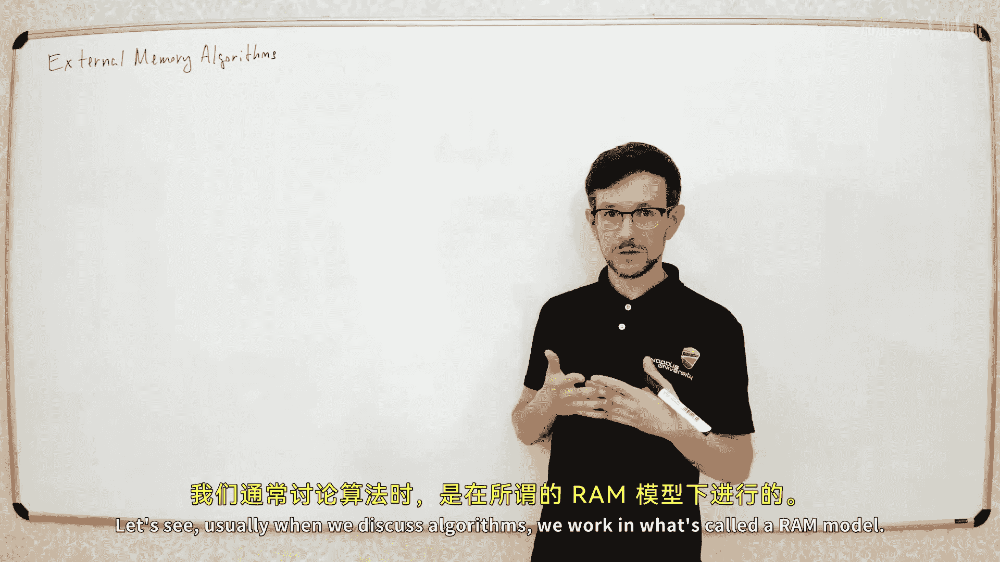

そで。

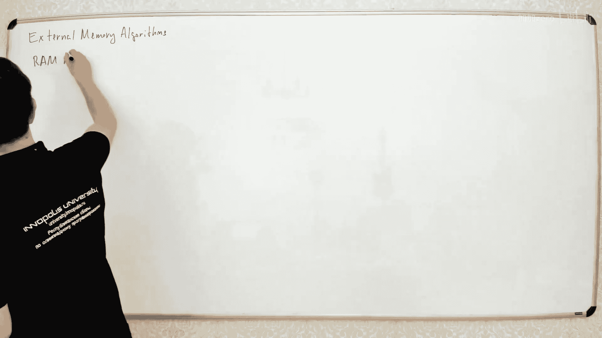

Usually when you build some algorithm， you think you're working in a rare model Ra model is a very simple model in rare model you think that all your data is stored on some RA basically right rare model a RAM is basically just a bigger array so you have a bigger array of data。

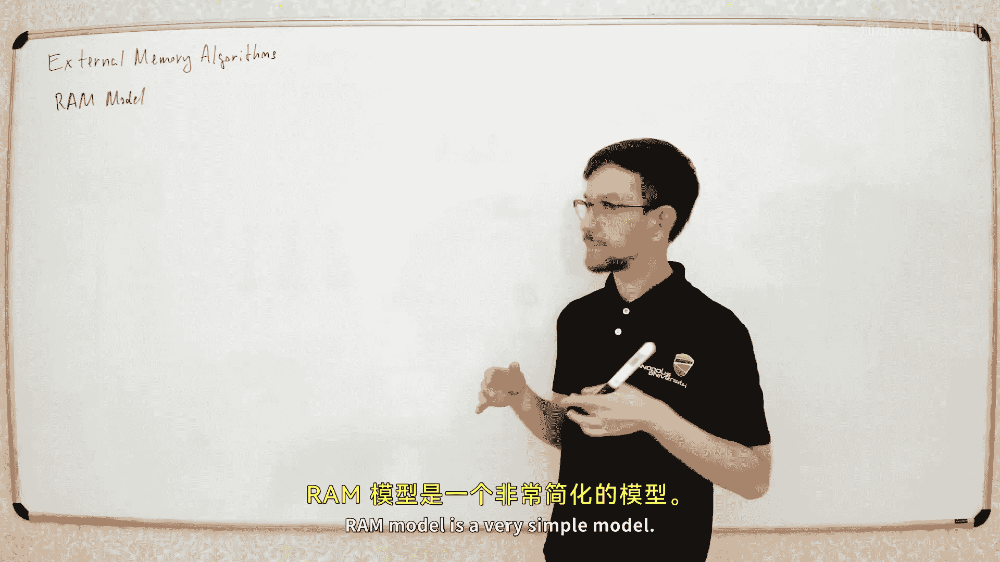

And you can get any piece of this data in constant time。

 So you can you can like make a reation in this thing。

 So you have address in your memory and you can get this data from this address in constant time。

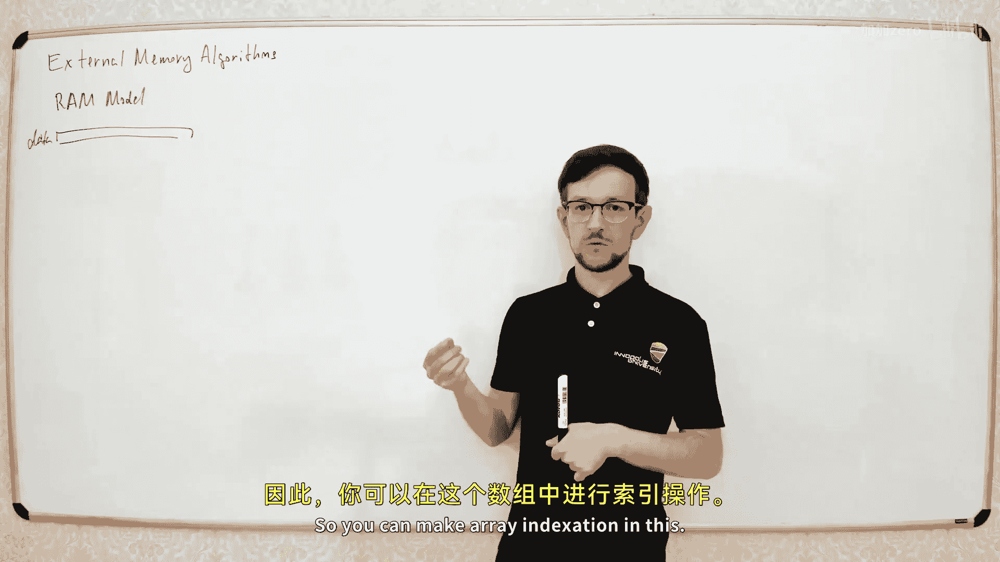

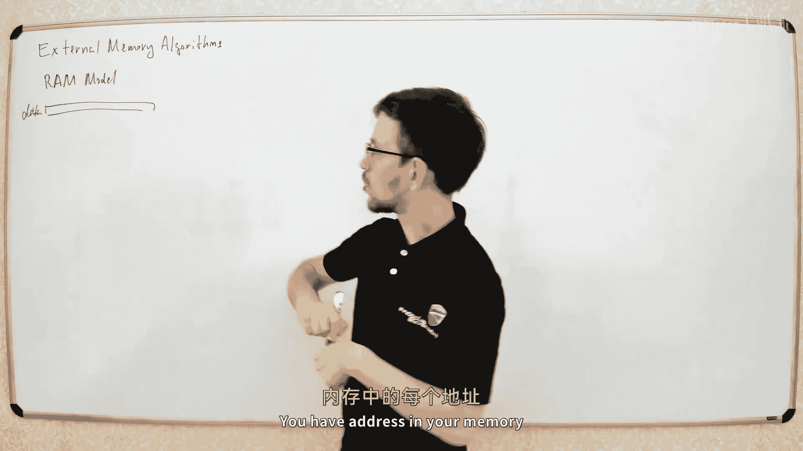

And like we discussed in the first lecture， this model is quite suitable for standard computer。

 So if you're working for a standard computer program， usually Ram model is what you need because in。

Reusual computing in like standard program。 you work with random access memory and accessing random access memory is basically in constant time。

 not exactly， but。不つ。呃。Very close。But sometimes you need some another model， for example。

 if you have a lot of data and you cannot store all this data in yourM。

 so all your data is stored in some external drive like for example， in hard disk。

 so you have some hard disk。

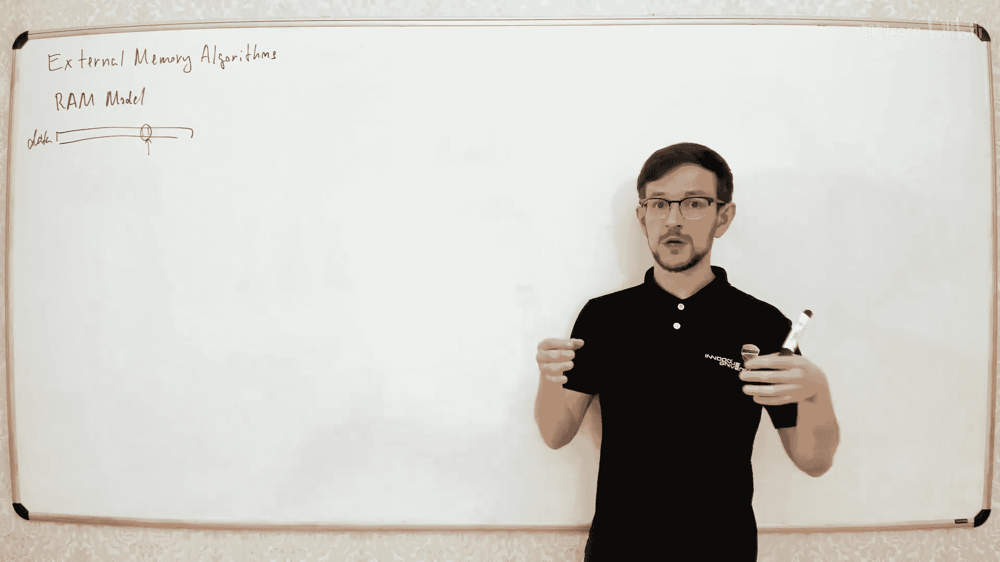

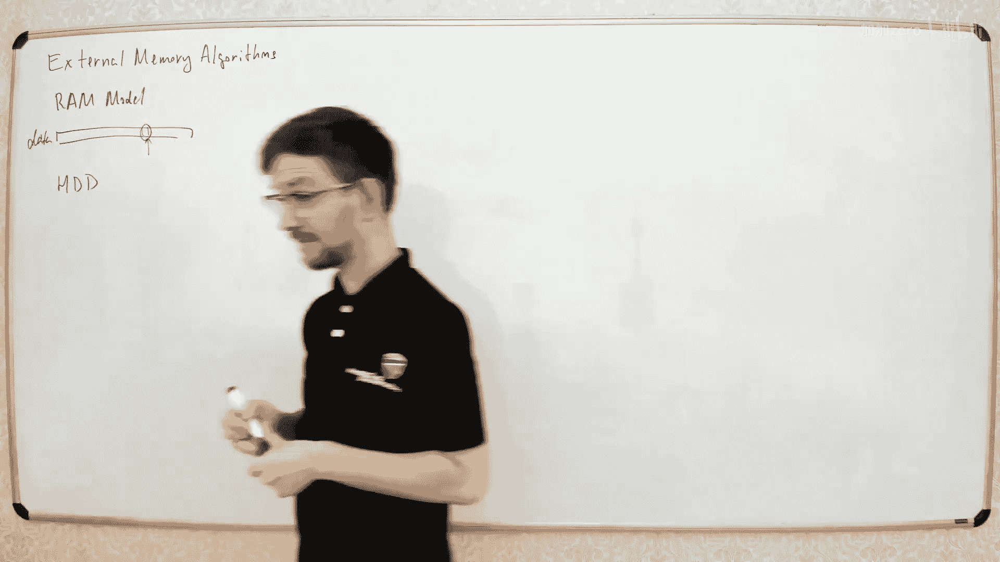

And all your data is stored on this hard drive。

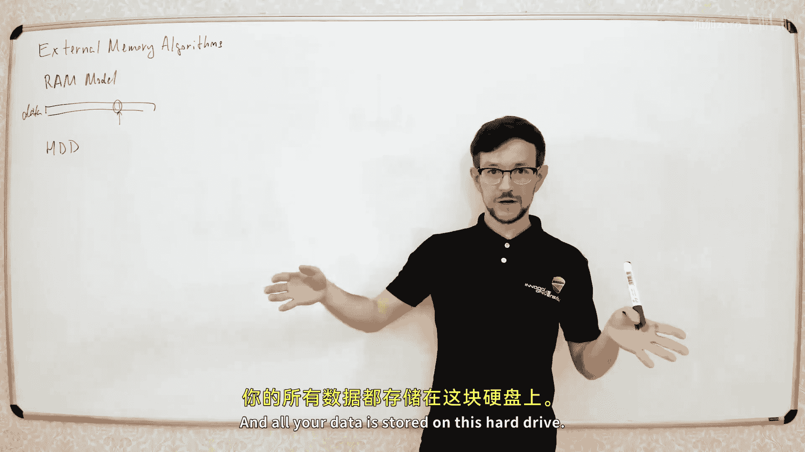

啊。Hard drive risk quite different from Re because in in in hard disk drive。

 you cannot access any data fast。 This happened just because of the physical structure of the hard disk。

 how the hard disk is working。 It's working like this。 Basically， you have a disk。

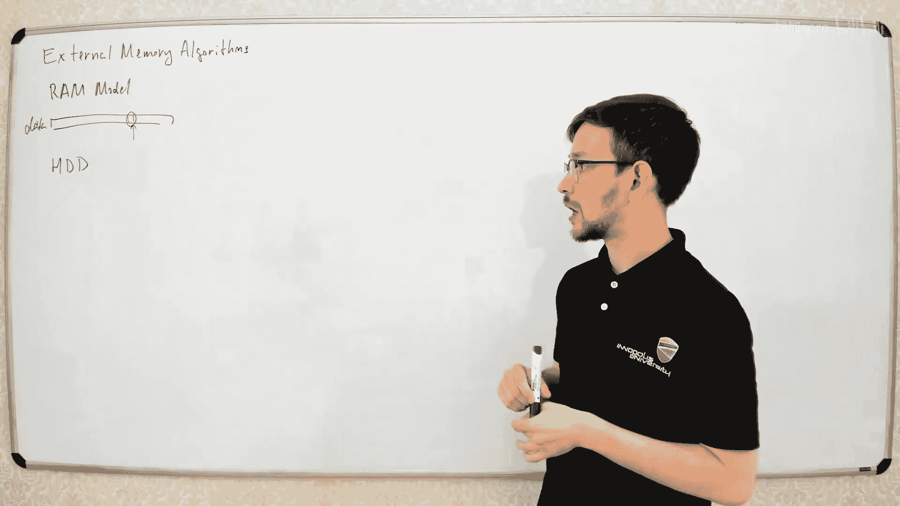

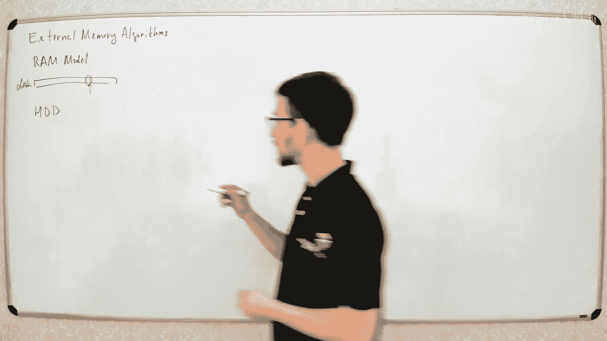

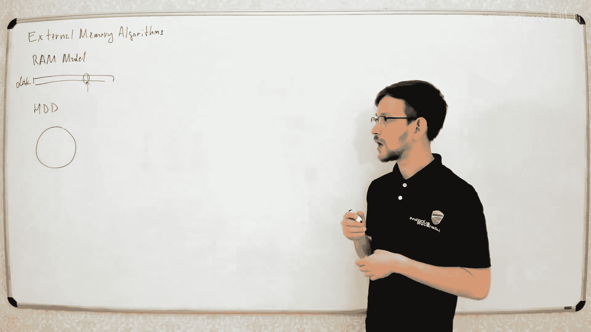

And you have。응 some。We're working case。 okay。So this is the head。

And your data is spread across the the surface of this disk。

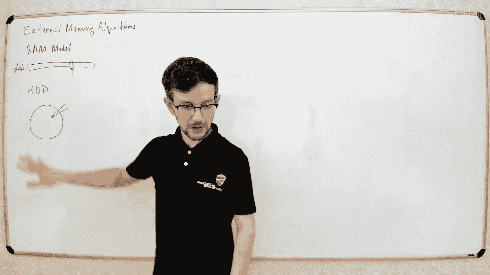

And you only can access the data at this point。 So this is the only point you can access the data。

So this this is spinning。So it's been very fast， usually what is the speed of the hard disk。

 let's say， let's say， let's say about 100 rotations per second。About hundreds about。

Rotations per second。So it spin quite fast。 So and this speed can give you access to all the data。

 So at some point， any data can be read by your head Hehara。啊。Let's see。

 So if you want to access some data of your hard disk what's happening So imagine your date is somewhere here and you want to access this data here。

 So what you need to do is to wait until until this point move to your heads。

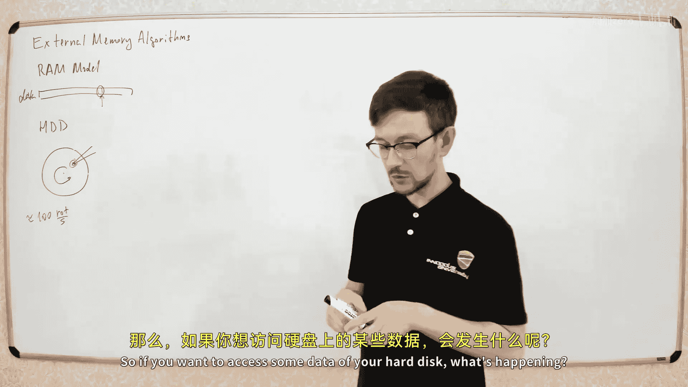

This。Point is moving here。 and at some point you you will be able to read this data。

What what time delay is between you want this data and you cannot read this data time delay is the time that this point move to this point。

So it's about one rotation of the disk， one rotation of the disk is about 10 milliseconds， right？

So it's about 10 milliseconds。

So it's just delayed between you ask the disk to read some data and you actually can read this data。

 just because of the physical structure of this disk。

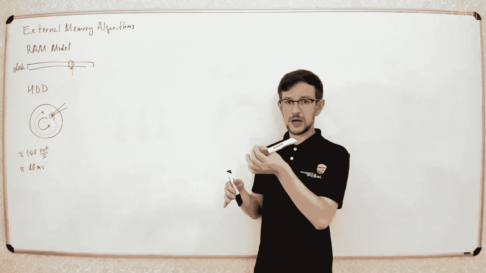

Right。嗯。10 milliseconds is you may think that it's pretty small， but actually。

 it's pretty big time because it's your computer can do a lot of a lot much more operations per second。

 right， Your computer can do like billion operation per second。 And here you can just like。

Due0 de per。So the difference is pretty big。 let's say if you want to access like byte by byte。

 like you want just to access random bytes of your hard disk， then the speed of reading this data。

 So if you are sure by by by， by by by byte， then the speed will be about10。Buy it per second， right。

Hundd bys per second is pretty small， right。啊。On contrast， if you just。

What they can do you're not reading data from disk100 bytes per second right you can read that data from disk much faster Why can't you do it from data from disk much faster because you are not reading only single bytes now usually you want to read a lot of bytes from disk if you have a file on your hard disk then if you want to read the whole file the whole file usually usually bytes of the file are pretty close on the surface of this task disk so if you want to read this block of data block。

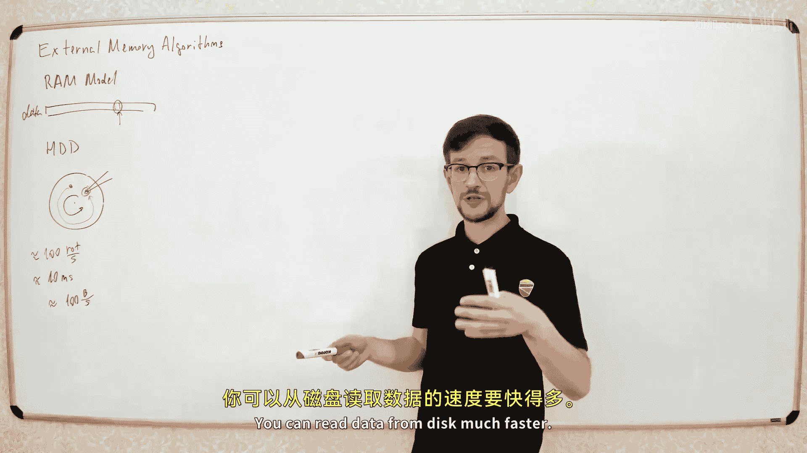

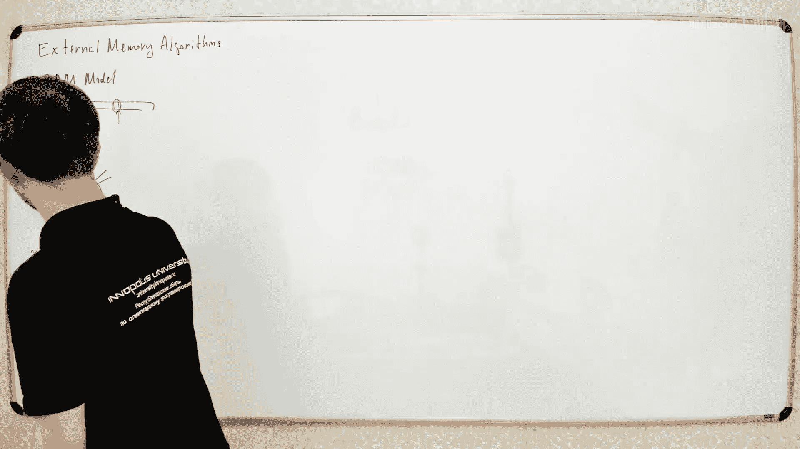

Then you wait until you this block reaches this point and then read the whole block instead of one byte。

 you will read the whole block of this data。

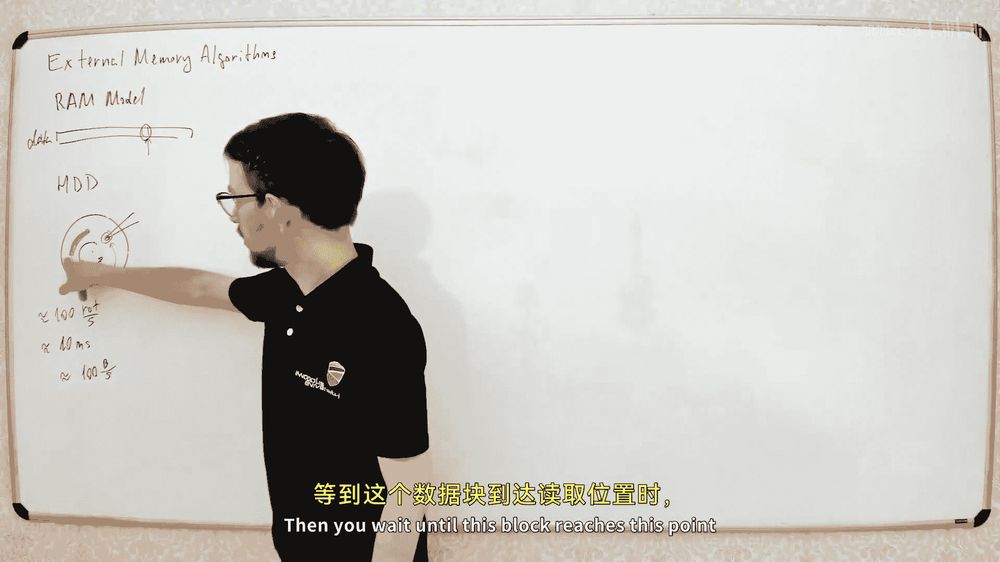

And the speed of reading data is pretty big actually， compared to this speech。

 the usual speed of reading data from hard disk， let's say。Let's say， usually， it's about。

Let's say 100 megabys per second。

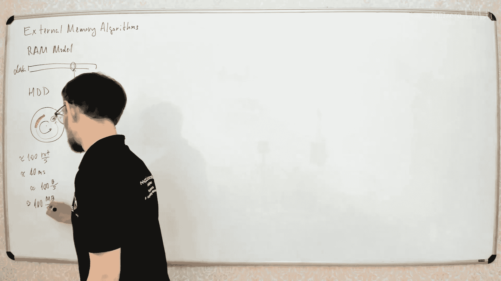

送そ。So if you read just random bytes， the speed of this random access will be 100 bytes per second。

 If you read consecutive。Block of bys。 Then the the speed of the consecutive rate will be about 100 MBB per second。

 So difference between these two is about 1 million。

 So the difference of time complexity is 1 million。

That's quite big difficult this quite big difference。

 so usually we kind of ignore all the constants right。

 but it's pretty hard to ignore constant of 1 million because if in real program you want to read some data from your disk and you can read it in random way or in consequent way consent is it in work okay。

So the difference of running time of this two。Programs will be 1 million times。

 That's a big difference。 So this rare model is just not working when your data is on the hard disk。

 Yeah， we want some different model， which kind of uses this fact that reading bytes in sequence is faster than just reading random bytes。

五。

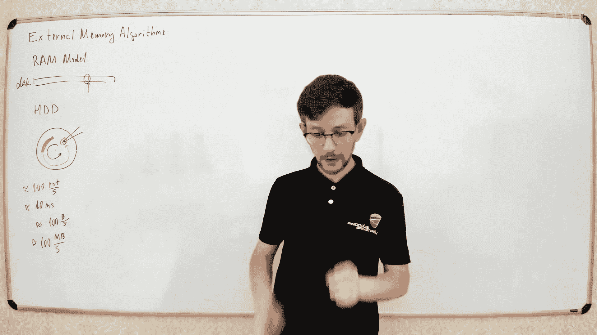

嗯。Yeah， so we will move to another model。 so we will use another model which kind of simplifies this fact。

Model goes a X amendment model。Sequential， maybe the is or cool。

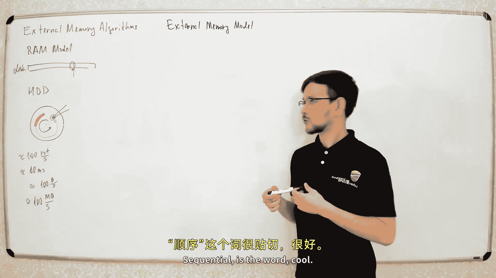

So how this model is working？No， let's say what want to do。 So if you。

 if you just try to optimize your time of your program。Thinking about this。

Structure of your hard disk and all these spinning disks and stuff。 It's just too complicated。

 So when we build some computational model， we want to simplify the reality， right。

 So you have a real computer， and it is too complicated。

 There are a lot of different stuff inside this machine， right。

 So we want to build some simplified model， but this simplified model should be kind of suitable for this real machine。

 So how will simplified this model。 Let's see。

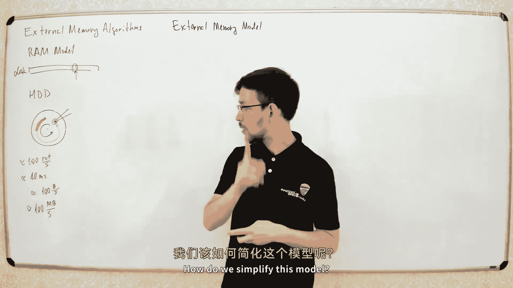

嗯。No less thing。 let's read data in blocks。

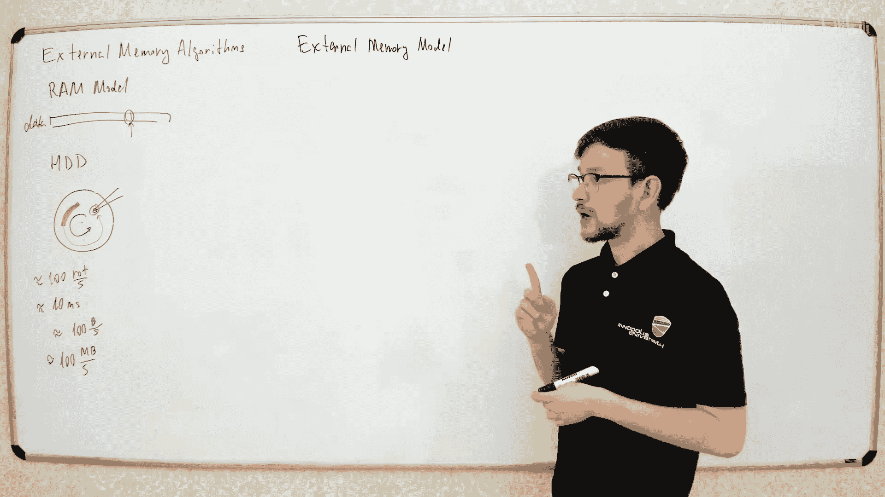

So if this block have size， let's say。And we want to read this block， the whole block。

Then how much time do we need to read this whole block， let's see the time of reading this blog。

 let's see。Will be some of two values。 First， we need to wait until this block reaches this point。

 Let'll see you see。

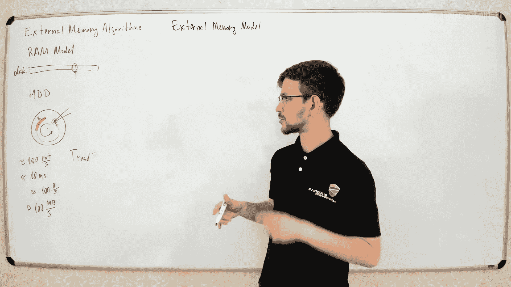

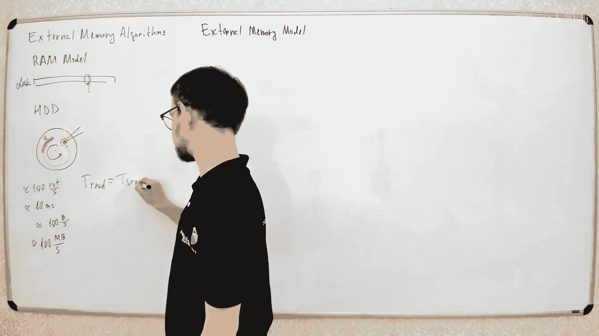

And then we just read the whole blog。

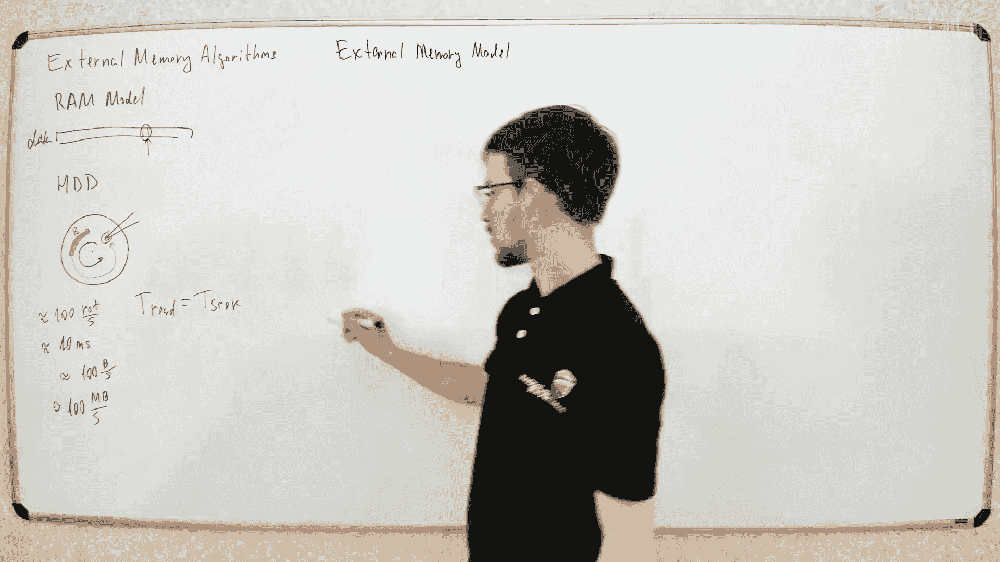

Time of reading， the whole block is just size of this block provided by speed of reading。

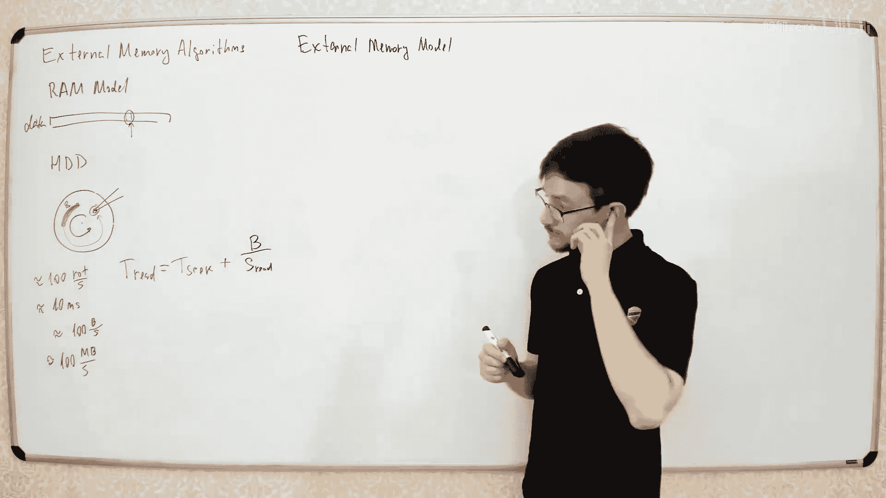

That's the total time you need to read this whole block。诶。Now。

 let's think what is the optimal size of this block？No， the optimal size is basically when this。

Two values are about the same。 So if this。Block is small there。

 this amount is smaller than this amount。 So so， so this part will be just much smaller than this part。

 It means that most of time of your algorithm， you just make 6。

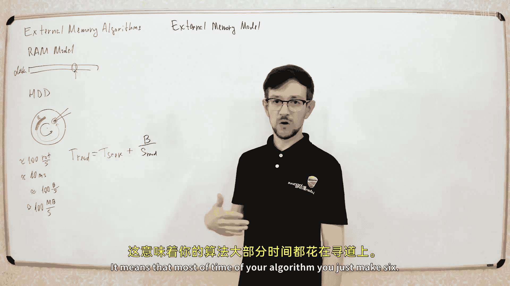

It if you spend 10 milliseconds。Do wait until you get， you get your data。

Then you actually can spend another 10 milliseconds to read this data。 Yeah。

 this its just just too stupid to read less data than you actually spend to secure。 So this。

Fraction must be some might be about time of this ship so。 This size of this block should be about。

 let's move it here。 So it's the thick。Multiplied by speed。

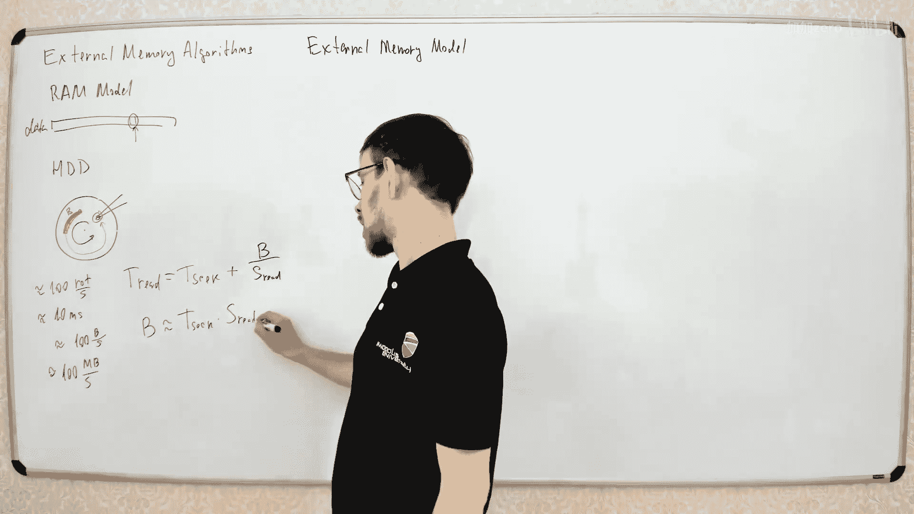

Well lets the time of seek is about 10 milliseconds。And speed is about00 MBby per second。

 So if we multiply this by this， we will have something like 1 MB， right。

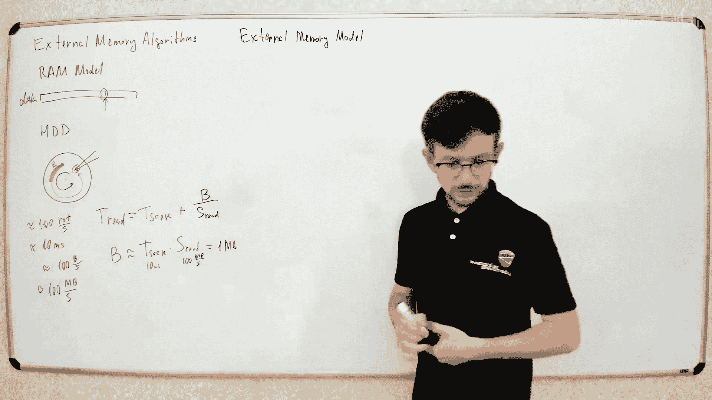

So it's kind of optimal to read information in blocks of 1 megabyte。

Its it's not efficient to read data in smaller blocks because we will just spend a lot of time just on these six and not on these reads。

And it's kind of not important if， if B， if B is bigger than megabyte。

 it means that you spend a lot of time here and smaller time here。 But instead of this。

 you can just make 26。 This will not affect the asymptotics， right， So if you， if these two some。

 then it's basically if you think about asymptal。Time of your algorithm。

 it's optimal to make these two parts equal。In practice， actually。

 you should read in bigger blocks because if you have blocks of size1 MBby。

 it means that you will spend half of time using doing these six， just doing nothing basically。

 So in practice， it's better to have。Larger blocks like 10 megabytes。So if size of work istemicga。

 then you spend like 10% of your time just doing nothing。

 waiting for your data and use 90% of your time to actually reading some data。

So usually it's better to have， it's about 10 megabytes， but it doesn't matter for asymptotics。嗯哼。😊。

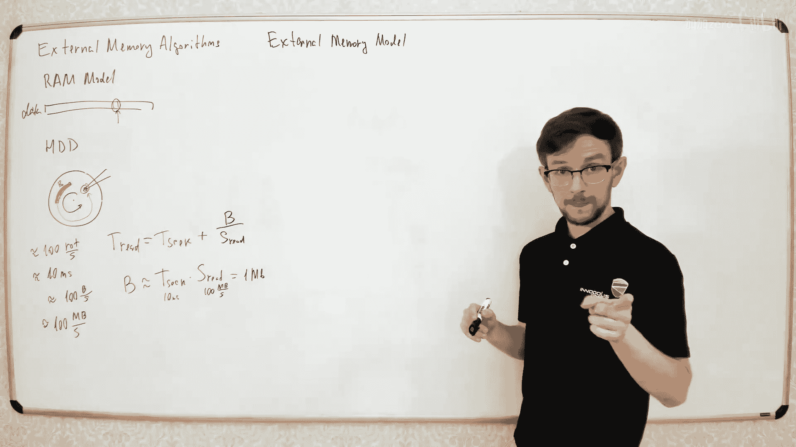

Again， if you understand them just say something in the chat okay。Don't make me errors。こ。

So how the external memory is working， We will fix the size of the block。

 We will say that we only read data in blocks of size B。

We will just always read the data inside in blocks of size B。

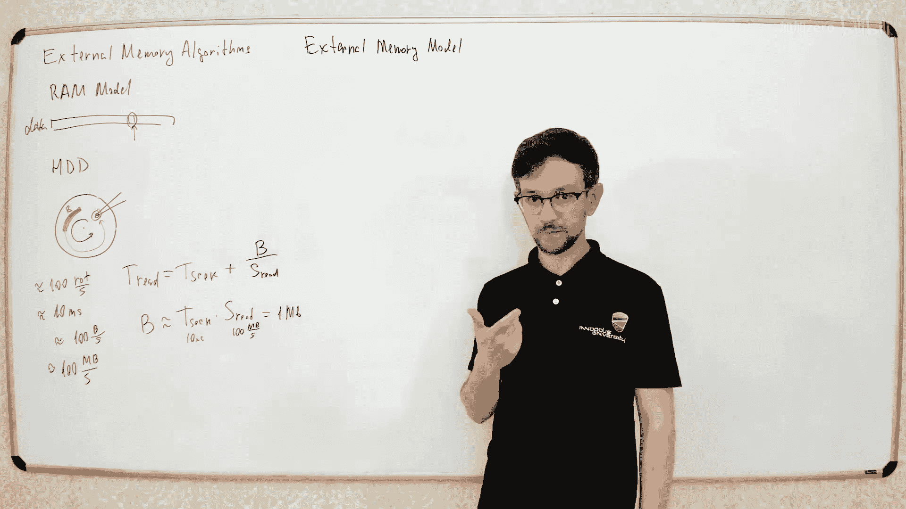

So the model is looks like this you have。You have your CPU。 Yeah， that's your processor。

And you have some local real。So you have some local memory you can access in the fast way so you CPU inside of this。

 you actually have a RAM model or something like that。And you have your hard disk。And。嗯。

You transfer the data from here to here and back in blocks of size B。

So you can write data in blocks of size B or rebate in blocks of size B。

Every interaction between your local memory and hard disk is by reading or writing the block of size B。

Nice。Now， the size of your local memory is M。This is another parameter of your。

Moel external memory model have two parameterss， This parameters M and B。啊把那个东西。제。off your model。

So when we will think about some asymptotics of some algorithm。

 these asymptotics will have some formula。And this formula will contain these two variables。

 So these variables define the structure of your external memory one law。

So temperature complexity will depend on the size of the block and size of the memory。

 like if you have large amount of memory， the algorithm work faster， if the size of the block is big。

 then the algorithm will work fast and so on。Now， how do we measure time in the in external memory model in a very simple way？

We will measure time in number of operations of reading or like input output operations。

 So time complexity will be equal to the number。All of these readings or writings。Re in。All right。

 thanks。Yeah。So we will only measure the number of times we need to write or read the block of data。

What's happening inside this model。 So inside this model。

 you have actually have some fast memory so you can access this data very fast。

So what we'll do is just ignore everything which' is happening inside this Rammeter。

 so all operations inside this realm are free。You can do anything here in zero time。fits。

That's a big simplification in your real program， you actually need to take care of some fast decors inside your memory。

But in this model， we'll just ignore this completely。

 we'll only optimize the number of these input output operations。嗯哼。We just talked about doing。

 so yeah， that's not something you。Usually in comparative programming。

 you don't need to care about this。 Sometimes actually you need talk about this when you will think。

啊。You can actually apply this model not only for data stored on the computer or on the hard disk。

You can actually apply the same model when you date stored and Ram。

 So instead of having a RamM and H and hard disk here， you can have a RamM here and your。

Cash of your purchaseor here。So， actually， when you have。And you have your local cache。

 accessing your local cache of your processor is much faster than accessing Ram。

So sometimes you need to optimize your program tool or good in your tool to utilize your cache and efficiently。

 it's basically the same model。Right， different in other situations， for example， when your data is。

不。Nowadays， you usually not don't use hard disk use like solid stay drives， right。

For solid state drives， basically the same model is working。

 but for different reasons in solid state drive， you don't have this rotating disk。

 but still the delay between you ask for data and you receive your data is pretty big。

 So when you when you when you want to read some data from your from your SSD what's going on your processor ask your。

Will say you。I'm not not not exactly sure how it's going on。

So a lot of things happening inside your computer between your processor and your solicited right。

 So so it's asking something。 it's asking something it's going to some buses。

 I don't know how it's working。 No idea。 So it's go to the seta cable and ask the solicit SSD。

 your SSD is doing something inside not exactly what's going on。

 but this whole process is pretty long。 So this big delay between you ask the data and you receive your data。

 So this time of thinking is not the same as for the hard disk but still you have some delay between you exit the data and you receive the data。

 the same thing is happening。 for example， if you have data stored on some let's stay of some remote server。

 So you have some remote server here。And your date is here。

This is your local computer and this is remote server and what's going on So when you need to ask when you need to read read the data。

 you make like a request。To the remote server is going through your network， then go back。

 And you have this delay between you ask the data and you actually receive the data。

 So if you ask data by by byte， it's。They takes long time。 So you don't want to ask data by by by。

 You want to ask a big block of data。 So you ask。The data through the network and you receive the whole block of data instead of just single byte。

Yeah， like this。 yeah in computer programming， you might have something like when you have a array of data and you just。

 when you have a big array of data in real。And you read this data like by rows。

 it's pretty fast because this data is sequential。 But if you read data by columns。

 it will be much slower just because you have a lot of cache misses。 And that's usually the same。かいな。

前りモ。那。That all's all that's all about model。That's all， so now what we'll do。

 we will try to make some efficient algorithms designeds specifically for this external memory model。

Let's start something simple， something simple， something simple， Let's find the sum of elements。

So we have R A。So this array is stored in your hard disk。And you want to find some of all elements。

A very simple algorithm， yeah。How do you solve this problem in RE model quite simple。

Iterate all elements of your array and ask them one by one。 Yes。

 you should ask all the elements of your array and just calculate the sum of all these elements。啊。

In ex song memorial is it's much actually it's actually the same。

 but instead of writing elements one by one， you written block by block so you split your array into blocks and read these blocks one by one。

Look of these fs。And you just read them wrong by bounce， you'll read the first book。

Calculate the sum of the first block， then read the second block。

 calculate the sum of the second block， and so on， until you reach the end of the array。

So what will be the time complexity？😡。

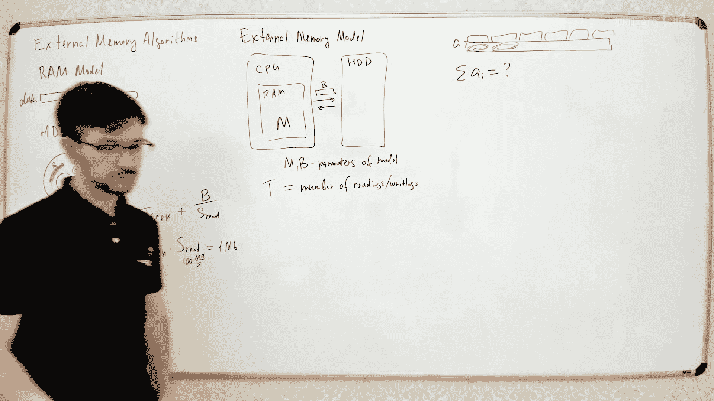

即实。That was a question， yeah。So if you just read this data block by block。

 what will be the total time of your algorithm。Yeah。

 because of N is not is's not good enough because because we are reading data by blocks and we calculate the number of these readings。

 So we need to calculate not the number of elements we read， but the number of blocks we read。

So time complexity will be not n， but n over B like this。

That's actually important because N and N by B are different in like million times。So。

So what you want to do is to make algorithm have something like this in time complexity。

 so your time complexity is divided by B， it's important because the size of block is pretty big。

So you want your tank complexity be divided by this size of dog。 It's important。嗯，那。

That's important thing missing in this time complexity。 The important thing is this。呃 see。

Why it is important because the type of legacy of these algorithm is actually not never less than one。

 right？So if you have if the size of your array is less than size of block。

Then you still need one reading to read this whole block。 If you， if you just miss this selling that。

 what happened？ So if you have a lot of small arrays。 So if you， if you have an array of size 1。Yep。

If you have any price of size 1。And you won't read the one by one even if you if you。

 if you just emit this sail， that what was going on。 So the time complexity of each。

Read will be1 over M。Then you will multi long， yeah。But over be。

Then you will multiply this time complexity of single read by the number of marks。

We will come an overview。That's not true if if you read a lot of small arrays。

Time complexity will be N， not N over B， right， just because this for each of these small arrays。

 you need to read at least one block。From your ex memory。And。So。

 so this selling is actually important instead of saying you make。You may do it like this。啊。

Itsactly the same。Again， this thing is important only for small size of the direction。This。

's let's start to the apparent because big O is actually。Take care about big size of rabut。嗯。

And this is important only for small array。Let's just keep it like this just to make it clear。

Good good， good， good， good， good。So this is how you read the data from the array from the hard disk。

 quite quite simple。 It's called scan。Andand of。And。Let's the Edward。

What event were reading an elementsilments。Yes， were reading an elements。 Yes。

 were reading all an elements。But we read this element not one by one， but in blocks。And we。

 in this time complexityity， we a create number of blocks with it。

So we need these three these blocks one by one， and the number of blocks will be an R。Right。Yep。

Again， in this model， we are measuring only at the time only the number of these input output operations。

And every input output operation he giving you the block of size B。嗯。Let's move next。啊。

The next most important algorithm is， of course， sorting。

So it's very important to be able to sort the data， even if this data is in some external storage。结续。

So how to sort the data in the external memory， no right。

So we learned in the previous in in in the first semester。

 we learn a lot of different sorting algorithms。 So let's pick some sorting algorithm。

Which actually can take advantage of this technique， So we need to take some sorting algorithm。

Which kind of is the data in sequential order。For example， if you have he sort。

 so if you try to sort your array using binary he。Then your binary heap is actually trying to access random elements of your array。

So if， if you have binary hip， how binary hip is stored in your memory you have this。So this array。

 sorry each element have some children， sorry， So you have this， this is。

These two elements are left and right child of your element， so for element I。

 you have elements like 2 i plus1 and 2 i plus2。So when you want to apply some operations to your。

By the hip， you need to jump across your array。Just access your left child or your right child。

And that's too slow because to jump from here to here， you need to read another block of data。

 So each time you jump you need to make another access and its so He source， for example。

 is not suitable。うか。Yeah， for example， milk chocolate milk chocolate will be much better。

In merge cytoography， we actually read data from left to right one by one。

That's exactly how we do it here， so we will be able to split this reading into blocks and read blocks but block by block。

これつのし。そで。嗯。The cooperation of North sort is actually emerging to two arrays。 So let's hey， we have。

 let's say we have two arrays。Let's drawing much bigger。

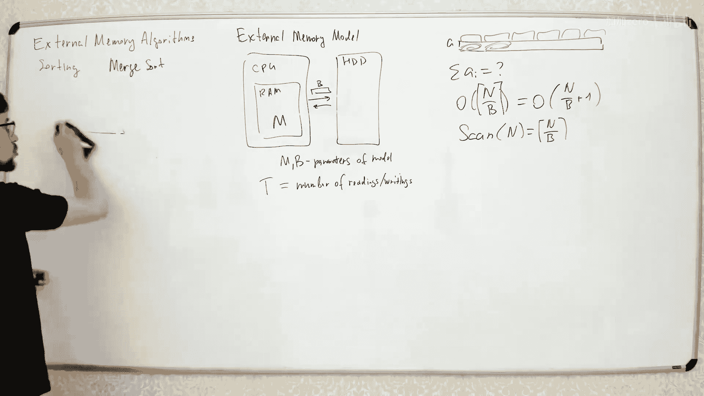

Let's have。Al A and B of size M。And we want to merge them into a array C。

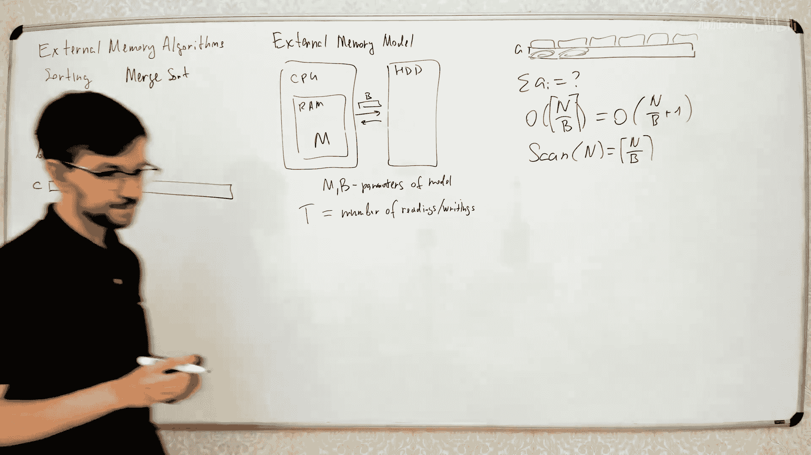

So how do you merge two sorted array into one sort array array you have this both array assorted and you want to merge this to sort array into single sorted array。

How you do it， You will look on the first element of each array。you look on this first element。

 this first element， see what element is smaller and just remove this element from here and move it here。

 Then look on the next first element。 see which element is small。 So this is small。

 So you move it here and so on。 So you take this。 Now you take this and so on。

 So each time you look on that。These two elements of your arrays。

See which element is smaller and move this smaller element to a racing。

So how to make it in external memory。Actually， exactly I like these。We'll do it exactly like this。啊。

嗯。Here， you need to read array A and B from left to right， so we will read them block by block。

Each time we need some sort。 So this is the current element of A A， it belongs to some block。

This currentdown and4 beginning belongs to some block。送。

We will maintain these two blocks in our local memory。So we can access these elements first。Now。

 each time we。Look on these two elements。Pick the smallest one and put it here to put it here。

 with also need to， we need to write elements to to a C block by block。

 So we'll maintain some block of a C。In the local memory。

So each time we will look on these two elements。Pick the smallest element。

And put this smaller element here。 So we remove it from here and move it here。啊。

Thats all when we finish the block， we will read the next block， so we will。Forget about this block。

 Mo to the next block。 Read the next block from。From your hard disk。And then do it again。 So again。

 you look on these two。Elements， see which element is smaller would be smaller element here and so on。

 When you finish writing this block， you write the whole block。

T your hard disk and move to the next block。So you write this block to you have disk and move to the next block。

 So now now we are reading from these two blocks and right into this block。 So these three blocks。

in your local memory。M哼m。😊，When you finish the block， you just read the next block。

When you finish this book， you read the network， When you finish this block。

 you write this block on your hard disk and move to the network。Clear enough。Again。

 the time complexity of this algorithm will again be an，In end orbit time。

We will be able to make this mergech of two arrays。So what will be the total time complexity。

 the total time complexity of the whole algorithm。So if we can merge the arrays into single array in this time。

What will be the total time of the whole sorting algorithm？But it is with sail again， yeah， yeah。

 yeah， y。Can I just submit this sailing in the future。 Yeah， yeah， you you you， you， you need to。

 you need to think about this when you are working a smaller race， but I will just ignore this。

As for simplicity。Again， what is that complexity？Of the whole sorting algorithm。Again。

 when you do your merger sort， what do you how do you apply merge sort。

 you split your array into two hs， then apply merge sort to both house and then make merge of this。

The did do。Yeah actually in this case， when the size of these blocks is less than if size of this array is less than one block。

 you just you can just read this block and sort them inside your memory and then put it back。

So you can stop your recursion when you reach the size of the block。いやあ。Not the exact but quite。

This is time of single merging and the depth of your recursion again， what's happening in your me。

 you have this whole array， you split it into two halves， apply recursively the same， split it。

Applyticos to the same and so on。And this happening until you reach the size of the block。

If you have the area of size of your block， you just can read this whole block， sort it inside。

 and then put back here。あ。Right。So， this。De filter cushion will be log N over B。And on each level。

 we do merg to to array。 Mer of two array can be done in this time So the sum of all this merging will be again and over B。

So the total time complexity will be actually。And over B， log N over B， like this。不中。

So if you just take the standard merchant sort algorithm， apply it to external memory model。

Then you will get this time complexity。Thanksice。Can we improve this。Actually， we can。

How can we improve this， Let's see。Ignore。Very important fact。 Let's see in this algorithm。

 how much memory actually we need。When we apply this algorithm， we need only three blocks of memory。

 right？So， in this。Local memory， we use only three blocks。 So we use。This block。

 this block and this block。So to apply this algorithm。

 you actually only need three blocks of your local memory。But we may have a lot of local memory。

So the size of your local memory is not used in this algorithm。 that's not good。

Let's try to optimize our algorithm to use our local memory， much more efficient。How to do it。 No。

 Let's see。 Let's try to merge not22 arrays。In one thing， but， but。Big number of worries is。Mmhmm。😊。

So instead of just launching two arrays into one， we will merge just a big number of arrays。

A lot of ways。And in single operation， we will merge all these sorties into one sorted array。

A am over three。You can take you can change the parameter B， you can change the parameter B。

 and parameter B is just the parameter of your model。You can choose size of the block。 again。

 this block comes from your physical model， Like in your physical model， you。

 theres some efficient size over the block。 so you can read data。

 And this is just size of your memory。 These two parameters maybe be。Different。Yeah。

So you can just say that your size of the block will be M O free。 It's not working recently。

嗯嗯嗯嗯嗯嗯嗯 yeah。WhateverSo let's try to merge not two arrays in one time， but big number of arrays。

So let's see。 if we merge this array into one， how many blocks do we need we need。

To store at only one block from eachery。So at every moment。

 we only need one block from each array in our local memory。

So each time we're reading these elements and right to this element， so we need these blocks。

In our local memory。So if the size of memory is M。Then we can merge not to arrays， but。

About m over B array notice plus minus-1， I will ignore all the constants， right？

So if if you try to merge this number of arrays， you will use all your memory efficiently and it will actually improve your time complexity。

Because time complexity now this time complexity， the depth of your recursion will be much smaller again。

 what's going on so in standard node short pattern you have this array。

And each time you split it into two parts， but now it can split it not in two parts。

 but in M M over B parts。おし？Let's say we split it in five parts， then again。

 we split each of these into five parts and so on。So the depth of its res will be much smaller。

It will be log of n over B base M over B。And un complexity of this single mech will be the same。

So on each level， we spend on n over B times and the depth of recursion will be this。

 so total time complexity here will be n over B。Lookock and overview， B An over。Nice， right。

So this is time complexity of the sortcing algorithm in external memory model。

And we can actually prove that this is optimal time complexity here。

 So if you can only compare two elements。Then the time minimal number of input output frame operations you need to sort this array is actually this time。

So we cant do it pick。We can also make brake case。yやや yeah。

You can improve it slightly just you can split your arrays until you reach the size M。

 So if if size array is M， then you can read you can just read the whole block。

 sort it inside your memory and then pull it back。So if you do it like this， the， you will have the。

 Let's move here， log and over beam。And over M base M over B。

But the attack is actually the same as here。So it's n over M。Is just L over beingan。

Multiply divided by M over bit， right？So， this log is actually。The same look minus1。Yeah， yeah。

 in practice， you can optimize it by just just you can stop your recursion when the size of block is M。

Then the size of work is am， you just read the whole block and your memory and sort it inside your memory。

But it， it will not affect the asymptotics。 asymptotics will be the same because just because these two labors are the same。

嗯。That just it just looks better because you in each position you have this over being universal if you have n over M here。

 it just doesn't look that good to him。But asymptotics is the same。 Yes。

 you can stop your recursion when when the size of block is M。 So this this are also working。Nice。没错。

嗯。Do't to have enough time。Let me show you just how to prove that this time time complexity is optimal。

 This is actually optimal time complexity for a social algorithm in in external memory model。

Let's prove this just。Very first。Okay， I'll present you just a sketch of the proof right。

 I want to prove that this is the optimal time of the sort in external memory model。😡。

I will make on this sketch。 can you can put all details as an exercise。s not it's not that hard。

So let's remember how do we prove that the time complexity。

 the optimal time complexity of the sort algorithm in model is analog Logan。In rare model。

 we have something like。So we have this。Three of comparison sorry。

 So each time we compare to elements， yeah， we get one bit of information。I'll just remove this。

I don't need to draw this string So every time you compare to elements。

 you have one bit of information right and to sort the array you you need to have log of and information and factorial information。

So you need this number of information to sort your array logo if one frame factor is about a log。

I just I meet all the constants。For simplicity， okay？So log of control is about n log n。

 And we in one comparison comparing to elements， we get one bit of information。

 So we need to compare two elements at least N log n times。

 So this is why you can sort the elements in the rare model in faster than N loggan time。 Now。

 we'll try to do the same in external memory model。In external memory model again。What we need is。

Most first， let's sort all the blocks one by one。 Let's read all the blocks。

 and not all all the blocks are sorted。Just just to make it more simple。

now to sort now now to sort the whole array。After sorting all the blocks， we need Lo from。Let me see。

 So it's loaded from n functional over。嗯呃呃。B factor。P。And over B like this， right。Yeah。

 looks fine so it's about N log n over B。So we need this amount of information to sort the whole array if each block is already sorted。

 each block is sorted so I divide it by these materials。So I don't get information inside each book。

So now let's think。What is the amount of information we can get in one read。

 So when we read one block of data。How many information， How much new information do we actually get。

Let's see。 So we we have。 So this is our local memory M。And we read one new block B。

So we just read this new book。What we can do， we can compare all the elements of this block。

With all elements inside our memory。So we make comparison between all these elements and all these elements。

Now， how。What's the total number of different results we can get actually a result we can get is since we have a linear ordering of elements。

 right？So we have all these M elements if we sort them。

Then these B elementss are in some positions in this。So these are your new elements。Yeah。

So if you compare these elements with all elements here。

You will find the positions of these elements in the sorted order， right。

 This test the whole all of all information you get by comparing these elements to these elements。

You will find the positions of this element in the sorted order。

How many positions can these be elements have inside this。M elements。

 no the total number of positions is just。Number of。 how it's called in English。 I forgot about this。

 I'm not sure， but this is phenomena nol coefficient from。Mh。

So it it's number of different ways to put these B elements in the sorted order of all these M elements。

So amount information we get is actually logo of this。No。

 this is actually M factorial divided by M minus B factorial B factorial， and it's about。

About about B log M overbe。So this is the amount of memory beach being and choose being， not nice。

I need to read more lectures about combinatoricsators is my weak point。Now。

 so this is the amount of memory or amount of information you get when you read new block block from from your disk。

 so when you read block from your disk， you compare all elements with all these elements and this is the amount of information you get。

And now。To do just we， we need to get this number of information。

 and each rig give us this number of information。 So just to calculate the number of reads。

 we just divide this by this。So we have an log and over being。Divided by B log M over being。

 and that's exactly what we need。That's on。So actually。

 if you just make merge short algorithm when merging M over B blocks each time。

Then you have the theoretically optimal results。 So it's asymptotically the best possible sort in external memory。

故。P， D， F， I don't have any P， Ds。嗯。Okay， we don't。 We don't have much time。Okay， let's talk about。

Let's talk about some different stuff。 Let's talk about data structures。

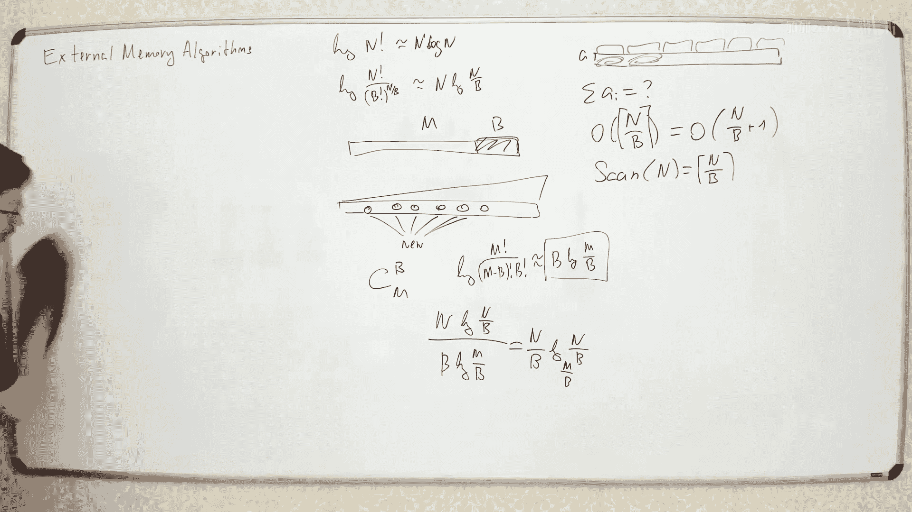

same as the algorithms in external memory， you can。You can make some data structures。

These structures others are basically the same things。

 So let's discuss some primitive data structures we discussed in the previous sense。 For example。

 steps。 So how to make extraordinary memory steps。So this is tech。

 you just put some elements here so these are some elements。

So you put elements here and pull elements from here。So。Next round memory model again。

The whole stack is too big to， to have it in your local memory。

 So these elements is actually are actually stored in your external memory。

And you want some efficient algorithm to work with this step。What you can do。Let's see。

 if you only push elements to the stack， never pop elements from a stack。

Then all you need is to have the last block of your step。So we have this block。你 your what memory。

And all these elements are on your external drive， right？And when you push。

 when you push new element to to the stack， you put it in your local block。When this block is full。

 you write the whole block to your external drive and then move to the next block。Similar。

 when you pop the element from this stack， you just take the last element from your local block。

 If your local block is empty， you move to the previous block。So again。

 it's almost the same as we did when we have scan。 So we。

 we only maintain the last block of our stack。So all these blocks。

On the unural drive and this block is up in our local memory。

So we can read and write these blocks first when this block is full， we move to the next block。

 when this block is empty， we move to the previous block。That's almost correct。 Not exactly。

Can you see what is the problem here。So if we maintain in our local memory on the last block of our stack。

 what can you do wrong？嗯。No。Okay， I， I want on the last block。We can do with last box of size。 Yeah。

 we can do the last block of size M。It's also working， yeah。Since we have。M memory。

 we can use on the。 We can We can have this the last M elements in our stack。Stack overflow。

 St overflow。 Yes， stack overflow of the source problem。

 but we will think that the amount of external memory is infinite just for simplicity， okay。Yeah。

 the problem is when we're on the boundary yeah， so when we pop this element here。

We need to move to the previous block。 now when we call pop operation。

 we need to move to the previous block。 So we move here。行。Take this element。

And now when we push it back。Then this block is full。 So we move back to this block and so on。

 So every operation。 So we push then pop then push then pop。

 So while we are on on the boundaries of two blocks。

 Each operation actually forces us to make one read or write operation。 That to be。

So how can we fix it， We did the same frequency we have when we talk about vectors in the previous semester。

 we will just store not one ball， but two blocks。So when we are on the boundaries of two blocks。

 we will just store both blocks in our local memory。So now we move here， we write data here。

 and we don't don't forget this block。 We just put both these blocks in our local memory。

When this block will be full， we forget about this block and move to the next block。

So we will forget about this book only when we move to this point， when move to this point。Well。

 we if we need to go back here， we need to make at at least B operations to move back here。Yeah。

So that's how you make an Excel memory stack。What's the complexity。

 What's the same complexity of single durationeration？So again。

 time complexity is measured in number of readings or writings， blocks of SB。

 So how many blocks do we actually need to read or write， whether we make single or pusho operations。

Can we shift block by B over two we。 Yes， yes， if you can read blog from any position。

 you can actually shift the block of size B by half of the tools。Yeah。

If this separation of blocks is not fixed yeah。Usually it's easier to think about blocks like fixed size blocks or。

 So the whole memory is split into blocks， and you can read blocks one by one。

's usuallyly it's easier to think like this， but if you can just read the memory from any position。

 just block size B from here to here， that yes， you can move your block by half of size bar。

So the time complexity， time complexity here will be actually fractional。

Time complexity of single operation will be one over be。And it's important。

 kinda that this time complexity is less than one。 If you just say that time complexity is constant。

 that's not good because if， if you say， if you say， for example， if。大です。이거 보안。

That's not good enough。Not good enough， because it means that for every operation。

 you actually need to read or write some data and every reading or write an operation costs you 10 milliseconds。

Yeah。So， you don't want to spend。reading a right impression for every request。All。right go here。

This time complexity is better， this time complexity means that for each million operations you have one written or writing operation in your extraordinary。

So you spend 10 milliseconds not for every operation， but every million operations。

That's much better。 Mill times better。Nice。You can also make you in the same way。Is it of here？

So when you when you want to make Q in external memory， you do just the same thing， but you've just。

Put the first and last block of your queue in the， in your local memory。

And you just read data from here and write data from to here。Mmhm。😊，Okay， I think it's。You。

 you can do it by by yourself。So stack and cues and all the linear data structures are pretty simple。

Let's talk about trees。What about biose trees？嗯。Don。就这。No。

 just just just say that you you you you yourself if you have。Qu。When you once block is full。

 you can split this window， not here but。But here。嗯。And if you do it like this。

 you always have this spread between your current position and。So when you do the separation。

 you id in the middle of your block。 So you need to have at least B operation here and at least B operations here。

Y。So that's what I was talking about。 So every time you have some gap between your current position and the next time you need to make input output preparation。

This， this card's working。That's the common techniques for all this stuff for some， let's say。

Look for most of these amortized time operations。 So when， for example， no。

 we did the same when we vector。 So so when you when you。

And what's the size of your vector or when you shrink your vector。

You need to have some gap between your current position。

 And the next time you need to change the size of your vector， right。

 and the similar stuff is going up here。 So you need some gap between your current position and the next。

Position， when we need to make operation。啊。No， you can have window size M。

 It will not affect anything， actually。because when you move to here。

 you need to read another M memory M element。 So you need to make M over B readings to read this next block。

So every M over B operations you spend on market。 So it will be the same。嗯。No no。

Let's move to the binary search trees。 The optimal binary search tree， for example。

 my model is is B3。B3 is the following phase structure。 B3 have nodes。

Each note of the B3 maintain about B elements。 So you have each。

Each note of your binary history will contain not single key， but B keys。What's see about biies。

If you have big key in your note。Then like that。The whole field of elements will be separated into B plus one segments。

 right？So these are all possible keys you have， these are your B keys。Yep。So the， the whole。

 the whole set of possible keys will be split into this segments。 You have this， this and this。

 this and this。And all the segments will be replaced by one child of your note。 So each。

Note of the B tree will have not two children like a buying research trees。

 but B plus one children about B plus one。元什么。So it's not buying the research trees like。

 but still search still search there。No， you can think about it like a binary research tree。

 But instead each each of these blocks may be inside implemented as a binary research tree。

 So it's actually a binary research tree， but。Can， a strange one。啊。Again， how to work with Bre。

 how to work with Bre， pretty simple。 you， when you looking for some element， you take the root node。

Read it from the external memory。Then you have these big keys。

 you find the position of your key between theseoid。 So this is position you are looking for。

So you know that your key is between this and these。

 so you know you need to go into this children node check a。

 so you select this child node and go to this child node and here you do the same you read some B keys。

 find your position between these keys and go to some child of your current node。

So it's kind of the same like in binary the research trees， but you don't have two choices。

 You have B plus one choices each time。So what will be10 complex。

 10 complexityities will be so if you have n elements。Here you have one element。

So each time the number of elements is divided by n over B by by B。

 so the time complexity will be log and base beam。So that's the time complexity of operations in B3。

You next the order。I think you can prove that that it's optimal。Yeah。

 I think I think you can prove that this actually optimal for the binary search trees in external model。

What's interesting what's interesting， we just say that this time complexity is bad。

But here we have even worse than complexity。So we don't want data structure which forces us to make input operation for every operation。

 but here even more， we have more than one operation。For for it。

 for each request to the binary search tree。We make more than one request to the external memory。

And we just said that even one request cost you 10 milliseconds。

So you kind don't want to spend 10 milliseconds for each request。

 but here we kind of had to why we had to do it， No。

 basically because because of the just nature of the binary search trees， for binary search trees。

 what is specific of a binary search trees and binary search trees。

 you can access any any element of the binary search tree。So you can so in binary strategy。

 you just have separation find the separation find find you some elements of the binary search。

 so you can calls you can make some specific core， which accesses the specific element of your binary search trees and each city you have an elements。

You can access any of these an elements of your binary search tree。

And to be able to access all elements of your binary， you kind of had to make。

At least this number of requests to your external memory。Nest life。 That's the hard work。basically。

Binary research tree is not very efficient for external service。

 Usually when you have some external memory algorithm， you don't want to use binary search trees。

Just because each， each request to the binary search tree cost you this amount of time。

 And this this that too much。So usually you kind want to avoid using binary search trees in external memory algorithms。

In comparison， for example， steps are good。 sex steps are good。Heaps are good。

You can make fast hip in by in external memory。 I will not talk about fast hips this time。

 but you actually cant make fast hips in by in external memory。嗯。That's complicated。

But you can what is different between between hips and binary search trees。

 The key difference is that in binary search trees， you can access any element。And he。

 you can access only the minimum element。 Yeah， so what happened and you have hip。

 you can insert element or you can remove the minimal element。

 So you only access the minimal element here by your hip。

 So there is only small set of elements which can be accessed in the next。Number of。

 if you have sequence of operations， then you you always know that next few operations will access only some small subset of small elements of your hip so you can maintain all the small elements of your hip in your local memory and all big elements。

 you can store on on your hard disk。So that's the difference in binary search。

 you can do it because you can access all elements of the binary search tree。Well similar they same。

Let's see hash tables。 You have the same problem。You can build fresh F table in external manner。

Just because in hash table， you can access any element of the hash table。That's no。

 that's the problem of all maps or sets in a show memory。Do we have time to do something else。

I am not sure if we have enough time， actually。Okay， let's solve a few more problems。

That's a nice topic， we can make another lecture about these actually。It's nice topic。

There are a lot of very interesting algorithms about in external memory model。

 very specifically designed for for external memory model。呃。Let's solve two more problems。

 Two more problems。 Yes， we have enough time to solve two more problems。

Just to give you some sense of what's going on when you design some algorithm in an extraordinary world。

And what problem you have？嗯。Yeah， that's the last last lecture of the semester。

 So maybe you need to go to the。Previous lectures of this semester not that's kind of complicated stuff。

 Yeah， so you need to start with some something more simple。Just watch。

 watch of the previous lectures。In the first semester work much， much easier。嗯。不光。Okay。

 let's solve the problem problem。We have some presentation。Let's have something like free1。5。杜甫。

So it's per rotational。别冇。对手。Yeah。Premutation just means that we have each element exactly once。

다시피 있어가 어。What I want to do is to build a reverse implementation， so I want to build a arrayR。

Such that。R of P of I equals to I。Its school through for renovation。Now again， if you have RE model。

 you have no problems。Right， you just make like this make4 I from rather than1 to n or P I equal to I。

 That's how you make the limitationut in Ram model。You cannot do it in external memory model。

Because in external memory model， you can't access。Random element of array R。

So in in external memory model， you need to be more。呃，不不不不。How it's called。So you need something。

 you need do something more interesting。boom boom boom。So what's the plan。

How will we make the reverse rotation。The easiest way to do it is like this。

We will make the array of pairs。Okay， what is RPI knows， It means that's lessbinar。

Let me what let me。 So I want to do I want to do these operationss， right。

 I want to access the element of index P I to I。I want make want to make all these operations in sync is sequential order。

So what I will do。I will put all these operationss into list of operationss and then sort this list。

S。我个人。Again， I want to put the element with index PI value I。What I will do。

 I will write all these operationsations into array as a pairs。So， let's see I have this already。

Yeah。So what I want to do， I want to put。In the radar， on the f position。

Value1 on the second on the first position， value2 on the fifth position。

 value 3 on the second position， value4 and on the fifth on the fourth position on the fourth position。

 value 5。Yeah。So this appears P and I。Again。I just look at this code and this code I want to put in position P value I。

 so let's write all the separations into list。So I have this list of operations。嗯。So I want to。

 I want to apply these operations to my array。And now I will just sort this list。

And make the separations in a sequential order。So I will sort this list。By the index of the。

So I just saw this list by this。So I have one，2 so。1，2， boom，2，4。3， one， four， five。5， free。

And now after this sorting， I have all the operations sorted by the index of the array R。Mhhu。😊。

So I can just go in this order and apply all the separations。嗯。腿不。I put the first element to two。

Second element to4， element element to1， that the5 into3。 So this is the array。That's错。

That's how you built the gas experimentation in there。External memory。 So again， in Ram model。

 when you need to build the inverse， you just make something like this。 So in Ram model。

 you do it like this。in external model， you can do it like this because here you access some random elements of your array。

But since the order of the separation doesn't matter。We can perform these operations。

 not from one to one， but in some different order。So I will just make just get the list of all these separations。

Then solve the operations。In such a way that I will later will be able to make the separations from left to right。

So I just write all the separations， sort them by the index of the R I need in inspiration and then apply these separations one by one。

嗯， clear了。Okay， hope it's clear enough。And total the complexity will be the same so the slowest part of this algorithm is this sorting。

 so I can make the industrialverse rotation in again N over beam。Log N over B and over me time。

And that's quite common thing in external memory model， in external memory。

 usually what you want to do is to make something， then sort this something。

And then apply your algorithm。 So all。Basic algorithms in external memory model， actually。

 based on this sorting。No， just because you want to make operations in some soft oil to make it faster。

 So you， you do something， then sort this and then make， make operations in this order。 And it it。

 it is the fastest way to do it。It's kind of strange that some kind of algorithms looks like linear algorithm。

 now have this slogan in the time complexity。 But that's， that's how it's working in。

In the snow memory。No we havent time。 We have enough time。Let's solve one more。Oh， sorry。嗯。

Second one。You have two arrays。 You have array A and array B。And I want to build a a， such that。

Such that C of I is just， let's say， B of a of I。So I kind of make I。

How it's called I want to make this a combination of these two functions right。

 so I want to apply function A they apply apply function B， something like that。Again。

 I want to use this element software A as indexes in array B。

So C I is an element of R A B with index AI。哎どな。嗯。How to do。

It's actually pretty much the same as here， but just。

Let's look look on this problem from another perspective just to make you just different views of the same problem。

How you can think about this。 Let's， let's write down all all the pairs。 you have this。Ie。

A I like this。Let's distort it like these。1， a of1，2， a of2。3e， a of free。And so on N A of n。

Let's make this array of pairs and here let's make another array of pairs， A1， B of 1，2， B of2。

Free B of free。And so on and。Now how to construct AC C， what you want to make some elements C2。

What's going on？ What's going on？You take this element a2。 Yeah。

 now use this element as index in array B。 So you go to some position here。And take this element。

S C 2。はい。Mmhmm。😊，So， how to find the element C2， you take the second element of of RA A。

Find the correspondingent element here and here find the corresponding element of A。That's all。

 That's how you that that that's how you find the answer。So to make it first。

 you kind of need to join these two tables if you， if you're working with this。Databases， that's。

 that's how you join in tables and databases。 right， So you have these two tables in database。

 You need to join this column with this column。Yeah， kind of kind of kind of like。

So for each element here， you want to find corresponding element here。😡，And how to do it。

 how to do it is you just sort both these array。 So you sort。

You sort frost array of pairs by this column and this array of pair and by this column it's already sorted So its done metal。

 So this array is already sorted， but you can you need to sort this array by by this column。

And now after you sort these two arrays， you just need to assign you just need to kind join these two sort arrays。

 So for each element of the first rate， you need to find the equal element in the secondary。

And if both there is a sourceet， you can do it like you do me sort。

So you have two pointers here and here。And every time you move this first pointer。

 you move the second point or Turkish point position。So you can。

 you can assign this element to this element。And each time you find the corresponding element in the second array。

 you find this value of a ra。So you can make this join using two point methods。

 And for each each time you find these equal elements。

 you know the element of array B correspondinging to index equal to this element of array A。

 So you know the what element you should put in Ra C。That's how it's done。 So again。

 you just sort this， sort this， make two point or to assign element to the corresponding point element here and find the all elements of a AC C。

Again， the slowest part is just to sort this two array of pairs。

 So the sourcing is working in this time complexity。

 The total time complexity will be again the same as the sorturcing algorithm。Let one。那我我我我。

Some more complicated algorithms in yourO memory actually uses stuff like this。

 So what you want to do is to split your algorithms into phases and so in each phase you do you need to do something like that。

So you need to come by in some race。Into some， into something new。 and then you。

 you do these operations， something like that。 So So each time you sort something and then assign this and make the combination of this array。

And when you just split your problem into several problems like this。

 and then the time complexity of each such operation will be the same as sorting。Okay。

 I think that's out for today。Yeah。