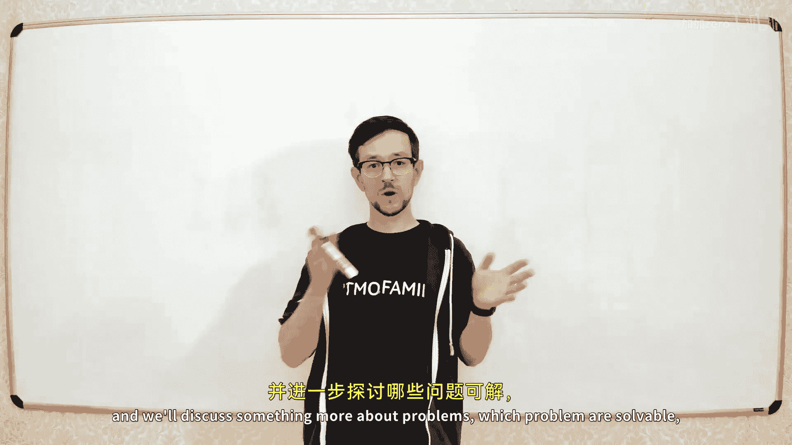
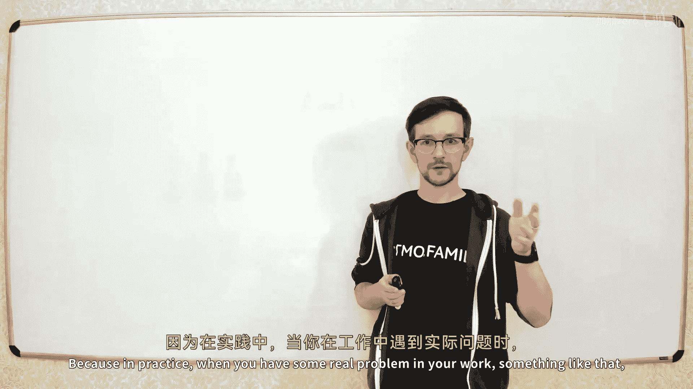
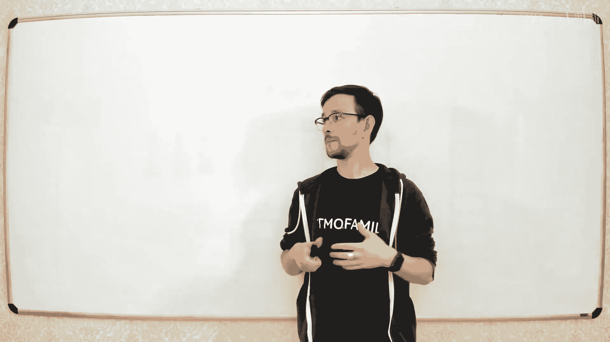
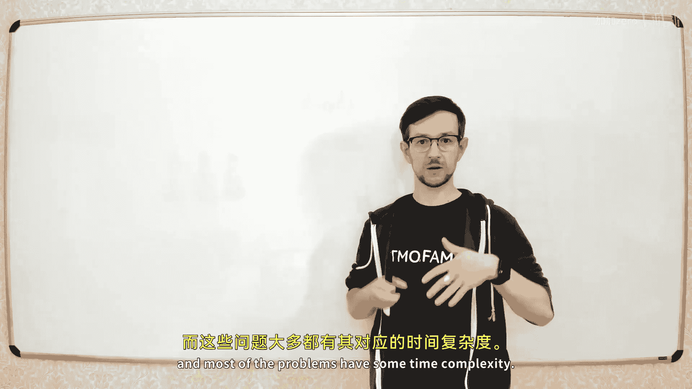
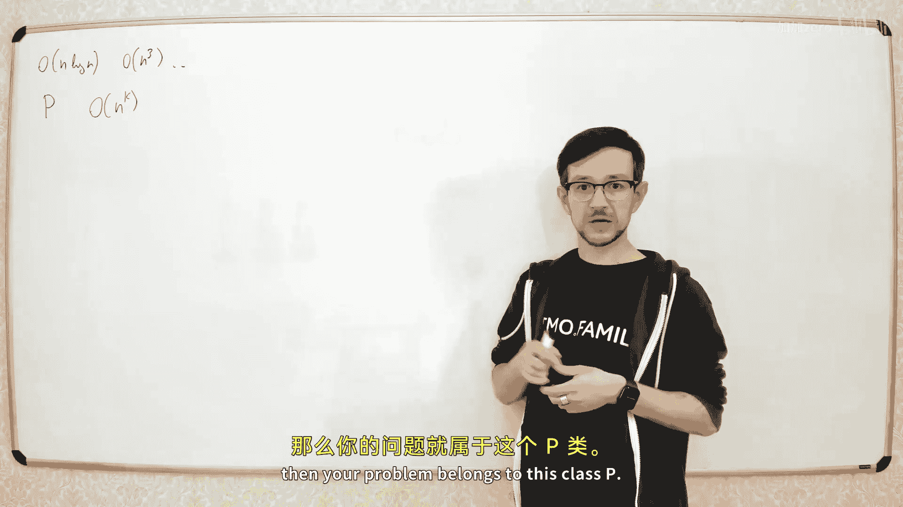
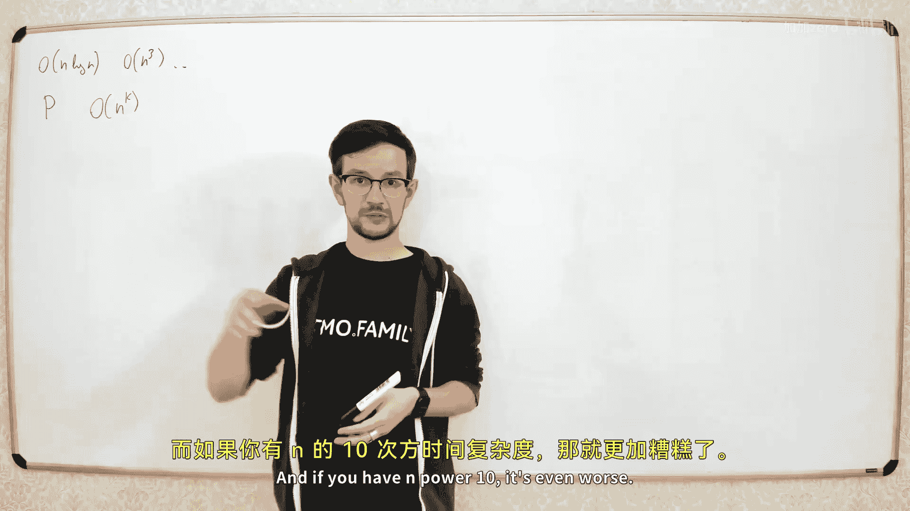
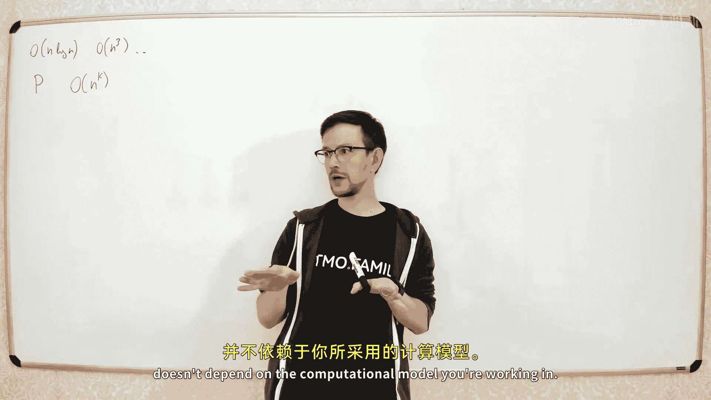
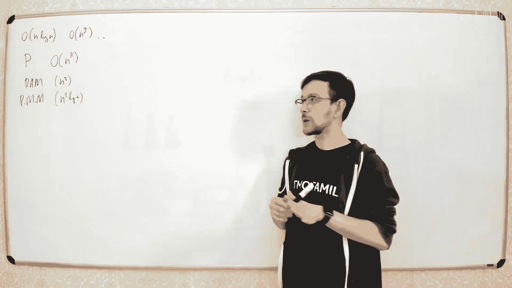
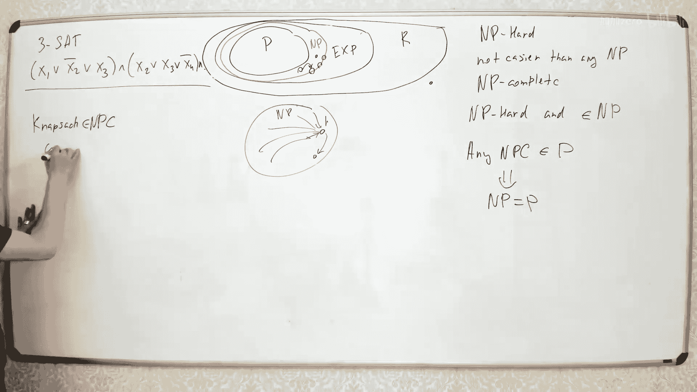

# 【精译⚡算法与数据结构】PavelMavrin p32 p31 A&DS S02E15. Complexity Classes -BV1NLB8YfEMq_p32-

，🎼嘟嘟嘟嘟嘟嘟。🎼The。So it's the final lecture of this semester and today we'll discuss something different so today we talk about some algorithms。

 some problems。We shall actually。Solvable or not solvable or solvable。

 but it can dissolved fast and so on。 So。 you may hurt something like this problem isnt P complete or something。

 This problem isnt P hard。 and usually it means that this problem is unsolvable。

 That's actually not exactly true。 and P complete problem is not actually unsolvable problem。

 It's something it's got very specific meaning。 And today we'll discuss what does mean。

 And we'll discuss some something more about problems。 Which problem are solvable， which not。

啊。Why it is important because in practice， so when you have some real problem in your work。

 something like that， usually when you make a formal specification of your problem and you order to find some algorithm which solves your specific problem in like 90% cases。

 your problem will be in the complete。

Or even unslvable。 That's kind of different。 but was。

So it usually it means that you need to like change your problem to make to make it solvable。

Or youd want to find not the exact solution， like exact minimum solution or something like close to optimal solution。

 something like that。

大ジか。First， we discussed lot of problems in this course and most of the problems have some time complexity。

 So usually time complexity， you may have something like。

Let's say n loggan time complexity or let's say N cu time complexity or something else。Again。

 this enistic means that you need this number of operations to solve your problem。

In complexity theory， usually all these problems。Are combined in a single complexity class。

 and this class is called P。E is the class of problems which are actually solvable in polynomial time。

 So if you can solve the problem。In time complexity， like and power of K for some。For some k。

Then your problem belongs to this class P。

嗯。Why we don't we don't distinguish different time complexities。

 Why we put all this like N cube and N loggan is actually different time complexity。 Like， right。

 if you have N cube time complexity， it's much worse than if you have N log n time complexity。

 And if you have like N power or 10， it's even worse。 So if you have n and power of 101 complexity。

 it's pretty bad algorithm， but it will still be in the same time complexity was。

The reason is that this。Property that the problem can be solved in polynomial time doesn't depend on the computational model you're working in。

Usually we work in RA model right， so in RAM model you may have some time complexity。

 let's say in RA model。In Ram model， you may have one and complexity， let's say。N square。

And if you work on some different computational model， let's say point machine model， right？

You may have some different complexity because you don't have this arrays and you cannot just make indexing in this arrays in constant time。

 So usually。Yeah， you can simulate real model in pointer machine model just by edging the tree of all elements。

 So usually its time complexity is greater than in real model by logative。Or even the same。

 so it may be like n square logan。Just because you don't have this arrays and you need to build this tree to access all the elements of your hearingring。

But in some different computational model， you may have even more than complexity。But still。

 the time complexity will be some polynomial of N。because you can simulate this RA model in your computational model and for each operation in RA model。

 you will make up to some polynomial number of operation to just just simulate this one operation in RA model。

So this property that the problem can be solved in town doesn't depend on this。没带上网了。啊。

So we will work in very， in very， very simple computational model。

 So since we don't actually depend on the computational model， Yeah。

 we will think about problem in very， very， very， very simple computational model。

 And one of the simplest computational models is tuuring machine。

 So tuuring machine is the following thing。 you haveuring machine。

Duringuring machineboard phenomena， you have your data starting like a single。Stip of elements。

 we have this infinite strip of elements。And you can access only one element at a time。

 so you have like。Your current location， and you can access only this element of history。

And your program is very simple。 Your program works this following。

 Your program is simply like autoatton。 So you have some states。三分力别。So time at every moment。

 you have some current state。 So this is the current state here。就用 machine。You look at your state。

 you look on the symbol in your current position and you make something。

 So you do do one of the four impressions。 So you look on your current state。

 You look on this this at this character at this position and you may you may change this character to some another character。

 You may move your head left。 All right， and you may change your current state。

 So basically you have function So you have your current state。And you have this value X here。

And by look on your current state and this value x， you decide what you doing。

 so you move to some different state state prime like this。

 you pull some different value here prime and you move your head left or right。

 so you will move left left right or stay in place。Also you also you may hold you also may just cold。

So you we just end。Your program。Very simple。 Okay。 So so。

 so this autoatton simply explains what your program is doing when you look at this when it's looking on this data。

 So you have this data and this autoton。 And this that's all you have。어。

Still now this this computational mode is very simple， but it's still maintained this property。

 So if you if you can solve your problem。In real model， in some polynomial term。

 you also can solve the same problem in。Totuuring machine in polynomial time。

 the polynomial will be different。No， because。No it's kind of complicated to do some it's hard to make some complicated things in this tuuring machine Yeah because you can access only this element and you have like fixed number of elements so for example。

 if you want to simulate like variable like integer variable。

 then instead of having each cell contained single variable。

 you you have only fixed number of elements Yeah， so you like make kind of bit representation of you have this binary representation of your numbers if you have local variable I in random machine model then in in tuuring machine。

 you need to have like binary representation of this I。And if in RAM model， you make like plus one。

 then in tu machine you actually need to perform this plus one in the binary， so you go here。

Then find this0， changes0 to1 and so on。Then next time， when you want to add one to this number。

 you need to go here。Find this， this be this one。 So we go left， left， left。Find this 0。

 increase the 0 to 1。 Then go here， change all these ones to zeros and so on。 So。啊。

Even this simple operation is kind of complicated in your machine model。

 but it's still polynomial so for example， plus one takes polynomial number of operations of the length of this number thing。

If you want to do something even harder than this， let's say if you want to find element in the array。

So you have this。You have RA A。And3 able I would' same here。

And you want to find value in array I with this index。 So this is index in this array。

 and you want to find the corresponding value in array A。

 Then it's even harder than what you can do to find this value you may。

Put some special separator character here。Then go back to I make I-1。

Then move this separator one position to the right。Then again， decrease I by one then again。

 move it to the right until this I became0。 when I is0。

 it means your separator is in the position you need in your array， So you move here。

 move here decrease， move here， move here decrease， move here。

 move here the10 complexity will be like n square， but it's still polynoml。

 So if every index in your array costs your n square1。

 then your total10 complexity will be multiplied by this n square。

 but it will still be some polynomial of n。So this property that the problem is solvable in polynomial time。

Is satisfied in this ti machine。 So even in theory machine。

 you still can solve the same problem in polynomial 10。

 So that's why why we put all these problems in the same class。 So this。

 this class doesn't depend like specification of this class doesn't depend on the computational model。

那是。So we have this class peak。So class P is class of all problem solvable in polynomial time。

And what people think next is is there any problem outside of this class。

 so can we find any problem here which is not solvable in perenamial time？

And turns out there is some problem the easiest problem， which is outside of class P。

 is the following problem For example， you have a chessboard。So if you have chboard n by N。

And there are some chess pieces in this box， so let's say you have like queen here and somen here。

I'm not good on drawing， but。You got the So here you have some poem here and some k here。

 This is king。And so。So you have some chess position in this large one chessboard。

 So it's chessboard n by N。And you want to check if who will win in this position。

So you will you need to check who will be in whites or blacks。

And it turns out it's impossible to solve this problem in put it on melt time。It's hard to prove。

Because again， it's easy to prove that problem is solvable in pernoial time。

 if you want to prove the problem is solvable， you just solve this problem easy right。

 So you just solve this problem in polynoial time and if you have solution of your problem in pernoial time。

 then your problem belongs to class P。For this problem。

 we actually need to prove that it's impossible to solve the problem in polynoial time and to prove the problem is impossible to solve in polynomial time。

 we kind need to check all possible solutions。Of this problem。

 And just proof that all the solutions work slower than any polynomial time。It's much difficult but。

People prove this。So people prove this though that this actual problem is out of this。Class B。啊。

But we still can't cancel solve this problem， right， So no because there are fixed。

 there is some fixed number of positions。 If you have board N by N。

So the number of possible positions is just some finite number so we can kind of bru all possible positions on this chboard and like no like build a graph of all these positions see all the moves and see who will win if we start from this position and so on。

 So this problem literally solvable but it can be solveable can be solved in polynomial time for any for any polynomial of n。

So this problem is out of this class beam。But it belongs to some class experts。诶。エ？

Class X means that the problem can be solved in some exponential time。Exponent means。呃我我的。

exponentialncial means that it can be solved in time， let's say， E power of sum and power K。

So you make some， some exponent of some polynomial of M。嗯。Oh， let's actually。

There is a really big gloss also any anything which can be described as exponentialons of some polynomial may be put here。

 for example， n factorial n factorial is you know if you have n factorial， right？It's something like。

Something like this。So in factorial also fits in this class。

 and so so everything which is not basically anything， which is not a polynomial fits in this class。

 not everything， but。Quite， quite a lot of things， which are not polynomial fits in this class。

 There are problem outside of this class， also。Usually， everything you can。

All the problem you can solve actually belongs to this one。Gong。No。Again， you're too quiet。

 say something。好不好？No。Next。比都。Start to explore the。Problems outside of this class。

So is there any problem here and it turns there is a problem here。

 so so there are problems which are outside of this x。

And people go much further and they find this class of all solvable problems。Let's。Build the class。

 It's called class R from recursive， if it doesn't。So it's his historical name。

So it's called a class R， class R is is class of all solvable problems。So R is just solvable。

What does mean solable solvable means that there is a solution for your problem， basically Yeah。

 so if you have some problem， you can build a tuuring machine which solves your problem。

 So if you start your， if you give your tuuring machine， your input。

 it will produce your output in some finite number of operations。

 some finite number of operations it's important。 If your number of operations infinite。

 then it means you don't have the result again， again。

 the important part that is this tu machine must stop at some point and give you the result。

How to improve this problem is outside of fee is It is complicated。 if you look at any any proof。

About lower bound of some time complexities， all these proofs are very complicated。

 we learned some proof about， for example， certain algorithms。In one of the first lectures。

 we prove that it is impossible to sort the array faster and en logan time。

It was very simple proof of the lower bound， usually when you want to prove something like that。

 so it's impossible solving polynomial time。You need to make some something much more something much more complicated。

I'm not sure how this actually。 I didn't read this proof， so I don't know how it proof， but I， I。

I can't imagine that this proof is kind of complicated。

So all these proofs of lower bounds usually are much more complicated than proofs of the time complexity of the given algorithm。

 or if you're given the algorithm， you can prove the centralles usually it's very simple。

 but if you don't have this algorithm you you just prove that this algorithm doesn't exist。

 it's much more complicated。啊。This， this a is actually。Co quiteite interesting。

 We will find the similar asy。Pretty soon。啊。到。Let's move thanks。Next。

 when people discover this class of all solvable problems， people start to think。

 what is outside of this class。 Is there any problem outside of this class。

So is there any problem which is actually not solvable by any tuuring machine。

And it's actually El Turing was thinking about this。

 and he finds out that there actually is there are problems which are outside of this solvable class。

 so there are problems which are theoretical， not solvable by the tuuring machine。

And if your problem is not solved by tuing machine， it means it's not sovable by any。

Like standard computational model。 So it， if it's not sold by tu machine。

 it means it's not sold in your M model。 It's not not soable in any other， like normal models。

누 나 또 완전。嗯。大か？So how to find problem， which is outside of this。Cls。That's pretty simple。

 let's go through。The simplest problem， which is outside of this solvable class。

 is the following problem。 It's whole whole problem。嗯 응。Whole problem with phone problem。

 You are given two values。 You are given some program and some input。

And you want to say if this program will hold on this input。

 so if you start your program and give this program this input。We will。

 will it stop in some finite number of operations or not。嗯。Will peace stop on in。Wouldd X。인フニタ。

So it's just Boolean function basically so it's some simple Boolean function you're given with the program。

 no you can describe program as a sequence of lines or something like that。

 So I're given it a program and some input and this function must say will this program stop on this input at some point？

Or if it will work infinitely， right？And it turns out this problem， this problem is unsolvable。

 Let's prove this problem is unsolvable。How to prove that some problem is unsolvable。What's in。

Let's think if this problem is solveable。 Then we have this function。 So we have some algorithm。

 which is。So which takes this。2 things as an arguments and gives you the result like Boolean value。

 true or false， right， So if you have this algorithm， then let's build the following thing。

 Let's build。Let's build a very simple function。 So let's build function。If。어 바람들。B。

This problem does the the followinging。 You give this plug。

 You take one argument P and you'll try to。You call this hold。W 바람 B and B。お。Basically。

 you check if you give this program。it's cold。As an argument。Will it stop or not？😡，So you just。

 you take this program。And give this， like this sequence of lines of is your problem like every program is just sequence of lines。

 or you can。You' want to interpret the sequence of bits or something doesn't matter so your program is a data just block of data if you give the same block of data as input to this exact problem。

 will it stop or not？If this program will stop。When given itself is an input。

 then well do a infinite loop。 wild true。诶。Best week。In Bon way。So it's just infinite loop。

And if this program is not。The doesn't stop on this input。Then我 just睡 don throw。

So if this problem is solvable， then we can build this function。Now。

 let's think what will happen if we give。This function itself as an input。H。多行。啊。

What will happen inside this problem inside this function， So if this function returns yes。

 so if you're given this function F as an input and it returns yes。What does it mean。

It means that if， if this function returns yes， it means that it will stop at some point。 Yeah。

 and if it will stop， it means that hold function。 So here you give F and F as an argument。

This hold checks if if function F stops when you give it the function F as an input。It stops。

 so this hole turns through， you go inside this section and you have infinite cycle。Infinite loop。

 Yeah， so if function F stops， then function F doesn't stop。Its contradiction。On the other。

 on the other hand， if progress if。Problem F， if this program F doesn't stock when you give it itself as an input。

Then these holes are turned true or different false。Then you go here and edit on true。

So if your function doesn't stop， then it stops。 Again again， you have contradiction。

 So this program F cannot stop on this input and cannot reward in this input。

So you have contradiction in both cases。So it means that this， this program actually doesn't exist。

 So this program doesn't exist。 It means that you cannot solve the whole problem。嗯。

What would be the input of the input。No， no， no， you don't give give So you just give this function as an input。

 Again， every function is just sequence of lines。 Yeah， so you get sequence of lines of code。

 You just give this sequence of lines。所 if一所以。If you work in functional programming。

 that's not what you。 So you don't give this function as a function。

 You give this function as a sequence of lines。So I give this sequence of lines to to itself as an input。

Mmhm。So I don't I don't call it anything。 I just give this function as a text， basically。

 so I give the text of this function and to this function as an input。I can do it。 Why not。Okay。

 so I want you。因。Like middle of， of the of the last century。 And I'm not sure what what's。In 40s。

 maybe。He found this proof and it turns out there are some problems outside of this solvable class。

What does mean？ What does mean？First thing。Is。That programming is complicated。

When you try to solve some problem using some when you want to find programming solution for your problem。

 it's actually an unsolvable problem。嗯。😊，Even analyzing the given problem。

 the given the given program is unsolvable problem。

 So when someone gives you his program and asks you to analyze his program。

 it's actually an unsolvable problem。So if you can analyze someone's program。

 that's not you be because it's probably not soable。

 so if you try to build something like code analyzer， for example。

 you're building some IDE like IDG or CI or something like that。啊。

And you want to show the user that your program have back here。

 It's actually an unsolvable problem because every every analyze of of the code is unsolvable problem even。

Even this simple problem， just to try to find out if a problem stops or not is unsolvable。

 It means that all non trivialval properties of your problem actually are unsolvable and。If you can。

If you can analyze your problem， it means usually that your problem is very simple。

 So if you have very simple problem。Then you can find some heuristics to find if this problem is good or not。

 But if you have some real problem， usually it's that complicated that even finding some simple properties of your problem is unsolvable。

啊。That's said action。呃，都。From one side， it's bad， from other side。

 it means that programming is actually a kind of cool profession because you're actually solving un solving all problems。

Next。Okay， forget about problems。 Maybe that's only maybe the problem only with these programs。

 maybe for some other objects， it's not at the bit。

 Maybe the problem is only when we try to analyze programs。 Maybe we can analyze other objects。

But it turns out there are a lot of objects which are that complicated that we can't analyze them because they are as complicated as programs。

For example， if you look on。For example， if you look on Kbe Game of life， yeah。So don on me。嗯。はい。어。

So keep build this game。 It's very simple game。 So I have this infinite。Greed of cells。

Every cell is dead or alive。So， for example， these get cells on death， these cells out life。

And he makes some very simple rules， so when the cell became dead or it became alive like this。

 so if that cell is dead。And it has exactly three neighbors。Which are alive。 So in the next。

In the next step， this cell becomes left。あす吧。And so it's exactly three neighbors。

And if this cell is alive。And the number of life neighbors is less than free， or more than。4， right？

Then in the next step， it will be dead like if it have on like these two neighbors。

Only two neighbors。 Then in the next step， it will be dead。啊。Les than two。맞。Dy is okay， yeah。啊嗯。How。

 dear analyze in idea you make the idea， they implemented a lot of different heuristic。

 which analyze your specific code and find some some various。Common bugs。

 So you know that usually programs programmers write code like this。

 And when you write code like this。Then in this position， you may have this problem。

 So it shows you the problems which are common for a lot of programmers。

But it cannot analyze the code if you call this too complicated。

 If you call this too complicated E idea cannot show you any problems because it cannot understand what's going on here。

嗯。Yeah two friends for Edwardwood， Yeah， less than two and more than four Ab。Right。Great， great。

 Yeah nice。And he when he build this game， he find out that this the。

Behavior of this game is very interesting。So there are some， for example。

 there are some stable structures like these square of cells if you have these four cells。

They form a stable structure。 So every cell is alive。Every cell has free neighbors。

So so it stays alive and all cells here have less than three neighbors。 so they don't begin alive。

 So if you have this square of four life cells， it will stay like this and will not change There are some other objects。

 There are some， lets say like this。 If you have free cells。Then in the next step。

These two cells will die and these two cells will get left in the next step。

 you will have function like this。And then back。So you have this like loops。

And there are some much more much stranger objects to you there are some special structures which actually moves。

 So if you like build this structure and find what's going on then after a few steps。

 you have the same structure but shifted by sound vector。 So you have like moving structures。

 and there are some special structures which repeatedly create these moving structures and so on。

 so a lot of very interesting objects which can be built inside this game of life。嗯。

What does usually mean， Usually when you have something very interesting， it's unsolvable，s。

Like roll of thumbs this works like this。What does mean so。Let's's look on the following problem。

 You're given some initial state of your game of life。And you want to check if at some point。

 you come to some stable state。So if you start from this position in your game of life。

 will it stop at some point or not， or will it grow infinitely or something like that？

It turns out that all these problems are unsolvable。Why are they unsolvable。

 basically because you can simulate the tuuring machine using this game of layer。

 so you can use these moving structures and stuff to simulate the tuuring machine。

And since steering machine is unsoolvable， then game of life is all unsolvable。

 You cannot check any properties of your position and game of life。Because you can， because you。

 if you can check any properties of this game of life。

 it means you can simulate the tuuring machine and you can check properties of his tuuring machine。

 and you can。Check any properties of sewing machine， because of this。哎。That's actually very sad。

So systems like this cause called tuuring complete systems， so some systems are tuuring complete。

 it means that you can simulate a tuuring machine inside this system。And if system is steercomp。

 it means you cannot check any properties of this system。Because if you can check these properties。

 you can check the same properties on your machine。 and you cannot。Okay。

So game of life is one of these twin complete systems。Ex examplele。

 but you gross and fierce it's large and I can't remember it。 So it's not small system。

 there's a system which produces gliders one by one。So after this few steps。

 you have the same system plus glider， and this glider is moving in。

I can build it from from my memory。 So New York can Google it needs。It's kind of fun stuff to Google。

啊。Okay， this is one of the example of tuuring complete system。

 but there are a lot of tuuring complete systems。Again， usually if you have very interesting system。

 usually it's simply be complete。For example， one of the systems works like this。

You have something like， So you have squares。Every square has some numbers on each on each side。

Let's say we have 1，1，2，1， and here we have 2，2，1，1， and here we have。12。1。뭐三어。

So we have a set of some squares。 Every square have some digits on sides。 Well usually it's colors。

 but I can I can use。Veryar different colors。 actually。 So I have two colors。'， So usually it's。

Like this。 So every site has a color。YeahSo this color one and this these will be color2。

And now you can build figures of these squares connecting them with sides of the same color so you can take。

 for example， you can take this square and this square。You have this square2，2，1，1。

 and then here you have this square1，1，2，2。And then here you can prove another square two two。1，1。

 And here you put another square and so on。 So you can connect the squares by the size of the same color。

And what you want to check， you want to check， for example。

 if it is possible to feel the entire space using only this。Squares。

 so if you have only these types of squares， is it possible to fill their entire plane using just these squares。

And it turns out this problem is often so unssovable， why it's unsolvable。Wch it。

 because this plane is infinite。So in this infinite plane， there are infinite number of。States。

So basically， what you can do is simulate your tuuring machine using this system。It's like this。

 so you look at like every。Every row of this。诶。Tiling is state of the tu machine。

 And when you move to the next show， you do something similar to the T machine。응 哼。

So you can simulate your machine using only these squares。 So by giving this。

Some set of some set of types of squares， you can actually simulate the given tu machine。Let's sit。

Another simple example works like this， so it's another cell toton。So Stephen Bra。

It actually was not so long time ago。 So it was in 90s。 He was。呃。

So he was exploring different autoattons， not like this。 So basically like game of life。

 but one dimensional。 So if you look on the something like fit but one dimensional。 So we have this。

Again。Okay have this line of cells。Each cell is dead or alive。

And you have some rules about each cell。 So each rules。 So each cell looks at the。

2 neighboring cells。And find it next state。So next state。

 the next state of this cell depends on each state and state of two neighboring cells of this cell。

So basically。 So， so basically， if you have this。X， Y， and Z。Then to create this。Ultimately。

 you actually need to make a function， so you need to make this function from X， Y and Z。

Do the new value of a foreign priority。So we look on these free cells and find the next value of this cell。

So this is the Booleyan function of three variabless， so they' right most。256。Different functions。

 Yeah， So there are 256 different autoattons。In one dimension， right？So。He tries to to just。

To to to explore all this。256 automatons。 And check if it is。

 if there are some interesting auto mattons。In this group。Oh you can skip some symmetrical ones。

 So if if， if this symmetrical， you can skip one of them。

 then there are a lot of not noninterest automantons which just die immediately。

 so you start them and they die or you start them and they all became alive or something like that。

 So when you get rid of all noninterest autotons。 There are some few number opts。

 which actually works， do something interesting。One of these autos works like， please。啊。

You have very simple rules， very simple rules， for example。

 if if cell is dead and the cell to the right。Is alive and something here。

Then this cell became alive。So if cell is dead and cell to arrive as alive。

 then this cell became alive。And if the cell is alive and both neighboring cells are alive。

 then it became dead。That's all， but it seem both ropes。And well， when he built this autoatton。

 he actually started to run on different inputs and he find out that the behavior of this autoatton is very complicated。

So if you start this auto on some input。It usually makes something strange。

 And then sometimes it stops。 Sometimes it doesn't。 So so it it it may it does。

 it does something strange。So he think if this automaton is tuuring complete and few years after they actually proved this this simple autoton is an is Turing complete。

It means you can simulate tuuring machine using just this simple autoatton。

So take your tuning machine。Prouce some input for this auto。

And this autoatton will work as the tu machine。which we， which is from we should start。

What does mean it means that you actually cannot predict。The behavior， even of this simple automaton。

Oh。So这说。Things like kind of strange in this So。 that a lot of problems are actually unsolvable。

 Usually when you have some interesting system。 and in your in this system。

 you can do something like tuuring machine。 So。嗯。Usually it happens when you have some infinite memory。

 For example， in this autoatton， the the length of this line is infinite。

 If you have limited number of memory， then your problem is actually solvable because you can iterateerate all possible states of your memory。

 But if your memory is infinite。😊，Usually， it means your problem is not solvable， not always， but。

Most things。Okay， let's move next。So。These are the complexity classes。

 so there are some problems here are some problems outside。Now。When you move to this direction。

Next thing you， we want to do is to move into this direction。 So。 So this problem are unsolvable。

 Okay， so this problem solve exponential time。 Okay， But what is between， what is here between this。

Problem solvevable in pernial time and problems not soable inial time I， Is there any special。

Class between these two classes， which kind of problems which are solvable important time or not。

 maybe something like that。When you explore this region， you find the antilos。

So between these two classes， there is special class course and。That's another interesting class。

So usually then people think about N PcoOS， they say that NP P is non polynomial， it's actually not。

Common misunderstandings like huge。If you hear something。

 there somebody talking about NP problems like non solvable problems， it's not。

And P class is actually closest possible class2 P， something like that。

What's interesting about problems in class MP P， We actually don't know if it is solvable in preliminary time or not。

So if we find any problem in this P。We actually don't know if this problem belong to P or not。

Maybe必没。All problems in PcoOS are actually in Pcos， maybe not。We don't know。Probably not。Bals。啊。

What has been problem in N class problem is in an N class when it can can be solved in polynomial time by non deter non deterministic to the machine。

What does mean knowledge mean。イプレの名単 byの。No the German。啊，就是模式。

What does mean non thismin Studio machine， It means that this studio machine have some advice from some。

And hows called。So at some point your tuuring machine may have some non termministic choice。

So usually what's going on。 So you have this autoatton。 So you have state。And from each state。

 you have a single transition to another state。So you have so if you stay here and you see character A。

 you move to this state that's usually how it works in autoattons right in non-terministic exterioring machine。

 you may have several different transitions so if if you see this character A。

 you may move to this state or you may move to this state。And this tradition is not deterministic。

 so when you stay here， you may go here or you may go here， so you ask。😡，Someone for help。

And it tells you where to go， so it tells you to go here or to go here。嗯。那。呃，How to。

How to solve problems using non determins machine， nondeministic tutor machine。Again。

 like a normal tu machine， you have some let's say you have some special state。

So the special state for us for yes。And another special state for An。

So you're on your tuuring machine and at some point you reach one of these states。

 so you go here or you go here。So if your drilling machine is here。

 it means the answer to your problem is yes。 if you go here， it means the answer your problem is no。

啊。Okay， now。Your， the person who helps you actually wants you to make the answer here。

 So the person who helps you to find。呃 to two do them。

To choose between these two transitions actually wants you to go to into this years。

So if it is possible to make any choices， which force you to move into this。State。

Then you will be in this state in the end， so。So the answer is yes。

 if it is possible to reach the state yes， if you make some lit discharges。So again， at some point。

 you make some non deterministic choices。And you reach this state yes。

 if it is possible to reach the state yes。That's the meaning of non steel machine。没。

You may think about it。 You may think it like this。 Someone knows the answer。 Yeah。

 so you're writing yourtuuring machine。 You don't know the answer。 and someone knows you the answer。

 And the the the man who knows the answer actually tries to。Pro you， that there is an answer。

Something like that。So he knows the answer he knows the answer is yes。

So he shows you which transitions to take to move to this status。And if the state is no。

 if the answer is no， then it is impossible to reach status。So this man gives you some instructions。

 but it's actually impossible to reach the state， so you reach the state now。Pro story， yeah， yeah。

 yeah， usually in complexity theory， we think only about problems with no yes answer yeah。Yeah。

 all these classes usually are about problems with yes or no。

If you have some problem which which you need to find。Yeah。Find something like find the minimum。

 Find the optimal path。You can transform your problem to yes， no problem like this。

 So if you find the find find the minimal answer， you may transform it to something like this。 is。

 is it possible to。You want to find minimum something， y？You can transform your problem to yes。

 No problem like this。 So， you can see like it is。嗯。えいいすね。X， such that F of x is less than。D。

So you're given this x and D， you're given this D and you answer if it is possible to find the value function less than d。

And then by， by making buying the research over this value D。

 you can find the minimal possible answer。 Sound like that。

So all the problems in this theory are described as a yes， no problem。

There there are another classes which works this problems of。Like， when you need to。

Co on something or something like that。So all these complexity classes are usually describe problems with yes。

 no solutions。嗯哼。So like that， okay。What I was talking about？About to domestic questions。

 There is another way of thinking about to domestic machines。 non domestic。 No。

 let's solve some problem。 Let's solve some problem。 for example， one of。

Noown N P problem is a problem finding Hamiltontonio pad。 So you have this graph。嗯。

You have some graph and you find you want to find a crimintonial path in this graph。 No， not fine。

 You want to check， you want to check if this graph contains a crimintonial path。Yeah。It a big cycle。

 for example。It's a little bit easier。So I've given some graph and you want to check easily original cycle in this graph。

嗯。No for for this draft。 The answer is yes。 you can build cycle like this。 go here， here。Here you。

Yeah， this agree a little bit。So how to build a non dimensional tuing machine。Very simple way。So。

 you start from。Some point。And then each time you make some non deterministic choice。So。

 you ask someone。Where should I go from this position。

And if this someone knows the correct answer it， it can。Like。Show you where to move。

 So you're standing here， then you ask where to go， I can go here or I can go here。

So you make this non domestic choice。And someone tells you go go there。

 so you're going here now you're standing here。You have to to possible。 You can go here or。

 You can go here。So again， someone， So someone just to tell you to go here。

 they you go over here and so on。So at some point， if you have some advice from someone who knows the answer。

 you can actually build the correct answer。That's basically the meaning of the MP problems。 Yeah。

 sorry， MP problems。Actually， problems。 when if you know the correct answer。

 you can prove someone that is the answer is yes。So if you know that the answer is yes。

You can actually provide some advice to this sewing machine to actually prove it that answer is yes。

嗯哼。Something like that。And if the answer is no， you actually can't provide any proof because if the answer it's easy to prove that the graph contains guittonial cycle。

 Yeah， you just show this gatonial cycle and say this ismtonial cycle and you look and see， okay。

 this ismtonial cycle。 so this graph contains a guittonial cycle and if you have some graph which just in can the cycle you can't prove anyone that this graph doesn't containmtonial cycle。

 right。Because how you can prove someone this graph doesn't contain in any commial cycle。我操。So again。

 this is some a between something you can prove that the answer is yes。

And you can prove the answer is no。Input in my mail then。嗯哼。Yeah。

 it's it's important thing about polynomial time。 You can prove some。

 you can prove someone that the answer is yes， in polynomial time。嗯。

So if you're given the solution of your problem， you can check this problem。

 The solution is correct in polynomial time。This usually calls the certificate of the problem。

So if you' are given this certificate like this cycle。

 you can check this certificate is correct in polymermal time。

That's another just another way of thinking about N problems。 N problem is the problem。

Then the answer is yes。If and only if there is。Some certificates such that。You。

 you're given this certificate to。Problem， and it returnston yes。In problem of them。

And peak complete is something different， so we we're moving there in peak completeness。

 we are pretty close。Now， if the problem belongs to P， it actually doesn't mean the problem is。

Its hard because actually any problem in P actually belongs to NP P。

Clas P is completely inside class and P obviously yeah。

 if you can solve something in nondeistics machine tuuring machine。

 you can solve the same if you can solve something in standard tuuring machine。

 you can solve the same problem in non-diministic tuuring machine。

 you just't you just don't do any non-diteristic choices。

So any tu machine is actually nondi machine if you don't make any nondis choices， right。

 So every problem inside P is actually inside N P。 So if you。

 if you if you prove that your problem is an MP， it actually doesn't mean this problem is hard。

The problem is then your problem isn't be complete。So what has it been？嗯。

And pick complete problems are the problems which kind are on border of this vessel。

Something like here。So there are some problems which can be proved to be on the border of this N class。

 so it's the hardest possible problems in class and P。

How to prove that problem is hardest in the whole class。啊。Yeah。To make this proof。

 we actually need to。We need to think about how to prove that one problem is harder than another problem。

😡，So。Let's say you have two problems， let's see a problem A and B。

And you want to prove that problem A is harder than problem B。Look， how can you approve this？Okay。

 so what does mean problem A is harder than problem B。 It means if you can solve problem A。

Then we can solve problem， B well。嗯哼。Okay， so problem A is harder than problem B if。

We can solve problem B， if we solve problem A。You can think about it。 So there are different。

The different definitions of。Reducing the problem one of the way to this problem is also making by reducing one problem to another problem。

 so you can reduce problem B to problem A。Let's do like this。 Let's look like this。

So how we can solve we see if want solve we won't solve problem B yeah。Instead of solving problem B。

 we will solve problem A。But we can give just input of problem B So you want to solve some B off from x。

 So we want to give this input X to problem B and solve is problem B， right。So instead of this。

 we will modify this input and give this input to problem A。So we will run problem a。

On the input of problem B modified by this function。And this air is calculated the point tell them。

哎哎哎。要要要。What does mean it means that if we can solve problem a。Then how to solve problem B。

 we take the input of problem B。Pform this verification。And have the input for problem A。

 Give this input to problem A， So problem A。 Then the result of this problem A will be the same as the result of this problem B。

Yeah， this pretty normal time modification。 Yes， this modificationification should be done in pretty normal time。

Then the whole thing will run in polynomial time because we will make this modification in polynomial time and then run problem A in polynomial time。

 it will be a polynomial of some polynomial， so it still be some polynomial So the whole thing works in some polynomial time。

嗯哼。😊，没错。那。Mo， for example。 Okay， let's make the same example。 So for， for example。

I know that finding a grmtonial cycle is in being right。Let's prove that finding Hamiltonitial path。

Is harder than。Not easy。 And let's， it's not hard。 It's actually not easier。あ、明とおぱ。

Is actually not in。Let's say， not easier like this。 It's not easier than I haven't done up with。

And be proud of them then be yeah。We'll talk about N heart and and complete problems in few minutes。

Let's build this example and then we'll go to NP complete and NP hard problems。啊。Hepe it there， okay。

 let's， that's kind of strange。 Let's cycle。Let's prove that buildingtonium Perth is not easier than buildingial cycle。

How to prove this， imagine we know how to build Hamiltonial cycle。咩了的。ian。

 imagine we know how to build Hamiltonidio path。Let's try to use this function to build the conversion cycle。

 So again you have this graph。So you have some graph。And you want to find the caimintonial cycle。

 but you know how to build atonial path。 So how to use this function to find theintonial cycle。

 you can do it like this。 You can take any note of your graph。Just double this snow。Like this。

Just make two copies of the same note。Now your commitment your sake cycle is actually。A path。

 So if you look on yogatonial cycle。Like this。Now， your cycle is split in this point。

 so you have this path。And now all you want to need， all you need is to find the metonial path。

 which starts here and ends here。If you build pathth from here to here。

 which go across all the nodes of your graph， then you build this maintenance cycle。

And now you need something to force Yogailtonio Perth to start here and to end here。

And you can force this by engine addingging just these two nodes。 So you add two more nodes here。

And now if you， if in this graph， you build a commal path。

It will be forced to start here and end here。So you be in this graph， you build agreement your path。

It will start here and and here。Now you remove these two edges。Combine this start and this finish。

 and you have this commital cycle。So if you know how to build a comminial pathth。

 then you actually can use this function to build the comminial cycle。

It means that the building a Milian Earth is not easier than building a meium cycle。어 어 어 어 어 어 어。

Okay， that's how to prove that one problem is not easier than another problem。

And now with the interesting part。There are some special problems。They called and pe。

And be hard problems。啊。AndP，R problems are known to be not easier than any problem in class P。

What does mean it means you actually can reduce any problem to your NPhar problem。

And be complete problem。Means that problem is MP hardd and belongs to N。双回。This。はい。六六。Sory。This way。

 right？嗯。Yeah， that's break， okay。So N complete problems are very special problems。

 Theres are problems which belongs to class N。And they are not easier than any problem in class and P。

 It means we can reduce any problem in class and P to one of these n P complete problems。

 If you take any problem in P class， you can reduce it。To your MP P complete problem。

What does mean it means if we solve any one of these NP complete problems in pretty normal time。そ。

If any。AndP complete problem。Belongs。Because if you solve any of MP complete problems in perial time。

It immediately fall that that N P actually equal to the。

And because if you can solve any of these problems in polynomial time。

 it means that all problems in N P class can be solved in polynomial time。

That's why people actually think that it's impossible。 because if it is possible。

 it means that any any problem， no what does mean， what does mean if N p goes to P。

 it means that if you can check the solution in pallennoial time。

 you actually cant find a solution in polylennoial time。It can look strange。Yeah。

It doesn't mean it's false。 Maybe it's true。 Nobody knows。But it it， it's kind of strange。

 But because it means again， what does mean it means that if。

You can check your certificate in belowial time， then you can find the certificate in belowial time。

I mean， mean if you can do something this way， you can do something in the opposite way。

 if you can check， then you can produce its。Strange thing， but nobody knows if it is true false。

해배 나다 누구 회 나。Okay， okay about after time。Let's do something interesting。

So how do people prove that some problem isn't pre completelete？waitai。

 there is a list of problems known to be and B complete。

One of the simplest and pick complete problem is the problem problem。嗯，そ以。

So one of the simplest impably problem is the freezea problem。In free cell problem。

 you have a formula in free form。 So you have this formula。 looks like this。 So you have this set of。

How is cold in English。So it it looks like this。So you you have number of brackets in each bracket。

 you have something like this，61 or node x2 or x3。And in the network。

 you have something like x2 or x3 or not x4， and that's all。

So in each bracket you have three elements， each element is either the variable or ne of this a variable。

So have this。Clloss， good， Thank you。 so My English was not that good。

 actually forgot how to do the closest in each closer。 You have this free analog okay。😊，Cool， thanks。

Now。No。This problem isn't be complete。I will not show you that this problem isn't be complete。

 It's kind of complicated。We'll talk about it if you want to know how to prove that sample problem isn't be complete。

 solve the first problem。We can talk about it in a minute， but now I want to do the。another stop。

 So there is a list of problems known to be in P complete。

 So how to prove that your problem isn't p complete。To prove that your problem isn't to be complete。

You actually need to reduce one of NP complete problems to your problem。嗯。So this is the poll P loss。

So this is your problem。You want to reduce all problems in N P， to your problem。

How to do it The easiest way。Is to take one of the problems known to be in be completete。

 So this is some known and be complete problem。So you have。

So there is a proof that any MP problem can be reduced to this problem。

 and now you reduce this problem to your problem like this。

And now any problem in class and P can be reduced to your problem。

 It means that your problem isn't be complete。That's the easiest way to prove that some problem isn't be complete。

 just take some known and be completelete problem and reduce the problem to your problem。嗯。No， no。

 no， no， no， no one knows if builds equals。 No one knows， No knows if it is true not。

Most probably not， but no one knows。No basically every year。

 there there is some different proofs about the P versus P。But usually， all these proofs are。

너 노 not 노 나도어。嗯。People actually actually investigate this。But very deeply。

 And there are a lot of problems about proving this thing， so。

So people work around this problem quite a lot。 And there are a lot of different。Difficulties。

Which actually prevents you to prove this。 And as we know from the gal theory。

 there this there are some， there are some problems in mathematics， which actually are unprorovable。

 So maybe this is one of these problems。 no one knows。 So if you， if， if you know， if you know。

 if if you know mathematical logic。There is always some problem， which is。there's always some。

How's cold， I don't know。So there are always things and mathematics， which can be proved。Yeah。

 maybe it's one of these problems。呃呃呃嗯嗯。Yes， and we actually can prove it iss prorovvable。 Yeah。

's that's another problem of mathematics and mathematics you。

You can't prove that something is unrovovable。Inside them inside your theory。 So its。

 it's complicated。 So mathematic is complicated。啊。Now let's go to something we can prove what we can prove。

 We can prove that some problems are incomplete。For example。

 let's prove that Napsack problem isn't complete。So let's move for Napsick。Is't pick complete。

How to prove thatps Napsack problem is't be complete。

 We will reduce freea problem to Napsack problem。And since free up isn't becomplete。

 then Napsseick ist be completelete， how to do this？The easiest way is to do the following。

 Let's solve the problem Napsack problem， simple， very simplenypsack problem。 We have some weight。

And we need to check if it is possible to combine some ways to have some equal to S。

We have some equal。え。So given some set of elements， and you want to find some subset。

Such that the sum of this subset equals to S。嗯 哼。This just very simple version of Mapsick problem。

 right。And even this problem isn't bigcomplete， let's prove this。

How to prove the problem isn't be complete again。To prove this problem is to be complete。

 we need to take freeat problem and reduce this problem to your problem。嗯。So we take this formula。

And from this formula， produce some set of elements and some number S， such that。If it is。

 it is possible to get some S only。If it is possible to solve this for more。

So if there is if there are some values of these variables which satisfy this formula。If and only if。

You have the subset with some equal to S。how to do it， No easiest way to do it like this。

Let's take this photo up。Let's take all the clothes， let's take all the variables for each variable。

 we create two elements。So let's pay variable for x1 and not x1。そ。

Each variable of this formula will produce two elements for thenapsack problem。1 for x 1。

 another for node x1，1 for x2， another for node x2， and so on。

So each variable will produce two elements for your sample。What will be the race of these elements。

 No let's see so we will look on each red。And see in which closes it actually appears。 So example。

 this x1。Appears in this first class。Let's cover one more。Let's have more mos。

Let's see god let's see。 Let's say no X1。or x2 or note x3。보고。So we'll look on the first variable。

 first variable appears here and here。Mmhhum。So in this first element。

 we will make the first digit equal to one。Oh all the D equals 2 zero。And here we have note X 1。

 So we will put one in this position。And all other positions will be 0。So。

The digital representation of each rate will be the following。

 we put zeros in positions where the clause doesn't contain this variable。

 and we put one in positions when the clothes can contain this variable。X2， x2。

 we have x2 here and here， so it will be0，1 and1。Again。

We have one here because we have x2 here and we have one here because we have x2。Not X2。

 We have here and oh， y。한지지。変ソン。So for each variable， we create a。Two elements。

 each element have once in positions when we have this variable in the close。要从。Soong。Now。

When I will calculate the sum of elements， the sum of elements will represent the state of the variables in this formula。

 So let's look on the state of variables in this formula if we take some values for each variable。

 we will pick one of these elements， so we need to pick one of these elements， one of these elements。

 one of these elements and so on， for example， if you。

If you take x1 equal to true and x2 equal to false。有。

Then you will calculate the sum of these elements， and the sum will be one one。

But it's not always like this。 For example， if you have x 3 here， if you have this x3。

W whichch is one， ones0。And you pick X3 eor，2。有。Then here you will have like22 and1。Again。

 what does it mean， it means that you peep。Two variables in the first clause。

 two variables in the second clause and one variable in the first clause。そう。So this is true。

 this is true here you have this is true， this is true， and here you have this is true。

So each digit means the number of variables which satisfy in each clause。Great。Now。

 what we need to do is to force our Nepsec to use only one variable from each group。 So we need to。啊。

Somehow force our Epsack to take only one of these items， only one of these items。

 only one of these items and so on。So for each， this pair of items。We can pick only one of them。

 How to force an abstract to do this。Very simple way。 We will add more digits。

So these digits represent closes， so we will add more digits here。Now。

 these digits will prevent us to use two items of the same type。

 so how to prevent our nextec to use these two items at the same time。

 we'll just pick another digit and put one here。For these two elements。

 we will put one in this position。For these elements， well put ones in these position。Now。

 if you take one of these elements in each pair， then here you will have one， one and one and so on。

Yeah。We should use base and representation。 No we can use base 10 representation soon enough。

 B 10 will be enough。合从。No， by now， each element is 1，2 or3。So we based then will be enough。何总。Mmhmm。

😊，Now， again， if you look at any solution of your Boolean formula。

And try to build the same solution for yournapsack problem。有豆腐我给你送。From each one of these two items。

 you can pick only one item because you want in the end to have these ones。

 So if you pick two items of the same type， you will have two in this position and you need to have one in this position。

So you， you can pick only one item from each pair now here。You pick some items。 So in the end。

 you will have some digits here， and the distance shouldn't be 0。 So these digits。1，2， and3。

That's not exactly what we want to do。 We want this sum to be exactly S。 Yeah， so we can't。

can make three possible values for imagess。 We need to have only one possible value for imagess。

So we will。Add some models， for each。For each position， we will add two more special elements。

These special elements will force each digit to be exactly free。

 so we'll add for each close and two more variables with one in this position。응 그렇아。

Let me put the whole picture here， so you have。This， so this x1， not x 1， not X 1， X 2， not X 2。

 and so on， X， M， not X M。So you have this part when you have one in positions。

 when you have these elements， so this interesting part。Now， here you have one in these positions。

Like these。And also， you have。These additional elements， just to make all the dishes equal to free。

So you have another two ones here。 another two ones here。Special elements。嗯哼。😊。

So you now you give all these elements to your Nepsack problem and try to find some equal to3，3，3，3。

3 and so on，3， and here one，1， one， and so on， one。And if this problem is solvable。😡，So。

 if you can find the。Items with some subset of items with this sum。

 It means that the you can satisfy this wooden formula。

Because let's look on the solution of this knapsack problem for this knapsack problem。

 you have free in each digit。How can you get free in this digit？ No you may take up to two ones here。

So you must have at least one here， at least one。에 오 아 씨。So I take these two values。

 and you must have at least one value from here。Mmhmm。

Or you may take one from here and some two frame from here something like it So at least at least one variable should satisfy each clause for each clause。

 there is at least one variable which satisfies this clause。And this thing。

Forces you to use only one variable from each group。 So if you have one here。

 it means you you can take only one of two of these two。

 It means you cannot make variables true and false at the same time。So you just look on the solution。

 Look which variables you actually picked。And this gives you the solution for your free problem。

So if you can solve Nepsack problem， you can give this problem to your next solution and actually solve this free set problem。

 It means that your Nepsack problem is not easier than an free free set problem and free set problem is known to be in becomp。

 So your problem isn't be complete。That's how it usually dance。 sorry。

 that's how you improve the some problems complete。Okay， final thing。

 How to prove about the first problem。So I just thought that some problems are known to be in p completelete。

 but how to prove this first problem to be in p completelete。That's different story。

So for the first problem， you kind of need to actually prove that this problem isn't be complete。

 so you need to prove that all problems can be reduced to this problem。嗯。

There is some special problem。Which is easier to prove that this problem is incomplete。

This problem looks like this。啊。You have some nondiistic sewing machine。

So you have some please non this。就这方式。You are given this problem some input X。And some time limit。嗯。

Some em， O。And。What's what's what' is the problem， So you are given this problem your this。

Turing machine， this input and this time limit。또こ？Yeah it's not exactly like these， but close enough。

And。And this problem， you need to check。If this nondi institutional machine will end。

On this input in this time limit。 So if you make this number of operations on this student machine。

 will it eventually solve this problem for this input。Like this。

This problem can be proved to be in P complete without any reducing。

 so you just how to prove this problem isn't P complete， you take some and P complete problem。

 You know that your problem is't P complete， It means your problem can be solved by some nondeterministics machine in this time yeah。

So you you， so if your problem is going to be complete。

 then you have some non deteristic them tuing machine， which solves your problem。

 So you take your your tu machine。Give the steering machine to this problem。This problem will。

Could you tell you the result of this steer machine。And you output the result of this uni machine。

May you friend。So using this universal problem， you can solve any problem in N class。

 You just get in your N class for any problem。 There is some intermin security machine。

 So you take this your machine， Give it to this。Univers problem。

 And this universal problem solves your problem using your tuuring machine。

So it's obviously universal， so it's obviously in complete just because it can can it can simulate any any given problems。

 you give it some problem and it simulates your solution and solves your problem。

So it's obviously in completele。And now the tricky part is to reduce your problem to reduce this problem to your problem。

 For example， you， you want you want to。reduce this。A problem，2， freezea problem。

That's complicated stuff。 So you kind't want to simulate。The tuuring machine。

 non Semiuring machine using freea formula。It's possible， but this complicated sorry。

So this problem is obviously and completete。 Now to prove this free settings and complete。

 you reduce this problem to free set。Then free sub isn't be complete。

 and now you reduce free up to some of your problems and prove your problem isn't be complete and so on。

So that's basically the base problem of all this and P completeness。Fure人。 okay。That's all for today。

 And for this semester， see you in September。