# 【精译⚡算法与数据结构】PavelMavrin p33 p32 A&DS S03E01. Graphs. Depth First Search. Topological sorting -BV1NLB8YfEMq_p33-

🎼。

So today we started the first semester， we will talk about graphs and about def algorithm。

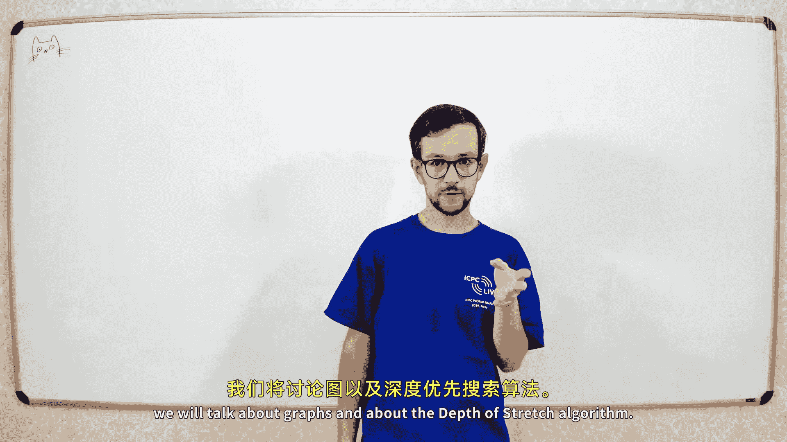

So what is graph， graph is basically a set of circles and line segments connecting these circles。

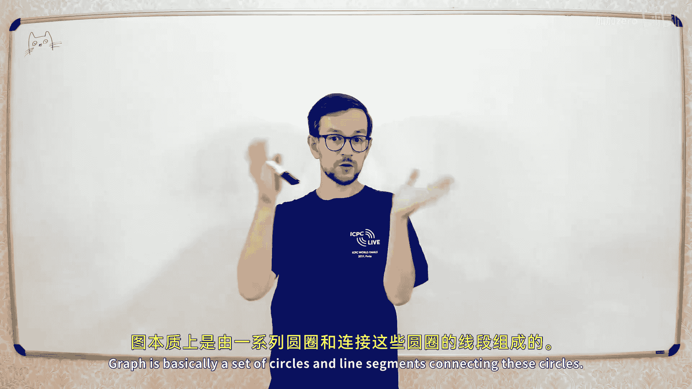

You have。Some circles and you have some line segmentss connected this surface like this。熟在吃包。お。

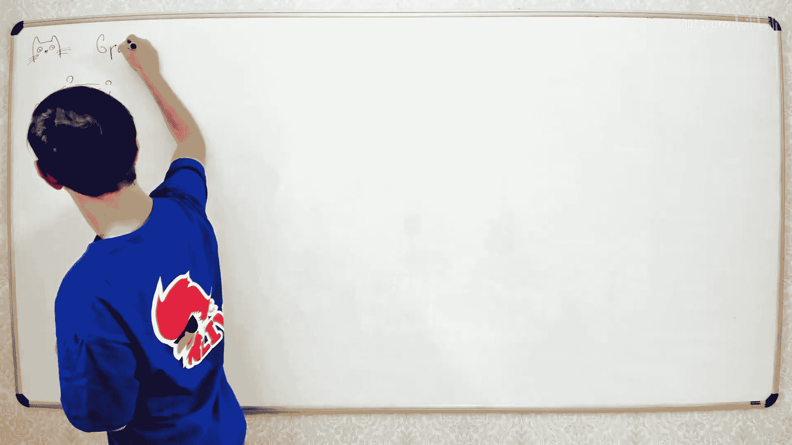

嗯。

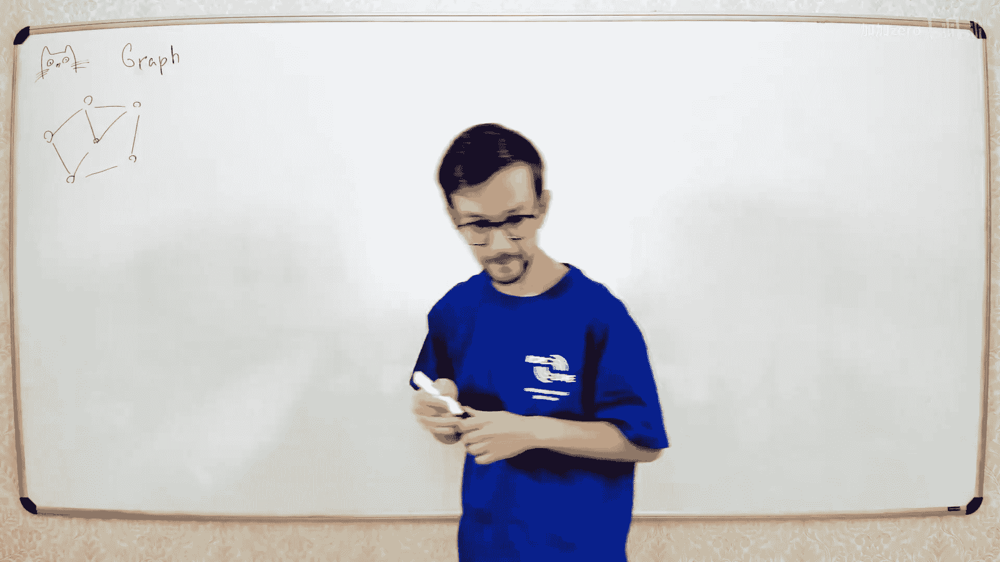

These circles are called vertices and these line segments called edges。very 페이스북 살。

There are two types of graphs， oriented graph and an some。 This graph is not oriented。

 There are different types of graphs， which called oriented graph。

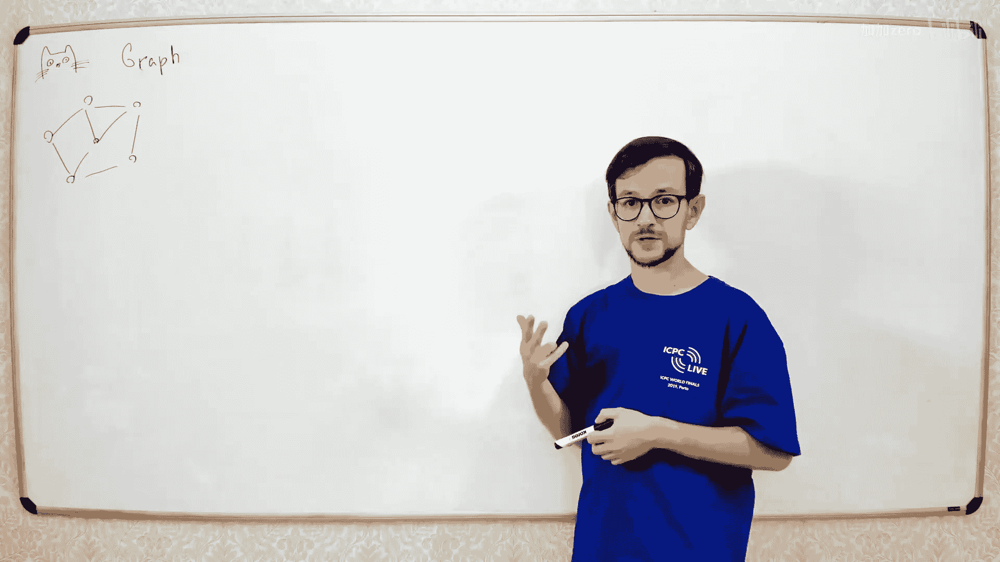

In a renderra， you have the same thing， but each edge have a direction。

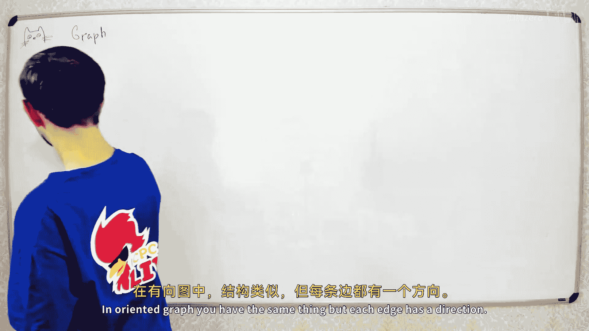

SoIts directed and undirect and directeded。Something like this。

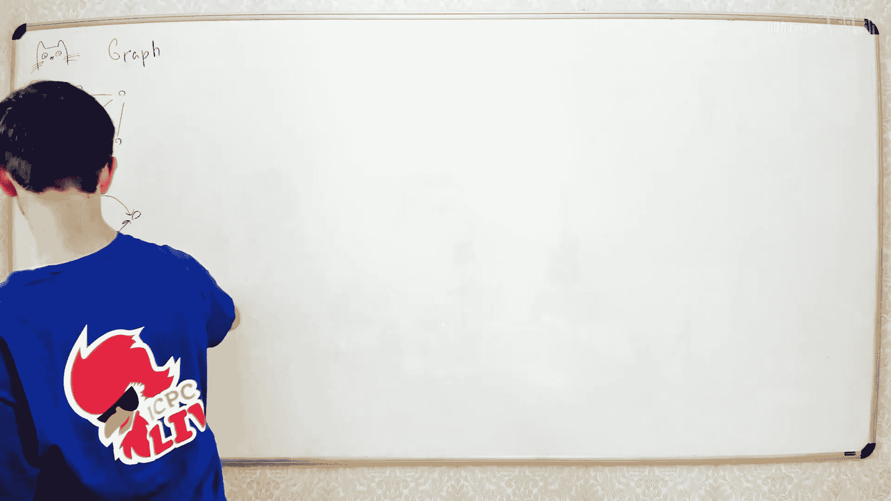

So this is directed graph， this is undirect graph。共。

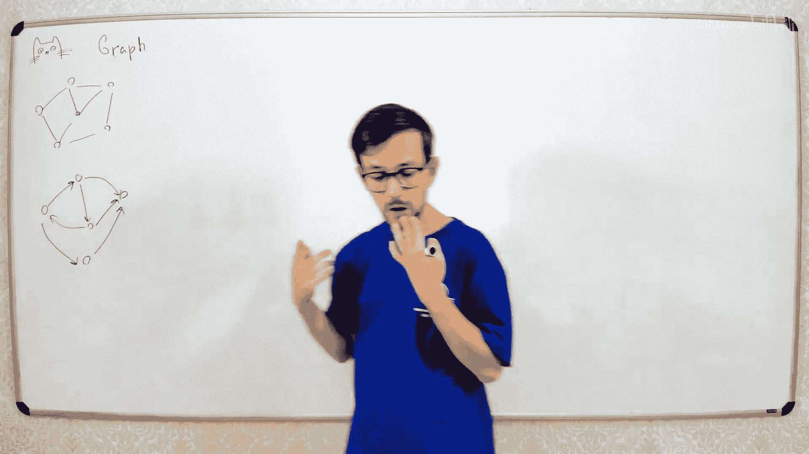

And they both are actually important， so for some problems you have something like this。

 for some problems， you have something like this。

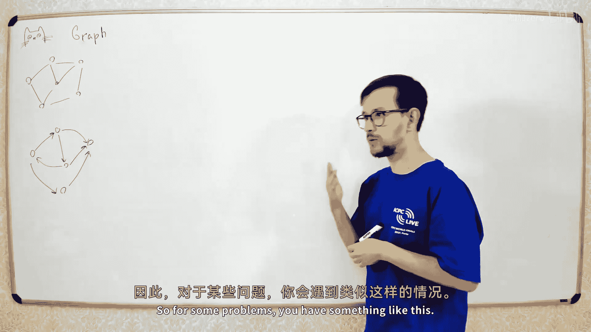

Basically。These graphs like directly graphs， usually occur when you have some problem when you have some system and the system have some states。

 and these are some transition from one state to another state。

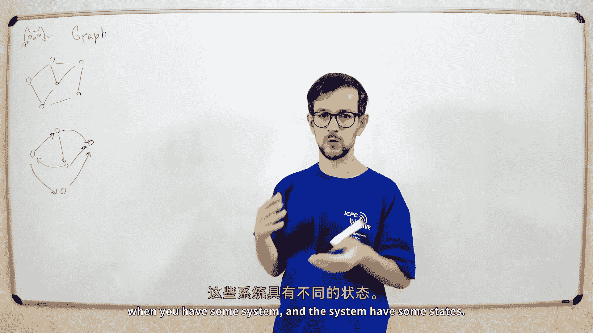

So。So like you're sitting in here and you can move here from this you can from。要跟要跟部嘅。

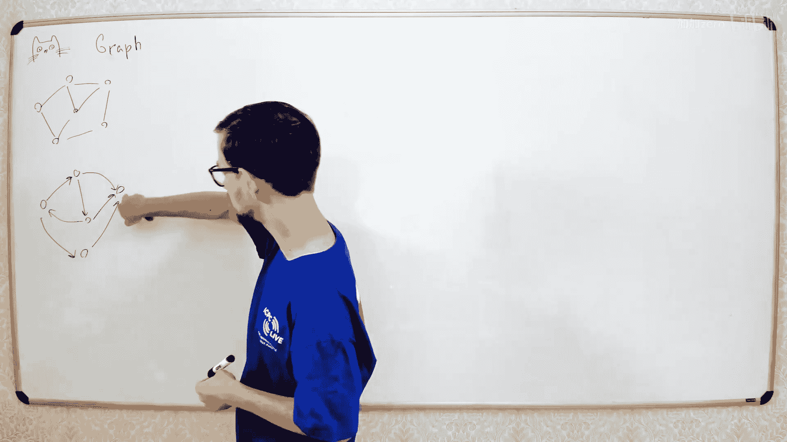

For example， you start here and then you move here， then you move here and so sorry。

 this graph kind of explains how you can move from one state to another state and when you have a direct graph it's usually when you have some relation between different objects So you have some number of objects and these two objects related to each other。

 So it's like symmetrical stuff。 So these objects。

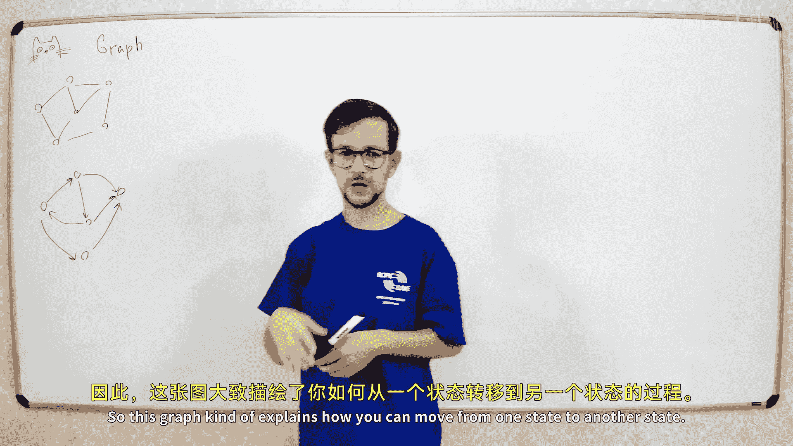

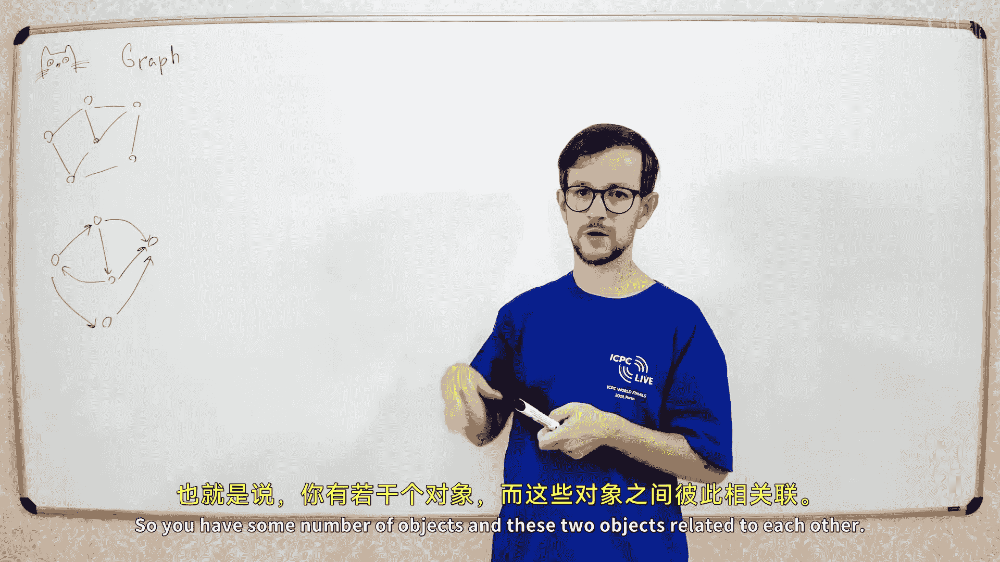

In relation。Both the graphs are important， where are different algorithms for different graphs。

Some algorithms can be used for both directly and undirectgraphs。

 but some algorithms may specifically for some one of these types。

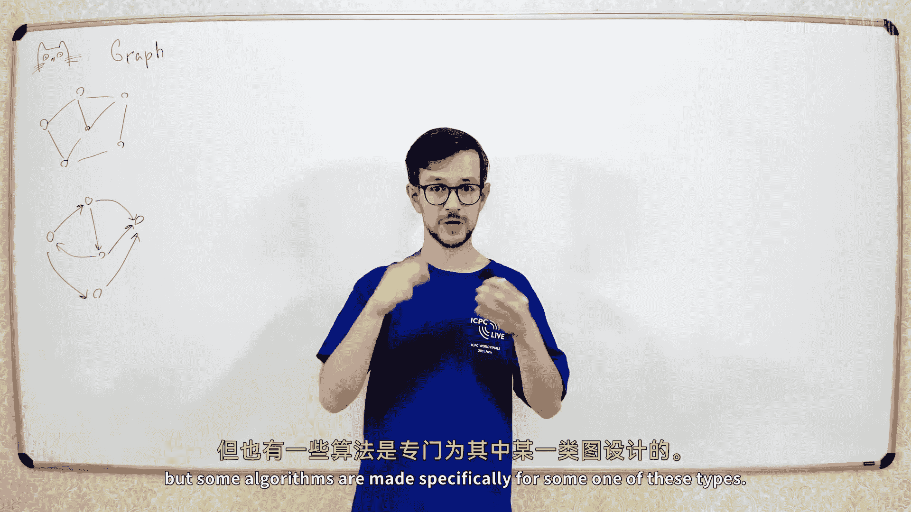

こう出ぜか。呃。Now， there are two important crs of the graph， number of vertices and number of edges。

 so I will say I have n vertices。

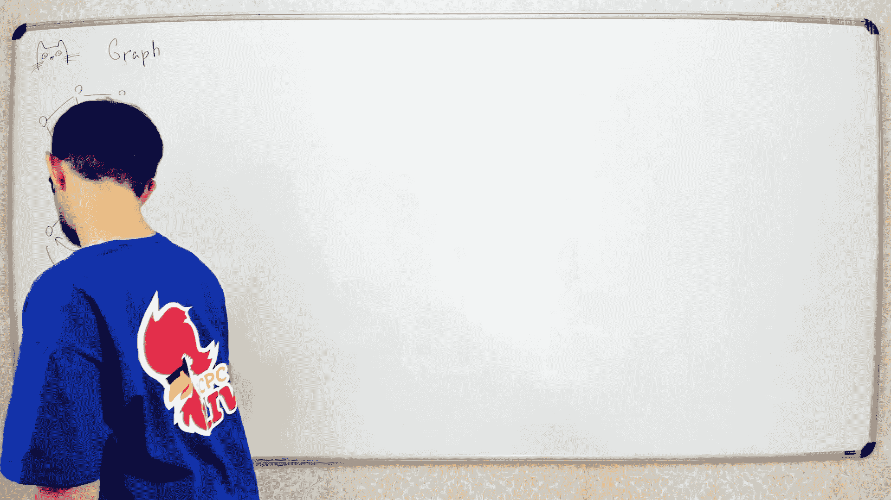

And pages。

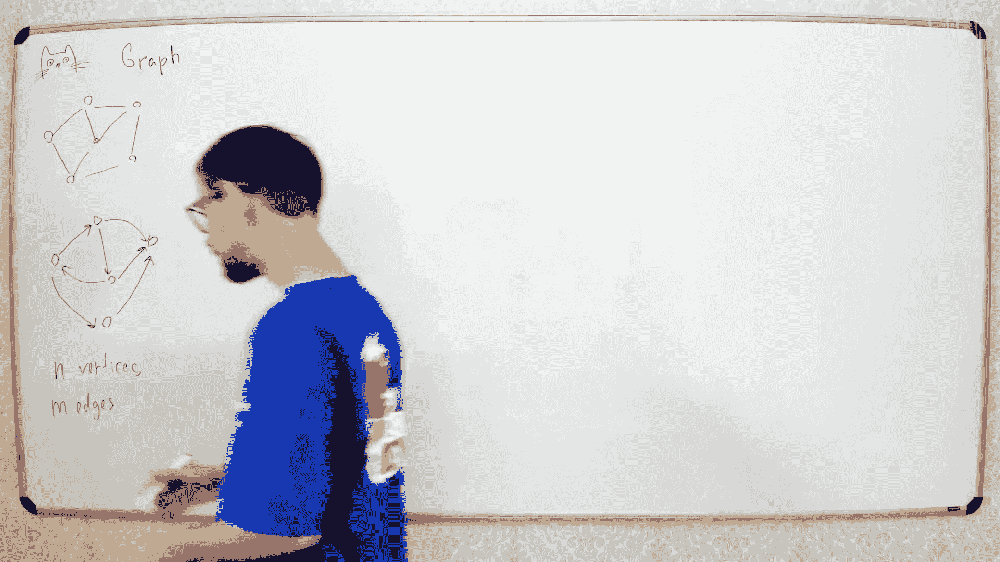

And when we will talk about asmptotics of the time complexity of the algorithm。

 we will use these two variables， not one variable like we did in previous lectures。

 so usually in the previous lectures we had only one cur series like n number of elements here we have two basicques and we kind of want to discuss how the time complexity depends on these two variables。

 so usually time complexity will be a function of two variables。Let's usually how working in graphs。

啊。I will assume two simple inequ equations。 first of all， let's look on number of edges。

If number of agencies very small。Then your graph is not connected。Yeah。

 so if you want your graph to be connected， so you want you don't want it to split into several parts。

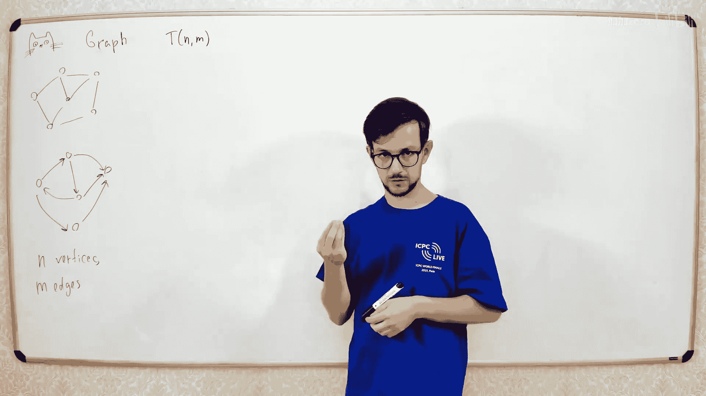

Then number of edges should be at least n minus1。小衣服 Alexex。Usually， if graph is not connected， you。

 you can just split it into several connected person。

 then the run algorithm incept in each individual component。

 So I will usually assume that M is at least a -1， not always， but。

And let's look on the maximum number of edges。 So if you look on the maximum number of edges。

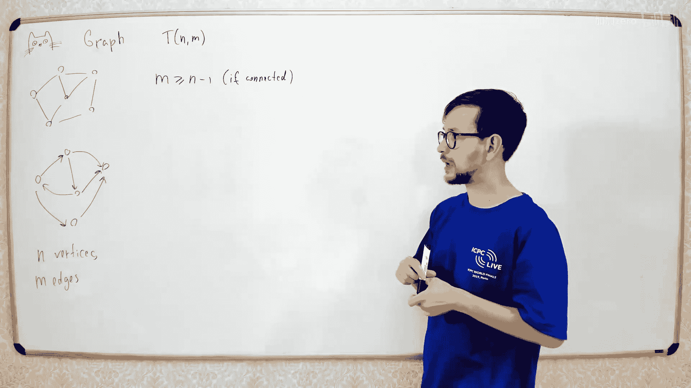

Then。If we don't allow to have two identical edges。

 like two parallel if we don't allow a situation like this。So。So we say that。Every edge is like。

 unique。Then。Number of ages should be， at most。for undirect graph it should be at most n and minus1 over 2。

 and for direct graph it should be at most n and minus1 length。In both cases。

It's big off square think。So I will usually assume that M is at least n and M is no more than n squared。

 and it will give me some little bit shorter formulas for the time complexity。 For example。

 if time complexity， you have some like。I you call n plus M， but let's put the big goal here。

B old of fat waska。So you have some linear algorithm。

 I will usually simply say that this because of M and say this enough because M is greater than n。

 Yeah， so can you can replace this n plus M of just M because this sum is bigger than this。啊。Or。

 for example， if du complexity is like n square plus M。I will simply say it's the and square。

Because m is less than n squared。Just for simplicity。Okay。Now。

 if you read the real papers about algorithms and time complexities。

 you will usually see notation like this because it's a more accurate way to explain how the time collection works。

 but I will usually just ignore all this unimportant stuff just to make all the formal symbol okay。G。

What's next？ What's next？Let's start the first algorithm。 the first algorithm will be very simple。

 We have the under drop。And it is not connected。's make something like this。And sound in like this。

Let it go， so you have this graph。It is not connected。

 so it is split into several connect components。 What is connected component common Cam is a set of vertices。

 And in this set， you can move from any node to any other node。 For example， in this。

Inside this set of four nodes， you can move from any node to any other node using all only these edges here。

 so we can start from here and go here， here and move to this are nodes。This relation。

 like these two nodes are connected， is a equivalentvalence of relation like it。

Because it is symmetric， it is transitive yeah， so all your notes will be splitted in some likeruence glasses。

And in each。In each this proven class， you can move from any node to any other node。

This is how connectivity works in andirect graph in all our anddirect graph。

 Connectivity is very simple。 You There are some components。

 this sets called connected components list。だかなでこおねなてさ。

So these sets of veres called connect components and the connectivity in undergraph works very simplely if you have two nodes from the same connect components。

 they are connected， if you take two nodes from different connect components， they are not connected。

What is steep water right。So the first algorithm from' class today is basically to find all the connected components。

 So why given them the graph。And we want to find all the connect components in this graph。酷。呃。

Yes you can do it using the Joyet Union yeah if you remember the last actually last semester first semester we actually talked about one important data structure which was union find and you can use union find data structure to make this on first That's true that's true you can just take all the edges call the union function for each edge and then have these sets in individual sets in your union find data structure That's true that's true。

We will make it first actually， but that also works。Let's。Good question。Now。

 how I will store the graph before we start the algorithm。

 let's talk about how to store the graphs in your program。

There are basically two important ways how to store graphs in in program。 First way is pretty simple。

 you just make a matrix N by n。And for each edge， you put one in the cell。

 which corresponds to your edge。For example， let's take somewhere graph' these graph。But no smooth，1。

2。Free。4 and5， and put some pages。Yes。For example， for this graph， you can sort like this。

 you can make matrix 5 by5 because you have five nodes。Oh。And now for each edge。

 you just put one in the corresponding itself， for example。

 here you have node 1 and node one have edge to node 2。 so you take the first row。

 take second column and put one here。 So this one。Rerespons to this edge。And so on for each edge。

 you just put one corresponding cell。 So you have this edge from 3 to2。From three to one。

From four to2，3 and five。2， three and five and from 5 to3。1，2，3，4，5，6，1，2，3，4，5，6， mail。k some work。

And you zero in out。啊。This matrix is actually sometimes it useful because it's metrics。

 so you can run some algebraics like a lot some algorithms from linear algebras just to work with this。

Set of edges as a matrix。咋的，我都。Quite two algorithms in linear algebra。 you can apply there。

 but we will we will usually not do it like this just because this matrix is too big。

 This matrix uses n square memory。 And if the number of edges is small， it's very uneffective。

So we will usually use another approach how to store the graph， we will do it like this。

We will start for each。For each node， we will store simply the list of all edges connect to this vertex。

 vertex。 For example， here， we have like 5。5 veres。 So we will have five lists。So for each note。

 we have a list。And in this list， we will simply store all the edges going from this node。

 for example here。And here we have from node one， we have H2。Thes2 from two。

 we have nothing from three， we have one and two from four， we have。2， three and five， and from five。

 we have four。So well have lease lists。啊。그しか。手印。What is the total number of elements on all these lists。

 It's pretty simple。 So each edge only only occurs in one of these lists， so。

Total length for all these lists is just M， so。Here。

 the total end is M and size of this matrix n square。So if your graph is almost full。😡。

Then you don't care， so if your graph is close to the full graph or you have almost all the edges。

Then you have about n square edges and you can storm them like this。 If you have small number of H。

 you have a sparse graph。 So number of edges is much less than n square。

 Then the preferred way to store graph is like this because these uses just M memory and node n square。

 If M is much less than n square。 then that's how you want to store your graph。ho。What what。

 what white5，5 to3。Okay。Let's fix this， I just get it from the front here。嗯。Nice。能从。

The same thing works for under the graph。 if you have under the graph， you just make the same thing。

 but here you will have a symmetrical matrix So for each for each one you will have symmetrical one in the corresponding and here each age will occur twice。

So you will have one edge from here to here have one。 so for each node， it's U。In the list of you。

 you will have in the list of we will have you so。Each edge will give you two elements in this list。

But the idea is the same。こ。Now？Yeah， believe this so。 So let's now let's write the first algorithm。

 The first algorithm will just find you the connected components in the given graph。yes， yes yes。

 if you have under graph， then you have these two elements， two ones in the same setup。

 so if you have this adjacentsymmetrics， you have one here and one here。

 this Uv in this video so you have two ones for each age of your prop。こう。No。

Now that's let's write the first algorithm， the algorithm works like this。 You have your graph。

You will take any vers of your graph。Let's， for example， take this vertex of the graph。

And now I will quote it a recurive procedure， which will。

Mark all the no all the vertices connected to this vertex。

 so I will start from this vertex and mark all the vertices connected to this vertex。

So after I run this procedure， all the nodes inside the disconnectant prompt will be marked。

This the blend。The audience is called the deficit。There不得 her。Yeah， first。Sure。

The output is very seen， but I just write the code here。So let's try this D FS of node。

So this is the recursor procedure， it takes some node V and try to mark all the nodes connected to this node V。

 so I start from node V and try to mark everything connected to node V。So how to do it。Pretty simple。

 So first tomark Markold be。Now we will simply iterate all edges connected to node V。

 So weve not mark node V and then try to mark everything connected to node V。

 So we iterate all edges。For all VU。Let's call this list out。

So out of V is the list of all edges connected to node V。So wait。Take hold there。我是。嗯。

So we take all edges connected to node V。And now see if so you stand in V， you take all the edges。

Here we take node U if node U is not yet marked。So this， this is marked。

 Now we take the node U if it is not yet marked。Then we simply recursively go to this node you。

 mark heat， and everything connected to it。So simply call the DFS。不是病。Let's all。

 this is the whole plan。呃。Which is important。Any questions by now？So it is no no， no。

 this is not the only representation of the graphs， but it isnt two most common representation graph。

 There are other presentations of the graph there used for some specific algorithms we'll talk about this。

 if some if at some point we need some another representation， we will make it。

 These are just two two most common representations of the graph used in for algorithms。

 So usually we will use this representation。嗯哼。ふ。Wals in on for play。So what we're doing here。

 we take the list of node V， so we take this list。요。And the eacher all node in this list。嗯哼。

So this out of V is the list of all nodes connected to node V。I don think you mark all the neighbors。

No， I will mark on name。아쪽쭉쭉。ピピピ。Yes， if you have a tree， you can do it simple。

 but we don't have a tree here we have some。Yes， if you if you。

 if you try to run the face on the tree， you can do it without this marks。But that's not a point。故。

Look， let's run from Lion， for example。2。Okay， what's start from here。 Let。Let's just mo here。

 let's make one， two。Free。我。For。6。社会人。好な。So what will happen in this algorithm if we were around this procedure？

嗯。嗯。Let's remove something。Let's to move this stage。To make it more interesting。

We started for in this graph， we have this。Lists， let me let's just build this lists。

So we have least for vertex one， we have four and five for vertex 2， we have9 and eight。For free。

 we can for the depth six。For four， we have one for five， we have five here， and it's one and seven。

For six， we have three。4， seven， one， and five。For829。Almost feet2 and6，2 and8。So for this graph。

 we have lists y。Now， what will happen if we run this algorithm from the note 1。 So we started。

Start a node one。It will mark the node1 and then it all neighbors of the node1。

 so we have three neighbors， so we're staying here。I forgot something。4，5，17。や。Yeah。

So well start from node 1 and try to treat all neighbors of node 1。 Take the first element。

 It's node 4。 So we go to node 4。嗯哼。And it be civilian。よし。Try to find air connect4。So we re go here。

 mark this snowfall。Then go back， because now from note4。We do the same thing。 We mark node 4。

 then iter our all neighbors of node4， so we take this node 4。SoIt has only one neighbor。

 not node one， but node one is already marked。嗯。So in these four we its right for all nodes connected to node 4。

 it's only node1， it's all remarks so we don't go here。So， these four ends。

And we go back from the re back here。Now， from here， we take the next node。Next， note5。 So we call。

The affairs of fight。From here we。Try to go here， then go back。Now， we go no fire。Note 5， here it is。

Has two neighbors， one and7， node one is already marked。Notode 7 is not yet marked。

 so we go to node 7， so from here we go to node 7。嗯哼。Note7 have two neighbors here it is。

I also has two neighbors， they both are marked。So we don't go anywhere。The recursion ends。

 we go back to node 5， node 5 has no more neighbors， so we go back to node 1， node 1 has neighbor 7。

 It's already marked so that's all that the that's the whole recursion tree。嗯哼。That's all。

 so by the end of this。Procedure， everything connected to node 1 is marked。So this on mark。

 this mark this mark this is mark。Now how to find the second connect components。

 how to find the second components， we take the next note which is not not marked yet。

 so we take take any note which is not marked。For example， node2。 So we start from node2。

Hold D F S from those two。And do the same thing， so we start here， go to node8， so mark this。

 go here， mark this， go here， mark this， nowhere to go， nowhere to go， nowhere to go with that's all。

Go to the Fs of8。 Here we have to the Fs from 9。Then go back， then go back。And in the end。

 we do the same here。Let's the hope lamb， let's to hope lamb。

Now we need two things to prove first we need to prove that this algorithms actually works。

And second， we need to improve the temperature。Let's go。First。

 let let's prove this algorithm actually works。 So how to prove the algorithm actually works。

It's actually quite obvious because it's。Pretty simple on even， but I will。

I will try to prove it with。Little bit of mathematics just to show you how this album are usually in。

B。So let's prove this algorithm is actually works。 So what I what I want to prove if I start the from some node。

By the end of this procedure， everything connected to this node will be marked and nothing else will be marked。

So if I have some movie。It belongs to some connect component。Then by the end of this DFS。

All the nodes in this connect compound will be marked and nothing else will be marked。

 This is basically what means that I I al mark all the connect compound， right。Well， first of all。

 let's proof that everything that will be marked by these algorithms is actually connected to node V。

So I want to prove that if some node due is wrong。Thats。呃，do they。And you is smart。Yeah。So。

 I want to prove that。All the nodes connected to V Ammar and vice versa。

let's move from left to right， let's move from right to left， let simply。That's simple。

 Let's prove that everything what was marked by this algorithm。Is actually connected to Nordvi。ど。

We'll talk about in complexity in a second。's's first。

 let's prove that this argumentgon actually works because if it does't work that is。

It does make sense what's done of first we need to prove that the algorithm is correct， right？

Oh let's prove this， it's simple， so first let's prove everything which is marked。

Is connected to Nor。It's simple。 Let's prove just by。

 lets we maintain the invariant that everything connected， everything marked is connected to V。

So if we are on the first from now from some node， let's say you。Then just bit the very list。

Let's go。Let's call it S because we have V here just。

So S is the first vertex from which we start the defense function right。 So this is the first node。

If I I do first。From node S， then everything connected to S will be marked。 Let's go。Let's see。

 So I have note S， and I have this note， Let's say V。Just by invari， I say that this node is marked。

 it means it is connected to node S。We just maintain the environment that everything which is marked。

 everything that is marked is connected notice。Now let's see what happens in this procedure in this procedure。

 which rate all edges from this node V。Make this note U， I we going go here and mark this node。

If we go here and mark this node， it means this node is connected to node S because this node is connected to this node and this is connected to S So so just by transit。

 so this U is connected to S。こ。That's错。So we simply maintain the invari that everything which is every node which is marked is connected to node S。

That's all。So we so we proved， we proved。This secondそ。Now let's prove the opposite solid。

 So let's prove that if something is connected to S， it will be marked by this algorithm。

 Let's say a little bit more。So we have some notice。And we start the first from this note。

And there is some another note。You okay， you。We have some node view and this node is connected to us。

So there is some pathth。Which connects S and U。Let's prove that if we run DFS from this node S。

 this U will be marked at some point。How to prove this very simple action， note S will be marked。

Because we start differ from node S， like the first action here will be to mark node S。

 so the node S will be different marked。Well， let's see if the node U is not marked。

Then let's look on this path。 on this path， let's find the first node， which is not marked。

 So we start from node S and go down until we find the first node， which will not marked here here。

 This is marked， this is marked， and this is not marked。So we have these two nodes， let's say node。

X and y。So on this path from S to U， we have some node X， which was marked and some node U Y。

 which wasn't marked。let's see why this happens。 and this kind is strange because if we mark not x。

 if we mark not X。Then it means we only mark nodes here。So if we mark this node X。

 it means we at some point run this recursive procedure from node X。

 but when we run this recursive procedure from node X。

 we eacherate all edges connected node X so we actually look at this edge so we actually found this edge。

And if we found this edge and this node wasn't marked。

 it means that we must go to this node Y and run the difference from this node。

So this situation must have happened。M哼。😊，That this contradiction。

 so it means that if some node U is connected to node S。

 then at some point it will be marked by this other thing。야。You here。

How can we do theit We'll talk about it in some practice。 It's not not very important。

 Every recur of algorithm can be made it right。Just by manually making the stack of recursion using stack。

そう。So if you have some recursive algorithm， you can just remove the recursion and manually make this stack of the recursion and make the nonrecursi algorithm。

 but its just recursion is just a simple way to explain how the algorithm works if you have some algorithm of stacks。

 usually it's much easier to explain how it works using the recursion。

But recursion is not the the fundamental property of the algorithms。

 Recursion is just a simple way to explain how the algorithm with stack works。别走。啊。Co。O for大。

Let's talk about time complexity。What is the time complexity of this algorithm。

 not lets seen time complexity this is re algorithm for so for first to calculate time complexity。

 we need to calculate total time complexity of each recursive call of this algorithm。

 What is the total number of the recursive calls for each note we will call this D first function only once。

Because we only go to the nose， which wasn't marked yet and when we go into this record we marked this snow by the firstspiration so we only call this DFS function for each note exactly once。

Now what happens So let's just write this。So we do it once。For each。So for each we。

 we will call this D only ones。 Now what happens inside this D， we here we all edges。

Connected to Norwe。嗯哼。What is the total number of all what is the total length of all these lists。

 total length of all these lists。 So for each for each list rule will trade all elements of this list。

 right， So total number of elements of this list again is M。So the total time complexity of all this。

😡，Loops is M。とた complexity is have。Because it's n plus M again again， again。

 that collects is n plus M， but I will just ignore this plus n because I also swim with okay。

 let's simplicity。You also need to make these separations。

 these separations you can need make end times。I usually order of this plus n because I assume that M is greater than n and this algorithm is actually not because these graphs are connected。

Usually， I just don't know it。啊。ho。Well， that's all the best debt for social Britain。Nice。

Isn't least is M size。 No， the total size of all these lists， sum of all these sizes is M。

 because for each edge， you have the element in two lists。 So not2 M O K。일 일。No， you have n lists。

 you have n lists， but total size of all this list is M， that's what I mean。故。

Now that's the first application of the deposition algorithm。

 but it's not there if it was the only application of the deposit it will not be so interesting。

 so we'll discuss a lot of different applications of deposit written these lectures and few next lectures we'll discuss only the deposition algorithm。

🎼It turns out it is actually quite important algorithm for the graphs for both directed graph and undirect graphs。

🎼So we'll discuss a few different algorithms which are based on depth research algorithm。

🎼D cool so today the first algorithm we' will discuss the next angle this this was the first。

 the next algorithm we'll discuss is actually working on direct graphs。

 so let's talk about direct graphs。F ring well。Okay， I hope it wasn't important。어 저 볼 더。

At the start of the semester， everybody' is growinging 10 times a day。I heard the Septembers。嗯。

Directive graphs， so imagine you have some directed graph。Let's something like three，2，5，2。ああと。

And here's someone。And you hear something else。Like this， yeah。W my have on some camera else。 Okay。

 that this。So I think Bill is the teacher on some university that's interesting。政治性 fault。

I didn't think that。This song was about universities。What I was talking about。啊，所以还有这个口照。小鱼还不这这这啊。

AVery important case of direct graph is aci direct graph。So if you have a cycle。

 direct drop like this。A second means it's just it doesn't have cycles。

 so if you don't have any cycles in your direct graph， that's very important case on direct graphs。啊。

 oneの。Cool things， what you can do if when you have no cycles。

 you can make something that calls the biologicalological ordering butological sort。東ポ路ジか。So挺。

The biological sort means you have some order of the nodes。 and if you put the nodes in this order。

 all the edges will go from left to right。 Basically， for example， here， you can put node free。Oh。

 then let's see。We say about four， then for example， five， then one， and then two。So if you不。And，在。

Notes in this order。 Then all the edges will go from left to right。we have 3，2，4，3，2，5，3，2，1。A，复读王。

5 to 1 and 5 to 2。 and。A cyclic de graph is a tree this the term a cyclic graph usually youll used when you have directed graph if you have undirected a cyclic graph is just a tree or a forest。

 sounds like this source。 So its not it's not that interesting。

So these termss are usually used for directs。Yeah。No。Let's talk about this political certainly。

 what is the meaning of this political wondering and why is it important？For example。

 you have something like， I don't know。You have some libraries， and you have some dependencies。

 so each library depends on some other libraries。And you want to load these libraries in some order。

 such that when you load some library， all the dependencies are already loaded。So， like this。

That's actually how it works yeah， so what you can do。

 you can make this topological ordering and it gives you the order in which you need to load your libraries。

So you load libraries divided one by one， and each time you load library everything。

WeAll this library debate actually load before。と。But if this is dependencies from right to left。

 is plasma matter。そう。Another thing you can do when you have political organ is to make different dynamic programming algorithms。

 So， for example， no we discussed in first semester some dynamic programming algorithms。

 you can do it on a cyclic graph when you if you first make a biological order。

So first you make the biological order of graph， and then you write dynamic programming like from right to left left to right。

嗯， so and。Since all edge go from left layer to right， when you calculate some value here。

 these three values are already calculated。 So you know these three values。

 So you use these three values to calculate value here and so on。

 So all the programming algorithms may be done on thiscycl graph if you first start making the biological ordering of the node graph。

SoThis white in bottle。共。啊。Yeah， so now let's know how how to make this topological order。

About two ways。To make the biological sort and both these are actually important survival survival just。

Explain both ways。对。The first algorithm is pretty simple。 Let's just take this step search algorithm。

And in the end of this depth search， put the node V into the list of the biological problem。

 So in the end of this data search here， just add。Add load V to the biological order。です。

Let's make a sample， please stop sort。没新不。And so now I claim that if you run like this。

 then you will get all the node from right to left in this order。So， for example。

 let's run from here。 So if we with you start di。From node one。Here， you go to。Now two。So。

 you mark this。You mark this， you mark this。That means nowhere to go from those node to。

So you output with this note。To into your list。Then you go back， this know where to go from node1。

 so you output node 1。没's错。Now you take the。Any note mark node。 So you take take note free。嗰山煲。

Start from here。 Go to nodes。 I don't know4。So we start from here go here。

There's nowhere to go from node 4。So you stop the recursion， you output Note 4。不说。Now。

 you go back here。You see another edge from three to5。 So you go to low5。Oh。Martin old front。

There's no way to go from node 5， so you stop the regression there。I willput node5。

 then go back to node3。 Now where to go for node 3。 So output node 3。

So this is biologicalological ordering。 It's another topological order Yeah。

 so so you have one top so biological order is not unique。

They may be different from the biological sortcing of the same graph。

But it is the correct or topological sort of this notes。You so you need an outer for a loop。Yes， yes。

 yes。So this is the recursor procedure in your main procedure you need something like this。

 you per for all node from0， let's say to m minus1。O herety， I am an from one， but。

Usually in your program you start in zero and see if it does not mark。Then you call the effects。

Like this。Actually， what you what you can do。If you just want to run one difference。

You may add some another note here， some note 0。And just connect these node to all nodes of your graph notice。

And then you can just run the address from this node 0。Here it will just def less from node0。

And it will automatically run your all your defenses。 That's another way to。

Implement the same algorithm。It actually not about it。In theory， this is the easiest way to。

Get rid of all this。Extra loops in practice， this is the easiest way to do it。

 Just make one more loop and just aable notess and run this DFS several times。诶After。Okay。

Do we have any more time Oh， we have a more time cool。Let's prove， let's prove。

I claim that if you do it like this， then。As the out， you will have some the political organ。

 Let's prove this。 Let's prove this。How to prove that something is the political organ。

 You need to prove that all edges go from left to right。 So let's take some note。

 Let's take some note。Oh。So was different not。Let's look on all edges going from this node video。

So from this node V， you have some H to load U。We need to prove that this edge goes from left right so vert U must be added to this list before nodeV。

Why is this true， Well Because in this loop。We actually found this age。M哼。😊，When we found this edge。

 we first go into thes for this old。Run DfS here。 Then when we end this DFS。

 we add this U to the biological ordering， and then we go back and edit node field the Pol。

 So node U was added before the node V。嗯哼。That's almost true。That's almost wrong。

 can' see what was about here。Again， I claim if you have H from v to U， then in this loop。

 you will find this H from V to U。Aund the first noio。In the end of DF。 So so it looks like this。

 So you have DFS。Of node V， then you run the F for node U。 Then when you finish this recursion。

 you add you to do a Po ground， Then I go back and then add V to Bo card。

 So node V will be added after you and edit node V。Yeah。We don't visit V at all， but with two。 Yeah。

 it may happen。 It may happen。 then no， no， we visit all notes， only。

It may happen that we visited Nou before we visit Norwe。

 so we may visit Nou in some sort make so we start from from。This S， so we first。Go here。Mark。

 this told you。Then go back and then here we visit O。So when we visit node V。

 node U may be already marked。😡，So when we see this edge。

We don't go into this recursion because you is already marked。Let's proof。I claim that in this case。

 the ver screw is already in the topological organ。😊，We see this situation， so we stand here。

 we see this edge， then you for this node U， this recursion already finishes。

And we already added that this is not you to the biologicalological order。

So the situation looks like this， we first got an old U。嗯哼。Finish the recursion。

 then go back and then go Nor way。 That's the conversation station with Ka。 So if。

 if it is like this， then this U is already in the political organ and its end before the all。

Do we need to reverse tops， Yes， we need to reverse tost。

 these topcycl least will be formed from right to left。

If you want to correct a poly button then you need to reverse this list and then， yeah， that's right。

啊。But， but。What if， what if for this node view， it's already marked so we have to operation mark the note and add the note political order。

 What if for this node you。We already marked this note。

But we didn't add it to the College Gordon yet。So what if this node U in is in some middle states。

 So for this node U。We already marked this note。But， we still didn't。Add it to the political。

Let's see let's see if it may happen。 So。 let's see if it's possible for an old U to be marked。

 but not put in the topological origin yet。Let' see how it may happen if this note is marked。But。

Is not putting in the biologicalological order。 It means for this node view。

 we are here something yeah。 So this node view is in the recurs system So。 So when we。

When we look on the note him。And find this edge， this node view is in some middle state something here。

 it means it is in some recurss。So it's somewhere here， So we start here in something else。

 something else and then go here。This is you。What does it mean it means we start from node S。

 then somehow we go to node U。And then from node view， we somehow go to note3。

But it means you have a cycle。Yeah， so we we have a path from V from U to V。

 and then we have H from v to U， so we have this cycle in our graph。And if we have cycle。

 we obviously can't make poly boringing。Sliper。Yeah别别别别别。咩。でべてべて。This is the program。

 so if you have cycle in your graph， you can't make the political program because if all edges go from left to right。

 you cant make a cycle。At some point， you need to go from right to left。That's all。Okay。

 so so I just proved that for each edge for each edge of V U。

 node U was added to the biological ordering before node V， if the graph is a cyclic。

 So if you if you don't have any cycles in your graph。

 then this algorithm will give you the biological ordering。the pe， the。Now， if you have cycles。

 you can' make biological ordering。 obviously， yeah， because all edges go from left right。

 you can't make cycles when all edges go from left right。

Well you think about like if you have like think about dependencies， actually。

 thats thing which happens sometimes so you have dependencies between some operationss and from this library you have this dependency and then you have cycle。

 it usually ends badly so when this happens means you can't load in your library because they have a slightly dependencies。

That happens if you。But bureaucracy in your country happens sometimes Russia。

You go somewhere and they send you to some another organization and then you send to another organization and then you have a loop so you suggest。

From here you go here， From here you go here。 and then you you can make。

Anything because we're just sending you in a second。Any more questions？Okay。

 so this is the first I' going account to make the political sort。Yeah， that lock is yeah。

 that lock is basically the same thing as if you may have some when you have parallel algorithms you may have situation like this yeah。

 so you have a few threads each threads waiting for another thread to finish before can it can continue。

 so if you have a cycle in this graph then you have a dead log again。到。That's the first algorithm。

 now the algorithm result is。Also important， in other items important。It works like this。

Let's take the car。Let's take the girl。And just look at it。We want to make a aological ordering so。

 so we want to make this order。Let's think。What vertex may be the first vertex in this folder。

 so let's try to find this leftmost vertex in the political origin。

This leftmost vertex must be vertex which don't have any incoming edges。

 so we need to find vertex which have no ingoing edges。Deting cycles。

 we'll talk about the detectioning cycles in a minute I don't remember about this。So let's just。

 let's just I'll just explain another algorithm because it's holding it's also important。

 so let's try to build this。To college order than without any D。So the algorithm is very simple。

 let's try to find the first vertex inthological ordering。

It must be the verex which we doesn't have any incoming edges。 Yeah。

 so let's find any vertex which have no ingoing edges in our graph。 This node is free。

 so let's take note free because it does have any ining edges and put this node as a first node in our college order。

And now simply remove this node from the graph。So we just remove this node from the graphic。Now。

 from the remaining fourtics。Let's pick any verex which has no ing edges so so for example。

 we have two words， we have node4 and node5， so we have these two words have no ingo edges No since we remove this yeah。

 if we remove this node free。These two nodes have no encode golden ages。

 so we just take any of these two nodes and put them in the next。Position in this list， for example。

 let put note for。And they again to remove from this list。

Now you have these three nodes from this re nodeults， you have this node file。

Ithi has no ongoing edges， so take this node 5 put in the next position so。

So every time you just take any note， which has no in edges and put it in the next position and remove it from a curve。

That's the， that's the whole algorithm。Let's try to implement it。啊。So what we need to do。

 we need to maintain a set of vertices which has no ingo edges。

And now each time we take one of these notes。And try to remove it from a graph。

Once we remove it from a graph， we need to eacherate all edges connected to this node。

And remove these edges from the list of this node。嗯哼。So we need to maintain two operations。

 first separation is to find any node。Which has no in edges。

And the second equation is to remove the edges connected to the stone。嗯哼。

What the structure can to use， this data structure is very simple we will simply。

Maintain the counter for each node for each node， we will remember the number of edges which are going into this node。

So for example， in this graph， we will maintain this c， so let's see one， two， three， four，5。

So for each node， let's calculate the number of edges going into this node， so in node one。

 we have two inatorss。Oh。For node two， we have two going and useful for three0 here we have the one and here we have one。

So let's simply maintain this array of counters。Yes， you can use PRQ as well。

 but it's priorQ will give you another log login factor in your time complex you don't have another login factor。

 you can do it in linear time。35412 is also Po button， yes。よし。3，5，4，1，2 is also what yeah。Yes。

 you can now you need to maintain the set of zeros yeah， so so you can maintain a set of zeros。

 First of all， it will contain only node 3。So I will maintain this array of counters and the of set of boxes with a counter equal to0。

Now， each time what I need to do， I take some notes from this set。Put it into the order。Again。

No is this。And then try to erase it from graph When I erase not free from graph。

 I iterate all edges connected no three， So I have these three edges to 1，4 and 5。

And just decrease these three counters。 So I decrease counter for node1。Full note4。And for note 5。

And when I decrease counter， I see if the counter became zero。Then I put this note into this list。

So I decrease these two counters now theres zero， so I can put these two nodes into this list。

4 and 5。Now again， you take any note from this list。这 the note。4。Put it into topological ordering。

Then iterator all pages connected with Note4。Have only one h to node one。Decrease this counter。

It was two。 Yeah， it was2。Have doing going。Yeah， yeah right。So now you find this h。

 so you decrease count of node one， it is no one。And so on。 So you'll take these notes。Put it here。

 decrease counter for notess1 and 2。 So here is one， here is 0。See the0 added here。

 Now you take this note。我的天。It row this edge， decrease this counter， put this here and so on。時でのちょと。

不。How to print all possible top sorts， there is an exponential number of the ordering， obviously。

Well if you have graph like this， for example。お。There is emphasiscadeural way to。

So even if the graph is connected。There may be exponential number of topological order。

 so you don't want to print all of them。To calculate the number of possibleological ordering is something like piece space connected piece space complete something a。

 I'm not sure but no knows。I don't know the character term for these problems。

 but it is kind of hard problem。 You you， you， you can calculate the number of。嗯。

You can calculate the number of theological organs in preal1。哦。下定。

So there may be many different politicalological ordering。 You cannott output them all。

 and you cannot。Calculate the number of them。Though。

 it's not in Pihar because it's not yet no problem iss there are special classes for these problems when they need to calculate something。

嗯。I forgot how how how cold。There are special terms for problems when you need to calculate something。

Usually for NP problems， you need to answer yes or no， yeah， so it's different causes。

 it doesn' matter， that't matter。맞s么。Let's write the code， let's write the code。

I forgot my watch them hell nice。So let's write a code for this algorithm。

 so the algorithm is very simple。So for each note， we calculate the number of ingo edges。

 so let's make this count solve。Counter funnel V number。We are off in age。In going in yes and。

Zero will be this cent。Oh， this it goess。Now， first， let's put all the zeros。

 so we iterate all nodes。So if calendar。Is zero we just put。The node I into this set。啊。

Then while this set is not empty。こ。不。お。Like this good good。So while this set is not empty。

 here we just take any node from this set， let's take V。Get。

And itator all edges connect to this also。 itator again， reator all edges。嗯。

Going from this node V and decrease this。こ。If it is 0。です。We added to the two sets。P port okayけ。

S like。Now， let's talk about time complexity of this algorithm。

 What's going on this time complexity of this algorithm。Here again。

Every node will be removed from sets the only one on this。Works only once。For each。여기요？

So each vertex is removed from node node from the set the only one。

 so when you remove the V from set from the set， you iterateerate all edges here so again for each node V you iterate all edges connected to this node。

嗯哼。So the total total number of operations here again will be linear。

 so total10 complexityes here will be。Again， end。哎。Okay， so both these algorithms are linear。😡。

we have two hours from linear tankerplex。啊。Yeah， we did position so what data structure can you use to maintain thisine？

Those early yes， yes。to maintain they said Z， you can use basically any any linear data structure。

 like you can use Q， you can use stack， You can use anything or you want any， I don't know。

 What else can use say know。You can use link list if you love linked lists。So for these set Z。

 you need to make these two operations to work in constant time。 Yeah， you have these operations。

 You have set， you want to have two operations。 put element into set and get any element from the set。

 You don't need to care about order of this elements。 So you just put the。

 you can just use stack here。 You put element into stack。

 and here you pop top element from the stack。 or you can useQ or anything。 anything。啊啊啊啊啊啊啊啊啊。

We'll talk about that program and then。Nice。So that's all that' that's how you built the biological autoground。

Now， the next minute to talk is how to check if your graph is actually acycl。

 so biological ordering only exists when your graph have no cycles。

And how to check if you up with no cycles。That's interesting。

Because sometimes you may actually be given some graph which fails the cycle。

And you kind of try to build theological order and see that it's not working。

So how to check if your graph contain any cycles？Two ways。First way is very simple， very simple。

You may just run one of these algorithms。And see of course。So for example， for this algorithm。

 what will happen？If your graph contains any cycles。I me just write this for this algorithm。

 what will happen if your graph contain cycle？嗯嗯。Any ideas？Well let's try rather for example。

 here we have node one here we have node2。We in the camera cup cycle。Wai for what break。

So nowhere here to break what will end。What do you mean by break？Yeah。

 it it will stop after a first sorry， So it will end add this node 1 to the list， then remove it。

And now this is empty。So it will stop after end。 So it will add some nodes to the P ground。

 but not all of them。 So you you can check in the end if this the biological order。

 I didn't edit this。Lets hear。D sort。And all of you。Yeah。

So if in then this top garden has not all elements， it means we have some cycles。嗯嗯嗯嗯。we can start。

 sometimes we can add some notess because first we add some notes from electroate。

 but at some point if we have cycle， we can't add any nodes from this cycle to our college order。

 so at some point we will stop because this set will be empty。

So if we stop this algorithm before we added all the nodes to the topology origin。

 it means that we have set cycle in our。嗯。What will happen to this software。

It will actually never stop。一回の人。So if you have titles。And then go run this algorithm on your graph。

It will build you some topological ordering。 It will try least。 Okay。

 so this algorithm doesn't care about all this stuff。

 So it just tried to build topological ordering and it will put all the notes in the topological ordering。

Even if you have cycles。But how can they check if you have cycles？You see there。

 this algorithm will put all the notes into this list。Because you run the F from each node。

 so each node will be in the end put into this ap program。How to check if you have cycles。Yes。

 simple way is to just to check all the edges so you run this algorithmphone。

 then look on this list and check that all edges go from left to right。

If all edges go from left right， then you have correct biological ordering。

If you have some edge going from right to left， it means you had some cycles in your graph。ゴとっこれこと。

AnotherAnother way to check if you grab content cycles is simply by checking the situation we discussed before。

 So can't you keep you content access if you have some node V。And it has edge to some node you。

And this node U is marked， but yet it wasn't put into biological order sorry。 So if for this node U。

 we already mark this node， but we didn't put it in the biological organ， then we have cycle。

We can check the situation。 We can maintain for each。For each vertex。

 we can maintain like three states， so each vertex has three states state before we enter this exccursion。

 state when we are in the middle of this exccursion and state when we are after the end of this exccursion。

So we maintain three states for each node， and if this node U is in the middle state。

 so we're standing here in this recursion point， it means we have cycle because we're starting from node S again。

For this you， we are in the middle of a and here we entered the node V。

 so we have cycle here if you have station like this， then you have a cycle。是。ピピピピピピ。Co。P。Okay。

 now let's finally draw the important picture and then。为什么。Final thing for this lecture。

I will draw you one more picture just to show you what actually happens when you on the day for。

N' chicken o and then what or just or just。Make the list of all edges。 and for each edge。

 you check if it is correct。Look， so it's linear yeah。So you just for each edge。

 you you can make numbers for each node。 So you just for each here for each for each vertex。

 you remember the index of this node vertex in this order so you can check each edge in constant time。

Great。So you build this biological ordering， just remember the nu is there indices。Of all notes。

Then you take two nodes， find their indices and check if this index is less。

So you can do it and go that。G。Final picture。 final picture。

Let's see how the whole situation works when you run depth search in directly graph。

 So if you have some direct graph。then。You start your G first from some node。And。You go hear。

 you go hear， you go here let's see。And somewhere here。And then you go here。Yes。Like please。

So let's say this is the tree of the recursion when you call DFS from this node。

 so you call DFS from this node。And these are all the edges which are both used when we run this di。

So you start from here， then the recurs will go here， recurs will go here and so。

 then it go back back， then go here here， back， go here， take back back back， then go here。

 then go back， go here， go back and so on。 So this is the tree which is formed when you take on the edges which you used here when you call your deposition written。

Oh this may usually as a forest yeah， so usually you start from another three or you。G。

 it's happened like this。So usually have a forest， y， so you call JFS from here。

 it visit all these nodes， then you call JFS from here to visit all these nodes。But again。

 you can add one extra node here so you can go special node0 and just connect it to every node。

So instead of a forest of trees， you have a single tree。Excusely what on the info to do， okay？Now。

 let's look on this tree。And look， let's look on all other edges which can be in your。

Graph so these are all the trees or all the edges which were visited when we run this defation rhythm。

 Now let's look what other edges may exist in your graph。Let's take some note。

Let's go from here so let's take some note， for example of this。

 can we have an edge which connects some ancestor to some processoror like this？

Can we have an edge like this in our graph？It's long as we can。

So it's possible to have edge which connects some person in this string。行。

Look how can Ke you start your depth process from here， you go here， then you recursively。

 you first select this edge。 So first you go here， then you go back and when you go back you see this edge。

 but this no is already marked so you don't use this edge。 So beside this。Adge just in your graph。

 you you also may have edge which connects some answer sample。Can you have other station。

 can you have some node which connects and best some？嗯嗯嗯。Any thoughts？Yes， we can。Yeah。

 and actually we will have these edges if we have at least one cycle because for each cycle。

 they must have an edge like this yeah。If the graph is a cyclic。

 then we don't have because each edge like this give you a cycle， but if you have cycles in a graph。

 you will have edges which goes like this from brace to some ances。ho。And finally。

 you may have edges like this， which connects。Like this from right to left。

This is also possible yeah， so first you go here。Mark all these notes here。

 there you go to this branch and then see this edge， but this ver is already marked。

 so you see this edge but you don't use it in your deficit。Let's I'll be here。Here。Like this。

What you can't have in your graph is the edge which goes from left to right。So you can't have。

Edge like this。No， because if you first read this note。And then， you exit your。Theygo。嗯哼。

It means this is already marked because if if if you're standing here and you finish your recursion。

 it means you already it through all all the edges。 So all you saw is edge。

 and if this works was not marked before， then you just enter the recursion Yeah so you can't have edges from right from left to right。

That's by the way， another explanation of why the top source are written log。

So if you look on this on this situation。 So if you， if you don't have any cycles。

 it means you don't have any any red edges。 Yeah， So these red edges give you cycles and only dimension。

So if you have one of these thread edge， we can I express to answer。Then you have a cycle。

 if you only have these blue and green edges， Adam I'm not sure if you， yes， you see the color。

So if you only have edges of type like like this blue one connect to answer present like we have。

 we have more like bullets。If you have only edges of this and this type。

 so you only connect some answers some places and some right to some left。

Then you can't have any cycles。No， seems to prove this blue edge can give you a cycle because these two nodes was already connected。

 Yeah， because you have this path。 So this。Edge that doesn't change the connection relation to the there。

 they already were connected， sorry sorry you have this spectrum from here to here。

 so this edge can give any second。These green edges also will not give you any cycles because all green edges go from right to left。

嗯哼。行不行不行不行不行行？不错。So that's an important picture just to think about how your graph looks when youre on the definition rhythm。

 So basically your graph looks like this， you have this tree of depth search。

 your actual forest of depth search if you add this one extratroverts。

 then you have three of depth search Yeah， you have this three of depth search。

And you have some extra edges， extra edges may go down， They may go up if you have cycles。

 and they may go from right to left。That's all possibilities。

That's basically this picture we will use in some future algorithms when we all try to build something more complicated than just to polish versionion。

 we will basically use this picture to explain why the algorithm works。嗯。Yeah。

 if you if you listen the previous semester may know how to check the type of your edge。

 so if you if you look on some edge， how to check which type of this edges。

 so how to check if this edge goes from top to bottom from bottom to top or from right to left。嗯。

Any ideas。In the previous semester， we discussed a lot of。3 algorithms。

So you may simply want to check what is the type of your edge so that are three types of edge going down。

 going up and going to the right left。How to by entry an exit tab Yeah， right。

 So if you just in this step of search， remember the entry and exit dimensional。 So basically here。

What you want to do here。Remember that in of V equal to say。T plus plus。And here you say out。

Of three equal to T plus plus。So remember the time when you enter the node and time when you exit a note。

So if you remember these two things， you can see the relations between these two nodes in this Defors tree。

for this green note， for this green image， you all have something like this off， you have this note。

😊，You enter this node and exit this node。 then you go here， you enter this node， exit this node。

 So if these two segments do not inter， then you have special like this for this。Blue edge。

 you have this parent， so you enter the parent， then you enter the child， then you go back。

 exit the shell， exit the parent。 So if you have station like this。

Then you have this green edge on on， the blue edge and sound。

So just by looking on entry and exit of F note。You can basically see which type of， of edge you are。

You洗 know。Okay， this's just some preparations for future organisms in the future we will basically think about this more to try try to use these to build more complicated things。

Okay， think it's enough for today。Thank you for joining me。We need one cat cut make sense。get here。

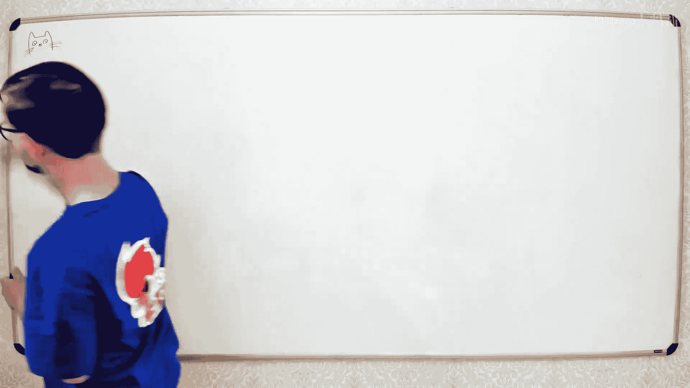

Now was a bit。