# 【精译⚡算法与数据结构】PavelMavrin p34 p33 A&DS S03E02. Strongly Connected Components, 2-SAT -BV1NLB8YfEMq_p34-

🎼。

So today we continue to talk about graphs。We continue to talk about def search algorithms and。

We discuss one more application of the research algorithm。

 a little bit more interesting than in previous lecture。

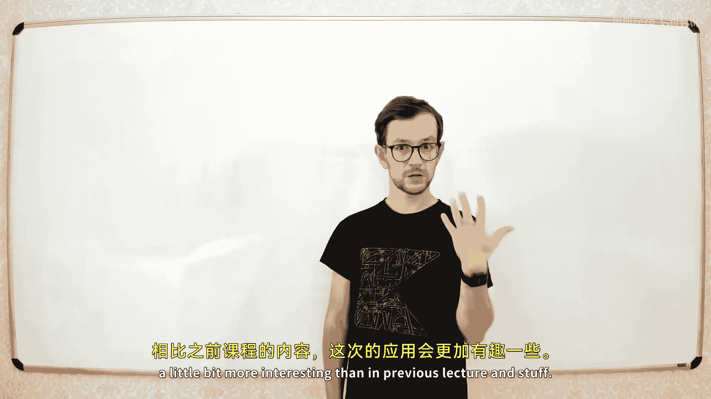

And so。五。What we talk about today is about connectivity in director graphs。

 so how the connectivity works in director graphs。If you remember the previous lecture。

 we discussed connectivity in and graphs in and graphs， it's very simple。

 connectivity works like this。 You have some components。

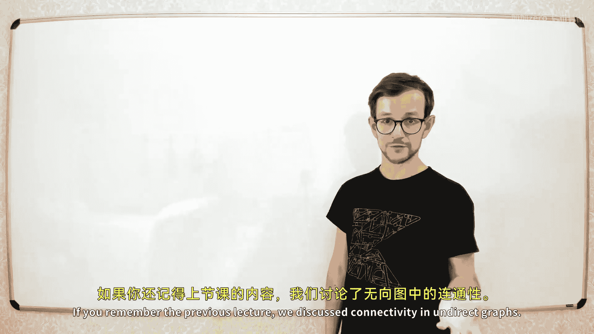

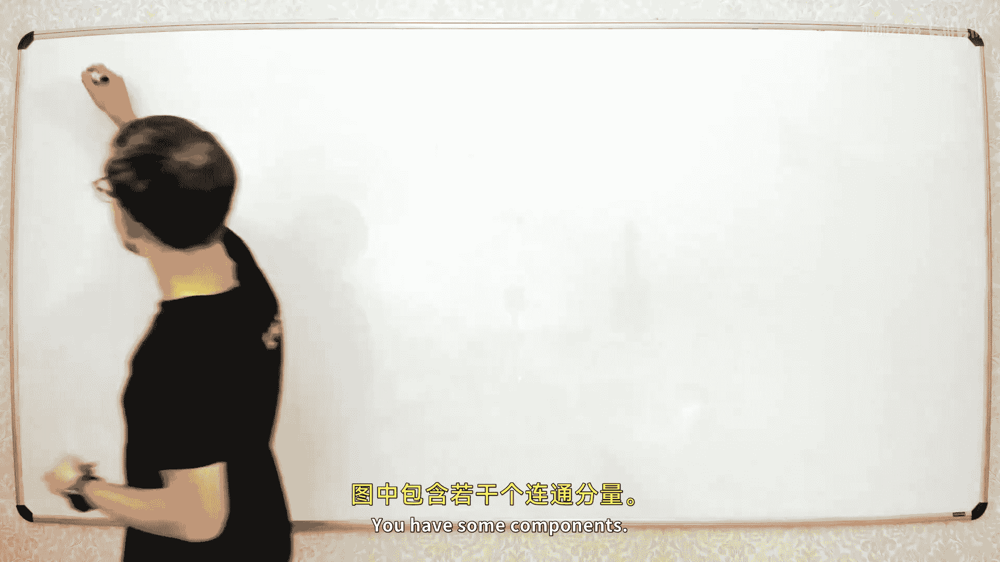

So in each component， you have something。

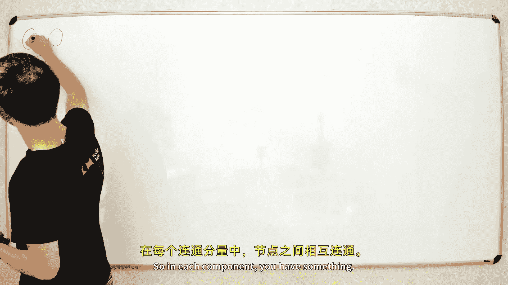

And here's something。And two vertics are connected if they belong to the same connected component。

 so if you take any two notes。

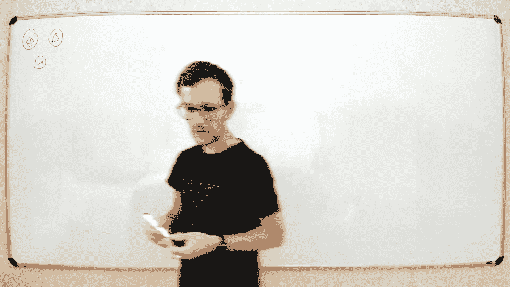

And look on the connect components of these nodes。 if you have the same connect component。

 then thisverse are connected。 If you take ver from two different connected components。

 they are not connected。So it's very simple in direct graphs， it's a little bit more complicated。

Because this relation is not symmetric， so you might have some node V and some node U。

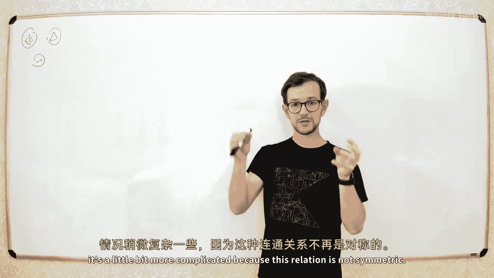

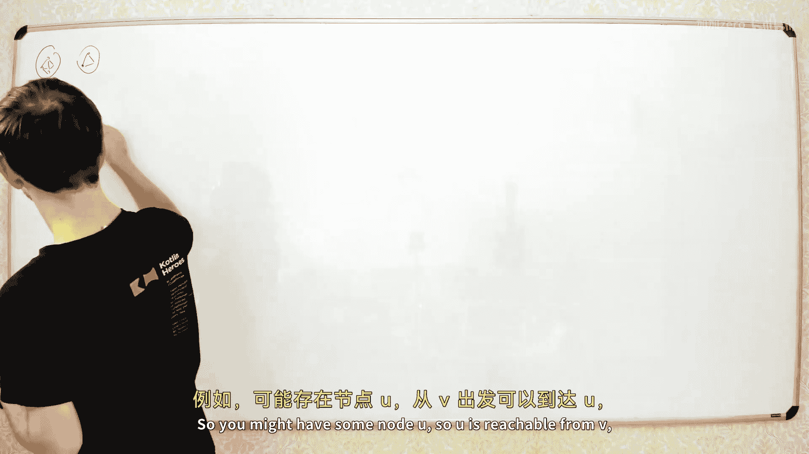

So U is reachable from V。But we is not。Guaranteed to be reachable from you。 So it's not symmetrical。

So you may have some strange constructions of this connectivity。啊。

And what we'll talk today is about how it works in director graphs if you look on the like big picture。

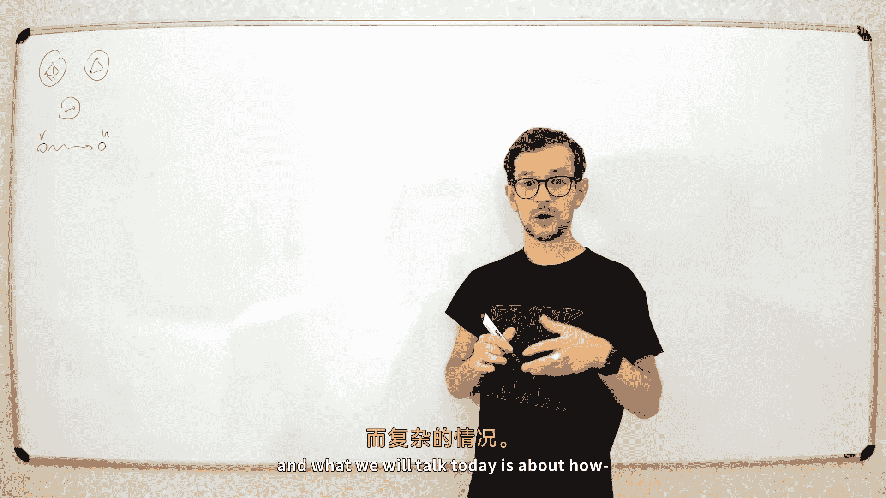

。Let's work on the following in relation。 Let's say that two nodes are double connected。

Let be connected。 Let's say be connected。 I'm good。 I'm good in English English terms。 Actually。

 Let's say two veres are be connected if you have。They're strongly connected。 Yeah。

 let's say they' are strongly connected。

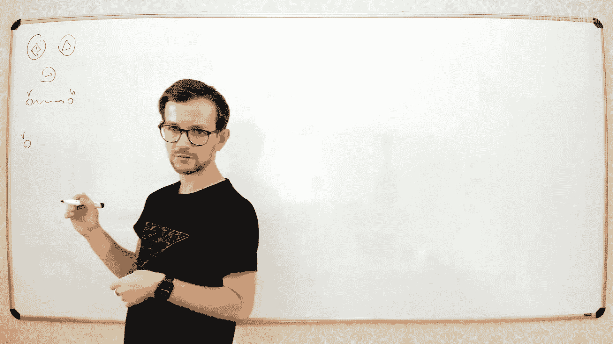

If you have both paths， so if you can go from V to U and you can go from U to V。

So we will not have stream on Friday again， like， like I explained。

Before I will be very busy on Friday， so we have lecture today instead of Friday。

So let's say that two nodes are strongly connected。 If I can go both ways。

 if I can go from V to U and go back。

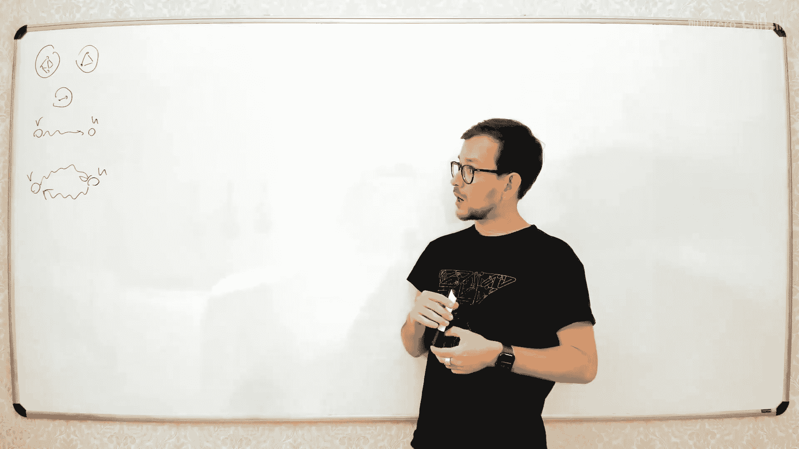

And this relation is actually symmetrical。And that's good。

 And it is also transit because if I have frees and I can go from V to U and back。

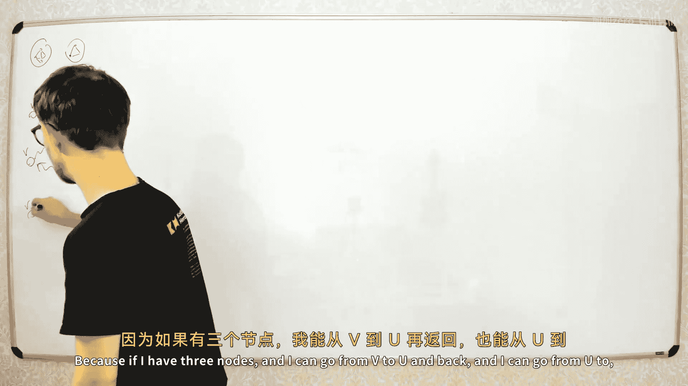

And I can go from you to say， double you and beck。Then I can go from V to W and back， Yes。

 just using this path， I can go from here using this this path and this path， I can go to W。

 and then I can go back just using this path and this path。

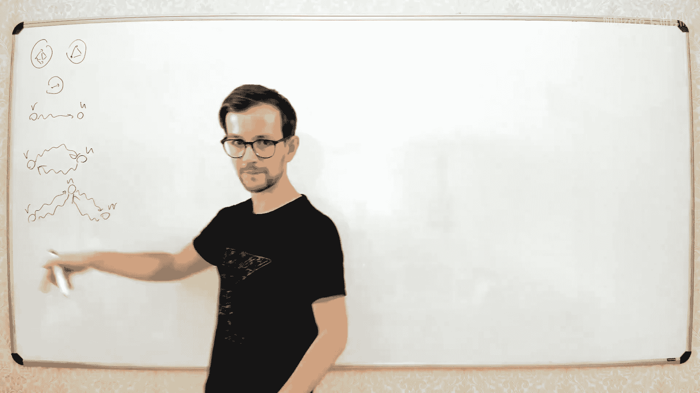

So this relation is actually symmetrical and transitive。So again。

 it will form some equivalence classes， like before， So if you look on the all node。

 they will be split into some sets。

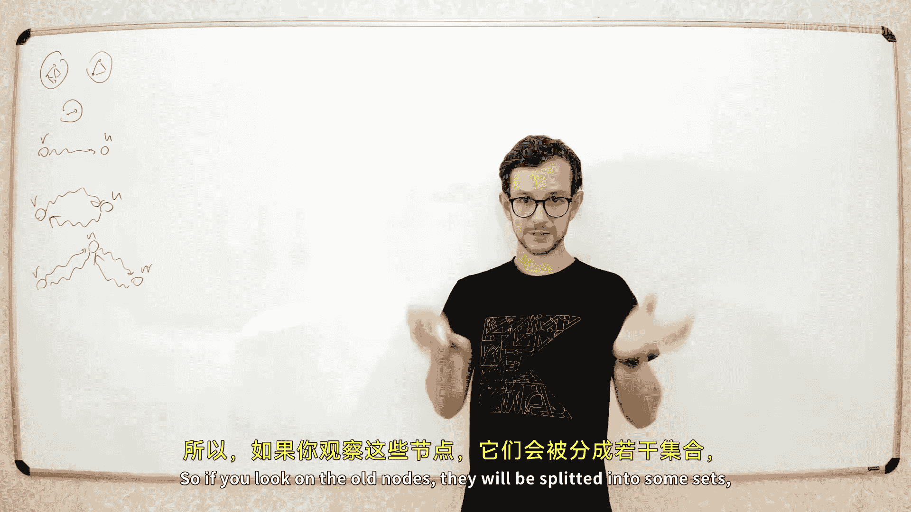

So I in each， in each of this set。All the nodes are strongly connected to each other。

 and these components are called strongly connected components。 Well Let's draw some。For example。

 let's say。Let's put some numbers actually， let's see。

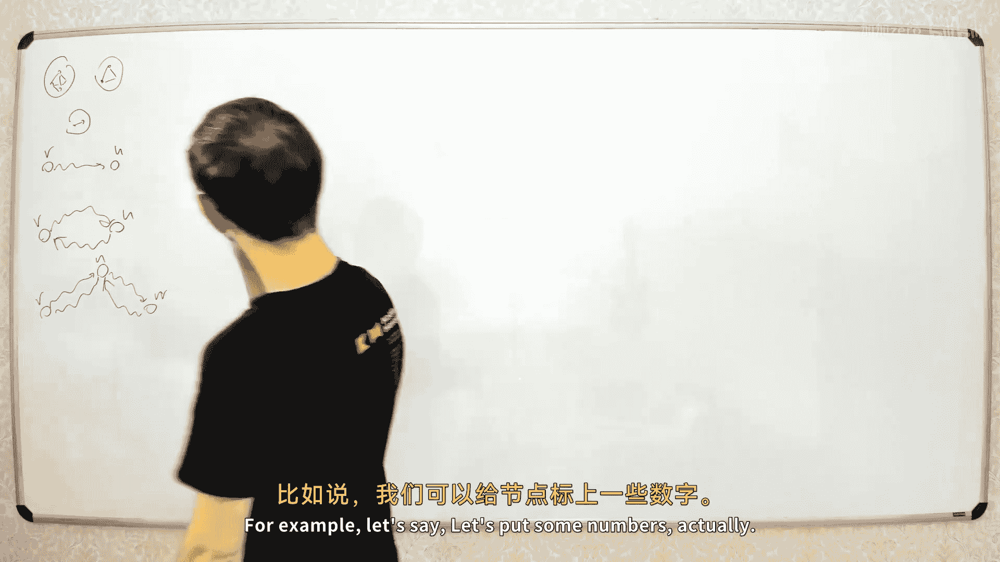

Its one and。Do end back。我색。5。And something here is true。Let me think。 So I wanted to be here。

 And then let's。2 and then。Let's see，4 here。And6 here。And I wanted to go there。

I'm just thinking what I want to achieve。as we' like at these lists for this。なか。4 here this six here。

嗯哼。Like peace。And then we have 23，4，5，3 and then put three here。Like this， for example。Yeah。

 this part。So let's look on this graph。In this graph， we have several connect， let's put some bumps。

嗯。That was so interesting。어。Let me think just a second。Just a second。

 I want to provo here and then back。嗯。Sorry， I just want to to be。

 I just want to make interesting draft。 So something interesting is going okay。呃呵呵呵呵。嗯哼哼。😊。

아 뭐 봐 난건 건 봐야。B think。嗯哼。嗯，哼嘿。😊，Yeah， let's do like play based school。

 not there and then go back like this。い sorry。Yes。Yeah， no那那那我 wants be fine。Let's put one something。

It7 here just， just to make it。Yeah， something like this。Yeah， now it's fine。そ。

Let's look on this graph， so we have this graph in this graph。

 we have some set of nodes such that in each of this set。

 all nodes are strongly connected to each other。 For example， if you look on these four nodes。

In these four node， we have path from every node to every other node。

So this is stronger connected component。For example， from these three， if you want to go this seven。

 you would like that you go here here and here， if you want to go back from seven to three。

 you go here， here and here。And so from three to2， from three to6。

 from three to seven and back from seven to three， from6 to three from2 to three。

 so you have perhapss from every node to every node add node。

So these four nodes are a strong an component and it's easy to see that all other nodes have no connection to these nodes。

 so you can go from this part of the graph to this part of the graph。

So these four nodes belong to the same， strongly connected component。

 and these nodes belong to some different strongly connected components。

So what happens in this part of the graph， so you have these two nodes from these two node。

 you can go。Both the ways these two node are another connect component like this。

And you have this single node， this single node is a strongly connected component of one node it's possible for some some strongly connected components。

 maybe just consist of a single node that that's fine。What is。

So this graph is split into three stronger connected components。到。What you can do。

 you can enumerate these strongly components。 Let's just， let's just label them these letterss。

 just for。so let's say these connect components A， this is connect component B。

 and this connect component C。And now what you want to build is to build another graph。

 which consists of these strongly connected components。

 So let's build the following graph for each strongly connected components。 let's build one vertex。

 So we have this vertex a。We are to speed。norex C。And now we will build edges such that you can can you see this isn't？

Two lights。手清装看。So， for this free。G this is you build the edges if these connect components have the edge between them。

Here you have this edge from three to one。3 belongs to a。 One belongs to B。

 So we need to make H from a to B。This age。啊。Hes no here。Similarly case so we have h from6 to 4。

6 belong to a， four belong to C， so we have H from A to C。And here you have H from C to B。

 so you like H here。Thatそ。This graph is actually important。

 this graph called the condensation of this graph。Its conversation。嗯。

But that's all about terms that's all we need to know basically。again。Let's call2 2。

2 vertices strongly connected if we have。Both webs from V to U and back from U to B。

This relation is equivalentruence translation， so all your notess will be split into some equivalentruence classes。

 These equivalentruence classes called strongly connect components。

Inside each strongly connect components， all the nodes are connected to each other。

Then you can split it into strong economic componentss and build this graph。

 this graph called the condensation， so each strong icon components is just squeeze into one single node。

And you build this job。再走。Now what's interesting about this graph interesting about this graph is you can have cycles in this graph。

 so in the condensation of any graph is always a acycl graph。Why you can't have cycles in this graph。

 No， it's easy to see。 So if you have cycle in this graph， it means that you can， you actually。

 any cycle is actually strongly can component if you have a cycle。Yes。Then in this cycle。

 you can move from any node to any and node， so any all vers in the same cycle should belong to the same connect strongly connected component。

 right？So in these condensationsations， each tro connect component is just within into one single node。

 So in this。Condensation graph you can't have any cycles。

 so this condensation is always some a cyclic direct graph。Acyclgraph are much more。

Much more easy for many algorithms， so in many algorithms， if you have acyclgraph。

 it's much easier to see what's going on because in acycl graph you can make it a logical sort and then run some algorithms and so on。

 So one of in many algorithms the first step is just to look on your graph strongly connected components。

 then build condensation and then run some specific algorithm for acyclgraphs on this condensation and then find your result。

That's how it works in director graphs。对。That's all about termology and now we just need to build the algorithm in which finds these strongly connected components。

So what we'll do today is to build the algorithms which will take the graph and find all the strongly connected components in this graph。

When you find all the stronger connected components， it's easy to build the condensation。 Yes。

 because if for each node， you know the stronger connected components and belongs。

Then none of it's very easy to build this condensation。

 You just remember for each note which component it belongs。

Now you iterate all edges you look for one each edge if these nodes belong to different。Components。

 then you just add the H in condensation。And so on。So after you make this split。

 it's easy to build the condensation。Right。Okay， hope is's clear。啊。That's all。That's the Bford today。

😊，But， let's first build some。Some stupid algorithm。 So if you。

If you just if you don't care about the time， you just want to build all the strongly connected components。

 how to do it using deation rhythm， what you can do， you can take， for example， node one。

Take note one。And now you want to find the strongly connected component of the node 1。

 What you can do。 You can take node 1。Around the death of social Britain。

And you will find all the nodes which are reachable from node 1。Yeah。

So this will be the nodes reachable from node 1。Now what you can do。

 you can run another def rhythm on reverse edges。And find all the notes。From which you can。

Go to node 1。 So it， it will be some another set of nodes。そ。

So these nodes will be reachable from one and these node will be the node from which you can reach the one。

Now， you can just intersect these two sets。So if some node X belongs to both these sets。

It means that this node X should belong to the same strongly connected component as one。

So you just take node one around these DS， around these DFs， take the intersection of these two sets。

 and this will be the strongly connected component of the node 1。嗯哼。😊。

Now you find this only component。 you take the next。

Not for which we which doesn't belong to this strong economic component， make the same thing。

 So you take the node 2。 So so you're run this for node one around this thing around this thing。

 intersect this two sets， find these two nodes， say they belong to the strong economic component node one。

 Now you take the next node， which is not marked yet。Take it was least。

ARound these two Ds from node2 mark these strongly connected components。And so on。

So what will be the running time for this algorithm。 unfortunately。

 running time of this algorithm would be too big because what's going on when you just run single de。

 You just don't remove these marks。 so in the previous lecture。

 we discuss discuss them if you run the search multiple times from multiple different vers and don't remove these marks。

 Then the total time complex， you will be still linear because you only run the search from each node only once。

 But here it is not true because it may happen that this set is big， these set is big。

 So spend a lot of time building these two sets， running these two the algorithms。

 But the intersection of these two sets is small。 So so this。You have a lot of nodes here。

 a lot of nodes here， but they are different nodes， so some nodes are reachable from one。

 some reach some nodes nodes from which you can reach one， but they are different nodes。

So you spend a lot of time， but mark only single node one。It may happen。

And this may happen actually for all nodes。So， for example。

 if you if the graph is a cyclic from the beginning。Then that's what will happen。 So for each note。

 you may spend M time to run this to the F。And then mark nothing just single node one。嗯。Yeah。

 so in this case。The tank complexity will be the following， so you run these two DFSs。

 10 complexity will be M， and you do it for every node。In the worst case， right。

 So in the worst case， you need to run these two the effectss for all nodes。

 So M will be multiplied by M。And that's too much。That's too much， so if you have a big graph。

 you can do it like this。But fortunately， there are some。Algorithms。

 which works much faster than this。 And one of these algorithms works。

 that are two main algorithms for。Constructing strong connected components。

 there is a Ta algorithm and cassra algorithm。And we will discuss the cassarari algorithm today。

It' verys very simple algorithm， the code will be very simple and the time complexity will be linear。

Cool algorithm in this。第二人。啊。お子そ。The algorithm。傻。嗯嗯嗯。

Those matter which one No they they have the same time complexity。

 Maybe the constant factor is a little bit different。 I am not sure which one is actually better。

I'm not sure which one is better in practice。 I believe they are pretty much the same real time。

You may try both。啊。No， no， you know， historically， I felt the first organ was is invented by Tchn。

 but then it， it's little bit。It uses some magic in the middle。

 we' will discuss this magic when we'll talk about B connected component sense。

Stuff like this and bridges and we will talk about this。

 Cassara I'll get this a little bit easier to implement and a little bit easier to understand what's going on。

 So we will discuss it today。啊。The algorithm。Read ready ready easy要。What we'll do？

We will take the graph。And then around the same procedure we used when we try to build the topological sort。

 so we will run the deficit algorithm and put the nodes when we exit the deficit。

 so we'll sort the nodes by the time when we exit the node from the DFS。Very。

They put it here from the D FS。So we put DFS。izizz like this。Let's do exactly this if this is marked。

Will it done。Then we generate all edges。Going from this audio call the D F S。We into market。

Mar the note。Then we all edges。Out of V。Andなこ言う。And then in the end of this difference， we。

Add this node V to the list of the topological sort。 we didt before。Let's be P and the。Yeah。

It's not algorithm， no， if you have a cycl graph， this algorithm will build with biologicalological ordering。

If you have sights， it will build you something。The interesting thing that this sum， it will be。

 it will put the ver in some order。 and this order is actually interesting。

 We'll talk about why it's interesting。 We'll talk about。 now。 So， for example， in this graph。 Look。

 we call thequest1。So we call JFS from one。No， please just some order of the nodes。

 I will add this node V into this order。I actually need to reverse it。

 so I will add all atom from right to left。You'll see in a minute， so around the F from here。

 the F goes here to node 5。Now from node5， there's nowhere to go。

 so we exit let's just mark all the edges I visit。 So I start here， go to5 using this node。

Now let's know where to go this from this node5。Let's put the marks back， so I mark node1。

 then go here， mark node5。 then it's know to go from node5。 So this DFS exit。

 So I need to add node 5 to the list。 so I note 5。Now is I need I go back to node 1 from node 1。

 there's nowhere to go。 So I exit node 1， add node1 to the list。Let's说。

Now we take the first unvisited node and start the face again like we did in the topp algorithm。

 so we take node two， call the first from node2， so we start from here。Mart note2。Move to node 6。

Then we move to node 3。Now from node3 is nowhere to go， so we exit node3， add node3 to the list。

Then we go back， go to note 4。Exit Note4， edit's to released。Go back to6， visit note 7。Exit node 7。

 add to missed。Exit node 6， exit node2。So in then， we have this list。呃。Yeah， maybe in Kara。

 you need to build both the normal graph and reverse graph， so maybe it's a little bit。Yeah， yeah。

 maybe maybe the consequences factor will be worse for the than in interchan。

 but interchan you need to build another array for these things。I'm not sure。

 You need to check both them。There are both difficulties in both these algorithms。

 So which I believe in practice is pretty much the same。嗯。Fine， so we have this RA in。Again。

 I added to from right to left I add this one so if you have vector you need to just reverse this vector in there。

 so what's going on in your program in your program you do it like this it for all in v from 0 to n minus1。

And just call this， dear first。For V， and then in there， universe reverse。Great。Something like this。

So in then you have this array。And now the magic happens。 Now the magic happens。

 What is the magic We will。Around the second deposit operation。On the reverse。

And we will do it in this folder， so in this folder。

 we will go and try to run a second if search on the reverse graph。So we take the leftmost note here。

 this note。And try to find all the nodes from which you can reach the node too。 So we'll again。

Call the second FS。 Let's call D FS 2， because I'm not very creative。

 So second F will work like this egg。 will do the same。嗯ん。Again， say if Mark 2。Of we and we。Mar。

T or the true， but these four will be not its right or all outgoing edges， but on ingoing edges。

So you picture it。In going pages just free。난 run。D， F， S， true of you。Okay this this is什。

Here we're going ongoing ages， here we're going all in going ages。For example， in this graph。

 so we take note2。We start from node 2。So standing in here and remove this box。

So we marked those two。Then look on all ingoing edge into node。 So in in August。

 you you will use this edge。 So you go to note3。 mark this。To this note3， you can go from here。

 you mail message to this node 6， you can go from here。It's already marked， go back go back。

 then use this edge to go here and thats on。And now the magic happens now it pure magic。

 So what will happen that this second deposit algorithm will mark exactly the strongly connected component of the node2。

 So if you just run this second deposit algorithm。します。4 V from 0 to n -1 run DFS。Z of be of。我发 you。

So if we take the first note in this order。And call the second depositation。

 So theation reverse edges。It will mark exactly the strongly connected component of the node2。

you can see here， so all the nodes marked by these DS is actually the strongly connect component of the no。

So it will mark this note let's say this belongs to component a，6，7， and three。7 and3。

So these four nodes belong to strongly connected components or connected component of node2。Magic。

 right？ We'll prove it in a second。What what next， let's take the next note which is not marked so let's take first note leftmost note。

 which doesn't belong to S connect component A。Build these four。For this note 4。

 let's call another depth for on reverse edges。 So we start from this note 4。From this dot4。

 you mark this do4。Then try to go on all ingoing edges you have only a single in so you will try to go here。

 this is notology marked， so you stop the DFS go back and this that's all so。

You only mark this node form， right， And thiss exactly the strongly connected component of this node4。

 So you mark this deficit showing from this node4 will mark only this node form。

 And that's exactly the strongly connected component of node 4。It was C。 It was啊。그 o オ。

 it's call it same just。I don't want to change it key。And now you take the next node。

 which was was't marked before。 So this note 1 doesn't belong to strong economic component A and B and C。

 So it must be belong to some another strong economic component。 So we take the leftmost node。

 which doesn't belong to any。Con strongly kind components we found before and run his second deposition from this node。

And it will mark these two holes。So these tools kind。That's all。That's the whole algorithm。

 that's the whole code， basically。So you need something。 So if if you。

 if you want to find for each note the， the the label of the strong framework。

 But you need to put this label here。 And when you call this there first。

 you want to put these labels in all notes。 Yeah， So， for example， here。

 you want to make you want to count all the。Strong components。 so if it is not marked。

 you increase the counter， put this counter here and then put this label to all nodes you visit in this device so you can add second parameter here。

 the label you want to put on all nodes。And just put instead of marks。

 you just put these labels in all nodes just so what you want to do is to label each node with the label of the connect compound。

 right， So you put labels a to all nodes here。Label B to all nodes here and label C to here。

That's what you want to do， usually。Usually it's not late， but but numbers， yeah， but just for just。

Y， okay。That's all， that's all。Now let's prove this actually works。

I want to prove that this algorithm is actually。Building the strong connect components。Let's go。

 Let's go。 Let's go。 Let's go。第二。そう。To prove this algorithm。

 we actually need to have some more observations about how depth search works ingraphs。

So indirect the graphs。If you have， let let's look on some strongly liquid components。

 imagine you have some strongly components。So we have some strong component a。

Let's look on the so you' on your deposit search， this first deposit search。And at some point。

 your depth search will enter this strongly economic component。

 Let's find the first node you will enter when you visit these strongly economic components。

 So at some point you will enter this edge and this will be the first。No of this strong compound。嗯。

So when you visit this first node， all this component is not marked yet。

 so all nodes in this kind of component are not marked。😡，So we have some notes here。

And since this is the first node you enter。So when you enter this node。

 all these nodes are not marked。こ。Now let's see what happened before you exit。

 so your D enter this node。Then do something and then go back。

I claim that when you exit this exit the depth of this node。All these notes will be marked。So。

 so again。The observation is very simple。 You have some strongly connected component。

 and it is not marked。 You， you enter some node V。So when you exit this node V。

So when you finish this dayest。All the notes here will be marked。So this the one。不咋回事。Mmhm。😊，Okay。

This V is the first node you enter when you enter this strong icon component。嗯哼。Now。

 eventually you will visit all the nodes of your graph， right。

 So just you just visit all the nodes of your graph。

 So eventually you will mark all the all the nodes of your graph。

 So let's find the first node in this strong connect component。

I just wait until you say that everything is clear。 So lets for each for some strong component。

 let's look on the first note of this strong console， which will be marked by ODFs。

So what will happen when you enter this note， you do something inside this recursion。

And then you here， you， you go here。 So you end， you you enter， you add this V to your list。

So the observation is when you exit this node V， all the nodes here will be marked。 Let's prove this。

 it is simple。Let's prove this。So let's take some node inside this canonic the compound。

 not node view for this node view。Since it is blocks to the same strong connect。

 there must be a path。 Yeah， so there must be a path from V V to U some path。So when we exit this V。

 this V must be marked。So V is marked， but U is not marked。How would it happen？So if V is marked。

 but you is not marked， let's find the first note on this path， which wasn't marked。So， for example。

 this。This note X is marked， but this Y wasn't marked。How could it happen， It couldn't happen。

Not because when we enter this V， X wasn't marked。 Yeah， so when we exit this V。

 we actually exited this node node x as well。 Yeah， No because what happened we。Enter this DFS of V。

 y。And before we exit node node3， we mark this node X。 It means that at some point。

We called DfS of node X and then go back to recursion and then exit here yeah。

 so we enter this recursion， then enter this recur， then exit this and exit this。

 so actually exited this node X。But when we exit on X， we must。In for all edges from this node X。

 So we actually must see this edge from x to y， so we must go to this edge and actually mark this node Y。

 So it couldn't happen。 So if we mark some node X， we must mark also mark this node Y。

Because we refer all edges from note X。So it could happen。Oh，It's actually quite intuitive。

 So so if what will happen when you call DFS， It try to mark everything which is connected to your current node。

 Yeah， so you if you start DFS from this node， it will try to reach everything it could reach and it could reach all this strong component because all all nodes inside strong connect are connected So。

 you actually can reach all the nodes inside this starting from this node be。

So when you exit this difference， it must actually mark everything and connected to V。

So it will mark all these salt inside the strong。Make sense，'s right。え哼。😊。

Now let's look how it corresponds to this order， So in this order， what will happen？So。

 you enter node V。Now， before you exit node V。You will visit all the nodes inside this strongly connected component。

😊，So every node view will be inside this recursion tree， right So if you look on everything so so。

Every note， you must be somewhere here in this regression dream。So in this recur three。

 you will visit all the notes inside the strong connect compound。

What does mean So if you look on this order。So， let's look this。In this order。

 you have some node which belongs to the austronomiconic components。

So we have here we have some notes from component A。Which of them will be the node fee。

 what do you think？Okay， after you run this first difference。You have some order of your nose。

So these are all the nodes which belongs to thecastroonic and compound A。

You don't know the how clues， but there are some strong connect component right。

 So let's imagine we look on some strong connect component。

And the notess of this strong reect component have these positions in your final order。In this。

 in this A P。Yeah， so which of them will be the node week？や。Fight。

So this node V will be the last node we add to A because we add。Note V  to A P when we exit node V。

 but we will exit node V at the last。So it will be the last note。We exit。

From all the notes of this learning it， so this note， we will be here。嗯哼。That's all。

 that's the first important observation。For each strongly connected component。

 if we look on the first。Note we enter in in this normal input that in this R。

 it will be the leftmost node of this component。哦。That's the first important observation。

 The second important observation is full。😊，Let's focus on two different strong economic components。

 So you have some。Component A， and sum another component B。And you have H from A to B。

And for each of these component， you have this first node， so you have。

 let's call this first V is the first node of component A， and this U is the first node component B。

嗯哼。So what will happen with these two node？If we look on the them in this A P。So in this repeat。

 we have node V somewhere and node U somewhere。And the observation is that node V is always to the left from the node view。

 so have node V here and node view somewhere here。And belong wants the compound。

So kind the situation is always like this。Why is this true？No， because when you enter this node fee。

You cant leave this node V until you reach something in this component B。So when you enter node V。

 you run across the pole。So your DFS will find everything inside this connect component。

Then it also will find all the edges going from this connect component。

 so since you have this edge from a to B， there must be some edge connected something from a to something from B。

So yops， so whether you reach this V。You will find everything inside disconnect component and you will look on this edge because note this again again this node X belong to this component。

 so before you exit V you must exit X and before you exit X， you must see this H。

And then you see this edge， you actually find something in connectect component B。

So some node in connect component B must be to the right。From V。はい。And since U is the first note。

It also must be to right from B。没事。Clな。Second， again。

 what is the observation if you look on two different components？And for each connect component。

 you find the first node of this connect deposit this。 So first node is something special。

 So you have this special node of the first connect component and the first special node of this。

 So special node is the first node you enter this connect component。

So the observation is very simple if you have some edge from A to B。

 then first node of B must be to the right from the first node of a。

Because you cant exit this node when you put this V to the node to this P。

 you try to visit everything from this node V， you can visit something from B。

So this B must be to derive right from a。sly again this is quite in。

 It's it's actually the same proof like we had when we have topological order this basically the same thing。

 What happened is these first nodes of connect components are presented in this P in topological order。

😊，So if you leave only first node of each connect component。

They present in this RA inthological order。 So if you have some edge from here to here。

 then first notes。Will be in the political order。That's the whole observation。Clear enough。

That's the home image。那嗯。故。And now the proof so Now let's hook on the first。

So let's look on the leftmost。Element in the R P。Leftmost element and Ree is the leftmost node in some connect component。

嗯哼。So if you look on this。Leftmost note here。It belongs to some connect component。

In this connect compound， it is the leftmost node。M哼m。😊，So since it is the leftmost node。

 it cant have any incoming edges。い。So this leftmost node belong to some strong economic component and you can't have edges going into this strong economic component。

 so you cant have edges like this。No， because if you have。

Edge in going to your first catrononic connect component。

 it means you have some another ktic compound and you must have some another vertex。

 which is to the left from your vertex。And if you take the leftmost， it can't have any ingoing edges。

Right。So if we take the leftmost note in this order P。

It belongs to some strongly connected component。And theses。And girl this。

So this strong economic component cant have any ingoing edges。嗯哼。And now what we do。

 we try to find everything which everything all the node from which you can enter this node。

 this leftmost node。M哼m。😊，You will find everything inside this strongly connected component。

But you can't find anything else because you second interface goes goes only regard graph。

And from this compound， you can't go any of there so you will visit everything inside this node this component。

 so you will mark everything inside this component。

 but you cant go out of disconnect connect components since you don't have any in edges。

So we will use only these strongly connected components。嗯哼。😊，When Java something。

 it's not about Java。 It's not about Jon。This lecture is about Java。

 Let's talk about other difference things。啊。Now now you take the next note。

So you take the leftmost node， which doesn't belong to your connect components。

 so it belongs in other connect components。This second connect component may have ingoing edges only from this component only from this customer。

 so you may have ingo edge only from here。You can can't have invoage from somewhere else。

Because again， because it is leftmost node。In in this oil P。So you take this node again。

 call the second DFS， it will mark。All the nodes inside this kind of compound。

 but it can go out of it because you can only go out to here。

 but these notes are all remarksmark before。So again。

 you will visit only the notes inside your strongly connected component。And so on， again。

 it's exactly like it like it was in the topological ordering on。

Every time you take some compound which doesn't have any ingoing edges。

So you will visit only the nodes inside this stronger compound， you can go out of it。嗯哼。

And so now again you take the next connect component again， you may have all the edges from here。So。

 you will。Mark everything here， but you can go out and so on so。 Each time you call the second DFS。

 you will mark all the nodes inside some strong connect component。

 but you can go out of this strong connect component since it is the leftmost。

Component in this order。Good song。That's the whole proof。Yeah。はイス。

So this is the focus scenario algorithm。What is the time complexity and time complexity is easy so so what we're doing in this program we run first the F reverse。

 run second FS， so all the actions are actually linear。

 so the time complexity of this algorithm will be linear， so time complexity will。Let's second plus。

That's all。That's how you build that。Stro looking at componentss。Okay。

 we have 30 more minutes to discuss。아都差た。which one。びびびび。You can watch any lectures you want。

Just watch your like if you have some algorithm want you want to learn。

 just watch every lecture about this algorithm。Some lectures are different。

 So maybe my approach will be hard to understand in some another approach。

Try to watch all all the lectures and find what works for you actually for the most of complicated algorithms。

 usually you can't understand them from from the first try。

 You need some different approaches to understand actually what's going on。Actually。

 some since it's better to watch the same lecture twice， just too。

Find all the details you missed on the first roundom。故。多少。

So one of the coolest implications of this technique is to solve the two cell problem。

So what is to a problem and how to solve。So tooa problem comes actually from Boolean algebra and stuff like this。

 it's one of the problems。Which。Comes from this brilliantan logic and stuff。

One of the most classical problem of this of the Boolean logic。So the problem is like this。

 you have the Boolean formula of the very specific type。

 the Boolean formula must consist of several clauses。And in each close。

 you have exactly two elements。Like， for example， X or Y。So you have n variables， booleing variables。

 and for each close， you have exactly two elements。

 each element must be a variable or the negation of the variable。不不不不不。Like this。

And you have something。Let's put something again okay。

 let's put it like like first time I always know what I want to do。Or that。And let's say。

 not Z or not X。Sounds like this。That's all。 So you have a formula。

 you have n variables and you have formula like this in this formula。

 you have closests image each clause， you have two elements。

 Each element is a variable organizational variable。 That's all。And the question is。

 is it possible to assign some values to all the variables so this formula will be through？That错。

It turns out maybe66 is quite surprising that a lot of problems actually turns out to be reduced to twoa problem。

So there are many different problems from various fields。

 which can be reduced to solving some long to side problem。

Another interesting thing that if you look on then not two separate problem， but threes a problem。

 if you allow three elements in all its clauses， it will be MP complete problem。

So if you allow three elements in all clauses， it will be n complete。

 but if you allow only two clauses， it will be polynomial is rather sovable， but and actually。

Linear in linear time。Or just throw。We have some space。Any more questions by now， Yes。

 we need to check if this brand formula is viable， so we need to find some values for all variables。

 so this formula is true。

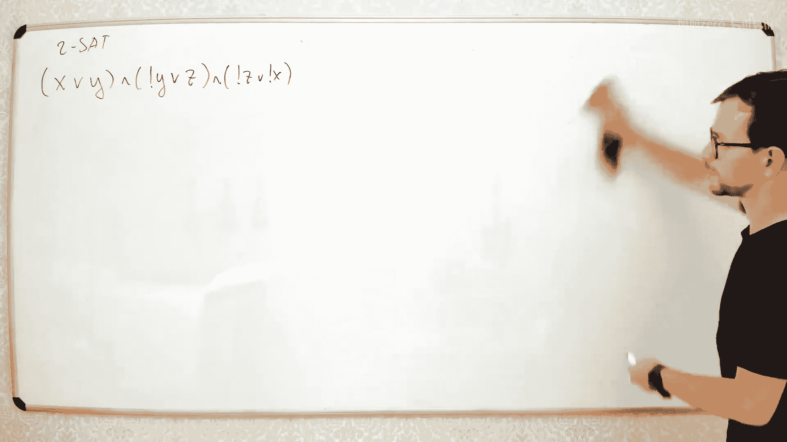

No， okay， let's try to solve with manually， so what will happen if you try to solve two sub problem manually。

 let's take some variable， Let's take variable X。For this variable x， you have two options。

 you can assign 001。Let's try to assign0， So if x is 0。H。😊，What happened？So if x is 0。

 then for this flow， yeah， this is false， so this must be true。So if x is zero。

 then y is definitely true。嗯。Now， we know that x is 0。 Y is 1。

 Let's look on this clause for this clause。 we have。False here。 So this must be true。

So that must be one。Now， for these clothes， we have。Here we have faults here， we have true。

 so all the clothes are satisfied。不说。Is it。Yeah。Now basically what happened。

 we just guessed the solution for the first variable and then everything is uniquely determined。

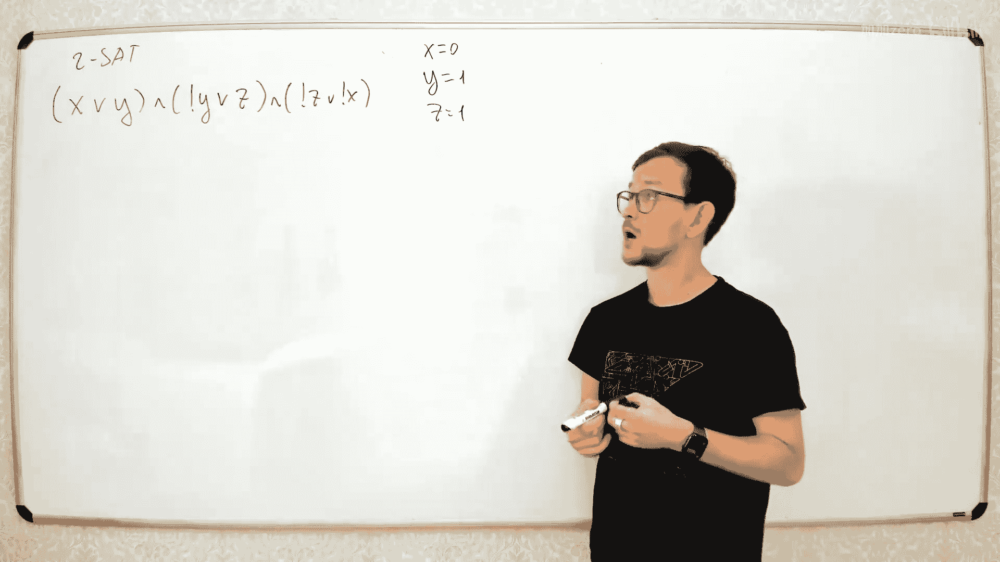

On other hand， so， if you， if you， if you say that x is 1。That will happen。 So if x1， then。

In this close， this is false。So this must be true。 It means that must be equal to 0，So that isよ。

If that is 0， then in this clothes。You have。The the equal is  zero， so y must be  zero。So why is you？

That's another solution。So we have two different solutions for the same formula。 That's， that's，'s。

 that's normal。 So sometimes you have several different solutions for the same formula。

 The question is to find any any valid solution for this formula。Actually。

 classical problem is to check if this form was satisfiable or not。

 but we will actually find the solution。 So our algorithm will find the correct values for all variables。

 which give the true in the end。呼呼。Okay， I'm just doing it very slowly to give you some time to rest。

거 go。let's have some more examples。For example， what will happen if we have。Something else。

 let's see。So， for example， not。Why。Or。Note X。Yes， the number of reference solution may grow exponentially。

And actually， to find the number of different solutions is again， something complete problem。

 So you can't find the number of different solutions。 You can't。

 it's right or all different solutions。 The question will be to find any solution。

 So algorithm we find some solution for this problem。E it exists。So what happened in this case。

 for example， let's try to do the same thing。 So we' will try assign x to 0。If x equal to 0。

 thens mark that this is0。Yeah， so this must be true。So why must be true？If white is true。

Then this is zero， so this must be true。Yeah， so that must be true。Now here you have not that。

 So you have zero here， about one here。So this close is fine in this close you have not y here。

 so zero here。这。Like these。That's my M0 here。😊，So here， have contradiction。So again。

 we assume that the value of x is 0。And try to find everything which let from this。 So So from this。

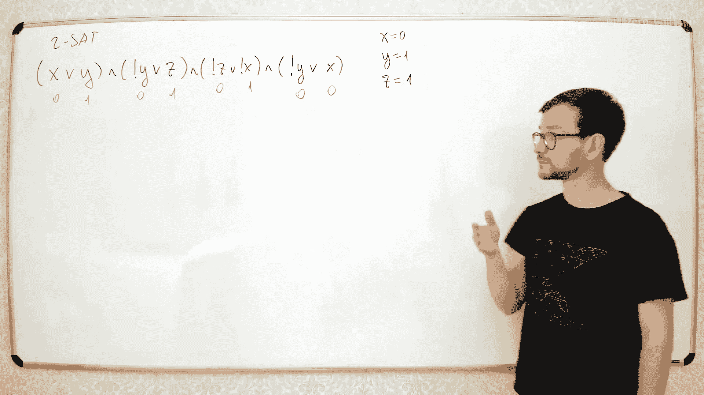

You get that y must be one from this， you get that Z must be1。And now you all the values are fixed。

 and you have a contradict here。So x may not be0。So we have a bed case here。

But if you try x equal to one。Then you will be fine。Because if x equal to one。And you have one here。

0 here，1 here。So in this clause， must be so that must be zero。So this is 0。 So why it must be。zero。

너지 이。Now， this is。True， and this is true。And now it's fine。Yeah， yes， in this problem。

 all records have exactly two variables。That's， that's。Again， in the common case。

 So if you just look on any bulletolean formula and try to find this value。

 it ist big complete problem。So， for。For all and for all and foremost， it is an a problem。

 and even if you allow three variables in each close， it will be acomp problem。

So this is very special problem， which is actually solvable。It's rareities。オ。Okay。

 let's roll the out。The algorithm will actually do the same thing we did manually。

So what will happen， so we will try to find all them。

Implications for for some variables to an another。For example， let's look on this first close。

For this first close， we know that if。What happened in this first calls in this first close。

 if we have。もうエ。The recovery recovery。And bicycle， so if we have not， why？Then， we have x。So。

Each clause will give us two applications like this。Yeah。For example， here， again。

 you will have if Y， the thenZ。So if this is false， then this must be true。And if not that。V modeway。

And so on so。The clothes will give you two in。두 두 두 인플케이션팩。Nice。So what we'll do？

We will build a graph。It's lecture bulk ups， right？So we will build the growth。

In this graph we will have two nodes for each variable。

 so one variable one node will be correspond to value true another for false， so Q will be x。

 Q will be not x。Wイ andの white。that。And love that。And now we just will add edges corresponding to this integration。

 so for each clause， we will add two edges to our graph edges will be like this。

Each respond on application。 So if if this statement is true， then this statement must be true。

Let's at all here we have。If not X， then what。If not Y than X。For this， close we have。If why。

 then that。Like these。And if not that， then not why。For this bracket， we have if Z， then not x。

 So if this is false， then this not the。 if Z， then this is false Yeah。 So this one be true。 So if Z。

 then not x， So if Z， then not x。We have edge like this。And呃。If x， then not that。

And for these course， we have E y and then x。And if not X， then not y。没错。

We can have all outside the breakfast and eat inside breakfast， no。You can think about it。

So if you have os in these places， it's actually racist it's quite stupid problem。

 actually So if you have os here and adds here， you just need at least one bracket to be true。😊。

So you take any brackets， make it true。 And it's all。 So its it's actually problem。 Yeah。

 it's so called this。I don't know how household in English is much conjective normal formulas。

' some normal form of the formula。嗯。It's not important how to call button that this。Let 왜。那。叔。

In this graph， we will try to find the contradictions。So what's contradiction。like we see before so。

 so if you， for example， if you assume that x must be equal to 0。Then。Yhy must be equal。

 so if equal equal to0。Then。0， then y must be equal to1。Then。X must be equal to  one。

That's a contradiction。 So So if x if x equal to 0， then x must be equal to 1。

But that's not the problem。 It， it， it it just means that we。

Didn't guess the value of the what of the x。So if from x equal to 0 implies that x must be equal to 1。

 it just shows that we pick the wrong value for this x。But what's the problem。

 how can we say that this formula is actually impossible to specify？What is， what is the easiest。

Way to see that this formal is actually not satisifiable at all。Can you see it。In what case。

It's very easy to see that this formal is not satisfiable。Yeah。

 it happens when you can't put any value for some variable。So if you take some variable。

 try to put value zero， so you try to put value0。And it implies that x must be equal to 1。

 Then you try value 1， but it implies that x must be 0。そう。

So if you have these implications above way， it means that you can't assign any value to to this x。

It means you this is it impossible to satisfy your wooden form。Y。Yeah。

 you already found the next step。 Now we need to check if for sample variable。

 you have these both paths。 So， so in this graph， what should happen。 So you。

 you must have PEf from X。Do not X。And also path from not x to x。How to check this linear time？

We already did this before yeah。To check this case in linear time。

 we just built a strongly connected components in this graph。

And if you have these two vers belong to the same strong economic component。

Then you'll have a problem。So you build the strongly connected components for this graph。

And if you find both these vers belong to the same stronger compound。

 then it is impossible to satisfy your booleion for。

That's all we just learned how to build so connect components and linear time。

 so we just apply this algorithm to this graph。So they belong to some strongly connected components。

So if you have situations like this， it is impossible to satisfy your willing for more。

And the interesting thing， it turns out that it's the only case when it's impossible。

 So if you don't have case like this， so for all these pairs。

 these two words don two different sort components。

 then the formula is always satisifiable and we will find the solution。In a few minutes。Yes， yes。

 Now you can see why it's not happening why you can do the same when you have three variables。

 if you have three variabless， you can't make edges。 So if you have two variables。

 you can you can make cr like this。 But if you have three variabless， then you can do it。

こどういうとんでですかそ。Let's take this graph and find story connect components。 Now， for example。

 in this graph， you have。You have this cycle， right， this cycle。It is connected component， like。

Of these threes。Yeah， what's going he。And you have。These cycles。Let's call it， not a。Okay。

Because of prison。And now we will build the condensation of this graph。

 So what happen if we just condense all the nodes of the same component invers？

So we have this component， node a。We have this component， a。Let's make it be great？

Just put all the very just to see what's what's going on inside this kind of comp。

 We have this kind of component。Not a？We have this component。Heいや。And we have this some。

This expression let's say this note X， y and Z。Note X， Y， and Z belong to this plan。 and this x。

Not why and not Z belong to its。And we have this H。 We have this H from node 8 to8。

 So let's put it here。P。Now。No now let's see thats all preparations。

 Now let's see what's going on inside each strongly connected component。

 So if you have strongly connected components。Then， you have。

Implications from any statement to any other statements。 So inside any strongly connected component。

 if at least one of these statements is true。Then all Satan must be true， right？

Because insulin can expose everything applies everything。So if at least one of these is true。

 then everything else also must be true。Mmhm。😊，So in every so connect component。

 everything is true or everything is false。😡，我。So what we'll do， we will build the same problem。

But only on components。So instead of solving this problem。

We reduce this problem to small problem to the same problem， but on this condensation。

So in this condensation。You have problem like this。 again I'll build here。

 So you have only one variable。 It will be true or false。And you have this implication here。Okay哼。

So again， you try to solve this problem you。Condensate each one you can compound into a single vert。

 Now， you have this problem。This is the same problem。 This is a two side problem。 Yeah。

 but you have only one variable here。 No you may have more variables。

 So each strongly can compound this variable。そう。So here。

 you satisfy everything here or you say satisfy everything here。And you have this。Implication。

We easy to see what what's going on here。 Well let's stop here for a second。

 So what's going on on in in this example in this example。

 you can satisfy everything here or you can satisfy everything here， and you have this implication。

So if you have implication from something to something and one of them is true， one of them is false。

And what you want to do is to make everything here false and everything here true。Right。This comes。

 how works。So the correct solution for for this problem will be to make everything true in this group and everything falls in this group。

So X must be true。 Y must be false。 Z must be false。Co。呵呵。😊，Okay， you're too quiet， say something。

How to decide the which is through is from， that's the next question。 That's the。That's interesting。

Let's see。Let's see。So what's going on next？Let's see。 again。

 here here here I moved that I I named one of the component A and another node a。

And I kindly imply that the set of variables here is the negation of set of variables here。诶。

Let's prove this。So I want to prove that all the components are split into parts。

And you have stretch like this。 So in some components you have something here and here you have a negation of this。

So you kind of have the same situation here。 Let's prove this is simple。

Our graph is very specific here。 This graph is very specific。

 It's actually a called cuimeter graph a thousand model。 It not model。

 What is the what is the what is the specific of this graph is all edges of this graph coming to pairs。

 So you have these pairs of edges。 So for each edge， you have a pair edge here。😊，Let's see So。

 So the specific of of the graph is the form you have。All the veres are split into pairs。

 So for each。For each vertex， you have a parent vertex like this。

And if you have some edge from you to V。Please。Then you always have a pair edge。

 So we have a symmetrical edge。But it goes in opposite direction， so if you have H from U to V。

 then you also have H from node V to no to U。They're just specific of this graph。Yes。

So I claim if my graph is ssosymmetric like this。Then。

All the components will will also came into pairs。m as pairs。 Yeah。

 so so you have only stronger components will be grouped into pairs like this。Let's prove this。

 so let's have some connect components， so you have some strongly connected component A。

In this component， you have two notes。 So let's say。practice。You have some two notes， with V and you。

They belong to two the same strongly connect components。

 Let's prove that the symmetrical nodes for these two nodes node note V。And not you。

These tunnels will also belong to some。To to do the same strongly connected component。

 So if you have。Some strongly connect compound and take any two node on these components。

Then the symmetrical nodes will also belong to some stronger connect component。嗯嗯嗯嗯嗯嗯嗯。

Now just specific if you have this graph， so in my graph， all the edges come in pairs。

Because I build graph like this。 So I build this graph using these clothes。

 Each clause give me two edges。One， this another this。Oh basicallyically。

 this is a couple of implications if from you if U is true， then the V is true。

 And this says if v is false then U is false， it is the same statement， right。ち。

You just because this graph comes from this formula， you have this property。So what I want to prove。

 what I want to prove， I want to prove if my graph is like this。Then the storm connect components。

 come in pairs。So if you have some strong connect compound。

 you have some symmetrical strong connect compound。Let's prove， so you have these node V and U。

 they belong to the same strong connect component， it means you have some PE from U to from V to U and some PE from V to from U to V。

Let's find the symmetrical path。 So you have path from V to U if you look on these edges。

And find the symmetrical edges。They will move from node U to note V。

 So if you look on this path and find the symmetrical edges。You will。 you will get path from note。

 You do not be like this。And for this path， you have PE from V from U2 V again for this path。

 if you look on symmetrical edges， you will get PE from not V to not U。

So if you have these two paths， then you have these two paths。

So if these two nodes belong to the same s compound。

 then these two nodes also belong to some s compound。That错。So。

 so node of if you look if you look on all nodes inside this component A and find the symmetrical nodes。

They belong to some strong component node。嗯。都好了。不。Again， that's quite intuitive。

 so you have some statements。Everything instrument can cost all the statements imp each other。

 so you have this group of statements。These statements are all true or all false if you look on negation of these statements or these statements。

 so this is just the opposite statements of this if you look on these statements。

 they also must employ each other。It's actually quite intuitive， though。

If everything plays everything here， then everything must employ everything here。

It's just like how logical。嗯，别走。Now， I also claim that the condensation will be specicssymmetrical also if you have some component a。

And you have H2 component B。Then you also must have H。From node being to not game。

So if you have edge like this， then you must have edge like this。This is to show。

 So if you have edge like this in connect the in the condensation。

 it means that in your initial graph， there was some node here and node here and you had edge like this。

 Now you look on the symmetrical nodes for these two nodes。

 This is the node here and node here and you will head edge like this。 So if you have edge like this。

 you have symmetrical edge like this。 So in the condensation， you have symmetrical edge this。

So my condensation will also be this specsymmetric graph like this。Okay。

 let's stop here for a second。What's happened？I had this graph。 This graph was very specific graph。

 it was constructed from this formula。It has very specific properties like this because it's constructed from this formal。

I might。The condenation of the graph here。This condensation is also schiciisymmetrical graph because of this。

And now I need to solve the same problem for this condensation。

So I reduce my problem to this problem。But the problem is the same。

 but Im I'm working not with single variables， but disconnect components。故。But that's almost all。

What's the benefits， Why you get from here to here， We have the same problem。

 but it's much better problem because this condensation is acyclic。Again， so what we did。

 we get rid of all the cycles。So now we have acycl graph。

 and we need to assign values 0 and1 in this acycl graph。 It's very easy。そうですァイパそう。啊。

How to assign values in thecyclgraph， you just build the topological order of this graph and assign values in the toppological order。

Oh what's。I need to raise something。えとレスです。それ。To raise this。Okay， let let's make some examples。 So。

 so we have some condensation。Let's have， for example， a。B。Not A and not B。And we have some edges。

Say from a to node B， from B to node A。And。That's said， let's say。That's not this to from A to B。

 and from me。So let's have your quick condensation like this。

So you had some graph and you have a condensation like this。

What we'll do next is to build a topological order in from this graph。

 So we just run the top sort algorithm。 Its actually， actually， if you run Cas algorithm。

 it will give you strongly connect components in topological order。 So you don't need to run。S。

F depth stretch to make it a political ordering。 So Ca Caari will return you strongly components into political order。

 So you you can just use this。So you make the biological source on the graph。

 for example So you have a。不。He would sayB。Then。B。Then， for example， node B and then node a。

So this is the political organ of this graph。So we have edges from A to B。

To not be from B to not A and from B。That's all。 now wass the final one。

Using thisp order is very easy to assign values。Let's work on each。Component。

 let's look on the pair of symmetrical components。 We just assign left one to 0 and right  one to 1。

So for this a and note a， we assign 0 to a and one to not a。That's all。Now， we take this P。

So B is to the left。 not B is to the right。 So assign B to 0， not B to 1。That's all。Now。

 will prove that this is correct solution for the， for the formula。The in this case， it was simple。

 we had only one variable， so we have0 and one。 If you have more than one variable。

 it must be it it may be a little bit more complicated。别冲别冲。I just waiting for your questions。

Or something。嗯。Again， the whole algorithm works like this。You take your you build this graph。

Build strongly connected components。Build the condensation。 Now you take its condensation。

Make it biological ordering and in this biological order make the look on the pairs of symmetrical components。

 assign zero to the left one and one to the right one， and this will be the correct solution。故。

Now final， let's prove this， let's actually really simple how to prove this actually current solution。

 Let's look on the leftmost variable。 So we have this biological order and again。

 let's look on the leftmost variable on this biological order on this a。It is the left most variable。

So it is left most vertex in。Tropological ordering， so it must not have any ingoing edges。

 So you look have thisological ordering。You take the leftmost。

A vers in myth theological it has no ingo ages。Yes。It has only our growing edges。So if。

 if you assign value 0。To this variable， all these implications will be satisfied because you can apply for you from the zero can apply anything。

So all this。Implication satisfied。 Now， let's look on symmetrical variables。 So this will be a。

 This will be not a。Not not always the last in this order。

 It may be in some in the middle of this array。 That's fine。

What what what is true that if this a has no ingoing edges。

 then this not a should have no outgoing edges。Because the graph is chsymmetrical。If this not。

 a have out edge。Then the symmetrical edge for this will be。Going inside this egg。 So you。

 you can have this edge because you will have symmetrical edge like this。Now。

 since this note egg have only in edges。If you put value one here。

Then all these implications will be described。Because you can employ one from anything。啊，别错。So。

 all this。Satisfied all these satisfied。 Now， we just remove this A and。continue the same process。

 so you take the next so again you take this leftmost node。This is satisfied。 This is satisfied。

 This is satisfied this。 Now just remove this a from your graph and continue same take the leftmost node。

Everything sets fight for the symmetrical one。 Everything says fight and so on， which continue。

This process and just prove that all all they just were be satisfied。That's all。Okay。

 that's the whole algorithm。 And it' obviously linear。

 So the hard is part of this algorithm is actually to construct this condensation。

 After you construct this condensation， just build this biological order and assign the various that's all。

So the hardest part of this algorithm is just to build this condensation and we just show how to build condensation in linear time。

 so this whole algorithm course actually works in linear time。嗯。You gonna reply why from anything。

 It will be true。🎼You can say if 0 then one is， it's correct。 It's true。 If one then one， it's true。

 So's let's go。 this's correct。 So。 So you can put anything here。

 and this will be correct implication。That's all。Again， you can look about it like this。

 let's look on any close here， so for any close， so lets prove that this actually solves the problem。

 let's look on any clues in this formula。For each cloth， you will have some edge。

This edge actually guarantees that this clause will be satisfied。

 Each edge will be inside this strong component。 If it is inside。

 then both things are either false or true。So， for example， let's's let's look on this calls。

 for example。 So we have this calls。Not Z or not X。From these flows， we made these two edges。

 so made this edge。And。These edges are inside these solar connect components。

So we have H from set to node x here and another h from node the X。From X not。

These edges are inside historical components。So for this edge。

 both these things are either true or false。We just build the solution right。If they both are true。

 like here， so we have X。And we have not that。Mmhmm。😊，If you have them both true。

 it means that if like here that one of them will be false， one of them will be true。

So each close like this， this will be satisfied and if you have clothes like this list from not x not want to on this clothes。

You will have this edge。This edge actually goes from here to here。So for this edge。We， we have。Oh no。

 we have either this true or this false。So if you have this true。

 then you will specify specify one variable。 If you this is false， let me just find another variable。

So this edge guarantees that at least one of these things will be true。Yes one。

So if all edges are satisfied， then all clothes will be satisfied。Thatform little be strong。Ok。

 hope it's clear enough。Okay， thank you for joining me， See you next week。🎼。

