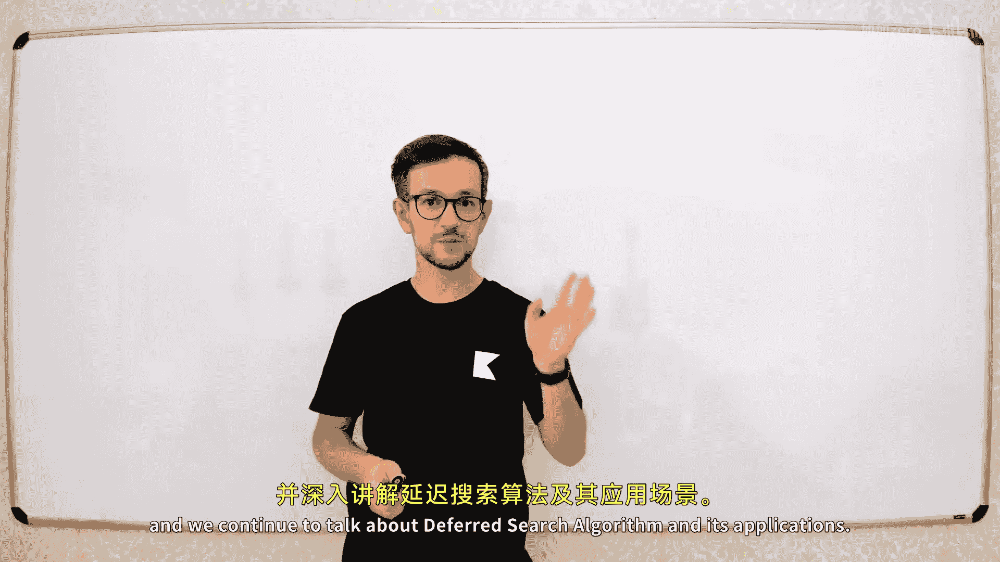
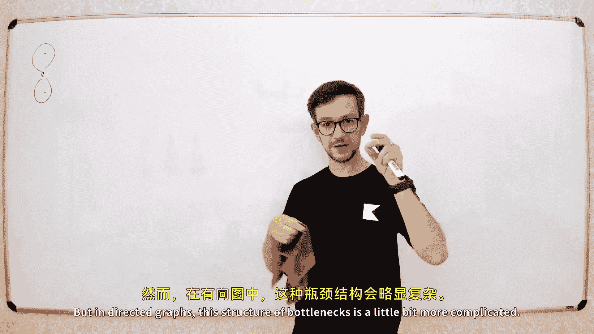
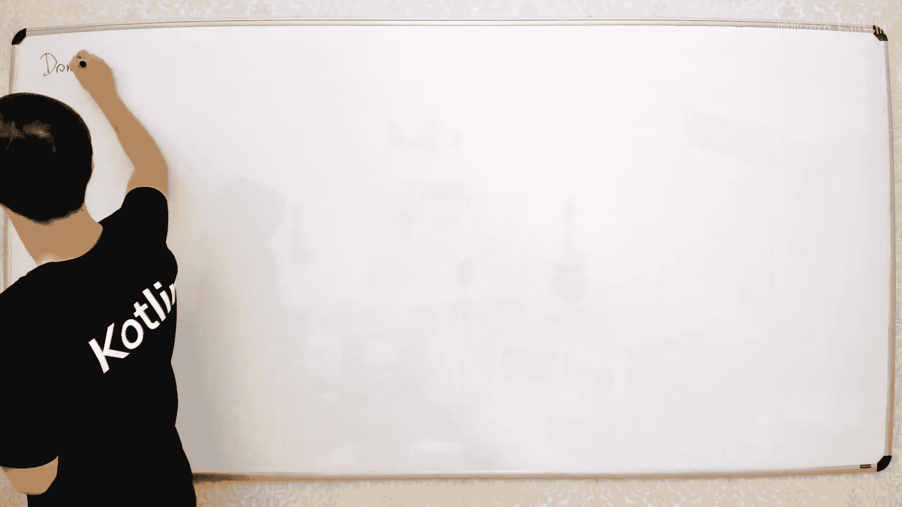
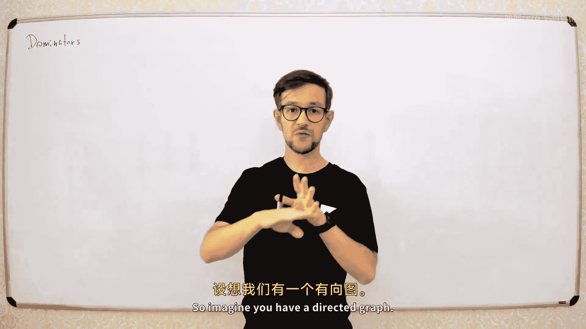
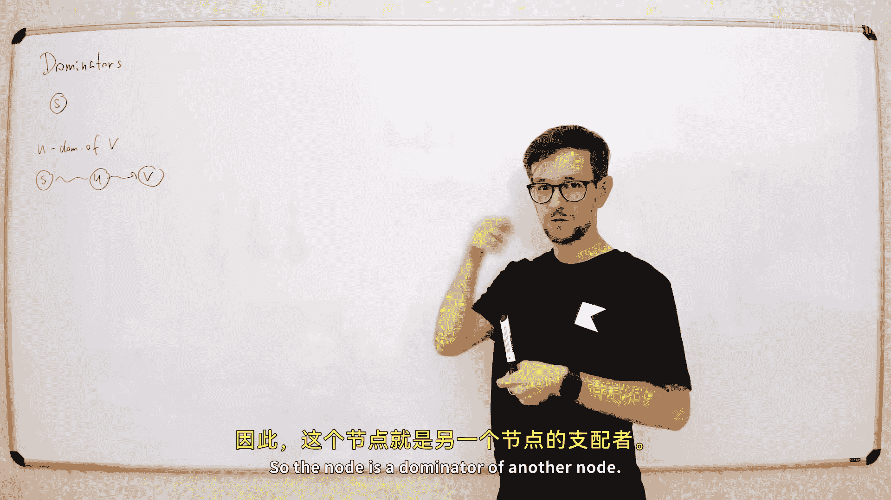
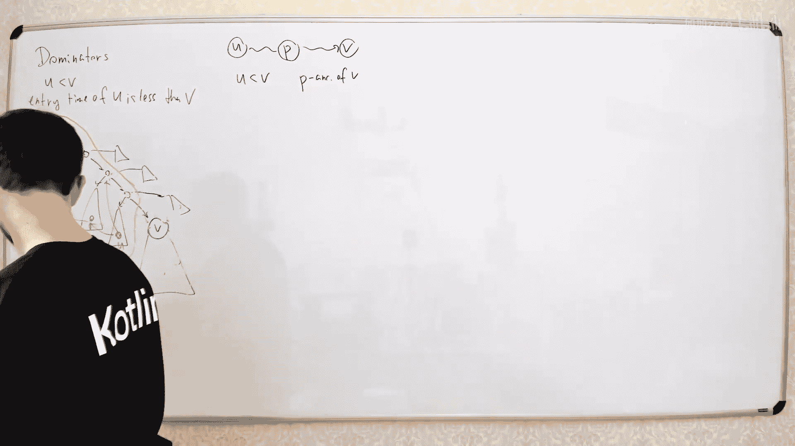

# 【精译⚡算法与数据结构】PavelMavrin p36 p35 A&DS S03E04. Dominator Tree -BV1NLB8YfEMq_p36-

🎼。

SoToday we continue to talk about graphs and we continue to talk about Devest search algorithm and its applications。

啊。Last time we discussed bridges and articulation points。

 and this is something like a bottlenecks of the graph。

 So if you have an articulation point in graph。It means you have something here and something here and if you want to move from here to here。

 you kind of need to visit this artation point， so artation point is some kind of bottleneck of your graph。

And。This is how it's going on in in Android graphs， but in direct graphs。This。

 this structure of bottlenecks is a little bit more complicated。 And today。

 we kind of discuss how it looks in the director graph。

Indirect drops again， the is。This relation of connectivity is not symmetrical。

 So this bottleneck depends on from what point to what point you want to you want to go。 So it。

 it's kinda a little bit more complicated， but。Still， it's interesting。 And today。

 we'll try to build it。Let's go。 So we're going talk about deminators。

What is theminator， Dominator is a special node， which kind of it is on your way to another node。

 So imagine you have a direct graph。

In this direct graph， you have one special note， it's called a source of you have a special note S。

That's all。 So you have some directly graph and a special note in this graph。

And what you want to do is to find the deminators。 What is deminator vertex U。Is the meanator。呃，V。

If it appears on every path from node S to node V。 So if you take any path from node S。Dont mean。

The no， you will be on the on this bed。So the note is a dimminator of another node。

 if you cannot go to this node。

The do is in this node for every path from S to V， the developerex assume must be on this path。

That view is the mainator of it。That's all。That so let's draw some graph。Let's draw some graph。

 So we have no click this here。And here we have something like one。D。You will have free。아 안。

I will see here we have full。5。We have。I just like these。You have 6。What's not connected。

So let's see。For example， for this note4。Which node dominate this note 4。

 So if you look on the path from note S to note4， theres just a single path like this path。

So this is the only path through node S node 4， and on this path we have nodes S let's call a Zone。

So all the nodes are marked with integers。So on this path from S to4。Rap two nodes，0 and2。

 so both these notess。Themins this note form。Y。This's happening if you have a single path here。

 but let's take some note which have multiple paths， for example， these note 5。For this note 5。

 you have two possible paths。 You can go like here or you can go like here。

But both these pairs contain nodes 2 and0。 So again， nodes 2 and 0 these node5。嗯。So for this node5。

 there are two deminators。Its2 and0。Now， if， if if， now if he， yeah。

 I believe you just notice this node 0 actually dominates every node。

 So node S is the deminator of every node of of a graph。

 because every path from S to be contains node node S。 So S is always theminator of any node。

Let's take some。 I don't know。For example， its technical as note 6。Stop 6。

This of 6 is dominate by  one and 0。And， for example。For example。

 this note free is dominate by by no0。And2 by0 and1 by 0 and so on。Gu。205。

2 the minutes5205 because we have this。 Okay， medicine。Now我 do the banana nice fight的。ふ。Yeah。

Let's take some sale here。And node 7 is dominated only by node0 because you can go this way。

 or you can go that way。 And so every node can be passed。

Except node  zero so the only diametermin of node 7 is node0。こ直パ。共。Now。

 let's try to find some you have some usual properties of useful properties of these dominators first。

You for purposes is uT so if。You eliminateates。V and V dominates。Nbleよ。全 효 매ジだこゃ。No obviously， yeah。

 because if V dominates w， it means on every path from S。To double1， there is an old V。

And you dominate V then for for each road from S to V， there must be an audio。

So you must be on every path from S to W， so u dominates W。It就是TV team。

Second property is a little bit more complicated。Let's take two different。Dminators of V。

 So let's take。X。Theators， the X and Y are both the mainators of real。

What does mean if they both areimminators of the V。

 then they belong to any path from S to V so less'。Draw some path from pest。土皮。On every path。

 there must be node x and Y， so let's put them here。X and。Wei。

So these two nodes are in some order shop。 For example， here， you start from S first you visit X。

 and then you visit Y， then you is visiting。Let's， let's， let's fix this order like this。

 So if you first to visit X， then lose 20。Then I claim that note X is actually a theminator of V of1。

Yes。Let's see X。Beng。W， a then X is the a white。Why is it true。呃。Okay， if x is not a deminator of y。

 then there is some path to node y， which goes around node X。

 So so you can go to vertex Y without visiting node X。 So there is some special path from S to y。

Which doesn't visit this old X。But then we can visit node V without visiting X。 here。

 We can use this path， and then go here。So we have a path which doesn't contain this node x。

 So x is not theminator of V， but we know x is the matter of V， so。Ex must be a minute of white。Nice。

What does it mean， What does it mean if you take。Some。

 if you have several dimmins of of a single node。Imine you have node S。

And here you have some dominators。Of node of node V。 So So if these are dominators of node V。

Then they all dominate each other。 So for each， for each to dominates。

 one of them dominates another one。So they always appear in these sequence。

 the order of these deminators here is fixed， actually， you first with thisimminator。

 then you this deimminator， then this and so， because they all dominate each other。啊。Oh。Let's see。

 For each ver。2 what what what want to want what what we want to build。

 We want to build some structure of these dominator。

 So we will want to build some structure which explain how these dimminators works in our。

 so to build this structure， we actually need to know only one dominator of node V。So。

Which of these demins is the most important diameterminator of node B。What do you think。You stop。

 you stop same electron trans clear。So imagine you have these five four deminators。

 whichminator is the most important。 Yeah， the most importantator is the right mod deminator。

 this deminator。It's called the immediate deminator of Nordwe。啊。

I'll just say do because it's a symbol。In original paper is called I dom because it's immediate deminator。

 but will not use any other dimminator here starting from this point。 So if I say do of V。

 it is immediate deminator of no do。So dome of V is the right most dominator of nodewin。

 so this is the closest to node V。Why this deminator is the most important。

 because it actually implies all other dimminators， how to find all dimminators of node V。

 you start from V， find the immediate dimminator of node V， then how to find the next dimminator。

 next deminator is just immediate deminator of node V。 So this deminator。Please deator。

Will be just image deminator。Of immediate dimminator of。And so on。

So if you want to find all the dimminators of node V。

 you start from node V and big each time you just take the immediate deminator of your current node。

 So you start from here， find the closest dimminator to V， find the closest dimminator to here。

 find the closest deminator here， and then you will find all dimminators of node V。こ。

So that's the plan for today。 The plan for today is to build。This array of a media deminator。

 So for each note， we will find its media dominator。 Test the whole plan for today's selection。Nice。

 nice。Say everything is clear， if everything is clear。呃。Now， again。

 if you want to buy if you want to find something some。Some pointer for each node of your graph。

 And if you look on this structure， you will have some tree。So so it's。Can you go on the cycle。 No。

 you can't go on a cycle。 it's easier because each each deminator is closer to vertex S as the previous node。

So each time you move closer to an old S。So you cant have cycles。 you know， actually。

 use can if you have cycles that it means that for each5。

 you have all this node so it's easy to show that this this snow cycle。啊。

What we was talking about if you build these deminators。

 you will have some pointers to some another node。 and this structure of pointers will give you some three like structure。

 right， So you can build a tree such that each node is actually the parent of the node is its deminator。

 So， for example， for this graph， we have this node 0。Now， node 1 consminator 0。L two because0。

Note 3 has the matter 2。And note 4 has the met tone。Now these don't six Ca matter one。

Note 5 resminator 2。Now， this note 7 hesdminator，0。

So this is the structure of the minators of your graph。

So this structure kind of explains what's going on in this dominator situation in ingraph if you。

Just by building this this tree and then just basically what's going on inside this tree。

 you can get a lot of information about about this bottleneck situation in your graph。 For example。

 here， we can see that this。2 dominates all these snow。

It means that if you remove these nodes2 from the graph。

All these nodes will be an eve and and accessible from this node 0。

So this note two is kind of important for connectivity of your graph， something like that。

 So make section that if we remove this note all these。All this region of the group will be unacs。

So this is why we actually need these deminator trees。Just。

 just to show you some interesting points in your graph。

 which are important for the connectivity from this notice。Kind of like this， okay。Now엠 또 out겠。Now。

 we're moving to the algorithm。The algorithm is pretty complicated。I must prepare you。嗯。So this。

 the most complicated algorithm by finding this course。

 I think except at least in this semester in this semester。

 it it will be the most complicated algorithm。But we can do it。 Okay， go be fine。It's little bit。

 It's a little bit more complicated than usual， but it will be fine。

Let's talk from the symbol's simple。Csあ。Simple algorithm。 So if your graph is a cyclic。

The algorithm is pretty simple。 For example。 let's， let's， let's。Let's draw some a click let's。

 for example， remove this。Let's remove this。I， actually。 it was a cyclic。 It was a cyclic。还没。

If your graph is acyclic， it's very easy to build a deminator tree。How to build the deminator train。

You take your graph。Now， build thepological order of this graph。嗯。Yeah。

 they are numbers in the biological order。Now， you add the nodes  one by one in theological order and build this the sec。

 But the minute three for this pre。 So we have this topological order of your。

And you go from left to right and build a deminator tree for this prex。Why is correct。

 Because if you have some node， then all all its deminators must be to the left in theological order。

 Yeah， because you have this， you have this path。 So if you have any node。

 all its deminators are to the left in the political order。

So if you go from left to right and want to build theminator for this node。

You only need notes to the left in the political order。

So that's what how we will build that topological sort of that。

Dminator tree will go from left to right， and each time we will add one mon note the to the deminator tree。

So how to find the next node in ministry， so maybe you go from left to right and then take some note V。

And want to add this note in your deminator stream。So you take this interviewne。Not we。

 here's some in edges。So for this node view， you have some ingoing edges。

 So there are some paths to this node view。 These paths are must finish in one of these nodes。

So if you have some dominator， this dominator。Must also dominate all these snow。そう。

The dominator of node V must also dominate all these free nodes。Great。It's quite simple yeah。Again。

 if this node diminishs node V， then it belongs to any path from S to V。

 If you take any path from S to one of these nodes， you。So if you look on path from S to U。

 this deminator must belong to this path as well。 Yeah。

 so this deminator must be a deminator of all these three nodes。Now。

 we just need to find the closest note， which dominates all these free。Noes。

And that's just lowest common ancestor of these nodes in deminator tree。 So deminator。

Of V is just LC CA。Of all deminators。Okay。For all， for all edges from youtu。Let'错。Second。

 we take note V， look on all ingo edges， take these notess。

 these nodes are to the left in the political order， so these nodes are here。

So they always belong to to your doator。Ahu。Now， so you know the dimmins of these nodes and you know it's position in the dimminator tree。

So you take your note， take the LCA of these demins。And you find your dimminator of your land。

Now we just connect it to your dominator。 and then again。Do do the same thing for the next one。Yes。

 and since since we add the node only one by one， we can use， for example。

 binary the lifting to find the LC。 Yeah， that's fine。

 So you you add add the note and go go it by the lifting for this node。And so， so， so。

 So each time you have， you have your tree and you calculated the bind lists for all notes。 Now。

 each time you add one more leaf to you know。 So you take this dominator。And they and this is not V。

So you add one more leaf to your note。 So you just calculate the bind listings for this node。아 저 야 야。

That's simple case， so if your graph is a cyclic， then actually building a theminator tree is very simple。

The interesting alternative is when your graph is actually head cycles。Then we have。A lot of issues。

 Not again。Why we have issue because we can't can't make this theological ordering。

 So he if you graphic a cycle， you can just go in this order from left to right。 And each time。

 you know what's going on。 Yeah， for all the for all the node here， you already know itminators。 So。

 if you have cycles， you don't know the order of the building diminish because each node may be。

At the minute what going here。Oh。Okay， I'm just making the big post because I am。

I'm kind of afraid of clean this all home。But it will be fine， okay。It will different。Lets go。Let me。

 let me just。Some spray here。ho， let's go。The first thing。啊。

Let's enumerate all the notes of the tree， or off the craft。

In the but by the entry time of the node in the de research algorithm。

 So we run de search algorithm from node S。And then enumerate all the nodes by the entry time of this node。

哼。So if I say that U is less than V。It actually means that node you was visited before node V。

이 this debt。Soで end time。Of U is less。问题。Yeah。そう。We yeah， yes。

 let's assume every node is reachable from S just for simplicity， okay。

So every node is reachable from S。Mhmm。Now， I will run depth for rhythm from node S and enumerate all the nodes by the entry time of this node。

Yes， I already the， but I hope， hope hope is clear now。Let's draw another graph。 Okay。

 let's draw another graph。 So we have a graph like this。Let's have some cycles。嗯。어呵。Yes。

 I want to have some cycles here。 Let's have this cycle and here and something here。那 so。

So you start from， from the this node S。 So you start from node S and in the right node by by the enter。

 So start here。So it's not one。 Then you go here。 list node2。 Then you go here。 That's load free。

Then I go back， then you go here。 this notice4。 then I go back， then back， then here this is5。

 and then here this is6。嗯哼。So this is the number we will use in this algorithm。 So if we compare。

Two mos。It is the same as compare the entry time of this notes。Mmhm。😊。

Because we will compare the notes a lot。And every time I see， I say that node U is less than V。

 I will mean that it was entered before node V。ho。Now let's see how this structure actually works。

 so if we have this known view。So we have this not as week。Started the from this node S。

 and then at some point。We go here， we go here， we go here， we go here， at some point。

 we visit don feel。Before this note， we visited some subaries here。 So we go here， visit this sub。

 go here and visit with sub。Go here visit this sub。 then I got no beef with eat sub。 Then we go back。

 visit some some other sub here。And sub here and some sub here and so on。 and then go back。So。

 we go from the right， we first visit this sub then this sub and this sub here find dot V。

 with this sub， then go back， find this sub and go back， find this and and so on。

So that's the structure of your definition right？So let's see which notes I actually less than the。

If you have note V。Which nodes are less than being。 So less than B as an notes。

 which were visited before node V。Which note was listed before not。For example， these parents。

 so all these ancestors of green， were visited before Norwe。So all these notes are less than the。

Also， these subris， these subris are also less than they。 So before we visit this part of the graph。

This is part of the graph。Is less than。m哼m。😊，just understand what's going on sorry if I say that node U is less than v。

 it actually means this node U belongs to this part of the graph。

 it's either one of the antor of V or U belong to some of these subies。Mmhm。😊，Okay。

 hopes good enough。Now我's行。啊。If I have any edge。From this notwe。Where this edge can go。

So if I have any edge from this node view。No， let's remember if we have a deficitation algorithm。

 we have some special。 So we have these edges belong to to your deficit tree。

 and then we have some other edges。 which just doesn't belong to your deficit tree。

 So what other edges can be in your graph， except these edges of deficit tree。

No there may be several different types of edges， there may be。

 for example edges from node V to one of these ancestors， so we may have edge like this。

So some ages going up to the tree， we may have age going up to some parent or some ancestor of them。

We also may have some edge going to to the left， so we may have edge to from V to one of these。

Left Cy。So。These two types of edges are perfectly legal。

 so you may have both these edges in your graph。Look how So your show is going going here。

 Then you go here。 and then you see this edge。Let's spec。Also。

 you may have edge from V to one of the nodes in this substrate。You may have。edge like this。

What you may not have， you may not have any H from V to nose in these subris visited afterna。

Why is this show？Why you can't have H from V to one of these substrates。

Can we discuss it when we talk first talk about depth research。No。

 it's actually because if you have any edge from V， don't be sub。

 you will not exit this node V until you visit everything you can visit。 Yeah。

 So when you exit this node V。You kind try to visit all the edges from Norway。

So if you have this edge， then when you exit node V。

 you must look at this edge and you must try to visit this node as well。

So the only edges you may have from node V are the edges to one of these。Noles。

 which are less than V， and also H。Inside this object， okay。On the other hand， let's do that。

 Let's do it very slowly。 very slowly。If we have some edge going into this not beam， so we have。

We have some edge from somewhere to this don't we。From what part of the graph can we have at this age？

No， we may have edge again， we may have edge from from this subject have edge like this。

Perfectly legal。We might have edge from one of these trees like this。Yeah， this this。

 this kinda edge to to the left。 Yeah， this is edge edge up。 this is edge to the left。And also。

 we may have some edges from one of the ancestors here， so we may have edges from the ancestors of。

Basically， if we have H going from one of the nodes less than v。

 then this edge must be from one of the ancestors。We may not have any edge from these sataries。

 we may have edges only from the of nodes， but greater than V。

And from the parents or from the ancestors。Mmhm。😊，Okay。

 that's just just some observations about how this thing is going on。

 So Okays just just to keep your。Just to give you some intuition about what's going on in this direction。

 So that's why I will to talk about this sensor。 So if I， if I just look on the numbers of of on the。

 on the entry times of these doors， I kind， I kind understand what's going on。 So if I， if I have。

For example， if I have node V and I have some edge from node， which is less than the。

If you have stick。So for example， if you have H from node U to node V。

And youll know that U is less than the。Then you must be an ancestor of V， right。

Not because you only allowed to have。Ingo edge from these notess。 so if you have this。

 then use use the ances。어 그 형。So。So to make it like this。

 you kind need to understand what's going on here， so this picture is kind of important to understand what's going on and why everything works。

故。Now， I will prove one theorem， very small theorem， the only one theorem。

 everything else will be quite simple。Almost。But I need one theoryor to make all other proofs。信号。好见。

Very simple theorem， the single one， there will be no more theorems， okay。

I'm kind the limit of the number of mathematics in in the lecture。 So that's。

 that's the maxim amount of mathematics I'm allowed to have in a single lecture。 Okay。

 single theorem。Imagine you have some pe from you。Bvi。

And this path is actually from some notes which is lessious unless you is less than me。Then。

On this path， there must be some ancestor of it。 So on this path， there must be some note P。

And P is ancestor。我。So if you move from some node， which is less than V to node V。

Then you you always visit at least one an of way。That's all。Let's the hole field him。Let's prove it。

 let's just prove it very， very just look by hook on this picture， Let's look on this picture。

So you have some node U， which is less than the。 So this U must belong to this part of the tree of the graph。

So this you belong to this part。If U is one of the ancestors， then it's already approved here。

 So if U is one of this node， we just say P equals to U and we are done here。 That's all。Yes。

 we allow this P to be equal to you。But no fee， obviously， because it will be。Too boring， okay。那。

If you is not necessarily of we， then it means it belong to one of these subjects， for example， here。

 So here we have no view。Now we need to have a pair from here to here。So we started with this sub。

 how can we exit this sub？So to exit this sub tree， we must take some edge。

 and these edges only may go up or left here。 So from this subre。

 we may go up to one of the ancestors here。Or we may go left to one of the previous centuries。

Because we only allowed to have edges going down up and left。If we go down， we stay in the same sub。

 So if we want to exit this sub web， we must go up or left。So if we go up。

 then we visit some ancestors of we， because all the ancestors of this are the same as ancestors of we。

If we go left， then we have the same situation and then again we stay in this sub and we want to lift this sub so we can lift this sub only by using edge up or left。

If we go up again， we find some ancestor of we， if we go left， then we have again。

 we have the same situation we stay in this sub until we left this sub。So again。

 we stay inside these sub trees。And we only can lift these sub if we take one of the edges going to one of the ancestors of we。

So so to exit this region， we need to take at least one edge going up and if the edge going up it's going to one of the ancestors of this node。

 and these ancestors are all the ancestors of we。 So we will definitely visit at least one ancestors of we。

Clear了。嗯。😊，You may。 you may do this proof much more formally。

 but it's I I actually believe that visual proof is much more clear then。If you。

 if you try to write a formal， sorry， you can do the same just by writing a lot of formal， but I I。

I actually believe that just look at this picture is much more。

Give you a much clear understanding about what's going on， King。Let's走。那。

We will use this theorem a lot。 Let let me just， let me just write this theorem here。

Because I will use a envelope。

So if I have this P V。 So if U is less than V。Then P is answer Sir。好福利。Yeah， I'll just keep it here。

Thanksice。Were close here。The next thing， how to prove that some node is immediate diameterminator of V。

 So let's have some node be。full了。First of all， all the deminators of we must must be the ancestors of we in this day history。

Because if you take any pathth from S to V， you will have all the dimminators of V in this path here。

 So if you look on this。3 of D Fs， all the dimminators of V must belong to these path。

 So all the dimminators of V must be ancestors of V in this D Fs tree。It's quite obvious。

So let's look on all ancestors of V in this DFS tree。So we start from node S again。

 we call DFS from node S， and we build this DFS 3， and these nodes are。I want to source for free。

So we have a lot of ancestors in this in this D tree。Now。

 we want to prove that one of the nodes is actually a deminator。 So let's prove that this node。

Is dominator。Of V this immediate deminator。 So it is the lowest possible nodes。

 which dominates node V。How can we prove that some note？Actually。

 is the lowest possible deminator of3。 So we need to prove a lot of things。 Yeah， first of all。

 we need to prove that big node dominates3。And also。

 we need to prove that all nodes below do not dominate this node V。

 So we need to prove that this is theminator of V。 and these three nodes are not the deminators of V。

So this is theminator and these are not deminrs。Yeah。That's kind of the plan。 Yeah。

 So if we want to find the closest deminator for node V。

 we need to prove that all these nodes are not the deminators of V and this node is deminator of V。

 Then this node is the immediate deminator of V。That's the plan。Now。

 how to prove that some node is not a deminator of free。

Now let's sort we have this node V this node S。Here you have some no you。

 And here you have something。So if you want to prove this， U is not a deminator of we。

How to prove this。I'm just checking your life。There must be some forward edge。

 not clear forward edge。 There might be some forward path， so there must be some path。

Which goes to node V， but doesn't visit this node U。 Yeah， there must be not a single edge there。

 There may be some something like this。 So there must be some。But。So if U is not a deminator of V。

 there must be some PE which goes out of this note V you kind of from here to here and it doesn't visit this snow deal okay。

So the al will be kind of looking for paths like this。

 so we will try to look to find something some paths like this。

And these paths will help us to prove that some node are not deminators。

And then we will find all the nodes， which are not the deminrs。And the first note。

 which we failed will be actually the mini and we will prove that it actually the mini。Just a plan。

So we'll find the paths like this。For all the notes here。 And then for some note。

 will not find the bell。 And this note will be a deminr。This is the whole blend of this article。こ度。

Let's go。No。To find pets like this， we need to build some。Additional structure。Unfortunately。

We need to find something which called the semi deminator。H， let's go。

 So vertex U is the same deminator。Of the。If。There is a path。From node U to node V。And in this path。

All the all these middle notess all here。 all these notess in the middle。 Yeah， all these dos。

let's great， great， great， great， great。브레이ト은。Look that's kind of perhaps like this。

 So if you look on this viewue， look let's see。So if you have a path from U to V。

 which visit only the nodes， which are greater than V。So it's kind of weird。

Like this so in this right part of the graph。So if you find the path from U2 view like this。

 then use semi diametermin of we。Clver呢。Let's try some， let's draw some graphic on list。Peoples。

 some more examples。Let's get some more examples。And so it's very slowly。For example。

 I get here we0 one。D。嗯。PP皮。그냥 들어 온단 말이이에요。에 두。哦。good enough。 good enough。我知道。

We'll be done with the fri of this。 Not exactly。 It's a bit more complicated， but。You。

 you're kind of clothes。You close， but not exactly。Now let's look here。嗯。For example， for this node2。

 we have node0。 node0 is the same eminator of node 2。Because we can use this path。Yeah。

 we have this path from 0 to 2。And this path only visit node which are greater than true。

 So0 is semidemin of true。0 is also semi to the integral of4。Because we can use this path。

And in this path， there are no middle edges and middle notess。So， just by definition。

 all the middle notess are greater than4。Because empty set is guess its easy。

 So all the nodes here are greater than4。 There are no nodes。 So it' so true。

 So 0 is actually semidminator of4。Mh。No。五。So let's see。We actually need to think only about。

 so let's say that you is actually an。This that your squeeze answer。Of。

 because this these are the only important sims I have。 You can remove this。Pro definition， but it's。

 it's easier to say like this。I'll show you just in a second。 I'll。 I'll show you just in a second。

 so。Now， let's look on all semi deminators software。 You have this node S。

So if you have this old you。And you is semi the fee。What does it say about dominators？

It actually say that all the notes below this U are not diminish。 So you have some breath like here。

So if you have PEth like this， then all the nodes here are not the deminators。

So these nodes are not demins。그。Now， if you have several possible seimminator。Again。

 you have this node V and you have several seimminators。

Which of these semis is the most important one。冇的 thing。嗯。So if you have several semins。

 you actually need only one。Which one。嗯。Anyone。Again。Why do we need deminators。

 These deminators are used to prove that these nodes are not deminators， this seminator。

 If you have same deminator， then all nodes below are not deminators。よep。So。So this deminator。

Pro giveive you the proof that these nodes are not demins。

 These s deminator gives you the proof that all these nodes are not s， not deminators and so on。

 So the topmost。Smeter of this one。 give you more information on all other seimimminators。

 So this is actually the most important simminator。Because。

These same eimminators give you the proof that all these notess here are not eminators。So。

 so this se eminator give you the maximum possible information。So this， that。

 this is the most important segment at Google。 remember， remember on the on， on， on， on on thismin。

So， this。This note。We will call edo。Will be the minimum semi。Of of。

Minimal because all the notes on this path are ordered by the entry time。So you you。

 if you want to find the topmost node， it， it is not minimal entry time。

And as minimum this by by the entry time。 Yeah， so all the nodes in any path in your deposit search tree are ordered by the entry time。

 You first enter this node then you enter this node and so on。 So you enter the notes in this order。

 So this will be the order， which was the entered entered first。 Yeah， in this deposit。

So S do will be the semid with minimal number if you order the notes by the entry time。

So it will be the top most millmeter， right。这走等这好。Best of all。Mmhmm。And so now we need to do。Okay。

 we need two things。 First， we will build semiimminators。对。First， we'll build Semiimmins。Bd S。No。

And then， we will build。嗯。Dminators。U in this。Sim me to the others。That's the plan。

Both these steps are kind of scary。😡，It， it will be fine。嗯。

Let's start to start from the second one actually。Just to just to show that the same myth is actually important。

嗯。Let's start for the for the first step。 So let's do this step first。So if you want to。

 if you already know the semiators of all the nodes。How to find the deminator？I little little bit S。

嗯嗯。First of all， which which node will be above fraction and so you have these tos。

 one of them is semideminator another is deminator。

So let's see one of these node is semiminator and not node deminator。Which note is less。

Has less than1。So which of them is deminator， which of them is semideminator， what do you think？

It's actually easy。Yes， the if you have some semideminator， then all the node below are node demins。

 So a semidmeterator must be must be less。 So so we have this as。Doome ofvi。 And this is Do of。

They may be the same note。For example， here， for example， yeah。Here。

 this S is semi deminator of V as N S is deminator of V。So this two knows but may be the same notes。

 but sometimes they don't， for example， let's build some simple graph。嗯。We' say like this。

 We have this 0，1。Two and three。And you have something like this。 You have。

You also have edge from here to here and edge from here to here。So for example， in this graph。

 for this three， one is the semideminator of three0 is not the semi deminator。

 So this0 is not the semidminator of three。Yeah， so this one is this is the same for you。

And this is zero the。Mmhmm。😊，So they may be the same node， the same node。

 they may be different notes。It's so possible。 good。Let's see。Let's look。In this region of the group。

So let's look on all the node in this region。说。So move this bite。

So remember remember imagine you know that theological coated all the semidemins。

So you know the same neither。어 너무 누。Let's look on all the nodes in this region。For this region。

Let's find all we already know all all the same emins。

 So we know all the same es of all the nodes here。Imagine that all these eimminators actually belong to the same range。

So you have no view here。And the seiminator of node U is always below this point。So for。All notes。

You long them to do this path。From。S， dome。Actuallyly， nothing inclusion is done。

Not including as do of free。哦。我只 from here。In this region。

 because asdom of V actually is above as do of V。As dome of V。To V。Yeah， if it's same eminator。

Is greater or equal than seimin。Or three。Again， what does this mean。

 It means that we're kind of stuck inside this segment。 So inside this segment。

 all the same administratormins of full nodes in this segment belong to the same segment。So。

 if you have this。Wonderful paths。 Then all these pes here are kind inside this region。

 So you have some pers， but they all belong to this region， y。What does it mean What do you think。So。

 for each note。From this segment。You know that the closest forest minimum seimin is also inside this region。

What does mean。Well， this picture kind explains what it was going on。Again。

 if I look in in this region and for each node in this region。

 the semiimminator also belongs to this region。Then， yes， you're right。

then the deminator is actually equal to the subminator。Do let prove this。s actually easy to prove。

First of all， all the nodes below are not demins， sos all these nodes are not dimminators。

Now we just need to prove that this note is a deator。How to prove this node denominator。

Imagine this note is not a deminator。Then we have some path from S to V。

 which doesn't visit this dot。So， we have some path。Proro note S。Where is these？

So we have some path from S。Do we。Which doesn't exist this note。

Let's find the first note this of this path， which belong to this green region。So in this region。

 we have some node view。And this。This is the first node on this path， which belongs to this region。

Including the not。So we have some path from S to V， this path ends in node V。

 so we will at least with node V。But we may visit first time note here。

 so we we may have some breath from S to something here that to here and then to here。

So U is the first， so leftmost， yeah， leftmost node on this path， which belong to this path。

We can accusedccuse of Islamma。It's a Cleveland symbol。 it's even more simple， yeah。

We can make use of the slema。I believe with the wooden't need to。Let me think。Yes， really yes。 we。

 we will need this La yeah。 You're right。Youre right。啊。Now。

 let's go to the left from this view and find the closest node， which is less than you。呃老梦用。

This now is less than you。So if this W is less than you， then this W must be the parent of you。

 the ancestor of you。So this W must be under here。Why this true， Because again， no。

 we will use the sma。If W is less than U， then on this path from W to U。

 there must be some an of you。But W is the closest node to the U， which is less than you。

 So this W must be answered of you。Yeah， you're right。 We'll use just use this now。The从。

Where's the contradiction， do you see the contradiction？do you see。The contradiction is very simple。

 so all the notes in this area。How great， doesn't you。It means that W is same deminator of you。Mm哼m。

😊，So we have some， so in this region， we have some node U， which has some seiminator。

 which is above this point。And this contradict this。state。So again again again again。Again。

What I want to prove， I want to prove that if all deminators。

 Semi deminators in this region are below this point。Then this point is actually a deminator of V。

 Why it is， Because if it is not a deminator， then we have some pathth like this。

 This pathth must visit at least one node from here， and we will find the closest note。Here。

 and this note will be a sim of this note。嗯。😮，Lis all。Mhm。😊，Again。

I want to prove that if all the notes in this region have a simminator below this point。

 then this is eliminator。Why it is true， Because all these notes are not deminators。

And this one is the dimminator of V。 white is deminator。

 If we have some pair which avoids this point like here。

Then it must be it must enter this region at some point。 U and the closest node here。

 which is less than you must be its parent。But U is the first node from this region。

 So W must be its parent， but not from this region。 So it， So it's parent above this position。

So we have some node you， which have the same eminator above this position。 So it contradicts this。

Sa요 꼭。No。Second case， if we have some note， which has theator less than， So let's take an node U。

 which has minimal。嗯。Again， let's take some note。Which belongs to to do the same region。Again。

 it's it it it includes double which includes fee。Yeah， for simplicity。Or we have empty second。ね。

And we take the minimum possible。谁面的面那种。So we take the node with minimal possible seimin。

 So we have highest possible diameter from this region。啊。It turns out that situation is very simple。

 I turns that also eliminate。Is the same as the simminator of you。Don let me throw this big chicken。

So we have this node V。We have this now。 Do you。Now， we have simminator。Of V。 And here， we have。

Same deminator。Of you。 And here we have deminator。O。You。来看。そもさ？D' blend it。Well enough， okay。Perhaps。

Have 1，2，3。F。Wind for 3 feet for here right。Okay， and I need to fit for notes here。嗯핸。はい。

So this is the same in。Of V， this is seimiminator。Of you and this is theminator。O for you。Right。

I want to prove that this note is actually theminator three。M哼。😊。

And this U is actually of minimum possible seulator from this region， so from this region。

This U has a highest possible notice in from this region。From this region。From this region。

 this U has the maximum possible sims， this。I have a path S it from sei to here。And this。

 this the middle is minimal possible。Nice。So。We need to prove that。

 this node is immediate deminator of V。 So first of all。

 let's prove that all the nodes below unknown node demins of V。

 So how to prove that all the nodes below unknown node eminators of V。

 these nodes are obviously node deminators。So these node nodes are not eminators because we can avoid them because this is the closest sorry。

 this node is the same eminator of V。So we have path like this。So， these notes are not。They the。

These node are also not deminator of free。Because they are not theminators of you。😡。

So if we can avoid these notess。When we go to node U， we can also avoid them when we go to node V。

 So so we are with start from node S， we go to node U avoiding this nodes and then go。Here。

So these nodes are also not demins of it。Right。Now we just need to prove that these node is actually deminator3。

Let's do this。It's actually really simple。Again again。

Let's imagine this note is not a deminator of V。Then there must be some path。

 which goes from node S to node V。And which doesn't with this。能没。So。

 we have some path from node as to node。So if this path， do not freeze this deminator。

It also may not visit this h。Because if this paint contains you。It must contain its dimminator。So。

 we have some breath。Which starts from note S and kind of avoids this deminator。

And it also must avoid this no，Something like this。Mmhm。😊。

Why these nodes are cross out because these notes cannot be theminators of V。

Because we can avoid these notes when we visit node U。 So for all nodes in this range。

These nodes are node deminators of U so we can avoid this h when we go to node U and now so we use the same path to node U and then use this part to go here so we can avoid all these nodes from this region。

Again， we we can avoid this aid this notes when we go to old U。

So we can avoid them when they got not。 We just use this path， plus this part。

Now I just need to prove that this node is actually theminator。

So it imagine this node is not the deminator。Then we have some path from S to V。

 which avoids this drop dominator。If this path avoids the remainderator of you。

 it also must avoid the you。Because if this path contains you， it must contain its deminator。

So we have some PE from S to V， which avoids not you。So let's find the first note from this region。

It is not here， it's some another note。Here。Again， let's find the leftmost note。Now again。

Will find the closest note。I am out of letter。 Actually。 Let's find note X。

So we find the closest note to the left， which is less than w。Please note。

Don now yet this x is semimin of W。Can you see it yeah。Because again， by the same lemma。

 x must be apparent of the ancestor of W， and this ancestor cannot be below this point because this the first we try to avoid this deminator。

Yeah， so all these nodes here are greater than w。 So x must be a simminator of w。So， X is。

me theminator of W。 and x is actually less than the meanator of U。 So it is。

Less or equal than the same minute。Yep。And now we have a contradiction because for this node this node U is the node with minimal possible semiiminator。

 but we have node V which have semi deminator above this point。So U is not the minimum。

 has not the minimum 7 me in this range。Now， we have a contradiction。Y x is less than a vertical。

 because this path cannot contain this deminator。Mh。And if it can contain any this matter。

 it also can contain any else in this range。没见没见了。this path。Do not contain this deminator。

If we can avoid this deminator， we can't go to node U because note this node dominates U。

 If we can avoid it in go to U， it means this node not node deminator yeah。

So if we avoid this deminator， we also must avoid all this region。

Because if you're gonna to hover from here， go here。

 then we can visit node U and avoid this deminator。 So this is not the deminator。

So if we have PE which avoids deminator， it also must avoid all this region actually it might go here and then go straight here。

What's all。That's the whole proof， that's the whole proof。

And now we have the algorithm for building the deminators from the same deminators。

 So So if you know the same deminator， then how to fire the deminator。You take note me。

Look on this part of your tree。 So on this path， in this path。

 you'll find the node of minimal seimminator。If it is greater or equal than si of v。

 then the mean of v equal to si of v。E for again， E for this is list。

If it is less than 7m of reading。Then you just assign the same value as the value of you。嗯哼。Let's on。

Yes， go to you also need to calculate in the correct order。

 so you need to calculate it from top to bottom。 So when you calculate this value of V。

 you also need to best value of u to calculate before。Okay。

 you can just calculateulate from from top to bottom。 Yeah。 So when you calculate this V。

 U is already calculated。 so you can dis assignment again。It's also not how its。Actually。

 need to be robot。Co了。No。To conclude this quickly， to conclude this quickly， you actually。

Need to data structure， which code collects this minimum。Of some minis in in， in。

 in a bath entry tree。So you need some data structure。Which finds minimum in the pth in tree。

But we know these structures from the last semester， right， So in the last semester。

 we discussed a few structures which help you to find the minimum in the region of the tree。

 For example， you can lose link countries， Why not。

So you may use link cap to calculate these minimums。No， you can use segment three。

 segment three is only four segments。 and here you have a tree。

 So this segment is not the segment of a line。 a segment of a tree。 you have some other things here。

 and just draw to draw only one path tree， but it's actually a tree。

 You have something here and something here。 It's actually a part of the big tree。

So you can kill segmentaries。一样。So for example， you can use at least you can use sling countries here。

Linkka tree is actually。A littlettle bit of work for this algorithm。 You may。

 since you have aesthetic destruction， you may use a link about the destruction。

 which we discussed in one of the bonus lectures。Yes， you for this thing。

 you you can use you can also use binary liftings。 Right， Yes， yes， to conclude these things。

 you also you you also can use binary liftings。 since you have set the structure。

 you don't change this。 Yes， you can use binary liftings for this。Yesし。You will need。

 You will need something。Something less something more interesting in different phase。 But yeah， A。

 Im correct。Here you you can use binary listings。 You're right。

maybe in the second phase you also can use by the listings。 Let me think。外边外边。Yeah， maybe you just。

 you can just use minor listings in both phases yeah。Again。

 here you need to find minimum in a segment of the tree。 you can use binaryny liftings。

 you can use link cut trees， you can use link about the destruction。

Lin Cava will actually give you not longer， but indoor sacrament time for all operations， but。

아 to you。啊。Yes， you about data structure is the same as Detroittro Union。

 but you actually calculate something on the path。 We discussed in one one of the performances lecture slide last here right。

It's kind it's a little bit more complicated because you， when you calculate minimums。

 you you cannot change the order of the links。 So when you link one tree to another tree。

 you can just swap it and link this to here。So because it will change the minimums。

 so it's kind of more complicated， but it's possible to make destroy at like data structure to calculate minimums in a static data structure。

Okay， so this is the second phase。Second非常。So if we know the same deminators we't build the deminators。

 that's totally time complexity。 if you do something simple。

 if you could use binary lifting or something like this， the time complexity will be。And log N。

Andelman。Yeah， we need we need only ones for each node again。

 So complexity of this but of this phase is actually un lookingken。

Complex of the first place will be emloed。Sers。哦。Okay。Now the final part。

 we need to calculate these semiims。大じこ。Let's go calculate some ins。Is it clear by now。

This very complicated lecture。He， I hope youre live。I will raise it， okay。

Can you show which node of the length on what what？What， what， what？Now。

 if you want to use link ca structure， you need to do it in special area。

You may think about it so link about the structure you kind it's like link a tree but you don't make any cuts。

 you only make links so you can link to trees and you can calculate the minimum from here to the root of the tree so here what you want to do is when you calculate this value for node V you you want this part to be a part of your root so you want this node be a root of the tree for node V。

How can you achieve it， You kind of do it。You make a difference search。And when you exit the。

 you make a link。Sos at every point you have your current node。

 so in your depth search you have your old V。And when you exit the first search。

 everything here is linked。But V is not linked to the parent。

And now what you want to do is calculate this denominator when you exit this node。

 so when you exit the same deminator， you find all the nodes for for which this node the same deminator。

And at this point， you calculate deminator for this node。 So when you exit this node。

 you have all these nodes linked。So this very well contain。

Actually not actually you don't want these connection。 Yeah。

 you want you want to medium home accept this seiminator， yeah。やや。So what， what， it's not， not。

 not not like this you， you need Yeah like that that situation you want to be in。

That situation will you won't go quite meaning among all nodes except this one。

 so you want to picture something like this。So when you exit this seiminator。

 so this exit seimeterator of V， you take this V and this second。

 so this above function give you minimum on this spec。And now your exit is not X。

 you make all these links。And exit no x。三 like it。You may think about this。

 this interesting exercise about using。Link about the structure for otherss like this。

So you just need to do it in special order to make it worse。

 So you want to calculate some minimum symmetryry。You just need to find the good order of this minimum。

 So all these requests will be doing in the order when you have this。

 So So when when you calculate the request， you need your tree look like this。 So you just。Okay。

 you can do it。Fal part。Let's go with manager。It will be a little bit more scared。But。Okay。

 how to find seiminator。Let's take note view。If some not the semi the me of3。

Oh let's say you is 7 of me。Then there must be some pet from U to V。Yeah。

 essentially that all notess here are greater than。啊看。I have it here。へ。😊，あとうといます。Okay。啊， okay。

So I need I have some path from U2 V and all the notes in the middle are greater than the。

Let's have two cases。 First case。There is no middle。 no， no， no middle so I can and then。

So if I have the edge from U to V， then you cent of V。Just by， by definition。

So how to find all the notes like this。 No simple。 Let's look on all in edges to note V。啊。

So let's look on all ingo edges。These notes are similar of。Let us count them。 So。

 so let just include them in this minimum。 We need to find the minimum seimator。

 So we will add these nodes to our minimum。Okay， that's that's a simple case。Now， the second case。

Second case， if I have some notes in the middle， Let's look on the last note in this thicknessus。

 We have this node view。Then we have some path。 Then we have some no W and then load。You。

 we have two cases。 There is no middle。 No， no no There is no， no。

 no verses in the middle or there are some notice， no those in the middle。 If there is。

 nothing in the middle， then you have to just have edge from U to V。

 I just it for all possible edges。And if I have something in the middle。

 let's look on the final note here。Let's it all possible final notes。Again。

 how to interact all possible so we can take all the ingoing edges。And here we have this stone w。Who。

O。Now。Now， what do we you need to do？We need to find。No do you。Which has a path to no W。

 such that all the notes here are greater hasn' you。응 哼。Unfortunately。This no U。

 maybe not the se deminator of W。It would be good if this u centmeter of w。

 then we just calculate w and add the centmeter of w will。嗯哼。😊，Co that， okay， okay。

 let's talk from opposite。 If some note is semimin of double here， yeah。So I have some note here。

And this load the simeter of w， so I have this path here and all nodes here are greater than W again。

Then this U centimeter of fee， right。Because W is greater than P。너 어。当就别东。

If double is less than within， it's not same， it's's not not interesting。

 So Ill take all the ingoing edges from the vers which are greater than me。개 또 못자。

So all these nodes here are greater than W。 and W is greater than V。

 Then all nodes on this path are greater than V。So this note is is obviously the same diameterminator of V。

But that's not all that it's not all possible s。啊。There may be another simators。

There may be smeters of V， which are not smeters of W。For example， here， let's。

 let's draw something like this。 So we have boom。Let's breath。Let's have path to here。

And then to here， and then to here。Ts like this。Lets have this one。To。Fi。4 and5。For。

 in this situation， one is the same in of three。Because I have this but。I have this breath。

So one is the semiconductor interval of three。The last edge on this path is H from node node 5。

But note1 is not the sminator of 5。On this path， I have known four，4 is less than 5。

 so one is not simulator of5， but one is simulator of 3。Mmhm。Why it happens。

Because one is actually sd of four。So I can use this path from one to four。

 then use this branch from four to five and then go here。So let's look on this per picture。

 If I have this edge from W to V， W is greater than V。 Let's look on this branch。 We have this。

Some here have here。So in this branch。If I have some note。X。And U is semi diametermin of x。

Then I have this path here。All these notes are greater than X。X and W are both greater than V。Mhm。

So all these notes are greater doesnt we。These nodes are greater than x， and x is greater than V。

So I can take this path。 I I can I go from U to x， then here， then here， and all these paths。

Contain only the nodes greater than V。 These nodes are greater than B。

 These nodes are greater than V and here。So if you is the same eminator of some node。

 which is on this branch of the tree。Then you is send the fee。算好吃。So I get。

 let's take this part of the tree。So this part is from W to the lowest common ancestor of W and V。

I take all these notes， which are ancestors offi。Wuble， but not ancestors of free。

Let's take a little x， x is the ancestor。Of V， but not。Ancestor of double of111。What some me。

So I take some note， we just answer W， but not answer of B。And if。You is ancesor。 No， not semimin。

Of X， X。Then， you samemin。Of we。嗯。Clear enough。Okay， I hope it's clear。Now。

 the interesting thing that this is the only case we need to care about。

If node U is the centimeter of V。 and the last edge on this path is paid edge from this node W。Then。

You must be a simator of some x， which belongs to this branch。 So the interesting， in fact。

 is that you can do it like this。So they must be that least1 x。Such that you is semi the of。

That's the interesting fact。 So again， if you have you。S a diametermin of V。

 And the last edge goes from this node W。Then you is the same administratorator for some note on this branch。

카ト도게 대。We have some path from U to the visit O W。 So we have this path。In this path。

Let's find the first node， which belongs to this branch。 So we have this。

So we have this pair from you。2 W and then to U，2 V。And this。In this part， let's find the first note。

Which， which belongs to this branch。 So x。 and again，5 is leftmost node， which is。

AnAncestor of ancestor of。W and。Let's say greater than people。So it's not an answer of you。

So let's find the leftmost note from this branch。Now， for this branch， we have this path from U to X。

Mmhmm。😊，I claim that in this area， all the notess are greater than X。Now why is it true。

 Because if I have some node less than x， then by this landma？I have some ancestor of X。

So if I have some note， why。Less than x。Then why must they pair an ancestor of X？

But I don't have any ancestors here because all the ancestors are either in this branch。

Or are less than the。And all the notes here are great。 So all this not a great because you is s of V。

嗯哼m。So again， what what I want to prove， I want to prove that if U is 7im of V and the last edge on this。

Pth is from W。 Then U must be seiminator of some node X， which belongs to this branch。

How to prove this， Let's look on this path。 Let's find the leftmost node。

 which belongs to this branch。If it is a leftmost node， then all nodes to the left。

Must be greater than X。Because if I have a old， which is less than x。Then I have some ancestor of x。

But it's thislema。And all the ancestors of x actually belong to must belong to this part。

Because these notes are a great lesson v。I only allow to have these answers。

And x is the leftmost section note。So， I don't have any。Notes here from， from this break。

So I I can't have any answers of X here， so almost here must be greater than x。Okay， that was。

 that was the most tricky part of this proof。 and everything now will be much easier so。

So that's the most tricky part of this。Of all this lecture。Now we just need to finish all this。

 And that's all。Clear呢。Okay， finish it。How to find the semi deminator。So to find the seimminator。

 we do the following。We take a minimum of all possible notes which may be esseimminators of week。

These are node。 First， we take all the node which have edges to note V。I also booking H from Lo。

And also， we need to take minimum of all nodes in these branches。

So we need a meeting of all semi deminators。Of x of x。Such X belong to。Do this。Branch。

Po do like this from LC C。Of V and W。두打요。For bold edges。From W to。Like this。Okay。

 something like that。So we， we take the node view and look on all ingo edges。

If we have an edge from some node， which is less than V。We just saved this so and let' don。

So if this node， if this age going from some node， which is greater than V。Then we take this branch。

From this W to the LC C here。 And in this branch， we need to find the minimum， Yes。

 minimum among all all sevens in this branch。And thus in then end。

 we calculate minimum of all these minimums。And it will be the minimum possible semiimmins just because we。

 we try to find all possible semiimmins。 Yeah， we tried all semiimminators in this region， alls here。

 all the semiimminators just using one edge and so on。

So we tried all possible positions of sameimmins and find minimum flow possible dispositions。

So and now finally， what we need to do here， what this structure we need to calculate this here。

 the only interesting thing we need to calculate is this minimum。

So we need to find minimal seiminator in this branch of the tree。And again。

 to find semiinated re tree。 we need we， we， we can use。Link Katri， why not。

 It will give you logo factory for this day。Can we use some buy the listings， Let me think。

 Let me think。It it's a little bit more tricky to use buying the listings I think it's possible but。

Yeah， I think it's possible。It's kind of a little bit more tricky because I want to calculate semiiminator using other seimins。

 yeah。So I need these binary liftings to calculate before I try to calculate this seiminator Usually when use binary liftings。

 you first calculate all binary listings and then use use these binary listings to make requests right here you kind of need to do it dynamically。

So when you calculate this as dome。You want all these binder liftings to be calculated before。嗯哼。

And you， you can calculate all the binarynyl liftings because you don't know binaryny liftings here。

So a little bit more tricky， I believe it's possible to use buying listings here。

 but you need to do it carefully。So you need to calculate buying lipsticks when you。Okay， yeah。

So when you know all the elements in your bind listings， you actually need to calculate the value。

 something method that。So I believe it's possible， but it's much more tricky then。Then。

 it looks like。Yes， you need to calculate it in order so here when I calculate the dome of V。

 I need to this dome of x be calculated before， but that's easy。

 you just calculate it from right to left。This x is already it's always greater than V。

 So this x is greater than V。So you just calculated from greater values to to all values。 Yeah。

 so just go from right to left in the order of entry time。So then you calculate this fee。

The X will be all coated。Let's， let's find。Yeah。There's a tricky part that。

 if you want use binder liftings， you want these binder liftingicks to calculate it dynamically。

So when you， when you to calculate this value， you want these binary the liftings to be calculated。

 It's a bit more tricky。 I I believe it's doable， yeah。You need your ancestor。

 you don't need your ancestors。 No when you calculate V， you need only these nodes。

 You don't need these ancestorsor，나 여동끼났잖 사실。You only need these notes。

 and all these notes are great。You don't need to， to know the values of your answerscestor。

 when you calculate this value。Okay， so it's a little， but it's kind trickying。

 You also may use link valve destruction。It's kind of tricky， but it's possible。 So again。

 what you want to do when I calculate this value， you want in your link about the structure to be all these nodes linked。

And these edge do not link。 So， so you want one structure like。 So。 So when you calculate this value。

 you want to link all these nodes， but not all these nodes。 And again， it's possible。 you just again。

 you you， you link when you exit your DS。 So when when for this node V， you go from right to left。

 So for this right node， you already linked everything here。 But this node is less than V。

 So this edge is not linked yet。So in your link valid structure， you have this path。

 but not this path。AndYou just E value for this W， and it will give you minimum on this branch。

It's possible。It's。Again， it's little bit tricky， but it's possible to you use Li about structure。

Now again， the time complexity， time complexity， time complexity here。

 you need to calculate this request each time you have some H， so for each H you make this request。

 so time complexity here will be elegant。And again。

 if you use link caal structure with all these heuristics we talk about in the bonus lecture last semester。

 then you may do all this request in the second term。So actually。

 if you use Li caval with all these heuristics， you may achieve ten complexity。And inverse Ifunction。

That's。That's what we can do it。It's also possible to make it linear time。

So there is a much more complicated algorithm which actually solve this problem in linear time。

 They do some tricks kind like we used when we discussed farult vendor algorithm。

 when we build the LC in constant time， right？ So it's something like this。

 So we split it into some blocks， precalculated blocks， something like this。 And then in the end。

 thisverse inverseification command function is constant。 So it will be linear。So it's doable。

 but it it's much more trickycan。Who。Almost two hours， okay。So again， thank you for jing。

See you next week。