# 【精译⚡算法与数据结构】PavelMavrin p38 p37 A&DS S03E06. Breadth-First Search, Dijkstra's Algorithm -BV1NLB8YfEMq_p38-

🎼。

🎼So today we talk about shortest path algorithm so we'll start this lecture and continue next week Today we'll start with the first algorithms about how to find the shortest path graph。

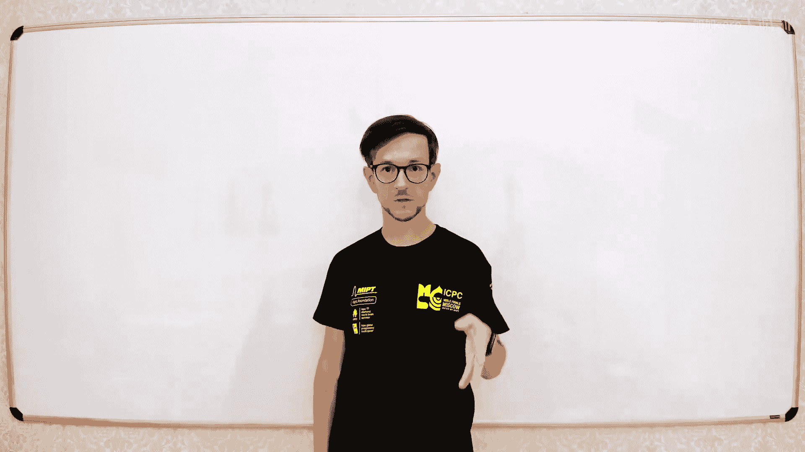

So short paths are very common problem。Basically what you need， you have a graph。Let'sT some off。

I just love to draw gloves。Something like this。 Okay， okay， let's do watch。 Okay， okay。

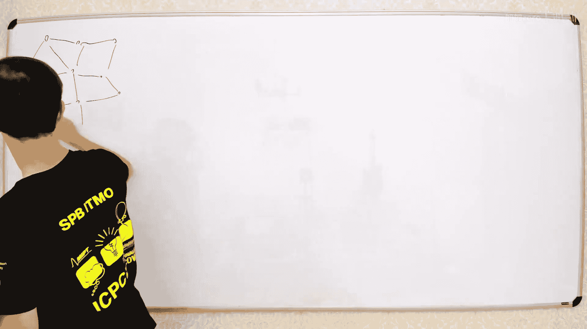

아 just stop 빨。

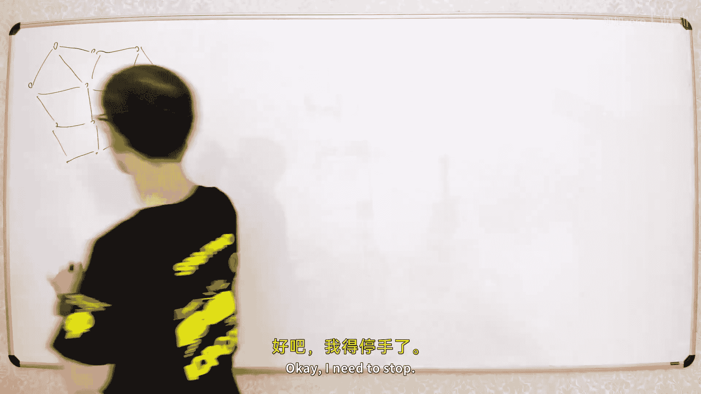

You have不上班。And in this graph。So。U you have something like you have two points in this graph。

 you have some starting point。嗯。야 some target 보지。And you need to find a shortest pair from S to T。

 So you have two nodes in a graph。 you need you need to find the path from here to here。

 That's usually how these problems all these problems look。 We problem。 for example。

 if you have some road network， you will need to find a short spread from here to here。

 but it's not not only about road networks， sometimes you have some system， I don't know。

 and this system has some states， and you need to move this system from this state to this state and minimal possible number of actions。

 something like that。 So sometimes graph is just a road networks。

 Sometimes it's just something a little bit more complicated。嗯。

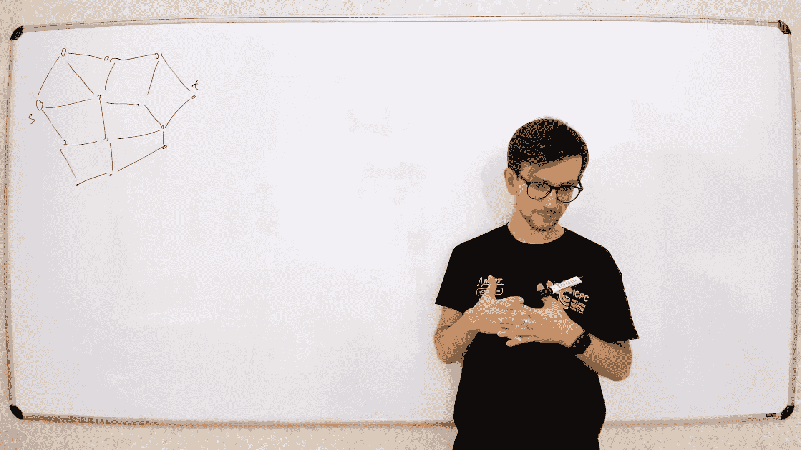

是道。Not no。嗯。

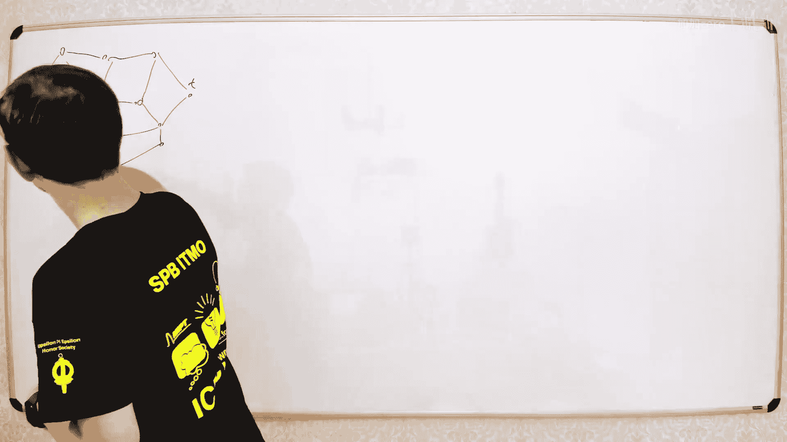

Okay。There are few deepfibris of this problem。 for example。

 your graph may be direct graph or undirect graph。And for all algorithms we'll discuss。

 there is not a big difference if the graph is oriented or if the graph is directed or not。

 but for some， for some algorithms， it may be slightly different。 So if you have anical graph。

 you may find some special algorithm which you build specially for an graphs usually usually it's not it's not usually the graph usually your algorithm work for。

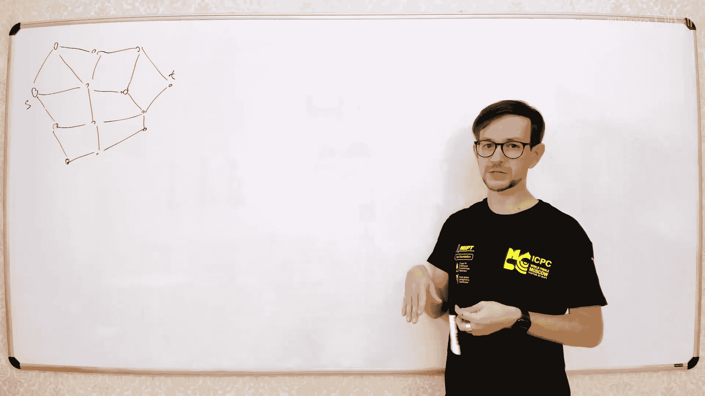

D red graph。And if your graph is hundred， you can simply replace every age。We have two edges。

And then the shortest undirect path will be the shortest direct path。Just because how it throws。嗯。

Okay。So I I will usually draw Androidroid graphs just because it's easier to draw。

 but all these algorithms will work in direct graphs as well。Now。

 there are different algorithms for different types of problems。For example。

 the first type of problem we will discuss is the problem which when we have all when all edges have the same weight。

 so for example， so let's say。Let's say the weight of each page is one。

So all edges have the same weight with this3 to equal to 1。

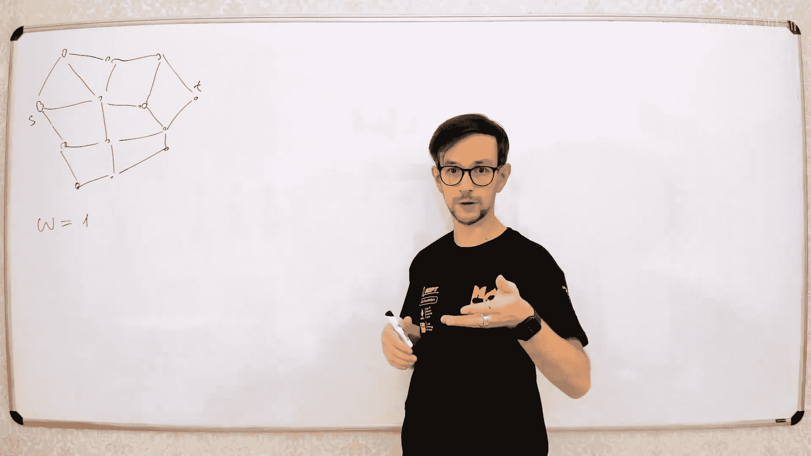

So now the shortest path is just the path， which contain the minimal possible number of edges。

So if all edges have the same rate， we just need to minimize the number of edges in this path。

Why we have so many Russian students today。Did they switch the language to English， Yes， I did。真个是。

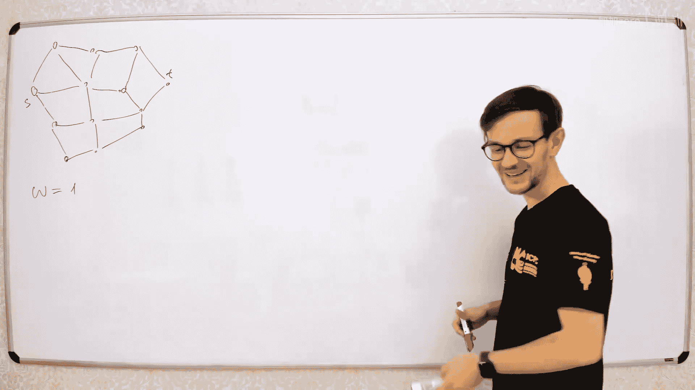

I have Russian lectures on on on Tuesdays。So if you are interested。

 just come back on Tuesday this very global English session。嗯。Usually I have the opposite problem。

 Usually I have a lot of English students on on Tuesdays， but to this。For some reasons， different。

Yes， and in in a in English。Maybe you come from cold forces。Make sense。 Okay， so for example， here。

 I can move from here to here in in four steps。 we can go here and then go here and go here and go in here。

 So the left of this path is4。 sorry and this is the shortest path from S2 T。Okay。

 so if all edges have the same weight， we can use the very same algorithm。

 it's called the breath of essential。嗯。What is the idea of this algorithm。 Id is very simple。

 Let's try to find the tator all nodes of the graph by increasing the distance from S。Soうタね。

By tracking all nodes， which are close to S。 then will go far and far and so on until we reach the node team。

When we reach no T， we know the distance from S to T。So how to do it？Let's put some imagesice here。

質問？D。お。6 don much。too many of them Okay， not88。Let seeて。Let's then。And here 11。不用。

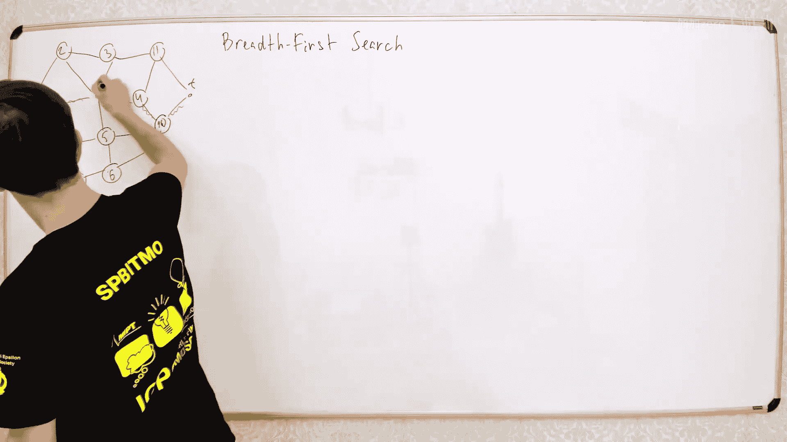

And T is the last one。So let's try to sign all the nodes in increasing order by the distance from node S。

We start。B of fee will be the distance。From S to B。So first。

 let's find all the nodes of this and equal to zero。你거不よ。

So which node have distance equal to 0 from node S。 There's only one node， right？ It's a node S。

 So node S is the only node which had distance 0 to node S。So we start this algorithm byte。

Finding that node S a distance equal to 0。You we have no what。That's all。

Let's def situation very simple。Now， let's find all the nodes of this in equal to one。

The nodes the distance equal to one are the all neighbors of node S。

 So let's find all the neighbors of node S。And say that for all these node。

 the distance will will be equal to one。そう。Here， I just all neighbors of one。 I have no 2，12 and 9。

 I will say here distance is one。 here distance is one。 Here。 distance is is to one。

And just put them all in this list so I have notes。2。12th and9。Now， it's a bit more complicated。

 Now I need to find all the notes distance equal to2。Here is a small tree。

 All nodes of distance equal to 2 have have a neighbor， which have distance equal to  one。 So if。

 if I take some node，And I know that distance to this not equal to true。 So I have this note S。

Then something， then nobody。And I know this is the minimum possible distance。

Then this so this node should be equal to one， right？So how to find all the。

 all the nodes distance equal to 2。 I' will just it all nodes of distance equal to  one。

Find all their neighbors。And for these neighbors， I will say that the distance will be equal to。

s that simple song， let's take note2 for note2。We have neighbors one，12 and three。Not one and 12。

 I always know the distance。So distance node1， 0， distance node 12 is1， but for node three。

 I don't know the distance。So this distance must be true。Why is the two。

 Because I have the path of length too here。I have this path。 I can go to node the two and then here。

 So the length of the path will be true。 And I don't have any shorter path because I already found all node node the distance equal to 1。

0。 and this equal to1。 So this distance not free。It's not equal to1 to 0， and it is not equal to one。

But it is at most2。 So I know the distance is at most2， and it is not 0， and it is not one。

 So it must be 2， right。So this is not free true。Just是不요。Let's song。

 wait right over all neighbors of Nor2。啊。Wetra to all neighbors of node2。

 and if we don't know the distance to this node， we just say the distance equals to2。

So now we apply the same thing to all other node here， So we take node 12。

 it's right all neighbors of node 12 and node 2， we tell neighbors， 1，2，3，5 and four， this five。

Nots for node，1，2 and 3， I already know the distance。 so I just keep them。

So now I also have nodes four and five。I don't know。 I don't know the distance to this node。

 but I know this node， the distance is not0 and it's not one， and it is at most2。

 So it must be equal to， right， So this is not4 and 5 is2。Yeah just again。

 just add them to this list。So make almost。And I apply the same things to this node 9。

 So for this note 9， I have。I have neighbors， one， five and seven。So for node 7， I don't know this。

 So this node 7 is true and justity。so now we found all the nodes for a distance equal to2。

And I will just continue the same protest。 Now， we need to find all the nodes of distance equal to 3。

 How to find all the nodes distance equal to 3。 We need to each all nodes of distance equal to 2。

 Find all the neighbors。 If we don't know the distance to this neighbors to this node。

 then this distance must be equal to 3， because it is at most 3， and it is not equal to 01 and 2。

So we take note three。Again， I' take note three， each let all neighbors find note 11。Would it here。

Take note 4。Find notes 1110。まケ。Put it here and so on。 Just continue the same process。

 Take note 5 for note 5。 well find this6。So here's free。60啊。

Not so now we find all the node of distance equal to3 and now continue the same thing。

 We iterate all node as it' equal to3 and try to find all the node distance equal to 4。

 So iterate all over these nodes， take note 11， find note 13， say distances 4。Put it here。

Take note 1。 find this node A。 Sa this sentence is4。我的天 here。Mil。

So at some point we'll reach all the nodes which are accessible from nodes S so if your graph is not connected。

 you may have something like this， you may have some extra nodes here and you will never find this node in this graph search Ref search will find all the nodes which are connected to node S so if you have a path from S to this node you will find this path and you will find the shortest path。

The same thing works if your graph is directed， if your graph is directed you'll apply the same thing。

 so first you'll find all in those distance equal to012 and so on。

 if you find all in all of distance equal to k， you will move from k to K plus1 just by iteration over nodes in this list and find all the nodes in the next list。

Let's write the pill code， it's going。So we need some name for these lists。嗯嗯。嗯。嗯。嗯。

We need some name for the for the variables。 So， so， so we need to have array of lists。Let's call it。

Lasts。Level。Makes sense。 Okay， let's say level。Sorry， look have a strong wind。

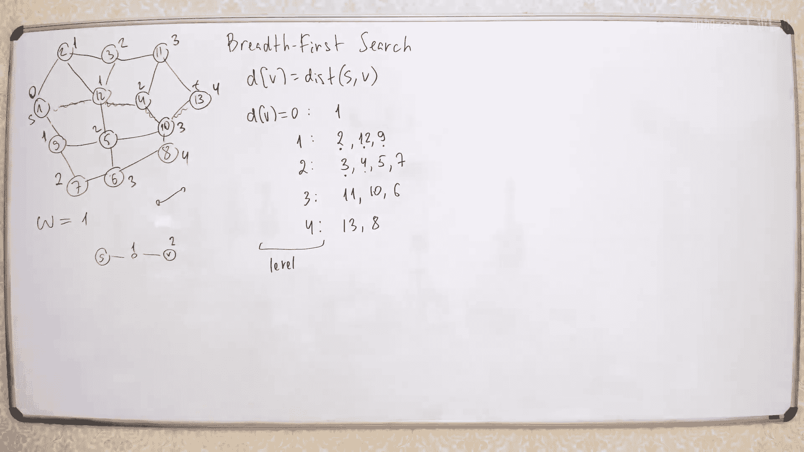

Believe near the sea。 So today， the be is。The wind is kind extreme。Okay， hope it will be fine no。

So we start by putting first note S in the level 0。 So we say that。Lowell。

0 will contain only the note S。And we also start by。Iitiating this array。

 So we say that distance to note S。Is zero。And distance to other and let we need some marks。

 so for some for each note， we need to make special mark that this note is not visited here here。

So we need to do to make special mark then some distance is not defined yet here。

 So let's say that distance to all other nodes will be minus-1。For all， V， not equal to S。

And now we just apply this procedure。 So we we iterate over or all levels。

So what may be in the maximum distance from node S？How many levels do we actually need here？不先一。

If you have unknowns。Then the maximal distance will be at most n -1 so maximum we will have is the path of all n nodes。

 then distance from last node from first node to last node will be n -1。

 so we will have at most n minus-1 layers here。So I need to move from0 to 1， from 1 to2， and so on。

 and then from n minus2 to n minus1。So， from 0，2 and -2。And now here。

 I will just move from level K to level K plus1。So what I will do， I will iterate。Overall。

 vertices in least in level。Okay。And now， for each verex in this level。

 I will iterate her all in ongoinggo ages。So， for。Gu。Ages。V U， let's say。I will going from Nor here。

Yeah， I just have。 I have。 I have this list of edges， right， for， for each note。

 I have the list of all green edges。So I tried over this list and now for this load to you。

 I share if it is not marked here。So if distance to you is not defined。

Then this distance must be capableless1。 So I see the distance to note you。Is K plus one？

And add this note to the next list。あい。I believe that's all that that's the whole algorithm。So。

 let's check again。 So what what we do， We start by putting don S in the cost list。Now。

 each time we take all the elements from this K and try to find all elements in this K plus1。

 We do it by simply creating over edges going from this node V。And if we don't know distance node U。

 then this distance must be K plus one。 So we we assign distance K plus one to this D and put this node in the next list。

嗯嗯嗯。嗯嗯。😊，You the memory about fun rice。Oh， the main great is to find the distance snow tea。

So the result will be。嗯。Distance to no。Usually， what you want to do is to find distance to only one node。

 So usually this this like。信信度。Pyer algorithm。 So usually you have a pair S and T。

 and you want to find distance from S2 T。But most of the algorithms will actually find listen to all nodes。

 So in this algorithm we'll find actually listen to to all nodes。Mmm。😊，呃。

Almost all the classical classical algorithm will find the distance to all nodes。

 not not to single node， but to all to all nodes。 because that's how the shortest path works。

 So if you， if you know shortest path to here， you actually kind of need to know shortest distance to all these nodes as well。

 So if you have this shortest path， you kind know the shortest distance。

 So all the all the sub paths of this path are also optimal。

 So if you want want to find shortest path from here to here。

 you will also need to find the short path to all intermediate nodes as well。That's basically why。

All classical shortpe algorithms will find distance not to a single node。

 but to all nodes of your graph。But we actually can stop。 we can。

We can improve it a little just here。 If we find the distance snow tea， We can break from this slope。

So if at some point， we know the distance node to node T。

 we can break from this loop and because we don't need。お 어。All all the next layers of this。Mmhm。😊。

Yes， the main problem was to find to the the， my main problem was to find distance to node T。

 but to find distance node T， we kind of need to find distance to all other nodes because these nodes are intermediate in this。

Shortest span。Can that make sense。Gong。Now。Let's improve little bit。 Lets improve it little bit。

How to improve it， let's get rid of this list， so this in this implementation we need kind of array of lists。

That's kind of too much。you need to release。 you need to some kind of mutable list。

 so you can add these elements in the end of this list。Let's lift it over complication。

It says that to save the levels of eachnet while searching。We kind I say this label。

 So we cant sell this list， but we still need this era。Because on the next step。

 we try to iterate all nodes on this level。 so we kind of need this array of all nodes with this distance。

 yeah。We are saying in this and so in this I， we see in distances， but on each new iteration。

 we need to iterate all nodes。 We have distance K。 So we need to have list of all nodes which with distance equal to K。

Mmhm。But we can improve a little bit。 We can improve it a little bit， just by。Having not。

Multiple lists， but a single list。Because if you， yeah， yeah。

 people can use a queue because if if you kind of what， what we do with this list。

 we do the following thing we。At at each point， we have some list K。And on list K plus one。

And what we do， we eacherate our elements in this list and add elements in the list list。 So sorry。

 at at every point， the situation looks like this。 We already trade over these elements。

 So we only need this half of this。At least。And for the next。Let we already put this on it。

 So this is the standard middle station of this graph。 So what we do。

 we take the next element from here。It's right all neighbors of these elements of this is B， yeah。

And put these elements here。So we take one element from this list and put the elementses。

 So if we just concate all the all the list into single list， we well have a Q。 So we will put。

 we will take element from the this left part of the Q and add elements to this right part of the。哦。

What's。There is this。Well I will not raise this。To keep it for a little。 So what we do。

 we take one cu。Just basically without any prior something that was basically the destruction。

And we just。Take the elements from the left part of the Q and put elements to the right part of the key。

 So。 First， we put element 1。And it will be elements of distance equal to 0。This is my Q。

 Now I take the leftmost element from the Q。 So I just remove this element from the Q。

 I will not remove it。 I just marked it Yeah。 So， so this element is removed from the Q。

And put all the neighbors to the queue， so all the neighbors will be2，12 and9。

This will be the elements of distance equal to one。

Now I will iterate all these elements just by removing them from the queue。 So I remove element2。

Find all its neighbors。 So neighbors will be3。And put element free here。

 So here will be elements for this equal to2。Now I remove the next element at2， C elements 4 and 5。

Put them here。 Now I remove the next element 9， find the neighbors7。Put them here and so on。

 So when I removed all the elements with distance equald to O from the Q。

 I will put all elements of distance equald。 So So when I removed all elements of this level。

 I will add elements of the next level。 So at every moment in my queue。

 I have some suffix of the previous level and some prefiix of the next level level。

So by the time I remove all elements of one level， I will put all elements of the next level。

That's also。 So instead of having area of lists， I will just have this one Q。

So let's re algorithm written a little bit。 So instead of this level， I will just。포디서면네큐。嗯。なん。

And here， I don't。 I don't need this too。A loops are move there。

I don't seem to do the following so while Q is adapt。嗯ま。So while my a at MC here。

 I will just remove the leftmost element from the cure。And then do the same thing。

 it all all the edges。I'll go from this node P， find all the nodes you。And if U is not calculated。

 then this is USk plus1。 And then I just put this U in my cube。Like please。

So that's the most canonical implementation of the B algorithm。So again， like let's read it again。

 So what we do， We make this cure。In this Q， first， we put the S with distance equal to no， no。

Here it's got Cap+ one， it's called Cap+ one。I get rid of variable K during this improvement。

 So now it is not K plus1。 It's D plusmania。It's D of V last one。嗯。Yes， you yes。

 you usually have your Q in in your student library so you can just take a Q from the S T L andia。

Yeah， we did it in in one of the streams。Yes， right。Or you can use some vector instead， both works。

You can use alreadyic。In Java， anything， anything in the world。

So we make this Q put this element S in the Q with distance equal to 0。

 now input a distance to minus-1 or all other no。Now。

 each time we remove one element from the Q the leftmost element of this element。

 It rather all neighbors。 If this neighbor is not calculated yet。

 then the distance must be distance to v plus 1， and we add this element to2 to the Q。Yeah， again。

 when we， when we remove one one level from the Q， we will put all elements of the next level here。

 So now we， we remove all these elements and put the next level and so on。Yes， yes， yes， yes。

 that's a good question。 Yep， yeah， yeah， yeah， yeah， yeah， yeah let's。Let's talk about the little。

 usually。Sorry， this algorithm will give you the distance。

So you run this algorithm and it will return you the distance from S2 T。

 Usually what you need is not the distance but the path itself。

Usually you wont if you ask someone how to go from here to here and。He will say you the satellite。

 you can go from here to here in like three hours。And you asked him， okay， but how can I do it again。

 And he answers， I don't know。I know you can do it in I know you can go from here to here in four steps。

 but I have no idea how you can do it that's kind of said usually you kind of don't want to find the distance but you want to find the path itself。

How to find the path。 No， we did the same trick when we discussed。Dynamic programming。Last year。

 right？So to find this path， we will， we will。Remember the parents of each node， so for each note。

 we will remember how we get this distance。So， for example， here。

 we get this distance D plus  one by going from distance from node V to node U。 So for this node U。

 we will remember that we can go to to node U。In this。Distance。Byuy moving from note 3。

So for this note， you will remember the previous note and the path。お sayビー ofユこのビ。有。Like this。

And now for every note， we know the videos also for this stuff。

13 we this note we this note here we this note all。So we can start from node T and using these links。

 just it all nodes in this path from those backwards。 Okay， so we start from node T。

 then go back back until we reach node S。 and we reach node S。 well find this path from S to T。

 and it will be the short path。That's basically the whole idea。

 So how that's how you how how you find the path if you want to if， if that's what you want to。

 So if you just need the distance that you just return the distance here。 If you need the path。

 then you start on node T and use this backward link just to find this path。

By a P S equal S in the beginning。 no， P S must be No， depends on your implementation。

 You may say P S。Thequ to -1。Or you may say be as equal to S。Usually。

 usually when you when you reconstruct this path， you just make while and you stop when we go to zero。

 usually this last。So when you construct the path， you do it like this， you say like V equal to T。

 then while。V not equal to S， you know like like and。Okay， let's do at this like -1。 have -1。 we add。

呃。This note V。To bath and then say we or two pe of it。With this。唉。

Or if you want both list T and S in your path。I will add this tea。 And then in the end。

 I will add this as。Again， again， this depends on what on details of your problem， but。しかな。

How you do it。不。Nice， so that's the the most that's the most canonical implementation of pre rhythm。

 Its why it's widely used。 It's very simple。 The time complexityes here。

 Let's talk about time complexity here。 time complexity is obviously linear because here we will take each node exactly once。

😊，Each mode。Once。와 너무갔어。そ。你去。So each note will be taken from the queue exactly once。So for each node。

 we' will iterate our all neighbors of this node。 So these loops。Will it all edges of your graph。

 So the total time complexity will be。M， let's say plus M。

I actually don't write plus n because it's kind of ambiguous。If your graph is connected。

 the M is bigger than N。 But Okay， let's， let's look it。That's all。 So So it's nice over。

 It's very easy， easy the。 It's first。So everything is great about this order。

But sometimes we can do it even better。 So' let's talk about some improvements for some strange problems。

嗯。That about the following trick。 There is one small trick I want to discuss。So some problems。

 you kindly want to find the shortest path in a graph， but your graph is too big。For example。

 you have some puzzle like Ruik's cube， something like that。

 and your puzzle have very big number of states。And if you just say that each node auto graph is the state of your puzzle。

 then the number of。Different states is。Too big。 So， and you kind of want to solve this puzzle。

 So you have this。You have stuff instead of your puzzle， and you have the like。finishして ya final。啊。

But the number of states is too to too large。 So you you can adjust trade all possible states of your rubbik's cube。

 right， because the number of states of previous goods is kind too， too large。

So what you can do instead。You can do the following trick。

You can integrate not over all possible states of your puzzle。

 but only the states you kind and need in your path。Because if。

 if you have some state and you stay this far away from node S and the stay is far away from node T。

Then you kind of don't need this state。Yeah， because if this state is far away from node S and it is far away from node T。

 it's obviously not in the shortest path from S to T。Best idea。So what we do。

We will do the breakfast right from both ends。So you have this note S。And the don。

You start by finding all the neighbors of node S， so youll find all the neighbors of node S。

And say a distance from node S is one。Now， you're doing the same thing for Nor T。

 So you find all the neighbors of Nor and sail distance。From big snow to Chi is what。

Now you apply the next step node S。 So for node S， you find all the next nodes。And say。

 distance is to。And so on。 Then you apply the same thing to no tea。So you find all this。

Something here。And so on then you apply it to known case so at some point。At some point。

These two searches will meet at some point， at some point you will find。Here。You will find some note。

And you know the distance from node S to this node and from this note to node T。And now。

 you know the short spare。Forpect to adjust some of these two web。

 so you go from S to this node and from this node to T。嗯哼。So again。The trick is very simple。 You。

 You take this， not this， not this situation。You can， you can just use this code。

 but you need to kind of remember which ones you。Yes， you can use these code buttons。 Yeah。

 so you need to put in the Q S and T。 and then each time you need to remember in what professors you're actually working in。

It's a implementation details。 Yeah， I will keep it to you as an exercise， okay。

I dont know try to go for this。 it's simple。 You can do it。

So each time you like you build a new level in one of these breath researcherses。

 so youll build new level in this data research or in this breath research at some point you will find the note which is in both these trees。

So you find the small fee。And when you find this node V， then you know the distance from S to T。

 Why know the distance， No， Because if you have。Let's say if if the distance is， let's say even。

 Yeah， So you have this S and you have even number of edges here。嗯。If this distance is2。

Then you have some middle note here。And the distance to this middle note is D from here and D from here。

So if the distance is even。Then after after theitioerations of this search。

 you will find some node which have distance both these distance as equal to D。

So when we when these two breakfasts are just meet at some point， you know， the distance from B 2 D。

And if distance is odd， for example， if it's 2D plus one。Here。

Then there is a point of this D plus one from here can give to D G2 T a。そ。what will happen。

 You will make one more iteration of pre search con S。 So in the left graph search。

 you make one more iterations and find this node to be。 So at this point。

 you will know the distance from here is is D plus1 and distance to here is D。

 So you will know the distances to D plus1。不吵。Why is itW it may be more efficient than normal breakfast search？

In the worst case， it is， it has the same time complexity。 In the worst case。

 you can both these breakfast search as may it rather all notess of your graph so total time complexity will be linear。

 which obviously not more than linear yet because each note will be treated at most twice one in this breakfast and another in this breakfast。

But in。In some usual graph， you， you can meet in some in some puzzles， for example。

 or in some systems which look kinda naturally。 So in in kind。In some systems， which come from some。

Natural reasons they have。A hugee number of states。

And if you reiterate over states from one node and from oneNot。

 the number of states you will grow exponentially。So the number of nodes with distance。

Equal to D grows like alpha in power of D。So the number of nodes with on on distance D will grow exponentially with some。

Base alpha and。If you just make normal breakfast stretch， you will it over Al in distance。

From S to T。 So you will rate this number of states if you just make a normal normal breakfast search。

And if you make this， which fiber research from both ends， you will make。

D over two steps here and do over two steps here， So you will try kind these number of states。

And that's much less。 since this power is twice more。So it's like square root of this。

 So So if you have some kind of random system。We exponential growth of number of states。

Then by doing this algorithm from both ends， you can of decrease the number of visited states in like a square root of your。

너 먹 올게 있어。So if you have some kind of random graph。

 kind of random depends on what you what you're supposed to be random。

 So this algorithm is much more efficient than the normal everything。2。Who。Now。

 let's move the next thing。That's all about the graphs when you don't have weights when all the weights of all ages are equal to one。

Now let's move the weight and graphs。Let's have a graph。Again， we have some of S。Does he want。えと？ここ？

5。6 and 7， and some edges here。And let's say I want this pair to be the shortest one。Just for。Okay。

Let's say this weight will be。嗯。8。No， it is too much。Let's say，5。And here， we have。6 and。frree。

And now I want so I want some small numbers on this stuff， right， So we have two。

 let's say three here and one here。And now I want these to be smaller than this。

 So these actually be bigger than5。 So let's say 7 here。

And I want a base path to be longer than this path。 I have five here so here and something four here。

And for this path。It is6。So let's put down here。Just be sure。Yeah， something big here。

And something big here。嗯。嗯。外不子。So now我 havegraph。And every age have some weight。

Let's say that all the ways of ofgraph are no。If all the weights。啊弄那个地。

If the wordss are not negative， we can apply the algorithm which called the Dxter algorithm。

Very simple algorithm will discuss in a few moments。raiseです。

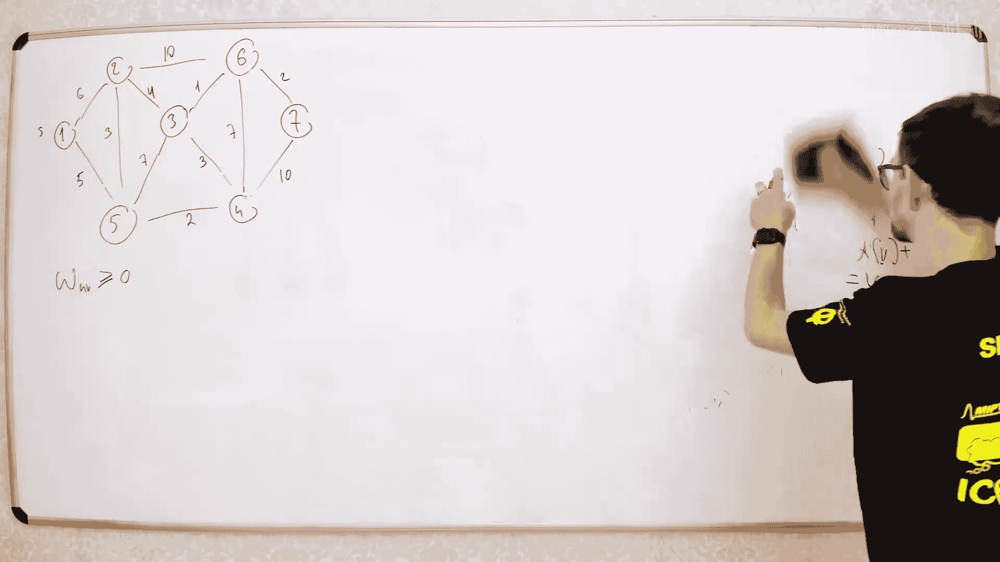

So how decent really works。 It worked kind of the same as the breakfast search。

But with small changes because we have this weight。 So we will try to iterate all nodes of the graph。

By increasing in order or by the distance to notice。 So again， we say the distance。

To note V is the D is distance。From node S to node V。

And we will try to iterate our all notess just by increasing this value of the。Let's go。手好图。

So actually。Pre pretty much the same。 So we start by finding the first node。

 First node is the node of distance equal to 0。 The only node of distance equal to 0 is the node S。

 So for node S， distance equal to 0。Now， let's find the note with minimal value of D。啊。Observation。

The node， which is closest node S， must be its neighbor。ButBecause if we have some node。

 which is not a neighbor of S。 so we have some。But least not。

Then let's take this path and move closer to node S。 So， so for this node。

 the distance will be smaller because we have the shortest path。

 So this path has smaller weight than this path。Because all the weight are not negative。

So the next node， the note the minimal value of D will be one of the neighbors of node S。

 So let's take。All the neighbors of node S and find the minimum one。 Minim one will be this5。

 So for this node5。This is the distance from note S。Again， why is five because I have this H5。

So I can move from here to here in dot level 5。And the distance can be less than5 because all other edges from node from node S are bigger than 5。

So I cannot get out of note S spending less than 5。 Yeah。 So so the distance is at most 5。

 and it is at least 5。 So it is equal provided。嗯。Good。Now， how to find the next node？Again。

 the observation， the next node must be。Either the the neighbor of node S or the neighbor of Noton 5。

 So the next。Note in the list must be one of the neighbors of these two node。Again。

 if the next node is not the neighbor of these node， so we can move closer。

And decrease the total length of all the edges here。 So if the next node is， so for example。

 this node cannot be the next node in the increased order by D， because for this node。

 there is another node， which is closer to these two nodes。

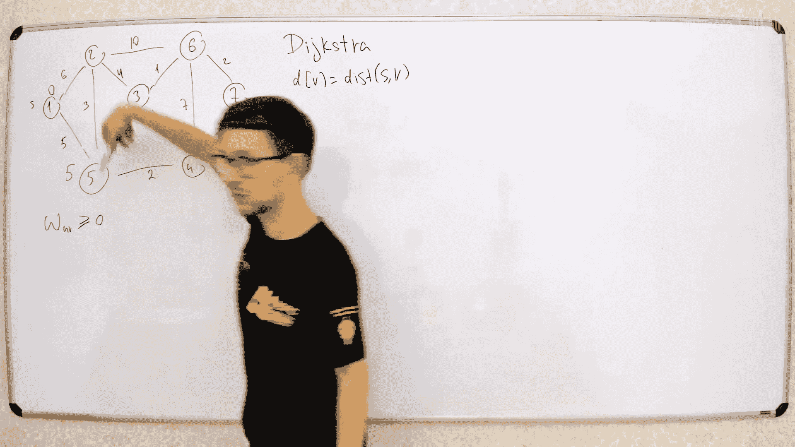

So next note must be the neighbor of one of these two node。

 so let's it through all neighbors of these two node。And find the smallest one。 For example。

 we can move here in 6。Or we can move here in 5 plus 7，12。Or we can move here in5 plus 27。

So minimum of these three is 6。 So we say that。Distance to here is 6。And so on。

So each time we have some set。Al we've already calculated values。

We will find the one of not calculated。Note with minimal value of D and add this tocald set and so on。

 and will repeat this process until you find all the distances。Okay。

 let's let's draw the algorithm here。 So what we'll do。At each point， we will have some set。

I called set a。Which and clothes told us。And this will be the set of nodes for which we know the distance。

 So for each node in for all。4s。落化。For o。V from node a， we know that Dv is the distance。

From S to T to V。So for all node on this set， we already know the distance。No。What we need to do。

 so these are all other nodes，We need to find the note。 We've not， not yet calculated。

So we need to find one of those from this set。嗯。And this node must have the minimum possible distance。

 What does mean。 So distance to this node is the distance to some node to here。嗯。어 유。Plus， this note。

So we find， we will find。let me write the code here。Okay， I write a formal here。

 and then I write a call here。 So we find the V such that this sound is minimal possible。So do you。

Plus， the weight of the edge you。Now， now I claim this。

This minimum is actually the distance to node V。Let's prove that。 this minimum。

Is the minimum possible distance， note we。Why is the minimum possible distance， First。

 we have a path of this length。 Yes， we can move to north you and then move here。

So this is the possible length of the path。Now let's prove that there is no path which is shorter than this。

So if we have some another path。So we have some another breath from S to V。

 which is shorter than this minimum。😊，It means we have some pair。 Let's roll this bag。

So we have some another bad。Like this。And this bear for some reason is shorter than this bear。

This path goes from set A to not so A here。 So we move from from some vertex inside set A to some vertex outside of set A。

 So at some point in this path， we， we must take a step out of set A。 So there is some H。Here。

In this path。Which goes from inside set H to antibiotics outside of set H， So let's say X， Y。Now。

 this part of the path is already longer than this because we take minimum of all possible paths like this。

So this part of the path from here to here。Is already longer than this part。

 because you take minimum of all possible pairs， right。And this extra part is not negative。

 since all。Weights are not negative。So we have something which is longer than our distance。

 plus something which is not negative。 So this path is definitely longer than our path。

 No short again。You may have paths of equal。So we have no negative sorry。

So this path can be shorter than our path。So we have this path， and we don't have any shorter paths。

 So it is the the shortest path to all we。So distance to R must be equal to this value。

That's the whole idea。Let let's write the algorithmism。嗯。Let's write the very seal。 Very very seal。啊。

诺这个字了这。I have it here。Oh let's talk about Let's say that。Every so， so set A contains only node S。

And distance to S equal to 0。the resulting bit the structures。then the will apply all of this charge。

 Okay， so we what we need to do， We need to repeat。Like in quote work okay， and-1 times。

The full operation， we need to find。Minimal value of D， U。Plus。Weight of the H V U， U V。What my。Uv。

For all you。In a and V， not in a。It's not the code， It's just the total scheme of the code。

 I will apply this structure next to me。I'll first write what we need to calculate。

 and then we will think what what the structure we need to calculate first again。

 So it's not a copy yet。 It's just just。Okay， now we need to find this minimum。

 and then we find this minimum。 We will say that this distance。Is actually equal to this sum。

A am at this note to set。嗯。Next。That's what we need to do， yeah。Again， what we need to do。

 we have the set A set of all the calculated notess。We look on all non calculated notess。

And find the note of minimal sum， sum of。Distance to here， plus this edge。If we take the minimum sum。

 it will be the correct distance for node B。 so we say that distance node B is equal to this sum。

And add this node V to the calculated set。And then repeat the same process。After unmanaged。

 we will add all the notess into set A。 So in the end， we have the set a containing all the notes。

Offf the graph。 So we'll calculate all the distances。嗯。O， I。

 I may kind exceed my limit on mathth formulas in the single lecture， but。Okay， isn it too much。

 Okay， this this minimum looks kind of scary about。Okay。😊，No。Now， when we know what we need。

 we need to find the appropriate data structure。So I again， like in the previous lecture。

 So if you if you remember the previous lecture， we did kind of the same thing。WellLast week。

 we did the same thing when we talk about minimal painting。We need some data structure。

One data structure， we need some data structure， which can calculate the minimum。

And many of these starts like this， for example， priority Qs so we can take priority Q。

Any any any of them。 What's it， Bi he。Can I apply the buy the here。嗯。Okay。

 let's do it in two steps in life last week。 So I can I will do it again in two steps。 First thing。

 Let's try to fight to put all these pairs into para。Like it a little okay。 longer。 I will rush it。

 Yes， we' have time。 So let let's do it in two steps。 First。

 let's try to put all these possible bears into bear re secure。Let's say again， a equal to S。

Distance to S equal to 0。And then we put in the priority queue。All the pairs。As。Ri。For all edges。

 For all edges。S。Yep。So each so at any moment， we will have this set a， set not a。

 and all these edges will be in our peri here。Yeah， it's pretty nice quality nice quality。

 Let's talk how you're supposed to write these song with him， but。그 good。Now。

 we repeat the following process。We take the no one of the edges U V。From biology。嗯。

So we remove this edge from pretty here now we need to add this V to the result。Let's say， D to V。

It called the U last weight of the H U V。And add this V to set a。 So when we add this V to set a。

 we need to modify the prior。So when you add this V to node a like this？

The the elements of your vertical will be changed。 For example。

 if you have edge from V to some here right here， let's say w。Now， this edge should be in the peri。

So what well do， we'll iterate all elements or all the edges can from node to be。 So we iterate。For。

Put all edges。위 double。有。We will say that。Let let's listen to this。 if W is not in a。要天。

Then we add this edge to the gra。And， if not。It means we have edge like this。

It means we have edge like this。So if we have actually push， we need to remove it from。

응 응 응 응 응 응 응 응 응。Whior should be restricted。 No， you don't need to visit the node multiple terms because again each time you remove the node from the period secure。

 you know the distance will be this。Since all the weights are not negative。

So when you remove the minimum node， the minimum node from the project， you know。

 distance can you distance can can can decrease when you add more edges。

So if you find the minimum one， So all other distances can decrease。

So you take minimal one and know that it it is the correct minimal distance。That。

 that's the idea of this of all these。And if not， let's remove it。Somethingund like that。야こ 나 뭐ら。

After lunch you give you me an old edgech。You need to check。Well if if you keep it like this。

 I will remove it here， I will try to keep only the correct edges from from A to note a。Okay。

 that's just a sketch。 this， that's not the， not the good algorithm Ca we will approve it。

 We will approve it。This just just to show you the first step。 Okay， we。

 we will make a better algorithm in just a second。啊。So， here。All going on here。

 so if we use some binary here， for example， then these operationsations， these operationsations。

 these operationsations， these operationsations all work in well in time。送。Yif。You have， for example。

 binary he。多king time complexity will be诶。Let see you apply this operation at most end time。

And you've play this version enzyme times。How can the prove。

That's just just implementation of this algorithm， the same algorithm。That's not。

 that's not how you implement this algorithm。 usually we will move to the most commonal innovation on that。

That's just one of the way to think about dial gra。 Again， what what I do in this implementation。

 I try to， I put all the edges between these two sets。In some。

This minimum is minimum of sum so the key in this periodQ。嗯。Is the sum of the you plus weight of。So。

 the key in the priority queue is some of distance plus the weight of the edge。

So I don't take the minimum edge。 I take the minimum sum from the previous。嗯。Okay， it's。

 it's kind of ugly implementation。 We do we can do better。So how can we debate on the same？Trick。

 as we used last week。What will do， We need to find minimum。For all nodes。

 let's group all the nodes by the N endver。 So for each node， for each vertex here。

 we and actually need to know only one edge， the minimum one。 So for each。For for each ortex。

 which is not in。So， if we is not。In a， then let's say that D of V will be minimum。

Of all D U plus U V for all you in a。I'll just reduce the same array， yeah。So， let's see。

That for each node， which is not。And said a， which is not complete yet。We will remember this minimum。

 so we will take all in。M let me draw this。어프 어 어프 어 오。So for each node V here。

I will look on all in edges。For each of these in goingage， I will calculate the shortest path。

 So I have some shortest path here。 some shortest path here。Now all these paths。

 I only need to take care about the minimum one。 So I will remember only one path。

 which is the minimum one。 So I for example， this， this is the minimum path。

 So I will remember only this path because these paths。

Will definitely will will not be the optimal ones。And now here。

 I will just need to find the minimal value of D in wholesale a in in note a。

This will be much easier， so let me just let me know this section quite a bit everything。So again。

 what we'll do， we will maintain this already， this already will contain distances for all nodes here and minimals for all elements here。

哦，我去。So D of S equal to0。 D of all other nodes will be equal to weight of no of H from S to V。

Actually， I don't tell you， you can't say that area A is empty。 set A is empty。

Then on the first step， before order， you will put。

 you will put S into into set A and then apply the。That's done small tricks。一人。Repeat L minus-1。

 So we need to find the minimum element in in here。 we need to， we need to make priority Q。

There's no conventional way of writing the for loops， but good enough， right。

So we need to do these things for all we not。😊，嗯。No。I bit following。

 We take the minimal element from here。Again， we did the same trick last week， right？そ。

This values of T will contain minimum among all the edges。 So by taking minimum element。

Among all these these， we will find minimums of all minimums， So it will be minimum of of everything。

 Yeah， so it will be minimum of all these pairs。So for each we， we calculate minimum of all in ages。

 Now we calculate minimums for all these vertices， and it will be minimum among all these pairs。

Absolutely， the same trick as last week last week。So we take this V and will be the minimum。

 And now we need to， we need to calculate distance to this node V。

 but it's actually already in this in the correct place。

 So we need to say the distance to V equal to this minimum， but is already equal to this minimum。Now。

We need to move this V to set a。We need to say， hey。How to put vertex v in insert A。

 When you put vertex v in A， again， you need to update your priority。

So now vertex v is inside your set a。So again， you need to it all edges。For all Hs， V W。Now。

 what you need to do for this verex W， you need to update the value of D。Yeah， so now this age。

Belongs to this minimum。So for first example， you， you need to update the value of D W。

So D of W will be updated as minimum。Of old were U D W。And this new sum。 So new sample will be TV。

Plus， the weight of H， V， W。Like these。So we find this edge and update value D for this W。And now。

 since we updated the very use， which we used as a key。Yeah， my plus。Thanks。Now。

 since we updated the value， which we used as a key in this priority queue。

 this D is key in this priority queue， we updated the key， so we need to update the priority queue。

PQ， let's say， a late。Now updateate is depends on how to implement the priority view， for example。

 if you have a binary hip， you need to see this element。얼싸냐。Good。Nice。I believe this a whole。

That's the whole picture algorithm would written。Now， again。Let's try to calculate time complexity。

Again， like。The last week， we do the same， same thing。

It's actually the the code is almost the same as in Pri algorithm。

 So if you remember how the Pri algorithm works from the last structure。

 it's actually kind of the same。 The only difference is that here we take the sum。For all。

 in prime algorithm， we have the same thing， but here we have just this album。Yeah。书那个是对对不书。No。

 it depends on the limitation， we can call update if it wasn't updated， it will just do nothing。Okay。

No， you will not have any cut color sample you。You mean if this W is not in in already in set A。

 we will push it back。Okay， okay， let's， let's do it only if。If W， not in a。Mhm。😊。

It depends on your implementation， again。There's just tilt theirco here。Cool。

 now let's talk about ten0 complexity。T complex depends on what the structure you use。

So we perform some operations with data structure， we do with data structure this operation of structure。

This operation where we actually call n times and this version call n times。

 I can like we did last week， absolutely the same thing。So here we remove minimum from the priority。

 and here we update value on priority。那。We can use different data structure for the perQ。No。

One of the basic pictures is to use。Binary hips。 again。

 I will I will repeat the same thing I I said I said last week。 So if we use binary he。

Then both in separation were work log on time。So I have Loin here。 Loin here。 top 10 click。

 will be a login。If instead of binary cure， I will use just simple array。Then， I can remove minimum。

Yin。A linear time， but I can update in constant time。 So if I just use array。

Time complexity will be n square plus n。Book n square is usually bigger than M。

 So it's just n square。Okay。And finally， of course， you can use Fibonac hip。 Why not。

 You can use Fibonacci hip and Fibonac hip。 You can remove minimum in login time。

 and you can update in constant time。 since this update just decrease the key in Fibonacci hip。 this。

😊，Distances are。Only decreasing。 So， so these values are only decreasing。

 so you can apply decrease key operation if you manage hip。 So this operation will work in constant。

 so you can use free he。WeHeap and give them complexity and1 percent。Again， same as last week。

Me and segment trees。 You can prefer to give just set value to infinity。 Yes。

 you can use segment trees。 Yes， you can use here， instead of binary hip， you can。

 you can use any data structure， which which support operation by the minimum， you can use。

Secondaries， you can use any type of balance search trees。매십이 기념엽 좀。Here' has been credit。

 B the keep is just the most efficient structure for this， which is space efficient。

But by we can work without any extra。Space suite， kind of。Cool。2。那走。Nice。

 let's roll up all these all。Fhibon Mac hips down， no when remove hips give you log and time when you remove minimums。

 but when you update value， when you update value and here when we have the value。

 we only decrease the keys So it's decrease key operation decreased key operation is constant time。

What is the key for priorityscript， He is the value of D。 So again well find。

 we need to find the minimum value of this。 So in this priorityic here。

 the value the key is this value of D。Gong。Let's mark a cute。哦。Nice。Okay， two more things。

 two more things I want to discuss。 First， simple thing。 you can apply。Let's write first，'s let。

 let's try this algorithm in this example just to make sure we got understand going on。

I want to run this document on this graph since I had this graph。So here I have a graph of 7，7 notes。

 so these distances。the area of7 elements。So first， I will say the distance to node S is 0。

Distance to all notes will be infinity。We can make some special value from these infinities or just put some big number instead of this。

dependss on the implementation。Not。到时里买点。Now， I， I will say distance equal no not。

 in this implementation actually， actually， you can improve a little bit。 You can put。

You can say that set A is empty。And then all these are infinities。

And then when you here you might repeat n times。 so on the first it， you will remove this S。

 put it in put it here and then put all these values here。Doesn't matter true。啊，其数数四。

This distance 2 is  6。 distance to 5 is 5。两个草。6三 five。Now， each time we remove the minimal elements。

Square decomposition。 Yes， I believe you can do something like square decomposition。

 but it will be is just it is slower。 So and N square root of is just bigger than end log。Yes， you。

 you can do， you can use any data structure which supports separation remove minimum。 For example。

 you square compatible。啊。那又什么そ。I actually remove this also。 now， now I remove the minimum elements。

 So it will be element 5。You are all neighbors of this five。Update the values of the。

 So I have this not updated here。 I will have 5 plus 3 is。Great than6。Here， with photo sensor is 12。

Here， have plus 5 plus 27。For update value for free S 12 and value for 4 thousand set。Yep。Now again。

 remove the minimum element。 It will be 6。 Remove it from here。 Each era of all neighbors。

 So here will be。6 plus than 16。Here will be 6 plus 4。 Its 10。So I update value here。10 and 6，6。

And again， remove the minimal value here is this7。So I remove this 7。Iterator all neighbors。

 So here the distance will be 7 plus3 is 10 is the same。 And here the 7 plus 7 it's 14。

 It's less than。 so it's 14。So here distance is 14。again， remove the minimal elements。

 the minimal elements of stand。 So you remove this stand。

It you writer will all neighbors see this neighbors one， so it will be 11。

 so you update this 14 to 11。B it here。Also when you cities this it's7 yeah。7 it was 7 pure。

And finally， now you remove this element 11， find this two。And update is value 2，13。

So in that youre at least5。嗯哼。And now again， like before。

 when if if you to if you want to construct this path。

You just remember for each value how you get this value， so for each for each note。

 you remember the previous note in the path。So you get this value by moving from here。You get。

 get this 11 by moving from here。 You get this 10 by moving from here。

 You get this 7 by moving from here。 and so。And right from from the end you go to here here。

 And you remember this pair。꼭。N。Two more things I want to discuss。First thing。

 you can apply the same treat we apply it with the breakfast et。

So you can do extra algorithm from both ends。So what you can do， you can take this node S。

And theres no deal。And try to apply Dter from both ends so you can find something from here and something from here。

So start from node S， find some node here。And at the same times you find some node close to note D。

Sounds like this。So at each time， time， you have some。

Nots in this digital algorithm and some nodes in this algorithm。 So for some node， you have。

 you know the distance from S to this nodes。For samples。

 you have you no distance from this note to tea。Now。

 each time you take the minimal node So you find the minimal node here and find the minimal node here。

You take minimum for this minimums。And add this don't note to this tree or these no to this three。

So you kind of want to grow these trees from both ends at the same time。嗯。That's all， at some point。

These two trees will meet。It some vertex。 So there will be some vertex in both these trees。

So when you grow from both ends at some point， these two extra will meet at some point。

 So you have this node V。And note this node V the next node for example。

 this node V was closest to node T from old nodes in this sense。 So you add this node。

 add this node to these three and。Then you find out that this V is actually already put in this in this。

At this point， you need to stop your extra algorithm。

And try to find what is the distance between S and T。Unfortunately， it's a bit more complicated。

 So in when we talk about the pre rhythm， when we find that these two trees interect。

 we just know that the distance from S to T equals to some of these distances。

 So it will be distance node V plus this distance。In the extra algorithm。

 it's a little bit more complicated since you have this weights。For example， Lesbs。For example。

 what may happen in situation like this， let's say。You have these two nodes。

 and you have these three。And let's say these length is stem， this length is1。And this length6 and，6。

6 and 6。Again， this may be useful when you have a huge graph， but the graph is that huge。

 you don't want to alter all node of your graph。Ahu。So this object is almost linear。 So So it's like。

 what I put it here， So there。Again， you can implement the Fibonage hips in an organgan。

 but the most common implementation like the situation used binary hips will be anloggan。

So it's almost here by this log factor patterns。So if you need to run only once on a graph on a normal graph of normal size。

 it's fine， but if your graph is huge， like we discussed before so if your graph is huge。

 you kind of don't want to interpret all nodes of your graph。哦。That's。

 that's when when this actually makes sense。So oh， so， so you have this graph。

 So we have this graph G， yeah。And this is bigel， so what happens usually you have this node S and this node T。

So you will each all these。You will find all these notess。 And if you run it from both ends。

 you will find。These nodes plus these notess。 Yeah， so here are them。So just this。

Number of mo waste will be much small。 You know， it's， it's to the case in， in to the case。

 it's not that interesting。 but， if the。If you have more dimensions。The difference grows。

Really first。Now， let's go。So what will happen at some point， these two trees will meet at some Bs。

But this， the sum of these two pairs may be not the minimum path。 So， So this pair。

Maybe not the minimum path， for example， in this graph。 So if you start from here。And from here。

Then first， you add these notess to the trees first。

So you add this node and then you add these notes， so at some point you add these two node。

And here you add these to notes。And find this middle node is in both threes。

This node is close on this node here distance is 10。 here distance is 12 right。

 and it is closer to this node as this node because is again， 10 is less than 12。

 So she refer add this node and then add this node。 So this node is added before。、バってゲームいい。Here。

 distances。To the2 20。 and this distance is。18， right。So the shortest path is actually this spa。M哼。

That's what may happen。The solution is very simple。

 The shortest path is always a path to some note here。Plus， this edge， plus。B to here。So you can。

 you need to find some node in this tree， some note in this tree， plus this edge。

And one of these paths will be the shortest path。Lets all。不错。I can leave it you as an exercise。

W I can I prove it。Okay， let let me leave it to you as an exercise。 Okay， so。

 what is the idea when youre on Dter from both ends。At some point you will find the vertex。

 which is in both three。At least at this point of the algorithm。

 you need to stop the data algorithm and then find this edge connecting these to trees。

 such that this sum is minimal possible， So we need to find the minimal possible。

So we need distance from S to node x plus distance from T to node y and plus the weight of h X Y。

So this will be the distance from node S2 T。故。One final thing I want to discuss is the A star album。

It's kind a strange name for the algorithm months。Sometimes， names are strange。

So a star algorithm is actually some cool modification of the digital star algorithm。

 which is quite useful when when you have some knowledge about the graph。For example。

 when you have something again， if if you have something or road network， Yeah， so you have a map。

And this graph is actually a road network in this map in this map。

And you want to go from here to here。Like， like two points on E map。

 You want to how from this point to this point。 And you have some roads。So typical situation。

And what will the extra do， What will digital get do。

 Dix algorithm will find the nodes by increasing distance of the node S so it will。Find these notes。

 then find these notes and so on。So the area you are working。

Will be some kind of circle around this node e， so at any point。油还好一看。

The area you're looking for will be grow like in all directions around node S。

 this like how diter everything works right So it its all nodes by increasing of the distance from node S so it's like growing circle around node S。

That kinda is strange， because if you know that you need to move from here to here。Then， actually。

 this note。Looks much more promising than this note， yeah。So this not。I's much better than this node。

 but for D everything they both do the same。Because it doesn't care about what， what is the。

Final node， okay， it only cares about the distance from S to this node。 So for digital algorithm。

 these two nodes have the same priority。But we know that this note is actually much closer to finish。

So maybe we can use this information somehow。And we're click。So how can we use this information？嗯。

Let's see， let's say that we somehow can make guesses about the distances in this graph。

So we have some intuition about how the draft works。So for some pair of notes。

 we kinda know what you。Some， some， some bounds for， for example， for these distances。走。Okay。

 so we know that let's say age of we will be about the distance。こロウィートがおって。

So let's say we know something about the distances。For example， we。

 we can approximate the value of this distance S H3。And for these values。

 the trinangle equation works。So we know for each， for each edge。嗯 응。The value of V。Plus。

그 small from。Yeah， will be it no more than。系啊。What direction， like， what's the weight of edge。

V U plus the。그そ。So this symbol is triangle in the quality range。 So if you have any edge。You vu。

You can move from here to here， and then to。And you want that your distance is no more than this age plus this distance。

Mmhmm。😊，So let's imagine we have these values from some knowledge about the structure of the graph。

 for example， again， if your graph is just the road map。Then this， this maybe just the distance。

 like physical distance between these two nodes。Like the total length for whole rolls can't be less than the distance between these points。

So at least an equation will work。More question about above proof is at the end。

 we can just fix node x in it all out and H from node x and compute minimum。

 wait both end of retro mystery n plus。 yes， again， in the worst case， in the worst case。

 you will need to it all graph。But if you have some special graph， which kind of random graph。

Then you the this those。 So again， again， you start from this node S。

 iterates over this edge and node T it over this， this node。If you have kind random graph。看呢。

Then total number of nodes in these to set will be much less than total number of of nodes in your graph。

But in the worst case， you will try。 You will have to charge all notes， yes。嗯。Okay。Go back here。

 So if you have these values from some knowledge about your graph， then what you can do。

 you can apply the same extra algorithm。 but here use the key could not D。About value of D plus H。

What it will give you。 It will give you the phone by shot so now。

This note will have less regular smaller value of age。So in the D algorithm。

 you will remove this node before you remove this node。

 so the set of nodes you use will look like this。But it will look something like。嗯。

Something like this。そう。Sounds like this。So this set of visit notes will be kind of moved closer to the note tee。

Because these notes will have。But the priority doesn least knows。

So we will remove these notess before you remove these notess。

And it actually will be much more efficient because you。

 the number of nodes you visit in this will be less than total number of nodes in your。没错。

Let's have some example。 Okay， let's have some example both。Let's have the final。呃。嗯。嗯。嗯。嗯。

Sounds like this。And let's say I need to move from here to here。And something here as well。Too much。

 too much。Okay。Now， we need to say that the length of the edge equal to the distance， right。

Let's say this distance is one。 So here is 1，2，3，4 let's say 5， and its 4。 and it's 5。

 And this looks like5。 And this also looks like6。 and this more like three。And this is what like。1，2。

3，4，5，6，6。And this one was like5 for like4。왜 good。It's like4 and like free。 And this looks like4。

U lets say 5 and 4 and 3 and 5。I tried to approximate the distance between two points。Okay。

 let's say this。Free and free。 And this one is speak plus 7。And this one is 5。 And here is。上诉人的。

So again， let's， let's say， it's a map of roads of your city。 And you need to move from here to here。

So you will try to approximate the value of the the distance between the two bridge just by just byequating the distance Euclidean distance of between two points。

So we'll say that here distance is free。Here distances，7 here distances。My name is 6。It's 4。

 It's 5 for this。 It distance is about。Whats say。eight。And here， this。我 sit there。Okay。

 you invo hold here。 the distance is。Lets take 11。And here it is。What's say。13。We了。It's about。

 let's say2 here。 It's about。エち？What's say，9。And thank。So these values are some again， some values。

Which kinda bounce the length of the path， yeah。Cool， and now we're just round the d right。

Using these values as guides。 So so we use this distance here whether we complete this minimums。

So we start by taking this S。For S， value is 0。And now we update all the various here so here instance。

4，5，5 and 5。And now we take the value with minimalimal sum。 Minimal sum will be here。

 It will be 8 plus 5。 Minimal sum is 15。 So this note will be the next note we remove from the priority。

So we remove this node from the prior here and update all the distances so here distance will be9 here。

 it will be8 here it will be 5 plus 5，10。Now， again， we have all these nodes。

 We remove the note of minimal possible sum。 So here sum is 14。 here， the sum is 14。

 So we remove one of these notess。From theQ。Yeah， for example， these snow。

 So remove these snow from the P G here。Update the distance set here is only 5 plus rates8。不从不从。

Now again， we remove the minimal sum Min sum will be here is 14 here it is 15 here and is 15。

 so this will have the verex will have the minimal sum。

 so we remove this verex sum from the priority here， update all the sums。Tokyo be 4 plus 4 is 8 here。

 It will be 10，42 10 more why more。s where it's not 8。 So that 8 is 10 plus 4 is 14， yeah。ああ。

The10 plus for 14 here。Then boss one is  eleven1 here。すよ？And now again。

 we remove the minimal node from the heat it will building this node。

And that's all we found the minimum the value of the minimal pad。

 The sharpest pet will have value 14。That's all。 And we didn't read all these notes because they are not promising。

We know that if we move here， the minimum length will be at least 15。

YeahSo we know distance to here is 6 and distance from here to here is at least at least distance is 9 and distance from here to here is at least 6。

 So we know if we use this node， the distance will be at least 15。 so we just skip all the notess。

With this， when this sum is。Worse than biology have。

 so we take the minimum possible sum of the shortest path plus this approximate distance。Thats all。

 that's the whole idea。Okay， the final thing。 let's just prove that it's actually the same thing as an extra order thing。

Yes， it's always the correct。 It's absolutely absolutely de determined correct other。

It will always give you the correct answer。 So if if if this integration is spike。

 so if you have this in。Then it will always give you the correct answer。

And it's usually working faster than the usual algorithm。No， for example， if all h is equal to 0。

 then you have just the extra algorithm。 Yeah， Now if all all all these values equal to 0， then0。

 not less or equal than something plus 0 since all weights are not negative。

Then constant0 is a good function。Constant0 will give you the best standard D algorithm。

But if you have something more intellectual here， then it will it may work faster than digital everything。

 sometimes， for example， in this graph。It works fast we only visited these notes。

 we didn't visit anything here。This this， this important。Oh。Final thing。

 I want to show that it actually does the same thing as the di algorithm， but with modified costs。

So let's do the following。Let's take the same graph， but update the weights of all ages。

 Let's say that the weight of all edge of the edge U V， new weight of the edge。

Is equal to old weight。AB。Plus， the age of U and minus the age of。No完。저젝 헬스스。Yeah， like this。

Because because I have view here Okay， makes sense。嗯。So， let's say that the weight of the age。

Is the old minus the。네。This function for you， and plus for you。Then。Ac claim the mind。

 this algorithm does the same thing as jigaw algorithm。But with these costs。For all ages。N really。

 let's show what is the distance in this graph， so if you take the distance to some node V。

I'm not yes。So distance will be just the sum of all modified weights。Yeahep。

Some of all modified weights will be the sum of all all weights。Plus， these differences。

In these differences。Everything will be eliminated and only two things will remain the value for the last and the first node in the sequence。

 Yeah， So we take， you take the difference for this node plus difference for this node plus difference for this node。

 And so So you when you sum all these differences， you will have difference between first and the last node。

 So it will be minus H of S and plus。Age of。So when you modify weights like this。

 the new distance of node V will be the old distance of node V。Mus H of S and plus H of V。

But least think is constant。Yep。This is just the function for the for the starting of the paragraph。

So the distances in this graph will be the same as in the initial graph。

But with added value for the last note。 So distance and will be D V plus H always。

And that's exactly what we do here here， instead of taking the minimal value of D。

 we take the minimal value of this sum。And it will the minimum value in this graph。

 So if you modify the voices like this。Then in this graph。

 what you do in this algorithm is you take minimal value of this sum。

 and it's the same thing as taking the minimal distance in this graph。Okay。

I just want to show that a star algorithm actually does the same thing as the extra algorithm。

Weve modified weights of all ages。It's kind like to give you sometuition about why actually works。

And why it actually works， because all these state ratess are not negative。

 So if you look on this rates， it's easy to show that all the rates are non negative。

Now how to prove this rate is not negative。 since this inequality holes。

 So so saying that this sum is not negative is actually the same thing as this。

 You just move one of these to the left and say H U is not a greater than weight of this H plus Hv。

So since this inequality holds， then all these names will be non negative。

And now you have the graph and non ratess and you run di algorithms， so it will work。This the plan。

Okay， that's all for today。