# 【精译⚡算法与数据结构】PavelMavrin p39 p38 A&DS S03E07. Bellman-Ford and Floyd-Warshall Algorithms -BV1NLB8YfEMq_p39-

🎼。

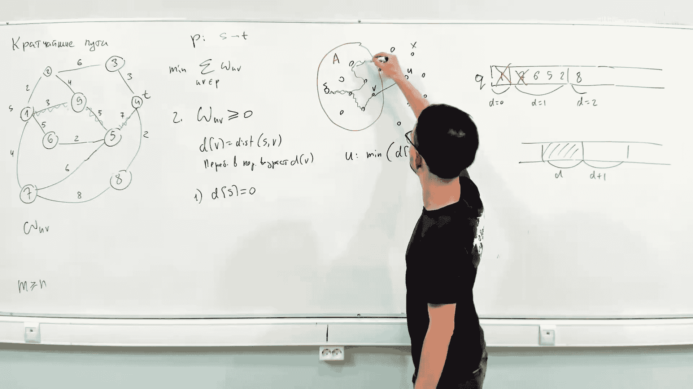

🎼So today we continue talk about shortest paths。Last week， we talked， we talked about。

Breakfast search algorithm and D algorithm。And these was two algorithms were used for short problem when all。

Weights are non negative。And today， will' talk about how to solve this problem if you have negative edges。

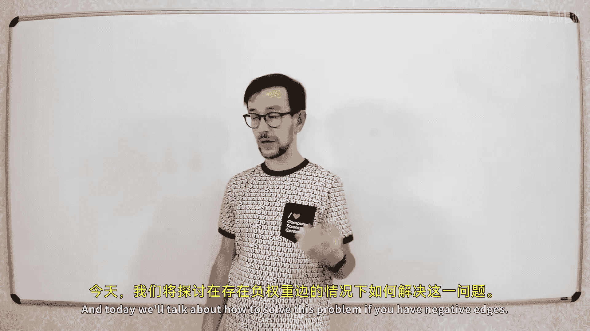

所以。So， if you have。All weight are no negative。You will just use theer。

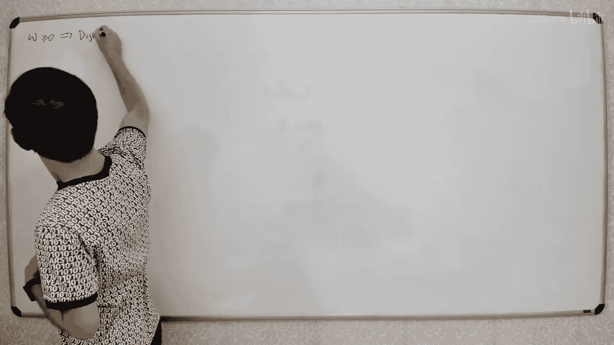

And if you have negative ways。Then you kind need to use out。あ、ど物。Let's see， first。Yes， the sources。

 yes。So I'm20 because。I have different。Set up today because I forgot my streaming laptop in ITO。

 So today I' streaming from my Macbook Air and it's not supposed to stream anything。

So I just hope it will handle this lecture。Okay。I believe it should be fine， okay。7even20数数的变了。Look帅。

系我我 try not to。Draw any small pictures there。Okay， so first， if you have negative weights。

The first problem you can get is that you may have negative cycles。

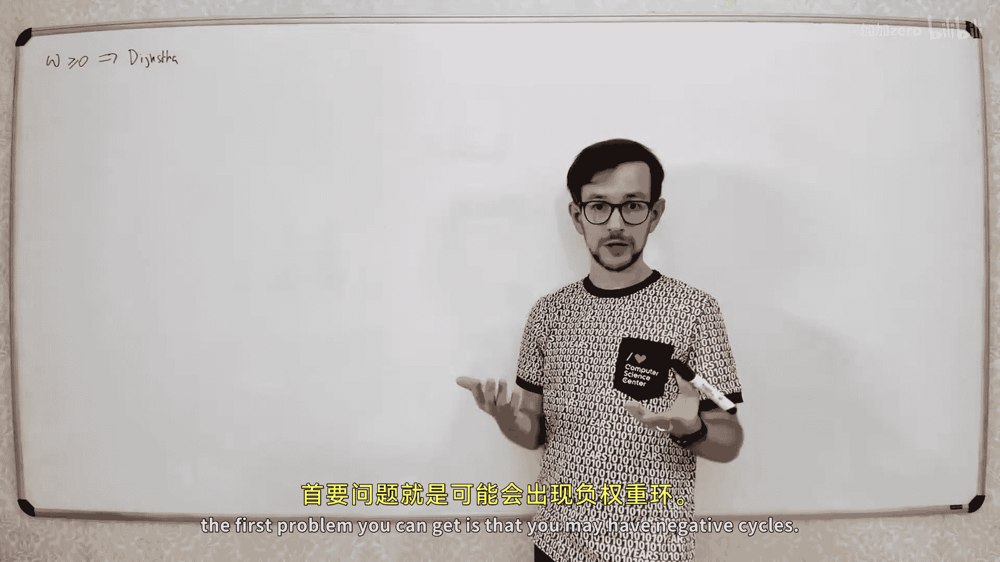

我个因为嗯。C have graph like this。And。I have something like these。And this is S and the ratess are。

 let's say minus5， minus10，3， let's do and three and let's say。

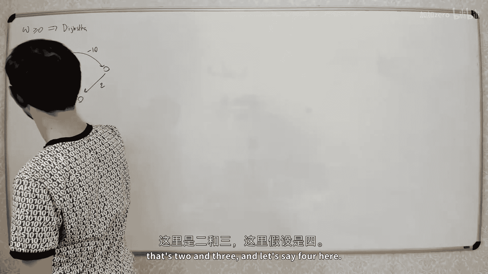

For him。

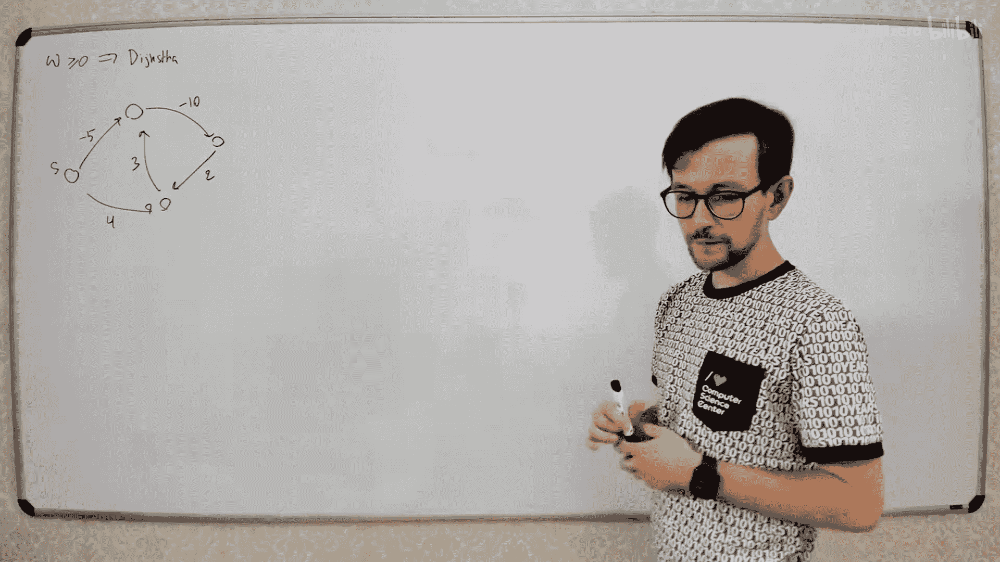

So what's the problem in this graph this graph， the problem is that you have a negative cycle here。

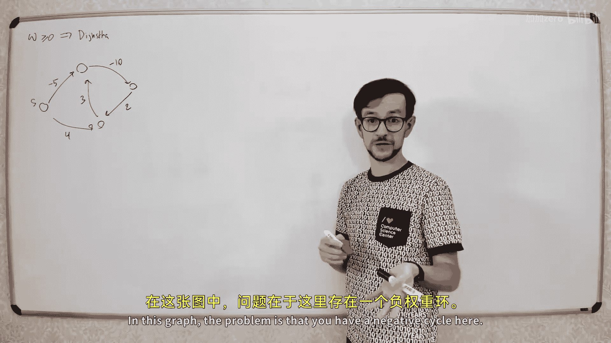

So， here。You have this cycle。And the sum of ways on the cycle is negative。

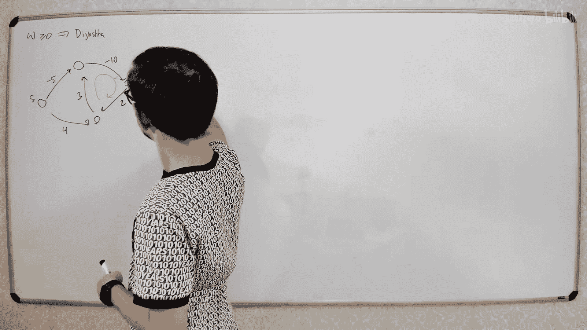

Why is this a problem， Because if you have a negative cycle then， the mean the short path is。그게 그리。

Because if you the。Move along the cycle， the cost of your cycle will decrease and the more terms you have around the cycle。

 the smaller your cost is。If yous say if you try to move from here to here。

 you can just use this H minus5 or I can use this H plus this cycle。

So the left of the cycle will be minus5 plus minus10 to1 plus minus5。 Yeah。

 so left of the cycle is minus5。So you can use this path。And the lamp will be-5。

Or you can go here and then use this cycle so the total length will be-10。

 if you use the cycle twice， the length will be -15 in and so on。

 So so you can make the length of your path as small as as small as you need。

 So there is no shortest path for any path， there is another path which is shorter than your path。

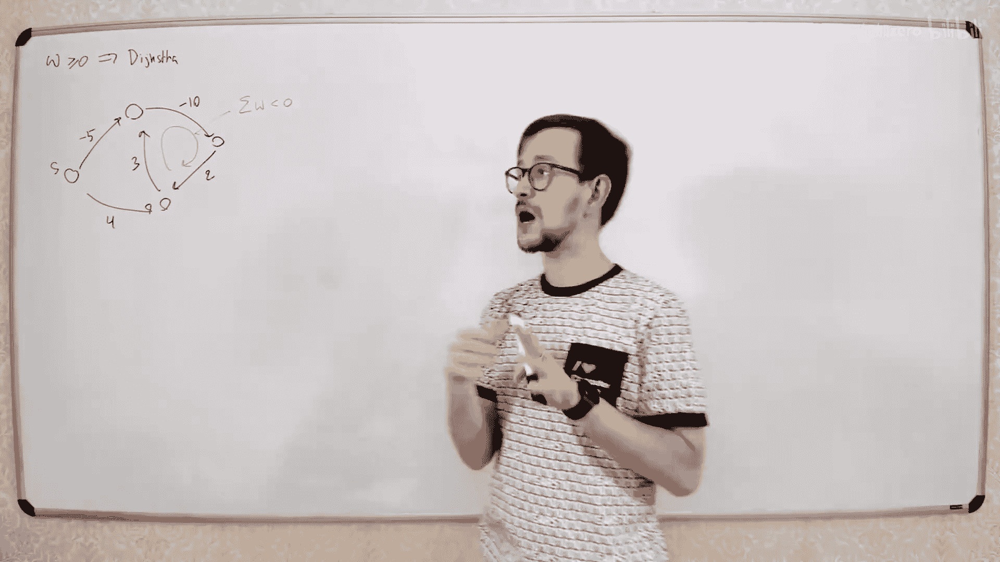

So if you have a negative plan。And aive cycle， then the problem is not defined。

Go if you if you take it， if you take some breath from S to T。And you have a negative cycle here。

Then there is no minimal path or for any path。There is another path which is smaller than your path。

That's a problem。But maybe console from problem them， maybe if we just forbid to use cycles。

So let's say we want to find a short path。shorthorly simple path， shall we want one write short path。

 and we just forbid to use the same ver twice。So let's say we want to find a shortest spell from S to T。

Which doesn't contain any cycles。Gin your solve of this problem。What do you think？

So if you have the following problem， you have some graph with negative cycles。

And you want to find the shortest path from S to T， which doesn't contain any cycles。

What do you think， Can you solve this problem or not。

I just remind you you need to say something in the chat， especially when I ask something。

 if you don't know， just say and don't know if you say everything is clear as you say everything is clear okay？

I don't know， that's an answer。The problem is you cant find you cant solve this problem。

 this problem isn't be complete。Why this problem isn't be complete。

 because if you can solve this problem， if you can find the shortest simple path。

Then you can find a Hamilton pattern。Because let's say you have graph and you want to find the commintonial path in this graph。

 so you want to find the path which visits each vertex exactly exactly once。

Then we're going to you you have some rock again。Youll have some graph， let's stay direct graph。

And you want to find the cratorial path in this graph， so what you can do。

 you can assign let's say wayss minus1 to all the edges of this graph。

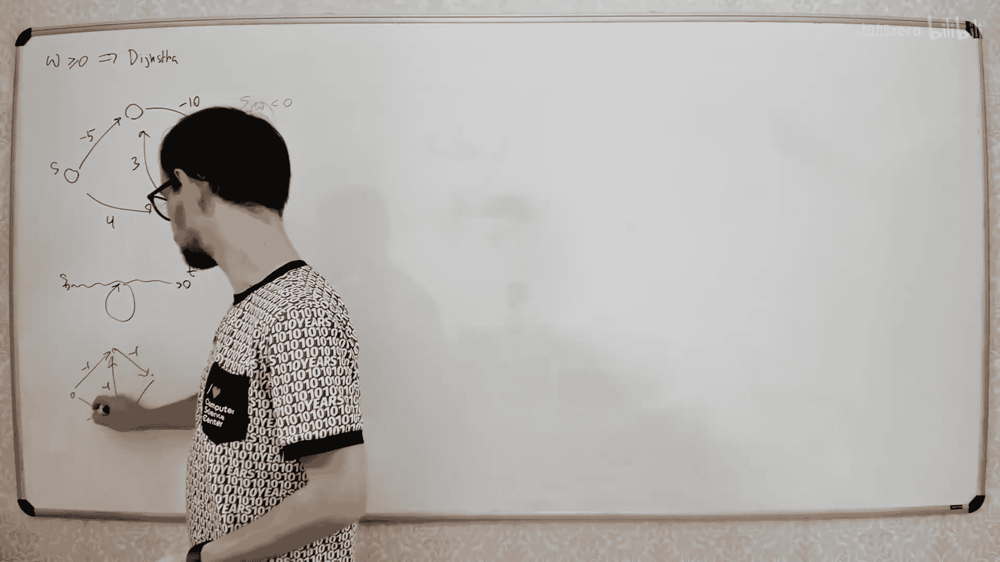

And now in this graph， you want to find the shortest simple path。

So if you find the shortest simple path， the length of this path will be the number of edges you visit。

 and you want to maximize this number。So you won what you want to do if you want to find a shortest simple pair。

You will actually find the longest simple path， yes。

 you will find the simple path which contains the maximum possible number of edges。

And it is equivalenting to find in a maternal path。

 so if you have a path which contain n minus1 edges。Then this path。

 if you have simple path of n minus1 edges， this is a dimensional path。

So if you can find the shortest symbol path， then you can solve a guintonial path problem and guimtonial path problem isn't be complete。

So this problem is often complete。That's the problem。So if you have a negative cycle。

 then you can find shortest path because there is no shortest path and you can find a short simple path because it is a complete problem so in both cases you have。

Problems。So we will。嗯啊。What we'll do we just forbid any negative cycles。

 so we will allow edges to have negative weights， but for any cycle。

 the sum of weights on the cycle will be non negative。嗯哼。

So that's how the problem will be you find so you'll have a crop。Each age have some weight。

And for each cycle， the sum of weights of all ages in the cycle is no negative。Let's say here。

 for example， let's say this is minus1。If weight this weight is minus1。

Then the weight of this cycle is actually non negative。 So it is minus-1 plus1 plus3 is。4。

And this is the only cycle。嗯。You mean Pi sensational？You can make yes， no problem from this problem。

No， you can see something like is the repair which has then at least x， something like this。if if。

 if you're。If you really want to make it it in a form which is allowed in Nbis， so it is in Nbi， yes。

 we have usually yes no problems。So if you want actually need to make a and problem and become the problem here。

 So you will say that something like so you need to make a no problem yes。

 so you want to make a problem like。Is there path from here to here， which has length at most X。

And it will be just no problem。And this problem isn't be completete。Thats。

That's more accurate way to do it。doesn't matter事有是又是。啊。なそうな。If we forbid。Negative cycles。

 but then the problem is always defined。

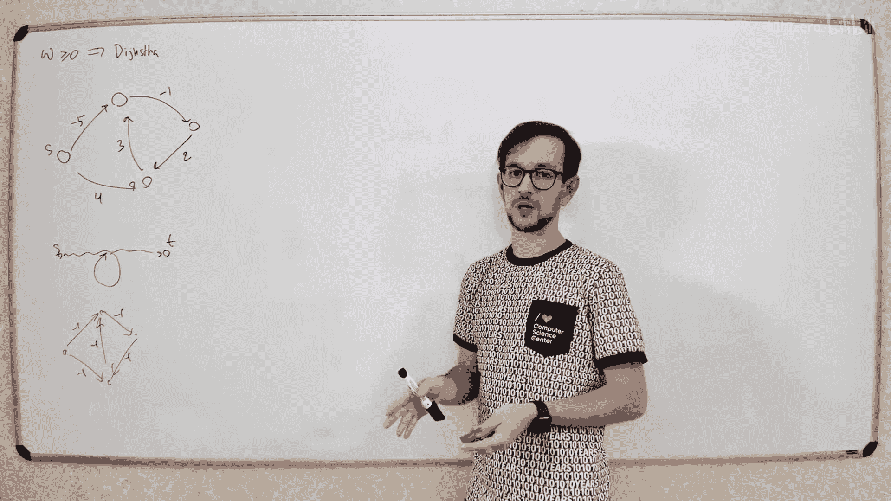

Because each shortest path is a simple path。If you have a short spread from S2 T。

 which contains some cycle。You can remove this cycle from this path。And since the。

the weight of this cycle is not negative。 The total length of your belt will be not increasing。

 so you can remove this path or this cycle。And have a short and have a short plan。

So now the problem is defined because there is always a minimal path。Because the path is simple。

 There is a。Limited number of simple paths from S to T and like at most n factorial paths。 Yeah。

 so there is some。The fixed number of paths from S2 T and from fixed cellular there is always some minimal path。

 So the problem is always defined， so even if you have negative edges but you don't have any negative cycles。

 there is always a shortest path from S2 T。Yeah。オ。

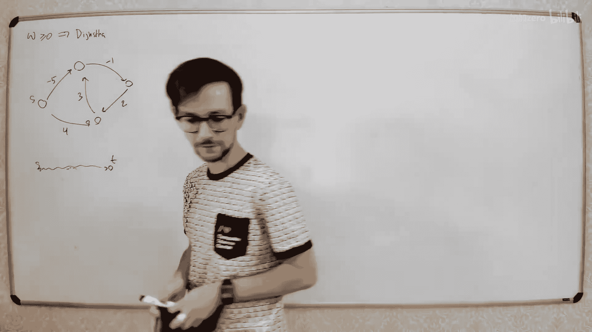

That好。Now how to find the shortest paths？There is a simple algorithm which called Belmon for in Russian。

 you will for Belmon， but in English it's English literature is usually Belmon Fort。

I think it's because of alphabetical order。I'm not sure why in Russian usually what's called fourbel。

まし work。내 만。아个个 좋아해。フールでアぶ。Check the spelling again。嗯，一。So how sells？

This algorithm is actually a simple dynamic programming algorithm。Actually。

 Belmon was one of the found founder of these dynamic programming method。So one of the first problem。

 which was。So。Biodynamic program。So how to use the inner programming here？We know that at this pair。

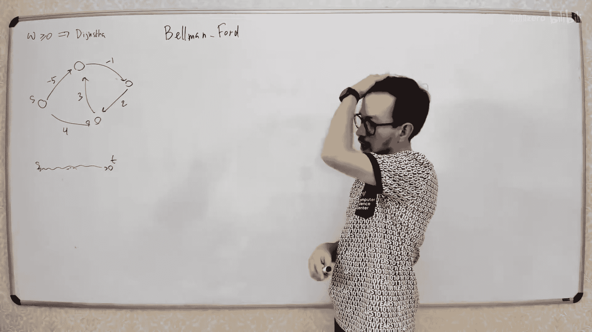

Its a simple question。So the number of edges in this pad will be limited to n minus1。

 so the number of edges in the shortest path from S2 T is at most n minus1。

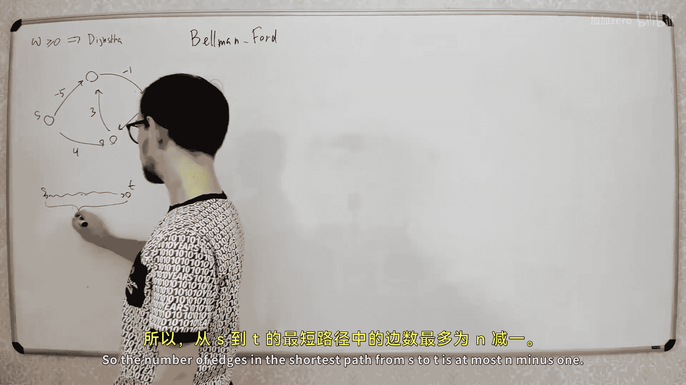

So let's try to make a dynamic program and buy the number of edges in the shortest spectrum from S2 T。

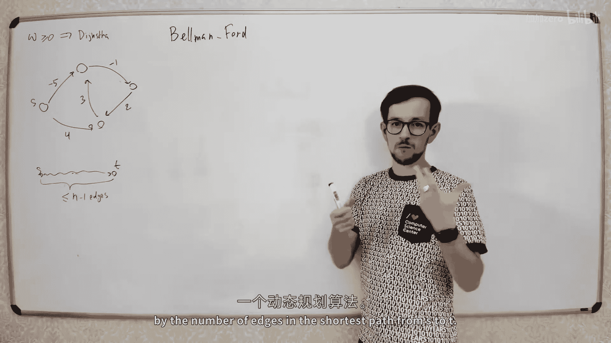

What we'll do We'll say， for example， let's say D。啊 위。Will be the shortest path。No来 what the说。

From S to T。From S to V。Which contain no more than K edges。嗯。

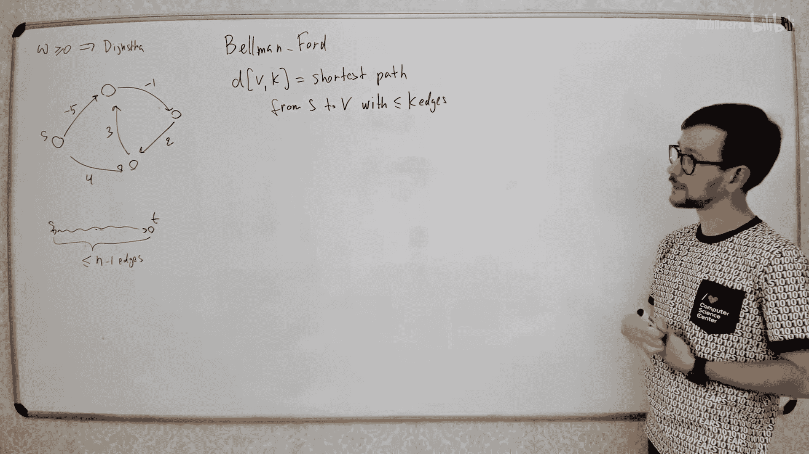

不错。Li本。And now well calculate these values by increasing of the value of k。

 so first we'll calculate for k equal to0 then  for k equal to 1 and so on in the end when k will be equal to n minus1。

 we will find the shortest path since since the shortest path always contain no more than n minus71 edges。

Okay， how to calculate this values well let's remember how dynamic programming works。啊。First。

 when you make a dynamic requirement， you need to make some starting videos。So for example， here。

 if k equal to 0。李 위是。So it will be the first layer of your dynamic programming and so some starting values of your dynamic program yeah。

 do you remember how dynamic program works here？So if k equal to0。

 then you need to find shortest path from S to v， which contains zero edges。

There is also many paths which contain zero edges， actually there's only one path with empty path here。

 so the only path which contains zero edges is this like empty path from S to itself。

So a distance to V。呃。Well if you use no more than zero。

 edges will be zero if v equal to S and plus infinity if we。我 to个对。嗯嗯。

Why didn you continue eight simple paths？You can consider a simple pest what was problem。No。

 I claim that the shortest path is always very simple。So for any short this path。

Any shortest path can contain the same vertex by so if in your shortest path you have some vertex twice。

 you have vertex D， and then again you have vertex v。

 then you can remove this part because this part as a cycle and the weight of any cycle is not negative。

So if you contain some vertex twice， you can remove this part from your cycle all from your path。

 and the total length of your panel will be decreased。So your short is path。

Should't contain the same vertex。Quice。And since all the middle vertics here are different。

 the total number of ages will be at most and minus1。Yeah， right。那。

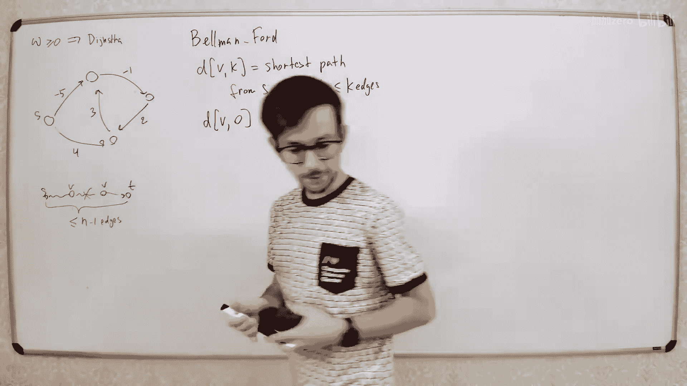

So what we'll do here we'll complete， this is the first layer of academic programming。

 so if k equal to0， then distance to each workex will be0 if verts S and plus infinity for all verts。

 so this plus infinity is just shortest path， but since if there is no path。Yeah。

 so it's minimum of an empty set。 So minimum of empty set， let's set it to plus infinity。 Yeah。

 like usual。It's。This kind of makes sense， right？So it's like neutral element for the minimum function。

When we have negative second， why don't we try to find solve the problem of age symbol respect？

Add short a simple width。HH H or， H simple stuff。Everything。

I am not sure if the press one was all on this。If you consider only h symbol shortest paths from S to T。

 is this problem be complete or not， I'm not sure about this。还能吃。It's not trivial。

 maybe it's even solvable。Let me think about it， we'll talk about it next time， okay。

 that's interesting。It looks kind of like solvable b。

But maybe for some reason it is all simply complete。黄老师。走呢个诶呢个位。

So we start the next program with really K equal to zero now we need to make transition from k to k plus1。

有。Let's do it from k minus1 to k。So I want to calculate this value。

 I want to find short path from vertex S。From vertex S to vertex v。

And this patch contain no more than k edges。So let's look on this path。

 so this is some path from S2 B。啊。If this pathth contained less than Khs。Less than k edge。

If this pen contains less than k edges， then they actually contain no more than k minus1 edges。

So the shortest path from S2 B， which contain less than K inches， is actually d Vk minus1。はい。

Second case。If it contains exactly cages。Then。Let's look the previous verts in this pair。

 so we have some short spare from S2V。P let's。Find this note。

So there is some previous node in this path， so there is some path from S to V and the。

This closest node to V is you。So this last age in this path will be from U。

So lets let's it with all possible edges， so let's it all edges which go in to know to be。Now。

 if we want to find short spell， which have。Not you here then。these。But well contain k minus1 edges。

 right？So what we need to do， we need to find short spare from S to U。

 which contain no more than K minus1 edges。Plus， this one inch。And among all of this possible？

This we need to find them in。So we need to find minimal。Of all values。

 so we go to vertex U using k minus1 edge。Plus， we need weight of this edge unit。

let's how you calculate the shortest path， so again， the shortest path from S to V。

 which contain no more than K hs， will be either shortest path of length at most K minus1。

Or sound short is spread from S to U of the of most command one plus one edge。

We will iterate over this edge。And now it takes the minimum to all these areas。Lis to hope Ly。

Let's write the quote。 The quote is actually very simple。 So first we say that D S0 is 0。

DV0 is plus andfin。For all v not equal to zero， not talk to S。And now it render all values of k。嗯嗯。

응 응 꼭。嗯。And just implement this formula， so we are old purposes。And for each verortex。

 we take minimum of these values。We'll say， well， let's say listen at least。say D and V。佢 이好肚지。

い計マイナスワ。So use this and now we trade it over all ages。For all edges， you view。We implement this mini。

You minus1。Lo rate。哎。嗯哼。こ。That's basically the whole algorithm。

 so that's the whole Belman for algorithm。Let's talk about time complexity。

 what's the time complexity of this algorithm complexityities？It's going to very simple。

 sorry we just have these free for loops。So here we have an direction of this loop。And here。

 what we do， we all vertices for each ver， we all edges going into this ver。So， with this。

Po four loops combined， make at most aiturations。저得得嘅 next시冇嘅。你呢。嗯mh。😊，Oh that's。

Much worse than for D algorithm for Xx algorithm we have sound like M log n operationss here we have NM operationss so this rhythm is significantly slower than Dixter algorithm。

But it can work when you have a negative edges。啊。And that's kind of that that's all we can do actually。

 we will modify it a little bit but。We will not improve this time complex。嗯嗯嗯嗯嗯。Again。

 you forgot you forgot to say something in John。When the chat is quiet。

 I think that something is broken。Yeah。I just continued to check that my string is working。

Just say something at least every minute。那。What we'll do next？We will try to improve this algorithm。

Yeah， heres。Let's hold this example first， so we have this graph since second of the graph。

Let's just show how this algorithm works on this graph。So we have this graph， we have four nodes。

 so the length will be。So let's say k will be from zero to three。喧か。そ this is ready。

What some numbers here。So first， when k equal to0， then we have zero for ver x。

And losss infinity for。Now we move to k equal to1， let's look on the ver1 for verex1。

The book have known one coming edges。So。The life is就 too。We have in age from node 4。

But the distance to node4 is plus infinian， so this sum will be infinity plus 2， it's still infinity。

 so it doesn't matter。And we have going age from vertex 1， so from vertex 1 to vertex 2。

 we can use this h， so the total length will be 0 plus 4 it is4。The vertex3。

 we have doingvoyage from here and from here， so from here we will have distance minus5 from here we have distance infinityine。

 so minimum is minus5。Vtex 4， we have no image from3 listens to no phrase infinity。

 so it will be infinitefin minus1 is still infinity。Okay， I'll think about this problem later， Okay。

 not now， let me finish this thing。😊，嗯。那。For k equal to 2， So we have0 here， Co 2， again， we have。

4 from here or infinity from here because still here we still can finish so we have。For。

F63 which still have five minus5 or four to us three， it will be seven， so seven is more than minus5。

 so it will be seven minus5。We will be my was far。En for vertex4， it will be minus5。

 minus1 it will be minus6。And finally， one k equal to3 we have0 here for verticex2。

 now we have this h。Going from node 4， it will be minus6 plus2， so it will be -4 -4 is less than4。

 so it will be minus-4 here5 here。And that's the final answer sorry。

 that these are the dis to all the node。嗯哼。Now let's try to improve this algorithm a little bit。

What would be the improvement first， let's improve the memory。啊，路。Right now we use this。

Big to dimensional rate， so the size of this matrix is n multiplied by n， so we have n square matrix。

呃。But we actually don't need this square matches。So in these querymetric we only use two rows so first we need first we build the row  zero。

 then we build the row one using row  zero， then we build the second row using first row。

 then we build the third row using the second row and so on so each time。あそ。

What's happening me first you have one0 zero。Then using row  zero， you build row1。

Then you use it through one to build row two and so on。

So each time you need only the previous row when you construct OK， you only need the R k minus1。

 you don't need all the previous rows。So what you can do is to start in your matrix only last two rows。

 so you're here here here， you use row k minus1。呃。All the rows above k minus-1。

 you don't need them anymore so you can forget all the rows here and only use these rows。嗯哼。😊。

So if you do it like this， the memory complexity will be in not elsewherel。Will be improved too。另啊。嗯。

That's a common trick for dynamic programming actually so if you have this twoal array and you only use last few roles of your array so you can forgot all the previous showss of your array and only use these roles So if you did like this you will improve the memory to linearo。

Okay。Okay。啊。那。啊。Another nice improvement， you can actually make it even simple。

 so instead of having two rows， you can have only one row。

So you can use only symbol one dimensional array。For the whole problem。Let's do lick this。嗯。

I will just modify this quote。Okay wantize this one。我上还有。每个他都忘鞋。The idea。啊。

Let's make one single one dimensionary。So， let's see LED。

First we'll say that d of s equal to zero and d of all other nodes will be pla。ます。ま。For all notes。

 not people。And then we'll just make these p minus and minuss。Okay，1，2 and minus-1。

And here we'll do the same thing。But we'll use this same array here， so we'll recalulate value of4。

No we using where you for the you。But well use very for view， not in previous row， but in this row。

So what we need to do。Let's write it like these it all edges。So let's say to all edges in our。

And just implement。Of these relaxation so will say V will be minimum。Of degree。

And did you lost weight of education。That's all。 That's whole old。

I claim that this algorithm is also correct， so this algorithm will give you in the end the value of Db will be the distance from S to B。

Let's prove this。Why this algorithm result is also correct， look。

 because it kind of uses the same ingredientvari as this algorithm， but slightly modified。

So what will be？What will be the value of D？So first。First observation。

 the value of D is always the length of some breath， so first observation。So D is always somepath。

Of summer。Okay。let's prove this， look here we have a short pad here， lengthth zero， and we have some。

 no， if it is plusfin， there's no pad here。So there is。So nonexisting path of length plus inmity。

And what we do here here， we assign the value D plus the weight of this edge of this D。

 so the length of Dv will be D U plus length of this edge so。If we have some bad to do you。

We can add this edge to this path， so this sum will be the length of sum path from S to V。

So we have some path from S to U plus this edge， so this sum is some path from S to B。

So these D are always correct， so there is some path of this land。And now the second observation。

The D is not。Large then a length of the shortest breath with most cases。嗯。Sure this。Bath。

Of at most K ages。So after every iteration。We will build some paths。In this curve。

 so this D will be length of some pathth and this path will be not worse than the length of the shortest pair of k edges。

Well， let's prove this again。On iteration zero it's correct。In each next iteration here。

 we will integrate to all edges to node V。So follow B。嗯哼哼ふふ。So for all， we are all in areas。So。

 if there is a path of。At most K ages from S to V， there is a path from S to U。

Which can take no more than k minus1 edges， right？So we will iterate all edges so we'll find this edge for this edge。

 we will find some path from S to U， which is not worse than this path。

And we will add to this path this age， so our path here will be not worse than the shortest path of at most cages。

Again， there is some path， some shortest path over most Kts at most K edges。Let's find this path。

 if we have this path， there is another path from S to U over at most K minus1 edges。

Here well find this H UVv。嗯。And we will apply this minimum。

 so value for our vertex we will be not greater than length of sum perth from S to U。

 which is not worse than the shortest pair of k minus1 h plus this edge。

 so it will be not worse than shortest pair from S2 v over most cages。That什么。说。Li总。Again。

 let's try to apply these other those are off。So what will。你国有清。So we're here with this already。

It is initial list like this。And now we just it all edges in our graph and try to apply this a。

So we travel all edges in a bit order and just apply the separation so we try to it's called relaxation doesn't matter。

 so we will try to update the value of distance to node V using distance to node U some。

So let's iterate all the edges in graph in some order doesn matter， so let's for example。

 let's pick this edge， so pick this edge I will mark edges which I always so。

So let's pick this edge for this edge， we update value of node3 using note1。

 so the value was minus infinity， but now we use this edge so this value will be。マイナスフイ。那。

Now let's speak for example this h， so repeat this h。

 so we have date value for node4 using value for node 3。

 so it will be minus5 means it will minus minus6。Now let's speak this age。For this edge。

 the value here will be updated to infinia， so it will notivate Now let's take this edge。

So we date where for node two as。That's for。So before。And now we pick message。

So date value you here is minus6 plus story， it will be minus1。

And now this is just the first iteration， so in the first iteration of this loop。

We will update the ID like this。And now we apply the second time， so we try to apply the same loop。

Free danceance。Because the length of the short speck will the short speck will look in no more than three inchess。

 we applying the same loop three times。let's apply it again so again we to try to relax this edge so if we relax this edge。

 then here will be at most minus-5 it's0 minus-5 length here will be minus-6 it is minus-6 Try to relax this H here will be minimum of minus-4 and 4 it will be minus-4。

And try to relax this edge， it will be a minus or something。 We try try to relax all the edges。And。

None of the really changed so after the second iteration。All the distances in already are the same。

What does mean it means that this rule will no longer be changed in all future traditions。At sumit。

 if we apply this loop。And all the values in the already didn't change。

It means we have the final values of hery because on all other generations。

 they also still behave have。Because we have the same values in already。

If we if all these values didn't change in one direction。

 they will not change in all future generations。こ。没错。Now， you see here。In this example。

 we were really like， yeah， we were like it because on the first iteration we。

Find all the correct values of these distances。It actually depends。

On the order in which we apply this separation。 So we apply separation in this order。

 and we got all the correct values。 If we try to each all ages in different order， we can have。

Something like these。Let's say that we have infin finishing finishing。Again。

 let's try to do it again， but we'll apply the separation in different order。

 so for example let's start from here so well apply this。Edge frost， some of these。I。True。

 so then let's say play this。H， so it will hear the way you build B7。

Well then let's sample this edge。啊。7-1，6。I matrices。Okay， now apply， for example， this edge。

 So here it'll be minimum of。But no， total the minimum of。What is two。What is it doing。换衣服。

Now I apply this age， so distance to here will be minimum of four and6 plus to eight。

 so the distance is still4。And now we apply to this h distance to3 will be updated to minus。嗯哼。Again。

 we finished the first situation where applied the separation to all pages of our work。

And the distances are not final yet， so we apply it the second time。

 so we will apply expression most n minus1 times we can prove that after n n minus1 duration。

 we will have the great distances。But it may happen that we have the correct distances。

Even before M interactionss， so the number of iterations here is at most minus1。But， it may happen。

That we will have the correct values before the end of this loop。So what we can do。

 we can optimize it a little bit。We can do it like this， we can do these operations。

Until we have a situation when no values of D changed。So would you feel like this。嗯嗯。もう我た。

This is something。So let's see， for example， let's see wki。Let's make a bullion by you， okay？

And then while not。We will make this loop again， so we'll see okay。こ。And那我一0来多后。It just U。

See if the batteries updated。 So if distance to U plus H U V is less than distance to V。

Then we update this distance。And say caseful。大いです。嗯。そな。If O it's true。

 it means we didn't change any value in D， if we didn't change any value in D。

 it means all the values are correct。So we tried to improve these distances and we didn't improve anything。

 it means that we have the correct distances to all the nodes。很爽。What is time of is everything？Again。

 the worst case and complexity will still be in。Why is it so because in worst case。

 we may have n minus1 iterations here？So it is possible to have n minus1 rats here。

You have at most n minus1 directions here。And this loop is。Again。It's rather all pages similar。

 so du corrects will be the same。But it may be better， so for some graphs。

It may have small number of generationerations。Mmh。😊，嗯。我情了那累死了。嗯。let's have a simple graph。

 let's have a graph like this。So this is S。So this is the short spectrum from S2T。

Is it possible that we will find the short span in a single duration of this algorithm so let's take some graph so in this graph you have this short span so this is a short spec。

Is it possible that we arrange the edges？In such an order that we will find this shortest breath in a single duration of this loop。

嗯。Yes， if you arrange the edges from left to right。And just apply the separation from left to right。

Then again， you you're。You first apply the separation to this edge and now you dont know the correct distance to this node。

Then you apply operation to this age now you have correct distance to this node and so on。

 so for any graft， there is a possibility。That you arrange that your ages in such honorrous so that。

You will calculate the correct distances here in the single duration of this loop。But。

Is there a possibility that you will run this loop n minus1 times？从嚟嘅。Best， let's see。

 one inspiration ratio。没是て。Let's find the board case。Is it possible that we arrange？😡。

Our ages in some bad order。So this loop actually make n minus concentrations。

If you just promote the notes。Now if you do it in random order we'll talk about random order in a minute。

 lets find first let's not about random but some very worst case so what is the worst case for this algorithm so if we have this short spread from S2 T。

 is it possible that we need n minus one its to find the short spread？哦。

Because here I find the number of directions is at most and minus one。

I want to check that it's actually maybe it's better， maybe we just always like him。

Maybe there is no such case when do you actually need end relations？Yes。

 if you apply this e evaluation in the reverse， if you apply this。Operations from right to left。

So again， what will happen so first？You have correct distance calculate only for the node S。

Now you go from right to left， you apply this version here， you don't change anything。

 you apply it here， you apply it here， you apply it here， apply here， then you go here。

 now you know the distance to this node。And that's all the first iteration finishes now you make the second iteration so again you go from right to left you apply here。

 here or here or here， here oh now you know listen to you and so on so on each next iteration you find the great distance to only one in this pad。

So you will net， you will meet。And minus1 thresholds。嗯嗯哼。So there's actually be gapos。

Between best and worst case。Let's think of more so if we just truuffle all the ages， maybe。

Maybe the random model is good， So what does the random model？So imagine here。

 you just half all the edges。And apply this integration in random order。

What will be the expected number of iterations， what do you think？And're start your guess。

Maybe it will be good， maybe build some loggan， it would be great to have loggan instructionss。

On average here。Maybe it is square root of them， it will also be great。

So if the average number of iterations is less than n。

 then the average time complexity will be less than Nm。So it will be kind of great。第。Good guess。

 So actually if you apply this。啊诶。Turation in random order。

 actually the expected number of durations will be about over two。Because on each duration。

 you will find about two new distances。Again， so what will happen。

 You apply operation some random order。Of first， you will apply apply it。

You need to apply operation to this age first， so when you apply operation to this age。Youニットポイントで。

So what is the probability that you apply the separation to second age after you end to the first stage？

It's about 0。5 ftz zone， so about 50% probability that this age will go after this age。

So the results are about 50% probability here that you will apply the next operation after the previous operation。

So the probability that you will make an next step will be decreased and exponentially。

So every time you will make them around two steps in this path so after each。Ittereration。

 you will find about two new distances in this path。

 so a total number of iterations here will be about an or。So it's still linear。Still linear。

So total time complexity again will be like this， so we didn't approve anything。but it is scary。Nice。

Exercise， okay。够值钱。I think it's enough for Poland， let's move the flight on。

The next algorithm part I want to discuss it is fo algorithm。s calledf washher就是。

I knows all two people。I'm not sure why they always need two people to invent the algorithm。嗯。啊。That。

So now we'll talk about flow多。我。おお。😮，Like these right。

So this algorithm solves a slightly different problem， so imagine you have a graph。

And you want to find distance between every pair of the notess， so you want to construct。

Something like this， you't want to construct。呃LV do。Itll be distance。From V do you。

So for every pair of node in your graph， you want to find a transfer from V to U。So in Bel for。

 we have this specific node S， so we wanted to find short from S to all other nodes。

In this algorithm， we all want to find a house for all possible pairs of stars。Well。

First what you can do， you' can just apply them forward order n times。

So you can just it over all nodes S。And apply Bel fourth algorithm for this。따 하시나 볼게요。

So you can which does does look like。こ alive。Build them pork over。Or all。あ。For all loads。

The time complexity will be。Qu simple， we need to apply billion and photo algorithm n times a comp of be and4 is N M。

 so total of U B and square m。A， so the war is algorithm for for closure and the fluid force spaces makes sense。

 and they just combine these two algorithms in the single algorithm。Okay。嗯。Any你 over不能 I don't。

 I' not true。I believe this's the best we can do in this problem。

I am not sure if there's a lot bow for this problem。

I kind of believe this is the best algorithm we know by now。

Why don' not shoot you for this problem that there's no better。Sendnder some question。嗯。还个。

Now let's go to fully first point， so what we want to do。

 we want to calculate distance between every pair of adults。If we just apply be and formal n times。

 temperature will be n square L。But what we can do， we can， of course， we can improve the central。

Using a very simple dynamic programming algorithm Earth。そうあ。So when it simple algorithm different。

 we'll use that in the programming again。In this dynamic program， we will make Ks。啊。So on in key。

We will calculate the following values， we will say that。V D of video。Will be。Is the shortest step？

From Vと you。Such that all the all the middle node in this path have indices at most。Me度。Nos。

So that you have this node V。And you have some other notes in this bag。

These notes must have indices at post case。So here we have notes from one to。That's the whole one。

So now let's start， so if k equal to 0， so if k equals to 0。

 then we can't have any middle nodes in output， so if k equal to  zero then。

The only path we can get is the path of the single edge， because if we have any。Middle node here。

 this node must have in this node more than0。 So if k equal to 0。So if k equal to zero。Then。

Distance from V to U will be just the weight of the age from B2 U。う。

So this is the only pair from V to U， which doesn't contain any needle nodes。If there is knowledge。

 it's post。嗯。那。Let's try to move from it K to it K plus one from k minus1 to it K。

So we will move from k minus1 to k。Let's see。We have this path from Whitu。

All the notes here have indice false skin。Again， there are two cases。He's number one。

All the notes here are strictly less than K。Eeave all the notes in here in this path。

Have indices strictly less than k， then these indices have a less or equal than k minus1。그う。

So we need to find the path from U2 V such that all the middle edges have all the middle vertices her indices across k minus1。

 and this is the value D。V U from the previous generation。For all came out as well。嗯哼。Second case。

If we have。So we have values not greater than k， so if all values are less than k then we have this K so now we need to if we have some node with index K。

 so we have this path and in this path we have rotx k。So if we have vertox K， this path。

Then let's split this path into two hs， so so let's look into this part and this part。

All the middle nodes here are less or equal the K minus1。

And all the nodes here are less or equal a k minus1。

Because all the nodes are less rec than k and we have k here， so all other nodes are not k。

 so they are less equivalent K but not k， so they are less rec K minus well。

So now the distance from here to here will be the shortest pair from v to k。Plus。

 the short spread from K。嗯。Okay2。Like this。That's错。能是获利啊。

Now we just apply de separation to all pairs of vertices and we will have the correct valuesius for the next direction。

Let'sSo we have durations here from one to n。And now we trade their old pairs。For me。

 from one to end。For you from1 to1。And here we just say that the distance。

Between V and V U is minimum。Of all distance is the first case， right？And this son。Let's show。

 that's the whole though。 That's the whole story that。SoLet's。The whole connection。

 you need to initialize the ID， but you can do it。What is time complexity here。

 time complexity is very simple， so you have three loops， each look rather make exactly。And its。

 so the total number of refrigers offered loop will be n square。は九。Thank you。That's all。

 that's better than just a blame。Balmo organ n times right so here we have n square m here we have n cube so if the number of edges is large so so if this m may be up to n square right so if your graph is very dense you have here you have n square multiplied by n square you have n per power4 and here we have n n cube so。

Definitely better and it's actually it's actually a pretty fast so the constant factor is very small since you have very very simple operations here。

 so it's actually really fast out there for fighting short spaces。Very nice story。And again。

 this algorithm can be applied even if you have negative edges since we don't use any。

We don't have any problems here of negative edge we never assume that the weight of edges are non negative。

 so this dieal algorithm can be applied even if you have negative edge。Thanks。Now。我得份过哎我这。

What if you have negative edges what if you have negative cycles？

So what happened if your graph actually have negative cycles？So if you graph has negative cycles。

You kind of want to detect it， right， So you you want to find you won't。

At some point to figure out that your graph actually is bad， sorry if。

Someone gives you a rough and asks you to find transfer from here to here。

And this graph actually contains some negative cycles you kind of want。

Something to take this problem。 Yeah， so you， you， you want to make some。Yeah。

YeahI era the bill in for location。So you want to make some check in this algorithm。

 which checks that the graph actually contain negative cycles。So， so how to do。

No let's use first let's use this flight under then they'll move back to Bel4 so in this flight under the way to detect negative cycle is the following so if you have a negative cycle。

Just。Then at some point， you will have some node。Such that the shortest path from v to itself will be less than 0。

So at some point you will find this smoking key。And then in these two loops。

 you will try to calculate the distance from V to itself。

You will find will find this distance from v to k plus distance from K to v。

 and if this sum is not negative。isnn't negative If this sum is negative， you will update radio。

D V V it will be less。So the way to detect you have negative cycle in the photo is very simple。

 so after each iteration you just need to check that on the diagonal of these metrics you have all zeros if you have some value which less than zero on the diagonal of this matrix。

It means you have a negative cycle。Okay。What happens with Belmont fort。

 so if you have Belmont fortal， how to detect？Negative cycle in Belmont For over and Belmont For is actually。

嗯。What do you do in the Bangal parking？ You have this。Let's make it for a loop。

 So you make this first loop for one to n minus1ia make this。And minus one its of be and fourth。

And we just proved that if you don't have any negative cycle。

 then in the end after this M2 direction， you will calculate the correct distances。

So now you play the D。Re is distance。From best to me。So how to check if you correct negative cycles。

 what you can do is to apply one more iteration of this loop so you can make n iteration of this loop instead of n minus1。

And if in the last situation， you update something in this R。It means you have some negative cycle。

So if you update some you do。In the m iteration of this forma algorithm。

 it means there is a shortest path which contain more than n minus1 edges。

 and it means you have some negative cycle。嗯嗯嗯嗯。Why in important space of your situation。嗯嗯。不得明。

Why the point appears in the first 10 my generations， I don't get it。What I want to do。

 I want to apply n minus1s， yeah， I can extend the Bel for everything。And I just proved。

That n minus1 integration is enough to calculate all the distances。So what Ill try to do。

 I will apply one more iteration of being4。And if this an iteration of Belmontvol updates something in LED。

It means I have a negative cycle because I have some short path which contain more than n minus1 edges。

嗯。That说 so what我嘅人。Again， once again so there are two ways to detect negative cycles first first way is the fluid algorithm fluid algorithm if you have a negative cycle then at some point you will have a negative value on on the diagonal of your matrix。

In the fluid version， why we get into negative in first n minus ones。No。

 we can get after the last iteration。We need after each iteration to check if we don't have any negative elements on the diagonal。

So after this duration， you just check that all elements on the diagonal are zeros if you have negative value on diagonal。

 it means you have a negative cycle。No， and my inflation is not enough， you need to make anyerations。

In the last situation， you may find this empty cycle。And basically， this negative cycle contains。h。

You mean n minus1 is always enough because in each cycle I have an node。With index at most and -1。

Makes sense。So each cycle contains at least two nodes。

So there is a note of with index at most n minus1。メたんです。有。So if you have negative style。

 you will find it on first and minus one iterations。was 보여。You only have sake like this and minus1。

And sounds like this。So this cycle will be founded in interactioneration n-1。 So when when you。

K equals to n minus1， then for this n。You will find this path and this path and the sun will be negative。

Makes sense。Okay。No， it doesn't pro。Nice observation， cool。Okay。

 the final thing I want to discuss is some algorithm。Which is Chinaa。

It's interesting and we will use it when we will talk about。About。Minimal cost flows next semester。啊。

So。Yeah。我台温두도温豆。I want to apply the extra algorithm for graph with negative edges。Okay，The blend。

I have some graph and this graph contains some negative edge。So， I have this。嗯，每你。어다 이번 주도？

I want to build another graph。We have the same shortest paths。

But the weight of all ages are not negative。So when I will apply di we can do that modify a graph。

 and it will give me shortest paths in my graph because my shortest path are the same as in this graph。

That's the plan， how to do it。I will assign some values to all the node of my graph。嗯。嗯30一。

Secret palace。And now I will modify my weights in a common way。

 I will say that my new weight of the H2V will be old weight。Plus。P of u and the minus。Heを好で。

There's like potential function again will。I will add this difference in potentials to my weight of the age。

嗯哼。And one of。5다번 토도？I want to find such potentials that these。New weights will be no。Now。

Imagine you find these values， so you find some values。Fi。

Such that if you modify your ways like this。All weight will be no negative。Then what you can do。

我就这么多。You can take any two notess of your graph。Yeah， yeah。

 last week we used kind of the same trick when we discussed the A star algorithm。

It's very symmetric trick， so what we'll do？We will look on some look at some。Let's take path from S。

估计。到。If you look at this path。Let's find its weight。

New way so what will be the weight of this path in this modified graph。

 so in this modified graph the weight of this spell will be some of all these modified weights。

What will be the sum of modified weights， it will be the sum of old weights。Plus。

 the sum of differences of this potential， so you will have potential source what you will have。

 you will have potential one minus potential2。Plus potential two minus potential three plus and so on。

So you will。For this age， you will add this difference for this age you will find this difference for this age find this difference and so on now the sum of all these differences。

Will be the difference between first and the last one。

 sorry it will be just potential of S minus potential of。そう。That。

Weight of this path will be the weight。In the Olgraph。But what the difference of these potentials。

Now again like in the previous lecture if you。Modify each weight by the same console。

This is some constant， right？So if you take any pad from S to T。

The weight of this path will be modified by this constant so if you add the same constant to all weights of the path。

 the minimum will say the minimum if you have some set of integers and you add the same value to all these integers。

 the minimum will be increased by the same integer right so if you increase all the elements by the same value the minimum will be the same。

But it will be imp these difference。So the what does mean it means the shortest path is the same。

 so if you have some shortest path。In the O graph， in U graph， you have the same shortest path。

So the length of this path will be different。But the path itself will be the same，メクさんですよ。そう。

What you will do。 So if。If you find these values。去。Such that all。你用 modified wayss are on the。

Then you can apply the D on everything。So you apply the algorithm from police modify the weight。

And this di algorithm will find you the shortest path in your graph。

 so it will find the shortest path in this graph will modify the graph， but in your graph。

 the short path will be the same path。That's the problem。Okay。

 now the only problem is how to find this potential。ここロさんが？嗯，呵呵嗯。Okay。Well， let's something for。

Something to hear and here。And something here are prejudice。And some more， let's see。And please。

That good enough and let's apply some weights here since say1 minus5 so I have this cycle。

 I want this cycle to be non negative。So it supply something like four and three here。

 so this cycle is not negative。诶哼。Now I have this cycle， I wanted to be so lets egg here。嗯。

Let's say minus-4 here and minus-1 here。Yeah。이 이 넣는데。So this cycle is not negative。

 this cycle is not negative， this is no negative。And these ones on negative。

Yeah really all circle on。What。😮，Yes， yes sir， I mean， if you have these values of fi。

Then you can apply dialar and it is faster than Belmon fort log。

 so you can use diar it will be faster than Belmon fortlog。Yeah， that's the idea。

Look let's say for example， now I want to apply some potentials， for example， but let's see。

So let's say， for example， for this node potential is zero。

 so I want this node this edge would be no negative。So for this note， I want the potential B。

 let's say four。So this edge will be zero。Now for this edge minus5。I want this to be4。

So the weight of this edge will be minus5 plus4 minus this， so I want this to be， let's say minus2。

So weight of this age will be one。응 응 응。Now， for this age。I want this potential to be at least one。

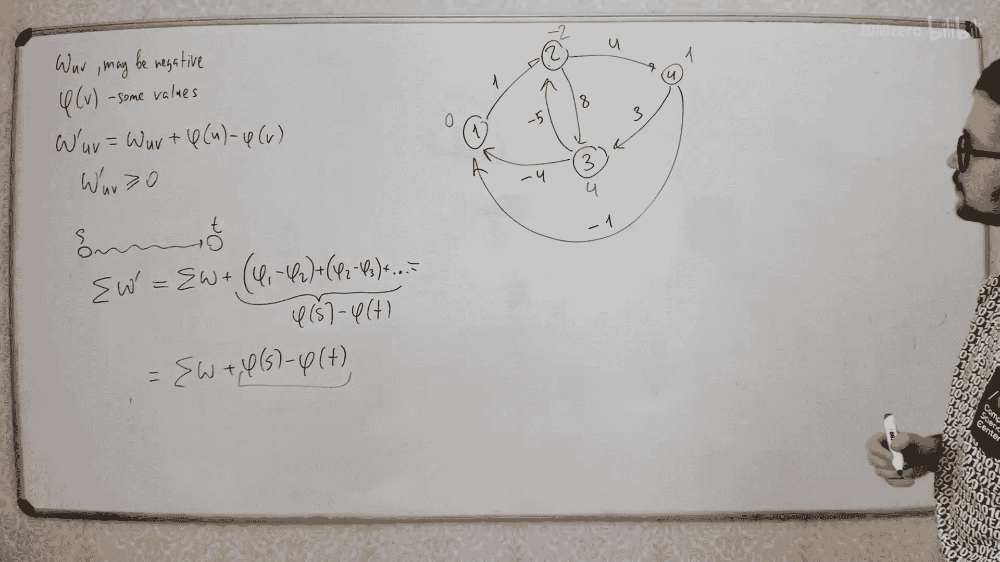

Yeah， I think that will work， so let's use this。Valus as a potential， so we will update the one way。

 so let's see。呃，猪。これ。아 아 어。So what would be the magnified weights？For this age。

 the weight will be1 plus zero minus minus2， so it will be free。

For this edge it will be minus5 plus four minus minus2， so it will be1。For this age， it will be 8。

Plus，-2，-4。L be。This age will be four。Plus minus2， but2-1 will be wrong。Please age will be3 minus-1。

 but3 plus1 minus-4 will be0。This edge will also be zero。And these age will be。Also zero。

And so now we have this graph in this graph we can find short paths using these algorithm and for example。

 you want to find shortest path。From one to 4。Let's go here。 I want to go from one to four。

 The shortest path from here to here is is is will this path use three plus one。

So this is the shortest path。From one to4。It's actually the only but for one。It's not interesting。

Let's find path。Let's say from four to2， from four to2。The shortest path is so this path is one。

 this path is three。 So the shortest path from4 to is this path。

So now we can translate this path to this graph。You will have this breath。And I claim。

 this is the shortest path from4 to2。2 plus 2 is 4-1。Did they image on the map？嗯。

Which one is not correct。好烦。嗯。我哋一。If I have some bucket in there of magic soon。I说不。

I hope is's no other造。No我换个 problem，你换什不 problem不。How to find these values So if you have some graph。

Weve some negative edges。You want to find。These various of potentials。啊。

Now we'll prove that if you don't have any negative cycles， it's always possible to find。三不得说方手。

Which gives you long negative ways in the modified graph。It's always possible， but there is a trick。

多放一点。These potentials we actually need to run Belgmon photography。That's the goal。到。啊。不食。

Let's some note， let's some note S。There there is a bath。嗯。诶。I。我要。From S。As to all other。とお。啊捞钱。

So let's pick some to about this。Mm you have some node such that you have pair from this as to all other nodes。

Of them。We can。Run Belmon for Tele。And assign value P V as distance。好SV。

And now I just claim that if you have apply these potentials to your graph。

 you will have no negative weights in the magifier graph。Now let's prove this。

Let's prove that if we apply these potentials， all the rates will be not negative。 No， let's see。

 So what will be the。Modified weights。We will be little all great。

Plus the difference of potential absorption plus distance。From S to u minus the distance。From S to V。

有。And I want to prove this is not negative， so I'll just transfer this to the right and detection the same as distance from S to V is no more than distance。

From S to U plus the weight of the HV。And this's just。To triangle equation， right？

So this is actually true。Okay。So that's true if I have some node such that all other nodes are reachable from this node S。

Then I can apply potential function as distance from S to the node。

And if I use these potentials in my graph， then all the modified weights will be non negative。嗯哼。

It looks kind of strange because I wanted to avoid Belmon For algorithm right。

 so I want to use Dixar algorithm instead of Belelman For algorithm。

 but now I just done Belman For algorithm。Then calculate potentials and then modify the weights and then apply the D algorithm。

Yep。Plus kind of strange rates， so I tried to find the shortest distance。

 but instead of just trying the Bel and for algorithm， I first on Belman4。

 then update the weights and then write the string。Mmhm。😊，In what case I may want to do it。

 it turns out there are cases when you actually want to do it like this， for example。

 if you want to calculate distance multiple times。So if you want to run the extra several times from different nodes。

So you can do it only once， so you can take your graph。Around this bill unfortunately only once。

And then。Runund Dter algorithm get from any node you want。

And each time the dis will will be run on this graph， and it will take just em time。 for example。

 instead of。Instead ofulating if you want to calculate shortest path for all pairs。What you can do。

 you can first。round Belmond Fort。Go create potentials。Then you ground each。For all loads be。

And now you will just calculate distance between every pair of the notess。

What will be their complexity here， that complexity will be like this so Belmon Ford uses NM。

DX uses and run away from， well， let's say if you just use the simple， if you are just binary hip。

And we' going time。Or can you actually keep on running M+ and loggan time， that's great。

So this will be better。These are a little bit larger than this。

 so total time complexity will be annalogogram。Or if use a edge tip， it will be n square again。Cl7。

If you use rean y。So that's slightly better than Floy algorithm。So if the graph is sparse。

 so if this M is small。So if M is big so if you have n square edges in your graph。

 then M is actually the same as n square as n cube， but if this M is small。

 then these algorithm actually works faster than just trying and fluid down me。这是后官。Yeah， ma here。

 if we don't have this S， so if we don't have any。Any node such that all other nodes are reachable from this node。

 what you can do， you can just add another node to your car。So you can take your graph。

And special note。And just。Wade age from this no to all other。

You can put any weights on this note on this edge section。Usually you just put zeros here。

 but detection doesn't matter。啊。Small observation， so if you don't have any negative cycles here。

 then in this modified graph you also don't have any negative cycles。

Since you don't have any cycle going through this not test。This node S has only outing edges。

 so you don't have any new cycles in your graph so oh if you didn't have any negative cycles before you don't have any negative cycles now。

南葱。他そ now。게。Final blend， blend。You have your graph， you have this negative edges here。

 you want to get rid of all the negative edges， so you add this special node here and the zero edges to all nodes。

Now we're around the Belmon  for。And this be for organ will give you some values for these potentials now you modify a graph using these potentials and in this new graph you will have all the weights not negative so you can run just run digs around this other thing on this graph。

诶都从。够。嗯。애인 뭐요 애인 축구。你 don't没 anything。Actually in this graph you could not modify your graph what you can do is just modify your Belman for algorithm everything so in Belman 4 we initialize array as0 n plus infinities for all a node steps but if you look what's going on in this graph so in the first duration of Belman 4 you will relax all these edges so the produce D for all nodes in this graph will be zeros。

So you can just modify your be and fors so it will initialize all distances to zeros and then apply these relaxation and minus one times。

It's just if you don't want to change your graph， you can just modify your be and for if you just start with all zeros and then apply the same relaxations。

Cool， I think it's soft to do。