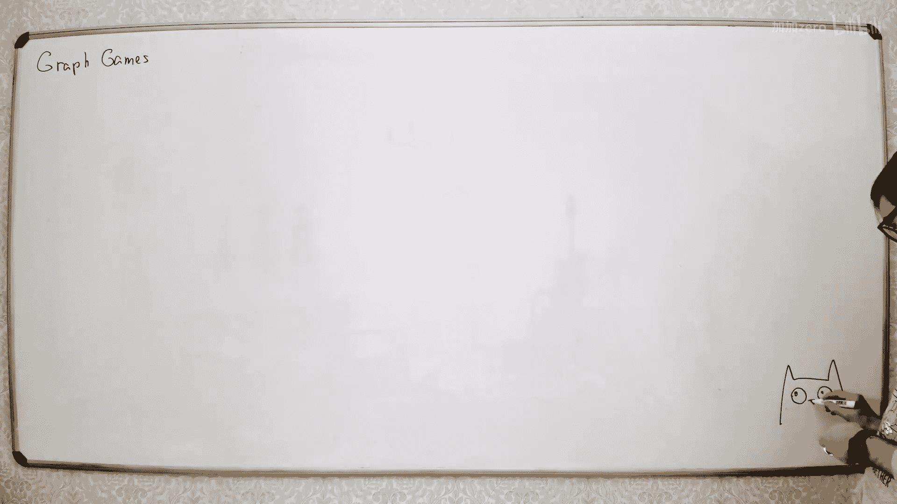

# 【精译⚡算法与数据结构】PavelMavrin p40 p39 A&DS S03E08. Graph Games -BV1NLB8YfEMq_p40-

🎼。

🎼So today we'll talk about draft gains。嗯。Yes's。What is graph game。

 Gra game is basically a game on the graph。So we have some graph and you want to play some game with it different graph games they will discuss some classical graph games。

The most classical graph game looks like this。You have some graph。

 and let's have you have a direct graph。Something like that。And you played the Halloween game。

You have。Special talking。It is placed in some vertex of the rock。And there are two players。

They take the alpha turns and when it your attorney you just move the torken along some edge so for example。

 now the first player moves， the first player move the talking here。

 then the second player and the second player moves the torken here and so on。

When you have nowhere to move when there's no edges。From your current vertex， you lose。Yes。Noも。

야 일단 너무。Sounds like this。What a simple game。And the question is， if you put that the talking in here。

 who will win if both players play optimally。 So there are two players and there are no ties so。

In every game there is some final no， so there is no way to move。 So if there is no tie。

 then one of the players will win the question is to determine who will win if your plays is starting talking here。

Cool。So let's try to analyze this this these games。 first games analyze other games than you have。

A psychograph。So if you have a cycling drop。Bake。In acyclic graph。

 most of the games are very easy to analyze， actually。For example， in this game。

 how to analyze this game。If you have a psychograph。What is the grafinius is if you have acycl。

 if you have cycles， you may havet been in game your strike。If the graph is the cyclic。

 there is always results the we， you can have a tie because the game will finish it somewhere。啊そ。

First， if you have a psychograph， then most of the games are very easy to analyze That's because you have of course if you have a psychograph。

 you can make an topological certain of this graph and just go from left to right or from right to left and analyze games in this order。

 So let's let's let's put some numbers here So this1，2。3 and4。

So you make a aological sorting of this algorithm of this graph。And then we'll go from right to left。

And analyze the games starting in this node。 So if we start a note 4。Then we will immediately lose。

 Right， So so if you start node 4。There's a losing game， sorry if you start here。

 you lost the game immediately。 So this is a losing。This part is 0。

 So 0 means that this node is a losing。 If you start the game and this snow， you will lose the game。

So the first player will lose the game。Now， let's move back and let's move the note freely。

For no free。You can move to node 4 and if you move to node 4。

 then your opponent will lose the game because node 4 is losing game。So if youre start the note3。

 your game will be a winningning game because you start from here。

 you move to the loosen node and your opponent will lose。So， so in note free。

 you have a winning game。Did we choose where to start。 No， no， no。

 there is some fixed starting vertex。 So So one of the notes， this say is no S。

This is starting not Riviian， but we will analyze all the notes。 So for each note。

 we will determine if the first player will will， if we start in this note。

And we just analyze it from right to left。 So for each node。We will determine the eve。

If you starting this note。Will you lose or will， will you win。Just the way。Let's move next。

 So now if if you have node two。 So if you start a game in a node2， then you have two options。

 The first player has two options。 He can move to node3。If he， if he moves to no three。

 then he will lose the game。RightBecause I move here and then my my， my opponent would win。

Or I can move to note 4。 and if I move to note 4， I will win the game because my opponent will lose the game。

So out of these two options， if you， if you are the first player， you will。

 you will decide to go to the。Losing position and to to win the game。

 So not free is the winning game because you can move to this position and your opponent will lose the game。

 So not two is winning game。Now， in node 1， you have two options， but in both these options。

 your opponent will win the game so you can move hear and lose or you can move here and lose。

 So in both these cases， you will lose the game。 So verortex 1 is a losing game。

That's all best how you analyze this game if you have a psychograph。 So okay， what you do。

 you go from right to left。You take some note to be。You look all。

So we just it or all edges were going out of this don't we。衣服。

At least one of these edges go to some losing note。

Then you can make this move and win the game so your game is just a winning game。And if。Let's see。

If all your moves， go to some winning game。Then， no matter what move you will make。

 you will lose the game co。Each case， you will go to some winning position so your opponent will win win the game。

 So this is a losing position。That's all。 And now just， you just apply this from right to left。

 and you will decide for each note if it is a winning node or is losing ground。That's the whole plan。

 That's the whole plan。嗯。不要了な。Now， for acycl graph， many other games are also easy to analyze。

 for example， if you have。Let's say。U， you have something like this。Let's say for each note。

 for each edge， there is some cost。嗯嗯嗯。Let's put some。Integers here， so you can。7 here， for example。

嗯。We work here。Or can move。Here， let's see one。诶。I to see free。 And then。5 here。まぞ。

Let's say each edge check has some cost。 So when you make the move。

 you pay this cost to your opponent to your opponent。So example， I start here。I make this move。

 I pay $1 to my opponent。Then he makes this move， and he pays me back。Fs。 and then I made petal。

 and I paid him back $4。So my， so if I， if I make this this move， then he makes Smith move。

 And then I make this move。 my total。We will be。呃。Will be 1-1 plus 3-4。 So it's-2。

 So if I make this move then he makes this move， then make this move， I will lose $2。

And the question is to find out what is the minimum。

 what is the maxim possible profit I can get in this game。 So if both players play optimally。

 you need to generate the max possible winnings of the first player。Let's go。

 So how to analyze such kind of problems the same way we we analyze these problems。

 So we just make an a logical ordering。 Now， go from right to left。For each note。

 we will find the value with C D。Will be the maximum winning。O first lip。啊。

That' song that's how you do。Now， again， how how to find this value。 you have this own V。

You look on all out angels。Let's say we have no view here， so if you make this move。

 then you will pay the cost of this edge so your winnings will be minus weight of the edge。

And then your opponent starts from here， so he will pay you back so he will win the value of this do。

 so the D will be the optimal winnings of the second player your winnings are his winnings are you losing so you will your winnings will be minus。

And the요。And now you just take maximum all these spreads。

Can you make this problem be harder by adding limit like you win if this happens when you count in。

Moth is odd。No， there are there are many beifications of this problem。

 and most of them are easily solvelvable by the same， by the same approach。

 So just go you make political order and go for right to left。 So basically。

 if the result of a game only is reminded by your current position。

And not by the history of all moves。 Then all of these game are easily determined by by the same approach。

 some。More complicated game may。呃。So， so， sometimes your move。

Depends on all the premier previous moves。 So your current move depends on on the history。Of moves。

 then it's a little bit more complicated。 So you some somehow need to remember the history of all moves。

Sometimes possible， sometimes it's not。 but in in these problems。My。

Choice of move only depends on my current position。

So no matter what what happened before I enter this position， my。

 my move is easily determined only by this position。 So I just need to make this。

Dnamic programming based on the current node of my view。Makes sense。

Let's try let's apply this to22 to，2。Do these graph。So。So I go from again， I go from right to left。

So here it is all vector to go。So I just， so the game just stops and my winnings is 0。

And now if the ver it is free。I can go here， so I will pay it。$4。 and my winnings will be -4。

Here I have two options。 I can go here， pay three dollars and then get$4 back。

 so my winnings will be one。And if I go here， then I pay $5 and get nothing。

 So give you win to be -5。 so I take maximum of1 and minus-5 maximum of one。And now for node one。

 I I can go here， pay 7 and then get4 minus-4。 So so my total winnings will be 7 plus4。Mr。 watchless。

不是。Good it like this。Just to make it more interesting， so I couldn't go go here。

 pay one and then get four back， so my total winnings will be。Wait， so my total wing is fully free。

 Yeah， so I no， yes free。 So I spent well then getting four。Or I can go here。Yeah， so I will。

I will pay 7。And then。Yeah， and then get another No， and then lose one that and then lose one。 Yeah。

 so my my my， my， my opening will will win one。 So I will lose one。

 So I will pay 7 and then lose one。 so。Okay。Okay， it's not very interesting。 Okay， so Ill play 7。

 and then once minus。 So so I will lose 8， right， So I will lose 8。 and here I will lose。

It was better， right。Yeah's more brick。Sorry， I'm not afraid good on this。Examples。

I just want this example to be interesting。So here I pay seven。

 then get four backs so my wing is minus minus3。Here I spend one and then get one and then spend another one。

 So my winning since -2。 So here my winning is -3。Here， my width is -2。Yeah，-2 is better than -3。

 Yeah， so the result will be -2。过了。So the optional strategy is go to so the optional strategy for first player is to go here。

 The optional strategy for the second player is to go here。

 and the optional strategy for the first player is to go here。 So total win will be minus。如。

That's all。Now there are few tenseent modifications for the graph games。

 First modification is asymmetrical game。 So so this game is symmetrical game。

 so both players have the same strategy Yeah because both players can make the same moves。

But in some problems， you use players can make different moves， so one player make one type of moves。

 another player make another type of moves。Let's have something here。's make it。

 Let's use two colors。Let's use the。Blue and originalal for different types of mo。嗯嗯对。うんうんふんふんふんふん。

う嗯んうん。No， let's make something like this soft script。To here。Then move， for example。Only here。

Here make something like this。And also， like these。嗯。And what。Will it be interesting now。哎こ着呢。不知了。

So now we have two types of moves， first player， let's say first player is a red player。

 we have two players red and blue， let's say first player is red。And the second layer is blue。

And now。Now， how how say type of games。 So if you have a symmetrical game， you want to find。

 you want to find something like this。So you want to find for each game if it is winning or a losing game。

 But here you have since again， is asymmetrical， you want to find these for both players。

 So each game， each game can be winning and or losing for for each for for。Each of these players。So。

 I will find。Two values for each note， I will find two values if it is game winning or losing for the first game for the first player and if it is winning or losing for the second player。

지 원 빨리야구나。不ト。백카一とく。다음 주에 바로 줄게。Okay。那。I will put two values for each note for each note。

 I will find two values if it is win orders for the first player and if it is win dollars for a second player。

 So again， I just move from right to left and find these values。この床。With no for。If I if I stand here。

 then the game is losing for both players， so it is losing for the first player and it is losing for the second player。

Now， for all free， if I am standing here， then for both players can go to note4 so for both players。

 not free is a winning node， so it is winning for not。For second and for the first play。嗯。嗯。

Was problem yeah problem say this symbol。 I have the same game like like the first game。 So。

 so I so both players make moves。 And if you have nowhere to move， then you lose。Very simple game。

 if you stand in a vertex and there are no outgoing edges then you will。

 but here you have two types of edges， you have like blue edges and red edges。

Blue player can only move along the blue edges and red player can only move along red edges。嗯哼。Now。

 if I send a note to， then if I am the first player， if I'm the red player， I can move here。

And win or and lose or I can move here and and win。 So the first player has two options。 So he。

 he will decide to move here and。Win the game。 So for the first player， this game is a winning game。

And for the second player is losing game since the first second player can only move here。

 So he So he moves here。 And now the first player will win the game。

So if if you're the second player and you here， so you move here and then the first player will win the game so your game is losing if you're the second player。

That's all。And now if you send here， if you are the first player， you can move here or here。

 if you move here， then the second player will lose。So for the first player。

 this game is a winning game。And for the second player， you you can only move here。

 And if you move here， then the first player will win the game。 So for the second player。

 it's also a losing game。Nice。😊，Oh yes， it's an extra。Just got it from the list。

G Christmas gift from Tip。嗯。That's all。 That's how we analyze the game。 if。

 if you have a asymmetrical game。 So if the game is symmetrical， you just apply this。啊。

Another way to analyze asymmetrical games is the polar games。 So let's just。

Reduce our game to the simple game。 So we have asymmetrical game。

 Let's build the same symmetrical game， which which have the same result as your game。

 How to build symmetrical game from asymmetrical game。 You basically need to duplicate your graph。还有。

The first polar camera。And the second layer。And now you simply say that if you stand in one of these nodes。

 then there is the first player who moves。So here， the first layer I move。And here the second layer。

Mmm。😊，And now we just build a simple symmetrical game。

 So if you're standing in node1 and this is a first player first player。

 then he can move to nodes 2 or three。 and when you will move here。

 the second player will be the second player turn。 So you move to node 2 and there is second player。

 So if you're standing here and it's the first player move， then you move here。Or can move note free。

And if it is second electron turn， then he moves to node2 so you can move from here to。Like this。

And so on， sort， if you's any note2， you can move to node。 So if you have a first player。

 it can move to three or four， so you can move from to three or four here。

Or if if it's the second player， you can move on little low free。 So you can move from here do。

From note 3， you can move to note 4。 So to move here and。And总。

And so now you have a simple graph there is no color then no colors in just just this stake of your game basically encodes this the your vertex and who's journal it。

嗯哼。Cool。Now you simply analyze this graph like we did before like we did in the first problem we discussed。

 so just go from again， this is a acycl graph。 since you don't have cycles here。

 you will not have cycles in this graph， So you analyze it in the same way you analyze the first graph。

 so you go from right to left。And。Mark all the notes if it is winning lose or no or lose a note。

So if start from here， this is a losing note， this is a losing note， this one will be a winning note。

 this one will be a winning note， this one will be a winning note。

 and this will be a losing note and so on。So this is winning。 This is。So basically do the same thing。

 so if you look at this。To approaches the you basically do the same thing。

 but it's it's kind of different since here you need to kind of change your algorithm just to modify your algorithm to solve your problems。

 And here you simply reduce your problem to already solve problem。

 It's usually a better way to solve the problems。 If you can just reduce your problem to something you always know how to solve。

 It's usually a better way to solve the problems。Okay。Okay。Nice。嗯 응。No， I I like to chat the extra。

Now， another way to simplify a problem is to change the rules of the problem a little bit。

 So let's try to remove this。好到。So let， let's go back to the first problem。

 So we just have this graph。Each player might move， but let's change the winning conditions。

 So let's change winning conditions。 So， let's say if you， if there is no move from the currenton。

 then you win the game。So we have the same problem。But the winning conditions changed。

 So if if if the if you stand here， for example， then you will win the game immediately。

So how to session？What we need to change。Any ideas？So again， if we change the winning condition。

 so we have the same rules， that have a graph， each player in his turn can move the torqueken along some of the edges。

And if there are no edges to move， then you win the game。How to change the solution of this problem。

응い见。嗯。嗯。What。I old you Madrid。 Okay，嗯。Let's get back to the problem。Again。

If they check the of the wgets。 Yes， right。 The only thing we need to change is the state of the signal。

 So if there is no outing edge， then we have some kind of dead end down yeah。 So。

 if you sending here， then you need to change the state of these node。

 So we'll start by marking all the end node as。Winning notes。

And now we just apply the same thing for all other nodes。 the rules are the same。

 So you look on all Algoing edges， look at all Algoing edges and see if you can go to some losing position。

 then your position is winning。 So these rules are the same。

The only state of these final loans will change。So we just go again， we'll go from right to left。

And we apply the same the same procedure。 So for not free， you can go only here。

 so not free the losing note。But from now two， you can move here or here and you can decide to go here and win the game so。

No two is a winning the end。 So as no，2 is winning。 no matter what conditions you're Okay。

 So in both， in both these games， no two is a winning node。 So it may happen。 So you know two。

 you can decide you can， you can go， you can。So you can force the player to go to the dead or alternate you can go itself to go then so in both these winning conditions。

 no2 is a winning game。Now for not one， you can move here or here。 So not one again。

 not one is the winning game so we can go here and win the game。Now， again。

These modifications need you to modify your algorithm。

So to analyze this graph you want to modify your algorithm a little bit， so it's small verification。

 but still a modificationification let's try to avoid this verification。

 let's try to reduce this problem to this to the problem we alreadyd。

Let's try to reduce this problem to the normal problem。 So So this is the most classical game。

 So when you have nowhere to go， you lose the game。

 So let's try let's try to change the graph in such a way that all these notess will be a winning winning node。

How can you change your problem situation。So basically。

 what we need to do is to force all these final nodes to be a winning node。

 how can we force some node to be a winning node？Again。

 I want to reduce this problem to the first problem we discuss when you。そこそ。When you lose。

 when you have no money。我同意出庭。嗯嗯嗯。Yes， what you going do？You used to introduce some some snows， sum。

Additional note here。 And for each final note。 So if there is nowhere to go from this note。

You just made one special edge to this special。And now in the first game。

 this action note will be a losing note。And all these nodes will be wind node。And all。

AllAll the rest will be the same。So this is easy way to solve the problems when you have a situation like this。

 when when you win when you have no moves。G。Next。Now， let's move next。Now。

 that's all about thecyclgraph。 So if you have a cyclgraph moisture。

 most of the problems are easy to solve。So we just go from right to left。

And tra calculateulate something in your notes。It depends on your problem。Go。Now， what。

 what happens if you have cycles， Let's put my on。What happens with your website？嗯。Again， let。

 let's have some graph and this graph of cycles。 And if you have no mood， then you lose the game。

So the same problem we discussed， the first problem we discussed。But now you have cycles。

 What might happen when you have cycles。 when you have cycles。

 you may have situation when you have ties。 for example， if you have a game like this。那你看不着。Yep， no。

 this is a draw。Because the game will never end， basically。So。Every player will have some move。

 So you So if you stand here， you can move here so on。 So we So the game will never end so we'll。

In this case， we will mark all these。All these notes as a draw。 Its some special mark for this。So。

 we have 0，1。Let's say， minus just。嗰时改四啲一。It's kind of in all these three states， we have a drawing。

Dr looks like leg zero， I don't like。嗯。Okay， minus5。My is fine。So now in all this game。

 you have a infinite game Yeah。 So if you start from from any of this note。

 you will have an infinite game。 infinitefin game means draw。那。Is it true that if you have a cycle。

 you always have a draw it turns out it's not the case， even if you have cycles？

The game may be a any game。 So even if you have cycles， you may have win or losing states。

 For example， if you have。Something like that。Then， situations change。Let's see。

So if you have something like that， then let's see， so this state is obviously a losing stake。Mmhm。😊。

Now， this state is a winning state。Since you can go here and win。So this is this is not a draw。

 So if you're standing here， you can go here and win the game。 So this is a winning stick。Mmhmm。

And now this is a losing state because you can go， you can only go go here and lose the game。

 So this is a losing state。And this is a winning state。So even if you have cycles。

You may have some winning losing states in this cycle。They maybe even。

Even more interesting situation， Let's say。Let's see， for example。

 you can go lets it one more second here。So now what happens here？What happens to these three states。

 What do you think。Yes， well do this package because yes。 we will do it in a minute idea。

I will just show you some examples just to show you what can go。

Orro if you just want to apply some standard references。So there may be some different situations。

 Yes， we will， will apply exactly what you want。What you suggest yeah。So now in this game。

 so this is losing state， this is winning state， but what about these states？No， let's see for。

 for this state， you have two options。 You can go here and lose。Or you can go here。

You don't want to lose， yeah， so you decide to go here。From here you go with there。

 And in this state， you only go come here and so on。 So for example， first player stands here。

He make the move。 Now， the second player moves。 The first player moves here。

 Now now was the second player charm。 He don't want to lose either。 So he doesnt most。

 So he decides to to move here and and so on so。 So you will move along the cycle infinitely。

So all these days are actually drop。So you have draw in all these three states。So this version。

 if you have a winning state， wooden state or draw， depends on the structure of your graph。そうそう。

These cycles may have some strange connections between them and so on。

 So you need wait to determine for some node if they are within a losing and for some node if they are theey。

Okay， how to analyze such games？It's actually pretty easy。What you will do。

Let's try to mark all the winning and all the losing games。We can， so we kept some up。嗯。

I raise the cat。Sorry。Whats next。Let's move it back。

Let's make it a little bit air。Because we raise it。あ、そう。那。How to analyze the games with cycles。

 You do the same thing quite before， you try to find for each node if these windows are losing an node and you want to do it as long as you can。

So you start again， you start from the nose without algorithmatings。 if you have some node。

This bring any。All these notes are obviously losing notes。

 so you mark all these thoughts losing notes。Now， you take all the notess。

 which hass edges to these losing nodes。是的。So all these notes must be winning notes since you can go here and win the game。

 so you mark all these notes as a winning notes。Now， in next layer。

 you want to find something special。 So you want to find such notes。 So all ongoing edges move。

 go go to some。Wning年。走了 if you have some no。And all outgoing ages。Go to some winning notes。

 Then this note must be a losing note。answer one。 do you have some models like these。

So these are losing those。And now， you may have some yous。Which has something like this。嗯。

Some edges to these windows。 So these loads will be windows。And so on。稍等。

So each time you try to add new node to determine the state of some nodes。

So how can you determine the state of the note and again， like like in the first game？

If you have some note。Which hair need do some losing note then。You must have a winning note。

And if all ages。Go some winning notes。 So if all these notes are winning nose。

 then your know is losing out。Now， we just want to apply this。To operations。

 and as as long as we can apply these operations。 So if we can apply this operation， we'll play this。

 if we can apply this operation， we will apply this and so on。 Well， we cannot apply any operation。

What does it mean。衣服。So we we applied some。Aperations to photograph。

 each time we mark some note as we of orlu mode。When we stop， when we can't apply any of desperation。

 we stop。で outす。What will happen in the end， In the end， a note will be not marked。

If the node is not marked， what does mean it means that all nodes。All unmark notes。

Here are some outgoing edges。Some of them are marked as winning edges， as winning nodes。

And some of them are unmarked。 So if there is at least 0， at least one0， we will mark the one。

 if it is， if they are all ones， we will mark 0。 So if we can apply this and this。

 it means for each node， there are some nodes marked marked with the ones and some unmarked nodes。

And I just claim that all these notes are draws because why seems because if we stand here。

 we can have two options， we can go here and lose。Or we can continue the game。

And both players't that doesn't want to lose。 So。 So if you both players。

 if they have the options to lose the game or to continue the game。

 they will decide to continue the game。So all a notes in the end will be a address。嗯嗯。Yes。

 that's exactly what you suggested in that。No。Let's try to do it。F enough。

 so I want to build an algorithm which is which does this thing and works a linear time。

I want to just implement this algorithm in linear time。 how to implement this algorithm linear time。

 I will， let's say， So we need to go from right to left again。

 So we go from right to left if we have。So each I will mark the node wide1 by one。

 If I mark node with0。 So if I have some node。And I want to market with this zero。What I need to do。

 I need to look on at all in ages。And mark all these notes as once。Mhhum。

And what happen if I marked note the one。 if I have some winning notes。Here。

Let's leave a little more complicated。 So what you need to do。そ youうかを。Ingo ages。

Some of these notes may became a losing note。啊。How to how to find out if。

 if it is now a losing node or not。 So if some of these nodes， if this。

 this is the final marked node。So we need to look at all these。I going he。

 just look at all this notes。If some of this node。Now。Has all I going on。

 age just going into two months。Then this node must be marked 0。

So we need to look at all ingoing edge to this node。 So let's see this sort video。So we。

 So now we mark this node view booth one。 So now this is winning node。 We look at all in edges。

And for all these nodes， we need to find out if if if it was the final edge of from this node。

 So if it is the final edge go going into some node marked one。

 So if all other node of if all other edges are marked one。

 then now it's the time to mark this node as。네 싫어。So we need to， we need to find some way。To quickly。

 Germany， if the。So we need to somehow find a way to determine if it was the final edge from this node。

 So if all other edges are marked with the ones， how can we do it。Again。

 first version is simple if you mark node with0， you just transfer for all edges and mark these node as onces。

所情况。So here is a little bit more complicated since you don't want to mark all these nodes as zeros。

 you only want to mark node as zero if all outgoing edges go to someone。Mm哼。

So you need to find some way to find out if after you you you mark this note one for these notes。

 for this note， all outgoing edges go to some onces。How to do quickly。嗯。

Brof force will not be fast enough since if for each node you go here and then iterate all edges here。

 it will be like n square so you find for this note you go here and for this note you go here so for each note you iterate for each edge you need to iterate all all these algorithm edges。

So so it can be it should have reverse， but the counters are good Yeah。 So you need to find。

 you need to make a counter for each node for each node。

 you make a counter how many outgoing edges are not marked yet。And for this stock， you， you just。

Deccrement discount。And then， see， if counter。Equal to 0， then this do must be marked as080 0。こう。

I want some tomatoesymentas。Let's go。Well， let's say we have a queue。

And we will put all the aations in the queue。 So in this queue。

 we' will put all the nodes we need to be。First， let's put。All the dead ends to the queue so form。

For all。We if。Out of V equal to 0。 Then we put。Will say the state of we equal to 0 and put。

This note in the。Now well just put all these the。And now while you function。嗯。持ってき。

We'll take one note from the queue。If it is a rep closing note。

Then we simply transfer all in growing ages。For all。As Uv。

We will say that need if it doesn' not mark here。Let I say that do U equal to one and put it in the Q。

Do you have enough space。Thank you。And if the， if I have the winning note， again。

 I for all the coin news。I will recommend this counter。 Let's say this out is a counter。

for simplicity， so how is the number of outgoing edge， which are not marked。

So I'll just dec the counter。And then， e for to0。嗯。I will put it in the Q。Sorry regret。哦。P perfect。

Now， in the end， all the unmark notes are the draws。嗯。Nice。

So and now the time complexity of this algorithm is linear since every time I pick some node from the queue。

 every node will be removed from the queue exactly once。

 So I do all these exactly once for east for4 each node。And here I just all of ingoing edges。

 so the total number of ingoing edge for all nodes is M， so the total length of legacy will be M。

plus M。拿什么？So we can analyze。Games with cycles and linear time， as well。Also。

 we can apply both these trips so if you have asymmetrical game。

If you have like edges of two colors and first layer can only move。

Along the red edges second only along the blue edges， we can apply the same technique。

 we can double the graph and so on。And if if you can。

 if you want to have a game when you when you win when you have no moves， then again。

 you can apply the same trick when you apply to the acyclgraphs。

 just add one action node to put these edges from this the。

 and then you will apply the same algorithm and you will determine for each minimum losingsing。

So both districts can be applied to the cycles as well。Thanksice。欢农 trick。Let's talk about range。

We need talk about range function。哦，这着了。Let's go。Let's talk about summer games。

 So if you have what you may do， you， you may have two games and you want to calculate the sum of these games。

 What does it mean。Let's have。2 grab games， for example， Sky game a like these。또 수 번。1，2。And this。

So 신게。A b b。When you have only， let's say， two states。Very， very simple game。

So let's have two graph games。What is the sound of this game？What is the game a plus B。

Game Air plus B means you have two tokens， so you have both these you have two games in each of the game you have a token so you can put this second in here and then I'm talkingken here。

And if it're attorney， then your move is just to move one of the torkens。嗯。Mo 왜。と？Tian。嗯。1 wolf。Gs。

I would know。So when it's your turn you decide in which game you need to move and then make a move in this game。

こだ。嗯mhm。😊，Now， the first solution is simple。 What we can do is to build another game。

And just in both these states into the state of the third game。

So we can take all all the pairs of these states。 so our current state in this sum。

 So if you have this sum， your state is the pair of states you have stayed in the first game and the second game。

 Let's include all these pairs as states in our new game。So let's have a game of six states。

 So we have six possible states in this game， right， So let's build a graph of six nodes。

Let's have long。2， free here，1，2， free here。 So this will be the state of the first game。

stateate of the game A。 And here you have a state of the second game。Thanks。

And now you just simply now should can apply this moves to this graph。 So you're standing here。

You can make a move in the first game and move to the second or to the first state。

 so if you have state 11， you can move to state 21 or to state3 one。Here， organ here。Again。

 if you send here， it means you have tokens here and here and if you make move in the first game。

 you can move here or here， if you make move in the second game， you can move to this thing。Yesor。

So if you staying here。You can move。Here or here and so on and all other。Like this。

So this will be the graph， which is the sum of this。Look， is this is like a product of photographs。

年なっただ。啊。Now， this is a psychograph。 So if you have two psychographs。

 if you make product of this graph， you will have some psychograph。

So you can analyze this graph using the same technique as before。 So in this graph。

You can just make an aological ordering and just go from right to left and analyze this graph as before。

 So this will be the losing state。 This is a。Weing state， this is winning。 this is losing here。

 you can move here， so it's winning and this will be on。Then so again。

 send first version is very simple， you just encode each player of the states as a state and new game and then you analyze the game as a simple graph game again this is a graph game like before。

 so we just can analyze it in the same way as we analyzed the games before so the sum of two games is sum of two graph games is a graph game。

So we can analyze it as before。こと。But the size of the graph is increased。 So， if you have。

You if you say you have two graphs of size N。Then the size of this graph will be n squared。

And if you。And squares not don't look that big。 But if you have many games， if you want， for example。

 can calculate the sum of。Free games like this。 You can calculate some of free games。

 What is some of three games。 It's some plus plus A plus B plus C。😊，Yeahep。

So A plus B is a graph game。 so we can make a sum of two games and another game。😊。

Simply what does mean you， you can make move in C or in one of the games， A or B。

It means you just make a move in one of these three games terms。Okay think。

So so if you want to calculate the sum of multiple games。

 then this power of n will be will just be increasing solid。

 The number of states here will be in cube and so on。 So if you。

 if you want to have sum of five games， you will have n power 5 and so on。

So the size of this graph will increase exponentially if you increase the number of games you。

And that。It's not what we want。So I want to be able to analyze a big sum of games。

 so I want to basically。Let's have a break。 So why do I want to analyze some of gamess， usually this。

You， you want to do it in situations when you want to。Let's say you have some game。

And you want to determine if the game is winning or losing。

 so you want to just split your games into separate independent games。

And then calculate this game independently and then calculate sum of these games。

 That's what usually。Usually bring。 Usually you have some game。Which has too many states。

 So it's very hard to analyze。You want to split this game into some of some small games。

Then analyze each of these small games。And then find the sum of these games。

 So what I want to do is to analyze these two games separately。

And then somehow calculate the sum of two games。Mmhm。😊，こさも。Or다。

Let's say you have two games and you know that both these games are losing games。

So you have this game eight。With this such sale end the is game bill。

And you analyze both these games independently， you don't build this graph。

 you just analyze this game and analyze this game。And you found out that this both states are losing states。

Both these games are losing games。 you lose here and you lose here。

 What will be the sum of these two game。What do you think。So we have two losing games。

So in both these games， you lose。What will be the style of these games。

Will it be winning losing game。Any guesses？I just two options。嗯。嗯。😀ふへへ。😊，Okay。

 you guess that's right。 So this will be a losing game。 So if you have two losing games。

You will have a losing game。Let's prove it。It's actually quite easy to prove。

So imagine you you're the first player， so you need to make a move in one of these games。

 For example， you make move and in game A。 So in game A， you make any move。

Since it was a losing state。You， we will make a move to some winning state。Mmhmm。

So the first player always make a move from some losing state to some winning state。

Now it's the second term， the second player term。 So he。

 what he can do is to move from this winning state to some losing state。 So。

 so he will make the move in the same game。啊。And again。

 he will move you to state when you have two losing states。 check again。First player make any move。

Now， second player makes this the move in the same game。And moving to again to the losing state。

 So the second， the first player always have two losing states。So at some point。

 you will go to some to some final states。 so we have no moves。And you will lose the game。有。Okay。

 case number two， what if you have losing game and winning game？

So let's say here you have losing game here。 We have a winning game。What will。

 what will be the sum of these games。Yes， the sound of these two games will be the winning game。

So if one of the game is losing game， another game is winning game。

 then the sum of these two games will be winning game。Well because in this game。

You can move to somebo and state。And now the second player has two losing games。

 so he will lose because some of two losing games is a losing game。

 so some of losing and winning games is a winning game。Okay， and and finally。

 if you have to win this。What will happen。Yes， if you have two winning games。

 the result may vary so so it depends on the game， so there are。For example。

If you have two games like this。Then both these games are winning games， so this is a winning game。

 this is a winning game。But the sum of these two games will be a losing game because first player moves here。

 second player moves here， first player lose。But if you say scrap something like this。Not like this。

 Like this。Like， we have this game， so。In this case， we have two winning games。

And the sum of these games is winningingy。So sometimes it's winning game。

 sometimes it's winning game。So that's basically all we need to think about。Again。

 how to analyze the sum of two games， We analyze each of these games independently and what we the only case when we don't know what will happen in the sum of the games if is when we have two winning games if we have two winning games。

 we need to find some。Some stronger theory to analyze these games。Yeah， yeah。

 all across with this story。I'm just， I'm just given sometuition about。

About this function before before youll introduce a grandi function。

 I want to give you some intuition， because。So so so you need to understand who。

From what arguments this grand function came from， what's the grand function？

Riny function works like this。 So it turns out that actually。The result of this sum。

Depends on some kind of type of winning game。 So if you have two games of the same type。Like here。

 no here we just， have two single games。So， if you， if you have the sum， sum of two equal games。

 So if you have game A and D， you have the same game here。 Let's say 81 a。If you have two equals。

Then the sum of two equal games will always be a losing game。

Because the second player can use the symmetrical strategy。 So you you。

 you make move in one of the games and your opponent make the same move in another game。

 So some of two equal games is always losing game。And it turns out。

 it depends on the some type of your winning games。

 So if you have two winning games of the same type。

Then the sum of these games will be a losing game If you have two winning games of different types in in some way。

Then you will have a winning game。So the best。How works。Okay， let's move through the grind function。

The drain function works like this。Let's have a note be。The range functions is geo3。Will be。

A mix of all random function， you。For all ages be。D that's a range， where is it？What is max。

 Max is the minimum non negative integer number， which is not。Mes， minimal。아 노 negative。不て。Indi者。

Not in the set。ごな。So， so you have on all these edges for each edge。

 you know the grandi function of these nodes。LetYou have some note。

You have all these possible transition， So for each of these notes。

 you calculate the grandi function。 it seems the graph is a cyclic。

 you can calculate them from right to left。If you have a cycle in graph。

 it's much more complicated than theem about this。Hi， lireman。

So if you want to know how to calculate some of two games with cycles。ナいっすよれ。

Much more complicated than this。So what's going on So So imagine for each of this node。

 you already calculate the grandi function。 Let's say grandite function here is。嗯。

What's if I'm some 2，0，1，2， and 5。So what will be the grindy function for this note。Again。

 you will need to find the minimum non negative number， which is not in this set。

 So we have0 in the set。 we have one， we have two yet twice， but we don't have three in the set。

 So three is the minimum number， which is not in this set。

So brand new function for this note will be free。That's all。let's book a gra function for this。

 for example， for this graph。What's the good for all these graphs。嗯。A the I time。

Now you can call function in real of a film。No， the value of。

The value of brand inction can be more than squared root of M。 That's true。 But actually。

 you can coate linear time。OhWitless， okay， let's。Let how to calculate randomi function。

We can complete grind new function in linear time。How can how to do it， Let's go from right to left。

 Each time we take a note。Take all outgoing edges。 We need to find minimal number。

 which is not in this set。What we can do we can。Here we have five notess。有。

So we you here we have five notess。 So we know that the minimum number original not set will be at most5。

Because if you have integers from 0 to 5， there are 6 integers， and you only have five nodes。So。

 you note the value of grindy function for this note。 is it most 5。Mmhm。😊，Now， you can make it。

From  zero to4。And just mark all the values you have in this set。Again。

 the size of this array should be at most 5， since you have only five edges。Mm哼。😊。

Now you simply mark all the。 So you have value true。 You market here。

 you have zero far here market here and so on。And now in this array you find the first and marked values so we go from left to right and find the first value which is again。

 the size of this array should be at most the number of edges you have here because this is maximum value you can have as a grai function。

That's all。 So you can calculate grandi function for this for this node in linear time by a number of these ages and total ones says M。

 So the total number total total time you need to calculate the grandi function is actually linear。哎。

有。Also， you can optimize it little bit。 Yes， the maximum value of the gra function will not increase the square root of M。

 You can prove it as an exercise。Y， that's also true， right？Look， okay， I will just put it。

Brind de function of will be no more with them。square look of。嗯。

I'm not sure about constant facto it saved the cold。Like this。I'm not sure about constant part that。

There must be some constant。 Y， doesnt matter it。嗯。Let's move back， let's move back。

So let's try to calculate grandi function for this graph。Let， let's start from these graphs。

So this is this very simple graph。 So this node has gra function equal to 0。

Since you don't have any outgoing edges， the minimum number you don't have is zero。

 you don't have any numbers again。From here， you can go to 0。 So minimum number。

 you don't get the its one。Here it is 0 again， here。As one from this node。

 you can move to2 to1 and to0。 So a minimum number you don't have any set is2 So random function for these numbers for this or2。

I believe this true。Ohpe， okay。 try to think about it。啊。Now， let's从 this。

What's happened in this graph So here you have them So here is 0。From here， you can move there。

 So so the you can move to 0。 So gra function is one。Here， we can move to zero。

 so brand function is one。And here you can move here and here。 so you can move to one and to one。

So the minimum number you can go is 0。Here you can move to one and0， so it's true。

 And finally from this note， you can move to0 to one and to2。

 so your your minimum number can go is free。 So functional its free。Thanks。到。

How this grandi function is connected to to the state of your game。

 So so we want to determine if the game is winning or losing， but now we have this grandy function。

How is gra function connected to this state of the game？Very simple way。

 the game is losing only then if and only if the grandi function is zero， so grandi function is zero。

Even and only if the we losing stay。嗯。No， let's prove this。 It's actually quite easy to prove。

 So let's see if。WellLet's do it by induction from right to left。

So we just go from right to left and prove it for each for each node。 So let's say if we have。

Some node and grind function is 0。So if grandi function is0。It means you don't have 0 in the set of。

Granded functions for these states。So all these states are non zeros。 All these states are non zeros。

But by induction， if， if the gra function is not 0， it means all these games are winning games。

So you must have a losing game。So if you give gra function is 0， then you have a losing game。

If your brandi function is not zero。What does mean it means the minimum number you can go is not0。

 It means the0 is in the set。 If your max is not0， it means you have 0 in this set。So。

 there is some note。We've currently function 0。What does mean it means by induction。

 this state is losing state， so your state must be a winning state。So so if grand function is0。

 then your state is losing。 If your grand function is not 0， then your state is winning state。有错。

So basically， randomi function is like。嗯。How it's gold。It's like。More interesting version of this。

per previous solution， when you decided。 so we just replaced these ones with some integralteger numbers。

 So zeros again， are the losing states。And all positive numbers are some different types of winning states。

 So grand functions simply want to just split all the winning states into some classes， like before。

Do we have T for this。 Nobody don't have tackles。Nice。That's all。And now the final thing。

 what I want to do。Is to calculate grand de function of some of the games based on grand de function of two separate games。

Again， what I want to do， I want to analyze games A and B separately and then analyze the sum of the games without building this big graph。

And it turns out very simple。 It turns out that the grand sum。Or grandy of some of two games。

It's just basically the big sort of wisdom。So we'll just take these two numbers and make a bit white sure of these two numbers。

 and it will be the grandi function of this sum。That's the magic。 That's just the magic。

So if you look here what's going on on here for states of the first game， we have grand function 2。

1 and0， and here we have one and zero。I have one on one。So now， now。

 this0 is just a sum of this  one and one。 and this one is just sum of this one and 0。

 And this three is just sort of this one and 2。 So one x 2 is free。

 That's one why we have value free here and so on。This two is。0， so 2。61 is 0， so 1， and so on。

Because that's a nice thing to say everything is clear， at least every minute。

So I know you understand what's going on。Yeah， let's roll off these Australians。됐说。Now。

 we just need to prove this and let' all。 So again。If we prove this。

And I will prove it in just a second。 Then how to analyze the sum of two games。 Again， you have two。

 two separate games。 and you analyze these sum of two games。So what you do。

 you analyze the first game， find this grandi function， analyze the second game。

 find the first grandi function， and then you just calculate the grandi function of this sum as bitwise sort of these two numbers。

And you don't need to build this graph。Yes， you just build these valuess， these valuess。 And now。

 you know all these valuess are wrong。Ask sort of these tus。Mhm。😊，That's all。Let's prove this。ああ、それか。

大し。Well let's go。So let's， let's look at some games。 So we have this sum of two games。

 So we have game a。We are ci in state A， and we have this game B。And we are last in state be。

So what moves can we make， We can So the current state is maybe。What moves can we make in this game。

 We can make one of the moves in the first game。Orre one of the moves in the second game。

 So if we make move in the first game。We will move to some state。A prime B。

So if we make the move from the first game or we can make a move from the second game。

Then will move to state A B prime。Now we just do it by induction。

 We go from right to left for these two games， not two games。 So we have some。Some games。

 some some of games like some of the games like this for all these games。We already know that。

 this formula is correct。So we know that the grand function for this state is actually。G， A prime。

 So G B。And we know that a grandi function for this state is。G a。So G be bright。So again。

 this is our current state from this state， we can move to one of these states for these states。

 we already proved that the grand function from these states looks like this。De个 induction。

And just now we just need to find the minimum number， which is not in this set。

And we just need to prove that this minimum number is actually G of X or G of B。So。

 we need to prove that。G8。So G B。Nothing in said。Not。And we'll。Numb。Less than this number。Be。Alright。

 you said。So we consider the set of all possible moves。

 and we need to prove that this number is not in this set， and all small numbers are in this set。

 Then it will prove that the grandi function for this state is actually a this number。

That's what we need to prove。Well， let's prove this。Let's probe the first and the first。

I claim that if we consider all the numbers like this。But there may be a not a number like this。

 in this set。嗯。White is strong。We say。 if we have solution like this。

So let's prove the first thing if we have situation like this， so we have some move。

Which had a grandy function like this。 So， for example， move of this sensor， if we have。Thisk so。

Equ toアプ。で。Back then it is impossible because if you have disk or equal to disk or you can absorb both sides by the value G of B so you can just。

Eliminate this two， and now you have just grandi function of a prime equal to grandi function of a。

 It means that in game A， you have a move from a to the state with the same grandi function。

 you can might move to the state with the same grandi function。

So G of H prime shouldn't be equal to J A。Well if you co grain function， right right。

 So这这个 f shouldn't be equal to0。G of a prime shouldn't be equal to G of a。It means it is impossible。

にんポシコン。Mmhm。😊，So this store is definitely not in this head。Here了。Let's need protection。Again， again。

 if you consider the set of all possible sounds like this。In this set。There never will be this sum。

Because if this sum is in the set， it means that I either one of two things happen。

 you may have this G of a prime equal to G of a。You can have this because you never move to the state with the same grain function。

 or you can move you can have G of p prime and equal to G of B that's also impossible yeah。O。

That's the first one。啊。Second， is a little bit more complicated。Oh， let's go。啊。One of these is proof。

 I can do is like this。 So let's do it like this。 Let's look at these numbers as a bit as a bit numbers。

 So we have。G of a。G of B， and the XO。And some number， which is less than this sort。

Let's look at the bitvo presentation of these numbers。哪一起。So again。

 we took these grandi functions of A and B， calculated theo of these two numbers。

 and then take any number， which is less than thisor。That's  find。

 So So one number is less than a number number。 How does look when you look at the tell them。

Be write the representation of this number。So。So if one number is less than an number number。

Then if you look at the bit representation， they have the same pre。

And then you have 0 here and one here yeah。If you look at any two numbers。

 such that one number is less than number number， then you have the same prefix。

 then you have one here and zero here， that's how you compare the numbers in binary rate。Now。

Let's see。 how this。2 numbers， look。啊。So this one is sort of two bits from A And B。

 So one of these bits should be one and another should be 0。 let's say， for example， this is 0。

 This is one。And here we have some pres。 So we have。For real， let's see。好。

I'll use different kitchens， for different numbers。

In case the colors are not perfect and something like this。嗯。So these numbers。

 G of A and G of B contain some prefix and then here one of them contained0 and one of them contained one so the sort of these numbers is the so of these two prefaces。

A plus the sort of these two bits。嗯哼m。😊，Mmhmm。And now what we will do。

 we will take the number which contains0， this B。And sort this X with this。Elements。

 we will calculate sort of x。And G over B。So what will happen if we sort these two planes。

 so we sort this line and this line？No， for example。SoSo this bit will be0， obviously， yeah。

What will happen in this prefix， This prefix will be sure of this blue prefix， Yes。

 and this green prefix。😊，So if you sort these blue prefix and these green prefix。

 you will get this red prefix。 So the prefix of this sort will be the same as N G。

So here we have this good。So these graphic will be the same as in number J A。Freak。

So since this blue prex is sort of these two prex。 So so this blue is sort of red and green。

 So if you make sort of blue and green， you will get red because so eliminates itself。

 if you apply salt rice， you will have the same。That's all。 That's all。

And now I just look at this number。 I claim this number is less than J8。So。

 we just proved that if we take sure of these two numbers。It will be a less。Then， G 8。

What does it mean， it means that from the state A， we can move to some state which have this gra function。

So we had So in game A。We can move to some another state。Such that。

Drandy function of a prime will be equal to this sort。嗯哼。

And it just means that if we move to this state then。G of a prime So G of B will be equal to X。很穷。

We just proved that for any number less than this score， we can make some move。

Which give you the position with grandi function equal to x。

So we can move to any position with all with all grai function less than this number。

 and we can move to position of grai function equal to this number。

 It means this number is the smallest number， which is not in this set。

So this is the grandi function of this sum。我在葱。亏了。Okay hope is clear enough。

Thank you for joining me today。