# 【精译⚡算法与数据结构】PavelMavrin p41 p40 A&DS S03E09. Strings. Hashing. KMP. Z Algorithm -BV1NLB8YfEMq_p41-

🎼。

🎼So today we start to talk about string algorithms。

And the first lecture will talk about substr search algorithm。

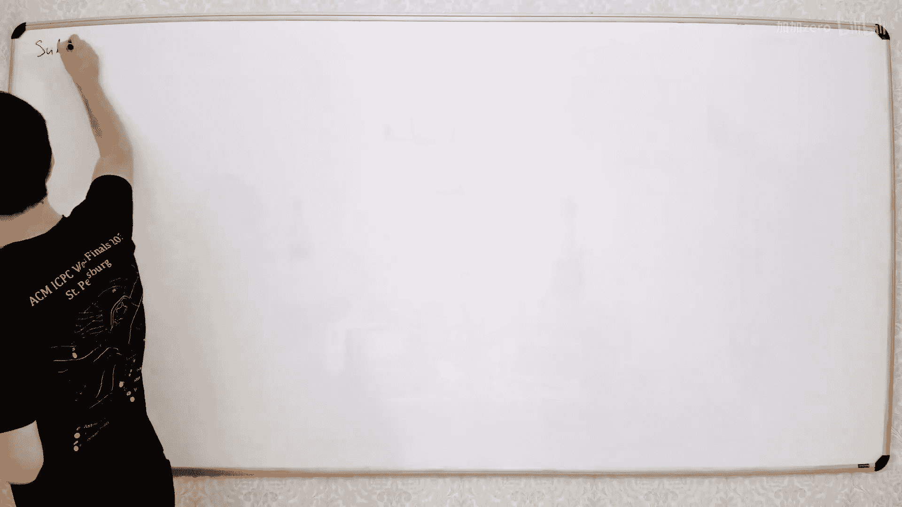

Nice， so what is the string string， basically a array of letters。

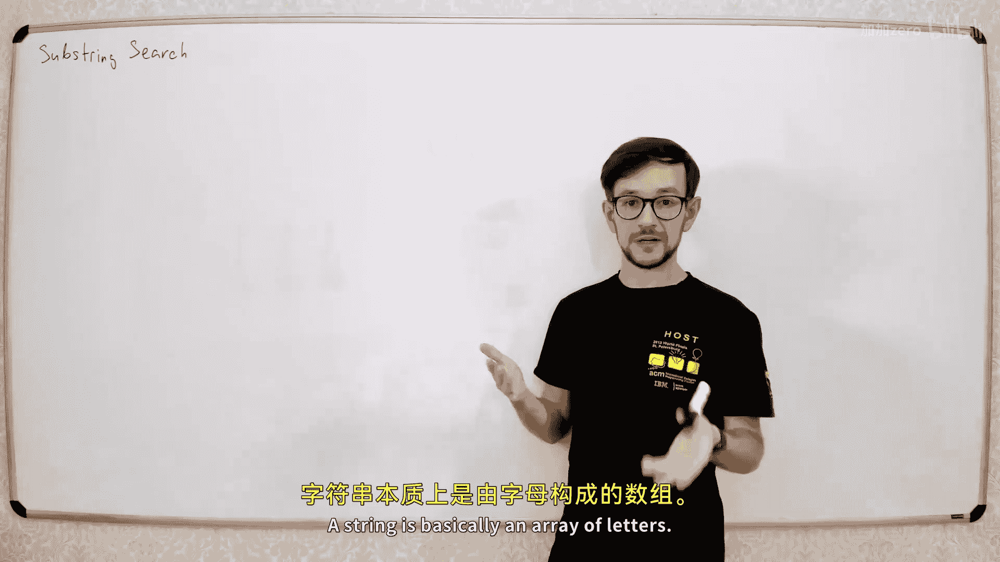

Sa your string。These jo let's say A， B， A， V B。Biansong。

So every string is just a sequence of letters。

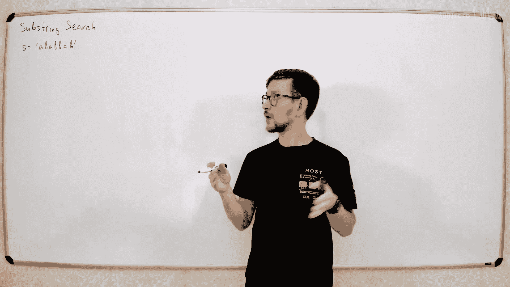

What you can do with the strings。 So basic operations just take any letter of the string。

 so you can get any letter in constant time just just like in array。 So if you have these indices，0。

1，2。5，6。You went they annual length that would just by index。And let's say， free。

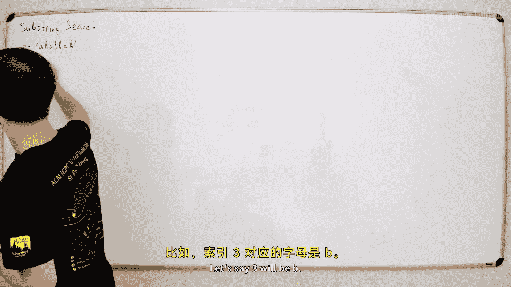

ビ。Some parts of the string have special names， for example。

 if you take first any number of first letters in the string。

 you will have some prefix of the string so prefix。

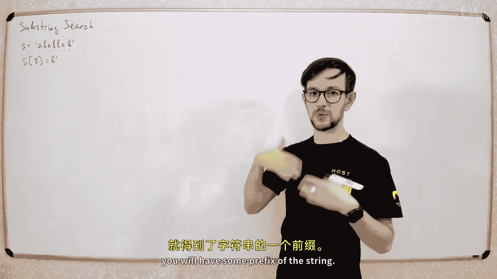

Of this chain。

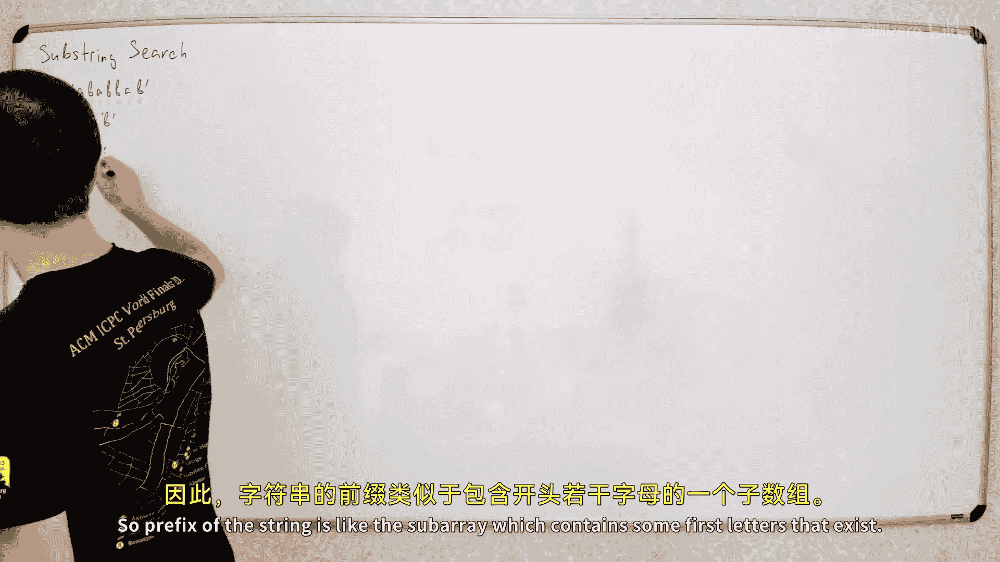

一思。Like the sa array， which contains some first letters and taste of some cic。0， to， sound and like。

I minus-1。So it will be the prefis of size N。 So if you take first eye letters of size A I。

 So if you take first eye letters of the string， you will have some prefis of the string。

In similar way， you have some lost letters of your string。

 So if you take some lost letters of your string， you will have some sacrifice。Let's see。 아이도。

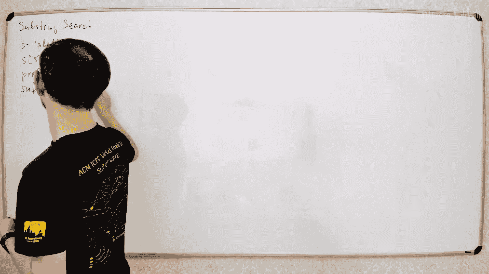

Every other sub sub is called a sub string。Some。系。그。If you take some letters from L to r minus-1。

You will have some substr of of your string。Let's talk about some interesting process of these fitting。

 So if you take prefi of any prefi， you will have some prefis。Yep， obviously。

If you take suffix of any suffix， you will have some suffix。If you take some suffix of some prefix。

What you will have， you will have some substream。 Yeah， if you have some string。

You take some pres of this string。And then you take some suffix of this prefix。

You will have at least。So any substr is a suffix of some prefi。Yep。And in the same way。

 So you can think about every sub string as a prefix of some suffix。 So you may take。

 you may take this suffix。

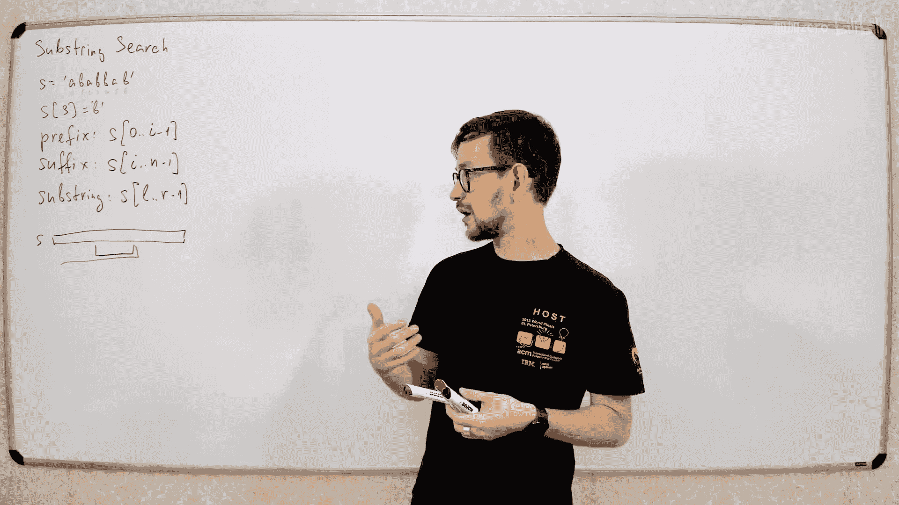

So your substrate string will be as prefi of this suffix。Okay。

That's just simple definitions of of some parts of the string。That's basically all。

 That's basically all we need in this。Segment about strings。没事。

So the problem well discussed today is a substr search。

 What is a sub string search problem The problems look like this， you have some big text。

Text is simply a large string here example。佢十个 stream。And you have some stream， say yes。

And what you often need to do is to find this string in this text。 So you you want。 So if。

 if you consider this text as a string， you need to find some substr of T， which is equal to2 S。

 So in this， in this text， we need to find some substr。Which is exactly the same as your string。Nice。

Okay， that's the whole problem， so we need to find some sunstr。Let's see for position I。

 So we need T from I。 Let's say the length of this string is M。 the length of this string is M。

So we need the substream from I to I plus M minus1 equal to string S。

That's the whole problem with trust me。Nice， so let's start with very simple algorithm。

 Very simple algorithm will just， let's do it in the brief force。

 Let's try to to iterate all possible values of I。 And for each position。

 we'll take this string and just compare the string with string S。 So we'll iterate our all。

Is from0 to n minus m。And then， check if。A string from I to I plus M-1 equals to S。

Then we simply turn out。お。嗯。Only if we didn't find anything， let's you return something。

Or a  minus-1。So if we didn't find anything here， we just returned minus1。

 so like there is no substrate equal to s。してぞ。It's a very simple algorithm in which solve the subsequent search problem。

Let's talk about time complexity of this algorithm。 What is time complexity in no， basically this。

Loop makes up to n iterations。 So you have n iterations here。

But this comparison to strings actually is not in constant time yeah。

 so you can compare to string in constant time， so compare to strings。

 you need to it all positions and for each position you need to compare to characteristics here。

 so this comparison to strings actually works in end time。So total and complexity would be。

And multiplied by M。Yeah， that's all， so that's the way you approach to solve this substance problem。

 it's pretty slow， but it's correct， right？So what we' will try to do today is to find more clever and more fast way to solve this problem。

That's the plan for this lecture。哦。哦。 so the first approach。

 the first approach to improve this time complexity is to use hash。Functions。So。

 you just be was cautious。What is the idea， idea is here。

 Most of these comparisons are actually false。 So if at some point you find some sub string equal to S。

 you immediately return from this loop。So the most time complexity both from the situations when you compare to strings and actually find out that these two strings are not equal。

So， it it。You spend most of your time just， just declare this。 These two strings are not equal。

How can we check that two strings are not equal using hash functions instead of。

Compare these two strings。 You can compare the hash functions of these strings。 So if。

You have two strings， and they are not equal。Vue， if you calculate any function of these ring or have some cash functions。

Will be not equal。So has function of B。嗯，嗯哼。Yeah， now we we simply find any accuracy so we need to find any occurrence of this shrinking in text here。

So if we find any instinct equal to else， we meet it to the term， that's the first。

First version of this problem。 You may have another versions problem。 In some problems。

 you actually need to find all kinds of testing。 So you need to find all possible positions of I such that this string will bigger。

 Yeah， we， we will consider this problem lately。 Let's， let's start from this problem。啊。

So most of the time， he。We will just find out that these string are not equal。

 So if these string are equal， we immediately return。 So if we。

We want to optimize the comparison of two strings in case then two strings are not equal。

 so how we'll optimize it instead of comparing these two strings。

 we will compare the hasshes of these two strings。嗯。So let's update it a little bit。

 so what we'll do。Just improve it a little bit。So what we'll do。

 we'll compare the hairs of these strings。Eve hassh of s teeth ro position， high to M-1。

Is not equal to hash。Ispecly it' if if is equal。So if cash are equal。と。Then will compare the strings。

응 응 응 응。うんうんうんうん。嗯。What case。So I just added this wine。To they everything else is the same。

And the idea is that usually if the strings are not equal， if if， if we find a good hash function。

Something good。啊。Then most times when we have not equal strings。And then the hashes will be a little。

Oh， my my better。I have application one week then。 My bit， my bit。Like this。Yepや。I will。

And no one noticed。啊。じゃ。If the strings are not， if these fishes are not equal。

Then the strings will not be equal。Right。Yeah， sometimes you， sometimes poor。Sometimes。

 you may have a。Two different things using having the same hash function。That's a collision。 Yeah。

 Sometimes collisions happens。Mmhmm。So we need to find a good cache function。

 we need to find a good cache function such that if two strings are not equal。

 then the probability here。sorry so if you have。Two different strings。Having the same has。

It's called collision。Yep。We talk about collision wind last year when we discussed hash tables， yeah。

そ プです。Some the number of possible values of cache function is less than number of total number of all strings。

 So collisions are unavoidable。 yeah， so sometimes you will have a collision。With some probability。や。

嗯。And。So this is the first problem。 The first problem is that if you have a bad has function。

Then you may have multiple multiple collisions。 So if， if you choose some bad has function。

Then you may have multiple situations when you have equal has function。

 but here actually you have different strings。We want to avoid this。

 so we want the probability of collision be as small as possible。

And the second problem is actually that if you want to cook here to compare this to has functions。

 we actually need to calculatec this to has functions and cculating has functions over string takes linear time。

 Yeah， so this calculation of has functions actually takes linear time。

 So we didn't improve anything。 So if we just take a sub string， try to calculate a has function。

 you need to iterate all heres of this string and calculatec the has function and similar here。

 Now here we need to。Immediately improve it， just calculating we need to hash function of S only once so we can calculate only once somewhere here so we can calculate it hash function of S as hash of S。

 and here just use this value Hs。So that's the simple improvement， again。So for string S。

 we need to calculate great fresh function of the only ones。But here。

It is much more complicated because here and on each duration of this loop。

 we need to go great flash function of some different streams。And。Yeah。

 each time it takes a linear time to calculate this ver function。

So we need some way to improve these calculation time。 So we need to find hash function。

 which can be easily recalculated when you move from one substream to another substream。으  긴 가 돼。So。

 so and now we also solve both these problems。 So we'll find some good has function。

 such probability of collision is pretty small。And it can be easily recalulated when you shift the position。

 so if you have hash function of this string， you can easily reculate the hash function of this string。

So when I move from this string to this string， I can recal this fresh function in go some time。

 That's the plan， good。Let's go。 We'll use preliminary function。 Pre function is very simple thing。

 So if you take us some string。Again， use string container of characters just a 0 S 1 and so on S and minus-1。

 Then the hash of this string。Will will be just sample in email mail。

Let's say if you if you just put numbers instead of characters for each。

 So each character can be specified as some。N right。

Usually you have some fixed number of possible letters in your screen。 Yeah。

 so you just just enumerate these letters from 0 to something yeah。So you just use this。

Characters ask coefficient of your polynoal。Haves S 0 multiplied by x power n -1 plus S1 multiplied by x power n-2 plus and so on plus S n -1。

X power zero。Now， if you just consider the polynomial。

 it can the value of this polynomial may be pretty large， so here you take the x power n minus1。

So if you just calculate polynomial as integer， the value will be too big。

 so what we'll do is to take this polynomial mod M。Take this one。我都话系。

I believe we discussed it last year， when we talk about。嗯。Cush tables， right。

So I'll just repeat the same thing。What is X， Good question。No。Well like which just cause idiot I。

Yes， we totally discussed it last year。 let's repeat it again。 When you choose the hash function。

 you don't want to choose one hash function。 You choose like the set of possible hash functions。

 So so these X and M will be the parameters of this hash function。

So when you want to choose the hash function， you choose the parameters X and M。

 and then you have your hash function。 So you don't have one hash function。

 You have like the big set of hash functions and you choose some random function from this set。

So how to choose this example， look， basically M will be choosing this random big brain。

How to find the random big parameter we will discuss in the next time direction。诶。

Usually it's not a big problem， okay。So it's it， it it's not hard to find the big prime number。啊。

And x will be just random number。うんとエマイのスはですね。Yeah， we totally did it last year。Okay。

 I'll just repeat the same。Now， I claim that these third functions will solve both our problems。

 so it will have the small number of collisions， and it will be easily here。

Why the number of collisions will be small， No， consider two different strings。

 So if you have two different strings。What is the probability？If you have two different thingss。

What is the probability that the hashes will be the same？Let's try to see。 So if you have two hashes。

 So these two hashes are two plannos。So we need to find two polynomials must have the same value。

 It is the same is the difference of these two polynomials is 0。

 So if you take the polynomial let's say B 0 minus B0。X power n -1 plus A 1 minus B1。

 X power n minus-2 plus and so on plus。A and minus-1 minus B and minus-1 at exp。まず必ジ了。Okay。

So just find these two polynomials and take the difference of these two plennools， right？

So this difference is a polynomial of power M。And if you have the value of plen equal to 0。

 it means that x is the root of this plenno。The root of the polynomial of power N for polymial to power N there is right at most n roots of the polynomial。

There more should be 0。So everything M Yeah， so I will assume it。In， in all future functions。

 I will assume this model and。Okay。I will ask you all all other calculations are made model M。Okay。

Nice， so it in in all future formulas。 I'll just I this model M just because all。

 all formals will have this model M。Everything everywhere we're working， we're working just in Mo。

Modelular M as。Thanksそ。X is a root of this plennomial。 plenno of power N has its most M roots。

So the number of possible values of x is at most n。And here， we picked some random number。

So what is the probability that picks sum root of this polynomial， the probability here。Will be。

No more than and。我啊。Something like that。嗯哼。So just by increasing the value of this them。

 we can make these probabilities as small as we need。嗯。That's that's the plan waste plan。

So the plan is to pick some big random number， big enough。 So this probability is small。

Now we keep some random value of x。응 哼。If you pick some random value of x。

 then the probability that you have collision of two strings will be something like that。

 so it will be small。So probability that we will go here and find out that these two strings are not equal is pretty small。

Let's home。's， that's the hope one。I。Okay。Now we'll solve the second problem。

 Second problem is that we need to be able to recalculate this hash function from this string to this string。

 So when when we know a hash function of this strings。

 we need to be able to easily recalulate hash function of this string。Again。

 it can be limited because these has functions is hash functions are polynoials。

So we can switch one from one polynomial to another polynomial just by making some algebra algebra。

맞 아 so。Let's raise software phone。What can I raise， What's is this。그 don就。Yeah 왜。Let's keep this。

A a statement。はい。So what's the plan， we know has function of some substratestream？

So imagine you you know the has function。Of some sub string。Of T from I -12。好似放闭。

So you know the has function of steam from I to i plus m minus1。And when we move from I to i plus1。

 we need to on the next it of this loop， we need to find the new has function x h prime is the hash function of T from i plus1 to I plus m。

やっぱりです。Well， let's just write down these two polynomial。 So this polynomial。Eese。Something like this。

 with tea。嗯嗯嗯I。I like these。ちょっとープって感シスてムで。啊。T I multip line by x。Power M-1 plus T， I plus 1 X M-2。

Plus， and so on plus T M， I plus M-1。Explsよ。So this is your pnoial and the next pnoial。

Will be something like this。 We need T I plus1。X power air -1 plus and so on plus。亲啊。

I plus M-1 X power 1。 I paid this marker。U plus G， I plus M X order like this。Let song。

That's the first polynoal， that's the second polyno mill。

And now we need to find a way to construct second plennomel from the first polynoel to do this。

 We need to find the similar parts in this pnoel。 let's say。 So we need to find the parts。

 which has the same。Good patience， right。So let's see here we have coefficients from I to i plus M -1。

 Here we have coefficients from i plus 1 to i plus M。 So this part。Is actually similar to this part。

So these two parts have the same coefficients， so the only change is the powers of this axis。

So to get this part from this part， we just need to take this thing and multiply it by x。

So always do the fold thing， so let's take the prenoial edge。At this bit I'm middle multiplied by x。

Now we need to remove remove。This item so so this item is actually so we'll multiply it by x。

 so it will be minus T。X power M。And we need to add this part。 So it will be plus T， I plus。

That's all。That's how you move from one billion to another。Hes clear enough。What fine。That's how。

 that's the whole idea of this algorithm。 Now， now， let's just write down the algorithm。

 So the algorithm works like this。 So play then。H S， again， is cash。Of string S。

You can create the first phenomenon with H S hash。Of g from 0 to n，-1。

And now you check for all positions again。And myた。And just compare this twos so if。

Herhees are the same。Then you compare the two strings。呃G from。From I to I plus M-1 equal to S。

 then return term。ああ。And then you move from this fish to the next fish， this fish is age。

 this is H prime。So you just say h equal to use this formal h multiply by x minus。

T I multiply by x power M。Bss tea。Eye blast。Everything model what happened。That's all。

 If you didn't have anything， that's your turn mind one。What what what not now not now。That's all。

 Best default article。Okay， let's talk about1 complexity of the algorithm。

 So what happens in this algorithm in this algorithm we sometimes so this line works in constant time。

Just one， let's put one here。So this line works in constant time。 This line works in。

But if strings are actually the same， then you finish。So what will be the dot down complexity。

So we made annierations。So we screw this land。N times。SoLet's see， so one plus。Here。

 if we go here and these two strings are not equal。

Then the probability of this will be something like this。

 So the probability that two strings don't equal is M or。嗯。Right。

 that's the probability that we go here and two strings are not equal。 It will multiply by M。嗯哼。😊。

And one last time， it will be gloss air。So so。So once we need to check the strings are equal and because they are actually equal。

 and then we immediately return。So he， so here this part will be something like one plus m square over m。

So， if you want the。The if you want the time complexity is small， you actually need to。

Take the am about。M square， at least。So here， when you pick the random big prime number。

 you need to this number to be as。at least m square something like this。

 if you want this algorithm to works smoothly。Nice， let's home。Noお。呃。Okay。

 let's just have some philosophical questions。So I I can make this probability as small as possible。

 So what if I pick a really big prime number here。 So if， if you， if I pick something like like。

64 beat prime number or or I don't know。128 beat prime number。 So it will fit in。In1 128。

 So if this number M is really big。So if， for example。

 if you pick M like about2 power 64 or even about2 power 1，28。

Then this probability will be actually very small yeah。

 so the probability that two strings different strings have the same crash function will be just just else so it will be that's small so it will never happen actually。

So if you believe your hash function is that good。At some obvious。

 you can actually believe that if you have two strings with the same cacheh function。

 you can just believe that two strings are equal because the probability of the has collision is that small。

AThat's it actually。Let's tricky your situation。Because if you make the algorithm。

 which relies on your hash function here the collisions。Then you actually make algorithm。

 which sometimes works。Incorrect， yeah， so if you just avoid。 So if you just。What I want to do。

 I want， I want to just avoid this conversion。I want to compare just two hasshes and don't compare these to strings。

해 조사를 만들요。Wellch just because if I compare to pressure and they are equal。

 I just believe that two strings must be equal because the probability of collision is that。啊。

Sometimes you can do it。 And actually in real programs， people do it all the time so。In in。

 in big string algorithms， there are a lot of situations when you can do it like this。

Because usually it's because thats the only way to do it。So in some algorithms。

 there's no people don't know any deter deter determinant。好，这さ。

So people can solve some problems without having tricks like this。

 so some problems to rely on the hash functions having in collisions。If you can avoid this。

 it's usually better to avoid this because you just made the algorithms， which sometimes may fail。

And if you make some critical system， you don't want your your algorithm to fail。Y。

 if you're building some something not that critical， building some I know。Something。I don't know。

Something like website unknown。So websites are usually also important。

 So if you building building some some recommendation system， something like that。 Yeah， So if you。

 if you once in a year will recommend some wrong song to somebody， it's not a big problem。 Yeah。

 it's it's it's bad， but it's not at the end of the world。

 So if you're building something not that important。 it's。

Almost always okay to use something like this。 If you just want to optimize the productivity of your system。

 So if you're making something。Some algorithm which I will optimize the workflow in your system。

 Then if you optimize it， not very good rate。 So， it's not a big problem。

 So it will be not the not not as optimal as it could be。 But it's not a big deal So。

 So sometimes if your system is not that critical， you can， you can do it。Without any second thought。

 But sometimes if you make something really critical。

 you you want to kind of avoid situations like this。Mmhm。😊，哎对。😊，Okay。

 so some philosophical part of this lecture， let's move next。😊。

's actually let's talk about this least tomorrow。Actually。

 this technique is that powerful that not only because you can do a sub search。

 because if you believe your has function to no collisions， you may do even even more。

Even more cool stuff。 Let's hold。Let's do something even cooler than this。

 So what you can do with hash functions， you can calculate any hash function of any substream in constant time。

哦。What I want to do， consider some stringing， we have some strings。It's also network working。

Perhapsps some string pests。I want to be able to calculate the hash function of any sub string of this。

 So I want to calculate， let's see hash from L to R。

Will be the has function of sub string from L to r1。

And I want this function to work in constant time。Let's the plan。

So I want to be able to calculate any hash。Function of any sub screen。Comp in some time。Now。

 how can I do it， You can do it after the linear temper calculation。So what you can do。

 you can precoulate。The has function of all the pre of this thing and put them into a array。

 So let's say the array。感对的开始方式。Of pres。Yes。From 0 to i-1。

You can precculate this values in linear time。Yeah。Is it obvious or should I write a code。

 Let's do it Let's write code。 How to preculate all these values in linear time。 No it's pretty easy。

 So you have the cache function of some practice。Hsh function of the prex is just a polynomial so we have this polynoial。

And you want to build this plate now。Do you want to add one more later to this bin logo？Okay。

So how to calculate this next plennol， you just need to take this plennol multiplied by x and then add this last characters。

The P I plus1 will be just the previous pnoome multiplied by x and add this last element。

 So this alignment will be S。Oh like this。嗯哼。So you can calculate all these hasshes in linear time。

That's cool。Now， what to do this early。 So if you know the hehes of all the pres of your stream。

You can calculate this the hash function of any substream。

How to calculate cash function of the sub string。So you have this up。You want to have a polynomial。

 which contains all these coefficient。 So let's take the polynomial， which。

Reponse to the right side of this observation。Let's take this on now。

This pnoial has all the coefficients we need here。But here it has some extra coefficients。

 so we will we need to to eliminate this part of the polynomial。

 And but this part of the polynomial is basically this fish。So we'll take this big polylennoial。

And subtract this small panom multiplied by some x。So if you calculate hash function。From Lと R。

You need to take this pan for this soft string suit will be PR。

And then just subtract this small polylennoial PL。Multiplied by the difference of the powers。

 Yeah so these coefficients have different powers of x。

 So just to normal extent you need to multiply this perl by the x。Power。

 the difference of length of this belong。 the X power are minus low。这错。And order。

 by using this formula， you can calculate the cache of any substream。

That's kind of cool because when you can calculate the cache of any substrateing。

 you can compare two substrates。You can take any two substrate strings of your string and compare them。

 Are they equipment。And that's quite powerful， actually。嗯。Nice。I。One final part。

 Sometimes you want to do something like that。 You want to compare， for example。

 you have some set of strings and you want to find the number of different strings in your set。

So what you can do is to put all your strings in the set and then find the size of the set yeah。

 but if strings are large you do not to do this instead you can just put the hashes of the string in the set。

So if you put case strings in the set。And then check the size of the set。

So if if you have some set of strings， yes， yes one as two and so on as car。

And then you calculate the hehes of this string and put them in in the set。Let's make this set。

Of precious。Of a line， yeah。So let's go fresh from every and put all all these freshes into set。

What would be the probability that you have no problems？啊。I got it it。Again， the， let's。

 let's say the probability of single collision is P。

what's the probability that you have at least one collision in this set？啊。Again， in this set。

 you have case square pairs of strings。And every pair in this set may have a collision。So。

 the probability。Probability of at least one collision。对对。In the set。Will be about not exactly， but。

If release is small， it's quite。Good enough。 So it's about case square multiplied by P。

So you need to be here here need to be careful here since you have case square here。

 it grows across pretty fast。 So if you even if you have some thousand string in your set。

 the probability will be multiplied by a medium， if you have a million string in your set。

 probability will be poied by some trillion yeah so the probability cross here pretty fast。

 So you need to be careful here。 again， if your probabilitybil is really small。 Like if you have。Or1。

2228 B prime number。 So it's it， it's usually not a big problem。 But if you。

 even if you have 64 B prime number， here you may have some problems。So you need to be careful here。

 just。Just a small mark about this。Next。Now， let's move some on。

 So So this this algorithm is pretty powerful。 all this technique about fresh functions is a very powerful technique。

But it uses some magic。 So we use some random， randomness。 So sometimes it works。 Sometimes it's not。

 this time complexity is not。It's not real complexities like expected complexityities and so on。

 So we will now will move to other algorithms， which has， which has no。

 no random functions and no magic， just standard。奥得夫司。

So the first I'm going from we'll discuss is the clueor part algorithm。왜 it？

One of the most classical over about strings。Responsibly reason。Yes。

 I believe could actually equipment invented this already。It's the same cloth， which， yes， yeah。

Let's go。 So what is not much pattern because Vi particle part is very simple。

 actually very simple linear algorithm which can be used to find the substrate string。

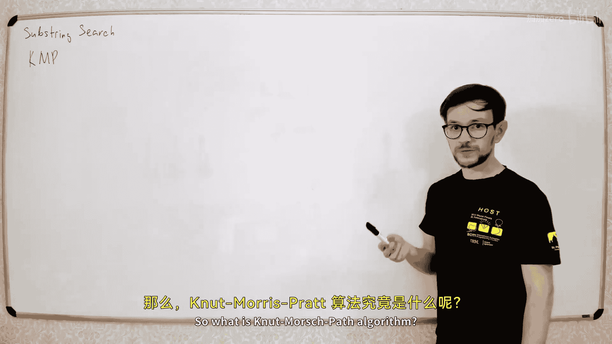

The core idea of this algorithm is to use some pre function。

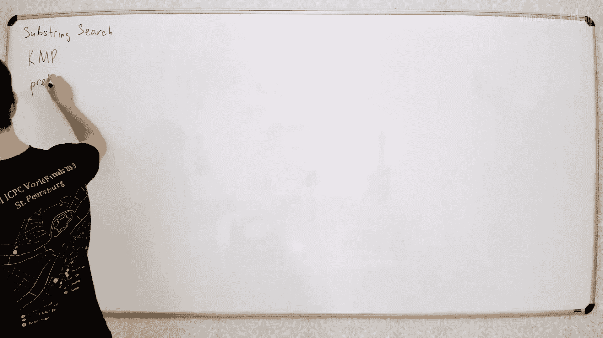

Or I should multiply know， I already eraed it， sorry。Let's move on。You're going to re the lecture。

Later on working。啊。So what is a perfect function， B function is very simple。Let's call the prefix。

 Let's call pre of S。He is the largest thing， which is both prefix and suffix of us。嗯。

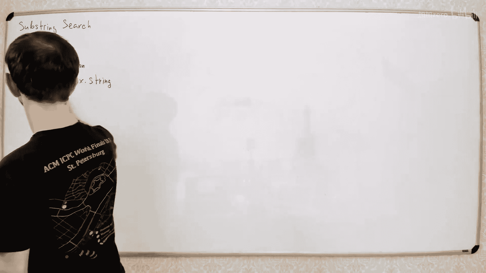

。And。Six。Oice。And not to good。So， for each。For the string， we need to find the largest string。

 which is not equal to the whole string S， but which is the prefix of this thing and also the s of this string x。

Just draw some pictures， so we have this twin S。We need to find some sub string， which is here。

And also here。Y。So this will be the。我好。Sorry。Okay， no， let's let's try。 So， for example。

 printer let's say。Of something like a。B， B， A B。So if you take string like this。

 the largest string which is both prefix and six is AB， so we have AB here and AB here。

So the bread function will be a。可以。嗯。Let's say， for example， breakfast function of A B， A B， A。

What will， what will be， what will be the previous function of this string。Okay。

 I have like 30 seconds delay， so it'll just。Make samples。

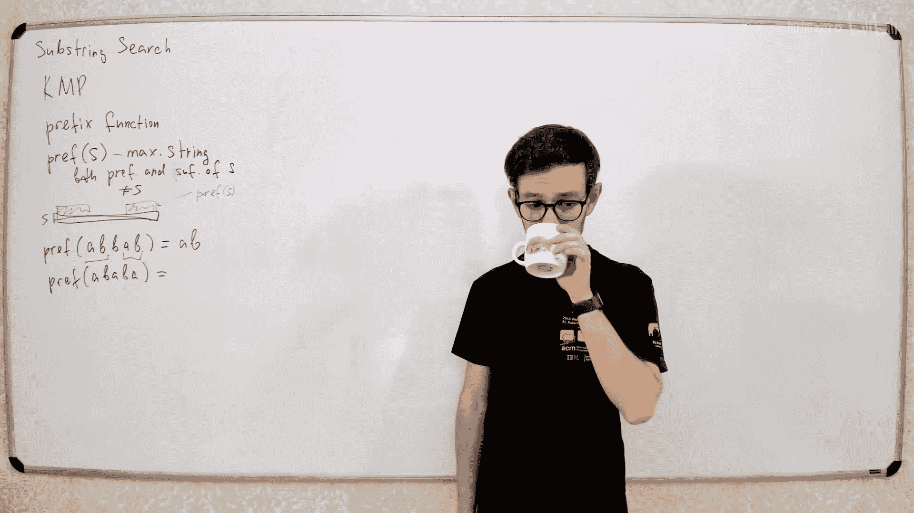

エビなイ。そう。So this pre and suffix make actually overlapip so， so we have this ABA and this ABA。

They are waiting， but it basically。 We allowed these two strings to avoid。No。For example。

 pres of say something like A A BB。So for these two strings， there are no string。

 which is both prex and statics， so prex function will be an energy string。And what is。Finally。

 the graphics function。Of分 damage string。Just five seconds。Which is deadestest？こ。

So the perfect function of an empty string will be not defined。

So why it's not defined because we want to find some string， which is both perfect size。

 but not equal to S。 So empty string is equal to S。

 so we don't want the perfect function of string will be this string itself。

 perfect function for empty strings is just not defined。N。

That's all we need to know about preference function。Okay。Now， the next exercise， the next exercise。

 I imagine you have some strain。And I want to find all possible strings。

 which are both products and s of。Imagine you can calculate this prex function。

What is I want so I want to find。All strings。No strings。Which are both。Both graphics and s of。

So pres function just gives you the largest such string。

 So what if we need to find all possible preview。The prees and ses of these act。

How can we find all such？Stt。Now， you can look like this。

 Let's try to iterate all such strings by decreasing the length of the string。 So first。

 let's find the larger string， which is both graphics and subjects。

It will be just the breakfast function of this。Just take that。Lest drink here。So this trip is just。

Rear fourth vest。So' still working。嗯哼。😊，So this this is the largest string。

 which is both perfect and status of S。 So now let's find the next string。 So the next string here。

Must be equal to this。So how to find the next string， which is both pres and suffix of us。

Oh it seems to see just by this picture， so this next string must be a prefix of this prex of S。

And also must be a six of this string， Yes so， So this orange string is the pre of this violet。

 I believe， string and is also the six of this viole string。I am not sure if you can read the colors。

So， this function is both graphics and sffix of these while string。

So it will be the brief expansion of the pre expansion of S。Not this。And so on。

 if you want to find the next thing。Again， it will be the pre of this one and suffix of this one。

 so it will be perfect of prayer， of prayer of us and so on。

We just continue to upload this previous function。Of believe of believe。Oice。有。

W shall continue to apply this perfect function， you will find all the strings which are both perfect and s of S。

Nice。That's all， that's how we do it。Cool， now let's move to the algorithm So what is the K parts algorithm Cl most particle algorithm is basically building the prefi functions for all prefaces of string S。

 So given the string S。And we will calculateate the pole window。Save some space here。

So what I want to do， I want to calculate the pre function for all prefaces of string S。

So I give the string test。And I want to calculate the array P off。I will be there。Prefis function。

Of the pre of size I is from 0 to I -1。Therefore， basicallynot more algorithm than though does。はい。

So given some string and you want to calculate this array of perfect functions。Oh。First of all。

 first of all， I don't want to have this array as a array of strings since array of strings has to use too much memory again。

 so instead of having this array as array of strings。I only need to have a length of this string。H。

No since let's see here， so I want to call prefix function of some prefix。

So prefix function of sub prefix will be another prefi of S。嗯哼。😊，Since prex of prex is pre。

So this perfect function also will always be some pre of string as。😊，So to define some prex。

 you just need to the length of this prex， so instead of having this pre function as strings。

 I will have only array of integers， so I will have the length of preex。For example，s。

 let's build some strict lists have some string。 Let's say it again， A B。B A A， B， B A B， and so on。

三 likeて。Now， what will AP look like？嗯。Was kept some in。Have inice is0，1。5，6，7。とない？

So what will be P of 0。 P of 0 is the perfect function of an empty string。

Pific function of empty string is not defined。So we'll put the here minus-1。

It turns out like -1 is a good radio。Just for just for implementation reasons。Now， here。

P of one this perfect function of string of one k。 It will be an empty string。

 So So P of P of one will be 0。Now， preference function of A B is also an empty string。

 so it will be also0。 A B B is also0 now here。Here go here string A， B， B， A。 So the largest string。

 which is both perfect and s of this A， A， B， B A。ABB。E is a。 So a is the largest possible string。

 which is both prex and subjects of A， B， B A。 So perfect function of this prex of La4 is one。

Here are the same thing。 So the largest thing， which is perfect specific is one。Here theres two。

 since we have seen A B。 So for these graphics。We have string A B here， and A B here。

So it's lengthless stool。Here them map is free。Here again， we have a。And here we have a。

 So the length will be 4。And finally， here， the largest wing will have size2。Since。

 we have string A B and string A B here。Okay that's the whole thing。

 So we now we will build the algorithm which makes this array from this string in linear time。

 That's the whole one。嗯。So how the Kpi algorithm works。

 we just go from left to right and calculate this values from left to right。

 so we'll just go from left to right and each time we take some position and calculate this value using some previous calculatedulated valuess。

So how to calculate the next value of P， I say again receiveless。So let's have this string S。

 and we want to calculate value of P。 So value of P is the perfect function of string of first I characters So first this is I。

So I want to calculate the pre function for this prex。

Preffix function of some prefix is the just some string。

 so I need to find this string equal to this string。嗯。So when I want calculate value P。

 I want to calculate a prex function for this prex。嗯哼。😊，Prefex function of this pre is some string。

 which is both here and here。 So I need to find the length of this part。

 which is the same here and here。嗯哼。😊，Now， let's take this last character。

 so let's take this last character here。If we just remove the characterttle from this string。So。

Let's take everything except this x。 Let's take this part。It will be the same。 here and here。

And this character X should be the same here and here。Like this。

So your perfect function contains two parts。 you can deal at this blue string。Plus， character X。嗯哼。

Now， this blue string is actually a perfect and suffix of these。Perfis of size， I-1。

So what we need to do。We need to find some string， which is both pre and six of this pre of size I-1。

And we need to add this character X to the end of this So。 So we need to find such string， which is。

Same here and here。And also， we need to check that this character X is equal to this character X here。

嗯。第着呢。Let's the one。So how to find the strings， we will iterate all sub strings。

 which are both pres and six of this pre of size I -1。Just it for all of them。

Until we find subspring， which have character X here。

And when we find sub some string which has character X here， we'll find the loud possible string。

 which is the parameters and suffix of these graphics。That's the hook one。 So yeah。

 we will eraerate all all the substance using this technique。

 So I will start by taking the pre function of this prex of size I-1。

 Then I will take perfect function of pre function and so on。

 So I will era all size strings until I find this character X。

We just stop saying that everything is clear， so I can hear say。The same。Think over and over again。

都行。退个。What's the plan， Let's take this prex of size I-1。 Let's take the pre function of this pre。

It is already calculated， so let's find the largest string， which is same here and here。

If we have character X here， then we can use this string as a perfect function of perfect I minus-1。

If so if character X is here， then we have this string equal to this string。

 if we have some different character here， so if we have character Y here。

Then these two string are different， so we need to find some small string。

 So let's take the pre function of this pre function and find the next string。

So we'll find the next thing here。So this trip will be pre of。Of I -1。

 this thing will be pref of pref。This lets B。 Let's just use B。So this will have p of I -1。

 This will be p of p of I -1。Let's take the next string and check this character。

 If this character is X， then we we can use this string is because it is the same here。

 If here we have some characters Z。 Sorry， again， these two characters are different。

 Let's take again， Let's take perfect function of this perfect function of this perfect function and use small string。

Until we find character X here。So if we have character X here。

 then we can use this string because these two strings will be the same。What's the whole plan。Nice。

What's write account。 The code code is really simple。 So we will。Will say the right P。

 Lets say P of-1 is。M0 of0 P of 0 is -1。 Then we generate our all values from 0 to M。From one to。

뭐히 값 빨 오요。Now， let's take the delivery of this string as some variable K。 So first save K is P I-1。

And now we just iterate all these strings until we find the character。 So while。

K is non M sorry while we did finish I， so when we move from k So in the last it of this loop。

 we actually will move from0 to minus-1 and we will end this loop。So if while can is not0 and。P ends。

T imposition， K。So K is the length of this string。 So this indexdice is R from0 to k -1。

 So this character index K is not equal to S I -1。Just continue。Do the next。Breakfast。Like face。

talk about time complexity， it's actually concerning a time complexity ruless discuss in the moment。

So we continue to the next string and when we stop。

 then we either have the k equal to -1 or we have some string so that we can add the next character to this string in both cases。

P of I should be able to keep what up。That's why we put -1 here。So we don't have extra if here。咩gan。

We end this loop in。In two situations， when we find some string， which have character X here。

 So we add this character X here。 So so the length of this string is K。

So if we add this character x to this string， the length of this string will be K plus one。

And if we just get get if we tried all these sub strings and none of them works。

Then the result must be 0， since we cannot add this x to any sub like here。 So the result must be 0。

 but willll n of k equal to -1。 So we add1 to this -1 and we'll have 0。It's a small trick。Nice。

That's all。 That's the whole KNP algorithm。Very simple algorithm。 Just five lines of code。

 You connect me。 I believe you can optimize it to like free lines of code， but that on。Now。

 let's talk about tank complexity。 I claim the tank complexity of this algorithm is linear。

Let's prove this。Why complexity is leaner。Everything here is linear， except this one。

So everything except this while is actually linear， quite obviously， right？

So what we need to prove is that the total number of iterations of this loop is linear。

How to prove the total am of this source， Let's look at the variable K。Let's look at variable K。

 What happens to this variable K in this while loop。The value of variable K is always decreasing。

 So in this while loop K is always decreasing。On each generation。

 we've moved to some value to some smaller value。 So pure case， always strictly smaller than k。

Now what happens to variable loop when we move from one iteration to another direction。

 so when we move from here to here。SoWhat's see。What we do here， we put value K plus one。두 번째 아이。

Then we increase I and take from the same cell of this array。 The value of K。

So simply we we we take some element of the array， put K minus-1 here and then take from the same element evaluate value k。

 Yeah， so basically from when you move from here to here， the K will be increased by one。

 you may keep what plus action。嗯哼。😊，So the value， the value for April K is increased by one in every duration of this loop。

But in every re of this wild loop， it is decreasing。So you increase the value of k at most n times。

 and you decrease this value in everyeration of this slope。

 So we cannot decrease the value of more than n times since you increase it only by n here。

So the total number of decreasing of this variable K is at mostly n。Okay。That that's why it's leaner。

No， another way to think about it is just to look at this length okay K is basically the length of this string。

So what happens to this stream so every time you have some streams of in the previous direction。

 you have this stream。So the length of the string is basically key。

So what you do in this in in this algorithm， you try to decrease this spring until you find。

So you in this while loop， you decrease this string until you find sub sub string。

Which has the same character here， and then you add this one。Extra character toast。So basically。

If you look at the left。Border of this string。It's like two pointers metals here。

 like like nurses or something like that。 So every time in this while loop。

 we move the left border of this string to the right。

And we can move this LED bottle to the right mode than end times。

 So the total number of iterations of this while loop is actually linear。Again。

 it it's the same like in two point those met。嗯m哼。😊，Nice， so this one is linear。 So yeah。

 we will build， build some linear algorithm which constructs this from string test。Now。

 how to use this algorithm to find actually we forgot about the problem we're solving。

 we tried to solve the problem of subs search so how to apply these algorithm to find the substreams。

The easiest way to do it。Again， we have this text。And we have a string。Let's make it smaller。

So we have a text and we have a string， and we need to find some substr here。Es to us。

So how to do it using Kmp algorithm， the easiest way。Easies way to do it is just like this。

 Let's construct one big string from this string So。 Let's construct the whole string。

 Let's take string S。Then add some special character here。And add the text here。

So let's construct this string， let's construct the long string using this S and T and just split into some special character which is not cur in these both strings。

Did you take a look。What， what what。What， what look。嗯。You they me something。ああ、それ。Now。

 let's build this long string and then build the perfect function for this string。

 So what happened if you have。So if you have string S here。

So if you have here a substrate equal to S， then for these pre。You will have graphic function。

So for this eye。You will have perfect function of IL P of I。ReGo to be。Equal to them for string S。

So if you need to find a substr， you can construct this string， then apply MP algorithm。

 build their A， and then look at position when the size of this pre function equals to length of S。

 So if the size pre function equal to length of S， then you have this string equal to to string S。

That's all。Good。그벨립터스 레스섹도보 그 그벌 파。Okay， very simple， it's very fast。 It works in linear time。

 It's very small constant fraction。s very usable algorithm。

 not not only for subsequent string search， but for multiple articles。

 So we'll discuss some other user usage of this algorithm in。

Btterest problems in the practice next week， maybe。Maybe next week， maybe in two weeks， will see。

Nice事。So I want to discuss one one more algorithm。Do we have time for this， I believe we don't。

So let's discuss one more algorithm， which is also useful and also works on。In your time。

 it's slightly different。But it's also quite important for some substrate algorithms。

 So let's talk about that algorithm。응 응 그렇지。入てほしい。It discuss Saix race。 Yes。

 we will discuss suffix race in later lecture year。

We'll discuss live both ethic arrays and s streets in thiscourse， again。啊。A what Yes。

 you're actually，'s discuss it， let's discuss it in the phone desk。

 you're going build a firing data auto from this function。Yes。

 you can think about this function P as a function for your。F final data冇。よ 여건ど。

Let's discuss with industries。It's， it's actually quite cool。 You can。 you。

 you can use it as a states of Finn state autoton and then use this autoton to apply some dynamic programming or stuff。

 So yeah。😊，We will do。嗯。거 yeah， let's talk about that。So what is the that， that very actually。

Strange name for the algorithm and boxeses。Maybe here is really strange， but。

You're given some string， again。To give some string hair。What you want to do is calculate a reset。

Which is kind of the same as A， but。Slightly different。So what will have in position I。

 So what you want to do， you want to take the position I in your stream。

And then find the longerest string， which is the same here。And here。

So you want to start in position I and find the longest prefix of string S from this position。😊。

Let's say it will be maximum okay。Such that string from 0 to k minus1 is the same as string from I to I plus k minus1。

It looks kind of the same like prefix function。 Yes。

 so but you calculate prex function in the end of this string。

 So you will calculate the same value here， right， So when you're standing here。

 you will find this string when you calculate prex function。 But in that algorithm。

 you want to calculate this value when you're standing in the left side of this string。😊。

So kind of the same thing。 but looking from the left， but not from the right。

So he use aテ technique to go it。嗯哼哼哼哼。哦。It's like lectures， so it's right。I love widely interested。

出ってこす。Don you have to just。Tell about algorithms。 We just， we just。Having a conversation， right？

You can't drink tea when you're writing an online course， but you can do it in live lectures。 That's。

 let's go。Whatever you can。 so so that's that's， that's that's the problem。 We have the string。

 and we need to calculate these values。 And we won't calculate the first in linear time again。告。

So let's start again， let's start with very simple algorithms， so how to create various values。

Slowly。let's look like this， so we'll iterate。Over all values。Yes， that of0 is kind of strange thing。

 So that of 0 is is。Strange really， we will not use Z of 0。 So that if you start from I equal to 0。

 it kind of just by definition， it should be equal to n。

 but it's kind of strange to have the Z function of 0。 So we will never use Z of 0。

 So we'll start from one。4 I from 1 to M，-1。And' say aim1 minus-1， we don't have text this head。

So let's go from left to right。And try to calculate these values。

How to calculatelate this radio again， let's see。嗯。No， atless we like this。

 Let's say that I equal to 0。And loan deal will just increment by one。

While we have the same character here。And here。We just incrementalement right。嗯。As simple as that。

This， this is just just the na approach to calculate the Z array for the given stream。

 but it is slow， yes。Again， this is quadological algorithm。 so this while may work slowly。

 you may have。First of all， if if the whole string contains the same characters， then each time。

You have the same character。 So you will you just go from 0 to the maximumim value。

 So total and complexity will be n square。And now， we will。C supplies small trick。But it small trick。

What I will try to do is to initialize this radioium。So I want to skip some characters。

 which I already know to be equal。How to do it。Draw a big picture。So I have this string S。

 I have this position I here。嗯，哼。I have this position， I。

Let's remember so I already calculate all all the values from 1 to I -1 so so for all these positions。

 I already calculated the value of the Z Okay， so what I will remember。

 I will remember from all these positions， the largest block。

Go going to the largest position to the right。 So from all the complete positions。

 I will remember one position。Which have this string as far to the right as possible。6。이건 또。

So I want these string to be equal to this string。And from all these positions。

 I will remember the writing one。So I want this as the this scale。 So I won't remember L such that。

L plus that at L is as max possible。From all positions，From 1 to pi 1。So this is L。

 So this position is L plus that of L。So it's easy easy to maintain this variable right。

 so you just calculate for all positions this sum and take the maximum value of this sum。

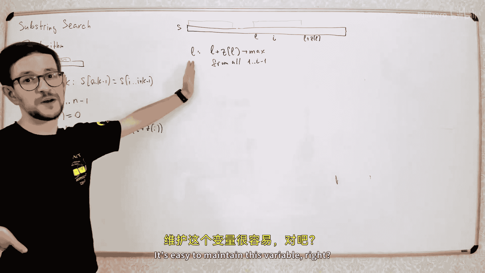

Nothing interesting here。But what's interesting here， let's see。Let's see。

 Let's look at this position I。So this。Part of this string is actually equal to this part of the string。

And what I want to do what I want to do in this algorithm， I want to compare the string。

 the characters from position I to the right to the pre of the string。

So I want to compare these characters to the pre of this string。But if I have。

This here less equal to this prex。Then， I also have。These characters echo to characters。不。So again。

 these characters are same as these characters， and these characters are the same as these characters。

 And this position is actually。😊，アイマイナス。So I want， So what I want to do。

 I want to check the position I minus L。 Check the Z function in this position。

And just use all these characters。Just to skip all these characters when I calculate this initial value。

嗯哼。So how， how many cars can I skip。I want to skip at most that of I minus L characters。嗯。At most。

 that of。I my not。And also， I want to skip at most the size of this red thing。

 because when I reach the end of this blue string。I have the different characters。

 So all these characters equal to these characters and these characters equal to these characters。

 so I can skip more than this。Many characters。 sold I want to skip that。At most。L plus Z L minus Pi。

So this maximum number of character I can safely skip。 So again。

So get this number of characters is the same are the same characters here and here。

And these many characters are the same in this position， and in the pre。

So if these characters are the same here and here and also the same here and in the pres。

 then they are the same here and in the pres。So this number of characters can be safely skipped。Yes。

Actually， not like this。 You need to thick。You actually need to also do it like this。

I always forgot about this。That's actually important。

Because sometimes you can't have a negative value here， but it's just。Small implementation details。

No this value can be negative， so if you have to apply this。I have negative value of that。

 You don't want to have negative value of that。诶。That错。Second， what we do。

 we skip all the characters we know we equal。Now， we just apply this separation like before。

 And in the end， we update the value of L。嗯。Sa。衣服。I plus that I is more than。

L plus Z L then just a video。Yes， I also， you also need to do some trick to find this first value of that。

 There are different ways to do it。 So when you calculate the first value of that set of one。Yes。

 you you don't have the previous values。 So L is unde definedfined。 So and tricks。 you can do it。

You can do it as an exercise。 Okay， so the first value of Z can be must be calculated slightly differently because you don't have all the previous values。

 You can deploy this。You can do it very。 So be okay， you， you can do it。

It it's not that important so。没。Let's the hold that。Now let's talk about time complexity again。

 I claim that time complexity to free algorithm is linear。Why this linear。 Now again， like this one。

 everything except this while loop。Works in linear time。

 So we only need to think about total number of itgererations in these wells。

Everything else is linear， So we only need to consider this while。Now。

 what happens in this envelope loopbe， I click what。不's行。Lis see。Why first。

 let's let's think why we actually can go in this while loop。

 So what happens if we go in in this lap loop if this green string is actually shorter than this red string。

Then we have some character x here and some character x here。And when we calculated this value。

 I I minus l。We actually stopped here。 So this character is not equal to this character。

 So here we have x and here we have y。Again， if this green string is shorter than this red string。

Then we have the same character here and here and different characters here and here。

So when we calculated this， that function， we stopped at this characterter。

So we will stop at this character as well。So if green swing is shorter than dressinging。

 we will not make any duration in this。W， yeah。So we'll just check the first character and immediately skip it。

So we only make this while loop when this green tree。G single cost comes to these positions。

So the only way we can do it is when you have something like this。

When you have blue string to this position。And boost into this position。

So you may only have the durations of this while loop when you reach the end。You。어 어 어。

So the characters here are different， so here are x and here are y， here's y。This is L plus Z L。😔。

And these two characters are the same。This is the only way。

 How can I get any iterations in this world。So can these two characters must be the same。

 so these two characters must be different。So it just stuff from here。That' all。

And what happens if you have any duration in this file。 So if you make a duration in this file loop。

 it means that you extend your Z block。To to to the right from this position。So。

Yours block will be from here to here。So every time in this one looppe， you actually move the right。

Border of yo。How in the book。So every time you move this。You increase this value of that I。

 you move the right border of your block。But since you extend this right border of the current block。

Your block will have the larger sound than than than the the block of L。

So if you make at least one it here。It means that。If you make at least one iteration。Then。

Your value Z I plus I will be more than the value Z L plus L。Okay。嗯哼m。😊，But it。

 it does mean that you will update the value of L here。So you will update the value L of L here。

 So your sum that I plus I will be the next sum that L plus L。 and you increase this sum。

In every duration of this loop。 So in every duration of this loop。

 you actually increase the value of that I。Bale。This all。

 the value of Z L plus L should be no more to n。So you can't make more than two anyerations of this loop。

有说。So total think complexities layer。Again， the proof。

 if you make at least one direction of this loop。It means that your your character here is the same as the character here。

But in position I minus L， you had two different characters。

 It means that you reach the right end of this blue block。

If you reach the right end of this blue block， then your sum Z I plus that I will be more than some L plus that L。

So you will update the value L here。And also in every duration of this loop。

 you increase the value of that I。 So the total sum is the L plusza L will be increased in each duration of this loop。

This sum should be no more than 2 end。So actually no more than n。

So you make no more than any of this while look。That's all。Yeah。

 basically you move this right boundary of the string to the right。

And you can do it more than1 times。Again， its like two pointers method， but from different side。

And again， how to use the z algorithm to find the substr， you can do the same thing。

 You just take the string S。Make sharp。String T。 And again， in this string。

 you calculate the Z algorithm。 around that I calculate a function。 So if you。

Had same string here and here， then in this position。You will have。Z of I equal to M。That's all。

Just another way to think about substances。Okay， this both。

 can get this both algorithm K P and that algorithm do kind of same thing。But from different sites。

 And so sometimes you， for some problems， it's easier to think about graphic function。

 for some other problems， it's easier to think about that function。

It depends on just the statement your problem。 Sometimes you use this， Sometimes you use that。

 These two arrays can be actually easily transformed from one page to other。

 So if you have a from K algorithm， you can build a array that from that algorithm。 And by。

 if you have this array that， you can build a and so on。

 So it's kind of the same array just we view it from different sides。

We will do it in practice next week， okay。W， the soft thing。

