# 【精译⚡算法与数据结构】PavelMavrin p42 p41 A&DS S03E10. Finite State Automata -BV1NLB8YfEMq_p42-

🎼。

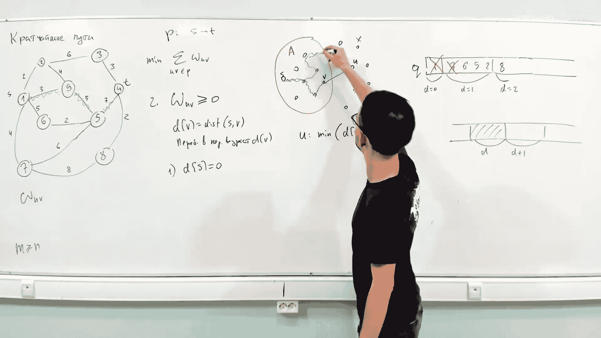

F night steak， automatta。

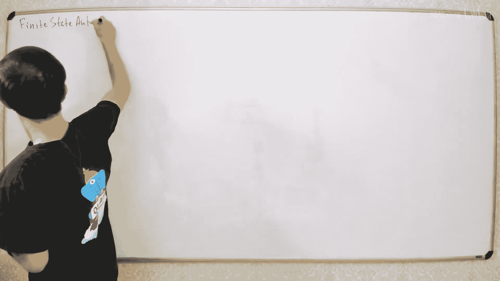

So what is it， how to use it， That's not the main topic of this course。 So there is another。

In other lecture courses， which covers all all these strange theory of and like about formal languages and also in this course。

 we just。C some basics about what is finite set automatic the and how to use it in algorithmic problems。

So finite amount will basically grab。

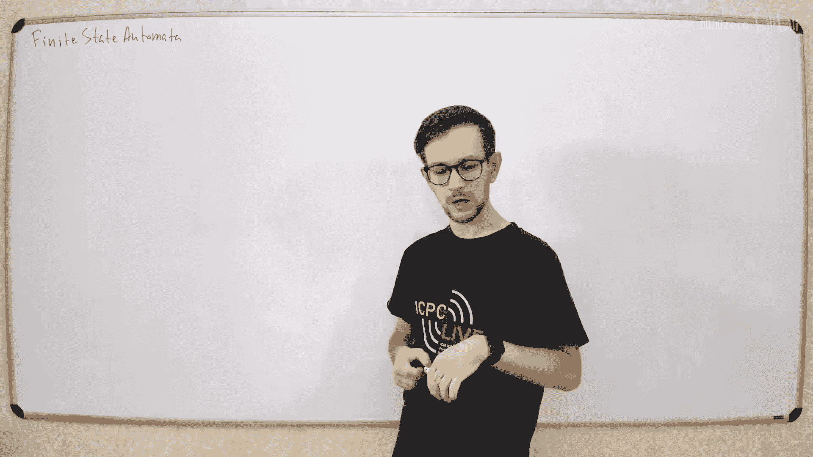

Which contains some states。So it's the graph， so each state is basically a vertex of the graph。

Something like that。

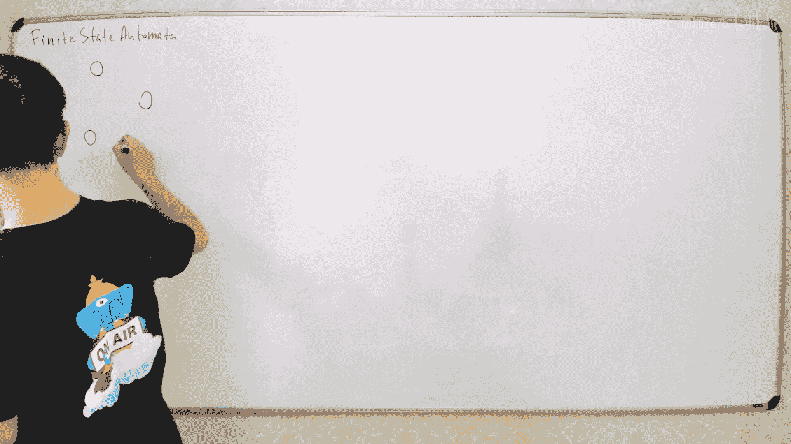

One state is a starting state， one state of marked is a starting state。

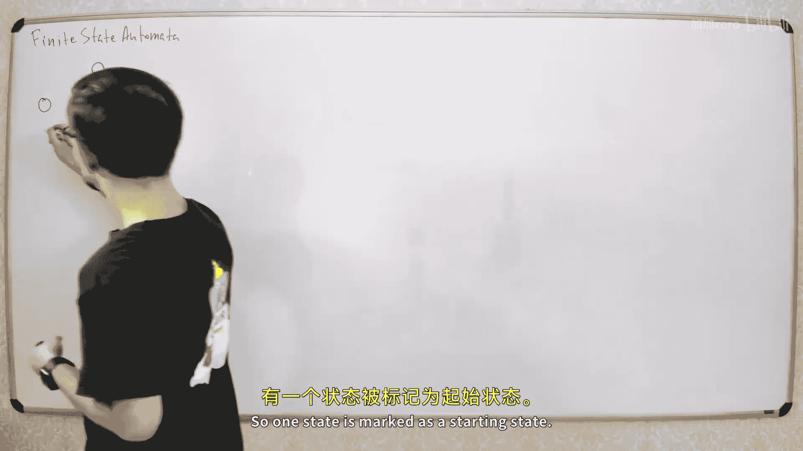

So' the stops instead of the altonum。And there are transitions。 So from each state。

 there are transitions to other state， and each transitions mark the thermo letter。い a。See。

They hear him。I be here。 And let's see。And something， or something like that。嗯。What's。

 what's a normal。

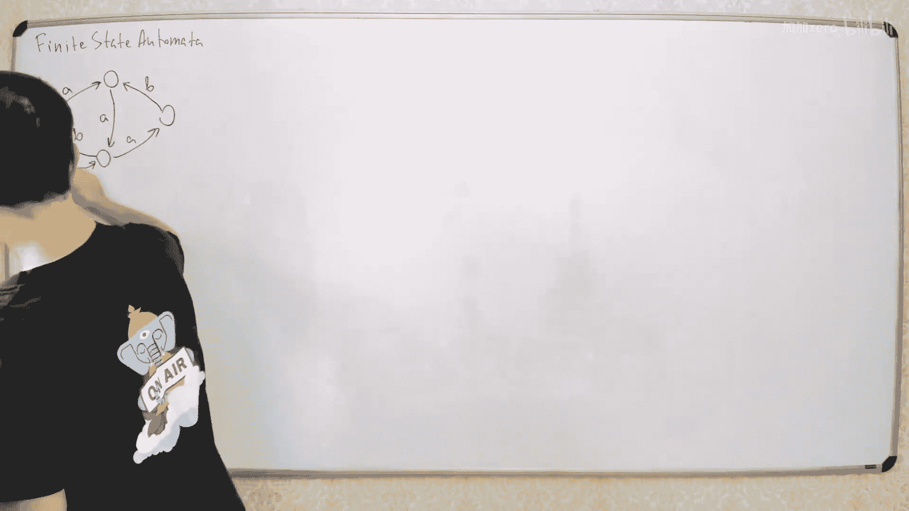

Soそ are some transitions。Also， some states are markets。Theter states。

 So some states are eternal states。 Let's say， let's say this state is journal state。That's all。

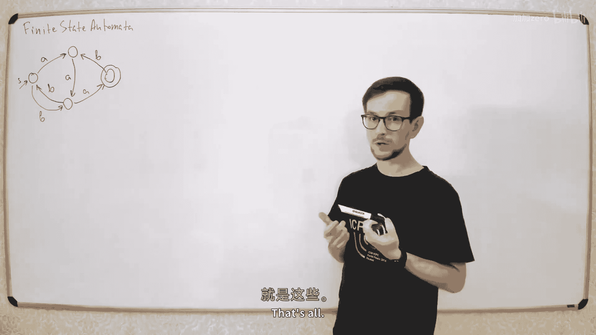

So， you have some graph。Each note of this graph is a state of the state of and are transitions so from each state。

 you can move to other state and each transition is marked some later from your alphabet。

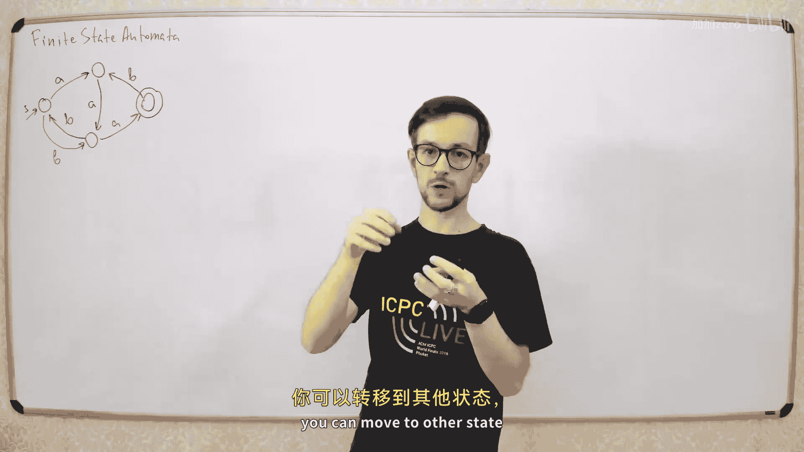

Yeah， let's say again。 let's， we have some fixed。A fixed number of letters in the alphabet so the number of letters is always some constant。

In this example， for example， we have only two letters where A and B， usually does quite enough。なぜかそ。

哦。

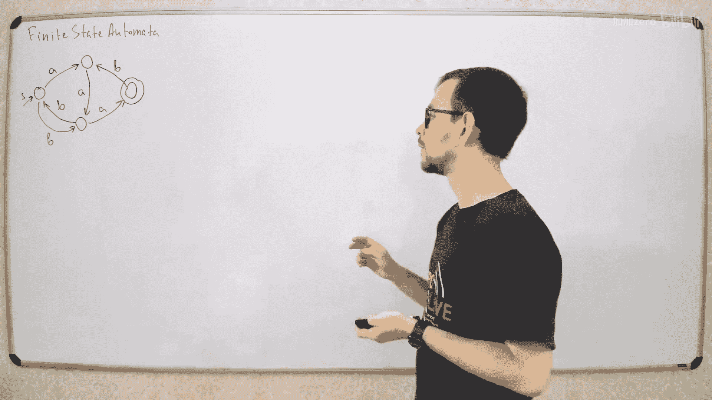

So how to use a finance auto。 It worked pretty simple。 So you' given some string。For example。

 let's see let's see。Let's say you see something like this。

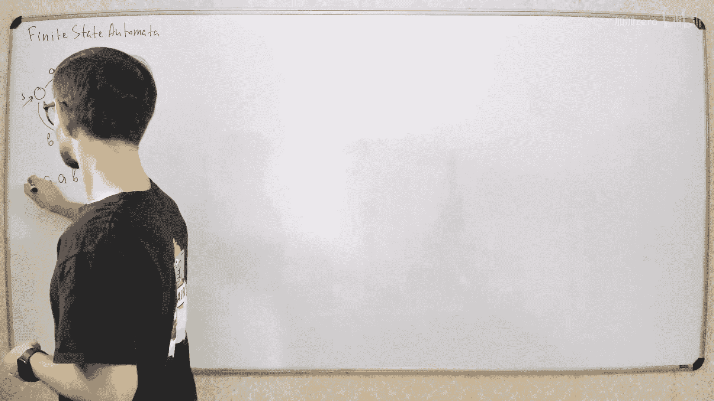

Or given some string。And when you give this state automaton， it makes very simple operations。

 so it starts in the starting state， so you start here。

And then each time you take the next letter from your string and move to the next state using the transition which marks this letter。

So for example， from here you you。还有那这A。So you move here。 So now you staying here。Now， from here。

 you have letter A。 So you move here。Now from。Now you have letter P。 you move here。

Then you have another B， so you move move back here。Then finally。

 you have letter pay so you remove the exit。そう。If in the end youre send in the terminal state。

 it means that this auto accepts this this string。

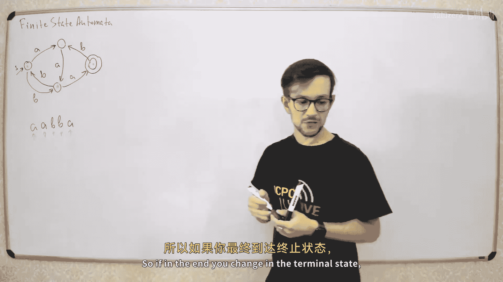

So we say string is accepted by this autoatton。 If you follow the transition marked these letters。

 and in the end， you end up in some kernel state。It's very simple。嗯，不从。

So most of them will talk about determin finite amountton。 So。

 So deterministic finite amount whatton is。Aton， when you have at most one transition for each given letter。

 So for each state。You have at most one transition marked with each letter from your alphabet。

So we have at least one transition marked with a and at least one transition marked with B。リてにしてく。

Sometimes you have known state。2 line image。 Okay， so sometimes you have no deterministic automatic It's。

 it's that when you have several transitions marked with the same letter。They are quite powerful。

 but they are not that useful usually in the algorithms because in the algorithms you kind of want to find what transition to follow if you have several possible transitions。

 you need somehow to choose this and usually it's complicated so in this lecture we'll mostly talk about deterministic for one on。

But in practice， sometimes you need to to build some some non deterministic autoatomy。And。Again。

 this is not the course about。Automato， so I'll just cover all the basics。 Basically。

 what you can do is from any nondeterministic auto autoatton。

 you can make the equivalent deterministic auto， but there's number of states indeed deter deterministic autoatton will be exponential。

 So if you have nondeterministic autoatton， you can make the same deterministic autoatton。

 but the number of states will be like two in power of n where n is the number of states in nondeministic。

 So all the problems with non deterministic autoton。

 You usually are and like usually need exponential time to solve。So we will in this lecture。

 well mostly need only deterministic auto and for deterministic to that。Many interesting algorithms。

 and we will discuss them today。嗯。No， they're quite useful。 For example， what you can do if you。

Automo is like a bridge from graph to string from string problems to graph problems。

So you you have some problem about strings。You build this autoatton。

 And now you have some problem about graphs。 and we learn a lot of good algorithms about graphs。

So that's basically how how you reduce your problem from string problem to graph problem。

So it sometimes it's quite useful， for example， what you can do。Okay。

 let's start with some simple stuff。Let's， for example。

 you want to calculate that you' given some language。

 so the set of string is a language in this termiminology， okay。You were given some auto。

This of give you some set of different strings， right， So let's see。

 let's see which strings I actually accept by this auto， for example。

 this and dont accept different strings。 So for example， you have string， let's say A A a。

Or you can strip can A， A， A， B， Let's do this so you can use A， A， then A， B， A。

 A something like this。It all is accepted also accepted by this autoton。 for example。

 look you must say something B， A is accepted by this autoton。 B， B A is B， B。

 B A is accepted aston and so on。So there is a set of strings accepted by this autoatton。

 So each autoatton is defined some set of strings。Yes， these are string usually references language。

 so each automaton defines some language。啊。Okay， I don't want to go deep in this theory。

 but this language is called regular language doesn。너튼 important 쪽래。嗯。I've got here 70 shorts。

 No I don't。That said。嗯。啊 what you can do when you， when you can。

Define your language as an automaton。You can， for example。

 calculate the total number of strings of the given length。So let you have a model。

It defines some set of strings， and you want to count the number of strings of length and。그 of。レグ？

and。So using some number M。And you want to find the total number of different strings accepted by this automatically。

 sorry you， you define your language is not quantum。

 and you want to find the number of different things of length and in your language。

How can you do it。Most question Li， you just move from the string problem to the craft problem。

Each string， accepted by autoatton。Is just a path。 Yeah。

 So each string is a path from star state to some terminal states。So to one of the general states。

 Yeah， so you just need to calculate so it is equal。The number of paths。From。S。呃， do one of。Dowa。

One of one of journal states， T is a set of journal states， okay。Of length。原来那个都哼样。

So now now just make the sungra problem。 So for the given draft。

 you need to calculate the number of paths of the given lamp。

 you can do it using dynamic programming。Like similar like in Belmon for whatever people discussed。

 you just calculate dynamic programming like D。VK is number of pers。To vertex v of Lak。いよ。

So we make the same dynamic programming like in Belmon fork。

And then use this dynamic program to calculate the number of strings in this language。

 So that's usually how how these two problems are connected。 So you're having some string problems。

 So we're given some dips。This language can be defined as a regular expression or something like that。

 so you have some language defined by some I don' know some constraints of your problem。And you can。

 you can define this language as some out of top。So you find a way how to build a tomato which describes your language。

So after this， you can simply calculate the number of paths in this graph and when you calculate number of paths。

 each path corresponds to some string， so when you calculate number of paths。

 you calculate number of strings。So like。으흠으 흐으 흐 으。That that's that's why it's important。

 So you can solve some problems。 You can find。You can find something。

 You can find something like small path。Or you can find。 I don't know。

You can you can have two different autota and then make something like product of this autota and build something like intersection of two given languages。

So so on so， there are multiple problems can be solved by 3 minutes later month。

Usually the problem is up before you。Before you apply one of these techniques。

 the main problem is how to construct this auto。 So you're given you're given some。

A definition of your language。And you want from this definition， go to the auto bottom。 That's。

 that's usually the main。Drick and all these problems。After you build this autoatton。

 everything else is usually simple， so you just make some dynamic programming。

 make a graphic preference and so on， and use solve the problem。Okay。Fice。

So what I want to discuss today is how to apply the algorithms from the previous lecture to build the optimal auto。

嗯。Go。So what we will try to do now， we will try to build。The automatton。

 which accepts all the strings， which contain given string S as a sub string。手机本。String。S。

And we want to build automaton。我。Which accepts？strings。呃 story个。4。They you such that。

S the sub of team。Mmhm。😊，That's what I what I want to with is sweat you are given again。

 given some string。Mmhmm。😊，And in previous lecture。

 we discussed how to find the substrate in a given text。

What I want to do now is to construct the autoton。Which accepts only text。

A wish contained in the given string。Again listen。This basically the same problem we discussed last time。

 but now we will， we will try not only define the algorithm just to find if the given string con。

 but well build the autoatton， which solves the same problem。And that's interesting because again。

 after you build this automaton， you can apply some dynamic programming into a oftonton， you can。

 for example， calculate the total number of all different texts which contain the given string and so on。

そ。Again， model is a very simple。A wayay to define the given language。

 if you can define your language to one。 then you can solve multiple multiple problem by dynamic programming and stuff。

We just stop saying everything is clear。 So Im just continued to save it。

The same thing over and over again， yet。Okay， hope we blew it up。Now， how to build this auto。

Any ideas？ No， yeah， let's， let's have some string。 Let's here。 have some string。 Let's see A， B， A。

 B， A， B， something。嗯。It's too boring。 Let's sale。 Let's add one more8 here。Yeah。ことが。

So let's type upstream。We want to build theton。Which accepts every text， which have this substrate。

Let's try to do it。 So how to start。 No， basically， if the T equal to S。

Then these strings should should be accepted by auto So。 At least our autoat should contain a path。

Like from Stocking State， let's check this。 This is Stocking State。

So at least we need to have this path in our matton from starting state to the terminal state。

 so let's build this path。He。be。嗯。啲。Okay， at least we need at least we need this path right？Again。

 string S must be accepted by this at by definition。 So in the。In the， we。

 we need at least to have this path。Now， let's let's add other transitions to this to this at。

 So what other transitions should be good。 So before we add other transitions。

 let's think about what these states are responsible for。

 So each of these states corresponds to some sounds interesting。 So for example。

 if youre taking here so。So if you are standing here。What does it mean？

It means that you already your text。And at some point， you send in here。

 you read this part of the text。And if you continue from this point and read letters A， D and A。

 you will end up in the terminal state。So if from this point， you read。Letters A， B and A。Mmhmm。

So again， if you're standing here， if you read all this。Prefis of the certainncity。

And now your current state is this。 So in this state。

 if you continue to read the string T and read letters A， B and A。

 you will find yourself in the eternal state。what does it mean。

 it means if you say you will have the letter S in your stringing。

 it means that if youre standing here and you understand this state。

Then you have these prefix already read the form。 So if you're standing here this state means that the last letters you read were A。

 B and B。Right。So basically， each state。Of this autoatton correspond to some prefix of string S。

 So if you are standing here， then the last prefix you it was a。If you're singing in here。

 then the last perfect you read was A and so on。So each of these states corresponds to some pre of this。

Basically， what what products do you need to remember。

 You need to remember the longest possible prefix of S S。That's this， that's all through this。

That's the meaning of this state。 So each state。Response to the maximal prefix of thing S。

 which you already read by this point， so you still in here and the state responds to max to those prex of maximal length。

Offf string S， which you read before this point。So now when we understand what is the mean of all the states。

 let's try to build all the transitions。For example， if you're standing here。

 So if youre standing here。 So the last pre you read was a。So I stand here in the perfect estate。

If you read letter B。Then you will go to preex A B。

But what happens if you read the the letter A in this point。 So if you have letter A here。

What will be the longest possible pre of  tune S， which we already read， It will be perfect A， right。

 So if we send in here and we read letter A。We will have the productsex A again。 So from here。

 you need me to make a look。え。And so on， now we do the same all other states if we're standing here and we read the letter A。

 so each we the letter B we go here。If read letter A， again， we have。We have A B。

And then re the page。What is the maximum possible pre of string S。No V A is not the prex of S。

 A is a prex of S。 So if we'reing it here and we to the A， we need to move to state 1。嗯h。😊，Now。

 if we're it here and believe that B， what happened？So me send it here， so we have later ABB。

And we read letter B。What will be the bacterial pre of S。응 응。I'm just giving you some time。Yes。

 if say if were letter B， then no prefix of S is here， so B is not prex， BB is not prex。

 b is not prefix， so we go to the sensor， so it is the empty prefix。Yeah。

 empty breath prefer to this state。 So if were staying here and little a little little bit。

 we just go here。And so on。So from here， if we， if we did letter A， we have A B， B， A。

 A longest perfect is A。 So we go here。From here， if we will be。So we have A， B， B， A， B， and B。

 So long this graphic is A B B。 So we go here。That's all。 What happens in the end， in the end。

 don No， if we want to find the out which accepts later。

 we kind want to stock in this terminal state。 So if we reach this terminal state。We find some。

String essence see so if at some point。We each of these terminal states。

In the middle of this painting。It means that were standing here and here is a slightness。No。

 if if we want to solve this problem， then we kind of want to stack in this terminal states Yeah。

 so we if we at some point go to terminal states， we want to stack in this terminal states forever and if it's done very easily。

 we just make a loop in this terminal state。By both A and D。

And this simple trick will just force you to slack in this terminal space forever。

 So if at some point。You have string S here， then you will go to this terminal states。

 and then in the rest of this string， you will just stack in these terminal states in terminal state。

 So the in the end。 So when you again， when you read all these six。And go here。

You still will be in this terminal state。So。This autoatton accepts any text which contain this S as a sub string。

And because if the sub is here， then when we move here we will move to this terminal state and when we reach the rest of the string rules still be in this terminal state。

But别种。that's how you build this on。Now let's see。What's interesting。

 interesting is the size of this autoatton is linear actually so the number of states of this autoatton is linear and the number of edges is the same as number of states multiplied by the alphabet。

 but if the alphabes some constant number of letters。

 then number of edges is also so linear right so the size of this autoatton is linear。Size。嗯。

If side of something is linear。It's usually a good thing to think is to think about how to construct it festival。

 if you， if you constructed just。Like like we did here。 So we。 So we try every string。

 try to add every every character， and then try all the sixes。

 check if the sixes the prefi and so on。 So it's it's pretty slow。

 So but if the structure you want to build this linear。

 usually it's a good thing to think about how to construct faster than we did So。 in this case。

 we can construct this toton and linear time。That's interesting。

 So let's try to build this autoatton in linear time。嗯。26。Yep。To stuck。

 I don't looking English story。 I'm Russian。How to， how to secure English。I don't know。 I don't know。

 I， I learned English from English from Hollywood movies， so maybe。Some my terminology is not。

The classic。To be a stark is an acceptance state。To be star is fine， but two star is good thank you。

Now。I want to build this autoton in in linear time。五。おそう。好。Again， we start by building this path。

 So we're just building a path with transitions corresponding to letters of this string S Now how to build all other transitions in this autocon。

 let's see。 So if we're standing in some state here。So。Let's have some。

So we're staying in in some state， I。What's it from 0。とかそ。So if we setting the state by。

What's going on here， we try to add some some one letter to this prefix so present it means。嗯嗯。

Theyre person in here， and now。We read the prefix。Ofully and I of skin as free。Thanks。

So that's our current stage， so we're resting in here。

And the last year we wrote the prefis of swing asoplan at oil。So how to make transitions。

 so if we add character x here， if this character is x。What's going on？

If this X is the next character of soon S then we move to next date。But simple。 if it is not。

Then what we need to do， we need to find some string here。Which is the perfect of string S。Anyway。

 we need to frame the longest such。So we need to find the longer string。

W whichhich is a suffix of this prex plus character X。And it is a prefix of string test。Again。

 we do it like we did in previous lecture。This last character must be X。And。This string。

Is some suffix of this string and some perfect of us。So we'll do the same thing like like brace。

 We'll try to find the longest。Suffix of this prefix， that this is the prefix of us。

So we need to find the longest tariff of this pres。

So we can add letter X and still have some pres of us。系。Let's。

 so let's build the perfect function from K' problem like in previous lecture。

And now this is what the hole so really great。For all， I， let's say， from 0 to。Yeah。Mi5。

Let's is all possible states。 Let's all weapons。For C in alphabet。It'Still cold， okay？

So we write over all states， except the last state and over characters from the opposite。

And now we make a transition。 So how to find the tradition。 So let's。

 let's say the length of this prefi is key。So， we need to find the。

Longest six of this string of length eye， which is a perfectx of string S。

 and which have character X here。😊，So we do it like like like in previous lecture。

 like in Kmore's part everything。 We say that the K is the length of this string。 we start from I。

And now just decrease this length until we find the pre switch have letter X after this pre。什么呀。

Again， this is just copy from the。그너빠 빠 보내。While K is at least 0。

And the character with on position K is not x。 We move to the next pre。Again。

 this this A is from the customer platform。Yep。That all。And now we just move to the state。

 which respond to this K plus one。So let's say it's usually called de del is the function which respond iss right we say from this state to this character what will be the next state。

 So the move from state I by character C will be K plus one。嗯。이 it거든。What do you think。The first。

Is it clear that this algorithm is actually correct？Again， lets。

 let's proof the algorithm is correct。So were study in some states。

 so our state corresponds to some prefis of shrink as， we want to find the longest s of this prefix。

Yes， with this K， such that this perfect pre can be extended this this letter X。

 So we iterate all sixes。😊，Which are also the prefaces here， and find the first one。

 which have letter X here。If we find this letter X， we add this letter X。

 So the length will be K plus one。And this。Basically， the same reason like in the。

 in the close platform。So this algorithm is definitely correct。What will be the thing complexityity。

What do you think。Okay， here we have two loops。So here we have enteringerations here we have sigeration。

 let's say that the sigma is a constant。 so here we have some constant。What about this file。

The most interesting thing of this， all these algorithms is actually this while loop。

 so everything else is basically linear except this while loop。So what about this， what do you think。

Yeah， it looks similar to Nomer's Pla gra。Bath is actually different。

if you try to apply the same reason from the Kmore battle， you will have a problem in Km path。

 we each time we start from this K is the position from the previous situation of conm battle。

So include the more powerful。 we next， we make this situation， make this K plus1。

 and then we start from the position K plus one here。

 But here we those start from position K plus1 here start from position I。 So each time we。

 we start from the position I。😊，And it it may be so that if you start from position I。

 you may each time have a lot of number of durations of this loop。Because you。

 you start from this position， go to， to the beginning。 now， start from the next position again。

 go to， to the beginning and so on。So you can easily build a test when the time complexity is not linear。

It is clear how to build this stick。Let's try so how to build a bed test for this algorithm。

 we need to build such a string S， so the number of iterations of this luus is big。

 so we want to to every prefi have a lot of surface success which are also the prefaces of this string yeah。

So want this sequence of string will be be as long as possible。How to build such strain。Yeah， I。

 I want， I， I want to build the string so that for each pre。E itselfuffix is also perfect。

 So I want all this。Strengs to be equal to the corresponding prefacees。How to build such such stream。

 Yeah， right， Yeah， right。 Don't scream， don't scream。 That's right。Yes。

 you just build the string of of the same letter。 So if you have string A， A， A， A， A like this。

So if you build a string like， please。Then each time you do following。

 So you stay in some states here。So if you're sending in this state， this is your current state。

 So this string of five case and now you have letter B。So this is your current state yeah。

 and now you have letter B here， so you want to make a transition from this state by this letter beam。

What will happen you you will see that the next letter not B。

 So you will try the next possible suffix。 Next possible six is one letter shorter。

 You try to add letter B here。 It's not B。 So we try the next suffix and so on。

So you make any durations of this loop， and it happens in every duration of this outer loop。

 So in in every duration of this outer loop here you start from position position I try all the positions to the0。

They all fail。 so you say that the transition is to state zero and so on。

So that's the best case for this algorithm。 So in this， so this algorithm。

 let's see that the complexity is n square。You multiply by the number of letters that does matter。

 let's start talking。 Let's， let's get the size of the alphabet here。やち。嗯。So it's the clean。

Can we improve it to building mirror， it's actually easy。It's almost true。

We just need to make a small improvement action。Yes， the the solution is very simple。

 We need to reuse the previously。Calculated transitions。 So let's see what's going on here yeah。そう。

We have discount state。 We try to add letter B。We try to add little bit to these prefix。

 and it is not。It is not here。 So here is a， here's B。 So we need to find some shorter s。

 so we need to find some traffic， which is a perfect sensor so on。 So we tried the longest one。嗯。

Try it at least。So for these prefix， we need to find the shorter the longest is prefix。

 which can be extended letter B， but we already calculated it when we calculated the tradition from this state。

We already know。This is long effects because we already calculated it when we calculate the same thing for this state。

So let's just reuse it。So， here。系い。い。Let's just fix this， just fix this。一。So again。

 if the next letter is good， so if。这衣服。If my letter， I is the same is。See。

Then we just say the transition from I by C is i plus one。If not。

Then we need to take some short shorter graphics， which is subjects of outcome current predicts。

So let's take the longest one。 It will be P of I and just make the transition to the same state。

 So I will be the same as transition from P。By the same carco。要错。Now， it's definitely linear。Y。

Since we don't have it as well。Yeah。And that's linear your time solution。That's all。

 that's how you build the out for the Gibbons Str。And next lecture will do the same for the multiple strings。

 right。No。嗯。Let's improve it just a little bit。 just again， it is will be useful in the next lecture。

 what I want to do， I want to improve it just a little bit。 So before you run this algorithm。

 you need to calculate this prex function。 Yeah so you run more part algorithm to calculate this pre function。

 You can avoid this。 You can calculate this pre function。Right inside this loop。So what we'll do。

 we will just do so。Again， that's， that's the perfectly normal solution。 You can do it like this。

 You run KM algorithm。 and then run this algorithm， it will work perfectly fine。😊。

But you actually don't need this K P step。You can calculate this perfect function right inside this for loop。

😊，You can do it like this。Here。So how to collect graphic function？Let's say P of I plus one。

Let's p 5 plus1。Right， so I want to add this the same to plus。Just 소시는 있을잖아。いや、これの。

So how to put perfect functions design the same loop？I can rest a it here。

So what is the breakfast function？So this is suit。Where you send here。So that's perfect of size I。

 that's the next character。This character of imposition I from 0 to y。

 So that's the pre of size I plus1。I want to find the longest suffix of this string。

 which is also a prex of this string。 So I want to find this string。Wehich is equal to this。

My claim is it's very easy。 We already gladated it。嗯。Right。Yeah嗱。そユニトテイプ。

This string and add character X to this string。So now you need to take some prefix。

 which is ordered also as starfix。Of the prefis of size， I-1。My I actually， yeah。

So you need to inters this string， this string is prefix and six of the pre of size I。

And add this character X。To2，2，2 special。 So the length of this string will be P of I。

And now you just need to add x to this string of size P of I。

And thiss just a transition in our matton。 We logical calculated it。 So it just be the。

Transition from state P of I by the character in this position。He's correct。Let me check。

It's almost it's， it's， it， it's almost correct。Yeah。

It will be strange in the first step when when I equal to 0。 And then here we have -1。

 So you transition from -1 to any state。 So p of 1 should be always equal to 0 to 2 to 1。Yeah。

 can you， you can do it if I is greater than 0。So in the first step。

 you will have something strange here because P of 0 equal to -1。Yeah。

 so in the first step of this book， you will have something strange。

You can redefine and just transition from -1 by any character 220， but。Op to you。으哼으哼으哼。That's all。

 so， so， So again， these algorithm different builds this are and also。

It builds their perfect expansion for the game stream。の？Actually。

 key P algorithm is a little bit more powerful because you don't have this。

A factor of size with alphabet。So in in inmore P can be used even if your alphabet is big and we did it or didn't it。

 Okay， we， we will do it in the home。So， so not more bra algorithm can be used。

 even if the size alphabet is big。This algorithm actually uses the fact that the size of an alphabet is small。

But if you have some fixed alphabet， then it's fine to use this argument instead of K， P。Okay。

허 호 호허 같이 반지 마시다。Clear enough， I will raise this。Can I erase this half of the board。Co。

 so the next thing。What's an advantage？Again게 the。What what does that when you build this。

 the autoton， you can calculate something。 So again， if you just need to find the sub stringing。

 you just use K B， and it's fine。But if you have something some more complicated problem。

 for example， you need to calculate the number of strings which have this as as a sub strings。

 then you can build a on on and then use this autoatton to solve your problem。

To make some dynamic program to use some graph algorithms and stuff。Mmhmm。😊，So， if。

 if you just need to find a upstream， that's noal。 So you just use this standard K P algorithm。

 and it's perfectly fine。Donton rent。They will yeah。我。The next thing I want to discuss is the。

Rightry。That's not whole problem。 So let's try to build the autoatton which accepts just a given fixed number of strings。

 So you're given some some fixed set of strings。So you have this set， let's say。Let's see， A A， A B。

A， A， B， A， A and something like A B V， H。And something like B A。

 I'm just starting to sort graphic and B， B， B B。So given some set of strings， yes。

And you want to find， you want to build autoton， which accepts only this set of strings。Usually。

 the pattern for the fixed set is pretty simple。呃，160600006。What。What。で。😊，So， I want to guilt。おトマト。

We took sets。Wongli。Sts from this set。That's quite， right， So for， for each of these strings。

We need to have a path from starting state， social internal state。Let's build this person。

 Let's start from the first string。 So we have the first string。Let's build a path。

From starting state。 So this will be the starting state。 So we need a path。Which have letters a。8。

A and B。And ends in joining states。So we need to have the spell。 Let's build the spell。Now。

 let's take the next train。We need to have a path from starting state to some German state。

 which corresponds to this string。 So let's try to add this state this path。 So we start from a A。

 Then we need string A， go here。That we need letter B。 So let's use letter B。And then。

 we need A and A。嗯。Now， this automatic accepts the first first two strings。

 So we will accept this string。 We accept this string。And so on。

 now we just add these strings one by one。Each time we start from the root from the its basically a root。

 but from this starting state。 Yeah， and we follow these transitions point to these letters。

 And if we don't have this transition， we just build a new transition。So we start from here。

 We need to add A， B， B， A。 So we have a。 We don't have B。 So we end transition by here can B。

Then we have B， A must add B and A。And so on， each time you have a new stream。

You just start from the starting state and add these transitions。 here we have B A A， What's say V。

He。Hey。And b B b。嗯。Yes， if you have no transition， you just make a new note and make a transition to this new node。

It， these data structures called fire。How do。How this data structure can be useful first of all。

What you going do。You can build this autoatton in a linear time by the size of these strings。

 So if the total size of your strings is n， then this autoatton will be built in linear time。

 So the time to build this autoton is just the sum of sizes of all these strings in。Something likeて。

Yeah， yeah， it's obviously linear， we just follow each。

Fll take each character of each string and make the transition each transition we make in constant time。

 so the total time complexity will be linear its easy。How to use it。

One of the simplest use of this data structure is to have some set like data structure。

 sorry so this autoat actually defines the set of the strings Yeah so what you can do is to check if your string is in the set so what you can do you're given some string X almost have some P。

So you can answer questions， for example， you're given some string。二ピ？啊啊。Hi， and the question is。

 is P belong to this set。You can answer this question very easily。 You just again。

 you use this auto use you take this。Characters of your string P start from the starting state。

 Foow this path。 If you end in in in the terminal state， then the o string P is in this set。

That's one of the easiest use of this data structure。

 or you can make something like map play the data structure so you can make map from string to something。

By doing this， you just put in each terminal state。You put the index of this note。

 something like this。 index or link to something else anything。

 So or values corresponding to this map and so on。So in each terminal state， you put some value。

And then you can make something like map play this。 So for each。Each string responds to some value。

 you put these values in these general states， and then when you want to find a value for for the given string P。

 you follow this path。And then you find this value in this final note。That's another use of the。

This auto hotel is。Also， very easy to update。 So if you have some scent。

 you can easily add the new string to this。 let's。Well， let's I just write on。

 So you can add the string。Do the center。Again， if you extend your set by one string。

 you just make new transition， starting from the starting state and make all transitions which do not exist。

You can do it in later time by the size of this string。You can to remove the strings。

Again if you want to remove a string from the set。You just follow this path。

And then remove all the remove the terminal node and then just greed remove everything which doesn't have any edges to the central state。

 So again， you start from you follow this path。Remove the terminal note and then follow back。

 removing everything， which doesn't have any outgoing edges。Mmh哼。😊。

So you can add string in linear time， remove string in linear time。

 and you can find what's you find it。And you can find string in the set linear time。Very basic。

 the structure to store strings， it's like hash map， but without hashes。美し？

And also have some interesting properties， for example。

 if you have some multiple if you take multiple strings。You， you get this。

 this autoatton is basically a tree。嗯。How we store transition still state， Yes， yes。

How to start in practice。And practice you， you do one of two things。Look。

 you need to express this function delta from。V by character C so it will be transitioned from the state of V by the character C。

You can do it is a two dimension array。But you will need and multiply by sigma。Mem。

Or you can make a map。S flexibility。 So you can make So if you have a small number of state or small number of transitions。

 you can make a map for for each for each node， you can make a map from character to to the transition。

And if you use Fh mapap， then the total memory black will billionre。

So if you have a lot of transitions， you can use a race。Just fine。

 If you have small number of transitions， but large after it， then you use hash maps。

You can make hashmap from pair to transition to something that on。Up to you。 So it it。

 it depends on the constraints for your problem， actually sure。Whatテ was lookingも also。

This autoome is a tricky。Yeah， so if you look， if you like， move your head to do that。

 So this is the root of the tree。 These are the leaves of the tree。It's nice。3。

 so we can apply all the three algorithms we know。Let's see so this is the。

Trerick response to this set of strings。So， each曲。AVs of this tree。

Conress to some pres of some string from this set。For example。So this not corresponds to this path。

This pipe correspond to shrink A， A B。So this vertex corresponds to string A A B Str A A B is a perfect of one of these strings。

おオ。M哼。So。This automoton is not only representation of the set of strings。

 but it's also representation of all possible pres of these strings。

So if you want to calculate something among all possible prefixes of the given set of strings。

 thats how you that's how represent your stripe strings， so you take your strings， build this tree。

 and now each vertex of this tree will be some prefix of some of these strings。

And then you can apply all the three algorithms we discussed in previous semester。

You can even apply some link cut to this。You don't want to， but you can。Okay。Nice。Falパ finalパ。Y。呃。

Yeah， yeah， that's right。So the final thing want to discuss is another is the algorithm which we used to analyze that。

Of finish it of butter。 It will be will just two algorithms。 Well test algorithm how to。sorry。

 So what you can do with to finance it auto。 You can minimize the auto， and you can。

Check the equal egg。Quality。Yeah， of to auto of two of or give auto。啊。First third， so。

There is no unique way to to express your given language as an auto。

So there may be several different auto automata， which which corresponds to the same set of strings。

 right？For example， let's have something like。We have a， and we have。here。It's going be here。

Let's do something like that。A and B。And also be。And here have。No。아 미。不度な。Yeah。

 I think it's good now。That consider see that this sort of矛。So this is something。

What will be the set of strings accepted by this autoatton？Oh，Let's see。So what we can do。

 we can take letter A and go here。And then take leather pill， Take a B。Plus。

 some more bees and then go here。 So the string will be A， then B， then some more bees。and then。

Or we can go here， take a and then a。It is also a good。Or we can go here。

 take B plus some Bs and then A B， B， B。Something like a。Yeah。Yeah。That's open。Yeah。

Can we do it shorter， Can we do the same thing using smaller number of states。No，'s see。 What's。

 what's going to about， Okay， We take either A or B。啊。No。어。嗯。I' like my bed。I believe this。

 this is the minimum possible。I want to do this it。On the images。嗯。That was fine。这是不是快？

So what happens we take A or B。Yeah， then we take some number of bees。And then we have a。Actually。

 the language we want to express is A or B。I just make regular expression。

 then some number of P and then 8， right。Yeah。So we have A A or A， then multiple Bs then a。

Or we have B and multiple business there， yeah。嗯，嗯哼。So basically want to express this language。

 we can do it in the small number of states。 we can do it in three states。So we can do it like this。

 We can start from here， then make the second state made A or B here。Then make a loop here。And then。

 make a here。So this automaton define the same language as this automaton。

B contains small number of states。What I want to do。Is for an autoatton。

 find the smallest representation of the same language。

 So want I want to build the autoatton with the smallest possible number of states。

 such that it accepts the same set of strings。Yeah， that's。

 that's the problem of minimization of the given auto。Okay。For this problem， for example。

 three states is obviously minimal number。뽀 또。For this problem。

 three states is the minimum possible number of states， right， No。

 because you cannot do it in two states in two states， you can't express this。Lguage。嗯。

Interesting part。 Interesting part is it's always is possible to find this autoton in polynomial time。

 It's actually in you can do it。prettytty first instance， so little small。

You cannot do it for non deteral to。So if you try and to solve the same problem for only two minutes to。

 it will be be complete。I believe。Yes。It will be something complete。 Im not sure it will be N P hard。

 at least。啊，把。I'm not sure it'll complete， because I' not sure if this is an PM。Okay。

 it do in P hard， at least。But in for deterministic Fi out， it's possible to check if。For example。

 it's possible to check that two given automata have accept the same set of strings。

 so it's possible to check the equivalents of these two automata。

 and it's possible to minimize number of states。 So it's possible to find this automoton which accept the given language and contain the minimum possible number of states and that we will。

Do know yeah。So the algorithm was pretty simple。Let's see here what we did when we move from this autoatton to this autoatton。

 we basically just merged two states， so we just take to these two states。And lu them。 Yeah。

 So we take this state and this state。And here we just merger this to state into this one state。

That's what we did when we moved from these four states to these three states。So， this。

Middle state X， the same as these two states combined。And that's what well do。

We will try to merge some states together。And we can merge two states。イフでア。いこ？

How to stay two states April。 So let's stay two states。Let's take some stage to you。

Let's look if we stay in this state， you， if if this is the current state。

Let's find all the possible strings， which we can add to the current position。

 so we will go to San State。So there are some strings。Which leads you to some terminal state。

Lets market this S of you。So S of you will be the set of four strings。

 which will be accepted by the Omaton if you start and state。嗯。Yeah， yeah， we'll draw this table。

얘는 미호 돼。嗯。Now， let's， let's say that two states are equal。If this sets a。So if for two given states。

The set of all possible strings we can add to this position。To go to some terminal verdict。

 to some terminal state is the same。 We say that these two states are actually equal。Go and here。

 you can easily see that these two states are actually equal。From here， if you want to go here。

 you can take string A or you take string B， something A。Yeah and from here， you you take string B。

 something A， it is the same。So the set of strings， which leads you from this state to this state。

 is the same as the set of strings， which is from this state to this state。Quter and， Ok。

Doesn't matter。You don't like the word equal。I like the roll。You can use any work you like。

It's not a lecture about discrete mathematics， it's a lecture about algorithms。我就是这门那么去。😊。

It's not that important。 Not that important。嗯。Nice， so the algorithm will be pretty simple。

 We will say that two states are not equal。 Okay， these states are equal if these sets are equal。

Sa are not equal。 If there is some string， so， so。어的構 어떻게교。So there exists some string。Some string S。

So， S。Belongs to as of U and S doesnt belong to S of it。Or the ver does me。So read some string。

 So if we start from state U and from state V and we follow the path corresponding to this string in one situation。

 we will。5， we will go to some non terminalminal state。 And in another case。

 we'll go to some terminal state。So。So if we follow the same string from state U and state3。

 and in one case， we go to some non terminal state。 and in any case， we've got some terminal state。

 then these two states are not equal。2。うそう。The algorithm will just find all the pairs of non equalal states。

我好企。How to find all pairs of not。First of all， if you take any。

Terminal state and any or any non terminal state in any terminal states， they will be not equal。Yeah。

Because if you take empty string here， then you don't accept empty string here。

 but you accept an empty empty string here。So empty string belongs to this set。

 but does belong to this set。So any pair of non terminal and terminal state will be a pair of non equal states。

呃。Now， if you have some pair of non encoers， if you not equal to three。

And you have some ingoing edge here。Byu the same character， see。

So you have the same character see here， and。See here。Then these two states will also be non equal。

hy is it so， Because for these two strings， you have this string S。So in one case。

 you go to non terminal， non terminal node， In other case， you go to some terminal node。

So we just add this character C to this string。And you have this string。

 which is different for these two states。 So if you go from this state using C plus S。

 you go to non terminalminal states。 If you go from here， take C plus S and go to terminal state。

 So these two states are also equal。That's the folk plan。

So we will start by taking all the pairs off。Nonteral and terminal state。

And then we will apply this procedure until you find all possible pairs of nonequal states。嗯。

That's the hopeland。 That's the hopeland。응 응。So。Okay， let's let's make a queuee。

 So let's make a queuee。And let's make matrix n by N， which will mark all Monal states。ノンいこオケー。

I will use work E because I can will be the Bo matrix。M哼m。😊。

Now let's just mark all possible pairs of non terminalminal and terminal states， so it's right。

For all you in terminal states。For all the。嗯。Non terminal states。But like please that me that。

You can implement it your every language like you can。 and just add all these pairs to this cube。嗯。

But do them both operationss of less。And。And will you and mark them in this。Aray。呃呃呃。Yeah不。

So I just marked all possible pairs of non non non terminal and terminal state。Now。

 I will just apply this operation， so I will take some pair of non Ne states。

Add some character here and mark these state nautical。そ前を。呃 not you电不。

So while I have something in the queue， I will take this pair in the queue。Like this wild。

So I removed some pair from the cube。And try， try to add every letter here。So， I will take any。

Whats it the same you prime。 This will be V prime。For all your prime， such that transition from。

You br by butter C， that we need to over all weather set。Let's switch all letters。What's the这。

Stays U prime such that transition from U prime by letter C is U。

 So I I need to find all ingoing edges to this。And for all V prime size。

 the transition from V prime by sea。嗯哼。😊，So in these three loops。

 I just to all pairs of these two edges， right？啊啊啊啊啊啊啊啊。Right。That's all。

 And now we have a pair of non non stage。 So if they are not marked yet。Then I willmark them。

So like total of space here on。And put them in the cube。Like this。Okay。Yep。That's all。

 that's the whole plan。 So， so again， work we did in this algorithm。 first， remark all the pairs。

Of non terminal and terminal state。Then each time we try cut to process some pair of nonal states。

 If we have some non nial states。And then move back one characteror。

 So we take some ingoing edge here and some ingoing edge here， which have the same letters here。

Then these two states will be non equal。So we mark this pair is non equal here。If not。

 if it wasn't marked previously。What is time complexity， That's a perfectly good question。 Let's see。

Let's听。It looks scary because here we have three loops here。

 So we have three loops here and one more loop here。 So we have four loops。啊。

But actually it's actually not this character。 so let's see what's going on here。In this outer loop。

 I will pick each pair only ones。Yep， so each panel will be moved to Q only once。

 so I will remove it from the Q only once， So what I'm itrating here。Here。

 I am iterating over all possible pairs of ingoing edges。So for each pair of notes。

I will find all the pairs of ingoing edges， which have the same。Charac here， yeah。啊。Mmm。😊。

and it looks like it's an N cube， right。Right now， it actually looks like n power 4 because I have n square pairs here and may have n square pairs here。

 so。Yeah。You may think it is an un powerfulful， but it's actually in square whites and square because。

Here。What I am doing， I introduce all possible pairel in total。I will。

 if you take any two edges which contain the symptoms。 So let's。

 let's take some edge with letter see and another edge with letter see。

Let's take any two transitions with the same letter。

I claim that I will iterate this pair of transitions， exactly once。난넌나 돈 와지。So。

 so each pair of transitions will be iterated here at most once。

Because to generate this pair of transitions， you need to off this pair of node and then generate this pair。

 So each pair of transitions。嗯。Brave。O transitions。Only onces。

So what is the total number of pairs of transitions， No， you have。Linear number of transitions。 Yeah。

 because for every for every state， you have only one transition for each character。

So the possible number of pairs of transitions is n square。Yep。

And you you just take the sum of all these by the number4。

 So the total10 complexity will be something like n square multiplied by there。

Obe square no alphabe is no squared。No just for each character， the sum will be n square。

 So we just take the sum for all characters building and squared。嗯哼。Nice。

So all this's the whole algorithm。Now how to let's prove a little bit。

 let's prove why it actually works， why we will mark all the non equivalentent states。

Why we will mark all the pair of non states， Because if two states are not equivalent。

 then there is some string S。Mm。With， let's find the shortest possible string S。So for any pair。

 there is some shortest possible string as。Let's take this string。对啊。For the next。Two states。

There will be a string， one character shorter here。

 So if for these two if these two string can be distinguished by this distinguished。NoOkay。

 So if we can。Does matter。 So if for this to stream。Can can be separated by the string S。 So。

 so you you take this take the smallest string， which act differently here and here。

 and so for these two states。We have。Shortest stream。Mh。😊，And so on。So again。

 what will happen in the first generation will Mar all state which have this string of length zero？

Each next step， we will have the string of one more character and so on。

 So for for each pair of character that exists on a string。

 So at some point we will find this string because each time we will find the next string for four we go from string of size n to string of same size and and plus one and so on。

So， if those，2， two states are not equal， then we will find that they are not equal after some number of durationerations。

H。I want' to talk about hope crypt algorithm， but I'm not sure if I have enough time to leave。嗯。

Before we go next。Yes， so， so so this is， this algorithm actually minimizes the number of states。

 Again， how to minimize the number of states in your automata。 First， you remove all。

 all nonimportant states。 So you can remove all the states which can be reached from the starting state and you remove all the states from which you can reach the。

Terminnal states。 So you will remove all all unnecessary states。And now you， you have some autoatum。

 you around this algorithm， mark all non equivalent states。 Everything else will be equivalent。

So you just merge all equivalent states into one state like here。

 these two states will be equivalent， so you just merge them into single state。

And this will be the minimum possible， downtown。Wite white will be minimal possible。

 basically because all this， if you look at these sets。😡。

So each state of this automaton responds to some set S。

And all these sets are necessary in your autoton。Because。

 if you can express this language as some autoatton in this autoatton should be states corresponding to these sets。

有。So you remove everything necessary and all the states left have different sets and each of these sets。

Is it necessary to define your language。Yeah， sounds like that。嗯。If the set has its condition。

 if the scent are any itself conditions arehe。What。啊，O。We just。那。Yeah。

 that's how you minimize the amount of states。Another important problem is to check if 2。

2 auto22 auto equal。 So let's say you have， you're given two auto Like first auto。

 Let's say A and autoton B。And you want some algorithm language checks that two given automatta have this exposed to the same language。

 So you want to the set of strings is the same for these two autota。 How to do it。Can you。

 you you console it。they right the problem。嗯。Dear fine。With the same language。嗯。Again。

 it's quite an important problem。You are given you given two languages。

 so language is the infinite number of strings。So you want to check that two infinite sets are the same。

That's， that's complicated。 But if， if this set can be defined as state auto state there that's it can。

 it can be solved。 So we given two。Autromatic end you need to check if they are equal or not。

And you since theoryrely that's one solution。 that's possible。

 What you can do is to minimize both auto auto and check that。You will have the same minimal result。

 You can。 you actually actually easy see that the minimal possible autoatton is unique。 So yes， yes。

 if you minimize both of them， you can check that you， you will have the same auto。

 But it's actually， it's actually even simple。 What what you can do is to run the same algorithm。

 So this algorithm will mark all non niel states。 Yeah。

 so you just can run the same algorithm on both this auto。Like， like， see。

 see this pair of auto is as a single auto， yeah。And around the same procedure。

And it will mark you all the pairs of non equalal states。

 And now you can check that these two starting states are non equalal if these two starting states are not equal。

Then this 토 맞아어。嗯。에먼지깐하고 수업 그렇다고다고 그랬。Im not sure。 if I am。Maybe。Little bit。

So I need like 2 more minutes to discuss Hope capital。Can we do it。

So hope your algorithmten does the same thing？Bad faster。 So you can。

 you can minimize the number of states in Phoenix State， Ota in andlogan time。走了。

So that's nice algorithm， but it works in n square time。You can do the same in endlog time。Okay。

 lets。So what do what do try to do。I will try to do the same thing， but faster。Y。

 it's called the Hope curve algorithm。嗯。So what's the idea in this algorithm thing I just raised。

 we try to it for all possible pairs of lo states。 there are n square such pairs。

 so we need to n square time。It's kind of no room for improvement。

 What we'll try to do is to find these pairs in batchches soil。

So instead of finding every pair of nonal states， we will just say that。

We will split all sets of states。Into some groups。Of no states。

And then we will split these groups into some small groups， and so on。那怎说再点说。

So let's start very when we have a set of terminal states and set of non terminalminal states。So。

This will be set of all possible states。We can split it into hals。

 We can say we have thermal states and nonther states。子。一ご先六。And now we do help。

 we will try to split these groups to even smaller groups。

So each time well take some group and if just split into some smaller groups and so on。

 that will split into some smaller groups and so on。感奏。So， in the end， we'll have some。嗯。

We have some some some small sets， and these sets will contain some equals。

So if two states belong to the same set， they will be equal。

 if they belong to different states to to different sets， they they are not equal。

And the basic operation is like this。So basic iteration。Let's take some set in。If we have set a。

 what does it mean， It means that everything inside a and everything outside of a is different。

 So everything inside is not equal to everything outside so。Like。We have A and not A。

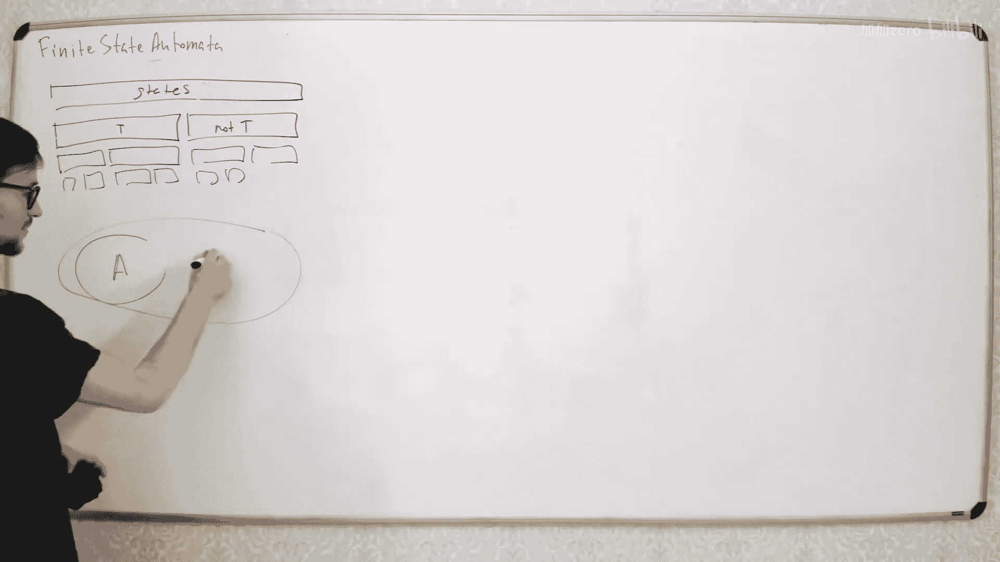

Yep。So all the states can be split into a and not A here。And。

Everything inside a is not equal to everything outside a。

So all states here are not equal to all states here。嗯哼。😊，Okay。So what will be the operation。

 Let's take this at A。And try to fight。系呀。We need to find every pair here。

 find all the ingoing edges by every character and split them into nonequal groups。

 So we'll do the same thing。 Let's take set a8 all ingoing edges。Buy the character。Mmhm。😊，So。

 for some states。If we follow the character C， we will go to two set a。For some other states。

We will go to something outside of Sydney。Now， since a is not equal to not a。

Then all these states must be not equal to all these states。So these states。

Are not equal to these states。Okay。Mhm。Right。So what we'll do。We'll see。

If these characters belongs to some。Ss。So anyway， you have some set B。Like this。B。

So if you have some set B。And from some states in the S P， you follow this sctoy and go inside A。

 And for some states， you go outside A。Then this be should be split into two hals。

So you can split this B。And say， this set。Is B1。And this set。Is pet。人从。That's a cooperation。So again。

 we take some set a。And try to， again， we try to。Like process all the pairs of non equalal states。

 One state is inside a。 Another state is outside a。 Okay， we do like like in previous algorithm。

 We just do it faster， right， We try to process all the pairs inside and outside of a。

For each such pair， if we have two states here， one is going inside of it。 another going out。

 these states must be not equal。 So we need somehow mark these two states as non equalal states。

If they already belong to different sets， we already know they not they not equal。

 If these two states belong to the same set B。Then we need to mark this state as not equal。

 We will mark this pair as not equal just by splitting set B into two house。

 So we will split the set B into first half， which are states which go in a and the second half are states which go out。

嗯哼。That's all。So again， the ideas just do the same but faster。

 so we we will not process these pairs one by one， we'll process the whole pack of pairs。

So each time we want to have all pairs， one state inside， one state outside。

 find all the consequences here and for every pair， which we know are not equal。

We will mark them not equal L vehicle just splitting the sets into two cup。😊，嗯。Okay。

 let make that that may be a little bit more complicated， right。Yeah， again。

 what we did in previous order。 would take some of states V and U。And we know they're not equal。

And we just。Process display Yeah， so we take some character C， take2 and go in H and mark this。

These two states are not cool as well。 Here we do the same， same thing。 We just。

Process this pair is not one by one， but in a group。So we take the group of pairs。

 one state is inside this set， another state is outside of this set and try to process all these pairs。

Mmhmm。😊，And if in some state B， we have some pair of character， some pair of states。

 So one state going here another going here， then these two states must be marked as non equal。

 and they marked this pair as non equal， not just by marking them in in this big table n by N。

But just by splitting this set。So if two states belong to different sets， they are not equal。

So if they now belong to the same set B， we need to split this set。

So we just split the set So these states going here or these states going here。Yeah。

 guess we will apply a few tricks later let's just implement this link。Bsible。 So again， we will。

 we will， we will make a queue。And the will put。Tea and not tea。토 된데 귀。Now， while curious of empty。

Yes。뭐 돼요 비지。We'll remove some set from the queue。Then we need to iterate through all ining edges。

4 see。You can see how through these characters， let interact to all in ages。Okay， okay。

 so any to all states。In a， and then iterate for all。You。Such that。放先。So this state is v。

 this state is。哎。It lookss scary。 I just wrote wrote three loops， but it is actually not。

 that's not scary。 here， I just trailer all ingo edge。 it doesn't。 It looks scary， but actually not。

 So I trade all things inside this set a and then follow each ingo edge here。😊，呃，那。Now。

 I need to find all the sets which was involved in all this operation。 So let's make some set。アるナを。

So， let's add the set。Iic。Let's add。Set of no。嗯。Let's make area of that。So each vertex。

 So each state knows the state is belong。So set of you is the set， which。The no you belong。

So now I find all the sets which was involved in the base separation。Yes， I need to。

 I also need to to know the list of this notes。嗯。O， let's add the list of this one。 Let's say L of。哦。

嗯。Okay， Elizabeth like these。I say B is the set of node U。 Let's add to that。No to be。

And then to the list of be like this。Good。I will end。The node用。So I kind of need to mark everything。

 which was involved in deperation。 Yeah。 So for this， I set A。

 I will mark all the nodes B or all the sets B， which has nodes， which go here。 And for each list。

 I will mark all the nodes， which have H here and so on。ことな。Nice。

 and now I will just transfer all notes inside the set B inside Z and then try to split this set。

For being in。Okay。😊，I use different character in every loop， okay。state。オ。No。

I will try all sets in N Z。 Let's take set B。Let's see if we need to split the assembly。 So， sorry。

Let's say B1 equal to L of B。B true， equal to not everything else。If one of them is empty。

I don't need to split。は。So if I want to split the set into empty set and something。

 I don't need to split it。Now， if I want to split it。Now， it is a trick。 Now， there is a trick。

There are two cases。So if set B is already in Q。So in my queue， I need to process the set B。

So what's me to process the set B？If you want to process the set B。

 you want to process all the pairs of notes，1 inside B， another outside of B。Instead of this。

 I can process sets B1 and vitro， so I can process set V1。And said be true。

So I will process all the pairs from B1 outside of B1。 So this will be not equal。

 and this will be not equal。 and I will process all pairs between them。 They also will be not equal。

So if I purchase B1 and B2 using this thing。I don't need to process B。Mhm。😊。

So I can remove B from Q and add B1 and B2 instead。嗯，リ。Eise。The with。With be1。Yeah。

You also need to update this set。요 근 요엔 누구 있지。I will give you some details just product exercise。Now。

 so if B is in the queue， then we will。 we need to process the cell B。But instead of processing at B。

 we can process B1 and B 2。 It will make the same result。Here。Because okay， when you process it B。

 you process all the pairs inside B， outside B。If you process B1 and B2。

 you will also process all these pairs。Anmore。If B is the current set of you， how is not process yet。

It may be processed later。 Sorry saw you again， you you like go from left to right in this。 So this。

 this is the state of your Q。The state of QQ， you process this， so this set this A。

And the next state is in the queue， so you'll process this first set。

And then you find this set should be splitted。Just it's working like user。So at every point of time。

 your states will be split into some states。And you have this is dependencies。

 so you take the state from the queue。And this state B is is is still a ni。

 So your first protested A。 And now you need to split send B。嗯。No。Now， if it is not in cure。Yeah。呃。

If it is not in the queue， it means robot process it。😡，So we processed B for set but B， B4 set A。

 So we first processed B。Remove it from the Q and then process set a。

let's see if we already process send B。And now we need process sets B1 and B2。

We can possess only one of them。Yeah。Con， let's see。 if you protested B。And for example， he be one。

Then you will process all the pairs from here and you will process all the pairs from here。

So you don't need this set video。So all the pairs of non equalal states will be already protest。So。

 you know， these states are not equal to these states and these states are not equal to these states。

So all these pairs of states are already processed。 So you need only one of these two sets。

 B1 or B 2。 So let's take the minimum of them and put them， we'll put it in the queue。嗯。嗯。嗯。

Like this。That's why you have little bit， yeah。That's all that's to call hope。所 again。Yeah。

 that idea， pretty simple。We have the queue of sets。

Each time we take some set from the queue and try to process it。 Proest means like this。

 We take all the in edges。Fine， if we if we need to split some another set。

 if we need to split some another set， we split it， how to split the set。

 If this set is in the queue， we just remove the set from the queue and put two other sets to the queue。

If， if it is not in the queue， it means， it means it was processed before。If it post process before。

Then we don't need to process both these houses。 We just need to process any of them。

 So let's take the minimum of them。And pulled the bag breaking。Letttle let好好。

So why is the log and time， let's see what happens here。そう。

The whole algorithm is just the sequence of iterations。 So first， you have two sets。 you have。

这像看 this。So you put them in the queue。Then each time when you do something in the queue。

 you either remove the set and。W two half of this set to the cure。

This operation do do not change the total number of elements in the car。And this separation。

Actually decreases the size of the set at least once。 So the size of this set。Will be。

Decreased by at least twice。 since we take the minimum of of these two halves。

 So half have size at most half of the size of the wholesale。So we take elements from the queue。

So if we El， if we remove some set from the queue， then the next time we will put some El the。

 So let's take some set A。If we remove it from the queue。

Then next time we will put something from this a。 We will put one of two halves of this set a。

So we will put one of these two house a it。 So the total1 will be increased twice。

 So next time we will put will be some。And so on so。

 every time we remove something this from the queue。

We will put back at most half of the of the number of elements。

So on the next next on each next iteration， we we， we try to work with the same set。

 The size size of the set will be decreased at least twice。Mmhmm。😊，我错。不错。

So what will be total complexity？そ。In when we try to do something the set， we trade for all in ages。

 so the number of ongoing ages for all states is linear。

Because the total number of ages in graph is linear， so sorry。Basically we we。

 we split all the sets into some groups。We put all these groups in in in the queue。

 Then we remove this sets，1 by one。And for each set， we character all in going ages。そう。わかか。

First you have these two sets in the queuen。Now， you remove the sets one by one。

And put some other sets， so you remove the first set from from the and for example。

 split the second step set。 So now now you have like this。So you remove this and you have this one。

 then you remove this， and then you split this set so you put one of the house into set in the queue and so on。

So on the next it。So you move this。 and for samples， please this。Yeah， then I split this。

 and then you remove this and Sweden。 So in the next direction， you have some。

Some some other sets in the queue， but each time if you remove something。

 then the next set will be twice smaller than the producer。

So the number of such durations will be no more than login。そう。What's。It's like breath search。

 but not exactly now。Not the exact， yeah。So we start by taking all the sets。

 then we're going to take smaller sets， one smaller and so on。

 so the maximum number of search here will be again。Sound like。Not exactly， but。

Close enough and in each direction， we take all the sets from the queue from each set。

 We look at all in edges here。So， here。Here， we look at all ingo edges for each set。

 and set is just the like split of all these stays in into into no， no， no， non intersecting。Yeah。

 so so so we have some g join sets， right， basically yeah。

 And so you iterate all these join sets for each set， you iterate all in going edges。

 So total number of ingo edges is the same as total number of edges。 So here you。

 you take the number of iterations here will be linear。Rin。44 each generation。

So the total number of operationserations will will be these multiplied by the number of iterations。

 number of ratios is log n。 So total number will be n log and multiplied by sea。Okay， it was long。

 It， it was long lecture。 Okay， hope is good enough。

