# 【精译⚡算法与数据结构】PavelMavrin p43 p42 A&DS S03E11. Aho Corasick Algorithm -BV1NLB8YfEMq_p43-

🎼。

🎼， so today we will continue to talk about strings。 Le will talk about a ho organism。

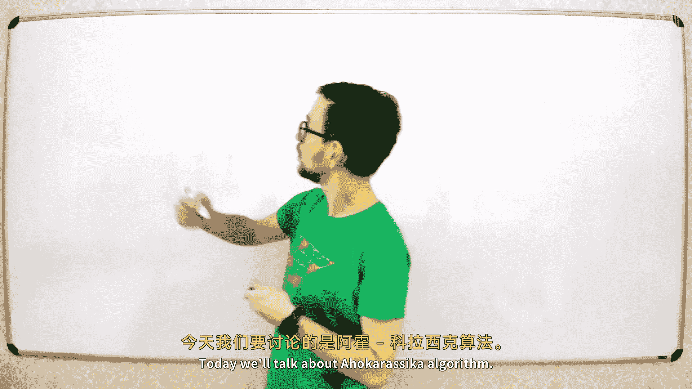

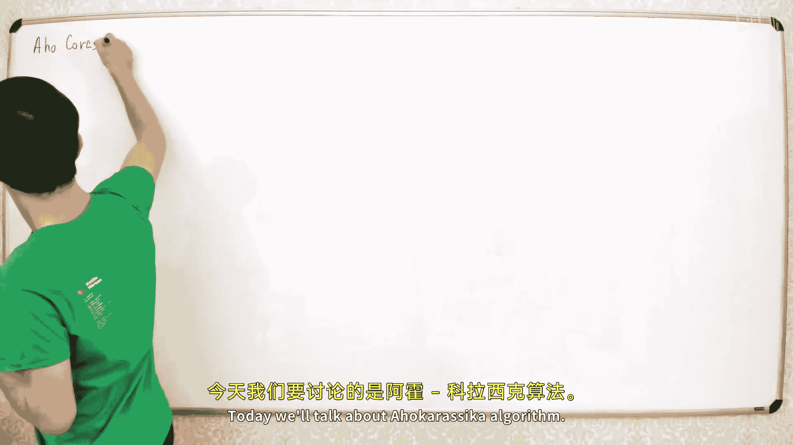

What problem will be solved will will be solved today。 The problem is， again。

 we will talk about subing search。

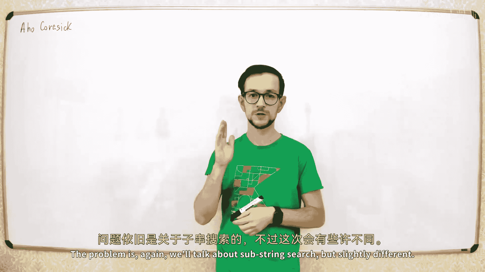

B's like a different。So again， well have some text。 So that text is just the long string。

 So we have some long string key。

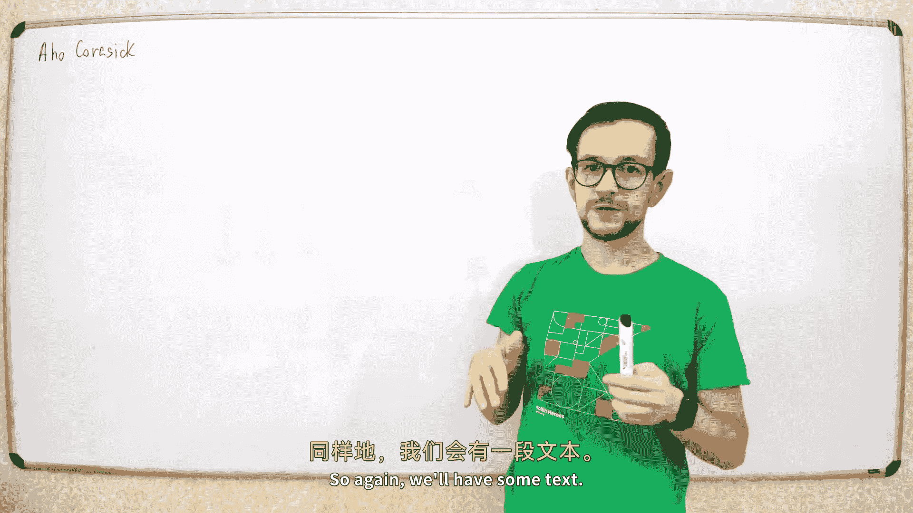

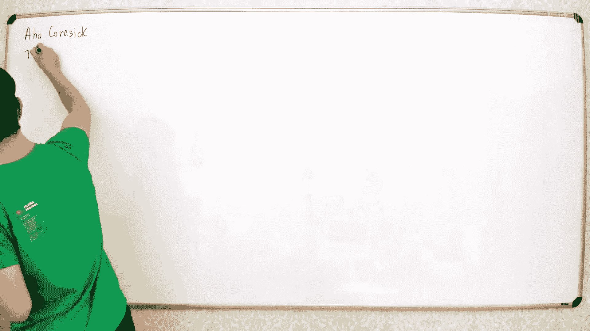

And we have multi many small strings。

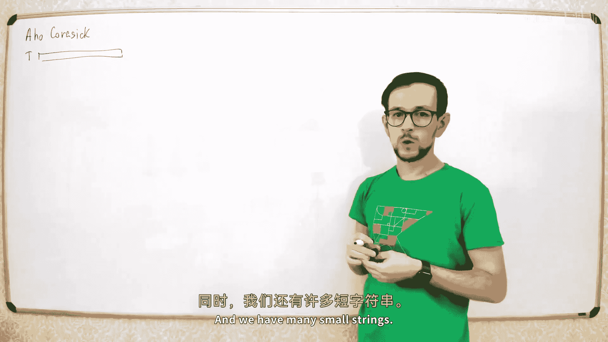

You have strings as one。えと。As3， and so on。

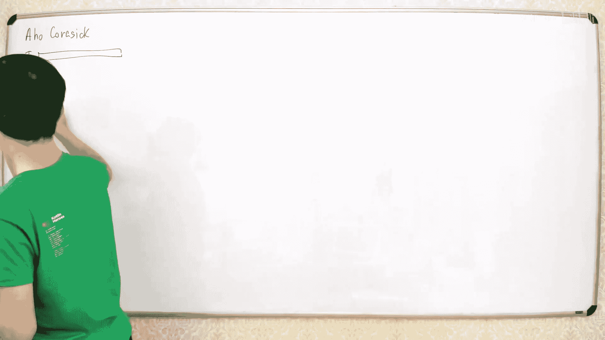

And what we want to do is to find all these strings in the text。AndFor each string。

 we want to find the substr of T， which is equal to S。So how can I solve this problem again。

 you can just run。Any， basically， of the。Subs stringring search algorithms we discussed in previous lectures so you can look for this part algorithm。

 you can write that algorithm or anyone any other algorithm we discussed earlier。

 so you can just take each string S and for each string just around。Any sub such algorithm。

 All of them work in linear time， so you will spend linear time for any strip for for for string。

What's the problem， The problem is that the text itself may be pretty long。

 so if you have a long text and main strength。Then for each string。

 you need to run across the whole text。 So this length from the text will be multiplied by the number of strings in your set。

So the time complexity will be not extra linear。 So it will be linear in some sense。

 but for the length of the text will be multiplied by the number of strings here。

 So for each strings says I， you need to run across the whole text T。 Yeah， So if text is long。

 then it's not of not not not efficient。What we want to do today today we kind of want to make an algorithm which which finds all these strings in a single past。

 so we will try to make a single pass across the whole text。And find all these strings up。At was。啊。

Let play。What has been find all the strings there may be problem。

 so if you just want to output all positions of all strings。Then again。

 you may have multiple positions for each string， you may have up to n positions。

 So if you just want to output all positions， the number of these positions may be like n square if n is number of strings and M is the number of text length of the text then for each string you may have up to M positions in this text。

 So the output size will be m multiplied by n。 So it's too much but。

Usually you don't want to find all the positions of all the strings。 You want to do something like。

 for example。You may want to find。

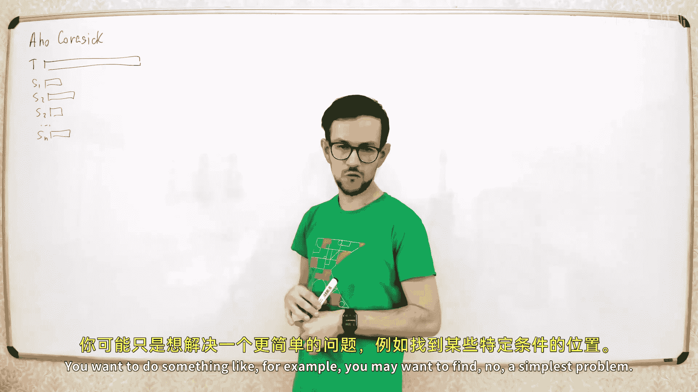

No， a simplest problem。 You just want to check if your text contain at least one of these strings。

帮佢冇 one。

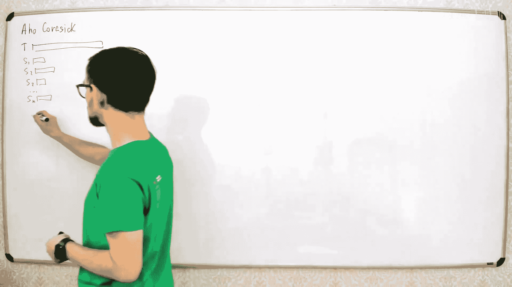

Find。Ayi。

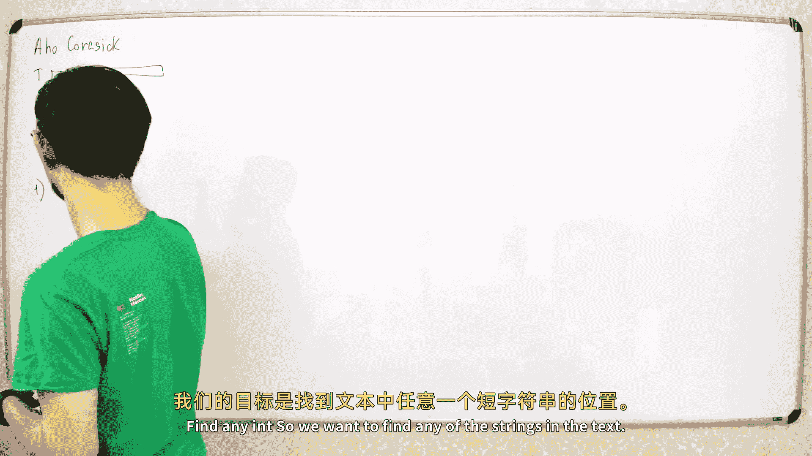

Ying。So， we want to find。Any of the strings in the text。Why you may want to do it， for example。

 you have some list of badwords。And you want to check if your text contain at least one backward。

 you just kind。嗯。Sensorship problem yeah， so you want you want to check if your text contains at least one of these band words。

Third problem。嗯嗯嗯嗯嗯嗯。Yeah， maybe look about this later。Thiss a first。First， I have a loss of day。

Second type of problem is for each string you want to find out if this string occurs in the text。

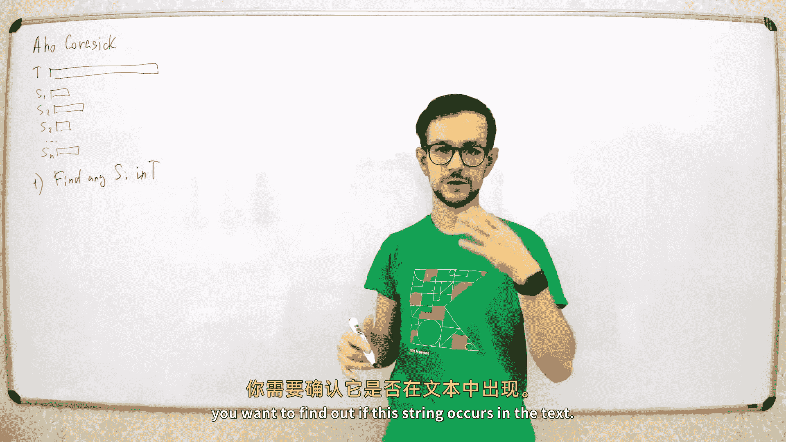

For each。As， I check。That。Do you contains。Okay。So the return of this order will be like a list of booles for each drink will return a boolean volume like tro falses。

The does that contain actually this substratestream。And maybe we want something more complicated。

 for example， sometimes we want to calculate the number of times each string occurs in this text。

 so maybe we want to find the number of times。嗯。E and eat。Ying。对。So for each string。

 we may find the like integer value like the number of sub strength in of T equal to this S I。

Ands so on then maybe some and on。Many other problems。

About the substrate strings can be sold using the same approach。아 뭐。我说。So how to start？

What we'll try to do now first you have some list of string， let's put some list of strings。

Let's say we have strings。 let's say A， A， B， B， A and something。A， B， B， a。And something else。

 let's say B， A， A， B， and something again， B， B， B。So。Let's kind this list of strings。

And we have some text。 We want to find this。We want to find these strings in the text。

So what we'll try to do first thing we is， we will build a try over this string。

 like we discussed in various lecture， we can build an autoat。

Which accept Gi streams it looks like a tree， so we'll build the tree。They were 좀 the tree。

And each edge of this tree will contain some letter of your alphabet。 Now in our case。

 we have just two letters we have A and B， so each edge will contain some letter A or B。

And so we want to have this string A， A D， B A， So we make H here a。A you。Maybe。啲。诶。

I will try to make H letter A to the left and H will letter be to the right just to make it more clear。

 right？So this path corresponds to this first string， so this is a terminal node。Yeah。

We discussed it in last week。Now， let's add all other strings。

 let's generate all strings and add them to these three。So we have A， B， B A， So we have A， then B。

Then， B， then a。So， that's the second string。Now， we have B， A A D， So let's have B。A。A。Be here。

And we have B framework。Again， we discussed it last week， so this structure its called a tri。

But here。It's basically the tree， which contains all the strings of the given set。

 So we just it all strings in this set and put them in this tree。Gridally。A V， A is the second， A V。

 A。嗯。嗯。Great。M哼。Thanks。So we dont know how to build this tree。 Yes。

 we can build this tree in linear time。 So the time complexity for building this tree is actually the sum of the length of all these strings。

 So by now we spend。Let's put it here。 some of all gl so。

We can construct this tree in this time complexity。あし。

Thiss the clear button now song we discussed it last week， so I just。And do it very briefly。 So go。

No。啊。Okay， there are two ways to， to describe the ahora。Okay， okay， I'll do I。 I'll do it both。

So there are two ways to think about a Hawkized algorithm。 The first way is a little bit more simple。

 So let's of it this So what we'll try to do。Is we will build from this try。

 We will build a full autoatton， So we' will try to build an autoatton which accepts like the strings。

 which contain the given sub strings。So what is the idea， so we will try to take this text。

 so we have this text。And we will read this text from left to right。

Like include more part like in all algorithms， so I just go from left to right and try to find this this substrates So if we standing in some point here。

So we already read all these characters in here here。 So which characters we actually need。

 we don't need all the characters in this pretex。 Yeah， we only need some last characters here。

 So we only need some characters， which can be。Later completed to to a full string， right？

So we only need some characters here if these characters can be completed to some of the strings from this set。

So we actually need to have some some characters here。

 which up the prefis of one of these strings from this set， right？For example， if we have no。

 let's put some things A， B， A， A B， B， A B and so on。If we have， if we ordered the red。

These letters。So which letters actually need？No， let's see。We can。We need this letter A， Yes。

 because we have strings starting with letter A。Do we need the string B， Yes。

 Do we have a string which starts with B A， Yes， we have string starts B A。

 So we need this B as well。 What about the A B A， So we don't have any string which starts with A B A。

B， A， B， A， no， So So we actually only need these two characters。Yeah。Again。

 we only it it's basically the same thing as we discussed when we discussed comm bottleon。Actually。

 when you think about how a algorithm isn't like generalization of the Kuthmorepart algorithm？Is。

Basically similar to Northmore Prale， away from bath on a tree。Thanks。So again。

 we read all these letters from here to here。But we only need these letters if we want to find these sub strings。

So we can forget everything about here。And only take care about these letters。M哼。Now。These letters。

The prefis of one of these strings。So each prefix of the given strings。

Maybe be represented as a vertex of this trade。Okay， again， each node of this right。

If you we look on the path from the route to this note。

 we will get some prefis of one of the strings。And while we also saw。

 each prefix of this string may be represented as a note in this try。That's what we all do。

So what that's the only thing we need to remember。 So we only need to remember that this prefix and this prefix will be represented as a as a node in this track。

 So if we're standing here， we know that we read red letters B and A and if were have bit Li B A。

 then we are standing here now。So that will be the current state of this ofmoto。Again。

 if we send here， we remember this three， this thing represented by this note。

 so this is the current note of the other potton。まあ。Let's talk about transitions。

Window make transitions， yeah。So if we are so weing in here， when in this state。

 so let's read one more letter， so will let go one more letter in the steps if this letter is。

 for example， a。If we， if we see letter A。Then we will move to this state because we will extend these pres with letter A。

 So we will move to this state。 So if we have letter A。

 we just move here and we already have actually this transition here。

 So we have transition from here to here by letter A。 So we just use this transition and go here。Mmm。

对。そ。So if I read letter A， I just moved to this state。But what happens if I have letter P。

E find have letter or B。I can extend my paras of letter B because I don't have a transition here。

 right， I only can extend the letter A。So。Again， like and perfect function。Exactly。

 we will need to add to the maximum possible six of the given prefix， which can be extended letter B。

So， we know that the last letters from B， A and B。We know these letters are not important。

 So for this twin B， A B， we need to find the maxim s。Which is。

 which is the perfect of one of these strings S Yeah。

 so we need to find the maximumim s of this string， which actually present in our try。Let's do it so。

 So we have this BA B is not en， but AB is an en， so if we standing here can this study。

And we read letter B。We must go to state A B， so the next state would be AB。

So if we receive letter B， we go from here to state A B to here。Lisip本。

Now I will add all the remaining transitions。Do this automato and make a full tomato from this from this tray。

For example， if I send it here， if I read letter A and then I read another letter A。

 I will go here if I read B， I go。 So I I have both transition by letter A and by letter B。So。

 that's fine。Here as well， I have transition by A and by B。For this node。

 I have transition only by letter B。 So let's add transition by letter A。

 So if I have transition letter A， then I have。So。IfSo if I mistake staying human。I am standing here。

 It means I have letters， A A。If I read another a。Then the maxim six of this will be Aa， right。

 So AA is the same note here。So if I am sending in this state and I read that letter A。

 I must state in the same state， so I will just make transition from here to itself by letter A。

And so。Let's just add all the remaining transitions。For example， here， I don't have function by a。

 So if I read A B and then a。I must go to B A， right？From here， if I add B， B and then A。

 then I have B， B， A Maxim s is B， A。Yeah。From here， if I read A， A B and then a， so。提。

So if I have A， A B， and then。Read letter A。嗯哼。Then what will be the maximum s。

 so ABA is not in the tray。B A is in a tray。 So the maximumim six will be B A。

 So if I am standing here in a read letter A， I must go to state B A。 State B A is here。

 So from here to here， I need to make a transition。나。嗯哼。And so on， I will stop here。

 So you got a point。 So let's just add all the remaining transitions and build the full autoton。Next。

You forgot to say everything is clear。Okay。Soう。So that's how the algorithm work。

 the algorithm will basically build all these remaining transitions。

 and so in then you will have the full autoatton。开。Now。Now to think this part。

I want to build these transitions efficiently， so if you just do it。No。

If you're just making just some neighbor approach so you just have this current state， yeah。

 this current state， oh， but that's the state， what's the state。So I want to make a transition。

 Let's put it here。 I want to make a transition from state V by by letter C。 What does it mean。Oh。

 we'll go through problems later。 Yeah， that's just the structure。 We'll。

 we'll solve all this problems。A little bit later。 Yeah， by now。

 it's not clear how to solve this problems using this structure， but we'll do it。

So if we want to transition from state V， so we have this state V。

 this state V responds to some string， yeah。We will add this length of sea。

Then we need to find the maximal six。Which presents in our try and move transition to this state。いや。

那。If you just try to do it just in some neighbor project， sorry just。If you just do it。

 just take this string itator all its six suffixes for each six， you try to add this letter C。

 check if this string is in your try and so on。 that's too slow because for the number of string is linears for each string you need to iterate all these sixes。

 it's another linear and then you check if this string is in your try。 It's another linear time。

 So it will look like N cube。 you don't want to have in cube So we'll do it fast。How to do it first。

啊。哎。It's pretty much the same as we did in the Nomore bra algorithm。So what we'll do。

 we will construct some additional links in this chain。

 and these links do the same thing as the perfect function in the Northmore particle。

But to make it a little bit more complicated， theyre called six links。So for each note。

 we will build the six link， what is a six link？Scifiix link is the phone of thing。

 So you have this what's six of V。We will take the string corresponding to this state B。

 so this state B is some state of of this tribe， so for each state there is some string。

So there is some string respond to this evening。And we will just find the maximum six of this string。

 which is also in your tribe。So these maximum string will be the suffix。Link。Again。

 it's pretty much pretty much the same as in Knumore bottle。

 Kuthmore algorithm we try to find for each prefi。Well find the maximal six。

 which is also a prefix right and here we do the same thing we will find for each prefix of all these strings。

 So each state is a prefix of one of these strings yeah， so for each prefix of all these strings。

 well find the maxim six of these prefix， which is also a prefix of one of these strings。

So it's pretty much the same but you have multiple strings yet。

 so so you may have six of one string in preix of another string。

 it's fine so but for each for each prefix which is in your trial。

 you will find the max prex or six of this prefix， which is also in your trial。Well for example。

 let's build some such experience。You some more colors here。Well， for example。Let's go from here。

 So this state。 So for this state。You have string A B B。 Yeah， what is the maximumim six of A B B。

 which is also in this tray。 So if you have string A B， B， then it has suffix B B。 six B。

 B is in your right。 It's here。 So we will put six link from here to here。And like。

Lets look like this。Oh you don't， you can treat this colors。Let me use some another。

Let's use this pink。Yeah， it's a little bit more。でえ。So from this state。

 we will put Sa link to this state。Answer on so。 Now， let's build some more assumptions things。

 for example， for example。에 알 너무。우치 완 호치 안。For example， from here， you have string B A A B。

 So the maximum s of this string is A A B， So you put sex string from here to B A A B。For example。

 from here， you have string A， A， B， B A， so A， B， B， A。A B is 솔 secure。Okay。That's boring。 Let's。

 let's do something interesting。For example， from here， you have string A， BB A。B， B。

 A is not in in the tri。 B， A is in the tri。 So the maximum s of this string。

 which is in the tri is B， A。 So we need to put static then from here to string B， A。嗯。嗯哼。😊。

Got the burn。啊。Again， let's go from top to bottom for these two states on the sex link we go to the root because sorry here we have string A。

 the maximal sex of a is empty string， so you have six link to the root。From here you have AA。

 the maximumim suffix is A。 Here you have A B， maximal suffixes B， and so on。

So you have something like this。 Yeah， for each snake。

 you have a link to the to the maximum s of this string。Now， what about the route。

 The route doesn't have any subjects link。 Like in， again。

 it's like in the km portal battle which we don't have perfect function from empty stream。

Here is same thing root of scan special notes。 route is a node which corresponds to empty string for an for empty string。

 you don't have any prefaces other than the the string string itself。

 So for the route we not calculate sufficientix link will calculate something for all avert for all node。

 except the route。然后。That's all。 That's all。That's all we need， so what we'll do， what we'll do。

We will calculate two arrays。You may think about this is the right。

So we'll calculate this array of transitions。And these array of s links。

And we will do it for all the notes of the of this tray。Okay， let's all res。

 don't do do do algorithm。Let's go。 So let's take some， let's take some note。

 Let's try to go gl some suffix or some。짜 shit。So have no fee。

And you want to calculate transition by sum。Charac터 c。So you want to calculate this delta of V and C。

What does mean， again， you have this string place me right。So you have this string beam。

You add this character here。And you want to find the maximum s， which is in your train。

If you already have a transition here down。If you， if the string， V plus C is in the tray。

Then you just move then you just let the transition。

 so if you had the transition from here to one of the children， then it's already done。

So if you don't have this transition， it means that this string V plus C is not in the tray。

So this whole string is not in track， so we may take we need to take some sffix。

 which is not the whole string。So what we need to do， We need to find some。Something like this。

So we need to find some six of this string， which is in the trial。嗯。Again。

 we will do it exactly like include more spa uniform Let this last letter is seen。And this thing。

Is some s of the string pi。So if we want to make transition from V by the character C。

 we need to find the maximumim s of V， which can be extended by this letter C。Mmm。诶。

Ho we finished which just will go the Toronto present。Yes。Yes， we can actually， yes，z。

Like I explorer there are two ways to think about ahawkra thing。

I think it's the easy easier way to think about， but we go to your solution later。 Yes。

 you you can actually the classical ho algorithm doesn't use this this this。Transitions。

 and we will do it later。This is the first version， we will get rid of these transitions later。

 you can do it here。That's right。YouYou can build all these ci links。

 and that's also possible in later time。 We will do it in。I don't know。 in In so。

Whatever So so I need to find the maximum s of V， which can be extended letterer same。

So how do you generate all sidees of。of the string。 Again。

 we will do it exactly the same like we did in the notmore part。So we can go。From string V。2 its。

Maxmalさ。Just following the settings link。 So we will go from here to here。Buy the six link。

It was it was pink so it's brand pink as well。So we can follow this pink link and go to the maximal s of this string S。

Now， if this maximal string can be extended letter C。

 then we found the maximal string which when the marked maximal sy， which can be extended。 If not。

 we go to the next s the next。And so on。所谓。So if we just follow this path of suffix links。

 we will it all sffixes of this given string decreasing order by by the length of this string so if you take the first six link you will find the maximal six。

Now， you take the next six link。 You will find the next maxim six and so on。

 So you go from here to here to here to here， and you will alter all sixes of this string。😊。

And you just stop when you find this the character scene。

 So you just follow this until you find some character scene。

So when you find some s which can be extended letter C， you just say that this is your transition。

 So this will be the transition from V to by C。What if we don't have any searchrc。

 it's possible that we read all sixes of of the string and go to the empty six and still don't have any transition by character C。

 then we'll just put the transition to the root。Again。

 if we generate all ses and we can extend any s with letter C。

 it means there is no six which we which contain this letter C， right。

So the answer will be empty syn。嗯。Again， it is the same like in more include more pattern which all prex functions until we find something which is equal to your current character and if you don't find anything。

 then you make prex function equal to0 here do the same thing。

 So if you all these ses and don't find this letter C。

 then you just stop and say that the transition must go to the root。え？Mice。

So if you just implement it like this， unfortunately， it will， it will be too slow。

 So if you just do it like this。Again， like we discussed in previous lecture。 we do we did the same。

 we did the same bug。 So if you just all these links。

 the tank complexity will be too slow unfortunately。

 because it may happen that for each if you don't， if you have a。そう。

Your e have a big chain of these s links。And for so for each character here。

 you need to follow all these steps and just don't find any characters here。

So we'll do the same trick in the believe lecture。We will go to the。

 We will follow one such link here。And for this s link。We already know the transition by character C。

 so。So we will just go to this settings link， make one。Tranability the s。 So， and for this， maxim s。

We will use the precalclate transition by the character sea。

So when we calculate the transition for these projects， we already did all this work。

So we already did all this when we calculated the transition for this。s fix。

So we already know what will be the final result， it will be adjust。おpo。

It will be just the transition from six links。Of V by the same。Yeah。

So well just use this spec transition。第一食服啦。あ。Let's try some cold。嗯。

So what will do I illustrate all notes？うん。Let's fix it later。 So rules here all notes of our train。

For each node， we' will iterate all points micro something， so we're going need to include s links。

 I put it here。Put it here for later use， and then we'll trigger all characters。어。Now。

 for each character， if there is no transition。嗯。If there is transition， okay。

 if there is transition。Now， if is not the transition。

Then we just use this transition from the six link。Again。

 we want to find the transition from this string by this character C。

 so we need to follow this chain of six link and find the closest thing。Close the subjects。

 which have the transition。But we can follow one s link and then use the result from this string So。

Transition from B by C will be equal to， to the transition of the surfaceix length。睇冇事。嗯。Again。

's barely easy。That's all。 That's how we calculates transitions。

Now how to complete psyic experiments？Let's see， you want a little great suffix sneak。

Suffix link is the maximum suffix switches in your。D， yep。

The same thing like in Cl water particle algorithm。 again。

 how we can create prefix per prefix function in Cl part particle Look at the last character。

 So look over this。We have this lost character here。에요？

What we need to do is to find is to take the string one。Okay for shorter。

 we need to take this string without this X。What will be the string of V without last character。

 what node corresponds to this string？Again， I have this string， yeah， this string。

I want to remove this last character。And look at this string， one character shot。

What note of that try will correspond to this shorter string。嗯嗯嗯嗯嗯。嗯。嗯。Parent not right。

 so this shorter string。Will be just the parent。어 너 형。Now。

 what we need to do is we need to add this character X。To the parent of the no。

But if we just add X to this parent， we will go back to thisno。

 so we need to find some six of the parent。So we want to find this。 So this string。

Will be a suffix of the parent。So we need to find the s of repellent， which can be extended letter x。

M哼。So what we'll do， we'll find the maximal six of parents。So this will be the ci link。O。

So we'll take the maximum possible s of the parent。

And then try to add this letter x to this maximal possible six using these speccalulated transitions。

嗯 응。So we will make a transition from the six link。Of the parent。Of we。By the character X。

 so what is x x is the character rh corresponding to this lecture。嗯嗯。Let's say。 cheap age of。Okay。

So this is the character which we used when we go from parallel to this node， right？嗯。Yeah。

 let me drop control here。 So we have transition from this V from that parent。

Of V and this character is T of V。So again， what we do here， we go to the parent node。

 so we remove last character here。Then we find the largest possible s of this parent。

And then we extend this maximumim six with the letter x。Using these precalulated transitions。

That's almost， that's almost it。嗯哼。이죠 그랬는데。嗯。Now， the final thing， least least far。

I want to build six links and transitions using some other six links and transitions。

So Im kind I'm building an array using the values in the same array。

This can be this should be done carefully because you need to make sure that when you use this。

Values， they are already calculated， so all these values we used here。

Must be calculated before the value in the note be。So we need to build this right build。

 We need to find this produce in some specific order。 Yeah， so inside such order that this。So okay。

 let me see first。So we use it here。 We use it here。 We use it here， here。

So all these values must be calculated before the value in the node V。Okay。😊。

Have any ideas about how which order we need to use。

To make sure that these values was complete before the value we need to calculate。If a solution up。

 So let's just calculate these values from top to bottom by increasing the length of this string。

 So all these， all these separations move to some shorter string。

So length of the six link is always shorter than the length of the string because it is some suffix。

啊啊。呃。Lth of the parent is shorter because it's apparent it's one character shorter。

 so all all these values we used belong to some shorter strings。

 so let's just build this from top to bottom the layer by layer yeah so by increasing the number of characters in。

So， let's。So we just from breakfast special from the root。

Like extend but data and just sit all over layers and then we use this code just to。

Ccoulate the value cycle function and transitions。That's all that's the whole of crash algorithm。

 that's the shortest implementation I know。Nice。Now what is that complexity？

All is time complexity of this thing。 It's obviously linear。

 So we just situated all nodes for each node we read all the characters。

 So time complexity will be like a number of nodes。 So number of nodes is no more than some of。

Some of all the length。Multipliied by the size of the alphabet。Oh，爱意思。Are you sigma twice again。 Ok。

 sorry。So this sigma is the sum and this sigma is the length of the alphabet。

So we just multiply the total length roll thing because the number of notes in this try is actually at most that sum of length of all the streams。

 so I just multiply that size of this try by the number of characters in my alphabet。Okay。Now。

 how to use this。Let's go to the problems。Let's go back to the problems。So how solve this problems。

过程中。You will use this autoton。And put this string as an input to this automatic。

 So can you go from left to right in this text T。LetLet's just erase something。

There is something here。And。So you have the you have the text。You just go from left to right。嗯 哼。

Each time， each time you add one more character。 So you have your current state。

You have your current state。Each time you add one more character and move to the next state using your transition array。

 Yeah， so you just， again， you have some character。

 you just look look in this array and find the next transition and move to the next state and so on。

Now the interested in bug。 So how to solve this problems。Let's start with the first problem。

 We need to find some string in the text。Okay， how to find out that they actually found one of these strings in the text。

So imagine you build all this stuff， now you go from left to right。

Each time you know the current state of your autoatton。

How to find out that you find one of these one of these strings。And heroes，6， right。嗯。嗯。

Oh first of all， let's see。If at some point， you。You are in one of these。There areal states。

When you definitely find one of them。One of the strings， so for example。

 if you're standing in this state。Yeah， if you're standing in this state， if。

 if this is your parent state。It means that last characteristic you saw was B， B， A， A and B。你 a a。

So if at some point， your current state is one of these general states。

Then you find one of the streams from your set。Is it the only case or not。为这啥子 notくな。Let me。

What some small order example。For example， you have strings like， let's say strings。嗯。

Let's grab some something small。 Let's say A， A B。B a。And string， A， B， B。ちょっとして。What will happen。

 You have drink。Youre looking this last will speed。So lets， let's have just two strings。 Yep， A B。

 A and B。 So you have a。B。B。诶。He a string， baby。This is normal， sister。嗯。Okay。

 let's just do this algorithm to build all all the transitions。 Okay。

 let's just implement let's just。Show how this algorithm works for this train。So again。

 you go from top to bottom。Each time you， you just implement this。 So sorry guess excuse this。

 So So for this a， to make six links to six link to here or B six link to here for this sort you need to transition by letter A。

 So to make transition by letter A， you go to the six links six link， then make transition to a。

So you have transition here。From here， you have transition by a。 So you move to six link。

 then transition by a。 So it will be here。Here， if you have a letter A， let's calculate six link。

 Let's go six link for this node。 So you go to the parent， then to the six link。

 then use the same character as here。 So youll follow letter B。 So your so six link will go here。

From here， you you take parent six link， then the same character as this。 So you go here。

Now transitions from here， you have transition by a letter A。

You move here and then use this transition by letter a。 So if you have you go here。

And so on from here by letter a， you go for the you letter a。 so we could here a。By B。

 you will hear be。Here suffix link。 So take parent Saix link， San Koca B。否意啊。

Transition by B will be you usual here and then B。 so it will be there。Here。

 six link will go to take parent here then the same character So follow a。 So go here。 It's a。诶。

Again， Six link from here， so you go to parent， and then S link， then use the same character。

 so you go here。Yeah subject to。So Sex link will go here。Now transitions by a， you go here。

 or then by a， use them here。

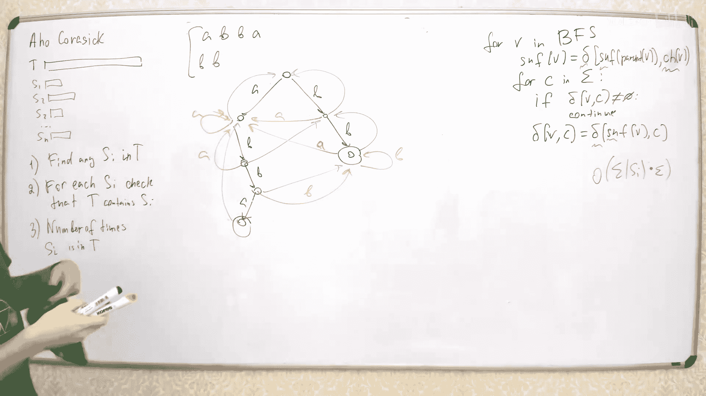

By B， you go here。 then by B， you go here。し。Soビでトマトン。It looks scary， but it's not。No。Again again。

Yeah， you you already find what the problem is， but I'll do。 So what will happen if you， if。

 if you take string A B B。😊，If you take string， A B B。Then you just step from the root and go here。

 here and here， so you will end up in this state so your current state will be ABB。

 so it will be here。W。那そ。Now， what the problem is， The problem is we're actually find the string BB。

 So the string B is here。And JBB is in our set， yeah。But this， this state is not terminal。嗯哼。

So it may happen that you find some string。But your current state is not terminal。W happened。

 because we have some， some longer pres。So we have this prefix B。But we also have some longer prefix。

 So this prefix A B B is also here， So we remember on the longest prefix and this longest prefix may not be determined on prex。

So we have SPB， but we have some longer graphicfis， which is not terminal， it may happen。

So how to solve this problem quite easy so， so how to find out your current state is actually need to be a general state。

So we have your current steak。So you currentt state correspond to some pres。

You find the string when your string is the surface of your current state。

 So this is some string S I。This is your current state。

So your string must be a side of your current state。What are the sixes of the of a state。

 These are all the states which accessible by these six things。

So you need to follow all all these graphic， thanks。So this깔。嗯。This is your Carl state， y。

So you need to follow these Sa links and if you have some terminal state。

Reachable by these six linkss。Then here you actually need to stop because here you find his string。

 so again。If you are staying in this state， it means that your current state is some pre。

This note is your node。 So it it corresponds to some string， So， some string S I。

So this strength S I is some six of six of suffix。 So it is a suffix of my current node。So。

 it is here。So I actually find the string SI in the text， so we need to stop。

If we solve the first problem， so we if we just need to find any string in the text。

So but when we reach to this stage， we need to stop。And say that we actually find this dream pipe。

Right。And have to do it。 Let's mark all the states。

Such that we can reach some terminal state from this state as terminal as well。For example。

Let's make it was something we want them。So in this node， we're find string one。In this note。

 refine find string tool。So from this node。We can reach this note， using this six link。

So if we send in here。We also find the string tool。 So let's mark it this well。

 So let's mark thisest。그 때 됐어。That's all。Okay。没's错。So what want you to do again， what。

 what we you to do。We need do。Mark all the notes。In this path。

S terminal nodes with the same string as here。 So all these nodes also must be terminal nodes because we can reach these terminal nodes using this six link。

How to go to linear of them。Okay， thiss the simple tree problem。 Can be solved。

I want to do it in linear time， I want to in linear time to find all the terminal nodes in this graph。

Be a in programming。いやそ么やね。Not two ways of thinking about this。 You may do it like this。

 You may just follow all the notes from top to bottom。Again， using the same BFS。And for each note。

 if its six link is already marked， then mark this note as well。

So we will just go from layer by layer， so。First well see for this node， this is terminal。

 so we'll mark this node， then we will find for this node， this is terminal。

 so we'll mark this node and so on， so we'll just go from top to bottom and we'll mark all the notes。

우 need 또 막요。Another way to think about this is a tri port。Basically， if you look only at the。

Six linksinx。You will find that six links actually form another tree。So there is a tree of s fls。

every node hass the suffix link。So we can build a tree。So Six link is apparent of the current note。

 something like this。よ。So if you remove everything but settings links。You will have some tree。Yeah。

 but this is to see because each node has only one f linkedlink。 So if you。

 if we say this node is apparent。We will have some tree。

So you can apply any tree algorithm to this tree For example， here。

 what we need to do is if some note is terminalable。Then the whole subary of this tree is terminal。

So if you take a note of this tree then。This sub。Is the set of nodes from which we can access this node using six linkss。

So if some node the terminal， then we need to mark the whole subary terminal。

So it simply mark all everything in this subject。And you can do it using some D F S over this tree。

So you can build explicitly this tree。And then run simple DFS to mark everything which should be marked。

It's another way to think about it。Basically， the same thing。 No here you do the same thing。

 you just， you just do the dynamic programming just。

No that's another way to think about dynamic programming entry tree。

 You can do dynamic programming layer by layer in B as fashion。 Yeah。

 or you can do it just using DF S all of this。Dream， that's the same thing okay。

The only idea is you that you need to your parent we collected before you old， yeah。你星平。Mmm。😊。

So again， the whole algorithm to solve the first problem。 So to solve the first problem。

 what we need to do。First， we build the tray。In the York them。

Then we calculate all the transitions and sexlings again， in linear time。

 multiplied by the size of the alphabet。 if if the alphabet is small， it's good enough。 Yeah。

 what do if alphabe's big rule talk about in a few moments。Now。Now。

 you just take your string team and re your text character by character and remember your current state。

If your current state is one of these terminal states。Then you find one of the strings from itself。

그래 맞아어。What will be tankplexity again tiex to build everything this is linear so you can build this try linear time。

 you can build these things linear time， you can mark all the nodes which need to be marked in linear time and so on so all the precalculations are linear yeah now。

When you read the same T， each time you just add one more character and move along with some transitions。

So each each move is a constant time。 So again， it's linear by the size of this text。

 So the total 10 complexity here， let's look put it here。Will be the sum of。Ls。

Of the given strings multiplied by the alphabet。Plus， the size of the textile。Mmhm。😊，Good。

Let's try to solve all other problems。Let's try to solve all our problemss。 So this if first problem。

그죠。Now， what about the second problem？嗯。Let's do it it the same way。So， we will try。

To fine for each string。If this string occurs in this text，'s drops。Let's draw what happened。

So you have this text。You have your text。And in this text， you have one of your strings， for example。

 here。You have one of the strings。啊，我不 happen不的关就。Most of this position。

When you move to this position， your current state。Will be some prefix。

 which is at least size of this string， because this string is a prefix。 Yes。

 so your current state will have then at least this。😊，Your current state will be something like this。

嗯哼。Okay。So you find string S if your， if at some point， your current state。Is something。So your car。

 So your string is six of this current state。Yep。So what well do？There are many ways to do it。

The easiest way maybe is just to let's mark all the states we visit during this trip。

 So we have this stream， so let's have some string Let's have。A A B， A A，BB。To much。Yeah。Sorry。😔。

I want to find a small example， but I don't want to to end all this。So you have this text。

In this text， you just go from left to right each time you remember the current state and just mark all the states you visited during this process。

 so we start from the start here。マきトロ。Then you have letter A， so you move here， mark this state。

 then you have letter A， so you move from here to the same thing market again。Then you have letter B。

 So you move here。Then you have letter B。Then you have letter B S again。

 So you move from here to here。And then you have letter is， you move back here。

So we just marked all the states we visited during this trip， yeah， so all these states。

At some some point， current was equal to this current state was equal to one of these states。Now。

Let's let's mark all the sixes of this string。 So for all these smart states。

Let's mark all these sidees。So we'll mark all these strings which are the syphyes of the current state at some point。

 so at some point we have this current state won't mark all the syphyes。

 so we'll know that we visited this string S。So we would look at all these marked states。Again。

 do the same thing like we just do。嗯 we need have。有冰。So if this state is marked。

We also need to mark all its suffixes because when we have this current state。

 we also visited all the suffixes of this state right so we go from here and mark all the suffixes。

Using these such thingss。Obsolutely the same。Again there are two ways to do it you can do it using breath using your BFS。

 but you need to do it from bottom to top， so you just take this cu from the BFS。

 reverse it and go from bottom to top and just propagate these marks up to the trim。

Or you can build this tree。You can build three of static links。

Then you need to mark the note If you have at least one mark note in its sub tree。 So for each node。

 you need to find if there is at least one mark note in sub3。

 you can do it using Dev search in the tree。As your wish。Both approach are linear。Okay， again。

 what you do。Use， use you eacherate through all characters of your string。

 maintain your current character be your current state。Mark all the states you visited。

 then propagate these marks using the sex strings。 Now you mark all the strings。

 which actually are the substrs of T， because each string， which is substr of T。

Will be the the s of some prefix。And we just marked all the strings。

 which are the sideopes of all the strings we visited。 So we marked everything。😊，嗯哼。Now。

 to check if your string S。EI in the string tea。You just take this string。

 find the corresponding state and check if this state is marked， if this state is marked。

Then this string was a s of something which you visited and so on。

 So you have this string in the text。别错。嗯哼嗯哼。And finally， let's solve the final problem。

 Let's calculate the number of times visit each string。So let's remove this。 Remove this。

 Remove this。あち。Lgan， let's have some tomorrow。 Let's have a。ABB。Ai。에 거기。你边。맞 지금 비비 비。Some long text。

Let's have some text。I want to find the number of times。 I find this string in this text。Again。

 what happened if I find the string contact text so if I have the string B？For example， it's here。

Here and here。 So I have it three times。If I have string in the text。

 it means that when I visit the last character of the string， my current state is something。

 So my string is s of this。😊，Mmhmm。😊，Do the same thing。

 but will not make the bulls but integer gas will calculate the number of times we visit each state。

Absolutely something。嗯。Again， I will put this string to this automaton and calculate the number of time I was each state。

So I start from the root again， so I have letter A， so here's1， then I have letter A。

 I move here so it's2。I'm standing here。 So now is B。 I move here。 Now another B。 I move here。

 Now it's a。 so from here。Here。Now again， a。 so I move here， so it's free。NowbaA什么。Yes B A B。B。Then。

 a。Then the， okay。Okay is little mess？Where was I here， right， and now B the A。B。呃，B。

And then egg here again。Thats all， so I just made a counter for each note。

And I just calculated the number of times I visited this note during this process。嗯。보거리 lock 같。

You need。 you need at least to read this text， right。Yeah， so at least you。

 you need to read read this text at least once。 Sorry。

 I believe it can be can be done faster than the length of。So this plus T is kind important。

 you need to read this text。 so you can get rid of this。🤧嗯。🤧No。不'错。So见。

I just direct over characters of this each time I have some current state。

 I just increment the counter in this state。Now， for each state。

 I know the number of times I visited this date。 So the number of times I I have this string S is the number of times total number of times I I am in some note。

Such that S is the suffix of this note。So。So if， if I have some string S。

I visit the drink S when I am in some state。From which S is reachable using this such。

So I need to have all these states。So I need to take all this sub and just take the sum of all the values in this sub。

这。And if， if at any point， I am in one of these states。It means I have some string。

 So S is the s of this string。 So I have string S in my text。

So to find the total number of times I see the st S in the text。

 I just need to take some of all these values。 It is a sums in a sub。

You can calculateulate again using dynamic programming on its own tree。

 or you can go from bottom to top and propagate these videos up again。

Just take your current radio and add it to the to your office link so you can go from bottom to top and propagate it。

Same thing。Im not sure but尴尬。We can run the samegram from multiple texts。

 so if we have multiple strings T。We can run in multiple terms。So it will be。

 So this is time for precalculation of all this auto。You mean we don't need the wholeton。 if we。

 if the text is short。啊。啊hu。Yeah， but if you can do it using some tree o kits。

Something like he de compositionposition in this tree and some of this， y。Yeah。

 but if you have many small text。And you just want to for each checks to do something。You can。Y。

Yeah believe if you could apply some three algorithm to this year。嗯哼。No， that's so basically。

 so so that that's the whole so so。We just solved all these problems using this technique in almost linear them。

Almost I mean by bike but were multiplied by the size of the alphabet。But if you are be small。

 if you like， have two letters， A and B， that's fine。If that bit as big， it's not good， price sorry。

불러なかなep。Cool。No， let's do the final trick。So that's the easiest implementation of the Ho。意思。

Definitely usable when your size of the alphabet is small。What happens if your size。

 if the size of your alphabet is big， if the size of an alphabet is big。

 then actually calculating all these transition is too much So so the total number of this transition is too big。

 We don't want to calculate all these transitions。What you can do。

 you can avoid culating these transitions， you can calculate only such things。

And calculate its transition on on on on。 So So what you can do。Okay。

 the most classical that's like the modern notion， so the classical Hora algorithm doesn't use this transition。

 so let's build on these aesthetic things。We'll do it in the same way like we did in the Kutmo algorithm。

 Again， it like generalization of the Ktmo pro。So we will calculate settings link in the same way。

 We build a pre function in the。그호빠에서 말 하게 되야。So so how to calculate sex links it if we don't have any。

Transition pick correct。So we have these plugin。So we have sympathy。

We want to calculateulate the six name。Sarix link is a maximum six of this link。

Want to find the maximum s of stringwi， which is in our tray。How can we do it。

Using the same if same approach like and。 so we will iterate all sixes of string we。I of the parent。

And try to add the last character to this parent。So I will remove the last character here。

Take the parent of V and then iterate all ses of this parent。I am till light。

 I find something which can be extended letters and。아。Now， this string will be my。S fix。

absolutelybsutely the same light K course button。 let's implement this。此示意见。

Spite easier than in looks。Okay， let's say that。Ok， let's see。 say P is apparent。

Of V and x is the character。Again， it's the character character which is on this left。This is P。

 this parent。Ovi。And this age contains。Like we you to be home。Now。

 I will follow this s link until I find this。や。Okay。

 let me write it like as close as possible to the clothth motor platform。

Let's say K is the suffix name。offff the ground。Now， I。

 I will render all ses until I find something which can be extended X。Or if I run to。

 to to the to to the route。 And then so at some point， you will run to， to the route and then you。

 you don't have such thing。So while。AK is not now， and。There is no transition。For bica X。

That's just now。 Okay， just possibility。There's not no time to say。 this is just a no。嗯。

So while I don't have a transition， I just move to the next sentence。No， in the end， if。If K is now。

 it means I turned all all ses。 I can't extend anything。 So I need to make six link to the root。

Then soft。Of we。Else。I just follow this transition， and go to the。算逼不用逼。Okay。Next。那走。

Don close particles， we actually avoid this E since we made the prefix function of 0 equal to -1。

 we just always make plus one here。Here， we can need use needs。

 have a special taste when you have And Im So you follow all these links and go be beyond this empty string。

So in spread， we just have -1 plus 1 and go to 0。 Here we got something something similar。

 So if we go to -1， it means we have beyond the empty stream。 So we need to make。

 make the link to the 0。 If not， we just follow this link and go there。

That's all I claim that tank complexity is linear。そう。Okay， this will be the final thing。today。

 let's prove the time complexity of this algorithm is actually linear。Some of all this。

W of case is no， but can。No， in case now it means we actually we we follow all the links。

 go to the empty string and then try to have an even smaller suffix。

It means we transfer all possible ses and then go from this。 So from the route here。

 I have the s things to know。Sos like this。So if K equals2， now， it means I go beyond this point。

 So sorry， I am here。It means I have no s， which can be extended again。嗯hu。No。

I claim that the tank complexityplexity is still linear。Why is it linear。

 Because let's try to calculate the total time complexity of calculating all the notes alone some strings。

 So let's try， let's take some string S。Let's take a this frustrating and try to calculate the total name complexity。

For。For these notess。Yeah。Let's see what's going on， So whether we render all these notes。

For each time。We have something here last this one。

So let's to calculate the total number of iterations of this while loop。 again。

 like a K motor algorithm in in this while loop， we go from string K to something smaller than string K。

 So here， the length of string k is decreasing。😊，So each time we follow the s link。

We go from some some， some some node to some some node above here。嗯。

But what happens when we move from one transition to the next time saw if we compare this node and this node。

 So when we calculate this bottom node， we actually take k as a six link of the parent， right。

And here， we're just extended by one。So when we move from one node to the next node。

 we extend this K by one。When we go from one note to the parent， do the child。

So K build be extended by one。's not K but length of the K。そ。

SoWhen do you move from the parent to the child。Again， what what happened You。

 you set the sex link as this transition from cable X。 So here， here actually。You， you extend the。

 you extend the K by one carton。Then put it in a suffix array and then take it back here as a suffix of your parent。

So here you put it string of La K plus one and then take it back as K。

So if you sum all the time complexities for all these nodes， you will have a linear time complexity。

아 인도 너 어떻게？And now let's just take some of all these strings。So for each thing。

 that complexity will be linear。 So total complexity will be linear by the sum of these strings。

That's a little bit tricky because1 complexity is linear by the total length of all the strings。

 but it may be not linear by the size of the try。Sorry， so it's possible that your price is small。

 but the total length of all strings is big。 For example， if you have。

 if you have something like this。Okay。Andさ。And here we have。Here her many spend。

Then you have M statess， but the total size of all these strings is n square， right。

 So we have M strings。 Each string has1 M。So the total 10 complexity will depend on the totals to total length of hole strings。

 not on the size of the size of your try。 So it may happen you have a small try。

 but the total length of hole strings is big。 Its it may happen。So for example， in this graph。

 the time complexity list of it will be on square right？

So you have n states here and N N states here。Each time you follow。

 each time when you calculate static for for these states。

 you will need to find you follow all this chain of static things to here。 So you take the no again。

You make have suck， things like this。So when you calculate everything to these states。

 you go here and then follow all this chain。 then for this date。

 you again you take this date and follow all this chain and so on， so。

The time relax may be quadratic by the size of the trackke。

But it will be linear by the total length of all strings。 That's simple。嗯。이대 바로 안。Any questions？

So that we be frost very small。Yes， the first log is linear actually by by the size of the tray。No。

 it's section it's easy to see。 I era the code， but it's very easy to。

 It's linear by the size of the try， but it is multiplied by the size of the alphabet。

So if you have small， try， but is and small alphabet， that's called maybe。把这。응  흐  흐。Yeah， actually。

 how to use this code when we discuss how to how to address problems。

 we actually used all these transitions。 We actually don't need these transitions。 Let's。

 let's raise the transitions and leave only the。Soix links。So to solve all these problems。

 exactly sufficient to have only specific links。How to do it using six thingss。The same way， O，ter。

게 turn。Andで andで。Let's leave on the traffic strings。I変不な。

So you can solve all these free problems using only settings things。how to do it。The same way。

 each time you maintain the current state。But you don't have the transitions。

 So you could calculate it transition on the go。 So you start from the current state。

 So you start from state。Here。Now we have a letter A， so you go here。Now， you have letter As will go。

So， so from here， you need， So you're staying here。 you're just staying here Yeah。

 Now you have letter A， So you need to find the transition by letter A。

 how to find the transition by letter A。 you dont have the transition here。

So you follow the specific links until you find the transition by the letter A。

 So you follow the s link and then move the transition by a。 So you can you standing here。

Now you're in leather beam。 So we go here。Now get a a bit of this here and go very here。Here， now。

 again， you need to， you need to make a transition by the letter A。

 You don't have a transition by letter A。 So you move the side link。

Until you find transition by later in。So from here， you move here。Again。

 you don't have a transition by letter A。 So youll follow the next step cancel one。

Here we have a transition later A。 So this will be your current state。 So again。

 usually standing here。 Then this was your current state， A， B， B， So this is your current state。

And you want to add letter a。You just follow their six links。And you will find all the sixes。

And find the find the longest one， which can be extended letter A。 So you follow the s time。

 You go from here to here。 So your stand will be a。You try to add a to this egg。

You don't have the transition。 So you follow the next subjects link。 Go to the route。

 So your strength will be empty string。And try to add a， A to the empty string。

 You can add a to the empty string。 So you go here， and this will be your next current state。Again。

 time complexity will be linear because each time you follow the six link。

 you decrease the length of the string。So when， when you add one more character， you extended by one。

When you move to along south length， you decreased them。 So you can't decrease it more than n times。

 So total time galaxy n will be linear。M哼。Okay， thiss a bit more classical。Vion of this。

 How can I spell。Mhm。😊，Oh。Okay， enough today。🎼，🎼結。🎼。

