# 【精译⚡算法与数据结构】PavelMavrin p44 p43 A&DS S03E12. Suffix Array -BV1NLB8YfEMq_p44-

🎼。

🎼Okay， so today we continue to talk about strings。 today we talk about six arrayray。

I have a full lesson about six ray on code forces you do。 So maybe。You want to see that。

 but I will repeat like everything the same thing in this live lecture just。

Just because it says this course will be not full without s race。 So we' will talk about s。

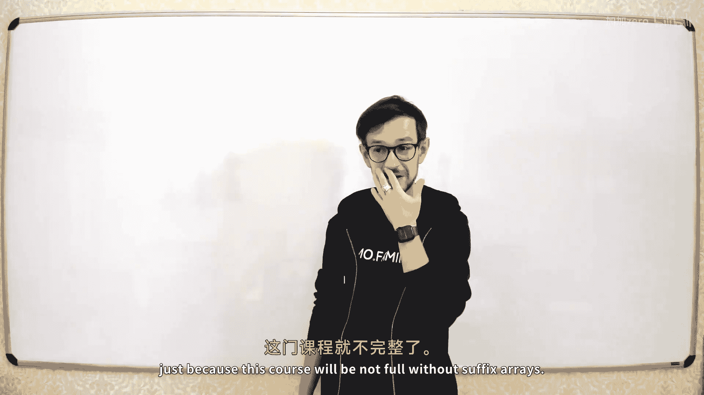

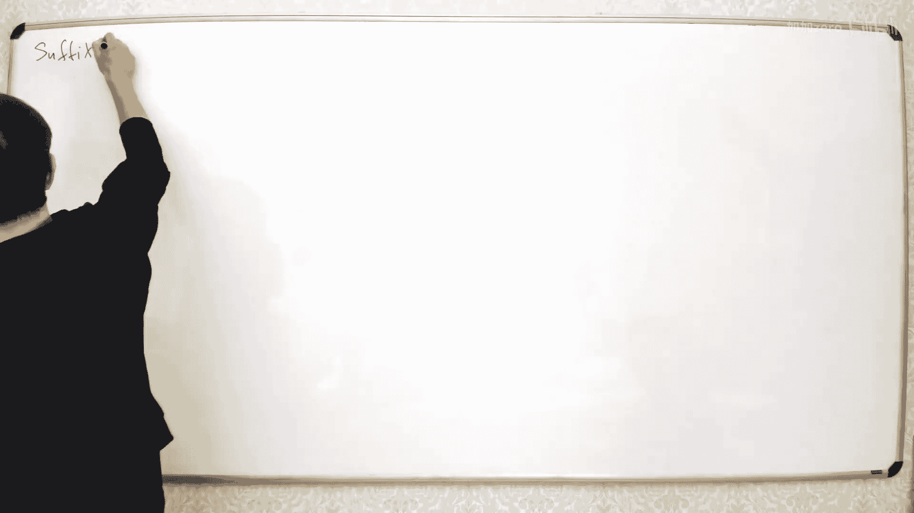

So what is sample and why。You want to use six array。 Six array is very simple。 little structure。

 You have some string。

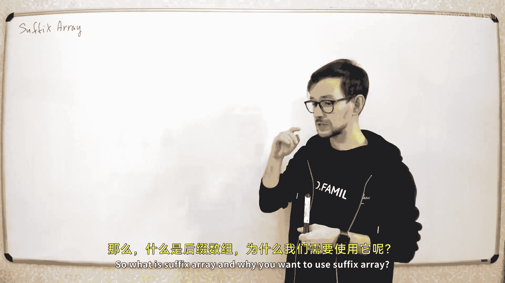

Let's say you have some string。 Let's say， A， B， B， big。

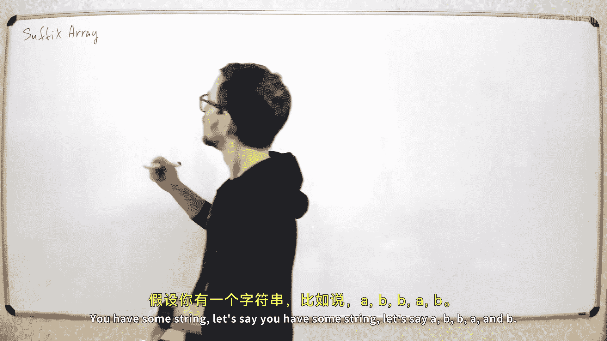

B。Hey， something like this。

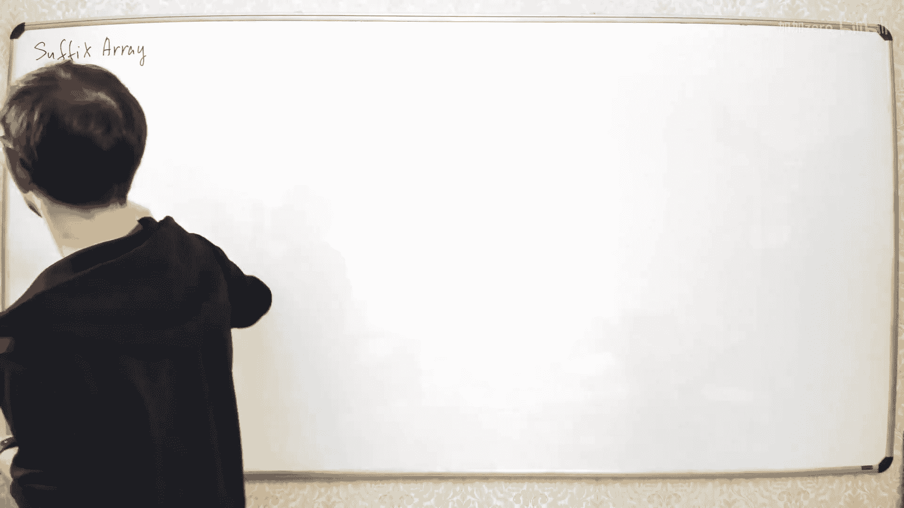

And you just write down all the suffffixes of this string in le geographicalographical order。

 So you start by， you start from empty suffix。 So first， you have the empty suffix。

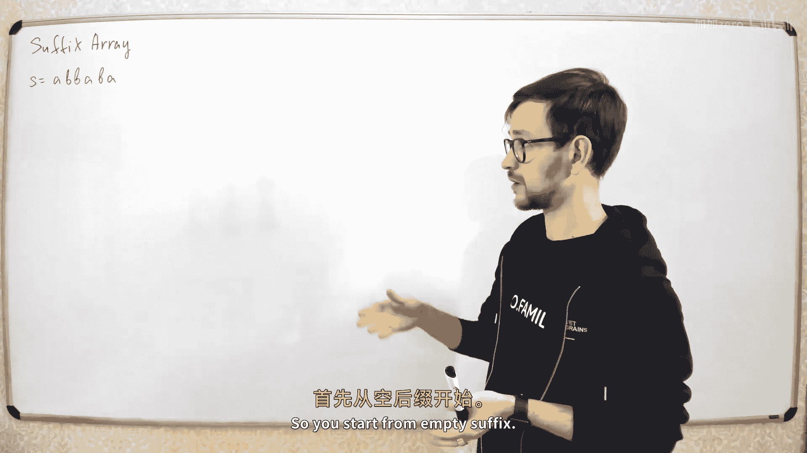

Then you put the lexxigraphally， smallest suffix。 Lexxiographically， small suffix is a。

The next c will be ABA。

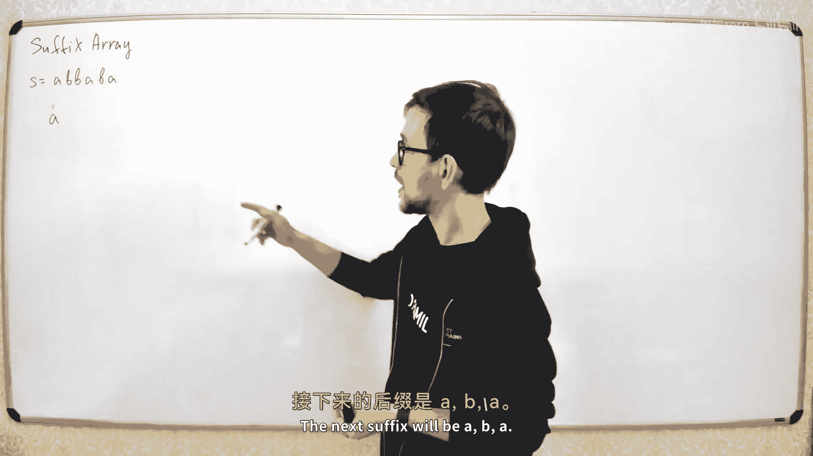

Then we have a。The full string， A， B， B， A， B， A。Then we get suffixes starting from B。

 so we have B A。Then we have be A B A。Not very interesting。

 And then we have these topics so we have B， B， A， B A。

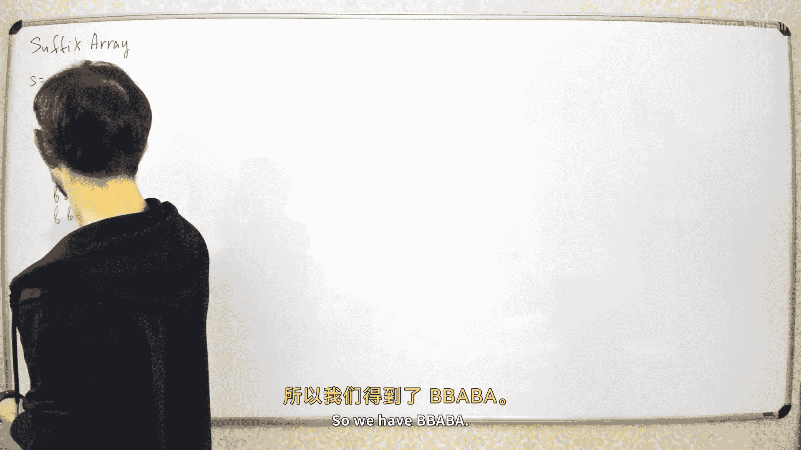

6 and6 yeah。So these are all the suffixes of this string as in le graphical order。That's all。

 This is the six array。 This is what we want to build today， and。啊。

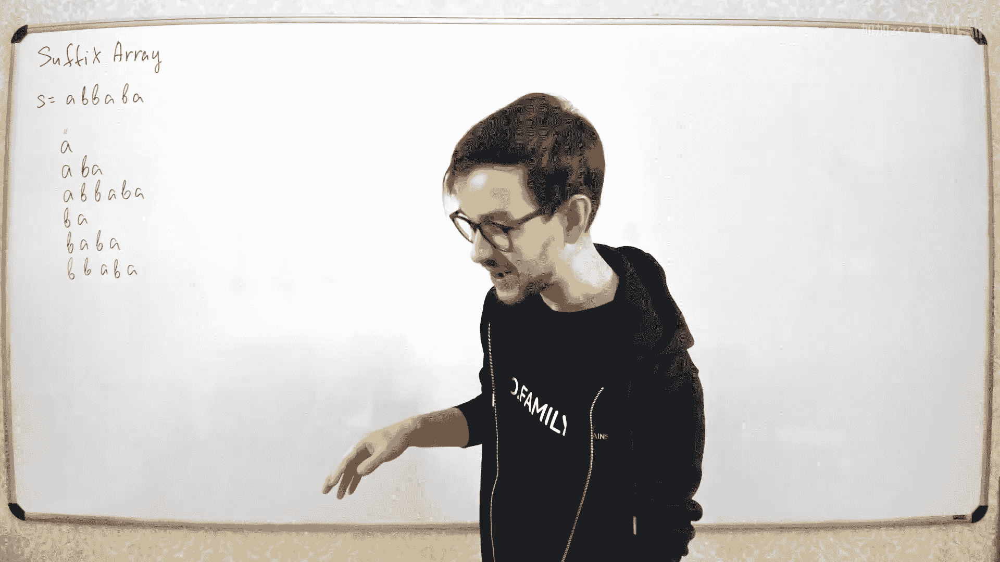

Yeah， that's all。So first of all， how to store the six array。How to store six array。

 You don't want to store six array as an area of strings because the total total size of all these strings is n square。

 basically So So it's sum of all eyes from I to n。 is from from one to n。

 So this total total length of all these strings is n square。

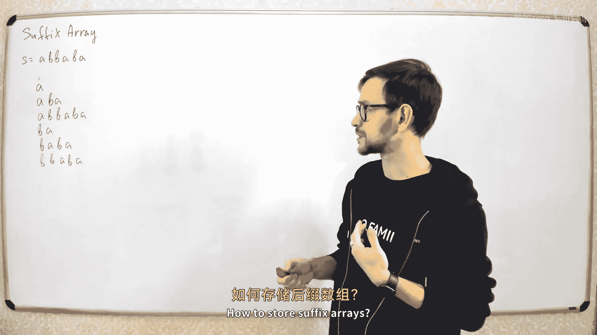

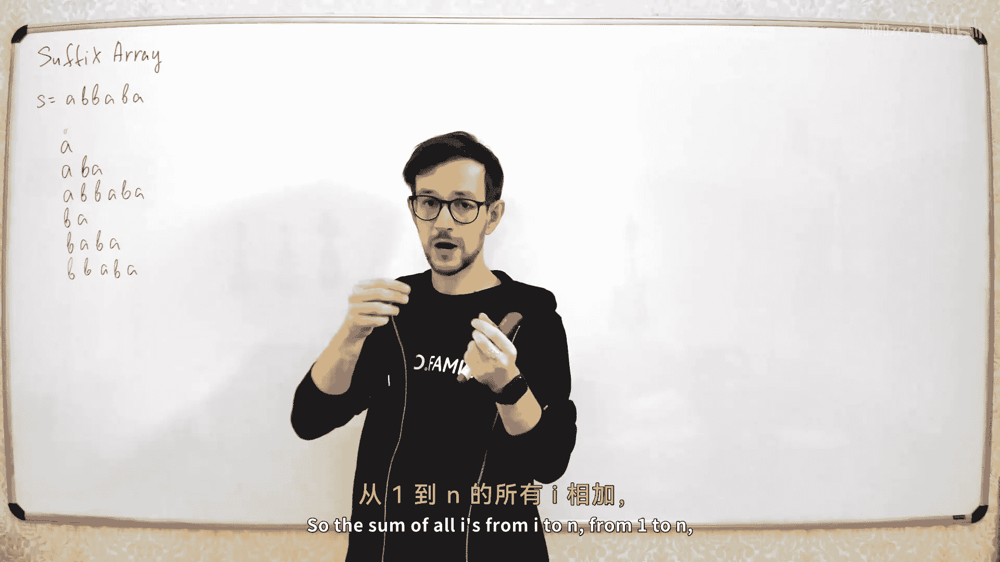

And that's too much。 So instead of storing all the suffixes。

 we want to store on only the indices of the suffixes。So instead of storing these topics。

We will say that this is not a string， but this is the suffix of the string S starting from this from this lecture。

 we will enumerate all the characters from left to right。

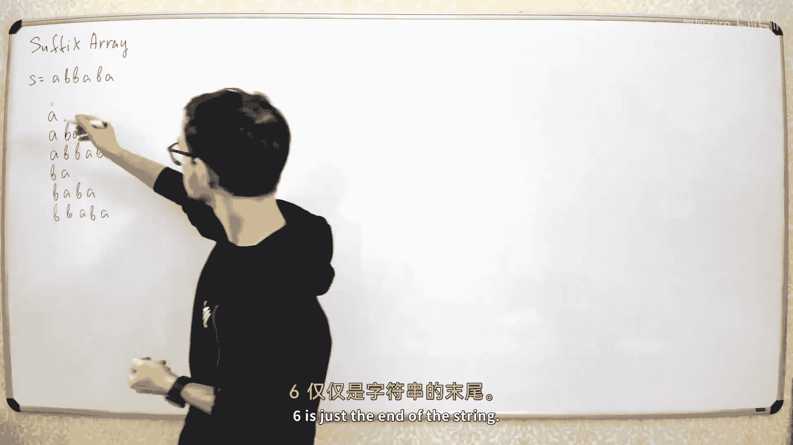

So，6，0，0，1，2，3，4，5。

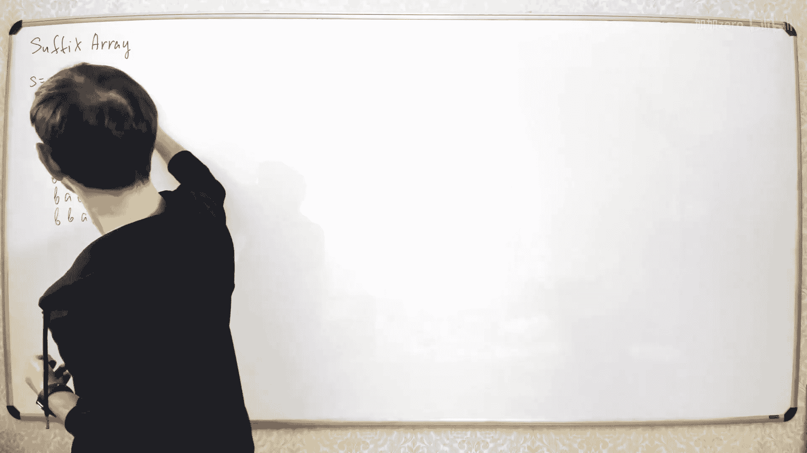

6 is just the end of the stream。嗯。And now now you just instead of writing down the suffix itself。

 you just write the first index of the first letter of the suffix。

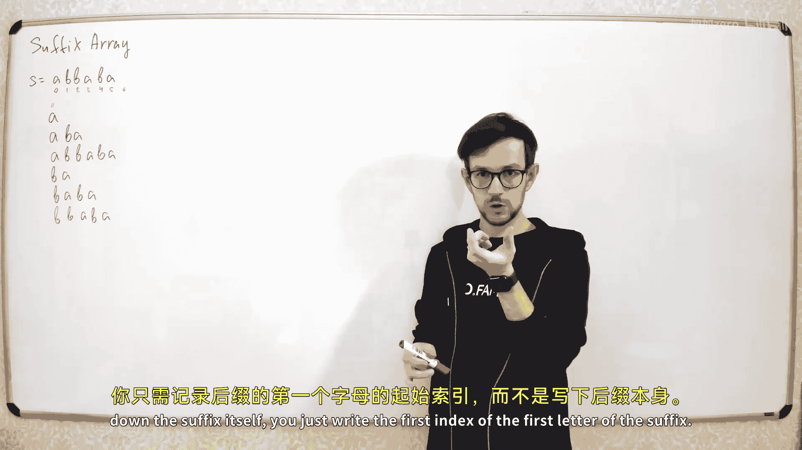

So this is the six starting from that6。So it's just the empty surface。Here's have example the five。

Here you start from。F letter here。 start from there。0 here start from here。 That's 4。 Here。

 We have2 and one。

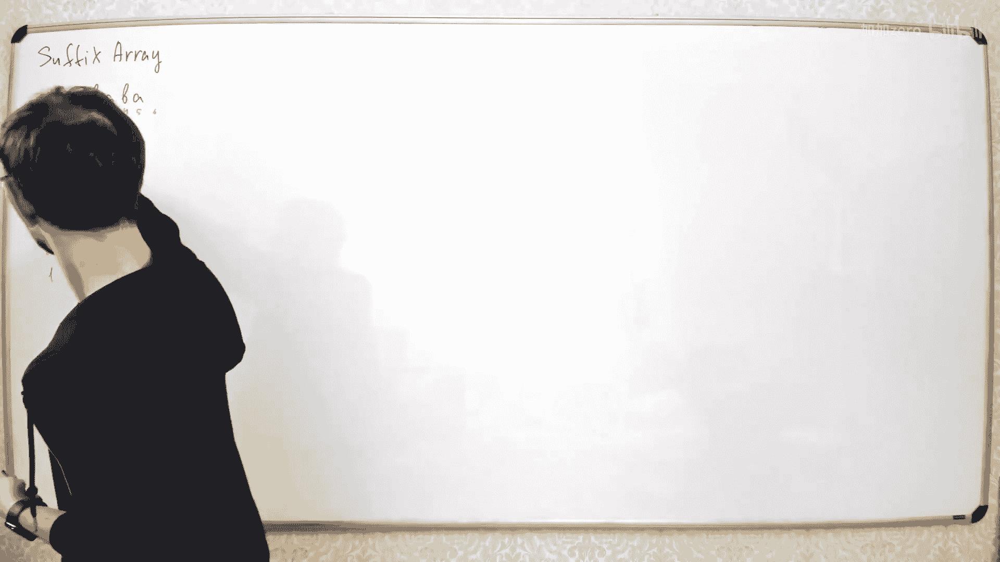

啊。嗯。嗯。Why exactly， bear， not A， A B。We don't have stockix A B here。Six is the end of the string。So 싸。

A row of pre is pretty simple。 you can do it by yourself。

 if you just want to have all the pres of the string it's pretty simple， you can do it by yourself。😊。

Yeah， yeah， the idea is the array of ses。it's very easy to sort all the prefies of the string。 Okay。

 you can do it。But the sourcing of the suffix is a slightly more complicated idea，啊。Let's错。

So you have this array P， this array is the very want to build。

 so this array represents your s array。And if you， if you look at this A。

 essentially enough to get any information about this ses， for example， you want to take。

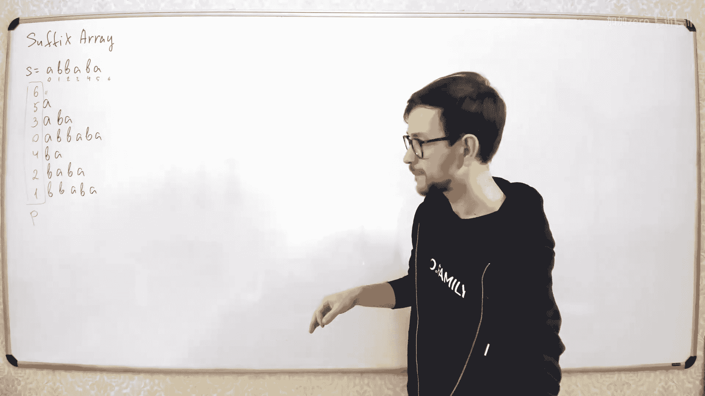

So you don't hold these strings。You only have these indices。

And you want to have some character from one of the suffix。 For example。

 you want to take this suffix and take this third letter of this suffix。

So how to find the third letter of this s if you don't know these string。You just look at this index。

 So the first index of this six is 2。 So index of this letter is 2。 index of this letter is 3。

 index of this letter is 4。

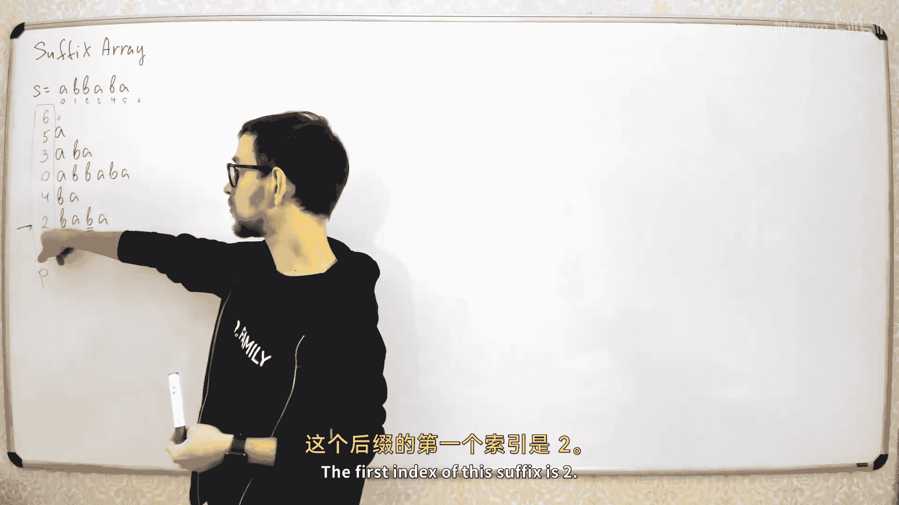

So this letter is actually the fourth letter of this string S。 So you go to the string S。

 take the fourth letter of this string S。Can just return this later。So you can， in constant time。

 you can。 You can get any character of any of any subjectsix from you just using this A P。 So if you。

If you take c of number I and one letter off with index J， so it will be S like P plus J。

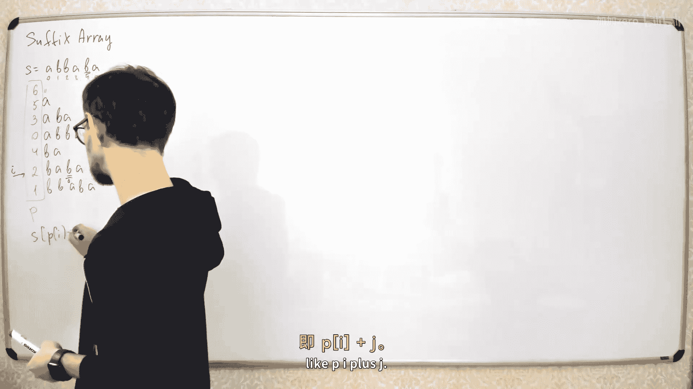

So P is the index of the first letter plus Js index of this letter， so you just look at that。

The corresponding letter is in student S and just take this letter。嗯，哼哼。Just， just， just wait for it。

 We'll talk about it in a second。啊。Why you may want to use this。

Six array around multiple problems can be solved by six array。 the easiest problem。

 like not the easiest problem， but one of the most common problems。

You want to use using substrate is the problem of sub stringing search again。

We come back to the six search problem or the sub string search problem。Imagine you have some text。

And you want to find some substrs in this text。 It's like very common problem。

 you have something like I know you have like the library and you want to have some index in this library so you're given in some word and you want to find this word in your library or you have like a website and you want to have index in your website So you want to so the user type something in the search and you find this string in the website。

 something like that。So it's quite common problem to find some sub stringing in the given text。

And we know how to solved problem so we know how to solved this problem in linear timeia。

 but here we have slide some different problem， we have the text and we have multiple queries。

 so we have some text。And we have multiple credits let see。嗯。I'm out of letters again， so be1。

let's make it cute。 That。We have multiple  queryries， first query， second query。F 구 so。や。

And for each query， we want to find this string in the text。So for each queryium。

We want to find these string in the text。Yep。And we know how to solve this problem using a hokaographic from previous lecture。

 So if if we have all this。A request。 and we can find all these strings in the text in in one pass。

 right。 So using the hookas gallery from previous lecture。

But if you don't have all these queries beforehand。 So。

 sorry you someone is giving you the queries one by one。So so first。

 he asks you to find this string then this string then this string and so on。

 So you have multiple queries， and you need to answer them one by one。

 You can cancel the next query before you answer the previous query。 right。

 That's how it usually happens here。Someone ask you to find this string。

 then ask you to find some another string。And he don't have to wait so to give you all all requests before you start your session。

啊。So for a problem like this， we can use the six rate， so what we can do。

We can build the six array for this text， so we take this text， lets lets change it with S。

Just to match this。So we take this text and build the suffix array for this text。And now。

 using the substrate， we can easily find all the all the sub strings。Because。

Any substring is the prefiix of some suffix， like we discussed in the first lecture strings。

So this substratestream is pre of these substrates。These suffix must be in your six array。

So we just need to find some sffix， which starts with the given string cube。

How to find the s which sounds as given string。 for example， let's take this。

 Let's take this text and try to find something。 I don't know。 I don't know something8。

So we have a query A。Duin。No 왜 몰 for。So what we need to do， We need to find the suffix。

 which starts with letter A B， B， right。So how to do it， We can do it using binary research。

Since all the suffixes are sorted。We can just make binary research and find the first six。

 which is greater than A B， B。😊，just take this ABB and find it here using binary search we will find this place。

 so this string is less than ABB， this is greater Oral maybe。嗯。Yeah。And that's all。 So。's so。 Now。

 I claim that the first string， which is greater equal than A B B。Must start with A B。

 B if we have any string starting with A B， B。So it must be the first string。

 which is greater equal than S than this。So we just make binary research。

Trying to find this string you in our s。Well find this position。 And the next string。This string。

If there is any six which starts with the given string， it must be this suffix。

Because it this list graphic meaning of most， which is greater original and than shrinkqui。

So we just check the six and we see it actually starts with ABB。

 so we find the string ABB in our text。And we know its position because its position is just the index of this suffix。

That's错。So we can answer the squares using binary search。 binary search actually works in time。

And complexity you will be。Lo n multiplied by the time we need to compare to strings we compare to strings in time proposal to the length of the string here。

 so we need to multiply this log n by the length of the string Q apply this。

So we can answer the queries in almost linear time。

 so it will be linear time multiplied by the logar of the length of the text。

 Loarative is usually pretty small。 There is a way to do it fast direction。

If you prickle some more information about your about your ses， you can do it in login， plus。

Lent of the string but。又是类似呢。The power of this data structure is it is very compact。

 So the size of the data structure is pretty small。 All you need to have is this。

Aray of integers of the size of your text。So you have the text of size。 I don't know， a million。

Characters， now you need one more array of million integers。 That's all。

That that's enough to answer these squares。So it's so it's very memory efficient， right。

3 and reverse three noise is slightly different。 So we， we， yes， we have， instead of prefixes。

 We have suffixes， but we don't reverse them。 If you reverse the suffixes， you will have。

You youll have another order of ses。No is， no no， no， no no。The idea is you take staff fix。

 so you have some endings of your string。But when you compare the suffixes。

 you go from left to right， right， So you have suffixes like the endings of the string。

 But you compare them from left to right。So you kindly compare the upstrs。

 That's what that's whats happening。So all the prefies of these sfiixes are all your substrs。

 so it's like compact representation of all the substrs of the given text。嗯。뭐 해？No。

 it can't be done It can't be done easily like Like if you just reverse the string and do something When you reverse the string。

 you need some order， which goes from right to left。 It's like the same problem。不给。Nice。

 so that's what one of the most common problems which can be solved using s。

There are other problems like the problems about substances about six array and other six structures。

 We will talk about six trees next next week。 All the six structures are used when you need to calculate something about substrs of the given text。

 So you have you have a text and you want kind to analyze。

Something about all the subs of the given text。So these suffix array somehow compact representation of all the possible sub strings of the given text。

 So all all the substrs of this text is just all the prefies of these suffixes。

So if you look at all the prees of the ses， you will get all the sub strings and you want to。

And since they are assorted， you can implement some efficient algorithms to analyze them。うんうん。

Its very complexity， but complete some cases into two consumers。 What， what， what。

I don't get it on expression Pro the computer and the same characters in two consecutive elements the。

No， no， no， no。 if you want to do it first， you need kinda to precalculate all possible ways of your binary research。

So for。You can do it as an exercise。 Yes， no because when you do the binary search。

 you kind of compare the same characters from left to right。 if you compare the first。K characters。

 And no they're equal to this string。Then when you go to the next branch of your binary search。

 you kind of want to skip all these first characters because you know these characters in the previous stage of the binary search。

 they were equal to these characters So you' kind of on the next stage you kind of want to skip them and so on。

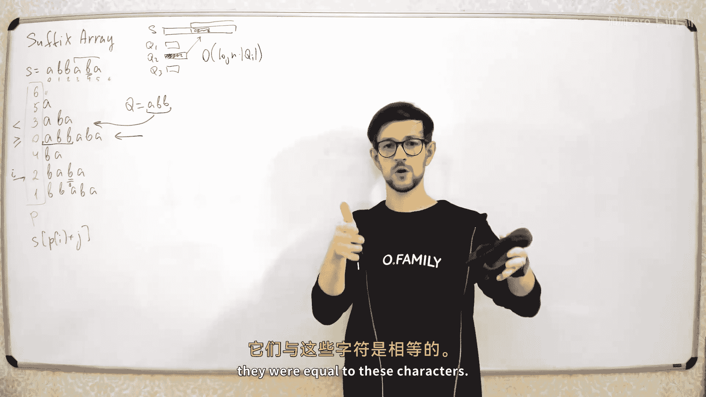

The idea is to precalculate something which allows you to skip all the characters which you already compared from。

You may think well， it's an exercise。Ha로운 건。What well discuss today is how to build this breath of this factory。

So this lecture will be about how to build this s story。お。

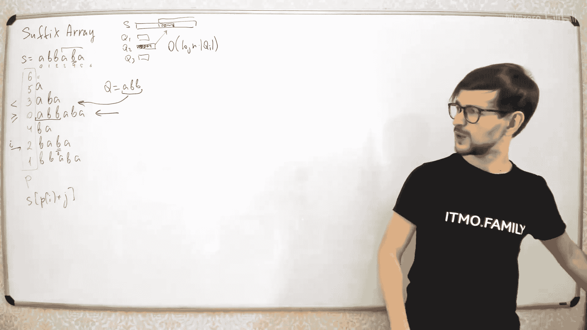

First， let's discuss some。Simple order。 for example， what you can do。

 how you can calculate six array， You can just write this area of all suffixes and sort them。No， sir。

 this is sources array of suffixes。 You can write down all the suffixes and sort them。Why not？

 What's the problem。老玩我吃。2。

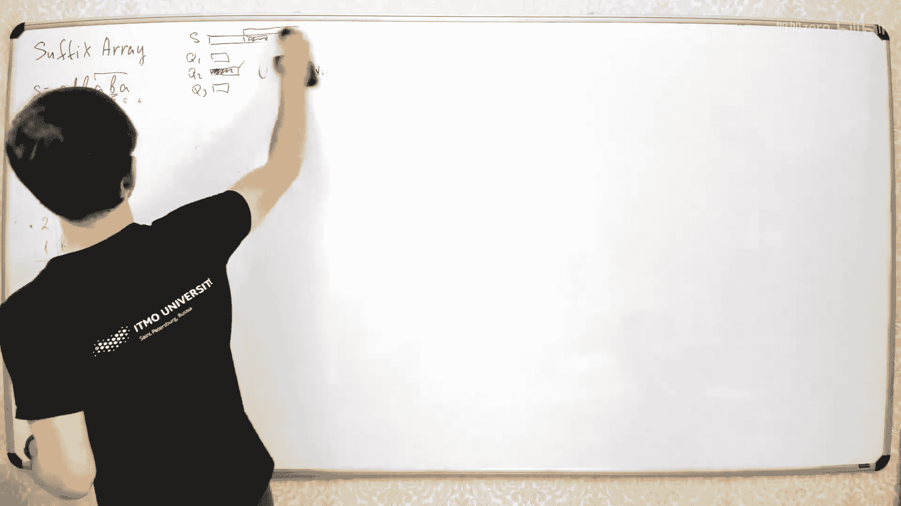

So if throw the deal list， let just write all the subjects of sense time。

not the ses themselves again， you don't need to write all subjects themselves less。Make our API。

 just put them integers from 0 to n。Then sort this API with compator， which compares two strings， y。

Just so。What will build1 complexity if you just。They call the s in sorting。

 The complexity of sorturcing algorithm is analog loggan。

But in each stage of the of the source algorithm， you need to compare to strings。 Yeah。

 so this analog log n will be multiplied by the time complexity of the compator。

Just put it multiplied by comparator。一一。We go to first。 yeah， I'll， I'll do it in a second。

First of all， if you just compare two strings like usual do。

 just go from left to right until you find the first so how to compare the strings again。

 you have two strings。You go from left to right and find the first character， which is different。

So these characters are the same。And this character is difference here， we have x here we have Y。

 So check this x is less than y。 And then so the whole string is less than this string。

 That's how you compare to strings。 So if you just implement it like this， in the worst case。

 you may in each comp you may go up to the end of the string each time。

So the the complexity of all of， of of this compator may be linear。 So if， if， in the worst case。

 you will have something like this。 You will have N square organ。That's obviously too much， ym。

But actually， in some cases， it's it's。It's a legal algorithmism。 So so in some cases。

If your string is pretty random。In some sense， yeah， if your string is pretty random， For example。

 you have something like， I don't know。 know， For example， you have some DNA string。 Yeah。

 so so you have a DNA sequence。 DNA sequence is pretty pretty random。 There are some blocks of equal。

Data buts。Pretty much random。 Yeah， so if you have some random string。

 then the complexity of comp is actually small。 No since there。

 if you have completely random strings， then the probability that you have a long。

Common graphics is pretty small。 No， So the probability that you have K equal characters will just decrease exponentially。

 right， So usually the compator will work in constant time if you have random stream。

So for random streams， it's actually a good strategy。

What what's best about this strategy is that you don't need any other arrays。

You just make this A A P。Then run a source algorithm on this repeat。And in the end。

 you have the sorted R。ThatSo you don't need any other race。

 So it's absolutely optimal if you think about memory additional memory。 Yeah。

 So so if you have very small amount of memory and a random string， that's the best you can do。

But in the worst case in the worst case， it is pretty long。So how， how can prove it？ We can， Yes。

 we we can use fashioning from the previous lecture from there。Two weeks before。

 so we can use Haian algorithm。So we can compare。So again， to compare to strings。

 we need to find the maximal。Common pre for this to string。And to find the maximum common pre。

 we can use binary storage with hashes。So we can， we can find this length of these common prefix using binary search。

 And when we compare to strings， we just use hash。So we calculate hash of this string。

 hash of this string， compare them if theyre the same， we go to the left to the right。

 if they're different we go to the left in the binary search and so on。

So we just make a binary So each time we need to compare to sixes， we use a binary search。

And in inside this binary search， we use， we need to compare to strings。And we use sketches for this。

So we use hashs plus binary research， so the complexity of compator will be loin。

So if you can binding ship and hases， then each comparator will work on loggan time。

 so total complexity will be in log square。This is also a algorithm。You can implement it like this。

Not very efficient。But actually， quite good。It has two problems。 It has two problems。 First of all。

 we need to use hashes and we need to just believe that we have no collisions in this hashes。

 so we need to have some big hash， good hash， so there will be no collisions。

Because any collision will break you your certain algorithm。If you have any collision。

 then you will have wrong result in your binary search。

 You have wrong result of your compator any collision may completely ruin your sort of。

So if you compare those strings and you have one wrong result in this comparison。

 will just break all your certain algorithm。It's not good。To break source and all other things。

So not 그랬。can we will do better。 Another problem with the algorithm agreement is use analog look square timing。

And analoglog square plus hasshes。 When you use hashes， you need some modular ametics and stuff。

 So it's actually pretty slow。 We will make fast algorithm， but it wouldn't have it's much。

 much better than just。Using standard compator， if you have some bed cases， what's bed case badcase。

 for example， if you have some， if if all characters are equal， you have string of。

 of the same letter， very long string。Then the simple comparator will just go go across the whole string each time。

So this will be much better， but we will make。Oプ op。Okay， I talk about。

 I talk about this organ too much。아 이 익숙 얘기하면。How to compare to string using heing。

How to compare those strings。We need to find the maximumim common prefix。

So we compare these characters and then find the first character， which differs， yeah。

So we need to find the maxim common pres of these two given us strengths。

And then check the next letter after this common pre。So we can find the longest common pre。

Just using hashes， last binary research。So we make binary research。

And find the maximum number of characters we can take from here to here so these strings will be equal so we calculate this cache。

 calculate this cache。And compare them if they're equal， we moved our binary surgeon in。Yep。

So use buying the research。To find the longest common pre。And inside this binary research。

 we need to compare， we need to compare the strings just We need to check if the strings are equal or not。

And we can check the quality of strings， just using hashes。嗯。Nice。So let's。

 let's go to the algorithm。Now， let's move to the algorithm。 So now。

 now we'll talk about the main algorithm。够。So the easiest way to， to explain the algorithm is。To。

 to modify the problem a little bit。嗯哼嘿嘿嘿嘿嘿嘿嘿。😊，Yeah， yeah， we'll do yes， let's wait for it。

 We will do it。 We'll do it in a second。Go。So。You can actually， you can。

 you can implement the algorithm just without all this。呃。

First section but it's a little bit easier to understand what's going on when I modify the problem a little bit。

Actually， actually， it's it's。嗯。You， okay， you you， you can do it without it。

 but it's easier to understand when I do it。 Okay， so so I object it。Let's let's literally。

Let's put it for I broke okay， welcome。几优性。So I want to modify a problem a little bit to make it a little bit more easier。

 Okay， so first of all， first of all， what's the problem。

 first problem is all the strings have different length。

 So I need to sort the strings and the length of all strings is different。

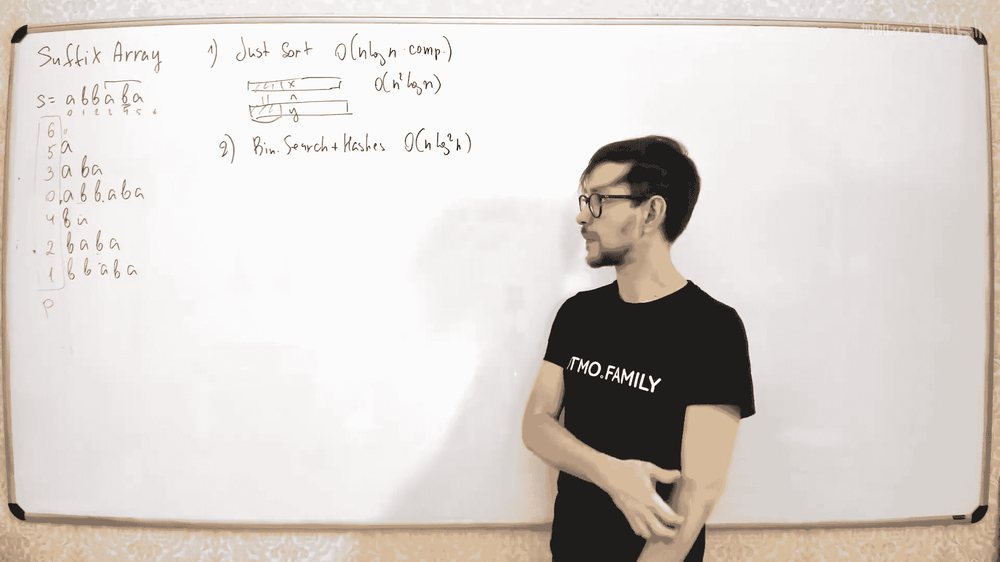

This。Not very comfortable。When you have strings of different length， you may， you may accidentally。

Ask for some character， and there is no character。 So it's little bit ungraable。

 So I will make all the strings the same length。 How to make all the strings the same length。

 First of all， let's put a special character in the end of the string， so。Put here special character。

This special character will be less than any character of the Gils。So， if you just。

this day all the suffixes will be extended this directly。That this。Yes。

 in practice you can use zero character。Actually， in in， in C plus plus。

 you have zero character in then string size。Quite useful， yeah。But its。

 it's hard to write zero character in in on a whiteboard。 So I will use dollar sign Okay。

 So this dollar sign is a special character， which is less than all the all the characters of your stream。

Now， let's see。 if we。If I add this special character in。To all the suffixes。

 the order of the six will not change。 So the order of the six will be the same。

Because when you compare to suffixes， you compare them from left to right， if you。

If you compare this dollar to something， it will be less than something。And that's what you need。

 Yeah。 So if one string is the perfect of another string， it must be less。

So if one string is less than another string。Then when you add the special car in end。It's。

 it will still be less than this string。 Yeah， again， you have two strings。

And this is less than this。If you add this dollar sign to this end。Yeah。It was three， same A and B。

If a was less than B。Then when， when you add this dollar sign to both strings。

A will still be less than B。 Well， because if a was less than B， it means it， it has either some。

Common graphics here。Plus， some characters here。So in that case， a is still less than B。

Or it may be a perfect story。 Maybe it was A and B， something like this。So if a is perfect So B。

 it is like gravity more than B。 like here will A。 we have a and then A A。And here。

 B A and then B A B。But if you add the dollar sign。

 it will it will still be less because when you go from left to right， you go to this dollar sign。

 dollar sign will be less than this。Oh。😊，So this modificationification will not change the order of the ses。

 so it's good。Now。Now what we need to do。We using this door sign。

 we can extend all the letters to to to make them the same length。And。For core reasons。

The easiest way to do is is to write all the same characters from left to right in the same stream。

 So after the dollar sign， let's write all the letters from left to right again。

To make all the strings the same length。So then we'll here we have A B， a dollar。

 and then we go from here again and say what， A， B and B。嗯哼m。😊，And now do the same tool lot strings。

 So we have here we have A， B， B， A here we have a。Okay。No， how's the8， right。A。

Slightly not alignment。 Okay， so here we have A， B，B， A， B， and here we have A B， B。응。So now we have。

 instead of sixes， we have a cyclic shifts of this trend。

So now all these things are the s shifts of this string S。So， again， again。

 what what does mean we have string free， string free。

 It means we start from this letter three from here。

And follow the same characters just to the end and then start from the beginning to the characters。

So now， instead of suffix， we have string from。Here to here。

 Then we start from the beginning and start from here to here。And we get this string listing。啊。

it is more comfortable because we have now all the strings have the same characters， yeah。不上去。Again。

 for technical reasons。You， you can avoid all these transformations。 You can do。

 You can do the same algorithm just for for your ses， but you will have more conditions。

sometimes you need to check that you， you go to to the end of the string and something。 So you。

 you will have more conditions。 That's just more easier way to understand what's going on， okay。No。

Now， after these modifications。We have all the cyclic shifts like this。

 and we need to sort all the cyclic shifts。It's little bit。Little bit easier， okay。那我换一你。

The length of the string is not power of2。Again， this's some good。Okay， the the of the string is。嗯。

아 그거 있어。방 왜 얘기 해。응 응 응 응 응？Like thisょ。So the lamp of all strings is7。7， not bubble of2。

And I want the length of things to be power of two。

So let's add one more character to to all these string。

I will add one more character of all the things to make all these strings the less equal to some power of two。

And next character again will be the next character in the cycle。

 so I will continue to write down the characters in a cycle equation。

 so this next character will be dollar here， here will be A， A， A， B， B， and B。

And now the land health has doing is power。That's all。 That's all。Again， we want to sort the ses。Y。

But Sak strange Sas has different length， and so on so。What we did， We just add this。

Dolls sent to the end of the stream and then I added some more letters in the cycle。

So the total level of1 sink will be a power of two。So now， instead of。

Instead of sorting the suffixes， we need to sort。Sttrainrange from S。I 2， I plus 2 power of k，-1。

In cycle。

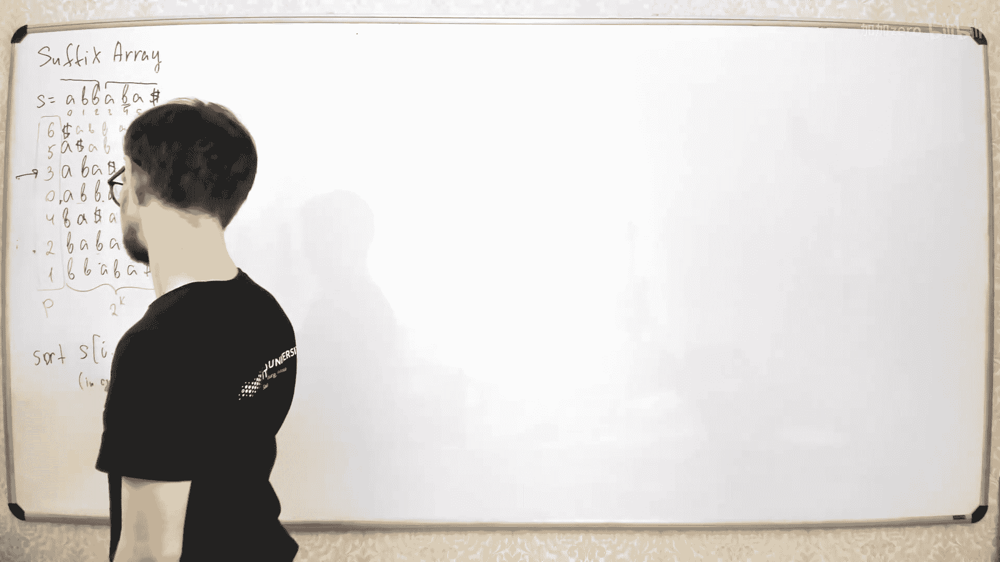

So if we sort these strings。We will have the solitary of of suffixes。

 because the order of suffix is the same as the order of these pcyclchic shifts。嗯。不'错。Oh。Let's it go。

 no， no no， now we just build this。So the algorithm will contain several phrases on the face key。

I'll just write the same thing。I will increase this value of k from 0 to again。 So in the end。

 I will have the sort of。So in taste case， I will sort strings again。I just run the same thing。

2 I plus two power cake， sample。So let's start with k equal to0。 give k equal to 0。what's going on。

 O equal to 0， If K equal to 0， it means I need to sort the strings of size 1。

So I need to sort strings as from I to doing power case1， So from I to I。So in the zero phase。

 you just need to sort all the strings of one character。You can sort strings of one character。

 using any sort algorithm。So you just write down all the characters of your screen and sort them。

Okay。So you sort all the single characters， you can do it in endloggan time using any sort on。

You can use mergech sort。 You can quick sorts， Heap sort， He sort is not very efficientlocing。Yeah。

N so quick for them。What the unit。那。Now， I will will make a transition。

 I will make transition from K to K plus one。So in the phase K。

 I have sorted strings of then to power K。 So on the next phase。

 I need to sort all the strings of then to power K plus one。

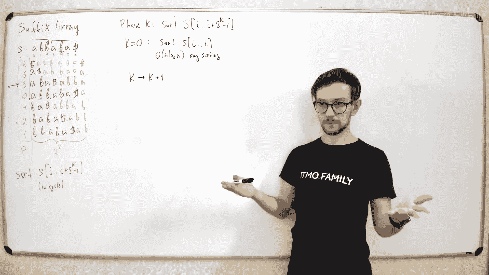

W how to sort drinks of the left cake， two in power cake plus1。

I will just sort them using sort an algorithm。But to implement this order on this， I need to fast。

 I need to first comp。 I I need to compare to strings of the length Kpa2 in the power K plus1 first。

 Yeah， let's see。I need to make a comp。Which takes two strings， A and B。In compare them。So let's see。

 So if a is how to check if a is less than B。So if you have two strings。Of length，2 a power。

 K plus one。How you can compare two strings。Like usually， you。

 you will divide this string into two strings of them to bar。

It's basically the same principle we used in all the data structures in lake。You in searies in。

 I don't know。By the climbing when it costs。Re and so on。

Sorry Ill I'll just split this long string into two smaller strings。

 So all these smaller strings can lend to power k。And now I have strings of length twin power key。

And in the previous phase， I already sorted all the strings of the land to a baroque。

So I know some information about this things。So now what do I need to do？啊。No， let's see。 Let's see。

 So if this。 So this is a 1， This is a 2。 This is B 1。 This is me， too。Okay。

So if we know how to compare strings of length2 power K。

 how we can compare to strings of length2 power K plus one。Hello。Seay。

 we need to compare the strings A 1 and B1。 So if a1 is less than B1。Then。What does mean。

 It means we have some。Common pre here。And then some character here， some character here。

 So this is less than this。So if a1 is less than B1， then the whole string A is less than string B。

So， we have the same common pre and same character here。So if a1 is less than B1。

 then a is less than B。Now， if a is equal to if a1 is equal to be 1。

If we have two equal strings here。Then we're need to compare a2 and B2。嗯。So， we follow here。

We have some character here and some character here。So we need to compare strings A1 and B1。

 And if they equal， we need to compare A2 and B2，So the compared looks like this。 So a less than B。

Is the same as a 1 less than B1 or。A 1 equal to B1。And。A2 is less than be2。

So we have a comp like this。

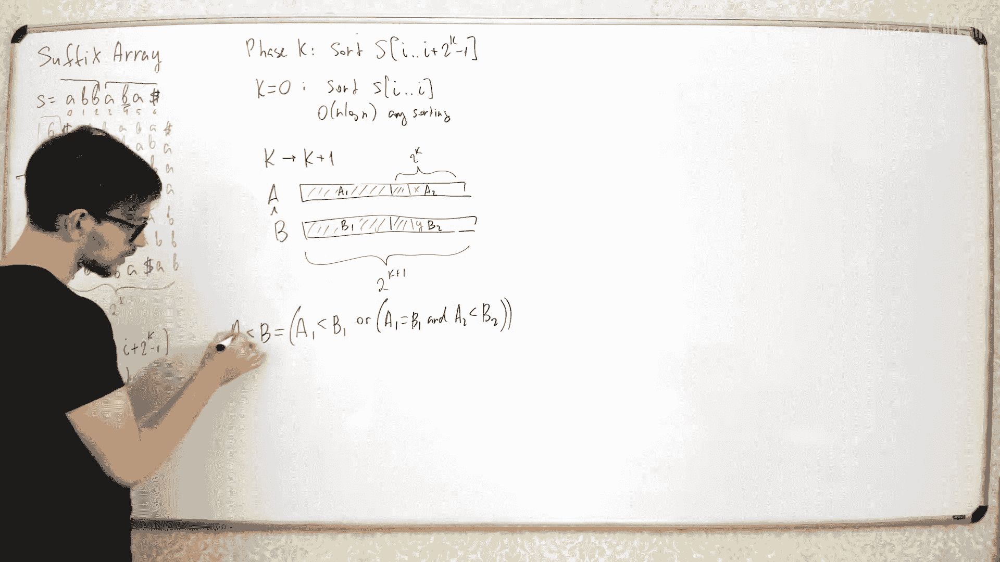

What does mean it means that if we can compare strings of length to power O K。

Then we can compare strings of2 power key plus one in constant time。

 So if we can do if we can make these comparisons in constant time。 so like this comparison。

 this compression。So if we can do all these conversions constant time。

 then we can compare the strings of length to K as final in constant time。不。You。

 you may think about this as comparing the two pairs。 So if you have so so。Actually。

 it is the same as comparing two pairs。 So we need to compare pair A 1， B1 with pair。A2， B 2， yeah。

Again， when you compare to pairs， you compare the first element of the pairs。

 if it is the same you compare the second element of the pair。那。

How to compare two strings of length to an power of cake。

Now we will use the result from the previous step。 So in the previous step。

 we already sorted all the strings of vent power key。So we have this sorted。

So we have the solidlit array of stringson。A fl barbecue。So strings， A 1， B1。

 A 2 and B2 are in this array。 So So in the phase K。Yep。We already have this rib。Yep。

 so we have the surgery array is less a 11 less than a2 Yes。 That's what I write。Yeah。

 so this pair is less than this pair as pairs。Now，So yeah， in the previous step in the step K。

 we have this array of all the possible strings of them to in power K。And we have a inserted order。

So how to compare to strings？If we know the positions in this race。 So for example。

 you know that position of string A1 is here and position of string B1 is here。Yeah。Okay。

 my but my you know what I mean okay，A1 be A2 less than B1 B。一系噶。Thanks。嗯。I just just I just。

 I decided from here and then， Okay， my brain can。 Okay， what happens。Yes， thank you again。 Okay。

 I now back， back by， by， By， By back to here。I want to compare two streams of of the level to power of cake。

So I kept。I have both these strings in this array。 so this is the sort array of strings of lengthern power。

So how to compare these two strings， No， since the strings are inserted over， y。

We can look at the positions of these strings in this array。

And the string below must be greater or equal in this string， right？The sincery is sorted。Yep。

The string in the bottom must be greater than string in the top。Oracle。This or equal is important。

Since we don't know， actually。 So if we have just two positions。This B1 may be greater than a1。

 or it may be equal to be a1。And we actually have the strict equation in equation here。

 So we need to check if it is less or if it is equal。So if a one is below B1。

 it's definitely not place， thank。But if， if it is above。

 it may be less or it may be equal and willing to distinguish these these two cases。

So they have the whole problem， we have the strings。Let's example， for example。

 let's take this string again。So， for example， we we have this string and we already completed phase one。

 So so we completed phase one。And we know these strings。 We have a A。 We have a dollar。 We have a B。

 A， B， B， A， B， A and B， B。そう。So if you have this string。Then after phase 1， we have this array。

 Not this array of strings。 Again， it will be it will not be a array of strings。

 It will be array of indices。 Okay， it doesn't matter。 So we have this array P。Basically 6，5。

 something like。0，3。嗯。2，4 and1。 sounds like。SoAfter the phase one， we have this A。Mh。😊，那。

We want to be able to compare the strings。So we want to check。

 We want the way for for for the given to string if these string are equal or not。

We can do it just by enummirating all this， all the equal strings of the same。

We have the same number。 So well go from top to bottom。And assign a number to each string。

This number will be the same for the equal strings and for different strings。

 the last string will have less number。你得。Okay， so we just go from top to bottom and assign the numbers from 0。

So we assign number 0 to the first string。So these strings are different。

 So we assign the next number。 So we had number one。 So these strings are different。

 So's at number two。 these strings are equal。 So we assign the same number。

These string are different。 So I sign next number。 these things are equal。 So I sign number 3。

 these string are different。 so as sign number4。So we will build this I sea。嗯。

And now we just use this ray C to compare these two strings， A1 and B1 and a and N2。Again。

 to compare to strings， we just need to compare these numbers。 If number is smaller。

 then the string itself is smaller。For example， again， you want to compare some。Stres。

 let's compare something。Let's compare these two strings。

So we have string inposition 4 and inposition 2。 So we have string B， A dollar A and string B。A， B。

 A。So these are strengths in positions，2 and4 and 2。So in the next cake， kick me。

When we move to phase cable equal2， y， we need to compare this two strings。そ。These two strings。

Can be splitted into two strings of size， food， right。So we split these two strings into two halves。

 these two strings into halves。哦。Each of these strings， we need to find in this array。No， it's easy。

 We know the positions。So this string is inposition 4。 So the first。Half is in position 4。

 we find position 4。And now the integer here is free， so。So lets get like the class of this string。

 Let's call class of this string。 So the class of this string， will be free。Let's find this string。

 This string is door A。 It's here。So Do a has plus 0。So the second half has has 0。

How can how can I find it easily， No We now the position of the string is 4。

 So the position of the second half will be 4 plus 2。So the position of this string is 4。

 position of this string is 6。So we find string4。 So it it will this will be a1。

This screen will be a2 Again it。 we， we can find just by by using these indices。

 We know the index of this position is 4。 so index of this position must be 6。

Yeah now in the same way we will find the positions of resistance streams。

 So this string has positioned tool。So this drink must have position for。So， this string will be。

Zhu is here。응 네。It has plus free。And the second half is in position 2 in position 4。 So it's here。

And his car also free。And now we just need to compare these two pairs。 We need to compare pair3，0。

 with the pair free， free。We know that 3，0 is less than3， free。 We can do it in constant time。

 Just compare these integers。So we compare this two strings。 No that。

So we know that30 is less than3 free。It means that this string is less than this string。嗯哼。

That's all。So again。내 all 그랬。We go in in different stages。 certainly on each stage we take we。

 we have the number key。And we want to sort the strings of the length twin power of K。And in phase0。

 is it's simple。 We just need to sort all the strings of the single characters we can do it using any sorting algorithm。

Now， when we move from stage K to stage K plus one。啊啊。So we take the previous stage。

 take this array P， calculate this array C。So this receiver will assign some numbers to these strings so that the small shrink has a smaller number。

Now， we use this A C。Do make this fresh compator。So this fast compator works like this。

 It takes these two strings。Look at the first half of the strings and look at the second half of the strings。

If the first half is the same， then it compares the second half。How to compare these two strings。

 These two strings are the strings of size twin bar K。We can find these strings in this array。

Just by using these indices， we don't need these strings。 We only need this indices， right。

So we have only these two arrays of indices， two of ingers。So we find these two strings into in。

 in this array。Find the corresponding glasses。And find these two strings in this array and find the corresponding glasses。

 And now we just need to compare these two pairs of integers。

We can compare its pair of ins in constant time， so the comparator will work in constantine。不ello。他从。

What will be total complexity， Total complexity will be like this。 So， first of all， we need to sort。

That's right， total complexity。So first， we we spend analog log and time to sort。

To to make phase phase 0。 And now we make。Logan mo is in in each stage we we。

Make this we on the sorting algorithm。 So in each stage， we resort their A。

 Each sorting cost you end of time。So total income complex will be。And looks great。

It can be easily improved to endgan。It can be easily roted and looking time just by removing this salts and oil。

So the critical part here is this sort of order。Every time we're run the same certain order from again and again。

We can avoid the sourcing it just by looking at what to actually be sorturcing。

 We source not some random objects。We sorting the pairs of small integers。

So each time we sort the pairs like a1， a2， that way make it。And pair B1， B2。

And both these pairs contain only small integer。 So all these integers A on a 2， B1 and B2。

From 0 to n，-1。有。So we need to compare not something。 We need to compare pairs of small integers。

 We can compare pairs of small integers using the raor。Mmhm。😊，If you forgot how to raise。

 how would the software for well we discussed it like last year in the first semester。Basically。

 you need to run this counting sort twice。 so you need to run counting sort for the second。

per part of your pair。 And then again， around the red salt for the first pair of your pair。

And after two pieces of thelic sort off off of the counting sort。You will have a solitary of pairs。

Yes， you can， you can build。 you can build six array in linear time。 That's， that's true。

You can do it， but the constants will be。Con will be bad。 So sorry it will be linear。

 but the constant factor will be great on this。 And actually。

 what was more important than the memory。You need to use in the linear time algorithm。Much， much。

 much， much larger so。 So you can do it in in linear time。 It's， it's not。

It's not that interesting because you can actually build the six tree in linear time so for theoretical use。

Suffk tree is luxury。Much more interesting than six array。 But for practical use， this algorithm。

More interesting， because linearar Tom my Albert is actually。Usually， its slower。

 and it is actually use and it uses much more memory to build this s array， so。😊，Usually。

 this algorithm is more efficient。That's what they will mean。Yes。

 if the size of for alphabet is up to end， then you can do it in later time again。나 어 야초 안 늦쨌든。

But you need you kind of need sort help it， sorry。You need to be able to sort the letters。Yep。Yep。O。

 if in letters， you have integers from one to N， Then you can do it in linear time， please。

Se like this。Okay， now。Let's round this examples let's just round this algorithm this on this string just to make everything。

Cl I。So I will just take this string and run the whole algorithm just。

Just so you understand completely what's going on。一直ての。And I think not， I need to read this。Okay。

응 응 응 응 응 응 응？Yeah， that's true。You actually， you actually don't don't need linear time six array because you need you can build six 3 in linear time and then convert it to two s s array。

That's。 That's wrong。Alternatively， you can build the six tree and then convert a six arrayray and then convert six array to suffix 3。

 That's also possible。😊，It's just different ways of。Buildu in the same thing。

Basically all the set structures， I believe， can be transformed one to each other。

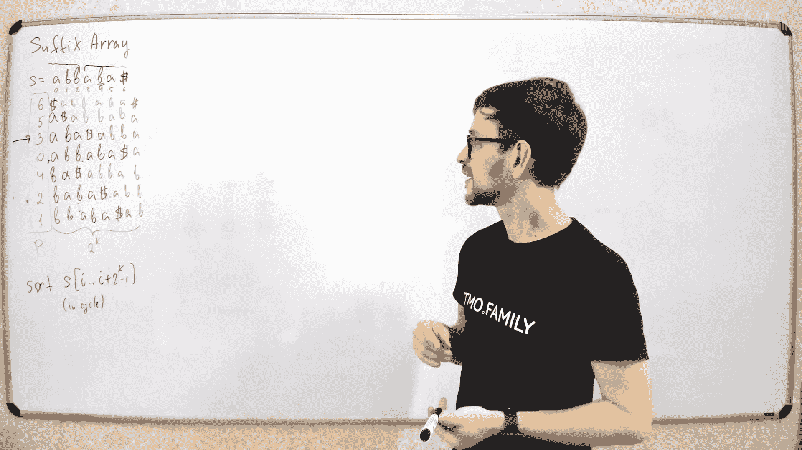

Then not， not that different。 all all the s structure basically do the same thing。嗯。Go。

 so we take this string and try to build the six array for this string。There most everything。

Everything。😔。

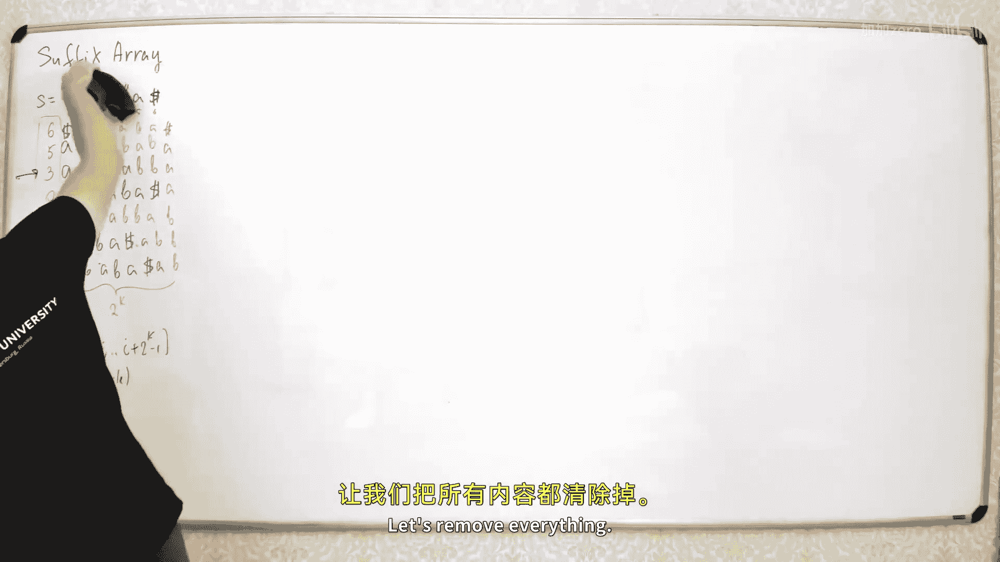

And this。We start from the phase K equal0， so lets start for K equal0。In this case，0。

 we need to sort this the strings of the single characters。 So we just take this。Aa of characters。

 we just saw them。 So we have this door then A， A， A， then B， B， and B。Again， we。

 we never store this array of strings。 I just write these strings just for clarity。

 you don't need this array of strings。 You only need the array of indices。

So you make the array of indices， indexes will be 6。Pa， pa， po，0，3。5， and for this will be1。2 and4。

So we have this API P。So this will be a RA from the stage zero of your algorithm。啊。

Now we calculate the array C， A array will be of classes。

 So we want to assign integers to all the strings， So the small string have the smaller integer and so。

 So again you go from top to bottom and then assign this integer to integer， 0，1，1，1，2，2 and 2。

And this would be your a C。嗯。Let's got s screw next week， or， lets。Okay。Ok。

 let's keep concentrated here。 Well talk about six trays next week。I promise。

Now that's all now we finish the stage stage zero。 Now we move to stage one。

So we want to stage K equal to one。In stage 1， we need to sort strings of size 2。

So we have all the strings of size too much。I'll just write write down all the strings of size to。

 So I have strings， A， B， B， B。데 에。Abe。B a。8 dollar。 and then dollar。So the indices will be 0，1。3，4。

5。s。Now， for each string。I want to make a pair of two of two integers。

 So first integer will be the class of the first half second will be the whole class of the second half。

 I take the first string。 So I have the string of size 2 in position 0。

 It means it contains strings the position 0 and1。So string position 0 has class 1。

 Str position 1 has class 2。Second。Let you。有 something。Ler。 So I have these two strings。

 This string is position 0， This in position 1。Strerinkent position 0 is here。

 Strrinkent position 1 is here。I'm not sure if you can see it， but。

So the class of the first string is one， and the second string is2。

 So this string corresponds to pair one through。T string contain string position 1 and 2。

So this in one is2 in2 is2。 So it's supposed to pair 2，2。And so on for each string， again。

 you don't need this array of strings。 You only need this render array of P and this this this array of pairs。

So you just write down all your is parel。 you can be。诶。So， B is。2，1， it's 1，2。2，1，1，0，0，1。

And now I just take this array sorted。If you solve this array， what do you get。Okay， so first。

 you get 0，1。 So if position 6， you have 0，1。In position。5。You have1，0。Now， in position0 and3。

You have one， too。No， no， no， no， no， no， no， no，2 and 4。You have to one。

21 and finally in position one， you have to2。嗯哼。So we just sorted all the strings of size 2。So。

 this will be。The RF P。Inration1。Now， need electrical collect this R C。

 and A receiver C will be a array of classes for each link。 we need to assign some co string。😊。

So again， we just go from top to bottom and assign new integers to this to this string。 again。

 if strings are equal， we assign the same integer。 If they are different， assign differentteger。

 So just go from right to。 So these look 0，1，2， these are equal2， different， equal different。

So this will be the final receipt。That's all。 That's the end of phase 1。 So in the in the phase  one。

 we build this arrays， sort them and build a C。So then so after the end of phase one。

 we have these two areas。Now， let's move the next phase。So， in the next phase。

 let's try to do it without these strings。 Okay， let's just write down all the。

These are vintages and don't use the serve to。Let's write down all the streams of landfall of landfall。

 We have 0，1，2，3，4，5，6。Now， for each string of then4， we need to split it into two halves。 Again。

 we have this。 so string and position 0。Is a this。Mmhmm。😊，We need to split it into two hals。

To be this and this。They have inices 0 and 2。 So we need to find string 0 here。 It's here。

And shrink to it here。So the class of string 0 will be two Strnk of click。

 class of string 2 will be free。So here we have pair 2 and3。

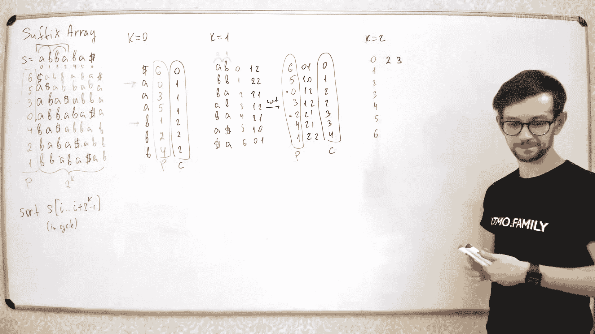

What错。And so on， for string one。The first half will be one。The second half will be free。

Because you have shift to， right？So the first half classposition one， second half caposition 3。

 So this will be class 4， and this will be class 2。 So the class 4 and 2。Next one will be 2 and 4。

So two will be free and4 is free。 So we could free and free。Now，3 and 5， it will be 2 and one。

4 and 6 will be free and 0。5 and 0。 again， now we have cycle。 Yeah， so string and position 5。I this。

So we start in position5， go here and then here。

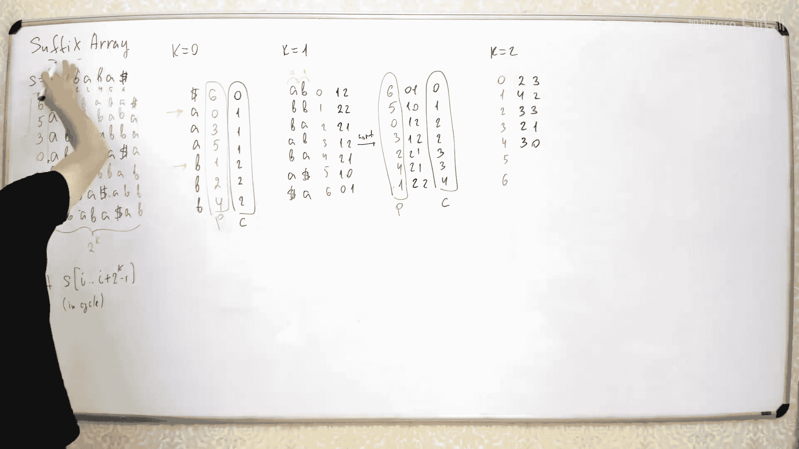

So the indices will be 5 and0， right？So we didt take string 5，1 and 0，2。 So you want2。And finally。

 here for6 will be 6 and1。 So 6 is 0 and4。That's all。 And now we sort this array of pairs。Again。

 we build these area of vintages， thus' just using these area of vintages so we just。

You got to let me break。So take some string。 So how， how did we build these strings free。

 We take the first half and the second half first half risk have in this three second half is in this five。

 So we take this。3e， and these5 here。And so。And now we'll just sort the three。

So when we sort this array， we get the we'll。We get 0，4 in position 6。 then we have。You安と。1。

2 in position 5。then。Duwang。In position free。Then， to free。position 0。Oh。Then 30， right。

 then 30 in position 4。F， free Yeah free free in position 2。And finally，42 in position 1。

Let's all this on new A P。And now we rebuild the array C。

 so we need our assign next classes for for the strings of them for。 So again。

 we just go from top to bottom and assign the classes。

 If strings have the same classes we assign the same if strings are equal。

 were assign the same class， if strings are different， well assigned the next class。

So then we go for doctor bottom say this plus 0。 They different。 These are different。

 they all different。 So we just same like this。It will be very soon。Now， finally。

 if at some point of your algorithm， you have all the classes， if all the classes are different。

 it means you can stop the algorithm。Because you already compare all all the effects in all these preferences are different。

Because you you you you take the first four characters from each of these strings and they are all different。

 If they are all different， you don't need any characters to rightium。

 So you can stop the algorithm here and return this array as a result。

 Let's just check it is the same as here。Yeah， so this raise is is the final A P。 So it is。

 it will be your s。Nice。Okay， well not write the quote with the king。If you want。

 if you want to look at the code， you， you can check my and you can check my code for lecture。 I， I。

 I write the whole code， and actually。Soaw some problems about subjects already there。

I will not do it here again。 So this。I believe this enough。 Let's， let's talk about， yeah。

Let's talk about one more algorithm。You stop saying everything's clear。ちね。嗯。Now， one more thing。

 One more thing I want to discuss is。For some problems。啊。Building six Sur is not enough。

 So six Sur is enough for many problems。 Thank you。 Thank you。Don't need to scream it Yes just。

 just say it every 50 seconds。 it will be enough。😀系。😊，Okay， so for some problems， it's enough。

 but for many other problems， it's not quite enough。down。

What you need in many problems is to find the longest common pres for the given those surfacees。

つけたんだ。So one of the most useful thing you want to calculate in the string is to find the longest common pre of two given string。

The LCB off string。Say A and B。Yeah。It is just the max K you search that string a from0 to k-1 is the same as B from 0 to k -1。

So basically， you take this string A and B。Yeah。And find the maximum number of characters in the beginning of string that equal。

Have these characters。That's very important。 very important query， it's used in many other problems。

 So in many other problems， at some point， you want to check the longest common pre of two given string。

嗯。엄만 지갔도 내 맞。There are many applications of this。Res also错。Now。

 instead of cocating longest cons of strings， I will calculate longest con pres of two given。

Suffixes。So here I will implement LC P of I N J。Will be。L C P。Of six from I2 and-1 and。From ja。嗯。

Why it's usually enough。 No since if you have many different strings。

 So if you have requests for different strings， you can just concatenate all your strings all the strings you need in in one big string。

 So if you have multiple strings， you have S1。えと。It has free， and so on。

If you want to check longest common graphic of some sub strings of this。

 you can just conlic them all。In some long string as。

Then calculate traffic sorry for this long string。And now if you just。

 if you want to calculate us like LC C P for for this and this。

To take this suffix and this six and just calculate the LCP of these two suffixes。 So。

 so cculating LCP of suffixes is usually enough。For mostプ。嗯哼。So I want to。

 I want solve the phone problem。 I have a given string， and I， I have multiple queries。

 Each query is to find the longest common pres of two given suffixes。 So someone is giving me two。

To s fixes and， I need to find the longest common projects。Let's， let's all。

So someone give gives me two plus two ses like these s and these ses。

And I just just said these two sides has。Have three。 have two，2，22 co characters。

 So I have A B here and A B here。 So the result will be true。No。Let's go how to solve this problem。

 so to solve this problem。Let's find these two suffixes in a six array。

So we know the indices of these twoes。 We can find these indices in a P。Mm。So we take this in。

 this is I N J and find these two numbers in a A P。 We can precalculate for each number。

 its' position in a A P。 It's already calculatedulated in a A C， actually， but。😊，나 나 말。

So we find this in this is I and J in RAAP。So， this will be。And now we do the following trick。

 So imagine you have the sat sorry。 You have。 this is I。This is Jay。

These two ses have some common characters。So this。Firstt。K characters are the same here and here。

Let's look at all suffixes in the middle。 Let's look at all suffixes between these two suffixes in the in the suffix area。

So you have some other ses here。 So have they use s and so on。Now？Since the effect is as sortsorted。

If you have two sixes to the same prefis。All suffixes in between must also have the same preference。

Because that's how the socing was， right。So all these suffixes also have these pres。Mmhm。😊。

So what we'll do？Instead of calculating the colon is going between this and this sex。

 we will calculate the colon is constant between any two consecutive secretive suffixes。

 So we'll calculate LCP of these two suffphyixes， LCP of these two suffphyixes。

 LCP of these two suffixes and all these two suffixes。So we will pre calculateulate array C L。

L I will be LC C P。Of two side P。Let's say I and P， I plus one。

So let's precalclate the following array， so we'll precalclate the array L such that the in position L we have LCP of two consecutive sixes in the six array。

Now， if we know。The LCP， LC CP of these two sex is LCP of these two of this And。

 How can we calculate LCP of the first and the last size。Can say something。 say something。Yeah。

 you you have a sequence of strings。You know， LCP of these two strings of these two strings in those strings。

And you want to find the number of common characters in the first and last strings。 Yes。

 you just take the minimum for all these values。 So LCP of these two strings。

Will be the minimum of LC Cps of this of this。A segment of theory。

So we need to find the minimum in the segment of a。So l p。Of I and G。Will be the minimum。L。Ti。

40 going from not I J。 So I J is the index。 So we need a position。I2 position of J -1 and -1。

Sounds like it。So going to find the position of the suffix I position of suffix J and between them。

 find the minimum in this segment。M哼m。😊，So how to find the minimum in the segment of array array。

 you can use segmentaries， you can use sparsse tables。

 you can use all this ferult vendor algorithm we discussed in the previous semester。

 so there are many ways to find the minimum in the segment of the array。

Usually the easiest one is to use sparse tables。 But again， if if you want to save the memory。

 spars table， use analoggan memory。 So you may want to use segmentaries just to save some memory。

What it's up to you， so。You use it as power table or segmentary to calculate this minimum query。Now。

 all we need is to precculate this array。 So when we have this array。

 then we can answer these queries。 just taking minimum in there in this array。

So how to calculate this R L to calculate our L Ru。Very cool。 L out。's this。Yes， you， yes， yes yes。

 You can use photo continental algorithm to answer menu query in constant time using。😊。

Lar time memory。 You can do it。again sub。You can use any algorithm to calculate minimumqueries depending on how much money you want to use and so on。

Again， we discussed it in the very semester around water bit。啊。Now， how to go lateratorial L。啊。Hi。

 will discuss all reference by Kaai Eim Air Valley Park。

There are5 scientists who actually discovered how to do it。

 There was another linear term algorithm discovered before， but this algorithm is very easy。 So。

There is very easy and beautiful algorithm to build this array。So how to build this algorithm。

 how to build this array。You just go。And build it。Starting from the longest suffix to the shortest six。

So you take the longest s in your six story。So what is the longest suffix。

 longest suffix is the such six starting with character 0。 So you take this。Sice。

And just calculate the LCP of this s and the previous s。So you take this suffix and previous suffix。

And calculate the LCP， just comparing all characterss by and by one。 So compare this is equal。

 This is equal。 This is not equal。 So you say the LCP of this。 and this is what is2。Yeah。

This would be very ill。Iasy right。 So just compare the characters until you find different characters。

Now you move to the next six， which is one character shorter。

 So you will calculate LCP of 0 and previous one。 Now we take six 1。 It's here。

And calculate LCP of1 and 2。Let's see。We have。Six 0。嗯哼。All。

If we remove the first character from the suffix， we will get suffix 1。And before six 0。

 we have six free。And if we remove first character from here， we will get Six 4。So we know。

 that real settings1。Ands 4。And since surface is this。0， and3。Had two common characters。Then。

 s is1 and 4。Should have at most at least one common character。So there is。

 there is one common character between these suffixes 1 and 2。Again。

 we know it because we know it there are two two two characters just here。

So if we just remove this first character。We will give。Six 4， and six 1。They are here suff 4 and s1。

 So these two suffixes must have this character be here and here， and it must be the same。h。😮。

What does mean， it means that suffix1 and the suffix also must have this one first character。Yeahep。

So we don't need to check first character。 We can start from the second character。

So we start from the second character and compare starting from the second ti。

So compare these two characters， since they are not equal and just keep the first completely。

And say that the answer here is one。嗯哼。严肃。Now again， we move to six onewa。

Compare to character to so this character goes equal。 this character goes equal， not equal。 Again。

 when we move from 2 to 3。We know that we have two common characters here。

So common so free and the previous subjects must have at least one common character。

So we can skip this first character and go to the second。そキャスキってしましけど。Ancl。No。

 let let me write the about here。So， we had six I。And the previous topics， for example called J。

Like this。They have some number of common care。Let's say we haveけこ。

And here we have some because why here we。So we already calculated as the LCP of these two ses。

 and it is equal to。So the result for this to s。Now， we move to Saix I plus  one。

Six I plus  one is the same color six as one as I， but we remove the first character。

So it's one character show， so we take this this s remove the first character。was the a bit shorter。

Let's look at。Get suffix J。 if we remove the first character of suffix J， we'll get suffix J plus 1。

 So suffix J plus one is somewhere here。People plus one。嗯。Now， we have key common characters here。

 If we remove the first character， we'll get K -1 common characters。So this s is I plus1 and J plus1。

Okay，-1。こきあります。And here we have next here with the one。

So the six J plus 1 must be above the six i plus1 because it is less。 Yeah。

 it is liographically less than this s。And they have K-1 common characters。Now， again。

 all the surfacees between must also have this K minus-1 common characters。

 So if we look at the all surfacees here。They also must have this first。게임マのパコ。

So the LCP of this a plus one and the previous s must be at at least k -1。

But it can be more than K-1。So， we just so。The character here may be white， for example。

So we just continue to compare these characters one by one。Until we find the different car。

We just keep all these characters and start comparing from here so we'll find the first character。

 which is this one again。Here here。And stop there。That's the whole idea。 So good。

We just calculate the LCP from the longest sffix to the shortest suffix。

When we move from six I to Six I plus 1。If the LC P of I and the previous was K。And cakes。

 more than 0。Then we can skip K -1 characters here and start from from the next character。That's all。

N than10 complexity is linear， while the 1 complexity is linear。Oh。

Because each time we move from one suffix to another。We decrease this K by one。

And when we compare to characters， we increase K by1。So we decrease K at most n times。And we get。

So not that look at sort。Okay， okay， let the， let me write that but down the one this a little bit easier。

 So we just to our all ses，From  zero to。前す。Then I'm try to concludeate these。嗯哼。So we're take x I。

 s I J J。嗯。I kind not want want to find the position， right。So six J is the six imposition previous。

bai。So I need to find suffix I， then find the previous suffix J is the index of pre。Now， K equals 0。

 So K is the number of characters。 I already know I columnium。

So now I just increase this case until I find the different characters。 So why me。

While character I plus K equals to character。J plus key。I just increase this fee。O。

 I just keep all the equal characterss。 Now， the K is number of equal characterss。

So I just say that ill。O。ポスパイ。Equal to k。like this。And now， if he is greater than 0， I。Like this。

That's the whole called basic。嗯。So again， I， I take my， my six， take the previous six。

Griizzly skip all all the equal characters。 Now assign this value as LCP and now move to the next stage when I move to the next stage。

 I just decrease this K by one because if I know the K equal characters and on the next stage。

 there must be at least k minus-1 equal characters。So why is the complex linear。 No。

 the only thing is not linear is this while loop。 So everything else is is linear。In this while loop。

 we increase this value of k。 So we find more equal characters。 So we we kind， we kind。

It increased the number of equal characters we already know。啊。So， so in this way。

 we increase the value of k y。Now， in here， we decrease the value of K。

And the value of K can be more than n。If any point key is no more than that。

Not because K is the number of equal characters。嗯哼。So we here we decrease K at most n times。

K Ken0 grow Mo M。So we cannot increase k more than two n times。 We actually no more no more than n。

 but doesn't matter。 good enough。 So we cannot increase n more than n times。Mhm。😊，なで서。

So everything else linear。 it's， it's similar to the clinical path a little bit， but not exactly。

 not exactly。 It's not exactly， but buts quite close。 the idea of the time complexity is the same。

 So we have this while loop， but in it's like  two point met mostly。So in this while loop。

 we kind extend this。If you look at the string of the equal characters in this while loop。

 we extend this string to the right so we find more equal characters。And after the end of this loop。

 we decrease the case。 So we removed the first letter。 So we kind of。

This string of equal characters is growing to the right end， like shrinking from the left。

Sounds like the stars。 So it's like，'s more like two point those methods。

So到 hyper products will give me up。W。Okay， I think it's all。🎼，🎼Yeah。う。

