# 【精译⚡算法与数据结构】PavelMavrin p45 p44 A&DS S03E13. Suffix Tree. Ukkonen's Algorithm -BV1NLB8YfEMq_p45-

🎼The。🎼こ当。

So today we today is the last lecture about strings。 Today， we'll discuss six strings。

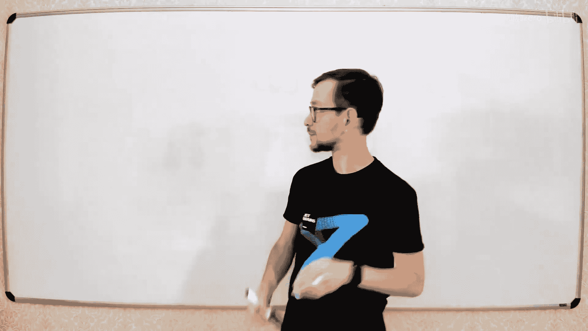

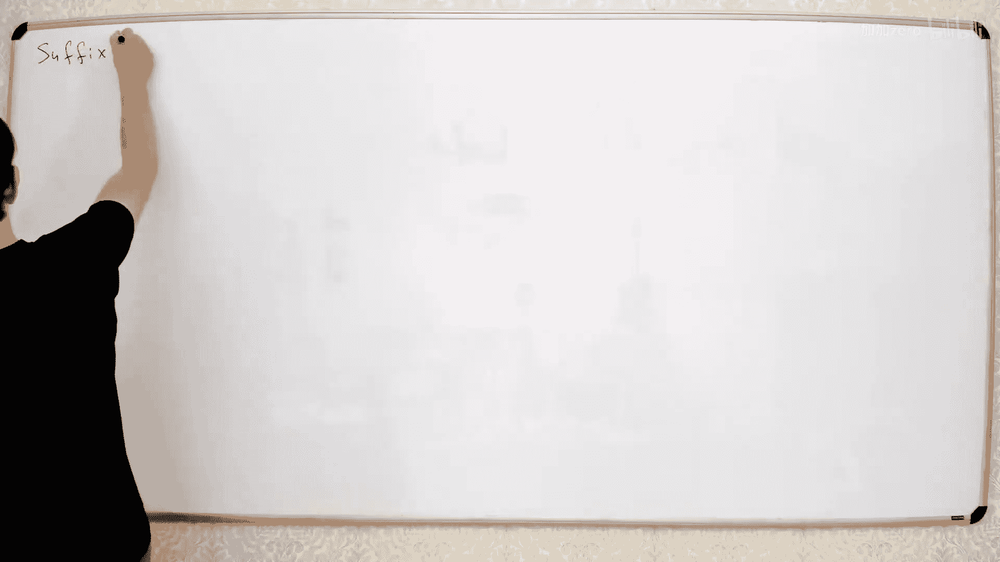

Sci3 is really cool。 the structure very powerful used to solve all types of problems。

 usually are the same types of problems used when。Usually。

 its the same types of problems when you can use six array。

 so usually you can use six array or six extreme， they both have some advantage and advantage but。

Mostly the field of problems is the same。Freeze it。That looks fine。 No， no， no， no， no。

The channel looks fine。 streamream looks fine。No， my it your problem。Go。So what is the sic string。

 sfiix string is basically a dry which contains all the sixes of a given string。Let me， let me check。

Did check the quality of the stream。Just for the second。

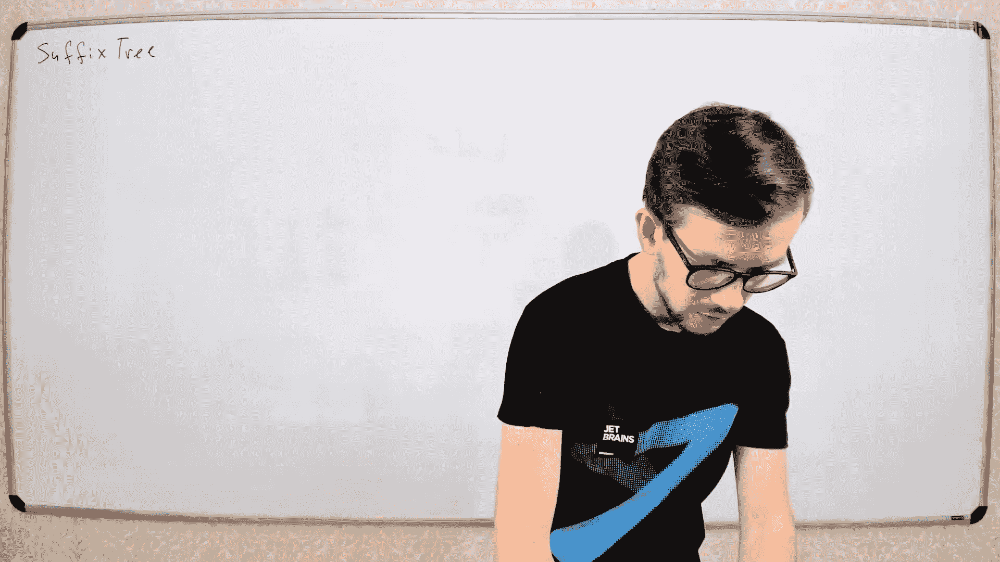

嗯哼哼哼。嗯。No， everything looks fine。那我妹没去跑包吗。No， stream looks fine。Is there any problem。嗯。

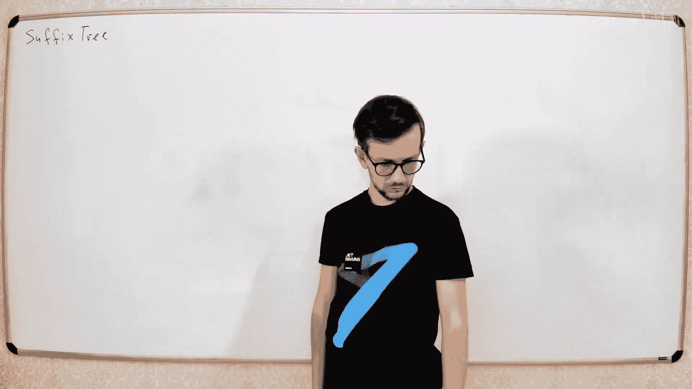

Okay。So maybe some your your problem with the entertainment。 Okay， quick。 So what the sex string。

 six is3 is basically a try， which contains all the ses of a given string。 So we take some string。

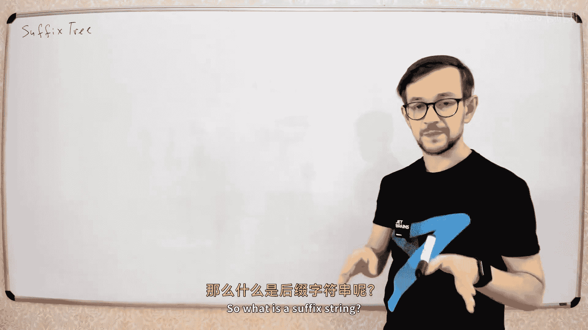

That's6 thing。A B， b， A a。

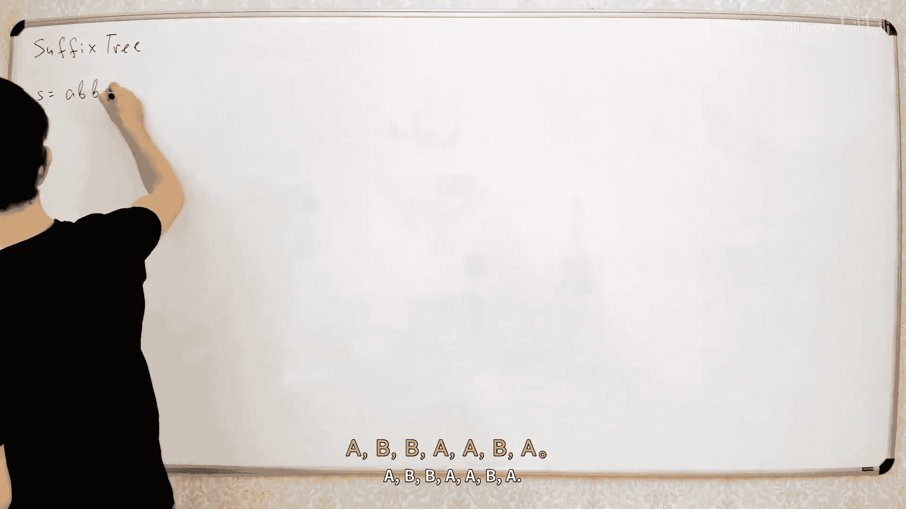

诶三て。

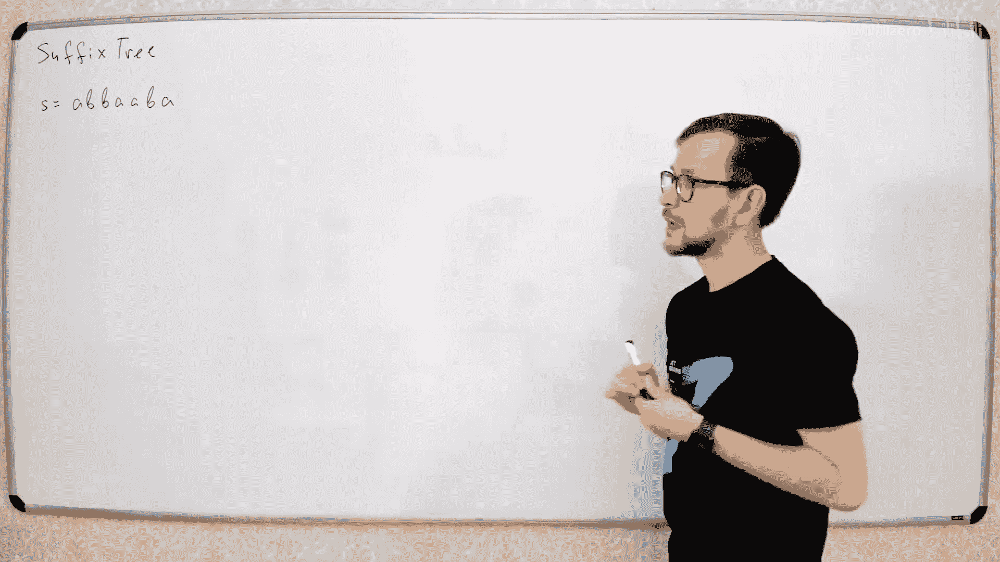

And now we just put all the ses in a track。So we again， let， let's create this try。

 So start on the route。 So this is a route of our try， and we have。H to the left to A。

 H to the left of the B。And let's just put all the suffixes。 So we have suffix a。Mark， please note。

Now we have s B A。 So we have B。8。

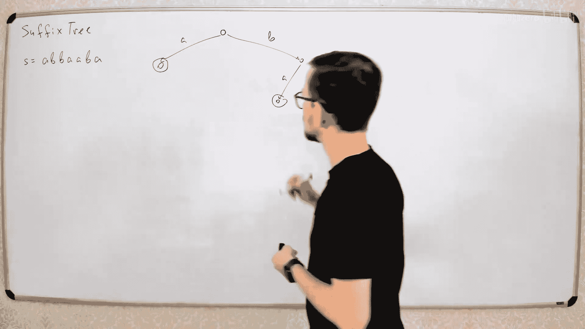

Now， we have six A V， A a。이 분。

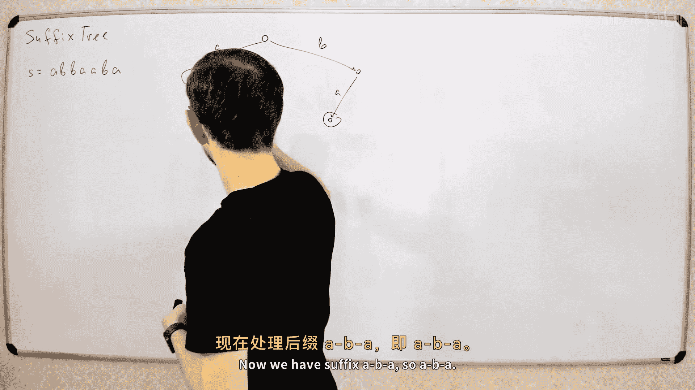

Okay。Now we have six A， A， B A， so A。Yi。唔啲。Can 수。

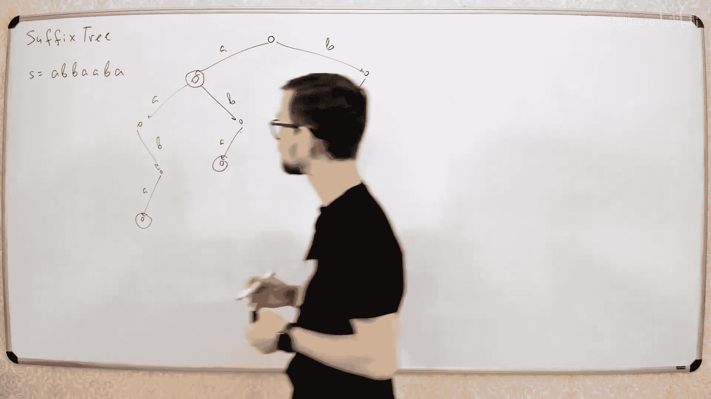

And also， we have B A A， B A， B A。8。B。Hey， it's a little bit boring。

 but it told end soon now we have B B A B B B。8。He。BB。Gage。This one and finally other full string A。

 baby A。O。A B。Bi。A age。嗯。Ai。你。AHere。T like it。

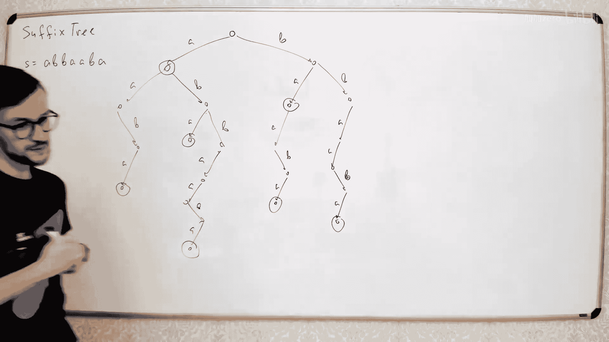

So then's just a try which contains all the suffixes of a given string。

 which just take this string and add all the suffixes to this tray。We can also include the empty。

 So we can say that the route is all around node。W this structure is important， because lets see。

 let's see what we have in this tri， so every vers of the tri。

Is the prefix of some string which in the tray。 So every vertex。Is the prefix of some suffix。

What is the pre of a suffix， prefix of a suffix is just substream。 So if we take any。Not let。

 for example， be note。So this node corresponds to string BA。Yep， this string B A A is the prefix of。

 of this big s。The seconds。So we take of these six。And from these topics， we take some pres。please。

So this prefix of a suffix will be a substr， so every note of this trick corresponds to some substring of。

Of your stream。And vice if you take any sub string of your text， it will be presented in this trial。

 for example， if you take。Let's say some up string， for example。Let's take soft string， B， B， D。

So this subsing P， B， A should be in this tray。 It is here。Again。

 that's because each substrate string is perfect of some suffix。

 so we have these suffix in the train。So this chain is the perfect of this six。

 so it must be presented in this track， so every node of this strike responds to some substr and every sub string is represented by some node of this try。

Okay。So basically it is a tree it is a tree which contains all the substrs of of your text。

 So if you want to to calculate something about all the subs of your text。

 you can just build this try and then just like。Investgate what's going on inside this tree and just bite bite it。

By research what's going on in these notes， you will know what's going on with your substrs。

For example， if you want to again， if you want to solve the same problem as we saw in previous lecture。

 if you want to find some substrs in the given text， so you have a substr search requests。

You're given some request。Q1， Q2 and so。So if request is some substr， so you're given some sub BBA。

And you want to find this sub string in your text。 You can do it using this try。

 So again you take this subs。 you take this string and try to find this string in your try。

 if you find。The vertex correspond to your string， it means that your string is actually accurate in this text because this again。

 this string is perfect of some suffix， so it is a substr of your text。Next。いや。

And the problem we'll solve today is how to build this try in linear time。 So in the end， let's。哦，对。

Is good here。 So the。Final result of today's lecture will be the algorithm which builds this dry and linear clam。

Nice。吧。So the first problem we need to solve is how to store this tree because this tree obviously uses n square memory right。

 so the number of nodes in this tree is n square now。

So if we want to store this this tree in the memory。

 we need to spend n square memory and we can spend n square memory and if we want to build it in linear time。

 right？So the first thing we need to solve is how to like compress this tree to make the size of this tree linear。

And we will do it just by compressing the paths， so we will take the paths like this。

And compress them in into single edges。So what we'll do we will allow。 So if we have any node。

 which has only one child， we will compress these node。And make， like from these three edges。

 will'll make a single edge， which contains all these three letters。 So will。Remove this。

And add a single edge like this and put A VA here。And we'll do the same trick with all okay。

 well do the same trick with all nodes， which are not non terminal。 So well。

 we'll leave all the terminal node uncompressed because we kind of need this information about terminal nodes。

 and we also leave the nodes， which has at least two children。So all other notess may be compressed。

 was up here。 Look here， we have A V A again， we will remove this。And add single edge。

 and put aviator。Here we have BA BA， so we remove this。Made a single edge and put B， A， A， B，8。

And finally， these again， have B A B。It's the same thing。

It is the sameix Auto don't expect kind of the same thing， but from different time angle of view。所用。

I will not only explain theloud for suffix or Moton it's different。

 but it can be transformed one it can be transferred to each other using some tricks。

 it's not a topic for today's action。But if you want to explore the Sao tomato， it's also。

Quite cool instruction。And。So we build this tree now that。

Total number of edges industry this is linear。So when we compress。This。No。

 which which has only one child。 total number of ages here is legal。Just。No。

 quite it is linear nodes because we have only linear number of terminal nodes。 Yeah。

 so the number of these terminal nodes is linear because each terminal node。Is a end of some suffix。

 right？ And we have only n suffixes。 So we have only internal nodes。

 and all other nodes has at least two children。So they can， they can make from， from one branch。

 they， they make two branches。 So each of these uncompressed nodes create a new branch in your tree。

 and the total number of branches in your tree can be more than n since we only have and leaves in your tree industry yeah。

So the total size of this tree is kind of linear。But now we have， instead of characters。

 we have these strings。On ages again。So we want to also compress these strings。

 We can can store these strings。On each edge， because total total length of all these strings， again。

 is n square。But all these strings。Can be compressed since all these strings are sub strings of your string S。

So we， instead of having this string， we can have only two indices。Of of the string。 So we need to。

 you say which sub string of S is written on this page。 So let's just。

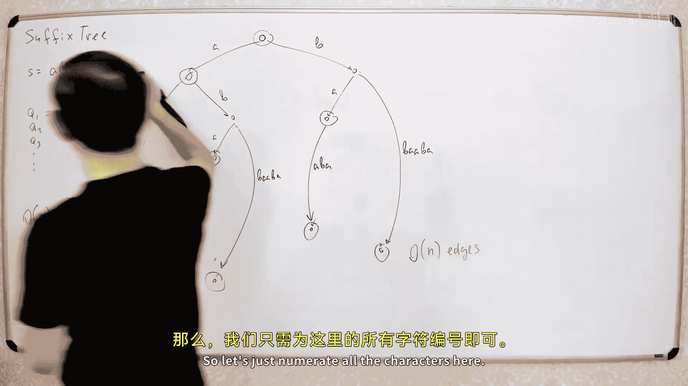

All day。Y plus here0。

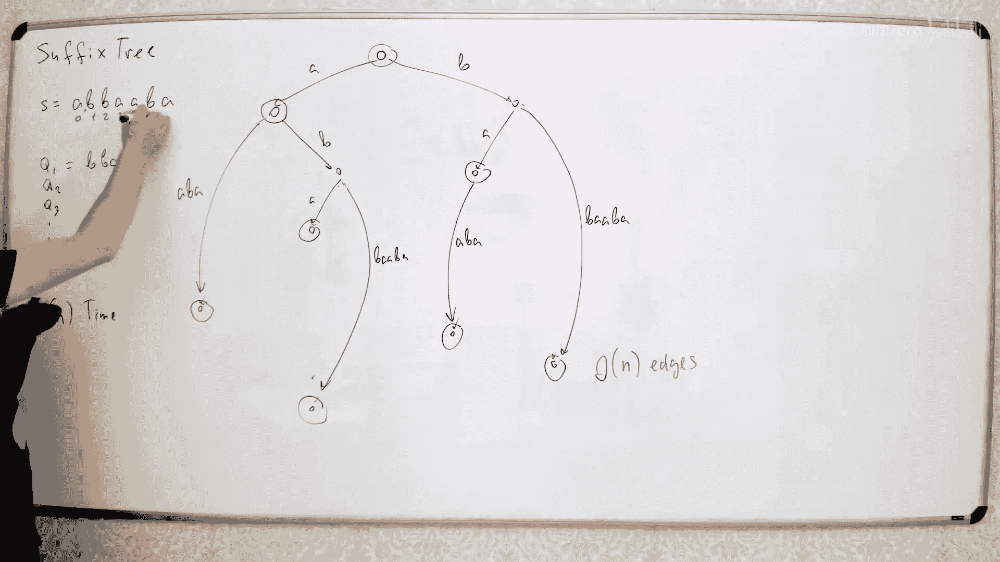

5 6。And now instead of having this long string here。

 I can just say that this string is actually a sub string from2 to 6。

So I can store only these two integers。And having these two integers is enough because substr this string is a substring of string S。

From this index to this index。And Ill do the same for all for all the edges of these tribes。

 if can go here I have ABA， what it' like for4 to4 to6， this is from2，2，6。This 1， I don't know。

4 to 6。 Again， this being。嗯。Any one will work。 So Let's say from2 to2， for example。

 And this pay is from one to one and so on。

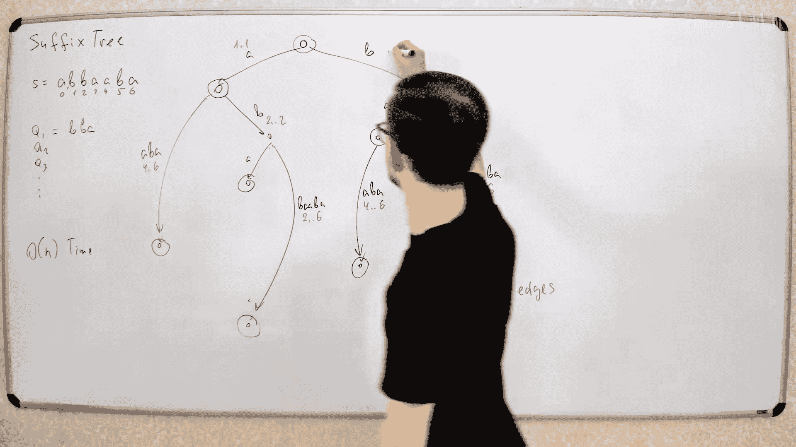

And that's all we need。So now the size of the structure we want to construct is linear。

 We have this linear size 3。For each age， we store these two integers。

 so we have up to n integers to two n integers。So the total size of this structure is linear。

 so we kind of have chance to construct this in linear time， right？Nice。Now， one small。

 one small change I will make is that。I kind of have these strange notes。 So for some node。

 I don't compress them， but I don't。 they have only one child。 So I。

 I didn't compress the notes if the node is terminal。 So some terminal notes has only。1 child。

 that's， that's kinda not convenient。 So you， you， you for some notes， and it will be 0 to 0。

 it makes sense， okay。So， so I have I still have some notes and compressed， which has only one chart。

So just to make things a little bit more easy， I will just。

Add a special character to the end of the line。 So I will add special character again。

 some dollar sign here。We hold this some special care， which is not in the stream。

And if you add this dollar character to the end of the stream。

 then for all terminal notess will end with these dollar sign。

 So I will just add this dollar sign to all terminal notes。 So here I will have dollar sign。

 So this note will be terminal now here I will add dollar sign here sign。에 he。And here。

And here and also this node is not no the terminal notes since I have this dollar signed here。

 so this node is terminal。And also， the road is not turn now。

Because I will add the dollar of signs and this total little be。So now I have two types of nodes。

 first type of note is the leaf node。Life is always turned out。

So each leaf corresponds to some suffix of your string。And I have these uncompressed nodes。

 uncompressed nodes are the nodes， which has at least two children。그죠。故。Now。

The next thing we need to build is six things， again， like an aac algorithm。

NowNow we need to make a six links like an ahoka algorithm。Again， let me remind do so。

 What's going on half we have。We have a note list in old V。And for each node。

 we have this string corresponding to this node。So for every node， we need to make a six link。

 Six link is a link to another node。Such that this string。Is the six of， of my string。St。Yeah。

So for each note， we need to make a link to the longest s of my string， which is also in the tray。

Okay。So he， if you didn't see the alcoholho price collection。It's kind of strange。

 but you may this lecture again， so sufffiix link again。

 sfiix link is a link to the note which corresponds to your longest suffix。Nice。In a suffix stream。

 suffix link is actually。more interesting。So since subix contain all the substrs of the given string S。

The length of this six link is always one character less than the string of of of this be。 So。

 so if the length of this string。Is K。The length of the traffics link is always K， -1。

Let's see why it is。 Why is it true， No Because our tree contains all the。

 all the sub strings of the string S。So， this。String is a sub string of string as S。Some were in the。

 There is this something。Right。So suffix links goes to the longest suffix of this string。

 which is also in the tray。But if we take this。Love just suffix， least larger suffix。

Which is just one characters shorter than this tree。It will also be in the trial。

Because our tray contains all the substrs of string S。 So if this string is substr of string S。

 this string will also be substr of string S。 So it will also be in this。Ty。嗯。や。Yeah。

 it's good duration。 Yeah， we'll talk about just just， just， just in a moment， yeah。

That's a good observation that some of the vertices were compressed， so yeah， I'll talk about it。

This is the first direction。 So so six link。Six screen in the s tree always goes to the string。

 which is just one character short term。 sorry， So basically when you move。Along the s exclaim。

 you remove the first character of your current string。ASecond pool observation。

We have this compressed tray， so we only have these nodes which has at least two children。啊。

And we will build six link only for these uncompressed nodes。 So we will。

 will not build the suffix link for all these middle nodes。

 which was removed when we compress these edges。 We will only build six links for the uncompressed nodes。

 So for， for example， for this node。So for example， this note， let's take this note。

 this dont corresponds to string A B。 So the longest task again， the longest s is just string B。

 So So six in from here。 well go to this node。And if you take this note， we have string P A。

 so long the sage will be will be a。 So s go。From this， sixing goes to a root。不。For the road。

 there is no sufficient thing like in acra property。Second consideration is。

 if you take any un compresspressed note。And try to build the six link。

 The six link will also go to some uncompressed note。 So if note， if this note V is uncompressed。

Then the s link goes to some uncompressed note。嗯嗯。😊，에。Yes。

 this try is just is just a try which contains all the suffixes If you just take all the suffixes。

 put them in a tray， you will get a six string， but it will take you n square time。

So the the problem today is how to， how to build this train in linear time instead of n square time。

If you just take all the sixes， put them in a try， you will have a correct six string。

 That's correct。What it takes n square time。Right。そう。Let's see。😊，Again。

 I claim that if this node V is uncompressed， then this six link node is also uncompressed。

 Why this drone， Oh let's see。あそ。This not reason compressed。 What does it mean。

 It means it has at least two children。 Yeah， let's say we have character X here and character Y here。

嗯哼。What does it mean， It means that both these strings。Are presented in the string as a sub。

So we have this thing S。At some point， we have string V with character X。And。

Somewhere we have the same string with the character white。

So both these substrs are somewhere instrument。Both V plus x and V plus1。'Sorry， Im sorry。嗯哼。

But now what， what about this topics。This six thingling is actually what just this thing。

 which is one paragraph shorter， so this is a substream， this is a six thingling。

W is to see that if you add this character X。To this shorter string。

 you will have some substr of string S。 And also， if you add this character Y。

 you will have some substr of string S。 So this note。Must have at least two children。

Child of character for X and child of character for Y。嗯。So if my node contains these two children。

 then this unex node also should contain these two children， so it also must be uncompressed。

So if you， if you try to build selfex from some uncompressed node。

You will have a link to some uncompressed note。Mmh。😊，有。

That's all that's all the preparations we need。嗯哼。な。This is the structure we need to build。G。

Now let's go to it。Let's go to the algorithm， The algorithm will work like this。

At every point of the algorithm will have some current position in the tree。So， our position。

Will be either a uncompressed node or some virtual node， so it will it may be a real note。

 so let's see。But just。Ill me just to raise this subject by now。

Just to make things a little bit clean era everything， which is not important。

So there is these sorry。Just to careful。Clean picture of what's going on。This。

So at every moment you have some current position in a tree。

 current position will be like a note in the uncompressed tree。So when you compress the tree。

 your position may be em。off off of the train。Or it may be compressed into some。

Middle position on the edge。 So it may be the node of the tree， or it may be position in this。Edge。

uhm。So for example， you may stand on this edge between this B and H3 this is your current position now yeah so before you compress this edge。

 it was a real node in in the tri， but when you compress the node。

 it became some position in the middle of this edge。So you want to remember your current position。

 your current position may be an note， or it may be just position in inside this edge。

And so we have this current position and we want to move along this stream。

 so we may move down or and move using s links。What happened when you when we move down。

 So when we have some current position。And we want to move down the tree using some characteristics。

 So we have some current position。Okay， let's do， let's do do here。And you receive1。

1 one more character。 And we need to move down using this character。

What do you do if you're standing in the middle of the edge。

Then you just check that the next character is correct。

And just move along this edge to the next position。When you。

 when you send in here and you receive the character a。You just move to the next position here。

If you are standing in this uncompressed node and you receive the character a。

You look at the children。Select the child， which contains letter A and move along this edge one character。

So when you're standing in here and you receive character A， you move to。어 되 스파지。

So you select this edge because it contains letter a and move along this edge1 position here。

So again， again， if you， if you're standing in the middle of the edge。

 you just move one position to the right along the same edge。If you're standing in the note。

 you need to select which age to use。 You select the H， which contains the given letter。

 and you move along this edge1 position。Good。So moving down this tray is pretty simple。嗯。

Much more interesting thing。 going on when you want to use the s link。 For example。

 you are standing here。 So you are standing in this position。For example。

 you standing in this position。And you want to use the suffix link。 So from this position。

 Just send me here。 your current string is B， A， A B here。So my current string is B， A， A， B。

And I want to use sx link， so I want to move to string AAB。

But I don't have six thing for this position because this suffix， this position is compressed。

 So it is in the middle of the edge。 I don't have sffix thing for these compressed positions。

So I need to make something much more interesting。 So how to。

 how to use suffix link when you're standing in the middle of the edge。

You go to the closest treat to your parent to this node， closest industry。

And now use six link from this position。 So you take this。Noe， and use selfex from here。

 So sub thing from here， we go。 We'll go to this note。And now， from this six link。

You need to move along the same string as here。 So here you string， A B。

So you go to this position and try to move using the same string A B like here。

 So it's go from here down to the tree using the string A B。我 let let put it어。

So you send me here so first you move to your parent。

 then you start thing and then from here you move down using string A。

 so if you move down using string maybe you will go to this position。

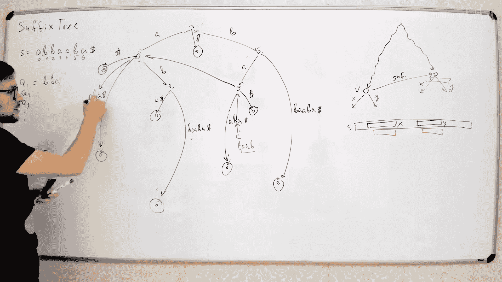

そう。This position will be your final destination。ラてき。Okay so we have the H。Yeah， let's。short。

So we have the edge。 We have some string on this edge。And。We have some pet here。

 We have the six link here。this position。そう。Let's say this is our current position。

We say this thing is on phone。And this thing is bad time。我说。

So our current state is out better our holidays。嗯。We want to go to six link from this position。

 So what we do， we remove the first character from here。うんうんうんうん。I need more colors。So， our six link。

Will contain。They string bed they moved first characterrota， plus the same string alpha。So of this。

Will be a suffix link。Yeah。So how we do it， We go to S better。 We go to this node。Use the six thing。

 Go to this string， yeah。Oh here， and now from this position， we go down using this chain valve。

It may happen that。We have some short ages。 we， we may follow several ages here， actually。と一緒。

Because maybe this string ultra is long and these edges are short。

 so these edges contain some short strings。そそ。So we may split this alpha into several things。

Now we just follow this pair。 so we take the first edge。Exting Al 1， dancing sister in Al 2。

And then finally， here， we have Al free and whistle of finishing this position。😊。

What's the subject subject to the subject string。系。Okay。So， that's how you use six。

Suffix links in the middle positions。 So again， yeah， again， that's。

 that's the most important part of the whole algorithm。 So I'll repeat it several times。

What's going on when you want to use six link。And youre standing in the middle of the edge。

You go to your parent， use six link from there and then apply the same string from this position。

 So you just go down until you find the corresponding position here。

It may happen that the first edge is short， So this is the short age。

 So you follow the first part of this string。And then stop here。

 then you apply the second part again at some point， you will end up in some H。

 you may you may end in the uncompressed node or you may end up in in this a middle of the edge。

Both都 happen but。예。What。嗯哼。That's all。 That's all。 That's how I use s thingss。

When you're standing in the middle of the beach。Isn't it slow， It is slow， It may be slow。 So。

 so this transition from here to here。Its not you can do it in constant time。

So this transition from here to here is kind of slow。有。And， you need to go here then， here and then。

Here。So it may be slow。Using six linkss in in in six 3 may take some time。嗯。No。Now the final。

 the important thing which actually make all this algorithm works。

Is that if you do a sequence of operations。Total time complexity of this sequence of progressions will still be linear so imagine imagine you start from the root。

So start from the root of the tree。And apply several operations have month。

 then go some character down， then again， then again， then again， and then use Saix link。

And then again， move down， down， down and then again， moves make office。U sex link and so on。

 So if you apply。Let's take anys。Then total and complexity for and operations will be linear。

That's the most important part of this algorithm。 actually， everything else will be。Pretty easy。

Why is it true。because of ofortization again， let's say the amortized time of going from here to here is constant。

Again， how to go the mar time。 We need We need to introduce a potential function。 Yeah。

 let's say that potential function。Is the depth of the current node in edges。そすで。Should be minus。

They bought the her。Of sea in edges。So it will be a number of edges。From the root。

To their current note。For example， you may add this edge or not it doesn' matter actually plus plus minus-1。

 So for example， the potential here will be free。 So we have these three edges。

 so current potential function will be free。Its a little bit unconvenient to have negative potential function。

 In this case， is' actually fine since this minus dev can be can't go to the minus infinitefin sheet。

Is at least least it minus n。 So it's fine。 So we need to prove linear pen complexity M。 So it's。

 it's， it's kind of okay to make negative potential function， which doesn't go below minus n。 you。

 you may， you may instead， if if you doesn't like， if you don't like the negative potential function。

 you may say it is n minus F of C。So， it will be positive。버스 버스 뭐。那。Let's see。

 What's going on with potential when we。They take， they take these steps。 So when were going。

Down the tree。嗯。哦。Let me us raise this。Do I need this dry animal。I think I don't。Just ready。

So space here。Well review this later，아 막 울던 분。So what's going on when you move down the chips and you have current position and you move down？

So when you move down。Your time complexity will be linear， right？It will be constant。

And the change of potential。So when you go down， you increase your current depth。 Yeah， so it may。

 so the change of potential will be 0 or -1。So in both cases， the amortized time will be constant。嗯哼。

Now I want to use s extinc。네。さあ、ィ syncン。When do your so link。What you do， you go here。

 then go here and then apply these steps down。 So let's say you have。嗯。嗯。Which letter we didn't use。

 So Let's say we applied X steps down。So time complexity will be like1 plus x yeah。

So we make some constant number operations here， plus x steps here。

What will happen with potential function？ No， let's see。

 What will happen with potential function when we move from here to here。

 let's compare this to depths。 So the depth of this node and the depth of this node。

What will happened。Any ideas。Canid data increase when we go from here。Okay， what do we need to prove。

 let's start from this point。This is decrease by oneang， yeah。Chris by one。 yes。

 we need to prove that the depth。This is not decreasing too much because when we decrease the depth。

 we actually increase the potential， and we don't want to increase the potential。 Yeah。

 so we need to prove that the depth of phase not。Again， let's see the depth of this notice。Let's say。

 let's introduce more variables to。Let's say， if we have。K edges here。

Then we have at least k-1 edges here。Okay。That's what we need to prove。

It's actually quite easy to prove。Let's look at this path。 So we have this path and this path。

 we have this middle nose。Let's look what happened when we take a six thing from this middle node。

 So six thing of this middle node will go to some a node in this path。 So if you take any again。

 these nodes are some prefacexes of this string。So their six links must go to some pres of this string。

So the second thing from all these notess。Moss so。So if we have some edges here。

We have some middle nodes。 These middle node has sat links。

 and this sat link should point to some node in this path。

So the number of middle nodes here must be the same as some of middle nodes here。Why is -1。괜 see。

I actually wrote k-1， but I just proved that it is at least K。It means， it may be more than K。 Yeah。

 you may have more middle notess。 You may have some middle notess here。That's quite possible。

So because this string is shorter so you may don't have this like middlelo because you don't have these branches here。

 but you may have additional branches here because this string is shorter so when you have shorter string。

 you may have some additional branches here。Yes， one of the suffix going to rule the real， right。

 so actually the top suffix here will go to the root here。や。So it's actually K -1。

So we have k edges here， so we have k minus1。Nots in this path top node have sub exnc to the root all other nodes have sub ex to some nodes in this path。

 so total number of nodes here will be at least k minus-2 so total number of edges will be at least k minus-1 right。

No， let's see。So what's going on with potential function， so the potential function will change。

No more than。 So again， when you move from here to here， you increase the potential by one。 Yeah。

 so potential is minus de。 So death is decreasing。 So potential is increasing by one。

 So it will be one。And then you make these x steps here， so each step。

Decrease your potential function because you increase the depth。

 So you decrease the potential function。 So it will be。嗯。1 minus x， right？So again， just。

Add these two values so the amort time will be constant。嗯h哼。Oh。If you think about it。

 the idea is pretty much the same as in the Ahoka algorithm。 So we when you use traffic slim。

 you kind of。Remove the characters from the left of your string。 So。

 You have your current string When you use self ex。

 you remove characters from the left position of your string。 You cant do it。long enough song。

Every time you do it， you kind of。I to move deeper in the tree。So you canど 있죠。More than linear1。别错。

Yeah， this is the most important part of algorithm。 Everything else will be easier。Okay。Again。

 I will repeat it once again。 So what we' doing in our algorithm， will have some current note。

 We'll start in the route。This will be the current node。From this current node。

 we will make some steps。 We will make up to n steps， maybe2 n nu matter。

 So we'll make a linear number of steps。Each step will be either going down in the tree or use suffix link。

And we will make linear number of steps。If we make linear number of steps， total10 complexity。

 you will be linear。嗯哼。Because if we use this potential， then the amortize them of both expression。

 isn't it？嗯哼ん。😊，That's all。Yeah， a little bit more curriculumcan than a hot crisis but。Still不是这。嗯。

Nice。那我什么不 그랬那我つ么 그랬。快了。The algorithm is actually pretty simple。😊，What will try to do。

 We will start with the empty train。 So first， we'll have empty train。で。

And now I will add letters of my string  one by one。

 So I go from left to right and try to add this string。

 So now I have a six string for an empty string。 If I have empty string。

 this is a six string for an empty string。And now I will have I will add these letters one by one from left right。

 so first let's add letter8。So why do you add little egg， You have your root。

You need to have a edge from this route， lettererate。没从。那。For the string A， you have two suffixes。

 empty suffix and suffix A。So you have like two positions， this position and this position。

So these positions are the end points of your current suffixes。Now。

 what will happen if I add the next letter， So I add the next letter B。

When you add the letter to your string， you need to add this letter to all sixes of your string。

So I need to take both these positions and add letter B to both these positions。

 So I add letter B here。It's easy Just be taking。And I add letter B here。 So it will be。Here。

And now I have these three positions。So these three position represents all the suffixes of my string A B。

 Yeah， I hear of suffix， A， B， B， and empty suffix。Now， again， I will add one more character here。

What I need to do， I need to add this character be all sideex of my current ring。

 So I need to add be here， here and here。So I had be here this she is just just like this。

I add B here。 It's easy。 And finally， I need to add B here when I add B to this position。

This end will move to the middle of this page。So， now I have。え。These position。Okay， can you see？

So again， now I have string A B， B。 Str A B， B has。4 suffixes， right。So I have six AD D， B， six B B。

 six B is right here in the middle of this edge and empty six。嗯哼。Okay。

 now now the interesting part now， now we need to make something more interesting。

 So when what happened when we add letter A， We hear a simple we add a we add a。

 Now what about this position。 So from this position， we need to add character A。

We don't have character。 A。 We have B。So we need to split this edge into two separate edges。

 We need to have。1 extra note here would be here in B A E。So our current position now is。

And now our current position is a real note。 So we add one more edge。

From this position of character8。 So again， we split this edge。

 so our current position is a real node。And add character A to this real node。어 뭐。Here。8。も好や。

So we added a here， added a here and added a to this position。Now we just need to add。A to this root。

 So for， when we add a to this root， we will go to this position。嗯哼。That's。

 that's the whole scheme so's how it's working。 We have。Our current string。

And we have some positions。Where we have the endings of our current suffixes。

 When we add one more character， we need to extend all the suffixes with with this one character。

And we just add this characteror to all the positions。Mmmm。Is clear enough。I'm sure。Well。

 let's add one more。 Let's add one more A。 So Let's add character A。 So again， what do we do。

We just add character A to all these positions。 So we add character A to this position。 It's easy。

Here。Add R here， add a here。 and we need to add a to this position。

When we when we want to add a to this position， again， we need to make a branch。

Because here we have character B， and we must add character a so again we need to split this edge into two edges。

So it will be A and BB。He。And now from this， you note， we make。Our next branch。系你。And finally。

 from the root， we need to add ca， so we' move to this。그そ。Yeah， and that's， that's。

 that's not the longer。 Yeah， that's just this。The whole idea of the algorithm。

 Now we just need to do the same test。嗯哼。Now。Now， let's see what's going on。

I will do exactly this thing。I will add the new character from the longest suffixes to the shortest suffix。

So what are going on on each phase， I will add some new character to my stream。

I will go from the longest suffix。Do the shorter suff。

And try to add this new character to all these positions。

 So I will just extend all these positions with the new character。Of my string。よ。So I。

 I will go from the longest sffix to the shortest six。

 so in the end they have the in then they have the root。

Then try to extend all these positions with my new。Now， let's split this into three stages。

first stage is simple when you have a leaf node。We just have if this current six ends in the lymph node。

 like here， so。So here， the suffix ends in in the lymph node。

What you need to do when you add one special character to live note。We just have this trick here。ね。

And when you add a new character， you just extend this edge by one character。

 So you add this new character to your。 Let's add character。 Let's say A。So add character a。

In the end of this stream。And that's true for all leaf node。

 So if your current surface ends in the leaf node。You just need to add one more character to the string corresponding to this edge。

 So just take this string and extend it one more character。And it's kind so good old leaves。Let's。

 let's see。Ys。Now， we'll have the second stage。啊。Now， let's take the first， first position。

 which is not a leaf。It may be either the。node of your tree or some middle position in the top。

You may have position like it may be a real note or it may be some compressed note in the middle the age。

 It doesn't matter。What's what's matter， It is not a leaf。So your current position is not a leave。

second stage is the stage when you， you， you don't have a transition with character a。So。

 there are some transitions。But there is no transition with letter A。

So you must create a new transition in your trip。题啊。No transition。With。you来 응。

Don't right by of the way。 let's stop here。s， let's stop here。啊。

Let's notice that if we go from longest suffix to shortest sepix。If we find the first suffix。

 which is not a leaf。All other ses will also will not be leaves。So， if this。Position is not a leaf。

Then all these position are also not leaves。Is it obvious or not。Because of the same reasons。

 Because if you have transition of letter X here。Then， for all。For all other sixes。

 you have transition letter pack。Again， because when you move along Suffix link。

You you remove the first character of your string。嗯。If you have this sub string in your text。

 you also have this substr in your text。 So if you have here， you have transition of x。

 then in the shorter string， you also must have this transition of x。So。

 so when you go from longest suffixes to shortest suffix。

 then first you have some leaves and then you have some known leaves。

So the second stage is stage when you have non leaves。

 but you don't have transition with x with character A。So what you need to do here。

 you need to make the transition A。 So here you make a new transition with letter A here。嗯哼。

And finally， the first stage is when you have transition thing。嗯。嗯。Fest transition。Tran Z。With。

We then。Let there a。So when you have transition as a， you just move along this this edge。

 so you have this a。So we just move from here to here。Mhm。那's错。不同。Yeah。

 now you may see that we actually do something interesting only being in the second phase。

Only the second phase is interesting。In the stage， in the third stage， we don't do anything。

 actually， we just follow this edge， just do the same thing for all these short surfaceuffixes。

For this long suffixes， we just add one more letter to each。To2，2， to each leaf。

We can just can let's start from left right。 Let's take the first stick。 How can we do it first。No。

 what happens to the lymph node？If you take any leaf node。

 then in each stage its just increased by one character。So if you have some suffix。

 which ends in the leaf node， when you add each new character。

 you just extend this leaf by one character and so on。

 So let's just add all the characters when we create the leaf because the leaf will always stay the leaf。

If you have some leaf node， then in each stage， it will be just increased by one character and still be the leaf node。

So let's just add all the characters to the leaf nodes when we create this leaf。

Not just one character， but all the character is up to the end of the stream。

This will eliminate the first phase。 So we will add this。Characters to the end of the leaf node。

 just when we create this leaf node。Immediately， when you if note， add all the characters。

And let them stay there。 So we don't need to do anything interesting in the first place。

In the third phase， we actually don't do anything。 We just follow these links。 Go from here to here。

So let's do only with the second phase because it's only interesting。So what we'll do？We will have。

One， again， we will have one current position。Current position will be this position。

So this will be the current transition of our algorithm。 again。

 we only need this single position in the whole algorithm。

So this position will be the position of the longest six， which is not a leaf。

Let's let me right here。냥。So we will only remember this position。Now。

 how we will add this letter A to our tree， we will take the current position， add letter A。

 then move along the suffix link， add letter A， move along suffix link。If we have letter  A。

 then I will stop our current phase here。응 哼。Because what happens。If you。M。

 if you didn't have the transition of letter A， then you create this transition and now you are in the leaf node because when you create this transition。

 you have a leaf node here。So this position moves to the first stage。So， you add this。Leter， and now。

 you can skip this。Suffix for all， for all next stages。 So you， So you add this letter A。

 add all the letters up to the end of the screen and then move to the next suffix。Then again。

 you add this character， add all the characters up to the end of the string and move to the next suffix。

If at some point， you have this letter， you have this transition。

 then I just follow this transition and this。Will be the start of the of the new stage。

So this will be the first suffix， which is not the leak。

 because all these s leaves all these sixesal。 So this will be the first suffix which is not leak。😊。

别错。Actually， it's a little bit more complicated because these positions may be in the middle of the edge。

 right， So this position may be in the middle of the edge。 So at some point。

 you need to split the edge and introducing a new node in the middle of the edge。

And when you introduce a new note in the middle of the edge。

 you need to create a six link because you don't have this six link。 Yeah。

 you just created this node So you need to you actually don't need you don't have this suffix link。

Unfortunatelym portion kid。So you don't have the six s。Because you just created this note。So you。

 you you， you， you need to do all this thing。 You need to go to the to your parent。

Use static link from there。オップスオプオプソプス。Then moved down。So actually follow all this path， you go here。

 here， then go down until you find this position。But again。

 this transition from here to here is not constant time。But amt time will be constant。 No， we just。

 we just prove this， yeah。So， so when you create a new node。

 you must follow all these steps to find the next suffix and then。Make a six link from here to here。

 So when you follow all these steps， you know the next suffix。

 So you create a suffix link from here to here。That's all。That's the whole okay architecture。Now。

 what will be time complexity again， time complexity here？

We only make operations in the second stage Yeah， so we only make operations in the second stage。

 What will be the total number of operations in the second stage in in second stage。

 we always create a new edge in the tray。And since in the end。

 we have a linear number of edges in the in a tri， we only have utmost linear number of operations in the second stage。

 again， in this stage， we increase the size of the tri。Total size of the tray will be linear。

So we'll only make the linear number of rats here。And again， these separations are just。

 we follow these subjects things or we go down。You using this letter here。

So total number of operations like this will be linear。

 so the amortized diameter of the whole algorithm will be linear。

We also need to make suffix sling for the red leaf。 You may create a suffix sling for the leaves。

 as well。Usually， you don't need such ex things for the for the leaves， but you can do it again。

IfIf you want to create s extinct for leaves， it's also possible you you just follow this。

 just remember the previous leaf and make s extinct from this leaf to the next leaf。Yes。

 you can do it。 but usually you don't need self lengths for leaves。You you may build them。

Just to be sure， but yeah。then you don't need have in this algorithm since you only use the six for your parent and your parents not leave。

So you never use such for leaves， but you can build them if you want to。や。どう。Its pretty fast。 That。

 that's the whole algorithm。Let's just， let's just run this algorithm in this string， just。

To make sure everything is。푹뽀。ポン？So again， we start from then from from from a single node。

 So this will be our current note。So， this is。And then we add letters from left to right。

 So first we try to add the first letter here a。I start from this first layer and try to add to2。

 We see， we have no transitional a。 So we need to introduce new edge。We create a new age。

 We will have a new leaf。 Yeah， So when we create a new leaf， we add all the letters。

 not only one letter， but all the letters are to。😊。

So we create a new H and add all the letters from A， B， B， A， B， A dot。

So we're here the first letter。Oh yeah， yes I missed this parts。's it's， yeah， okay。

 let's let's fix this。嗯。In this part， I just use the six things from my parent。

 It may happen that your parent is actually a root， and you don't have six ex for the root。

So when your parent is actually a routine， it's kind of， it's a little bit。Different。

 So if you standing here。And your parent is rude。So you have this string alpha here。So when you move。

 when you want to use static link from this current position and your parent is root。

 you actually don't need to follow static link from the parent。

 You just take the route and then start from the route， use the。Alpha width first character removed。

 So yes remove the first character from string Al and use this string to follow the path from the root。

Since since you don't have this。Let me check this。 So we have all these parts。

So looking for all these parts。그까랑 퍼지션 저 야 오케。嗯嗯。嗯嗯哼呵 응。A B， B，8， Ok， my but。A b A A B。Okay。

 so move to the next s。 Yeah， it was the final so。We had the final topics。啊。Yeah。Yes， yes， yes。

And another detail is。If you try to follow all these steps and you find the final suffix here and all suffixes do not have this transition of a。

 So you don't have this third phase。 So you you end in the root。 and then in the root。

 you don't have this transition of A。 So you add transition of A and then you stop the current phase and don't follow this a。

Like like like here。 So we added this new new leaf and then stop in the same position。

 So it may it you。It may be that you don't have this first stage at all。 Yeah。

 so you just stop when you finish the last tradition and just stop in the root note， y。Now。

 let's end second social where the be。So try， we're staying in here。 we try to add character B。

 so we don't have transition， so we add new transition， so we'll have a new leaf here。And again。

 we add all the characters， not only one， but all of them B B B， A， A， B， A do。Now。

 next we at character B。So again， this is our current position， we need to add character B。

So we see we only we have transition character B。 We can。 we have transition here。 We character B。

So we just move our current position from here to here。W去。So this will be the current position。很错。

Second again， our curve position is in the middle of the edge。That's fine。No， we need to add。

Next character 8。Again， we look at our current position。 We need to add a character A here。

 We don't have transition to a because this character is B。

So we need to create a new transition of a。So we， we need to create from here to create from here。

 We need to split this edge into twocs。C B and this。And now create a transition from here。

 So from here， we create a new edge and add all this A A， B， A。Door。ど个本で。Now， from here。

 we need to use S link。Mh。😊，So we go to the parent， use static thing since this parent is a root。

 So we just follow from the parent sector。 So so static link will be go。 will go to the root。So。

 create this stuff screen。And again， these will be the current position。너 노 노 노 나 노 나 노 나도 있어。

Forlow this side ex。 then， yeah。We need to add character A。

 then we need to add character A to this position。 So we have， yes， we have transition with a。

 so this will be accomplished。Mmhm。So again， we was here， we added this new age。

 follow the suffix link， create a six link。Yeah， so follow all this process to find the six link then create the six link。

 and then from this position we follow the character A， so this will be the end。And so let's add。

 let's add few more to so。 Now we need to add a。 So here we don't have transition of a。

 So we split this edge。 And then here will be a was standing here， create transition with。A。😔。

B a door。嗯嗯。Go from here using Sex link。 here。Create the six link。 Now， from here。

 we add character areas。 So we go here again。 So this will be the current position。Again， let。

 let's finish this。 So we have character B。 We need to from here at character B。

 We have transition by character B。 So we just move along this transition。 Go here。Now。

 we need to add character a。We don't have transition character A。So we split this edge again。嗯h。😊。

嗯啊啊啊啊啊。And add this new age with$ a dollar。Now， from here we need ya。 Finally， from here。

 we need to use six link。So from here， I need to use a suffix link。So how I do it， I go to my parent。

Use suffix link and then move along the same character B。 So I from I go here， suffix link。

 then add character B。 So this will be a deposit position for my suffix link。

So I add some thing from my new note to this node。And now continue from this note。

 I need to add a to this note。 I have transition by a， so this will be the new node。嗯哼。😊。

With so finally， you need to add this solar same in the end。You just again， you split this。嗯。

You split at this edge in to make this dollar。 Now， from， from this position， you need to use。

A suffix link。 So again， you go to your parent six link， then the same line here。

 So this will be a suffix link。嗯。From here， you need to add door sign。

 So you add this door sign here。Yoseix lingo here at door sign。Your six link。Make accept link。

And in the road。Yeah， that' that's all again called the cooking all over in Yeah it actually kind of the same as my crle Gr invented a few years before。

 but it's。A little bit easier to understand what's going on here。呃。

So this algorithm is linear if you have a linear， if you have a constant number of characters in your alphabet。

It's actually possible to build six， even if you don't have fixed alphabet。 So if you have。

But you kind it's not not not neutral。If you are able to sort the letters of your text。

In the linear time， then you can build yourself extremely time kind learn。But still， if you。

 if you allowed to use hash tables， you actually can use hash tables in all these notess instead of arrays。

So it still it's it possible we don't need to sort anything in this。

Algorithm actuallyally so we only， the only thing we need about characters is to check which edge to use If we have several edges。

 we need to select the the edge， which contains the given character。 Yeah。

 so we need a hash map from character to the edge。 That's all we need。So if you。

 if you allow to use hash maps， it's actually fine。 It will be linear。嗯哼。Let's all。 let's all。

We might discuss some problem， section。I usually want to leave these problems for the practice。

 but since。Im not。We missed the few practices。 So maybe， yeah。

Maybe we can discuss some problems today。嗯。Again， the the first。

Problem you want you may want to use the specificix streets。

 actually it a sub string search quite common。 So if you have a long text and you want to make a sub string searches in this text。

You may build a s string and then just search for your string in this train。That's， that's cool。啊。

Other important problems are when you need to calculate something about substrates， For example。

 you want to calculate the total number of different substrates in your text you given the text and you want kinda to iterate all possible substrates of your text。

 then you build the surface tree。And again， each note of the graphic tree is。

Some substr of your text， but some node are compressed into this ages。

 but you know the length of this age。 So if you want to create some such statistics about some number of different substratestrs。

 for example， you just take the length of this string and you know how many compressed node inside this compressed age and so on。

 for example。嗯。I kind of want to leave this problem for the practice， but okay， let's discuss it。

What are common techniques about strings。 One of the most common techniques is to find something about several things。

 So you usually don't have one string。 You have several strings。

And you want to calculate something in common for these strings。 For example， you have two strings。

Have two string S and D。That's。And you want to find， for example， the longest common substr。

 So you want a substr。Which is both in S。How you can do it using six trees again， you can。

The the most common techniques when you have several different strings and you want to solve the problem using six string is to con all the strings into one string。

 So you just make the special character make one big string。

Then build the suffix tree from this long string。And now analyze this big six tree。

 So if you look at the six tree for this connation， the sixes will be split into two。

Different kind of types。 So the first type of substratestrs is substr。

 which starts in these positions。So there are suffixes like this。And there are sixes like these。

Which starts in the in， N T。So these sffixes actually represent sub strings of S。

And these sffixes represents sixes of T。嗯。So now what you need to do is just to find the substr。

 which belongs to both ses。 So you want to find this you want to find a node。

Which is the prefix of some blue surf and the pre of some red surf。

So you want to have some blue suffix in your substrate and some red suffix in your substrate。

 And again， this， this simple tree algorithm。啊。Basically， you。

 you can use all the techniques about trees we discussed in the previous semester again。

 since it's just a tree。You can implement all the three algorithms。 You can use three dynamics。

 You can use something like。Haveavy light compositions。Bu no list things， and so on。

So you just three。 You can implement all the three algorithm for this tree。Yeah。

 you or you pretty just write simple D F S， usually usually， usually that's enough， but not always。

About implementation， it's not， it's not that it's not that hard to implement。

So this picture is actually all you need again， the only special case is when you try to use suffix link。

 but you're standing in the route。So try to go from here to here， go to your parent。

 try to use Six link， but your parent is root。So you don't have something thing。

That's the only special case you need， to。Doill this， but。Again， if your parent was rude。

 you just remove the first character and use the string without the first character。

So the procedure is very simple。 You're standing in some node and you want to go down using this string。

 So you given some sub stringing and you you need to just follow this string from this position。

So if your parent is not rude。Then you follow this follow suffix link。

 Now take your string and run this procedure from this point。 If your parent is root。

 you just shorten your string by one and start the same procedure from the route。

It's like they on this special case the full part。AndAlso， when when you try to add this letter a。

 there may be two cases， you may be in the real node or you may be in the middle of the edge。

 So if you are in the real node， you just add this if you are in the middle of the edge。

 you need to split the edge into two edge。It's actually not the hardest organ to implement。

It's tricky， but。Not as plainable as it looks though。Okay。No。

 I it's a really fun thing to try to implement。When you try to implement it direction。

Understand much more about how the thing works。 So if you， if you're interested。

 I highly recommend you to try to implement this at least once。It's not that difficult， but。

During this implementation， you will understand something more about how this thing works and so on。

嗯。Yeah， yeah yeah。One of the small trick I learned from my colleagues was actually。

If you want to avoid the situation， you can make a special note here on the s link。And try。

Add special edges from this。Fake note to the root using all the characters。 Yeah。

 let's eliminate this problem， but。It looks ugly， but it actually works。

 So when you go to the parent in your parent's route。Then you follow this link to this fake note。

And start from this fake note， you will try to add this string alpha So when you follow the first h。

 you will remove the first letter from your string alpha and then follow the whole string alpha without the first letter。

It's actually works。 It， it looks ugly， but it's actually it may remove。

Few special cases from your algorithm， yeah。Okay， nice lecture， so。

