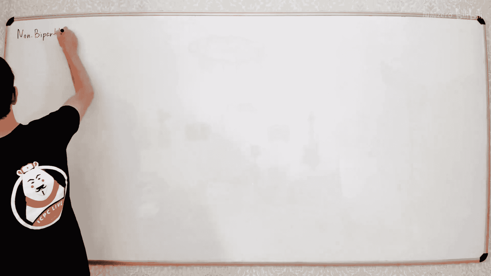
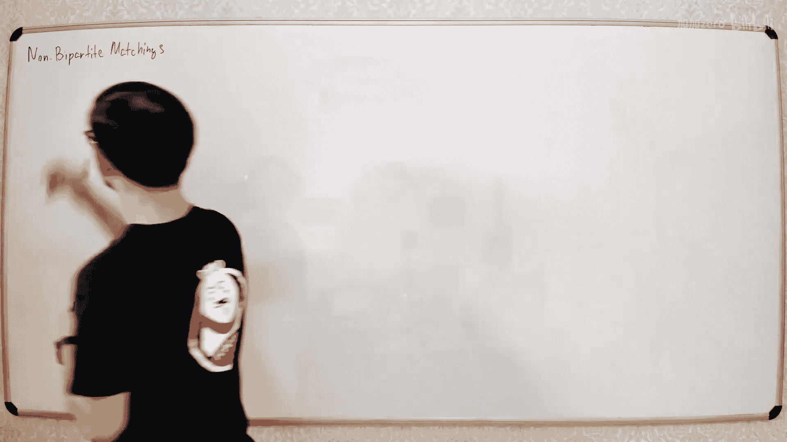
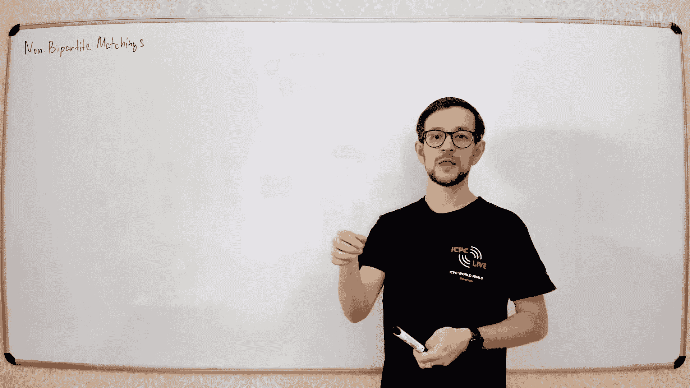
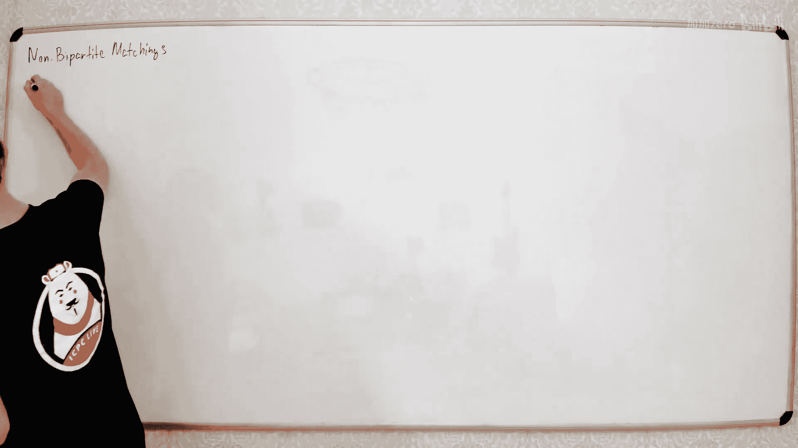
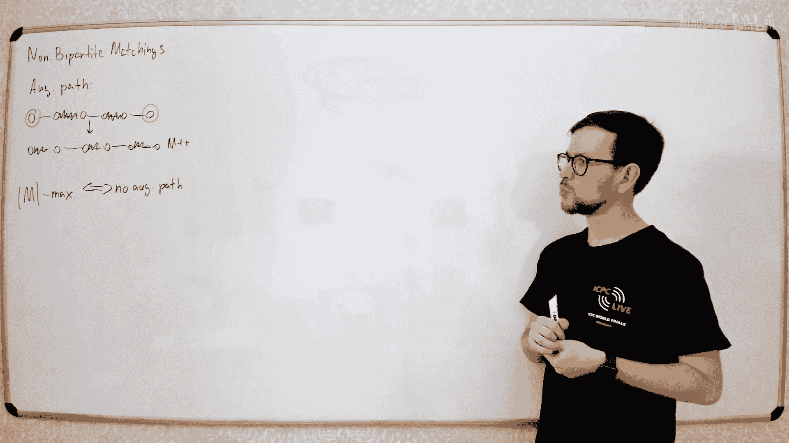
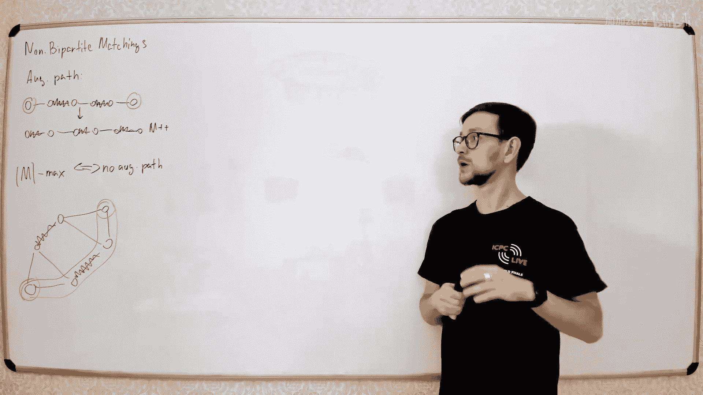
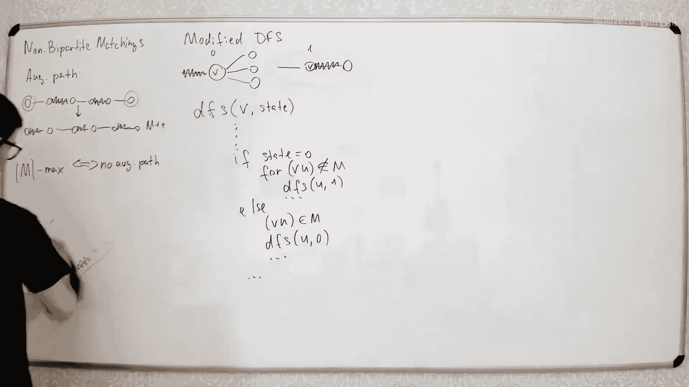

# 【精译⚡算法与数据结构】PavelMavrin p49 p48 A&DS S04E02. Maximum Matchings in Non-Bipartite Graphs -BV1NLB8YfEMq_p49-

🎼。

🎼So today we'll talk about non better matchings。お。

是。个さ。

， so last week we talk about bipartite matching and the algorithm for5 maximum bypartite matching was pretty simple。

We start from the empty matching， and then we add increase the size of the matching one by one。

 each time we just run the simple DFS algorithm to find the algorithm in path。

 Then we find this algorithm in path。 We increase the size of the matching by one and so on until we find the maximum matching。

Today， algorithm will be mostly the same， so we will start from empty machine。

And then we will increase dimension each time by finding some our went path。So what what is the our？

Outugmenting path looks like this。 again， it's the same thing as it last。

We have some pe on Portlandland。そ査せ。See we at five edges。

So the first and last regardless of the path must be free of the matching。Fre L be free not。

And the edge is alternate， so the first edge is not used in the mashing。

 second edge is used in the mashing。This is used not used， this is used， so this is our back。

And like in previous lecture if we find the augment path。

 we can increase the size of the machine just by inversing all edges on this pair we rule。

Will take these free agents instead。And just increase the size of the mixture。

So the idea is the same。 we start from the anti machine and then find our mat path until we find the max matching。

The difference is that the algorithm it's much more difficult to find augment path if the graph is non bipartid。

Just because how we did it in bipartgraphs， we just orient all edges edges not in imaging。

 orient from left to right， orient edges from matching from right to left。

And then find the augmenting back using some simple DFS here， we don't have left or right。

So we don't have any way to orient the edges such that augmenting path will become some simple path。

So that was been more complicated。嗯。いや、 but theほ idea is the same。And the main theorem is the same。

 So the image is maximal。If and only if we don't have any our paths。嗯h哼。😊。

We we broke this theorem in the last lecture。 So it is the same here。

不 go。let's draw some graph， let's draw some graph。Let's say we have something like。

Something known by partheid。Let's sing her something like this。And something here， for example。

Like it。Yeah， for example， we take this h and this h in dimension。

And now we have these two node are free notess。So when we try to find augmenting path， we may。

 for example， find this pair。So the visa is that augment back。

We find this path of increased dimension， and so on。Nice。So let's try to。

 let's try to find our meeting bath。 So how to find our mat bath。 Let's try some simple algorithm。

What can we do， for example， we can run slightly modify DFS algorithm。

So let's try to modify the DF algorithm in such a way that it will only find the augmenting paths。

 So simple DF algorithm find any path。 Yeah， so DFS algorithm don't know anything about the imaging。

Let's try to modify the DFIS algorithm in such a way that it will find only alternating paths。

 so how to modify algorithm。so。Moreう Gフイ。Do that for。So we will modifyify it in a very simple way。

 so we will take again in the F algorithm， you have some current node。

 so let's say let's have node V。We will maintain the current state of the professoror。

 we will maintain the state of the previous age in the path， so if previous age。

Was the age from dimension machine。Then well try to。

 we will try to extend this path by taking some edge， which is not in the machine。 So we'll try to。

Take all the edges from the machine。Yeah， so if we。

 if the previous edge we used in the path was the edge from the matching。

 then we'll try to use the next edge any edge， which is not in the matching。And if。

The previous page was not in the machine。Then in the next step。

 we will try to take the edge from the machine。我 we come on they want to。もだけ。嗯哼。

So we'll do something like this。 Let's see we have GFS。Well try V and some stick。Mhmm。

So we do all the same thing from the defense。 You know how to write defense， right。

 And then do we say if。嗯。Let's in state。Is0， so here will be0。 It will be1。So if state is 0。

 then we iterate all edges not in the machine。 So we iterate。Over all edges V。Such that。

It's not in dimension。And Ram， dear first。Of U and one。And else。Andど something。I just。

I just keep all the parts which are from this simple DF S， right， So you know how are D F S。あ。

I just write the things which are different。 Yeah， so if the previous age was in the。Mching。

 then the next edge which retro rotate is not in not not in matching。

 And if the previous edge was not in the matching， then well take。There's only one edge here。

 so we take the edge。Okay， it's only one edge。VU。Which is from dimension。And wrong， dear friends。

From this U and stay 0。Anl。Do something else here。 Do something else here。嗯。

Do something else is the same as here。 So if， if we found this augmenting path， we。

 we want to invert all the edges on this path and so on。 Yeah。

 I just skip all this power because theyre the same。Like in simple D。Yeah。

 so imagine we'd do something like this。So we will try to store this state。In all theFs。

So that here we know which edge we actually can take， so this of this path will be alternating。

Clear了。You're supposed to say clear enough every 50 seconds。Okay。

 what can go wrong So if we do it like this。What can actually go wrong。So， if we find， if we find。

Amenting pes。 So if we start from some node。

So we start the first from some empty note from some note in the not in the machine。We've stayed 0。

So state is 0， so we go here， the state is1， we go here， the state is 0， we go here， state is1。

 we go here， state is 0。We will hear and find。欢迎频到。Then we find an augmenting path。

 if we found the augmenting path， we just in the augmenting path and increase size by one。

But what can go wrong？How can it be that there is an augment bath。

 but our DFS didn't find this augment bath， Is possible。What do you think。Any ideas？

 What What can go wrong in this algorithm。First and last note， no， no， we don't go to the same node。

 so we will again like in simple DFS， we apply we just mark all the nodes we visit in the DFS and we never go to the node if we already visited this node in the DFS。

Again， I just keep this part here。So the Dsal algorithm is like usual Dsal rhythm。

 it doesn't try to go to the node if it's already visited。So。So start from here， we visit this node。

 market has visited， market as Vi， market has visited please。 So if we try to go to the first node。

 it's already visited。 So we will not go to the first node。

The problem is actually a little bit more sophisticated。 No。

 the problem is we actually change the defense algorithm。So the simple defpressiveogram。

 just find all the paths。Here， it tried to find some alternating pest， so sometimes。

It may not go to the。WithSe busy flag for both kinds of size。 Yeah， that's a good point。

So what could go wrong， We may。wantant to visit the same note twice。 So we may go to some note。第三部。

For example， we may have something like this， let's fix。Something like it。坐。

So if first we go into this branch， so we start from here， visit this node。Then go here。

 visit this node status 1， then go here， visit the install status 0， then go here， status 1， go here。

 status 0， then go here， status 1。う哼。Now here state one。

 so we need only we can only go through the nation which is in dimension。

 so from here we can go here。So since we want the path to be alternating。

 then if we go from this side， then next step we go here。 so well go from here， we go here。

 So here let's say is 0。And that's all we， we。Didn't reach this note。Problem。

So if we just do it like this。Then' possible what' is the problem。

 problemble is we visited this note in in in their own state。 So so this note。

Is visited in state  one instead of state  zero。 So to find this path。

 we need to visit this node in in state  zero。So we'll go here and find our meeting path。

 but we visited this note in the wrong state。So we visited this note， but the state is one。

So we didn't go here。Problem。Yes， we can we can。You made a good point， actually， what we can do。

We can do two set of marks， we can mark all the node Vi de state zero and mark all the needss with de state one。

And here we just say that if we visit in state  zero， then we go back from here we go back back back。

 Now we don' try to go here and try to visit this note in state one。

Last time we visited this out in state 0。 So now we will list it in state 1。 So we'll just stay。

 say state1， then go here。 state 0， then go here。 state1。 and we kind of find this our back。Y。

But this algorithm will actually hot。Look simple。But what can go wrong？If， if you make two。

 if you make two marks。So if you mark pairs like vertex and state。

What will actually go wrong is that from here again， when you try data search， you go here here here。

 here here， here here， and from here you will try to go here because you can。

If you go from here to this node， then you go to this node in state 1。

Then you go to this node and state 0 to this node state 1 to here to state 0 to state 1。So。

The path you found is actually a path like this。 So you go here， then you go here， then you go here。

But， like this。This is not a good augmenting path。 You can invert this path。It's not simple。

So we need this augment path to be a simple path。So we can invert this pen If you。

 if you have the same node， the same edge several times in your augmenting path。

 you cant invert this edge because it's。Did could say several times in your augmenting bed。Mhhum。

So having two， two marks for each node is actually not helping。

 You still don't know how to find a good augmentmenting bag because， again。

 good augmenting bath must be a simple path。IfIf you make two set of marks。

 then you will visit some nodes twice， and when you visit an notes twice。

 you have not a simple path when you have not a simple path， you can inert it。それだった。Okay。

So let's go back， let's go back。To this modified defense， this modified defect is actually。

Quite important。 So let's go back。 Let's go back here。嗱。Let's see。啊。

How can we tell that we actually have this problem in our graph。Yeah， so let's try to find。So again。

 you're on this DFS， one sun graph。How can you tell that you actually have some problem finding augment path。

 you have some problem if you try to visit the same node in the different states？For个下。

Again we go here， here， here， here， here， here， here， here， here， and after this。DFS。

 we will try to go to this note。And try to go here in a state one。

 So this note is actually visited in two different states， so we know we might have this problem。

 so there is some note which is maybe visited in two different states。Yeah。

 it only may happen if you have an old cycle， right。Since this。

 So that's why this algorithm is only this problem can only happen if you have non bipartralography。

 If you have bipartralography， you don't have this problem because all the cycles have even length。

 yeah。So this problem can only happen if you have odd cycle。Oh，Okay。So again。

 this is the only problem in which my happen。啊。Good thing。I claim。 But if this problem didn't happen。

Then。If there is an augmenting path， then we will find an augmenting path。Let's see more free。

Cオレ 수요レ。Small food， let's see。This is not free。Very simple theorem if we didn't find on weight path。

Oh pet。And。啊。no no。We visited it。In both states。So we don't have node like this。是。

So let's say this is some kind of problematic note， right？

So this node can be visible in two different states， so there may be some problem with this par。

 right？Simple heum。 If we didn't find our mat path in our D FS and there is no situation like this。

Then there is no mor Beth。No， let's prove it。 Let's prove it。Again。

 what does it mean if you if you don't have any note？Visited in two different states。

What does it mean what what your inition tells you。How the graph looks。

Where for each node we have some fixed data so what does mean if we don't have any node based in two different states this means each node has some state assigned to this node。

 its 001。So， there is some set of nodes visited for state 0 and some another set of nodes visited in state 1。

 Yeah， we have some kind of bipartgraph。 It's not exactly bipartite。

 but the like the sub graph visited from the。From this three node。

 So if we look only at the part of the graph， which is reachable from this。F now， so。

 so we're on GFS from here， so we didn't visit the whole graph。

 We visited some some part of this graph。 This part is actually bipartid。嗯。Yeah。

 and we know that in bi paragraphgraph it actually works。And by graph if there is a pet fine pair。

 we can prove it simply by induction。So if you have some augmenting belt， again。

 you have some augmenting belt。嗯 응 응 응。So let's let's say there is some augmenting path in the graph。

 let's prove that these D will actually find this augmenting path。

So we start from this note with state 0。Now， if we start from here to zero。

 we will try to take this edge。So we will try to go here with state1。

 since for every node there is only one state， we will go to this note with state 1， maybe not now。

 maybe some somewhere else， but this note will will be visited and the state will be one， right。

Well because we can go here。And we know that for each note。

 it may only be be visited in in one state。 So this this note may be visited only in state  one。Now。

 since we have this age， we will run the first here a state one。

So we will try to take this edge and try to go here or state zero。For each node。

 there is only one possible state， so we will eventually go to here with state 0 and so on。

 eventually we'll go here in state 1， well go here state 0， well go here in state one。嗯哼。😊。

So if you don't have any problematic notes like this。Then if there is augmenting path。

 you will find this augmenting path。P。嗯。That's almost。So now we have three possibilities。

That's ready to go。So you're on DFS。From all freeloads。There are three possible outcomes。Fか。

You found our meeting path。So if you're found o mating path。

You just increase the the matching by one。 Yeah， so you。

 you apply this augmenting path inverse all the edges and increase the。Mction。Second case。

If we didn't find our matching path。No augment making。喂。No but related notes。아 고 그럼。

What does mean it means there is no augmenting path， If there is no augmenting path。

 then the man is like maximum。Let's say let's election even mar small。And finally。

 the third outcome is when we have some problematic。😊，Now， now。

 finally something interesting will happen in this case。😊，我's see。How the situation actually looks。

 It looks like this。 So we have some problematic note here。If we have some problematic note。

 it means we have two different person， let's say we have node and V。This is a starting note。

And we have two possible paths， one path。Of the even length So say this spread ends with。

Ege from the machine。 and another path。Off Portlandland， headland。So。

So let's say we have some problematic note here。So there are two different pairs。

 One pair has hot lamp， and another part has even land。Let's find the closest。Note。

 which is common to above this。系 something like this。百三。これてスたさだけど。Actually。

 what you need to do is to take one path， then take the second path and find the closest node from here which belongs to this path。

 so well have a picture like this。ut two pers may have different sources you may have paths like this。

Yeah， so they they may intersect in different points。 What you do is to find the closest point。

Common point here。Then take only one prefix。So we have this pretty picture， yeah。So。

Let's see what's here， what's happening here is we have some augment or some alternate path from some free node to this junction point so we have something like something like this。

No， this， this age must be in the machine。あ。Do嘟嘟。あ、そたです。And here we have two possible edges。

 so we can go here。And。I have something， like。AV。Or we may go down here and have something like this。

いや。So that's how the station looks， So if you have some problematic note here。

 then you must have situation like this。So you have these common pre。

 And then you have two different pairs， one pair of E of。Of evenland， another path of Portland。嗯哼。

What does this actually mean means you here you have some odd cycle。Or the， the alternate cycle。

Well this cycle has not own odd length， obviously， and edges are alternate。

 so this edge is not on dimension， this is in the and so on。To move this be。どにですま。嗯哼。😊，Good。

And this is the main structure of this algorithm。 This structure is actually called a blossom。

Let's spread the big please。So this thing is called Bom。These are cool termss。 they go from the。

So the article about this algorithm， this algorithm was read by Jack Jack Edmonds， Jack Edmons。

And the article was called something like paths， Trees and Flowers。I just love this name since。

Very poetic。So he just called this structure a blossom。Because it's。Looks like a plant song。

So here here we check gently like the base of this plant。 And here we have a blossom。😊，唉。Gu。

That's all。 So this， this is the main structure of this algorithm。

So what we will do if we find this situation， Now first of all。

 how to find a blossom if you find a problematic note。How to find the blossom。 No， you can do it。

 So you can do it like I did here。 so you can start from here， find this path， find this path。

 find the con graphics。 But actually， it's much more simple。 since you're on D F S。

And what happened in DFS when you find the cycle in the graph。

 So if if you find the cycle in undirect the graph。

 you always find path So DFS actually works like this you go， go， go， go， go。

And eventually you run into one of your ancestors like this， So in the F algorithm。

 if you find cycle， you will find cycle like this。It's always。

 So since this is just simple non any graph。あ。So it it's actually it's actually much easier to programme as it looks。

 when you want to find the blossom， you you can do it right in these D。

 so when you find an edge like this。No， it's not a blossom。 We need to find。

There must be a cycle of old length。So if you find cycle like this。

 then you know that here is the blossom。So it's actually not that hard to find the blossom when you find the problem。

那我都我都问住我我我都问我。What I want to tell if you find a problematic note。It's quite easy to find the blossom。

 So we will go your T S will run like this。You will go actually here here， here here here。

 and eventually you will stop in this note in this note。And in this note。

 you will try to go to this node。有。And you will see that note， you is already visited。

 but in in the wrong state。So youll it's rather or old here， here。

Here you will through all possible node edges from the node V， and you will find this edge。

 and here you will see that node U is already visited but in the wrong state。And now， you know。

 you have a blossom。 You find this blossom mental。😊，So what to do if you find the boss？Let's see。

Yeah。So you have this blossom。아 어。What you do is very simple thing。

 You will take all the notes of this blossom in contract them into one single note。 So when you find。

😊，This blosom， you' simply remove all the node from here and add one single note。

 So this single node represents this blossom。And these。Notes are。1月 as before。

It's called a blossom cut。So again， what we do， we contract all this node on this node into one single node。

What happens to the edges， so you may have some edges from here， so you may have edges here。

Here and so。You just take all these edges and make them go from this new node。

 so you take this edge and now this edge goes from here and take this edge and now this edge goes from here。

嗯。Yes， we can have a nest blossom。 We will continue this process。 Yes， yes， yes， yes。😊。

So let we contract some blossom and then find another blossom。

 which includes this node and contract it again。你给我吃。そう。What will happen after we cut this blossom。

 we will continue to do the same。 So we have so we have graph G now we have G prime and we' will simply run DFS in this graph G prime。

No。If we find。Our maintain path in this graph prime。We can take it， expandend the blossom bag。

And construct the operating path for gravity。So。You've refined our men path。In dripbri。

We can find our menting pump。I graph G。how to do it。 Let's see。 You have some blossom。 Not like it。

 Let's take this picture。So again， what we did， what we just did。 So we find this awesome。

Contract all these nodes into one single node， then in this graph G prime we run the same algorithm。

 we're on the same DFS trying to find our mening pack。

Maybe we will find another blossom contracted so at some point we may find ouring path then how to go back from the so you you can call the same defect for this graph and then if you find augmenting path here。

 you want to translate the back to your graph gene。So how to do it。No。

 you found some augmenting path。 There are two possible cases。

 If this augmenting path do not include this node， so you have some augmenting path here。

So if you have some our path， this augment path do not include this contract blossom。

Then you just translate it。To2 to graph G， It is the same path。 Yeah， so if you have our path。

 which do not include this new node。Let's this gold be。From blossom。

So if you augmenting path injury prime。Do not contend this not be。

Then you just translate to a graph tree because it is the same path。Yeah。

 you have all the same notes。You' have all the same back。Now， if you have augmenting be。

 which actually contain the sound to be。So how does Beth flu like？

The augment path has alternating edges， yeah。So this augment path must go through this。

Base edge of your blossom。 So you， you， you must have path like this。 So it must go using this note。

 or maybe not from here。 Maybe it goes from here， something like。So you start from this though。

 for example， you go here， then use this blossom， then use one of these outgoing edges and go somewhere here。

So what happens if you have our mat path like this in graph？

We want to translate this augment path back to graphraph G。😡，How to do it。Let's。Take this blossom。

Yeah。Let's again replace this note with this odd cycle so what will help。So we have again。

 we have this part of that。I making both sample like this。We have this stock over here。

To here and some。那。What we need to do， we need to connect these two nodes。

Using the edges from this blossom。And I claim we can always do it。Because what we need to do。

 we need to find the alternating path between these two nodes。

And this path must have an even length because we start from the edge in the machine and we end with the edge not from the matching。

 So the number of node here must be even。There is always an even alternating path in the blossom。

So you can go clockwise， or you can go Quaclockwise one of these paths。Will actually satisfy you。

Conditions， right cost。So for example， in this case， you can go clockwise。

 so if you go from here to hit clockwise， you take this part of them。Of the blossom。

You will build alternating path from here to here。 And this part will also build alternating。

 So you have a correct augmenting path engine。What course insert replaced in Pertha， right。

 So we we go around cycle， but we need to choose the direction。 Yeah。

 so there are two possible directions。 You can go clockwise or counter clockwise。 And for this node。

 you need to go clockwise。 But， for example， for this node， if you have。Something going from here。

If you want to go to this node， you must go counterclockwise。But one of these paths will always be。

ここ 할て요。Because because the length of the cycle is odd。 So one of these lengths will be even。诶。别从。

So if we find problematic note， we contract。Go want to Iraq。Bsom。coolol。G F S in graph G prime。

 and then。对。嗯。诶。How it's cold。Very good this as a transfer this path。Ros。F 아 오고。With。Dzhi。

That's the plan。That's all that's the whole algorithm。嗯哼。Again， again。

 let's repeat the whole algorithm again。 So what happens you run this modified DFS algorithm。

So yourji first algorithm maintain the states for each visited node。If you find the note。

 which is listed in two different states， then you found some blossom。😊，You contract this blossom。

Round the again。Then put this blosom back。And just modify your augmenting bath so it youll have our augmenting bath injury。

If you find our ma path。Then just apply this how bed and return from your decors。

If you didn't find problematic note and you didn't find any blossoms。

 it means that your matching is actually maxim。En just Street in this end story。

Can we miss powerful president， that's a very good point。That's a very good point。そう。

 what may be the problem。problemblem is， we try to contract this blossom then around the DFS in this modified graph。

If we find it。Augmenting path in this G prime， then we can translate back to gravityging。But。What we。

 what if we didn't find any augmenting paper in。Geep Brian。What do you think。What does it mean。

So if we take some。Blossom can track this blossom。 then run the F S。

And then find out there is no augment width in this graph prime。

 So we can we try run all the same algorithm in this ja prime and didn't find anything。

 What can we say about graph。What do you think。Okay， what what you want to be true。

We will prove it parts。Yes， the hope is right， it's right for。

 So let's hope that if there's augmenting pathology， then for some reason。

 there is no augmenting path。😊，Inj。Let's actually throw。

🎼That's that's a little bit more complicated to prove， but we'll prove it now oh oh。

 I didn't connect my laptop， sorry。他 second。I forgot to connect my laptop。Andber。嗯。한个요。진 좋어。嗯。Go。

 let's prove this。First of all， this is the only thing that we need to prove， right？If we prove this。

 everything else is cool。Right。A could they may have。Yeah， no。

 the number of different our matching methods is not is not problem。

The problem is if we have at least one moment in path。If we have two different， now make bed。

 no problem。If we didn't find anything here， we want to return from this DFS and say we didn't find anything。

 sorry， so if we run DFS and G prime and didn't find anything。

 we want to return from this graph G and say that we didn't find anything in the graph。

That's the only problem we have， yeah。Let's prove this。Let's draw another beach。B。

 so we kind ground juice？Here we have some blossom。Thank。Let's do look these。small Wilson。

And we have groundji。I will prove this from right to left。

I want to prove so this is the same as this is our path entry， then there is our min path and right。

So it's the same as。Right。The same condition， right？

I just inverse this negation from both parts and reverse the setup。Your direction of this y。Yeah。

So heres where implication from node A to node B。 Here's implication from B to A。It's the same。那老じ公。

So I have some out breath injury。I want to prove that there is a majorbe in drip prime。

I will do it in。3ree steps。So I will build two additional graphs， so first I will build graph。H。

Graph H will look like this。 I will take this。m。 So this note is free。 This note is free。

I will take this part。This path and inverse this path。Everything else will be the same sorry。Okay。

Dick。😔，그ちか dreamかて。You can just inversese this path。So this edge is used。 This edge is used。有。

Its clear how I go from this graph to this graph。 So I just inver this part of the graph。

So I can't endorseverse any。Alterernating path starting from the f node here。 So if I have this path。

 I can in it and have this path。 This is the correct matching， right。And I'll do the same here。

 so let's say H prime。It will be like this。嗯。A this， at this。Mmhm。😊，That was proof。教室。

If I have our melt path。Yinju。Then I have our mat path。CB是吗？In H， let's put it。

So I claim if I have augment path G G， then I have augment path graph H。How to probe。嗯。Again。

 let's remember when we have our mat path， we have our went path。 if and only if the matching is not。

マクxiも。So I have a amazing beverage drink meals。That M is not maximal。Right。Mhmm。Yes。Now。

 listen's see， the size of dimension here is the same。Yeah， so when I in work this graphics。

 I have the of the same size。 if this matching is not maximal， then this matching is not maximal。

 then I have our matching path here as well。그 that's all。Now the same thing here。

 So if I have our main pad。In an age bright。Then I have our mounting pad。Yinjibra。Again。

 the same logic。These two machiness have the same size。So if I have our matching path here。

Then this matching is not maximal。If this matching is not maximal。

 then this matching is not maxal because they have the same size。 If the matching is not maximal。

 then there is our matching path。That's all。Okay， now I moved from here to here and from here to here。

 now I only need to move from here to here， right？😡，Most's true， no。

 I claim that if you have a mat path in graphph H， then youll have a mat path in graph H prime。

How to do。Let's look at the automatic path in graph H。

 If this automatictic path do not include this bossom。 So if， if I have automatic path like this。

Then I obviously have the same path in H prime， so if my oaz path do not contain anything from this blossom。

Then I have the same path here。If my augment pair actually touches this blossom， So if。

Well it might do it actually quite strange so。You may have。You may have our mat pair。

 which goes something like this。E。Something like this。 So you start from this free node。

 then go here here， then use this path from your own blossom， and then go。Here， here， here。

So you make 2， you may find our mat path like this。Now， I claim if you have any augmenting path。

Which includes some noise from your blossom。Then there is how much best in graph H prime。

 Why is it true， no。Let's take this path。So。One of the ends of this path is not this base of your blossom。

 So so let's， let's take this base of the blossom。So one of the ends of this path must be different from this note。

So， for example， this note is different。So， let's take this。Note V。And。

Just take the part of this augmenting path from this node V to the closest node。

 which belongs to your blossom。 So let's take only this part of the。Of the our bath。

And now translate this part of the path to graph H prime。 So in this graph。

 you will have something like this。Now， since note B is free。

Then now you have this small augmenting path from B to D 3。嗯哼。That's all。

So if you have any augmenting path， which includes note from your blossom。

Then you can cut this part of your orbiting pathth。

Move it to your graph H prime and here you will have our mattting path in graph H prime。That all。

So cut now from this。We can， we have this from this。 We have this。 Now。

 if we have our matten path in N G， then we have our mat path in H， then we have our mat path in H。

 then we have our mat page path in G in G brain。😊，人错人错。That's the whole。Okay。The proof is， yes。

 proof looks like Ka kind of magic， but it's the easiest proof I know for this， for this the。

 You might prove it， you might use something like dual problem to prove it。From other side。

 But I believe this is the easiest proof。 and it's， it's very visual in it's。Very simple。

The problem is that if you want to make a constructive proM。

 if you want to construct from this augmenting path， this augmenting path， that might be complicated。

Because the path may look completely different。WellBecause then you can again。

 like here When I contract this above， I have this long dimension path。

 Now we have this shorter dimension path。 This long animation path will no longer be our path。 Yeah。

 because here if you just take this augment path。Then here you， you will have。2， frame，2，2，2，2 edges。

This way just not， not alter alternate， yeah。So you can adjust contract this the blossom and take the same element be and say this element be will be again。

 our be。That's not true。So。Prove is a little bit sophisticated， but。不在哪。So again， how the works。

 So you start from graph G。You wrong dis。If your dear find the blossom， then you contract。

This awesome。You'll get a gr， jra。Around the same day， facing gravity prime， Find another blossom。

 contract it again。😊，Take and so on。At some point。You will find our had two options if you around the algorithm didn't find any blossom and didn't find any our path。

 it means that your matching is actually maximal possible so you cant find our melt path and you didn't find any blossom。

This means your there is no augment per。 So your matching is maxim possible。 If you found a per。

Then you translate back to graphraph G prime。And then translate the vector to word option。

Then you apply this augmenting path， increase the size of the。

 so you'll increase the size of the machine。And then do the same thing again， so again。

 you start from graph G。Try to find another orbitba Perth， you find blossom， find blossom。

 find blossom， then go back， go， go back， apply augmentmat Perth。

 and increase the size of dimension and so on。嗯哼。No。All these actions。Can be made in linear time。

So you can run DFS， find the blossom， contract the blossom， expand the blossom back， and so on。

 so all this separation can be done in linear time。

Maybe some of these operation are a little bit more complicated， but。you can do it as an exercise。

 So all these separations， like what with lost some expanded bssom back。

 transfer the augment back to2 G G and so on。 All these separations can be done at linear time。

You can think about it if it's not very clear。 So you spend。M time。

 let's say M is the number of ages。And here and here， so all these as stay cleaner then。

So what is the total number of the operationss， So how how many times should we run these DFS until we finally find the maxim possible matchings。

Let's see when we increase the matching。We cannot do it more than n times。Yep， sure。

So when you increase the matching。You can do it more than1 times。The end over to actually， yeah。

But because you have only end node， so the total number of edges in your cant be n over2， right？No。

What about these contractions？How many time can you contract the alossom until you finally reach the bottom point。

 So you will find the our bag or you will stop。What is the maximum number of operations here。嗯。

So why this algorithm is actually？To terminate at some point， why is not。

 Why can you do it infinitely， Why can't you contract the bloss infinitely， yeah。

Every time you contract some blossom， you decrease the number of nodes。 Yeah。

 so the number of times you decrease the number of nodes is no more than n is n over2 again。

 But okay， I just say N。I guess we the whole instance which is not important。

So again here you do any operationss here， then go back， do any operationss here。

 go back and so on and。Number of times you increase the machine again is n。

 so the total number for all these separations is no more than n squared。

So total 1 complexes here will be falling。So n times we increase the imaging。

Each time before we increase the machine， we make all these contractions， we have no model。

Ands quick on questions。And every reation is actually DFS or something else。

 which is works in linear time， so it works in linear time。

So that's the total complexity of this algorithm。嗯哼。呃。Interesting question is。

 can you do it faster or not is actually answer is you can， but it is complicated。

But have enough time。 We have some time。So if you will try to implement this algorithm。

You can implement just like this。So all steps here are actually。QuQuite。

 so for every step you don't actually know what to do。There will be a lot of code。

 especially when you try to expandend back your blossom and so on。So there may be some complications。

 but it's actuallyly doable， right？嗯。But you you you can make even first algorithm。

 and it actually will easier to implement。 You can do it like this what can。Let's， let's write this。

Itれ。You can actually do it all in the same DFS。 like we did in the k algorithm。

 So in the K algorithm， we need to find augment in Per， then find this and then when in the ver path。

 and we in previous lecture， we did it in the same DFS。Here we can do kind of the same thing。

 We can run DFS algorithm， and this DFS will find the om mattting path。

 willll contract all the blossoms， We'll invert the path and so on。

 we'll do all the stuff in this single DFS。So you do it like this。

 so what happens you start the from some freen。And run the D of it So you yourself from here。

 you go here， then go here。Yeah。嗯。What stuff stop here。You visit this mountain and state 0，1，0，1，0。

And here you find this edge， for example， so you find this edge and you find the blossom。Again。

 again again what will happen？ You have the， you have your D algorithm。 This is your current node。

You iterate all possible edges。From this node V， if you have edge to some node you。

 which is not visited yet。So you simply recursively call the F from here。And Mark E is the state one。

So you mark the state one around the first here。If if you feel read some note。

Which is already visited。We've stayed  one。Then you just don't go here。😡，Here。

 and just continue because you already visited this note in state1。

 So you visit everything possible in the state  one。 So you just skip this note。Now。

 if you find the edge。Do some another audio。We state 0。It means you have a blossom here。So again。

 this is your current state of your D algorithm。 You standing here in state 0。

 and you find edge to another node of state 0。Then， you know， you find the blosom。What you can do。

This blossom is always some top contains some top nodes from the stack of your recursive DFS。

 So this is the stack of your recursion。 So start DFS from here， then go here， then go here re reor。

 So these node are the top nodes in in the stack of your recursive DFS。So what you can do。

 you just take this notes。From the stack of your D F S。And then， contract this。不s。そ쭉 육。

So you just remove all these nodes and replace them with one bigger node。Now我 happens。啊。Now again。

 you have your graphraph G prime and you need to run DFS in graphraph2 prime。

 but your current state is probably a valid state of DFS and graphraph G prime。

So you just say that this is your current note。So again， imagine you start DFS in G G prime。

 so you start DS from here and we go here here， so this big note is the current note of your DFS and graph G prime。

So you can just continue j from this point， yeah。So just。

Contract this blossom and continue Ds from here。 So you just take this big note。

Thenll continue your D from here。 So you take the next。It's here authentic。And so on。Now。

 if your DFS will。Return true。 So if this DF， DFS actually will find some。Ourment pathth。

Then when you go back from the recur。You actually invert this augmenting pad。

So when you return from the regressioncur。 So you can just start from here。

 go to here and then continue。 So when you go back from the recur， you invert this part of the path。

And now you， you need to expand back。Your。Blossom and continue the re。So you expandend。

You're blossom。What。And all this notes the to move。Do choose the side of your path。And this。不爸爸就给啊嗯。

Yeah， to have meeting bed and then go back to discussion here。嗯。Yes， yes。 When you。

 When you contract the the boxes of the。Interesting thing that you actually have some notes going from here。

So when you contract this blossom， you need to merge all the adjustments list of all these nodes。

 yeah， so you need to take all the adjustments list of these nodes。And combine them into one。No。

 combine into single list of a list for this big no。Yes， strong。 You can do it。よくる。

Congratnate different if you maintain these lists as a double connect list， for example。

 you can concatetnate all this lists in linear time。Linear by by the number of nodes here。

So the time you need to spend contracting this node is linear of the size of this blossom。

And the number of nodes you remove from your graph is actually linear of the size of this blossom。

So again， if you have。if you have the blossom of size K。

Then you have linear time to contract mostmic， it's actually not。It's actually not。Let's it。

 like these。actuallyction not there， but close now。So you so if you can。

 if you can contract the blossom of size K in linear time。Then。You spend this number。

 this time to contract this node， and the。Number of nodes。Will be N minus k plus one。嗯。

So you decrease the number of nodes by K。And spend K time doing this。Now。

 now now if you take some of all these elements， if can you pay if you have K1， K2， K3 and so on， K。

I didn know another legend。B。有。Then the time I spent is sum of K。Hi。Yep。

And if you look at this thing that each time I decrease So so I take M minus k1 plus1 minus k2 plus1。

And so on must be。At least you know it actually one button that does me。

So if I remove this to the right， this to the left。

 then some of all case will be no more than n plus number of these ones plus P。

So tank complexity is actually n plus P。And P is the number of times I need to contract。在。Blossels。

 so please。There's no but there。 So this is the。ね。Yeah。Sorry。So actually。

 the time you need to compress all subscribe contract all this。Blossom is actually linear。

 Why not exactly， Because you actually need something like union find destruction。

You kindly need to maintain the current sets。Contracted， yeah。 so for each note。

 you need to know which blossom it actually belongs to。Because when you go here。

 so at some point you may have edge from here to here， something like that。

 you may find edge like this， and you need to know that this edge actually goes to this node and this node belongs to this contracted set。

So for each node， you need to find the set contained this node。

 So you need to you and find the structure for this。 You can avoid this， but is complicated。

 we will not do this。Sorry， actually， this is not linear。

 but linear multiplied by inverse acra function。Not a big deal， but。有。A。Finally。

 what people can do people。People know how to do it in time。

 So the best time known to solve this problem is actually maybe I believe it's the best time known。

Is square root of M multiply by M。Okay this thing is kind of complicated。

 We will find the algorithm with this time complexity for bipartralgraphs。

 so we will talk about hope car algorithm for bipartralgraphs with this time complexity。

It can be generalized for non biparttheed graphs to make non biparttheite mentions in this time complexity。

 but it is really complicated。So not not this year。 maybe at some point， we will talk about this。

 but。No。So it's possible to find none what the dimension with this type complexes here。

But it's much more sophisticated algorithm。都とです。Uually sorry so if you just apply this。

 then okay let's update this。 So if we do it like this， then we actually do all this thing。

 all this thing can be done in linear time。No。So totally， will be something like that。

Maybe' multiplied by indoorocrament function doesn't matter。呃But。Yeah。This is actually good enough。

 usually。For small graphs。Usually， you don't want to find。Mching for big graph。

If you actually need usually exactly first if you just start your graph from some greasy algorithm。

 so you just grizz take some edges。You will find almost。Almost maximum on machine， so。

So a lot of heuristics， which actually helps but。Okay。嗯。Any more questions。

 what the state of proposed research， What will be the state of the proposed node state will be 0。

 of course， Yeah， because this is the node compressed from this node。 So we go from here to here。

 So the state will be 0。 Yeah， so we we contract all these nodes in the single node and start from here。

 the state of this node is 0。 Yeah， so the next edge must be not in dimension。呃。Yes， yeah， yeah。 So。

 so this optimization actually removes all these stuff with a single DFS。 basically。

 So it's a single long DF S。 So So D F S goes sometimes it contracts some sets， sometimes it go here。

 But the total complexity will be linear， yeah。So you spend M time for the ho fast This part is actually N was M。

And you do it n times。 So we n plus M multiply by with if M is greater than N。

I always assume N is greater than M。 M is greater than N。

 So number of edges a greater number of nodes。If the number of edges is less number of nodes。

 then the graph is not connected。 this one。 You can just split it into components。あ。ト。

Hope it's clear enough。 This is one of the most complicated reasons for this semester。

 So if you didn't understand some parts of this， that's okay。So there are a lot of small details。

 If so， if you try to implement this， you will find a lot of small details。Good luck。

 actually if you try to implement this， it's， it's a good exercise， but。呃。So it is usually。Yeah。

 it's hard to do it from a first try， but。Okay。So this song yep。🎼，ううんうん。🎼。🎼Yeah。🎼う。

