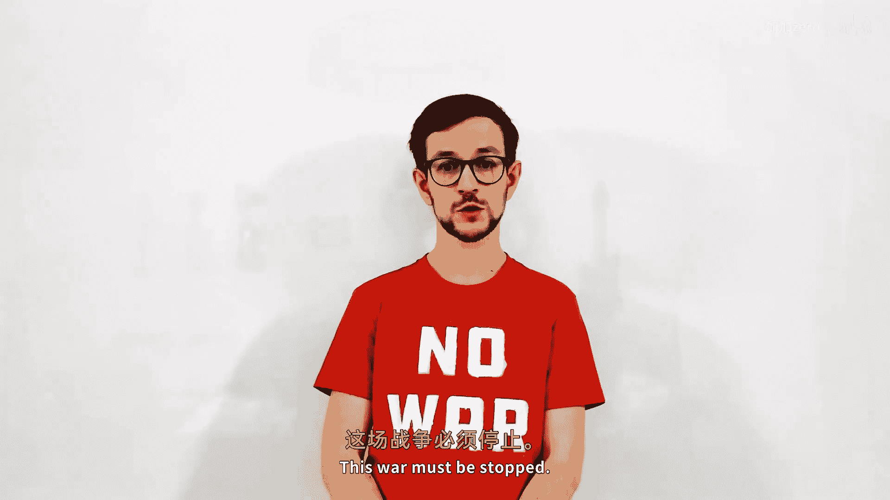
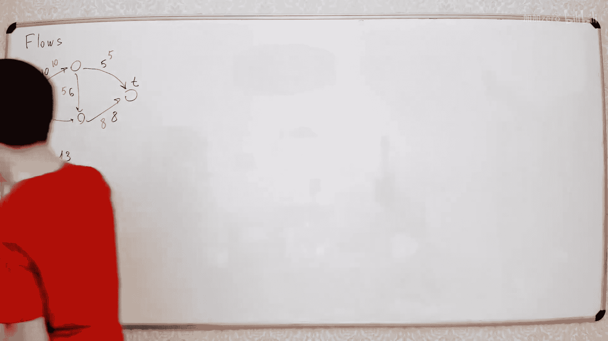

# 【精译⚡算法与数据结构】PavelMavrin p50 p49 A&DS S04E03. Flows, cuts. Ford-Fulkerson algorithm -BV1NLB8YfEMq_p50-

Hello。You know， it's got to talk about algorithms when is world outside。

I have a lot of friends in Ukraine。They all are great people。

And I don't understand why we're fighting them， Why are we killing them。This war must be stopped。

So they will talk about network flow。What is the net color problem， You have a graph。

Let's say some directed。Something like that。And you have， let's say some liquid。

 And this liquid is flowing from one point to another point of this graph。 So we have some。

2 fixed notess，1 of this source。Yes。It is the source of the liquid。

 so the liquid starting flow from this point， and lets start seeing。Thats deep。

So this graph and there's some liquid flowing from this point to this point。Now。

 for each edge of the graph， we know how much。Liquid can flow in one second。Through this edge。

 it's called the capacity of the edge， so each edge has some capacity。Well，s put some numbers here。

 Let's see。And here， let's say，5 here，6 here。Let's see。5 here and。AQ。So quite good。So for。

 for this actual example， we can from。This vertex this verex can flow8 units of liquid per second。

And the problem is very intuitive so in it though。Find the maximum amount flow of liquid。

 which can flow from source to signal。How can how can we describe the flow of the liquid。

 We will just say for each note how much liquid is is flowing through this edge。 So for each edge。

 we will fix some number。 This number is amount of liquid flowing for this edge。Hello， for example。

 let's say we have。 let's say something。We can' have。So here's the maximum output where it's 10。

 So let's see we have。是。It was damn。The image of liquid is flowing to here。Now， it is split。

Here and here， let's say5 is here。5 is here。Now， from this point， we have three units of liquid。

 So here are the joints。 So we have five from here free from here。 so we join them now we have。

8 units of liquid for this edge。So this is how the metal total looks like。

What we want to maximize what maximize the amount of liquid flow from source to sink。

How to calculate the amount amount of liquid What is the amount of liquid flowing from source to sink in this graph。

 for example。How to calculate it。It's called there。So F is the value of the clone。

 So it's the total amount of liquid， which flowing from source to sink。Pable for this graph， we have。

13 units。有。How to calculate it。 easiest way to calculate an amount of liquid is just calculate the number of total amount of liquid which is flow from the source。

So what kind this source of？We have。10 liquids flow in here and free liquid amount units of liquid flowing here。

 So the double amount of liquid flowing from the source is 13。

Or we can look at the sync note for this note， we have five units from here and eight units from here。

 so the total amount is 13 y。It is the same for overseas because no liquid is。So。All all the liquid。

 which is flowing from the source will eventually go to the sink。

 so the amount liquid is going from the source is the same as the amount liquid going to the sink。

Okay。No。Let's describe it more， so we will say that。For each note， for each edge。

 we have the value on C U V。 It is capacity of the edge。And these red values are the flows， yeah。

 so we have another value of F。You wish the flow。And there is simple constraints。 So then flow。Shubi。

At most at least zero and at most capacity。Now， for each node， they have a。Balance equation rate。

 So the amount of liquid flowing to the node must be the same as the amount of liquid going out of the node。

For each node。We have。Some of all ingoing ages。 So let's see。Some for all。U， so for each note V。

Except。S N。We have some of all ingra edges sources is F。UV so。

 so this total amount of liquid going to the edge to to the node must be the same as the amount of liquid going out of the node。

Like this saw。No， and yes。 And the right of the floor will be。

The flow will be just the sum of everything going out of the so storms。No， actually。

 there can be edges going to the source node， so can we need to subtract them。ぶ carefully。

So we need to sum everything going。Out of there。Sour of minus everything going to the source。

Like this。And the problem is to max wise F。だで。So that's a much flow problem。Yeah。

You forgot to say everything is clear every 50 seconds。Okay。I'll just suppose。

Everything great right now。オ。It's a nice model， but it's not very useful actually so for our algorithms。

 we will use slightly different model。 It is the same。But it's。

It will make the algorithms more simple。啊。I will explain why when we move to the algorithms we will use slightly remote。

 always slightly some symmetrical model so in the symmetrical model we will what's the problem here。

嗯。Yes my Why not there maybe some issues like these。Yes。

 you don't need these edges If you want to maximize the maximum flow。

You can just remove all these edges， actually。But。喂。

嗯。嗯。No。So what what what what the difficulty here。 So difficulty here is we have multiple sounds。

 So in these equations， we have some here and some here。

 So we have the sound for all ingoing edges and some for all outgoing edges。

That's kind of complicated。 It will make all the future algorithms。

More complicated because we need to look on all ining edges and look at all outgoing edges at the same time。

 So we will just merger these two set of edges in in a single set。 How we do it， We will add。

More edges to our graph。 So for each edge， we will。At the reverse stage。So， for each head。

Of the group。We will add one more page。Next slide， please。And we'll say the following。

 we willll say that the flow on the reverse edge is minus the flow of the port。

It will say that the flow on this regard H is minus flow of the main age。Now。

 in our hour will be no difference between real edges and these reverse edges。 so we will。

Work with them in the same way。Actually， so this is the edge from your realgraph。

 This is the age you add when you build your。Gfi。No。Yeah。Now， what about constraints。

 We will say that the capacity of this source edge is 0。And for these agents。

 we have capacity to CPU view。Will see the sea。U V is 0。H， let's talk about this。An equation。

 So for this equation， which we can just say that F U V is no more than zero。うん。😊，How kind of。

 What module is if you have multi， I just you can。 Okay， let's's let's do it here。

If you have multi edges。You can just add。This is ages for all of them。It's also work。Actually， in in。

When we don't have costs when we have simple flow problem。

 you can always unite all the multi edges into one single edge with capacity equal to the sum of all these capacities。

But in some innovative flows， when we will talk about minimal cost flow， we actually sometimes we。

Need to have multiple edges。And that's no problem。So for just for every age。

 you make another reverse edge and that's all。All these algorithms do not depend on the graph is simple。

 So you may have multi edges。 that its totally fine。Yes， it's it。の？

So we note that it will be slightly difficult to express it like this。

 So it's actually you do it like this。 So so you have multiplies。

 you have E1 and you have E H E2 and you have different flow。

 you have flow over H E1 and flow over H E2。So here， instead of these indices。

 you just make the you just no。You， you need to attach this flow to the edge。 Yeah。

 if you have multiple edge for the same ends， you need to attach different flows to different edge。

But that's usually how how do you program it， So usually when you program it。

 you have you don't have these adjustment symmetric， right？

So usually when you program graph algorithms， you have something like list of all edges。

 so you have kind of object edge， yeah。And if you have object edge。

 you can attach this capacity and flow to this object。Here's another problem。好。Yes。

 so I do it for simplicity。 so for simplicity。It's easier to have this indices here。

ItBecause it's more visual。 if I say E here and say that the H E connects V and U。

To make everything more complicated。哎。Yes， I didn't try that。

FQV is not negative because it may be negative。 Yeah， for this reverse edge。

The flow will be negative。Usually， y。But for this fourth age。The flow will be non negative。 No。

 white it will be non negative， because。For this digital edge， we have the flow is equal to minus F。

V yeah。And it should not be more than the capacity of this edge capacity is zero。

So minus flow for this H is not less than 0。 not greater than 0。 And now。

 now you just invert this in equation and you have that flow over the H。

The U is greater or equal to 0， again。So you don't need this quick actually。Now， what about balance。

 What about balance， So this balance equation。Will be simplified because， again。

 when you just take some of all edges going。Out of your note， you will have this。

Ages with plus and these edges with minus。 Yeah， so the balance equation is very simple。

 So we have some。For all V F U， for all you is 0。And then this equation is more simple。

 So in this equation， again， if you just summarize all everything going out of the node S。

 you will have this sum with plus and this sum width my。 So F is just。

Some of everything going out of the。や。嗯嘿。🤧。Nice。Now let's prove some important theoremnce。

Will be very few， few few theoriesems， but it's kind important。First of all failure。

 let's talk about some of the flows， so if you have some of two flows。What does mean。

 it mean you have just a flow and the flow or each H is equal to sum of flows in these two different flows。

It makes sense。So if you take flow for each h equal to F， let's say one U V plus F2 U。

And the important theor is that every flow can be decomposed into set of paths and cycles。

So every path， every， every flow， maybe it can post that sum of F 1 plus F 2 plus and so on F K。

 such that if each of them is。With。From S to T or second。so go。嗯m哼。Let's prove it。 Let's prove it。

 What What does been pathth or cycle， The flow is the path。 I mean that you have some path Yeah。

 from S to team。And。You have flow only on these edges So you have this you have the same flow。

 obviously for all these edges and all for all other edges is zero。And no cycle is in the same way。

 So if you have a cycle。You may have some。Same flow。Flowing around the cycle and Arab males is 0。

So we can decompose the flow into smaller flows like this or like this。

We's prove it we'll provide construction of the so。

 so we'll just construct this set of paths and cycles。 how we do it we take the graph。

And try to find some pathth which can we subtract from the flow？How we're doing， Oh， wait。

 let's find any。B from S to T， such that。Flow for each edge is not negative。How we do。

 So we start from from the source。 We take the source。Now， we take any edge with。Positive flow。 y。

 for example， let's take this edge。Now， if you go to some node and you have ining age with positive flow。

Then there must be another edge with positive flow going out of this node because the balance is0。

 right， So if you have ingoing edge。With positive flow。

 you must have outgoing age with positive flow。 So let's take any outgoing age with positive flow。

 So for example， this edge， thats only one， yeah。Now you reach Ro X T。If you reach for6。

 it means you found a path from S to T， such that all flows on the edges of this path are not negative。

Now， what we can do， we can take this path。Take the minimum of the flows over these edges and subtract it from。

 from the whole path。 So we see we have three units here，8 units here。 So the minimum was free。

So let's see， let's just say that the first flow is like this。Have。

Free units here and three units here。And now we just subtract this flow from outflow。So。

 we will have。Z here and five here。Now do itて again。Again， you start from the source node， take any。

Positive flow。From the source node and continue until you've reached the node team。So set from here。

 take this mode edge they take this edge。The minimum was 5。 So the second。Hello do。Will be like this。

Now， again， you' just subtracting tongue。L， also we have five here and0 here。And finally。

 do it again。 Now again， you start from this source node， take any positive H here。

 any positive H in positive h。 So find this。So find this path and then we are third。

Flow will look like it。嗯。5份。So we just decomposed the flow into three simple flows， yeah。

 so each of these three flows is just simple pair from S to T。You may also have cycles。Look。

 this graph is a cyclic， so it's hard to build cycling in this graph here。But if you。

 if you can contain some cycles。Then you may have some cycles in your decomposition。

 how to find cycles。 So in the same way， you take any positive edge。So if you want to find cycle。

 you take。Any positive edge。And just start from this point again， you start from this point。

 you find any positive edge， any positive edge， any positive edge。

 and so on until you reach the cycle。Again。And if you have ingoing positive edge。

 you must have outgoing positive edge， so you cannot stop。 You will stop only if you find a cycle。

Okay。어 that working。Some something wrong with my cable， again。The cable is bad。 O， try not to。

It cable just not working， okay。I will try not to touch it， again。Okay。Once again。

So why this process even stops？So why？ So again， what is the process of finding this sequence of flows。

 I find any。Path from S to T with positive flow on each H。

 Take the minimum of this flow and then subtract it。Or I can find a cycle。 If I find a cycle。

 I take minimum of all flows around the cycle and again subtracted from everything。

Why this process is finite， or white or white even。呃。No，Actually。

 I want to calculate the total number of of flow and is decomposition， but。Why。

 why is it even finite？ why this process will stop at some point。Any ideas。

We decrease the sum of the flows。 That's true。 Yes， in this process。

 we decrease the sum of the flows。 Yes， so so on each。 After each duration。

 the total amount of flow along all edges is decreased。But it's， yeah， yeah。

 that's correct observation， but it will not happen so if you have big numbers in initially if you have if you have integer numbers。

 it will end some point right， if you if you have some real numbers。

Then if you decrease some real function， it may not reach the 0， again。There is even。啊。

It much more powerful observation。咦。Of the closure， the scriptul flow is very flat。 Yes， this。

 this is the very flavour。Mhmm。What's happening is each time。We find that。Pth or find the cycle。

 one of the edges became zero right Yeah， so when we we find this we find a path。

 we find the minimum and then subtract this minimum from everything。 one of the edges became0。

Happen on each station show。 Each time we find one of these path or one of the cycles。

 one of the age became 0。And we have at most M edges。

 so the number of these paths and cycles in this composition can be more than M。Now。

 here here I use F for a value of the flow。 and here I use F as Fia。Yeah。

 you can write it like these books。嗯。I think it's a complicated usually usually it's。嗯。

Usually it's clear enough when I， when I use value of the flow flow。Maybe not， not as clear。

Now here I say there's it。Flow F is some of two different flows like this。Okay。那。

I need to raise something。Now， another important thing about flows is what is called residual capacity。

So we have some flow。십 쓴 거。You have some flow， let's have not maximal flow， let's have some flow。

What are your five here。Let's have something like。系。What's9 here and。5 here and。Let's put 6 here。

 and。Free here example strange flow， but let close it。

And we have six here Let's put two here and eight here。实力。So， let's have some flow。

What I want to do is to build what's called residual network。What does mean I will for each edge。

 I will calculate how much more flow I can push through this edge。好 capacity发。What is it。

 iss just difference between the max possible flow and the current flow。

And I will build the following network， I will build a network which contains all the same edges with these capacities。

 so I will build the network with all these residual capacities。

And I will remove all zero edges because I don't I don't need zero edges。

 So I will build a network with the same set of nodes， same set of edges with these capacities。

And I will remove all the zero edge。 So I will remove only。

As with re capacity greater than0 will remain。So let's try to build for this graph。 for example。

 again， we have some graph。 have some network。 It's called network this in this theory。

 So we have some network。 We have some flow。Let's build the residual network of this flow。How， how。

 how， how it' done， You build the same network。So have the same four notess。Now， you take the edge。

 for example， this edge for each， this edge current flow is 9。 The maximum flow is 10。

 so the residual capacity is one。So， we just made。1 edge with capacity 1。Again。

 this one is difference between the maximum flow and current flow。

And do it for all of edge for at this edge， the difference is2。For this edge， the difference is 0。

 so we don't make this edge。啊， yeah。The edge with New Zealand capacity is0， is called saturated edge。

It's not a big thing， but if you see the term saturric age。

 it means that the current flow equals to the maximum capacity。🤧。No， for least age。

Re capacity is free。For this H，0，50 again。But that's not all， that's not all。

 we also need to add the reverse edge we added before right。

 So for each edge we have also the reverse edge and we will add them to the residual network personer as well。

For example， for this edge， so we have this reverse edge。The flow for this edge is -9。

 and the capacity is 0。 So for it。 So the residual capacity will be 0 minus-9， right。

 So the residual capacityities。9。嗯。And we do it for all ages。Well these H， we kept the H。

With there is capacity free。For this edge， we have h with0 capacity2 for this edge。

 we have the regards H with0 plus6， and here we have my edge with capacity8。嗯。Now that's all。嗯。嗯。🤧No。

Now to the algorithm。 Okay， let's go to the algorithm。

 The algorithm a little bit of very is simple and what is simple algorithm。I little like this。

 It's basically the same as we did。 we were there。Bypartly measurements。

 So we will start from the empty flow。 empty flow is correct flow。 Yeah。

 if every flow for each edge equal to 0， then all the constraints fall young。

 So we have balance equal to 0 because of sum of all zeros and the。

🤧Flow is less or equal than capacity。 capacityacity is always not negative。

 So if you just start with all。If you equal to zero， so that's the algorithm from this graph。

So we start from the flow with all flows equal to 0。Very simple voice。Its flow with value0。

 but it is correct flow。And now we'll try to them。Increase this flow。 How would。

 how will we increase the flow， We will increase the flow by finding a augmenting paths。

Our mount path is just a path with residual capacity greater than 0。So， we'll find。Our main path。

It's the following one thing。So well find some path from S to T。Such that for all these ages。

 the zero capacity is greater than zero。uhu。No。If we find this path。What can you do。No。

 what does mean if residual capacity is greater than  zero。

 it means that our current flow is less than maximum flow。So it re capacities kind of a value。

 maxal value we can increase the flow of this age。SoSo we can increase the flow of all these ages。

So how， how， how can we increase the total flow， We just take the minimum of all capacities。So。

 let's say the del。Is the minimum。On plan。有。So we'll find the flow with all visual capacity greater than0。

 then take the minimum visual capacity on this path and just increase all the flow。On this section。

 we have plus delta。For all these ages。嗯。그哼。Now， it's easy to see that if you take the minimum of all these Cs that then you will have the constrain right so if you increase the value of the flow by this delta。

Then after this， the flow will still be less or equal than the total capacity。Yeah。

 that's basically the whole algorithm。 It for four fs and skin。

 So this four focusalcus and algorithm。Very simple algorithm。 We start from the from 0。Flolow。Now。

 each time we build this residual network。Now we're trying to find the path in this restore network。

So， this or path is just any path in the residual networkgram because we removed all the edges roof。

Zero residual capacity， so if we just find any path in the residual network。

 we will find some augmentventing path。So we take this residual network， find any pair from S to T。

For example， let's find these bed。So find this path。Oate the minimum residual capacity this path。

 it will be one。So， there there is one。And now we just increase the flow for these edges by one。

So we'll see the least flow is snow，1。This flow is not。Now we rebuild the residual network again。No。

 I once't rebuild it from scratch I will just update it right。

 so I will update my digital network here I will have zero。Here， I will have 10。Here I will have one。

Here for。Now we do it again again， we find our augmenting path。

 Aing path is any path in a regional network， so we find any path in this network。

It will have this back。 So I come here， here and here。Find the minimum value on the par。 again。

 that will do one。And now we apply this I birth to powerflow。

What does mean we just increase the flow for all edges by this but buy one。 So for for this stage。

We increase the value buy ones， but be free。Now， this edge is the reverse the edge of this edge。

What will happen if we increase the flow on the reverse edge。

 We will decrease the flow on the main edge by one， right？ So the flow for this edge will be。

 So what what what's actually happening。 So we have this reverse edge rate。From this room。

 and the flow is -6。So we'll increase it。 It will became -5。 So flow for this edge。

Will actually be 5。And here we go。嗯。that's basically why we need these additional edges。

 these reverse edges because our main paths in your main network look kind of like this。

 so this is the our main path in your network camera。It doesn't look like a normal pest。

What this mean what we just did， we increase， we increased the flow here。

 decreased here and increase it here。So this augmenting path， if we put it here。

It will for some edges， it will go in normal direction for some edges it will go in opposite direction。

And what it does mean if you go in in normal direction， you increase the flow。

 If you go in the opposite direction， you decrease the flow。But since we have this symmetrical form。

 all all these things are the same in this your network。 so this edge means we need to increase。

 this edge will need to decrease and we do it in the same way。Very useful。啊。Cool， that's all。

 that's the whole algorithm thing。嗯。Let's write the code， The code will be extremely， very simple。

The quote very simple again， you do you need to do this kind of kind of you you need to do kind of three steps。

 you， you need to find the path， then calculate the minimum and then increase the flow by this minimum。

Why does this work？ It's a very good question。I hope you didn't ask about， yeah。呃。Yeah。

 that's a really good question I didn't ask again， right？I plan to loo。啊。Yeah。

 I'll just rule it here for future， so。啊。What happened if we didn't find any augment in Beth。啊。

Actually， it means that the flow is maximal possible。

So I claim that if I don't have any path from S to T in the residual network。

Then there is the current current flow is maximal possible。 Yeah， this idea， I will prove it later。

 let's just put here。I will prove it little bit later。

It's just easy to prove it when we talk about cuts。No。Next。Code， yeah， well let's just code it。 So。

 So I need to do three steps。 I need to find path， find minimum， and then increase by this minimum。

 I will do it all in the same DFS。So I this。And the if will do all three things。

 So how to write the defense。 We do three things。 like the same way we did it when we talk about biparttic machiness。

 So in biparttic machiness， we need to find the path and then reverse the path。Okay， in Beth， right。

So and we find the path。In the D F S， and then we go back from the re， we。Inverse the path。

 here will do the same。 We will do a DFS。 So how Ds will work。 So we start from the S yeah。

Now you have some node feed， so this is the current state of your DFS。

What you need to do is to calculate minimum on this path， so I will calculate this minimum。Yeah。

그까지 mean。Yeah。so when I reach。Vertex T， I will find the minimum on this path。 Now。

 when I go back from thecurs。I will apply this Delta to the。To to do to the。 sorry。

 then I will go back from the calculation。 So I find this T。And then they go back。I will apply。

아 브 공 형。I will apply these increments to the detail of my path。

So I go back from the car and apply these increments。Do this back。That's the plan。

 so my DFs calculates menu when it goes this way and then goes backward， it applies the increment。

Thats the same， so I have two ways I have F and minimum。no no， I don't like the animal。 Let's go it。

Small del okay。So this small depth is the minimum on this。Suffix， or preface。Those see。

 So how to write the F。 you know how to write the F， right。So we see if， if it is smart。

We it on zero。So the function D will return the amount of flow it can push Yeah。

 so it will return this de。これそういう。Now was the market note。So this is simple DFS。 Now。

 we iterate our all a。 So now if。Not is T。It means we reach the about T。 So we just returned。

At this current minimum。So again， we return the minimum we found during this DFSia if we reach an O T。

 it means we found the whole path， so this data is the current minimum。

Now we just in it from all edges。As V U。As which has。Positive。没有。So we through all edges。

We've positiveized your capacity。You can iterate all edges and then just check if the result capacity is positive。

예。It just raised me。Okay， let's do， let's do it in two steps。 I have enough。I have enough space here。

 So if the。Okay， let's let let's rew writeite it。 So is your capacity is just C minus F。

 So if C minus F， you view。Is equal to 0， then continue。嗯。

So now I helps edge from v to U with positive residual capacity。

Let's write the best call difference from this note。 So let's say。They equal equal to。D F。

 S from this U。 And I need to update my minimum。So， my minimum will be minimum。Of this minimum。

 and there is your capacity of this node。Like this。ThatSo now if I find something。

So if this that taste is greater than zero。Means I reach the note team。If I reach note T。

 then I already updated this part of the path， and I need to update the next age。

 I need to update this edge V U update this it means increase the flow by this delta。

 So I increase the flow V U。バイデさ。And I decrease the ver。에 그렇죠。If I didn't find anything。

 I just return 0。嗯哼。So， and now you just call this DFS until you have no path。 So again， if。

 if there is a path in regional network from S2 T， this DFS will find this path， right。

So if this difference return non0。It means it it found some path from S to T and updated the flow along this path。

If this DFS returns 0， it means there is no path from S to T。

 if there is no path from S to T in the residual network， it means that our current flow is maximum。

 we will prove it later okay。Very simple， so the algorithm conversation you just call this DFs。

Until it turns 0， when it turns 0， your flow is max possible。Okay。

 now let's stop here for a second and talk about time complexity。Let's talk about T。

 what is the time complexity of this algorithm？No， time complexity of DFS is obviously linear。

 right So time complexity of this DFS is M。 Yeah， so it's size of the graph。

How many times can we call these D F S。Until the。啊。Our flow is maximum possible。嗯。What do you think。

So if we just run this D over and over again until it turns 0。

What is the maximum number of times can we do it。Y。It looks like。

In the previous if in the previous part， we just roof we can。We can decompose any。啊。

Any you flow into into no modern F。Pefs and M pes。 So it looks kind of the same。

 We kind of find pes and then form the big， big flow from these paths。But。Unfortunately， life is。嗯。

The first edge starts to mark flow but just。 No， we start from the zero flow for all ages for both main ages and reverse age。

嗯。So the life is a little bit more complicated than unfortunately today。

 So let's look at the following。you can drop like this。Let's 500 here。Hd here。He have here。

And one here。What might happen？Don do you first find any path， right？ So if it is not smart enough。

 you can find this perfect so。This is a nice oring path。This is a nice augmenting pad。

 You can increase the flow using this augmenting pad， so you have one here， one here and one here。嗯哼。

What will happen in the regional network。In the residual network， we something like this。Oh。

 you have 99 here， one back。Undered here。Hundred here。99 here1 back。 And here。

 this edge is saturated， so it will be removed from the residual network。

 but the backward edge will happen in。 So So you will remove this edge from the residual network and add。

As age to this one。 So you have backward with one。嗯。Now， again， in this visual network， you find。

The next path。Yeah， so you find any pair from S2 T。 And if you are not black enough。

 you may find this bad。So let me find this back。When I find this path again， the minimum was one。

 So we will increase flow by one。So you end up a thought like this。知로玩。And then you do it once again。

You find this path。 then you find this path。 then you find this path。 then find this path。

 each time you increase the flow by one。嗯哼。😊，So it might happen that the number of times you need to call this DFS actually is big enough。

 so here I have  hundred， but you may have a billion here。Yeah， no。

 let's just say that each time we increase the flow。

 So if we if the flow is bound bound by some constant， so each time we increase the flow， right？

So the number of times we need to call this DFS is no more than the value of the flow。

And then each time we call difference。So let's think complexity。嗯哼。What's the problem here。

 problemble here is not pulling on no， right？We talked in previous semester。

Maybe in the second semester， but about polynomial algorithms。

 polynomial algorithm should be time complexity， must be a polynomial of the size of the input。

F is not the size of the input。F is a value of the flow。 so it's just a value of these numbers。

You can write very big numbers。So it's not the size of the input。So， ideally， we want to have this。

Time and complexity not depend on this。Size of a flow。 We will do it later， but。

Sometimes it's good enough。 Sometimes you know that your flow is small。For example， if， if you。

 if you need problems， like you， you need， you have two nodes and you need to find two。

Perhapss from one to another and not interecting path， yeah。So if you have non intersecting path。

 if you want to find two non intersecting path， you can just find flow of size2。

And then decompose this flow as I two into two pairs。So if you know that the size of your flow is 2。

Then is fine， yeah。So， so if you know your flow is small， that's good enough。If you don't know it。

 then you maybe be， there may maybe be some problems。MOkay， let's go next。啊。Okay。

 I will leave this here。Because I， I want to prove with it。啊。But， I， I will move to another problem。

Ill， I will move to problem to find any minimal cut。主要拿到照是。Let's draw another graph。I know the same。

 but。Let's put something here， let's see。1 and3 and5。The4 and 8 something like。いや。No。嗯。有饭是吧？

Let' see do。Yeah。嗯。Bf。 we will move to bef。 let's wait wait for it。 will， we'll talk about it。

 So we'll talk about how to improve this time complexity a few moments later。

Let's talk about minimum account properly first。So what is the minimum cut problem。

 You have some graph， You have some network。You have two notes， S sent。What is the problem。

 So these numbers are the costs of these edges。And the problem is to remove some edges。

Such that there will be no back from S2 T。诶。Just。아。Suo。There。이。No。Where。From S to T， like this。

This is us。For example， you can remove these two edges or you can move these two edges or you can remove all all of them。

So we remove some subset of edges。To prevent anything going from S to T。

And these numbers are the costs of the edges。 So the value of the cut is just the sum of the costs of all removed edges。

Yeah。See be here。For example， in this graph， what we can do。For example， in this graph。

 we can remove these three edges and this edge and this edge and this edge。So total cost will be 9，9。

 right。So it's 5 plus minus9ny。嗯 哼。那ろと。So minimum cut problem looks very different from max flow problem right now yeah the problem is to find the minimum cut。

Its looks。 it looks very different from maximal flow problem， but it looks。

 but it turns out it is actually the same problem。 It's dual problem of the maximal flow problem in the same way that the again。

 when we talk about。Bibparttheite matchings， we talk about the bipart Mats and the vertex cover is the pair of dual problems。

 right？So if， if you maximize this， you will minimize that。Here happens all the same thing。

So again again， we will， when we'll talk about linear programming， we will see that actually。

 these are two dual linear。Problems， right。我's you。No， it' fruit。 Oh， just fruit。

I will just prove together。Again， if you remember what happened in the maximal byproduct matrix and minimal vertex cover。

 what happened is these two problems， kinda。Re'restricting child from。

So there are there almost two problems one trying to maximize something。

 another is trying to minimize something， and they meet at the same point。

The same thing will happen here。So if you look at any cut， so let's take some cut。

What does mean cost？So you have。Vertex S。You removed some edges from your graph。

 Let's mark everything which is reachable from node S。 So we removed some edges。Now， no。

 tea is not reachable from us。So let's mark everything which is reachable from S。

 So these nodes are reachable from S。And these notes are not suitable for us。And tea is here。Mmhmm。😊。

Now， if you look at old。Ages between these two parts。诶。All these edges must belong to your cut。

 right。So this is yourか。NowLet's think about maximum about some flow。

 if you have some flow in this network。 So if you have a flow from S to T。

And these costs are actually the capacities of the edges。

What you can send about the value of this floor。嗯。So the value of this cut。Will be some of all。

See U V for all edges from here to here， right。What we can say about maximal flow。

 So if we say that this CV is actually the capacity， and look at this as a network flow problem。

 what we can say about the value of the maximal flow from S to T。嗯。ReQu， if you have this。Yeah， yeah。

 you have this flow。 It It must flow from here to here， right。

 So So there there are only these edges going from this set to this set。So the maximum So。

 so the flow。Is the sum of all flows of these edges is no more than sum of all capacitors of this edges。

 which is same。 So if you take any cut and any flow。

 you can say that the value of the flow is no greater than the value of this cut。So again。

 we have the same situation as before。So we have some flows here。And some cuts here。

And all the flows are not greater than all the cuts。

 And the interesting thing for dual problem is that they actually meet at the same point so the risk at this point。

Mm。😊，So衣。If we find this point， so if we find some flow and some cut with the same value。

 we will immediately prove that this max possible flow and minimum possible cut。This。

It's actually quite common for linear programming problems to prove it like this。So以。

So in many linear programming problems， the algorithms look like this。

 So it kind of builds normal solution and dual solution。And at some point， they met。

 And it means you have optimal solution for both problems。Just。Okay。So how will do it？

We will do it in following weight。Again， it is basically the same as we did in the first lecture。

When which item build a Gers cover。We will run the maximum flow algorithm。 So let's hurry。

We've built a maxim flow。Yeah。And now we will run the same DFS again， I just raised this DS。

 but you run the same DFS again。And mark everything。Reachable from S in this D F S。Let'sけ this。

So long。DFs for all edges with positive capacities。 Again， the same DFs。It will mark something。

 So you have this known as。And you have the note tea here。So these nodes are reachable from S。

And these notes are not treatable for。嗯哼。Now， let's look at all edges from here to here。

 So we have edges from here to here。What can we tell about these edges。

 Why are these edges not in the residual network。So we run the S from this node S。

For all edges with positive residual capacity。 so we take all the node with positive residual capacity around DFS。

These notes are reachable。 These notes are not reachable。So。If we have this edge in our graph。

Why is this edge up， if we didn't go from here to here。

 It means this edge is actually not in the residual network。

If this edge is noted in the residual network， it means that the residual capacity of all these nodes of all these edges is0。

So for all these ages。ちょか慢します美し了。Because if it is greater than zero。

 then we will use this H to go from here to here。What does mean is capacity 0。

 0 means the edge is saturated。 Yeah so so the flow for this edge is the same as the capacity of this edge。

嗯哼。😊，So for all these edges， the flow equals the capacity。

 so they have the maximal possible flow for this edge。Mmhmm。😊，Now we just take the sum of this。

 sum of this。 So the sum of all Fs。Will be the same as sum of all sea。This is the very flow。

 this is the very little its all。嗯哼。Okay， so we just did two things first。

We know how to solve the minimal cut problem using max flow problem， and second。

 we just proved to this this say， we just proved that if there is no augmenting path。

 then the flow is maxwell possible。Again why it is so， because if there is no augmenting path。

We can mark all there。Rachable notes。 all no， non reachable notes。

Take all these edges and find the cut with the same value as the flow。 And if we。

 if we find the cut with the same air value of the flow。

 it immediately proves that your current flow is maximal possible。Okay。

 that's one of the easiest way to prove it。You will have time。Yeah。Nice。Now， I need to。

 I want to talk about two improvements for my algorithm。Maybe two， maybe one， at least one。

So we have the algorithm flow for finding there max flow algorithm or a max flow。

 max flow in the length， and the time of complexity is F by M。有。No。Again。

 this algorithm is not polynomial。 It's bad。 Yeah， so we want to improve this algorithm algorithm to make the cattan complexity polynomial。

And the first idea is very simple。 We will just replace DFS with BFS。

It's called the Edmunds car polys。The same admunds。呃。

Who found the problem for the all this blossom algorithm。 Yeah in from the previous selection so。

So it's at S poly， It's very simple。 we do all the do all the same thing。

 but we didn't find any path from S2 T， So when we try to find augment path。

 we to we always find augment path of the minimum length。That's all。 That's all。

And now I claim that if we find even on each step， well find not any path。

 but we're trying to shortest possible path。Then time complexity will be not know。Again。

 if you think about the problem we discuss this。Again。

 if you think about the problem we have in this graph， right？我算报应没上。In this graph。

 we have problem because we always find these path yeah。And if we replace D B。

 we will not do it here， because these paths are not shortest one。

 we will find these two paths and just in just in two steps， we will find the maximum flow。Y。

 so it kind of makes sense。Okay， we' let's draw off again。

I want to prove that if I replace DFS with BFS and on each step of my algorithm。

 I will try to find the shortest possible augmenting path。

Then time complexity will be polynomial of size of curve。Let's book。how to grow it。 Let's see。

Let's look at the following values。 Let's say， let's say D of fee is the distance。From S to V。

이 년 의지なか。So we take the original network take O。 again， we take all。We take all the edges。

With positive visual capacity。And try to find the shortest path in this is network。

So let's say that D of V is the distance in the regional network。

It might change during the algorithm because the regional network is changing。

When we apply something to the graph。Flow is changing。

 so some edges may become zeros and they are removed from the residual network。

And some ages may became not zeros。And they will be inserted in the original network。

 So the digital network is changing。So these distances will be changing。嗯。So it's not fixed values。

They are values for the current residual network。Now。

 what I want to prove is these distances are not decreasing。Can crisp can。No decrease。No。

 why is that true， No， because of the way how we apply the changes to our residual network。

So what we do in our residual network， we always apply change only to this augment path。

 and we try to find our path of the minimum length。So we take this short as possible。 our mating pad。

So this is the shortest augmenting path。What are the distances for these nodes， So if we do， if， if。

 if we look at values。D for all these stone。So D of S is obviously zero y。So for this node。

 the distance will be always one， right。For this note is be true。 for this note free and so on。

What is list for。No， no， edges are not weighted。 Yeah。

 so it's the the minimum length just in the number of edges like B S。などの costssそう。

We just take the path of minimum number of edges。Oh， again， if you look at the shortest breath。

In any shortest path。Distances look like this。 So distances is increasing increasing by one。

In any shortest path， Yeah， because you have， if you hear it， if this value is4。

 it means the distance to this node is4。 Yeah， if you take the shortest path。

Then you must go from some motor distance free now。Again。

 this part of the path is short as possible because this path as short as possible。

 So if this distance is free， this distance must be 2 and so on。

 So if you take any shortest path in a graph。The distances will be increasing by one。

Let's how说去 better。嗯 哼。Now， what happens？喂。Apply the short these are mat path to our flow。

So we increased the flow。Over these ages。What will happen to our residual network？

Which edges will be removed from residual network and which edges will be added to residual network。

 So what， what changes。Will be made to our digital network。So again， if you find this operating path。

 again， you find the minimal residual capacity on this on this path。

 then you increase the path by this delta， right like before。So after this changes。

 your residual network will change。So some edges will be removed。 Some edges will be added。So。

Which edges will be removed。What do you think。Yeah， we'll remove at least one edge along this path。

Yeah， no。Truth this way will only the only edges which the edge will be removed。

If the residual capacity was greater than 0 and became 0。

 so the edge became saturated and it is removed。嗯。Yeah。

 so we it may only happen when we increase the flow， we increase the flow for these edges。

 So the only edges which are removed are the edges on this path。And yes。

 we will we will always remove at least one edge because we will take the minimum for this minimum。

 the flow will become the same as capacity。 So if at least one edge will become saturated and it will be removed from the physiometer。

Who。Yes， and we will add some reverse edges， so some of these reverse edges。

Will be added to residual restaurant。No，Because if this original capacity was 0。

When we increase the flow we will decrease flow on the reverse edge， so for this reverse edge。

 residual capacity will become positive。Right。で。So we remove some some of these edges and add some of these edges。

 maybe not one maybe menu here。Actually， will add all of them， so。So all the reverse edge will will。

 will be positive after we play。Now， I claim if we made these changes。Distances may not decrease。

No way。Well first， let's add these new edges。 So when we add edge like this。

 distance to any node can decrease。Why is。上肉梯。Can we use this edge？To make better path to this note。

 we。So for this node V， we have some current distance， right？

So if we add edges from this node to this node， can this distance decrease？It actually cannot。

 because if we use this edge。It means we spend at at least 2。I just to go here， then use this。 So we。

 so we spend at least three。Hedges to go to this node， but the distance to this node is one。

So this path is always shortest to this path。So this， this edge will never be in any shortest path。

Baically， any edge which goes from the forest node to the closest node is is not can't be used in the short path。

In short space， you only use edges which goes from closest and old stoolfa' nodes。엎프 싶。

So you when you add these reverse edges， you can decrease distance to any node。So this story。

 So distance don't decrease。And now when you erase some of these nodes。

 distance also cannot be decreased， right， because when you remove edges from your graph。

 you cannot find the shortest path， right。So， so you add these edges。 distance is not decreasing。

 Now you remove this edges。 distance is not decreasing。So， distance is never decreasing。嗯哼。Okay。

 we just proved this。 So we just proved that this value G is never decreasing。I am now。Yeah。

 now let's do the following。 Now let's take some edge。And follow a whole lifetime of this edge。

 So what happened to some edge。So you have some edge from me to you。So at some point。

 this edge will be removed from the residual network。

When this edge will be removed from the residual network。

 then there is a path from S to T from this edge， so at some point we will find path like this。

So this edge is the minimum on this path。So it will be removed。

 so this is how we remove edges from the digital， so each time we remove at least one edge。

So for any age， there may be some point。When we find some path and this edge is minimal possible。

 So we remove this path this edge。How can we remove it again， So before we try to remove it again？

We need to add it back， yeah。So I want to I want to calculate number of times we can remove the edge。

 That's what they want。 That's what I'm trying to do。So if you take some edge。Let's go how。

 How many times can we remove this edge from the digital network。

SoSo where you removed the first time？Before we remove the second time， we need to insert it back。

To insert it back。We need to， again， we， we insert edges like this。

 So this edge must be a backward edge。 Yeah， so we must find a path like this。Bath like this。So。

 we update。Of flow using this augmenting path。And where we。Find this augmenting path。

We will move this edge back here。Answer。So is this is how the life of the edge looks like。

 so we have this edge。At some point， well find some our making per。 This edge is minimal possible。

 so it is removed from the residual network。Then we will find perth like this and we put it back to the z truck。

 and when we find Perth like this and we remove again。So 싸  응。Now。

 I want to claim that it can be happened too many times。Why is it wrong， No， no， let's see。

 First time when we remove this edge from the re rock， this path works short as possible。

So when we remove this edge， distance to U was equal to distance to V plus one， right。

It's one one word movement this edge。Now， when we put it back。We use this path。Soう。Next time。

 when we put it back， new distance to node V。Mus be new distance。Of note you plus1。

Just here' already move。Here， we in。No。The distances are not decreasing。So， new distance。

Of no deal is greater or equal than all distance of no dear。Right。I all just applied here。So， this。

New distance。Lo do V。Yis。Greater or equal than distance node U plus  one distance up to node U is distance to V plus 1。

So it' greater or equal than distance to note V。ラスト。What does it mean。保制品。It means if we。If we。

 if we look at some edge。And again， we look what happens to this edge。 at some point。

 we remove the edge， then put it back， remove and then put it back every size cycle。

Increases the distance node V， at least by two。嗯。So if we remove the edge and then insert it back。

The distance stone node fee must be increased by at least by at least by 2。Yeah。嗯哼。Clear enough。

So distance is upon。So， all the distances。Can it be more than n。No， n-1 is matter。

So we cannot increase distances， more than end times。So。So this look can happen more than n times。嗯哼。

Also， now just coco not just。 So for for each edge。

 we can remove the edge from the re network at most end times。We have M Hs。

So the total numbers of removals of all edges from our digital network。Is the most entertaining？

So at most Nm times。Where do you move。Ege。F with。But we remove at least one edge for each our mattting path。

 so we find our mating path。 we remove at least one edge from the residual truck。

We can't remove the edge more than n and times。So the total number of times we the total number of augmenting pairs。

Can it be more than an M。啊哼。So we call DF S and M times each DF S cost to M time。

 So the total time complexity will be。And then multiplied by D first you Nm squared。嗯哼。Good。Yes。

 this looks scary。 It looks scary。😰，嗯。It is again， it is the worst time to contain complexity。

So you can build a graph with which kind of satisfies also you。

 you can build the worst case for this algorithm。 It's not that。Not that hard， but。Usually， for some。

Typical cases， time complex， you want with that little better again。Again， if， again。

 if you know your， your floor is small， like like here。Time complexity again。

 each time you increase the flow， this time complexity are also satisfied here。

So this is just the worst case and complexity。Again， you you usually you may think about it again。

U what happened， you don't have just you're not given some graph from outside and just run the network flow just you don't try to find maximal flow in some bit graph given you by something。

 So usually you have some problem and from this problem you build your graph。

So it's not just abitgraph。 It's some specific graph。So for some specific graph。

 time connect maybe be much better。So usually if you have some specific if a graph。

The there are some， there is something interesting about the graph。

 which makes the algorithms of finding the maximum flows or fasterta。

 We will discuss faster algorithms in the next lecture that's。我めな送。

We'll talk about scaling or next time。How do you prove the first theorem particular。What composition。

 Yes， we didn't use it， yeah。It's just interesting theory to。It just， it's just。嗯。It just。

 just useful。 Just， just want to think about flow is the composition of some。Bes。Yes， but。

 but we didn't do this trick。Okay， let's talk about scaling。 Let's talk about scaling。

save some time in the next direction。So。Another cool technique。Bul graphs is the scaling。

There are different techniques called scanning they all do basically the same thing。啊。

What was the problem？In the first order in the algorithm。Why can' it work slowly， No。

 Because we find the best by augmenting best。So we find our mating paths minimum was small。

 so we increase the flow by the small amount。Let's try to find good augment in path。

So let's try to find our mating pers。With minimal。嗯。Our main is capacity， at least。

Pour in power of cake。That'样。And then will decrease the value of k。So first。

 we'll set a big value of k， or we'll say。So， okay will be decreasing from。L C to。どうしろ。

So flo will set a big value of K and try to find very good paths， which increase the flow by big。

 big amount。Then when we didn't find， when we don't find any puffs。Which increase。

The flow by two power of k will decrease k by 1 and find some smaller paths and so on。In the end。

 cable became0。 So so we will find any best with at least one。Yeah， it works only for integers。

 but you， you can do it for real numbers as well， but yeah。You will have some。아 이태였。

Very simple algorithm work。 You can。 you can find our mat path with all capacities at least two power k using the same DFS。

You just change this household code。Condition in your for loop。Just to check your iter all ages。

And just check if the residual capacity is at least2 in a power of k。

 We checked that radio capacity is positive。But you just change it to check if there is your capacity at least to power。

What will be their complexity。Whats school。NoLet'sing。Let's see what happened in the in。

So we have it e K， so we' trying to find paths of value at least to power of k。Why were doing it。

 Because in the previous situation， we didn't find anything。So this it was great iteration。Okay。

 it means。We have no bed。Withve this least2 power keep plus one， yeah。Yeah。So if we come K。

 it means we finish the previous duration in previous duration， we're trying to find pathovs。

Capacity at least 2 in power K plus  one。 So we didn't find anything。 So we go to iteration K， but。啊。

So what has been if we don't have any beef。Weve。Capacity2 embar plus one。

 It means again we have some cut Yeah， so again， we on this DFS。So these nodes are reachable。

 these notes are not reachable。And for all edges in this car。

 we have the residual capacity less than2 in a power of K1。So again， if in the previous version。

 we didn't find any augment in path。With capacity at least2 power k plus1， it means we have some cut。

 Yeah， so these nodes are reachable。 these node are not reachable。 All modes in between。

 or all edges in between must have capacity less than 2 power k plus1。

What does mean It means we can't increase our flow too much。 So the difference between maxim flow。

An outflow。Canned me more than the value of this cut。And the value of this cut。

Is no more than2 in power of K plus one multiplied by the number of edges here。 So it's M。

So we have some edges from here to here。 We can't increase the flow。

More than the total capacity of all these edges。 totalt capacity of all these ages is no more than two in power K plus1 multiplied by M。

Right。But here， each time in the in iteration， we increase。

We increase the flow by the value2 in power of k， so in iteration K， each time we find a new path。

An increase flow by value to bar cake。But if this difference is no more than two power cables found by M。

We cant do it more than。Two n times。Right。Again， this is different between maximal flow and al flow。

 It is no more than the total capacity of all these edges。

If we will if we each time we increase the flow by two power k。

We can increase it more than this difference。 So we just divide this by this and to get to that。Mm。

So in each generation， we do no more than 2 m。Will you find no more than 2 m our mat pads。

So the total tank up next here will look like this。So we have block C directions。On each duration。

We find our mat paths。 We find no more than2 m our mat paths。

 and each our mat paths will a path we find using the F S。 So it costs M times。

 So it will develop C multiplly by M squared。So what is better Nm squared or lo C M squared？嗯。

Good question。Depends again。Yeah， this is strongly European my algorithm。

It depends only on the size of the graph。This is weak million。Wick， right。

So this is weapon and so you have this log C in your。It's usually good enough。

 So log C is basically the size of this number。 So it's kind of like the number of digits you need to use to write this number。

So it's kind epi polynomial， but not strongly epinoal like this。Both algorithms are useful。

 and actually， we will combine the all these techniques in the next lecture to build even faster algorithm。

嗯。O啊。Some spoilers for the next lecture， what we will do what people can do。노래 나와 그랬。Which works in。

Time complexity and M。But it is very complicated。 We will not talk about it。

But people that's one of the best algorithm people people know slightly better algorithm for some cases。

We will。Go pretty close to this And complexity。 We will discuss how with much worse and。Yeah。

 let's's see。都改。So this algorithm we willll discuss in next lecture， maybe in two lectures。

 so at some point we'll discuss this algorithm and we will discuss algorithm with baseline and complexity。

So I plan to discuss this to algorithms。And it's pretty close to the best known algorithm very much floor problem。

A buy by this log， log factory。So what's the plan for the next lectures。Okay。

Think that's all for today。See you next week。

