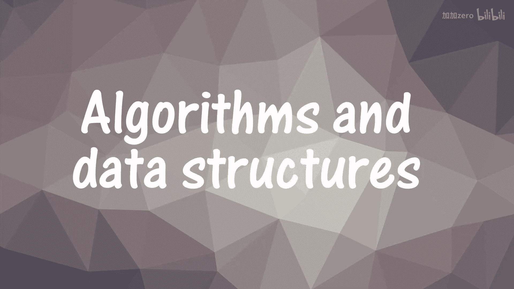
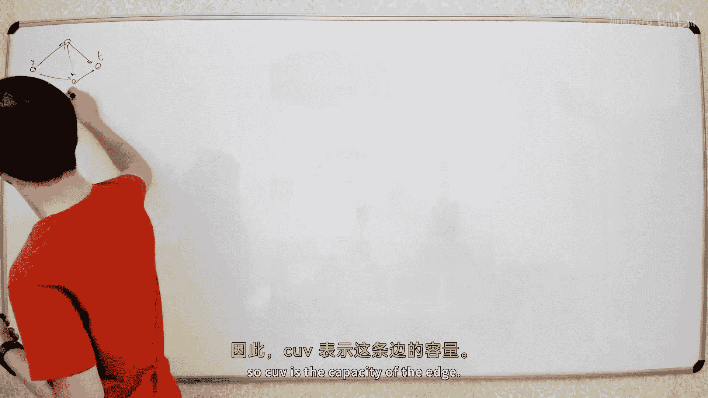

# 【精译⚡算法与数据结构】PavelMavrin p51 p50 A&DS S04E04. Flows. Dinic's algorithm -BV1NLB8YfEMq_p51-

So today we continue to talk about network flow algorithms and we discuss some more complicated and more advanced algorithms to find the maximal flow in network。

舒服。Firsts list。Let's remember what we learned in the previous lecture in the previous lecture we learned the problem so we have what is the maxim flow problem have we have a graph。

And let's throw snow off。Some smaller rock here。And。Each edge has some capacity。

 There are two fixed notess， S and T。And we are pushing some flow from S2 T for each edge we know its capacity。

 capacity is just the maximum speed of the flow for this edge。嗯。C， U V is the capacity。

Of the edge。And we want to find some flow for each H。 So the value of the flow is。F U V。

A which is no more than capacity of the edge。And we want to maximize the total flow flowing from S to T。

 So the amount of flow is just the sum of everything which is going from the S， for example。

Oh is the sum of everything going from S and want tot maximize the flow。Now。

 what we learned in the previous lecture， the most simple algorithm to find a maximum flow is for functions algorithm。

 and it works like this。 We try to。Each time we try to increase the current flow by finding the augmenting path。

 Amenting path is just the path。From S。P。Such that for each edge。

 there residual capacity is positive， residual capacity。

Is difference between maximum capacity and the current flow。And we just。

Try to find the path such that for each edge， the residual capacity is positive。

So we'll find the best so the is capacity is positive for our day。After we find this path。

 we calculate the minimum on this path， so we calculate。There 일단 which is 미。off。

Additional usual capacity for all the edges of this path。

 and then we increase the path or they increase the flow on this path by this delta。 So so we make。

F plus equal delta for this bag。Okay。If we didn't find the path。

 it means our current flow is maximal possible。 We just proved it in brick selection， yeah。呃 now。

What else we learned in the previous lecture， there is a。Simple improvement。

 which is called amunds car algorithm。 Edmunds car algorithm simply says that if each time we find the shortest possible path。

So if we just short this path。Then the time complexity of this algorithm will be at most。

And M squared。Okay， that's just a short reminder of what happened in previous lecture。

 so we try to find our path。If each time would find augmenting paper of the minimal number of the edges。

 Yeah， sorry you try just to use B， F S to try and to shortest possible augmenting path。

Then the total number of augmenting paths will be at most M M。

And each time to find this augment meetingtting path， we run the B vessel algorithm。

 so B vessel all get them run in。Lanar time， Yeah， so the total type complexity will be N M。

Multiplily by M。hu。Let's just a reminder of what happened in the previous section。

So this time we'll try to improve this time complexity so we'll try to find other algorithms which have better time complexity。

Mmm。Okay， hope。Everybody is on the same page， so。The improvement will discuss today。

 even through the British valueration waves。 Yes， we didn't use。Anything about their capacities。

 So capacities may be not even integers。 They may be。Any float numbers。

 So even if you have if you if your capacities are not integers。

The complexity will still be even square。So that's just because each time we make zero at least one edge and each edge may became zero at most end times。

Yes， even even if numbers are irrational or something else， yeah。Okay， yeah， the yeah。

 the key idea is each time we make at least one edge equal to 0。

So when I try to find the minimum edge on this path and then increase the flow by this delta。

Then this minimal edge will become 0。 So at least one edge will be removed。

From the residual network after you increase the flow by this path。This was the key idea。

 So each time， at least one edge became 0。Each edge maybe became 0 at most n times。

 So the total number of times we can find ouring path is at most N M。 So we must play N M by this M。

Which is from。B F S， Yeah， so this is totalta and。Okay。到。

The improvement of this algorithm which is called Den algorithm。D me。

 is kind of different they they are different spelling for because it's， it's not。

 it's not English So name it。It's actually a Jewish name D needs algorithm。

 I'm not sure how it's called algorithm。What idea we're using in algorithm in in algorithm。

 we use the follow idea。 Now， let's see what happened in aman's carap algorithm in Edman's carapal each time we try to find the shortest path using BFS。

 right， So we're on the BFS algorithm breath search and then using this breath algorithm。

 which which we find this。啊，万本。This software not very optimal because we on the full。

 what happens when you run BF algorithm， you simply iterate all edges of your graph So you scan whole graph to find only the single path。

 Yeah， so you have a B graph。 you run BF algorithm BFS scan the whole graph。

And then from from all this data， you just get one pair。Not요。So what we'll do？

We will try to get more information from this single BFS。

So we'll try to run one BFS and then find a lot of different augmenting paths。How to do。

Let's run BFS algorithm。And Bill， what's called a layered network。It's not very important。

 So what does it mean， we will build a graph of all possible shortest paths from S to T。

So how does look。So there is a note S。Then there are some node with distance equal to one。

S has a distance equal to 0， right？Then there are some nodes of distance equal to one。

 so there are some pages here。So for all these node， the distance is go to one。

Now there are some notes resistance too。嗯。よし。Yeah。And now that are some knows the distance free and so on。

And finally， somewhere here。 Lets， let's add some more here。Yeah。Finally， sour here。 We have tea。

So what we just did， we。啊。Run around the BFS algorithm。

 calculate the distance for each around the BFS from this node S。For each node。

 we calculate the distance from node S again again。Gandhi of V is distance。From S to V。

So we calculate these distances using single beer restaurant。Then we left， we remove all the edges。

 except the edges which can be used in the shortest path。

Which edges can be used in their shortest paths on the edges， which go from。

One note to to the note with。Distance plus one。So。If you have a shortest path。

Then the distances on on this shortest path are increasing by oneia。 So if you have shortest path。

 then distance to this this one distance to industry room to it and so on。

This is how short this pet are。So if you have any shortest path。

You only need the edges which move from from one distance to the to the next distance。

 so we only leave the edges which go from U to V。If distance to V is distance to U plus1。

Let's leave only these edges and remove all other edges。We will。We will get a V layer network。

Now what we can do， we can remove all the dead ends from this graph。 So let's stream， for example。

 in this for this note， there is no outgoing edges。Yeah， so let's remove all the nodes。

 which has no outgoing edges。exampleですね。Now， what will have left we。Have the graph。

Which contains all possible shortest paths from S to T。行。そうか。Is clear enough。So in this graph。

 we leave all the edges which can be used in the shortest path from S2 T。And only these edges， here。

Now now。If you build this graph。How can you find the shortest spare from S to T。Here your seat。

So I claim if you build this graph。No。And first of all， you can build this graph in linear time。

 right？So you're on B， F S algorithm， calculate distances。Then remove all edges， except these edges。

And remove all the dead ends。And now you have this graph。 it all can be done in linear time， right？

So by now， we spend。Ler time， Line time to build this drug。Mmhm。Is it clear enough。嗯嗯嗯。Yeah。Okay。

 do you believe we can build this graph in linear time？Okay， answer through previous version okay。

 yes。When you build this graph， you can find the shortest path just by taking any role from S2 T in this graph。

 any path from S2 T is the shortest path。Because we only left the edges。

 which are used in the shortest path。So we can take any path from S to T。

 and this path will be a shortest path。So how to find shortest path using this layer network。

 we start from the note S， then take any H。これが僕て。Like left most stage this stage。

And then take this edge and then take this edge and then take this edge。

You will find the path from S to T because there are no dead ends here。

 so you cannot stack in any node。 We remove all the all the node， which has no outgoing edges。

And so now if we take any。If we start from node S and each time we take any outgoing edge。We will。

We can only stack in the note 18 because the node T is the only node which has no outgoing edges。So。

 we will take any。Edge each time， and we will find the shortest path。To note。Thanks。So whatnot。

We' find some shortest path from S to T。What we can do， we can do the same thing as here。

 So we'll find the shortest path。Find the minimum residual capacity of the edges in this bed。啊。

Increase the flow by this delta。 again， to do the same steps as here。

 So we'll find the minimum original capacity。 increasencre the flow on this path by this delta。

And what will happen， at least one of the edges will be removed。 So at least one of these edges。

Will became saturated。So the flow by on this edge will be equal to the capacity of this issue。

 So one of these pages will be the minimum edge。So when we increase the flow by this deta for this h。

 the flow will be equal to capacity， it means the H will be saturated， residual capacity will be 0。

 so it will be removed from the layers from the original network。

So at least one of the edges will be removed。So waiting move this edge。

And continue with the same late network。So would you remove only one edge？

And then continue with the remaining network to try to find another。Ament in bath。

SoSo we don't rebuild this network。We just take the same network， remove one edge。

 and then continue the same process。Mmhm。So we tried to find another sort of path like this。

Let's take these short this path。Again。We'll find another shortest path， let's remove again。

 find the minimum residual capacity， increase the flow by this delta and at least one of the edges will be removed。

으哼 응哼 응。所谓的木。Okay think。嗯哼。So it will bit more。Now， when we remove this edge。

This node became a sync node。 Yeah， so so with there's no I would go in edges for this node。

So if we have a node with no outgoing edges， it can be used in any shortest path。 Yeah。

 so if if we have any node after we remove some edge， it was the last edge for this node。

So for this node， we have no more outgoing edges， we can remove this node completely。

 so this note can no longer be used in any short path。So we just remove this。No， complete。哦。

And so on， now again we have the remaining LED network， let's try to find another short pair。Again。

 take any route from S to T again， just test。Every time you take any edge。

Any outgoing edge from your node。 So you start from node S each time you take any outgoing edge。

So you will end up in the note tea， because it。The only node， which has no our graenaators。So again。

 you take anyro from S to T。Then again， try to find again。

 not try just fine for this road to find the minimal result capacity increase the flow at least one edge will be removed so you remove this edge。

Again， this node this node became the sync node， so there is no outgoing edges so you remove this node。

Now this node has no outgoing edges so you remove this node。

 and this node is not to remove this node and so on。Okay， let's finish this。

 So now you can you find any short span。Again， you find it。You find the minimal original capacity。

 increase the flow and remove。The situated edge。So in the end what happens？

And then you remove this stitch， sorry okay， you may left this stitch。This edge became a syn。

 you move this node， you move remove these nodes。So in the end， there is no outgoing age for note S。

Mmhm。😊，What does it mean？What does it mean？So again。

 what we are doing we each time we find some shortest path using this layer network。

Find the minimum your capacity， increase the flow。 At least one edge will be removed。

Then we remove all the in notes。Just cascading yes。

 so we remove one node if another node became a sync node， we remove this node as well and so on。Inデ。

You will have no outgoing edge for no S。 What does it mean。What do you think。So。If。

Now if we have no outgoing edges from node S， it means we don't have any augmenting path in this lead network。

 right？Mmhmm。Yeah。呃。Baically， what does that mean， it means we found all the possible shortest paths from S2 T。

 so we found all the paths which have distance for。So we found all the paths。

 which contain four edges。It means that distance to node S to node T is no longer4。

So there is no path of length4 and distances can decrease。 Yeah， so distance may only increase。

 So if we didn't find any path， it means that current distance node T is no longer for it。

 It is at least 5。So we revealed the whole network。And find shortest path of La 5 and again。

 where you build the network again， find the shortest path of length 6 and so on。맞어 아 그 형。But。

 let's try some silicon code。 So what what happens。So here while。We have pathth。嗯。Yeah。There is path。

From S 2 T。What we did， What， what， what what we doing， We run the Bay F。Andbu。Layer network。

So build this graph。Then each time we try to find the shortest path from S2 T。So， while。There is。冇嘅。

ing this layer network。Will find the path。It's very very sical， right， then calculate the data again。

Okay。Increase the flow by this data。Remove zero edges。No。There is at least one edge， right。

 they may be several edges。 if you have several minimums Yeah of the same。

 if you have several edges of the same minimum capacity， then all of them will be removed。

 but at least one of them will removed。 So we will remove all the minimum edges。

 If there is multiple minimum edges， then all they all will be removed。

And then they remove all the sinks。M哼。Yeah， yeah， we will not miss any path。In the layer temporal。

 because any path of length4 must contain these edges。 So again， let's repeat this。

So what will happen when you find a path and push a flow？Through this path。

 you will remove some edges on this path and you will add some edges reverse on this path。 Yeah。

 so the changes to a residual network will be like this。

 You remove some edges going forward and you add some edges going backwards here。

But these ages cannot decrease。啊 there。Distance to here， yeah。

These edges cannot be used in any short from S2 T。So you only add the edges。

 which going from from forest node to the closest node and edges like this can be used in the shortest path to T。

So is it the electrical will be changed？But it will not affect the layer network。Mmhm。😊，Again， again。

 again， get， let's take this one。 We discussed it last time。's let's do it again。 So you find any。

So you find any breath of length4。What will happen， at least one of the edges will be removed。

And some of the backward edges will be added。 So some of these edges will be added。

These backward edges cannot be used in the shortest path because they're going from far node to the closest node yeah。

 so you can use this node to make a shortest path from here to here。

 so you need to go here then use this edge and then go here。 The distance will be more than four。

Yeah。送。What I was talking about。Yeah， so， so you don't need these edges in your layer network。

 These edges can be used in shortpers in layer network， we we use only the edges。

 which can be used in the shortest platform from S2 T。So when we。

 when we have no path from S to T in the layer network。

 it means we no longer have any path of this lamp。Because we didn't have this path before and when we change the residual network。

 we add only edges like this and edges like this can be used in the shortest path。

So we only remove edges from the layer network。mhm。Okay。Okay， hopes clear enough。Now。

 let's analyze the complexity， let's analyze the time complexity of this algorithm。

So what happens in this algorithm？ We have this。Outer loop in this outer loop。

Each time we rebuild layer network， then find all possible shortest paths in this layer network。

So after this。Loop finishes the distance to no T is increasing。 So each time。

 each time we find all possible paths in the current layer network。

 we increase the distance from S to T。Distance to to the No T， can more than N。

So we cannot increase this value。 D T， Yeah， more than n times。So we do all these steps。

 no more end times。 because each time again， each time when we find all possible shortest paths of this length。

 we will increase the distance node t， distance node t is at most n and the n minus1 actually。

So we can't make this loop more than1 times。嗯哼嗯哼。Clear enough。Now， what happens inside this loop？

 First， we make BFS and build layer network it costs。M。Y。

It's course emration we can do it in linear time。 Yeah。

 we can probably be if I celebrate from then remove everything and industry so we can build layer network in linear time。

Now， what happens in this loop？How many times can we run this loop。Until there is no bathroom S，2 T。

Anyone here。走了。そ。Yes most M times right， because each time in this while loop。

 we remove at least one edge from the layer network。Again。

 we all the movement edges from the layer network， we all edges selected this。

 and each time we find the above at least one edge。

 the edge with minimal residual capacity will be removed。

So we can't remove the edges more than n times。Yes， how to loop。Outrop loop running no end times。

 inner loop runs no end times。Now， what happens inside this。Look。So first， we need to find the path。

And we can find the path just by taking any edge from the current node。

 so we start again how we find the path in the late network。

 we start from the node S Now each time we take any edge going out of the current node in the end we'll go to the node T。

So we can find the shortest path in in time O of N。Right。어哼。So again， here we're not not doing BFS。

 not doing DFS。We know there is a path， yeah， so we take any edge and we will go to the node T with the shortest path。

嗯。So it's linear by the length of this path。 lengthth of the path is at most1。呃。Now， finally， this。

 this， this， this， this。 So this all is linear。The only thing is a this。So all this thing is linear。

 Yeah， so we find the path and linear time by linear of n in time n。

 then find the minimum on this path。 again， length of the path is at most n。 So we find the minimum。

 increase the flow。 Remove the edges。 This all can be done in。End them， yeah。啊。The only。

 the only difference is for these removing synch nodes。 they may be multiple synchrons。 Yeah。

 so you so you there are they may be different synch nodes。 And when you remove them。

 you produce another synch nodes and so on。 So there maybe some cascading。 Yeah。

 So you remove one node， get another node， remove this node and so on。

 So there may be some cascading。 So you remove multiple node。

But you remove at least each node at least most once。Once。4 each note。So for the whole， this loop。

This separation can be run only once， for each note。Mmhmm。😊，Okay。

 now let's go later with the final10 complexity here。 so what。What we have。So first。

 we have n multiplied by M。For these B FSs and building LED network。 Now we go here in this loop。

We run these separations in time N， multiplied by N， multiply by n。Right。

And then we have these removals。 These removals happen at least once at most once for each note。

And when we remove the node， we remove this node and all in goinging edges。So the complexity of this。

Aspirationations will be and in total。So around M operations here。

 at least least M operations for the whole this loop， So it will be plus n M again。B and I again。

So total length complexityity will be n square m。Yes， yes， yes， you can do it very fast。 yes。

 you keep the counter of the of the of the out degree of each node。And when you remove the edge。

 if the counter is0， then you remove this node as well。

We did something similar when we talked about graph games， I think， yeah。Okay， let me write it here。

 So how you do it。 So you have the edge。When you remove the edge。

 you check the number of outgoing edges for this node。 if this number is0， then you remove this node。

And all the ingo edges as well。 So you remove this node and all these edges as well。And again。

 when you remove these edges， you check the counters for this node。If the calendar becomes zero。

 it means there is normal I an edge， so you remove this note as well。

 and there's some cascading in this。Yes， in the political sort， we did the same trick yeah。

Buts so the final time complexity is n square m。 It's slightly better than we did before。

 So here we have an M square。 here we have n square m so。Here we have n square。

 here we will have m square， right， So differences between n and M。N is usually less than M， right？

 So the number of nodes is usually less than number of edges for some graphices。

 not if you have sparse graph， if you have some linear number of edges， there's no big difference。

 Yes， so if n and M are the same values。Then you have N cube here and N cube here。

 If you have very dense graph。 So if you have like。Almost photograph graphs。 So when M is about。So。

So here， let's say。诶。So if M is about n， so if you have various positive graph。

Then here you will have something else cube and here you have cube。

 and if you have a very dense graph。Then here you will have N power。

Five and here we have M powerful four。Slicy better。So for dance， graphic is it's better， yeah。Okay。

 let now just remind you that in the previous lecture， we discussed the best known algorithm。 No， no。

 not， not the best known， but almost the best known algorithm。Let is。

 theres with slight deviations but。One of the best let's say。

 one of the best known algorithms works in time and M yeah。So it's not optimal by now。

 but it pretty close。呃，This is。呃。It looks like there is some。

AFa problem to make the algorithm strictly faster than N M。

So there is a algorithm which works in time。AndM and it is complicated， but。The， the。

 there may be some fundamental problem why we cant find any order in which works。F of them。

 And I'm there。嗯。Oh， nice。And only 40 minutes for this。 Okay， So this the whole genis algorithm。

 how to implement it。 So if you will try to implement it。The easiest way to do it is not like this。

So easiest way to implement this algorithm is do not remove。 So， okay， this one is this。Actually。

This step is simple。 Actually， you don't need to build red layer network。You can just run P FS。

And then when you find this path， you take on the edges。With this property， yeah。

 so you just keep all the edges， which do not。Sify this property here。So。So要 you know don't need to。

Build the layer network， explicitly。Maybe some problems。

 So you have your graph and then layer network。Usually it's complicated to have two different graphs in the same algorithm。

 Usually you don't need it。 You just run the F， calculate these differences。

 And then when try to try to refine this path， you only consider these edges。

So this one simple improvement to make the algorithm more simple， yeah。Now， in this part。

That trick is do not remove this syn tos。 So so this separation is actually。Quite complicated Yeah。

 So， so we need to。We need to remember all these counters。 So we。

 we need to remember the our degree for each node。 Now， each time we remove this sync node。

 we need to calculate again。 we do， we need to do all this stuff here。 So we remove this node。

 we remove all these edges， calculate the our degree for this node。 And then if it is0。

 then do the same recursory and so on， it's complicated。So。Easiest way to do it。

He is just to do it laly。So you can remove sync notes not here。

 but remove them here when you try to find the path。So again， what you can do again。

 then you have when you have some symptoms it with。Let's have some broth， with some skin cons。

So again， you have something here， something here。 and here have a single code。What you can do。

 you can leave this signal by now。 So when you again what happened， Yeah， what happened。

 You found this path， for example。So you found this path。This node became zero。

So you remove this load or this edge。 So this edge became aur， this edge became saturated。

 So you remove this edge from the again， you， you can。嗯。You cannot remove it explicitly。

You can just say that the residual capacity of this of this edge is 0。 So okay。

 when you increase the flow here。The zero capacity of this edge will become zero。

So you can not remove it explicitly。 You can just keep it when you are straight when you find the short spec。

然嗯。Now， what will happen in this。In this case， when you try to find the short spec。

You you try to find short spa。So you start from the S， go here， dont go here。

 and here you don't have any outgoing edges。 but you you have。

 but the all of them have So there are actually some edges but they have capacity equal to 0。

So now when you take the first edge from the list， again for each for each node you have the list of all Algoing edges。

 So you take the first note of first edge from this list if the residual capacity is0。

 so you just remove this edge now。So you you can remove all the zero edges laly。

 So when you see the you take you take the first edge from the list， if this edge is 0。

 then you remove it。EFrom the list， and so on。啊。Now， if there is no outgoing edges。

So you remove all the edges。 So all of them are zeros。You see that this node is actually a sink。

So what you can do is again you。So at at this stage， you try to find a short best go here and here。

 You can go back from the recursion， like in D F S。

So you go back from the reution and remove this edge。So okay， it's like， okay， again， it's like DFS。

 but you never use the same edge twice。 So you try to use this edge if you didn't find anything there。

 you go back from the recursion and remove this edge because there is nothing interesting that。

So you go here here， see nothing interesting is here。

 so you go back from the recurs and remove this edge。And then from this point。

 you continue your search of the shortest path， so it's like DFS， but then you go backwards。

 you remove the edge。嗯哼。😊，And now you'll find these eight pieces。So you。

 so you can remove all the signals la name。So again， you have this edge。 That's fine。

 So when you will try to find this path， you will remove it when you go backwarders。Okay。

Time complexity will be the same because again， each time you spend this amount of time to find the shortest path。

Plus， some removals of these edges， but total time of removals of all edges is at most M。So。

You again， you spend the same linear time here to remove all the things， but you don't spend it here。

 You spend it lazily when you find a sink。It's a little bit little bit easier to program。 It's like。

 it's like， again， you write a simple DF algorithm。

And if you moved to some node and didn't find anything there。

 you go back from the recursion and remove the edge。一从。You usually done with this。

 you usually you have some vector of all outgoing edges。 you have for the node V。

 you have vector of all outgoing edges。Or link list， if you are。Found of linked list。

 usually vector is much more faster than linked list。 So you take the last edge from this vector。

The know so it start you try to go to Nor。If you find a short spread。

Then you go backwards and increase the flow by this deta like we did before。

 like and for focus algorithm， if you didn't find anything。

So you you step into some that edge so there's no way here。

 So you move backwards and when you move backwards， you remove this edge。

 you remove this edge just by popping from the last position of your vector， right？

 So the last element of the vector is the easiest element to remove。

 So you just remove the last element from this vector。And take the next。If this vector is empty。

 it means there is no outing edge， so you move back from the recursion and you move the edge。嗯哼。😊。

Okay hope iss clear enough。Okay， this some this， these are just some implementation details。 You can。

 You can definitely implement like this。So even this speed code can be implemented。Btty stage。

 straightforward。 shows we just。Need to implement all these steps。 And no。

 it's all pretty straightforward。Not not the most difficult algorithm in this course， definitely。

Okay， let's move next。What we'll do next？what we'll do next？

We'll discuss some even more sophisticated algorithms。

So we'll try to improve even distance time complexity。

Just have to be careful not to loop our organize change， y， yeah。

But basically what you do if you know the edge is bad， you don't try to use it twice。

 so when you find some edge and you find this edge is not useful。

 you just immediately remove this edge so you will not use it next time。那可以点。ho。No okay， Elizabeth。

Next， we'll discuss the gold algorithm algorithm， the goldberta general algorithm。Let's go。

And first of all， before we， before we do this， what you can do。

 what you can do is to add the scaling method we discussed in previous lecture。

So you can do all the same things， but try to find not any short path。

 but to find any short path of the capacity at least to in power game。So if you add there scaling。

To this。아 아 그랬。You will have time complexity， something like。

Let's keep the track of what we actually achieved today so the simple thing is algorithm。

And complexity to air square m。 So if you add scaling。You will have an。Yeah now the same order。

And M look C。So one of this end will be changed with the lock C。Again， the same trick。

 you decrease the power of two and you try to find the path of capacity at least to power of K。

If you would like this， then total conceable like this。嗯。Good。Now， again。

 this is pretty close to the optimal algorithm。 Yeah to do to again。

 one of the best known algorithms works in time M M。So the only difference is by this log factor。

 But this log is from the cap quite it's not very good yet。 So it's not strongly preno algorithm。

 We have this log C factor here。Strongly polyno also written do not have this log C in the time complexity。

 They only have the parameters of the size of the graph。They don't depend on the capacities。うん。

What will I to do？Is to make even more sophisticated rating。 So well try to。

Improve this algorithm by adding some data structures。So we'll find again， what what is the。

 what is the bottleneck of this algorithm。 The bottleneck of this algorithm is actually this part。

 Yeah， so this is the slowest part of this algorithm。 This part is what is working in N M and time。

 So so this is the。This is the current bottleneck。Out of the else is quite quite fast。

So we'll try to improve this part of the algorithm。

 We'll try to find the shortest web path in the way network。

And make these modifications faster than in linear time。By using some data structures。

 some advanced data structure section A， we discussed in the。Last last year in the second semester。

F go。So what is the idiom？What was bad here， what was bad here？

The bad thing is each time we try to find the same short path。So again。

 you have the graph again this。 let's， let's build some layered network here。

 So we have some layered network like this。So what we are doing in this loop。

 each time we try to find any shortest path。Again so we'll find the shortest path like this。

Then will apply all the same modifications and then they remove one edge。Yeah。

And when we remove this one edge， we continue the same process from the beginning。 so again。

 we start from this from node S and try again to find the shortest path。

But we already know this part of this path。So maybe we can start not from here， but from here。

 we only always know that these two edges are the start of some shortest path。

So let's try to keep track of everything we actually found in the previous steps。YeahGood idea。

So again， where do you find the shortest path？You build it as a path， then you remove one edge。

 You have these two parts of this short path。 so you don't from main you you just try to reuse the same parts of the previous shortest paths to find the next short path。

かなです。소操줘。Again， we'll start from the S。En。We'll leave this mark so some of the edges will be marked。

Marked edges are the parts of the previous shortest paths。So， for example， in this state。

 we have these edges。We know these edges were used in previous shortest paths。

So rules keep them marked。So we will reduce use this。 Okay， okay。Okay， how to use this。

shorthorest steps。We will suffer on the。Now， from this position。

We will go immediately to the end of this shortest path。 So from here。

 we will go immediately to here。Let's use another marker。So again， we start from the node S。

Then we immediately go to this note because this note is the end of the current shortest path。

Then if this node is not S。Then we try to move from there using any not non marked edge。

 so we take any edge from this position， any edge from this position。嗯哼。Now。

 we find another short path。And remove the minimum edge。Let's say it， please。And again。

 we will keep these edges marked， so these edges marked， this edges mark this is marked。

 so this marked edge are the parts of the previous shortest paths。Now again， you start from note S。

 move immediately to this note because this is already。Some。Prebuil part of the short path right。

 So you go immediately to this node， then try to find a node。 Again， you find any node， any edge。

Letite any h。 and again， when you get to this position， you move to the end of the short span。Mmhmm。

So I will find the next spin。That's the whole idea of there。ゴ벨탈잖아。냥 맞ね。Let me write the scheme here。

人熟。The whole trick is to do the following。 We start from note S。야。Now。

 we use all the marked edges from the not。 So there is some。Number of the market ages， this stage is。

So we start from the note S， then they jump to the end of this path。 So we jump。To hear。

If this node is not S， is not D。If it is not T， then we try to expand the current path。

So we take any edge from here。And go somewhere。Now， if we go somewhere。

 there may be some more marked edges Yeah， so we take some more marked edges so some。

So you will jump immediately to this note， you。Again， if this note is not T。

Then you take any H and try to expand your path here。And you do it until you find an opt。

Let's make this note tea。Yeah。So the turkey is remembering the parts of the pes we used before turkey。

 we go here。Once again， once again， some of the edges of the layer networks are markeds。

 especially like this like this blue， like like here。 So the all these edges are marked this in blue。

So what you do is start from note S and then go immediately to the end of the current。

Part of the short sp。 So you go to the， you use all the blue edges until you reach to this。

And using some special data structures， we can go immediately from here to here。

We'll discuss it later。Now， from this point， if there， if theres no， there's no tea。

Then you need to expand your current path。 So you take any age。

And add this edge to a counter and mark this edge immediately。So you add this edge and market。

Then you go here。Again， you jump to the。To the final note of this part of the path。

 So you jump here to here。And then again， take some edge click here until you finally reach the node T When you reach the node T。

 you'll find the shortest path。嗯哼。😊，That's the whole idea。WellNo。After you find this path。

 you need to do all the same things， so you need to calculate the minimum again。

 you find de is the minimum。Of this path， you need to increase。

The pair the flow by plate is deta and you need to remove minimal edge。ExSo settings。네 안게。You know。

So you you do all these steps， then you find the shortest path and then you just remove the minimum。

 again， you find the minimal capacity on this path， increase the flow by this capacity， again。

 when you increase the flow capacities， the same as decreasing the。Yeah。

So residual capacity is just c minus f， so when you increase F， you decrease the C C parameter。

What if we stack out need it It's possible。 It's possible。 It's possible。Let's do it。 For example。

 let's use some mortgage。So you might take some wrong edge。Try to go here。And at this point。

 you find out there is no outgoing age。Or or you you you kind。Okay， you you。

 you might find some even more useful something like this。

So you jump here and here you finally find out there is no outgoing age。

 So if there is no outgoing age。Then this note is not useful for any short spare。

 so you can just remove this note。So you remove this node。Go backwards here。Go here。

 try to find another node and another edge。 If there is no edge， then again。

 you remove this node and go backwards。Yeah。So again， like in this lazy approach， yeah。

 so when you stuck in some sync node， you just remove this sync node and remove all the ingoing edges and go backwards。

Mhm。That's all。No， no， no， no， what's here。Let's see。Soi。

If we keep track of all edges used in the previous shortest paths。

What are these edges actually forming， So what。What is the structure of all these marked edges。

WellLet's see。For each note， there may be at most one outgoing marked edge。 Yeah， So if you take。

 if you take any note。Around multiple outgoing edge， at most one of them may be marked at any time。

So。that's because just how we build this algorithmia。

 so we start from here each time we create marked edge only there is no marked so if there is marked edge we just use this edge。

 if there is no marked edge， we marked some edge some outgoing edge from this now。

So at any moment for each node， there may be at most one out would go in marked edge。嗯哼。

So if they have some structure。In which in for each note， there is only one outgoing edge。Okay。

 let's adjust。Let me just erase everything except these smart ages。や。

What will the structure look like， This structure will look like the tree。please。Yeah。

 if for each node， there is only one our edge。And there is no， there are no cycles。

 there are no cycles because we build it over the late network。 late network is a I playgraph。

 obviously， right。So we build it over layered network， so there are no cycles。

And each a node has only one algoin edge。 If each node has one algoin edge。

 then the structure is a set of trees。NoIn this case， there is only one tree， but if you just。

If you erase something， let's erase something， let's erase something here。Like this。

So you will have some set of trees， right？そう。The current structure of the marked edges is a set of trees。

Yeah有有有。We're more we are more than for this。嗯，好。So we have something like these。

So there might be some tree like this。And also， some tree here， something like that， no。Yeah， this。

Doesn't make sense because we can move from here where。But we may have edge like this。Yeah so it。

 maybe have edge from here， for example， Why not。So。What are we doing？We have。This。AComponent， here。

 can they note S what we need to do。 We go from component S。

And go immediately to the root of the current tree。

 So move from here to here is move to the root of the tree， which contains not。So。

 so this note is to the root。Of the notice。Mmhm。😊，Now， in the end。

 so so we make it the root and then mark this edge， make it to this root and then mark the edge。

 And so on each time we move to the to the next root and mark at some edge。 So in the end。

 we will combine all these trees into single big tree。嗯哼。😊。

So we'll combine these trees into single victory and then we need to do all these operationsations。

So when we combine them in a single tree， then for this path from S to T。

We need to make these operationss。 We need to find the minimum capacity。 We need to decrease。 again。

 we， let's think about this。 So can only one value you this。 So for each edge。

 we have this various C prime， which is residual capacity。So。When you。Look at this path。

 you find the edge with minimal residual capacity。You decrease all the capacities by this value。

And then you remove the minimum edge。And you can do all inspirations using link batteries。So again。

 each of these blue trees will be a linkka tree。What you need to do。

 You need to be able to link these trees。 So this operation is linked。And these brush is link。

YeahSo you'll link to trees into a single tree。Then you have a pair from S to the root of this tree。

And for this path， you need to find the minimum and increase all the values。啊啊。

Increasing and minimum are two associative operations and distributive operations。

 So you can use you can make these two operations in a link country。Again。

 if you remember the second semester， we talked about segmentaries。 Yeah， so for a segmentary。

 it's important if you have multiple change in operation and some calculator or some function。

 it's important that two these functions are associative。And that they are distributed。Yeah。Again。

 what does this mean when you， when you change。The capacity by some deelta。

 the minimum will stay the minimum。So you can easily rec the minimal edge when you make the separation for this pair。

And now you just apply the same thing from this segment tree to your link tree So again。

 what happens in link tree link tree actually decomposes your tree into some set of paths and for each path you you you。

Yes， you， you maintain the。play reaction actually。Yes， if you want to have it it in login time。

 you make a split train。And in this play tray， you calculate this function for the sub。

 like in segmentary。Okay， if you're not familiar with all these concepts。

 you can revotch the second semester lectures about all the three structures。

That's basically one of the main application of linkerries。Yep。So。Y。

I believe it was like the first application of living countries。 That is why。

 where they actually was invented in first place。Okay。Okay let's write the code this one。

 let's just write the code。せここちゃんの。So what am I doing？First， we're doing the same step as the。

 So we will do it while。Why。There is a breath。Withath from S2 T。We make beer first。

And go great later in that work。The same thing as an ingenous algorithm。啊，那。What do we do， Yes。

 we maintain all these link countries。 In the beginning， all edges are not marked。 Yeah。

 so each each node is a single link entry of itself。So when you start the algorithm each node。

Here's some outgrown edges。All edges are not marked。So。So， every single loan is this。

As a link country of itself。 So you have you have many small link countries。Now。

 now you start from not this。Yep。So start from the note。So each time you try to find this。说子吧。呃，手腕。W。

Let's say it like this。While a road。Of S。No， no， no， we need to do with multiple death， right？

嗯哼哼哼哼呵哼。Let's say real true。Just for simplicity， you all sale。We'll find out when to break， okay。

No we need to break when there is no pair from S。Okay， while。Well S is not s say like this。

So while S has any outgoing edges， y。So we do the phone， we try to find this augmenting path。

 so we will do the following， we'll pick this note。As the root of the current node S。

 then we'll extend this breathth by one and again， try to find this but will will not do do like this。

It's the easiest way to to implement it。 so we'll start from here， go to this node。Make this link。

 then again try to find this route from here。Yeah。They will try to use it。 And again。

 will try to find this route。So it's just more simple way to implement it。

 So each time we'll start from the root and go to the current route from from each time we'll start from the node S and go to the current route of the tree containing the node SM。

Let's say V is the root。Of the node S。 So again， it is the root of the link cut。

 which contains the node S。就看控制 jump to here。Now， if。If this be equal to t。Then we do all this stuff。

 Yeah， so we calculate the is minimum。On air， on a on aircraft。From S to T。Then will increase again。

 let's， let me say C prime is。Let's say， Okay， let's。And。Let's say。

 let's say I have this various C prime on this path yeah。 So I will add value mine is little。

To the from S2。嗯哼。So in my link entry， I will always maintain the values of C prime or value of the residual capacity。

So when I push the flow through the path， I will decrease the residual capacity of all edges by this time。

 so I will decrease the residual capacity by delta for all the edge on this path and now I remove the minimum edge。

do you move。About minimum edge。Okay， always try to。 not not remove。 Actually。

 need need cut operation yet。We have lean cut， so we have brush cut。

 So this separation which removes。 So you find the minimum on this pair。Find the minimum edge。

 and then remove this edge。 Remove them this edge is just to make an operation cut in your link entry。

 right， So make a operation cut here。So if it is not team。Then it will try to link it to anything。

Where is sync？So if we is sink。Then we just remove notes。Cart all edges， V U V。嗯。Now。

 if it is not seen。嗯。It was in else。Lets see elses。elselse， if it is not T and it is not sync。

 we make this link。 Okay， so we'll make this link。 So we take any。V， what's say。V you with any。Ege。

From a v。And my。对到。That's basically， the whole。See the code of this gold Italian Italian organ。

The mean edges also stone plate。 Yes， Min edge is yes， yes yes， yes Again。

 what happens when you make a linkka tree linkka tree has the your tree is decomposed into set of paths。

 let me Just remind you what happens in linkka tree in linkka tree。 you have this tree。

Let's try some。G us draw something like this。So what happens in Lincolnka tree， you have your tree。

 this is the root of the tree。And this tree is always decomposed into sets of paths。

You have some breath here， some breath here and something here let'。So I have this path。

This small path， this path， this path。At least bit。So L3 composes your tree to set of paths。

 and for each path you have a split tree which can calculate the function and segment。

And when you find the root from the node S zone， so this is not S。You make separation。

 which called expose in linkka So。 You try to expose this path。 So you make。

 you make this path from S to T all。Okay， so you just mark all the edges on this path。

 so when you expose this note S。You will mark this node so you will already come。Tree like this。

And after you make the separation exposed， all the edges from S to T belongs to the same path in the decomposition。

 So they are in the same in the same play tree。So you'll just take this play train。

And in the splittry， you can find the minimum。No you just getting you you could create the medium in sub3 like that like in segment。

 exactly。 So you could create the medium in sub3 and you can apply the incration for the whole subre。

 again， using lazy propagation。 Again， if you are not familiar in the link countries。嗯。

It's not the easy topic， so if you don't know anything about link trace。

 you can rewatch the second semester of this course。

 we talked a lot about all the different operationss on Ta。But is doable， it's doable。Okay。Okay。

 let's analyze the time complexity of this outcome， So link a3。

 the time complexity of all durations is loggan。So let's mark all operations on link countries。

 so what operations we need， we need to be able to find the root here。

We need to be able to find the minimum， and increase the values。We need version cut。

We need here we need to cut all the edges， and here we need to link all edges。

So I just marked all decorations from the link Karine data structure， right。

So in Li search in Li cut data structure， we can find the root of the country。 again。

 we just expose this node and find the root。We can find the minimum using the operation on the display tree。

 We can increment the values by the same con constant。 We can cut the tree into two different trees。

 again， here we will only cut here， when we cut this edge。

 we will split the tree into two different trees yeah。Bgan， it's simple you just。How to cut the edge。

 You just expose this node， take this edge and then remove this edge from there。

correspondingrespond in Sp tree， So just remove this edge from the split tree。

 you split this split tree into two different s trees。So you can cut， you can cut again。

 you can link again， you can link tools。Two link countries in a single split。Who。不错不错。Go尾哪。

Let's calculate time complexity。 So what we're doing here again we have this outer loop again like ingen algorithmvitton exactly the same in this outer loop。

 we calculate all the possible troest paths of the same linear so this outer loop runs no more than n times。

By the same reasons as Den is algorithm。 Yeah， but when we finish this phase。

 we will find all possible short paths。This is just the first way to find short space section。啊。Now。

 in this well， let's see what happened。So this is， this， this is time time M。 Y， so M。

To buy to build this late that concerned。So what happens inside this while loop。

 I claim the total 1 complexity of this wall loop is not big。那行。

So what happens inside this while loopbe？呃。Each time we go into one of these free。Parts， yeah。

 So we do this， this or this。 Let's see。So how many times can we do these operationss。

 we can do these operations no more than m times。Because again。

 each time when when we go to this part， we remove one edge。So in this part， we remove one edge。

 so we can do it more than m times。Same thing here。Here we cut some edges。

 We can cut edges more than M times。What about this？I claim we can link edges more than end times。

wait。Each edge can be linked only once。Because what happens to the edge first， the edge is unmarked。

 then at some point we find this edge and mark this edge。So will make link。

 And now this edge is smart。Now， at some point， this edge became the minimum on the path and it will be removed。

So the lifetime of the edge looks like this first it is unmarked。

 then re marked it and then it is removed。So we can link the edge only once。Yeah。

 each edge will be linked only once because again， first it is un marked。

 then it is marked and it is removed When when we cut the edge we immediately removed from the late network。

 So each edge may be linked only once。 So again， this else also can be done on M times。

So all these free branches can be random more than M times。 So total number of。

Iteration of this loop is no more than M。Right。Now， what about time complexity。 let's see。

 So these operation， all operations in link country works in all operation work in login time。 Yeah。

 so we spend logging time here。Yep。Here we spend again， loggan time to find minimum。

 loggan time to add and loggan time to add。 So everything else is logan time。

Wch here is slightly different because we need to cut all possible edges， not a single edge。

 but all possible edges。 But we we cut each edge most once。 So it it is。Aloggan and total。

Then each edge will be cut only once。Yep。Well and here we spend looking on time。

So the final complexity will be n multiplied by M multiplied by loggan。This you will。And Logan。

And that's almost the best in。 So。 So again， one of the best algorithm we know is has time complexity and M。

And here we are pretty close to this。1 complexity。 Just buy this san factor。Actually。

 removing this Loan factory is。嗯。Is not easy。 Yeah。

 this usually happens in this in in this algorithms。

 usually your around on pretty close to the optimal solution and then spent another like 20 years to find the way to get rid of this final logan factory。

嗯。Cool。Yes， I really。 We know We don't have time to discuss the hotel。Okay。

 I'll just say there is another cool improvement of the algorithmles called the Alremo Malhoto Kmar Mahifari。

😊，呃。Which runs in time。And cube。So there very different improvement to the den algorithm。

 which actually removes what changes this M factor with n factor。

So each time we remove not one edge from the late network， but this one node from the late network。

So we can build the network and then remove nodes one by one。

So the total10 complexity will be not n square m， but n cube。But don't have enough time today。嗯。Also。

 as， let's say this。 there is a slight improvement to this global teleography。

 You can do it slightly better。부 boom let me remember。You can do something like this。 You can。

I didn't check， sorry， maybe I'm wrong not。Yes， if I remember correctly。

 you can do something like that。L and base M。Sounds like good。You can Google it。Let me let us check。

 and I am uncor。嗯。嗯。No， I don't want push the label。Our push label is also nice or gra。What。

Seeing that gober push。 No， no， no， no， no， no。What。嗯。Am I wrong。I always felt that， actually。

This is algorithm Scott， Goldber John Albertton。He嗯嘿。Mmhm。Mmm。I。Maybe I'm just wrong。

Maybe I was just strong， maybe you go with John。I always thought it's called Cobertagen。

 but maybe I'm wrong。嗯，哼m。😊，Could be said I know anything。嗯。哦。차独gle。嗯。Okay， I need to find it。See。

 God the is actually the bush level 그랬。Okay。It may be， maybe maybe I'm wrong。嗯。均不准。Okay。

 you like than just。Let's。I师 about this。I don't find the correct name for this organ name。 It。

 it's called like geniusalography withling cat trees。

So I believe the first time it was mentioned where you use can use link at for the maximum volume it was some ingen paper。

呃。m。You always need to check all these models deals。

 I am not good in all this computer science history now。And Im looking flow then I'll go some jump。

With difference the sum of the random cut。I will be digital for for sample person。Again。

 they have no links。 Just say that its possible to use link cut。And no links to the original paper。

I hate when happens。ちょクとこ。嗯。Okay， so so maybe it' not then。Well's let's raise it just please。Okay。

 they say it's called jazz D' algorithm with fllink cut。Why not。

But I believe its first was shown by the Tjan that you can use link at trees to find their shortest paths in this question。

チクチクチ。That said， that said， so。I was wrong， all the time。Such a shame。嗯。嗯。Okay。

 I will find the original article by by the next lecture and well。

Tell you what's the correct name is your king。Sorry I won't spend too much time today。

Sleter entergen， Yes， the that sleter John invented all this link structure。 And yes。

 I believe in this paper， they actually show that it can be used in the。Yeah。

 but maybe there is no special name for this algorithm。 Maybe it's just genius algorithm with link。

Maybe。Yes。Yes， I think it I think that's the case， yep。I just。Yes， yes。

 I believe it was first mentioned in the original articles about Yes about link trees of slater and Tojiang yeah。

So gold there is the topic about it here。Ok， so it's not ball gold。 Go go gold okay。

걸 but related some other order things。Meiing。嗯。Maybe this improvement was medical。Okay。

 I'll check it by the next lecture。And give you all the links to the paper scheme。Okay， sir。

See you next week， cooking。

