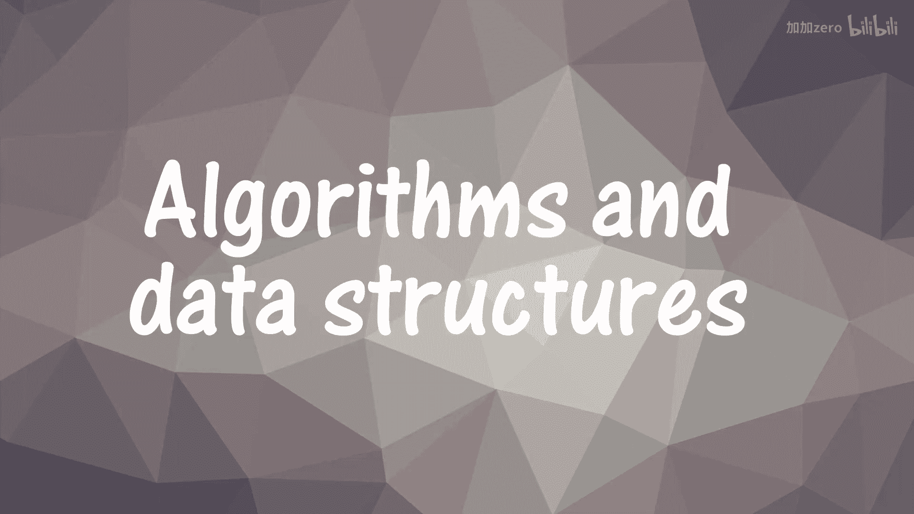
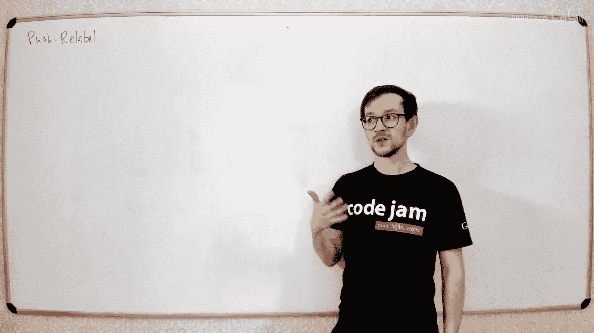

# 【精译⚡算法与数据结构】PavelMavrin p52 p51 A&DS S04E05. Hopcroft-Karp algorithm, Push-Relabel -BV1NLB8YfEMq_p52-

So today， we continue to talk about network laws and bipartite machines。嗯。

Our goal will be to find the better algorithm to find the bipartite matching。

 which is H carp algorithm， but we'll start with the flows。So in the two previous lectures。

 we discussed several different algorithms to solve the maximum rule problem。Now。

 let's revisit all of them and think about the following problem。

 One of the important case of the maximum flow problem is the case when all the edges have a unit capacity。

 So if the capacity of each edge is equal to one。Let's revisit all our algorithms we discuss in previous lectures and think what will be the time complexity of this algorithm if all the edges of the graph have unit capacity。

For example， let's say， let's start with simple forul algorithm。 So if we simply try to find any。

Augmenting path in a residual network， and。Push the flow through this augment path。say for。

So simple Forfo console algorithm works in the time。诶。F M， right。

So each time we increase the flow by at least once by at least one and how we do it， we find any。

A path from S to T， and push。The flow flew his path。So this is the term complex of algorithm。啊。Yep。

 simple enough。Okay， well does please do。So now what will happen if I say that in my graph。

 all edges has。Unic capacity。 So if the capacity of each H is equal to one。

What will be the then complexity for this case。Again again worse container time complexity so to analyze worst time complexity。

 we need to find the upper bound for the value of the flow。

 So what may be the maximal possible value for the flow in the network if it has n vertices and M Hs。

Simple upper bound is basically M。 So if you have M edges。

 you cannot push more than M flow from S to T， right， So this F。Maybe up to M。So。

Then complexity is not more than M square。いや。Yes， right。 But what what graph is simple。

 What if we forbid to use any parallel edges。If we say it。

All capacities are unique and no parallel edge， no parallel。And。Yes。Then you're right。

 if there is no parallel edges， then you can push more than n flow from vertex S。

 So you have vertex S， they may be up to n edges from the node S。

 so you can push more than n units of flow from S So10 obey be N actually。こ。Let's move next。

 What about advanced car。えなし。カぶつき。It's Kate， right？やep。E must stop over。

What will be the complexity of the atmososcopic poverty？诶一样。啊。4。呃。いや。Here。Here， it will be。

And I was correct right。So its complexity of for as Ads car co is when we find always find the shortest possible path。

 so we use BFS instead of DFS。So we prove that the time complexity will be n squared。

What about these cases？Will it be better。Actually not much。No。

We can definitely say that time complexity will be not slower than for the fourthpart algorithm。

 because again， we just。Each time we find any short。

In the fourth I find any shortest path here we find any augmenting path from S2 here we find the shortest。

Augmenting depth。 But still we find some special where push at in one1 unit of the flow each time。

 So the1 complexity will be no worse than for4 algorithm。Okay。

And now let's finally and talk about gen algorithm， genius algorithm。Very good consideration。

De item again。 remind you the complexity was M square m。 or we updated it for using some。呃。

Very sophisticated as we use lean cap to optimize it。To an M logan， but it was kind scary。

But what if we use just the simple D algorithm without all this link at trees and stuff。

 just simple den algorithm。What will be the time complexity。Let's see。 So what's the difference。

 what will happen in each stage of the Den algorithm in each householdcode in each phase of the Den algorithm。

 we build a layer network。So how the install works So we have this。We have this layer network。

like this。And now using this network， we try to find the shortest of paths。

So we find our matching paths like this， we take n from S2 T。And push the flow through this bathroom。

In this time， complexity here what we what we prove that。

Each time when you push the flow of this path， at least one edge will be removed here。

 So each time you push the flow， you remove at least one edge。So you have M edges。

 so this is why we have this M。 So each time we remove one edge from the network。

And we do it at most and times because we rebuild this network in time end， yeah。

So each time we increase the distance， so they will be at most n stages of the denus algorithm。

 so the total time per will be n multiplied by M， multiplied by n is the time to find this path。

So we find this pathth and time n， there are M edges。

So each phase of the genus algorithm works in NM time。

 and there may be up to n phases of this gen algorithm， so dot on Pri will be n square my。

So this one just what happened in the previous lecture。

 What will happen here is since all the edges have unit capacity when we push this flow。

 we will remove not one edge， but all of them yeah， right so。All of them have given capacity。

 So when you push the unit of the flow through this path。

 you will remove all these edges from the residual enter right。

So you remove all these edges from a geometry。That' the you for us， right？

So how to analyze them complexity again， we have n phases of the gen algorithm in each phase。

 we build this layer network。And now we try to find ourmenting paths each time we spend some time to find this augmenting path。

 and then we remove all the edges in this path。So the total time of finding all the possible augmenting path is still linear。

 y。Because again， we， we spend some time and then remove all the edges。

 Total time we spent will be the total number of the edges。

So the each phase of the Ding's algorithm has than complexity M。Right。

So thumb Mexico will work like this we have。We have。And phases of the genius algorithm。

In each phase case time complexity M。And the same here。Mm哼。😊，Is clear by long。Well。

 that's that's not all。The interesting thing is the time complexity is even better。

It's even better because we actually don't have n phases in these things of。

So if you have unique capacities of old ages， then the number of phases of the D algorithm can be bound bound even。

Better than this end。So and as a simple buffer， so you can have more than n's phases of the geness algorithm。

 but it's even less than n。Let's prove two interesting balances for this item。

First balance to the following。 let's prove that if we have。Capacities of one for oranges。

Then there will be up to。A square root of M。A phrasera on needs。Fras， like con。

I don't know the good work for this。Ittereration is something small。 It's not iteration。

 It's something big， right， Let's call phase， okay。Let's forward it。 Let's forward it。Why is it true？

Let's do the following， let's go the following。Let's see what happens in each phase of the D's algorithm。

 we build layer network then we will find all shortest pair of this length。

So first we find all shortest pair of length one。Then we find all possible shortest paths of length to。

 then of length3 and so on， up to square root of them。So。

Let's make the first square root of m phases of the gen algorithm。

What happens after we make these first square to frame phases。

There will be still some augmenting paths left right so after we find all the short paths。

Then we miss some long paths。 So all augmenting paths now are long paths。

 So in in the current residual network。The steel be， maybe some augmenting pairs。

But they all have length， at least squares of M。Yeah。Oh， oh augmenting peps。Have length。

 at least squared of M。Right。Not just because we removed all short webs in the first square of steps。

Now。No，'ing。 Let's see the difference between the maximum flow and the current flow。 So let's see。

Delta F is just the difference between maximal flow and K flow。

This Delta F can be decomposed into some set of paths， right。

 So let's decompose this F into some set of augmenting paths。So there will be Sams。

 So this is dead there。It will look like this。 We have S。Then we have some augmenting path。

That we have another o mating pack。These path are how it's called。Edge dis。They make。

 they may have the same vers， but all the edge are different。

Why is it so Because each h has a capacity for one。

 So when we decompose the flow into some set of paths。

Each edge could belong only to one of this path。Because again the capacity so we decompose the flow into set of paths。

And then we push like one flow through this path。 So if if one edge belongs to two different paths。

 then we will push two units of the flow through it。一回な買ったんですよ。

This difference will be decomposed into set of paths， and they will be edge to paths。Now。

 the length of all these paths is at least。嗯。Square root of it。嗯哼。Soong。Now we have some paths。

 The length of each path is at least squared of M。 So there may be no more than squared of M paths。

 total number of agencies M。 Yeah， So the total number of these paths。

Should be no more than squared of M。Okay。Again， because each edge belong on only to one of these paths。

So since the length of each pair contains squared root of M Hs。

 so the maximum number of paths is like M divided by squared of M。What does it mean。

 It means that the difference between maximal flow and the current flow is no more than squared of m。

But in each phase of Ds algorithm， we find at least one augmenting path。 Yeah。

 So we build all this network， and we will find at least one path。

Since we build this network in such a way that there is a path。So in all remaining phases。

 only at most squared of m phases will be like we'll find at least one augmenting path。

 So after you finish all these short phases， there will be some long phases。

 but so we will this phase and this phase and this phase， but the number in each of these phase。

 you find at least one augmenting path。So the total number of all these phases will be at most square root of1。

So the total number of the phases of the genes algorithm is at most M squared of m plus squared of m here。

 so you have squared of m here。Plus， no more than squared of M here。

So it's not more than two square root of f。That's all。 That's all。 It's very easy explanation。

 So the time complexity here is not actually N M， but it is。Square root of amble。 Okayk， let's。

 let's see， Okay。Let's say M。Fer are free or。So it's M multiplied by square rootl vector。And heroes。

Mhm。That's all。U。Okay， that' is the first interesting bound on the number of the phase of in algorithm。

 The next interesting bound is for the case when we have no bottle layers。So if， again。

 if the capacities。Equal to one and no barrel edges。Araial edges。

Then number of phases will be no more than an hour two over free。에 예 그 선생님。嗯。嗯。

You can say that the F is no more than n， so well have N M。

I believe square root of m is better than n usually so if your graph only if your graph has no parallel edges。

 okay if you're allowed to use parallel edges， then square root of M can actually be more than n yeah。

Okay， you can remove it。 Okay， let's。 okay， let's okay， what's some。So， let's say， it's a minimum。

Of n and square root of n multiplied by n like this。哼。It's a little bit moreer， right。嗯。到。

Let's move to this。So I claim that if you don't have any parallel edges。

 then the number of phases will be no more than m in power 2 or3。Will'll use the same trick。

 We'll use the same trick。Not first， let's。Let's make all this short。Prases of the gen algorithm。

 So we find all the paths of of the length，1，2，3， and so on， up to an。In a power tool or free。

So first， let's make all the short。Let's find all possible short webs。Now。

 all the all remaining pers has them at least an in power too。No哦。Our main wavess。Have this length。

At least1 power pool。Let's draw this beds again。Again you have this pest， you start from the node S。

Now we have one。But again， they， they maybe。They may share the same vertices。

 but the edges all are all different。そ。And this length is， at least。And。

Now we can rule prove that the number of these pipes is pretty small。How would we。の？

Willll do it the following week。Let's draw the blocks of the notes。 So let's find all。

All the first notes in this vest， so let's spend all these notes。Don't find all these snow。

 Don't find all these notes。嗯。Actually， it's a little bit more complicated since you may have different。

え。Different paths may have the same notess in different positions。嗯。You can do it more carefully。

I'll just keep it simplicity。Okay it's not it will not make the complete proof。

 it's just sketch off the proof key。넌 짜해。You can do it very。Okay。

So let's put all these layers in this network。 Let's calculate the number of nodes in each layer。

So let's see， this layer has a one node， a two node， a free notes。ちそ。Okay， let's not okay。

 let's let's do more carefully， let's do it more carefully， let's build a layered network。

That's what we do in action。Let's build a layer network from S2 T。M。

And what what I will try to and right always there。 So so these are the notes。With D equal to 1。

 D equal to 2， D equal to 3， and so on。Please。D more than。So let's split all the nodes into layers。

By the distance from us。And now I claim that in this graph， there is a cut。And size of this card is。

No more than any power。No， let bro。 Let's bro。How to find this cup？

Let's try to cut all the edges between the layers。Yeah。So。Let's try to cut all these nodes， edges。

 all these edges， all these edges and so on。So what may be the maximum number of edges between two layers。

So the maximum number of edges between these two layers。Is there just product of the sizes， right。

So so。If what say you。Is no more than minimum。Of the cut between layer I and layer I plus1。

 So if you cut all the edges between layer I and I plus 1。

 total number of ages will be no more than the product of these age right。

 AI multiplied by A I plus one plus 1。Yeah。嗯哼。Okay。Now。

What what will be the maximum value of this minimum。Okay， let' let's。

 let's try to solve the following problem。 We have end notes。 So you have like。You have n balls。

 and you need to put them into some number of buckets。 Yeah， so let's make it here。

So you have some buckets， yeah。And you put some goals into these buckets。

 so these are your notess yeah， so you put notes into this bucket。

Some of all these notess will be n so you have n nodes and you need to put them into these layers。

When this minimum will be the maximumim possible， Yes， you're right。

 this minimum will be maximized when all these values are the same。NoOr if it's not divisible by so。

 So it's so the difference between these sizes must be at most one， at most one。

 you can prove it just by sort if there is。One layer， and another layer。And the difference。

Is more than。呃，王。You can always move one of them。Here。And this minimum will be increase。

 will will not decrease。Yeah。熟。뭐욕은 그 어떻게？I will prove what you can do by yourself。So again。

 so this minimum will be maximized when all layers have the same size。

But if all layers have the same size， then the size of each layer is N。

Divided by the number of layers and power 2。Square， which is， again， and power。Mhm。And now again。

 we know that in this network， there is a cut of the size。1 power tool free。

It means that the difference between， again， if we have a cut of this size。

 we can't make a flow of the big of of of of a lot bigger size。 So the size of the。

Dence the flow is no more than size of the card。So it is no more powerful。

And now we use the same logic if the difference is small。

 it means in all the remaining phase of theius， well find at least one of many paths。

The number of these phases will be at most end power，2 or3。Mh哼m。😊，Nice， that's the whole proof。So。

 let's fix this， so。喂。啊。Totalys will be like look like this， so it will be minimum。

Of squared of M and N in power2 or3， multiplied by n。

I should no par edges because I assume that the number of edges between two layers is at most the product of these sizes。

If you allow if you allow parallel edges， you may have edges like this。

 you may have multiple edges and and more and more and more here and more edges here。

 so the number of these edges can be more than product of the sizes。嗯。

So this is why I want to forbid the parallel edges。有。Mmhhum。So， if there is no par edges。

 then you have some edges， some nodes here， and this total number of edges will be just the product of these size。

Okay。But now I want to point out this interesting factor in this time complexity here。啊。

That's actually quite interesting。Fact， so you may see this factor in even more complicated maxal flow algorithms。

 So sometimes if if in some literature， you find some something about network flow problem。

 time complexity and you see the factor like this So it this is where it's all from。

 So so this factor from time complexityities of the maximal flow problem is coming from all these assumptions right。

Okay。Next， next。Let's now， now we'll move back to。Bpart machines。

So we move back to the bipart measures to the first lecture of the semester。

And we'll try to improve that algorithm we used。To find the bipart metrics。So。Now， okay。

 let's try what happened when we tried to find the bipartite machines you have a bier？

You have some bipartgraph。Yeah， something like this someone and something like that。Yeah。

And you want to find the maximal matching， so you want to match the left nodes with the right nodes so for each edge so all the edge is not sure any notes here。

Very simple problem。 We discussed it the first in the。This semester。So。

What we can do is we can reduce this problem to the maximal flow problem。

I don't remember if you did it in home task， but it's quite simple， so。

You can solve the bipartite mentioned problem using network flow algorithms。啊。You do it like this。

 you introduce two additional notes here and here。And you make the additional edges from S to all the nodes of the left part and from the right part to T。

And you again。Let's。Orient there。Now， all edges have in capacity and you just try to find the maximal flow in this graph。

Okay。Again， if you find the maximal flow in this graph and then look at all ages here。

 then if the edge is saturated， it must be in the maximal matching。Well because again。

 you push at most one unit of of the flow to to the node in the left part。

 So at least one of this at most one of this node will be saturated。And for the right part as well。

 So you push out of this node， one unit of the flow。

 So at at most one of these edges will be saturated。

 So if you find the maximal flow and then look at all saturated edges in the middle。

 you will find a maximal matching。And now we'll try to do again。

 if you think about the cool algorithm we discussed in the first lecture。

 it's actually doing absolutely the same as the fourth part on public， thank you。YeahSo。So。

 this actually。Is the time complexity of the co algorithm， right？So in in the cool algorithm。

 we did exactly the same thing。 Each time well try， we try to find the augmenting path。

 augmenting path in the。Sense of the maximum mention problem is actually the same as augmenting path in this network flow problem。

Yeah， can you see it。Okay， hope I hope it grim up。And闹。

What we'll do we'll try to apply all these more complicated algorithms to this maximal flow problem since again in the first lecture。

 we use it very simple algorithm to find a maximal maximal matching。

 we use this but now we have this algorithm， much more much more interesting algorithm。

 So let's try to use this algorithm for this network and see what what will happen first of all。

 we have the graph with unit capacities and no parallel edges so for this graph。

 time complexity will be at most this。This's already better than this extract。This strictly better。

 right？So at least end power 2，3 is better than end。But it turns out it's even better for this graph。

Why is it， why time complexity is better for this graph？Because。All the phone back again。

I claim that if you run D's algorithm in this graph。

 the number of phases of D's algorithm will be no more than squared of M。Well， that's prove it。Okay。

 we'll do all the same tricks again。Again， let's round the D algorithm。First。

 it will find all the short pes。So first you will find paths of size 1。

2 and so 1 to square root of n。Now， all the remaining paths has then at least squared of n。

So let's draw all the remaining pairs。Oh。Oh。Okay。Again， the lamp of all this perhapss。

Is at least square often。Now， I claim that the number of these pair is no modern than squared of n。

Can you see what the wife is from？Can you see why the total number of these pair can be more than squared of n。

Again， you need to apply the same all， all the same ideas。We discussed。嗯。Again， see。

 so I want to prove that the number of these pers is no more than squared of n。Yeah。

That must be because the total size of this pers is no more than end， right。

You can find a card that's also possible， but it's it's it's's more complicated。 Yeah。

 so let's do like this So。 I want to claim that number of these path is no more than n divided by the square of。

To do this， I need to prove that the total size of all these pers is no more than N。

So we just proved that the total size was no more than M。So this number of edges。

And now I claim it in it for this graph。The total number of total size of all these pairs is no more number of verticsses。

有。How to prove it。We'll just prove that all these paths areverted joint。

 so any verts can belong to only one of these paths。That's why I drove him of this。嗯哼。

So in normal graph， we may have situation like this。

So perhapss different pers may share the same notes。I claim for this graph。

 this situation is actually impossible。So for each， each node。Can belong to only one of the paths。

Can you see why it's true。Why it's impossible to have situation like this。 Can you see in this graph。

That's pretty simple。 Okay， let's take some note。 Let's take this note。

Why can't we have situation like this for this note。The elevatorle protocol。 No， that's not true。

 No no， no。 No， The length of these paths is not free。 no， no， no no， Now。

 if you if you try to decompose your flow into pes， all paths will have size free， but。Here。

 we decompose not the flow， but the difference of the flow。

 So sorry this decomposition not of the flow， but of the difference of the flow。

 So the difference between maximal flow and the current flow。

So the difference of the flows is the flow in the residual network in the residual network。

 they may be pairs of size more than three。So again， after you apply some changes here。

 you will get some residual network and in this residual network， they may be perhaps like this。

Again， like and cool everything。So that's the possible augment path。Yeah， so for this note。

 there's only one in coming out y， here， here。So there may be no situation like this。And for each。

Note in the left part of the graph。There is only one in episode。

Each node in the left part of the graph。He's only one incoming age。

So if there is only one in coming action， then you may have more than one path through this note。

It's like， look， if you think about capacities of the。Of the veres。

So this vertex actually has capacity one。You can't push more than one flow flow this because the。

 you can't push more than one flow into this node。 So the cap。

 the actual capacity of this node is most one。If makes sense。

But what will happen in the regional network？In the Re network， it actually will stay the same。

So so this is your initial network， this is your initial network。 So this is S。 This is your node V。

So in the initial in the initial network， you have only one in edge。

 what will happen if you if you have some residual network。

 we're talking about residual network in the residual network， if you push the flow here。

 then in the residual network there will be station like this so you will this edge will be reversed。

And this edge will be reverseed。So in the residual network， there's still only one edge。

Going into this note， yeah。And this happened for all nodes in the left part of the graph。Yeah。

 one of these edge cap can point to to do it。 But if， if there is one edge pointed here。

 then this edge must be reversed。Well， it's actually quite logical。 sorry， it's like the balancing。

Of there。No stay the same， yeah。So if you have some note， yeah。

 there are some ingoing edges and some outgoing edges。So when you push the flow through this note。

 so you can like push flow here and here。Basically， what happened in the regional network。

The edge will be removed from the region network， and the reverse edge will be added to region network。

Basically， when you push the flow through the edge。

 you basically reverse this edge in the residual trunk， right？Makes sense， Again。

 what happened in the residual network， you have the edge。If you push the flow for this edge。

You basically reverse it in the residual network because now the flow is one。

 so this edge is removed from the residual network and the reverse edge is added to residual network。

 So when you push the flow through the edge， you basically reverse the edge in the residual network。

Yeah。嗯。So， so if you push the flow through this note， you reverse both these edges。

And then you reverse both these ages。 The number of ining and outgoing ages will stay the same。

So this is like there。啊。Constant property of the node number of ingoing and outgoing ages。

If it makes it。有。not even longer again that it's just the out degree and in degree stays the same。

 right？啊。No， so what， so what。So for all nodes here。

May may don't only one of these paths and the same thing for all nodes here。

 all the nodes in the right part。Have only one outdoor greenage。

So all these nodes has in degree1 and all nodes here have our degree1。

So all these edges could belong on only on paths， upon one of the paths。

 and all node here could be on only one of the paths。

So all of them would belong to only one of these paths。

 So the total size of all these paths is no more than n。

 So the number of these paths is no more than n or the。Square of them。Mhmm。没从。Okay。

 let's finalize this。 So if you run， if you make this graph and then run the genus algorithm on this graph。

The time complexity of this genius algorithm will be。Squared root of n。

Multiped by the tank of the single space of the gen。Let's all。

Can you improve what use in lean countries， what do you think？

But here we just improved this type of vector here， but here just using link cut。Actually， not。

No because we need at least。At least M。To build this layer network grid。

 So in each phase of the genesans algorithm， first。

 we spend M time just to build around BFS algorithm and build off this layer network。

So all these link cap trees will not helping。Yeah， Li thinkat helped us here when we try to find all these paths in the already built layered network。

But still to， to build this layer network， we need to spend M time， yeah。Yes， right。That's all。

So this is time complex here。Of the hope of candle， so so。All this thing is called hop car algorithm。

 So it's just basically it's just the genus algorithm around over and。All right。So。

I believe it's kind of。Almost the best possible algorithm known for the biparted machines。

 Let me check。Is there a weather algorithm for bipartite machines， I think not。Let me。Yeah。Yes。

 I believe it's the best known algorithm for bipart machines。Yes。

 I believe it's called Po of cup because because because came earlier than the genius algorithm。

There still one exploit shake and。 may， maybe not。So maybe they first maybe not I know how it happened。

Maybe hope of the cup just。At some point， find out that if you run genius algorithm in this network。

 you will get this temperature question。No idea。 No idea。

All this algorithms because sometimes because it strange naming。It's。Just。

Just because that's how the history works。嗯。Richard Bank of。Can you send me the link。Okay。

 I'll Google it。This might be interesting。Okay。Okay I'll read this later。啊。Nice。

So we have some time left。 Let's discuss pushy label algorithm。It's like the Bos。Bons for this。

 for all this maximal flow theorem。 Let's talk about。Push your label algorithm。

 It's just usually not covered in this lecture， but。Since we have。Almost 40 minutes。Let's do it。

So push label algorithm is， again， it's another way to construct the maximal flow algorithm。

It's very different from everything we discussed before。

 So it's like just just different view on all this maximal flow theory。

 So what happened in all previous algorithm from we discussed to find the maxal flow。

 we just basically we did the same thing yeah， so we tried to find the augmenting path。

 then increase the path the flow using this path then find another augmenting path and again。

 increase the flow using this augment path and so on。 So they all did the same thing。

 but do different time complexity。 So all we did is basically we improved the time complexity of finding shortest augmenting paths。

 We faster and faster and at some point we reached this time complexity。

啊。Push level see something different， so maybe again。

 maybe already have this spot so what you can do。You may think。Yeah。

 it's just just to give you some intuition about what's happening up。So what we did before。

We try to find some path。From here to here， and then push some flow using this path。And then again。

 which start from S， find another， find another path， Find pushing another flow。 What if。

 what if you do it in opposite way。What if you find some H from S。

And let's say you the capacity is an its set。Let's push seven units of flow to this edge。

 just from the start so。So let's start from S and push seven units of the flow to this node。

And then see what's going on next。 So first， we will push much more flow than battery need。

And then we will decide what to do next。 So we push， push a bigger amount than we actually need。

Then try to redistribute this cloth somewhere here。And then if there is some access left through。

 we'll just push it back。Okay。So first we push。Big amount of flow， just to be sure， yeah。

 and then if if there is stomach says left through， we'll just get it back to this。

That's basically it。The idea of what will happen next。So how the push level is more。

 we will build something which called a pre flow。Preef flow is basically a flow with some excesses。啊。

Okay， it's like a flow。 You have a again， you have your network。 Each age has some capacity in。

 And we will say that the flow for the edge is no modern capacity of this age。

And also we'll maintain the following balancing equation。 So here we have a balancing in equation。

 So we will allow to for the fluid to。Just like。Come to to the note and do not not go anywhere from the node。

The balance for the note will be。Yeah。呃。Let's see， okay， for OV for V。Is known with at least。嗯。

So we will allow the fluid to stay in the not here。So you catch some note。

 then make I eight here and something two here and five here。So eight units go to the node。

 then two units go here， five units go here， and one unit stays in the also。

So there is one extra unit of the fluid inside this node。不从。let's call it the balance。

 So let's call it the balance of the note。So the balance of the node B will be the current current amount of the fluid which stayed inside this node V。

Now， if all the balances are zeros， then we have just this regular flow， right。

 So if we have zero for all the balances， then we have just regular flow。Now， what we do。

We will add something's called layers level。 Let's called level。 So we have layers。

Let's add some levels to all the notes。Let's say， little level。Le。Levels will be。Assigned。

The following way， we will assign level。诶。And to note this。So note S will always stay on the level F。

And rule assign。That all is zero to an up。So these two levels will be fixed。

 Note S has always level M。 Note T has always level 0。And all other notes will。Have different layers。

 and then will be changed during this so。So will be initially then。No。Okay。

And now we just need one nice。Invariant So， the only invariant important for this algorithm is the following。

依须还。An edge from Ukraine。And。The difference between these levels is more than one。

So level of V is less than level of U-1。So this edge goes down by at least two layers。

 then this edge is saturated。SoThis is the only ingredient we need。Mmhm。Second， very simple imvari。

 So if you have the edge， no， what is what is the insition behind it。

 something like that we so the level of the source that is like the height of the snow height of the snow。

 right？So we will try to flow the liquid from from up in down Ga， so you。Yeah。

So we will try to move the liquid from nodes on the highest level to the nodes on the lowest level。

And if this edge。Goes down by more than one layer， the level yeah。

Then we will always maintain this edges saturated。Sounds like that。嗯 哼。That's all。 Now。

 Now we'll move to algorithm。Who。Now the elevator thing， let's start from the city thing。

 sos let's draw some。Let's have some case。I something here and something here。

That's actually to much。Okay， that's definitely enough。 So I could be。And have some capacities。

 Let's put 10 here，5 here，8 here。 then one here。For here， I know。So， here and free and。

A9 and something。 I don't know， and。To， sounds like that。So we have this network。First。

 we initial shallize the levels。We say that level of S is one or not one。 It's M。N is 1，2，3，4，5，6。

So level of S is6， level of t is0。Other levels are also zero。So0，0，0 and 0。Okay。

 wait and you shallize the levels。Now， we need to initialize the flow。How do you initialize the flow？

we need to maintain listen variant。Right。So to maintain this invari， we need to saturate these edges。

 so we have these three edges。For these three ages， the difference of levels is more than one。

 So we need to sitate them all。Let such right them。So let's say we have。eight。

Unitions of liquid here，5 units of liquid pair and 1 units of liquid here。Then zeros for everything。

Mmm。😊，Now， this is the correct state of the pre flow，Okay。

 so this is the initial state of the algorithm， we initialize all levels to zeros。

 this level to n and saturate all these edges。嗯 哼。That's a star。Now。What we will do next？啊。

So why is the bed flow because some nodes have some excess of the  liquidature， so for some nodes。

 the balance is not zero。So let's take any note with balance more than zero， so take any。

Where if we be more than 0。嗯。No， for example， let's take。 I don't know which one。

Let's take this though。Ps on both this one。For this note， the balance is 10。

So what we can do with this excess。We can make two operations， basically push and label。Firstly。

 what happens if you make a push correction？If you make push operation like this。

 you try to push the excess of the liquid in your note to some other node。

And we will only push the liquid down downwards， will so have this node V。

We will find some another audio。Such that we can push the liquid from here to here。

So we will only push the liquid down。 So so the level of this U must be below the level of three。

But if difference is more than one， then it's already saturated。 So the difference must be one。

 So we can only push the liquid if the level of node U is level of v-1。

And the capacity of this edge must be。呃。冇登调。错。So we can make a operation push。If we have some note。

 weve non0 balance。And we have some H。Do you not alone。

With the level one less from from you from V and non0 remain residual capacity。

So we take any edge and try to push liquid here。How much。

Liquid can we actually push the maximum amount of liquid we can push from here to here。Yeah okay。诶。

I don't know how people invent such algorithms。 I I have no idea。I think they are too smart。

 so we will increase the flow。By the maximum amount， What's the maximum amount we can push。

 It is the minimum。Of the balance。애늘 지까 맛있 이죠。Yes。M哼m。But for example， let's take this note。Yeah。

The balance is 10。 So we have 1010 units in and nothing out。 So the balance is 10。

Can we push this liquid somewhere， actually not。Because there are only these edges and the。

The difference of layers is not one so。 So we cannot push liquid from here to here because they are the same level。

 So we only push the liquid down or so。 So the level of this node must be below the average。

So right now we cannot make push operation。What if we cant make co separation？

If we can not make push operation， we make re label operation。

Relaable basically makes sure that you have at least one edged。So what we can do。

 we can increase the level of the current node。So there will be at least one edge if we can push here。

Yeah。So let's take some edge。So we've non zero remaining capacity。Okay。

So if you want to push using this。Edge。You need your level。B at。B level of U plus one。Yeah。

So you want to increase your level in such a way that you now you can push using this edge。

And we will increase the level until we find at least one outing edge。Well。

 it basically means that we need to make a level of V。M니モ。Of all levels of U plus  one。For all。

 for all ages， such that。There is。Some remaining capacity here。That's all。

 That's the whole algorithm。Okay， lets let's see how the re operation works。 so we take this note。

And we cannot make any push a。So we make re operation。If we make lab version。

 we have three outgoing edges。 we have outgoing edge here， here and basically here。

 because in the residual network， we have the reversed edge with capacity then right。

 So we have three outgoing edges for this node。 We take the minimum of the levels plus  one。

 so the minimum will be0。Yeah。So we make plus one。 So the level for this no。Be one。

After you make label operation， you can make push operation。Now， let's make push from this node。

 So we have。10 units of liquid here， we can， for example。

 push them using this edge so we can push three units of the flow from this edge from this node to this node。

So let's push three units here。Now， the balance is 7。So we have 10 ingoing and three outgoing。

We can push again， but let's push this。7 units from here。 We can push it using this edge。

So we can push 7 units here。That's all。No。Now， in this note， we don't have any access now。

So for this node， the excess is 0。Let's all。 it's okay， around Let's move here。 Let's move back here。

I claim that both the separations do not break this in。

Let's prove it Oh for push operation it's simple。 push operation do not create anything。

 Re is interesting。 Let's， let's prove that reliable operation do not break this in barrier。

Why is it true， let's see you have this no。First of all， re only increases their level。No。

 that's quite obvious， right。So if you have。Some non saturated edge。

 So So before you have this unsurated edge。If it is not sat， it means。

That the level of U was greater equal level of fee。Because it was not sat， and we cannot push。そう。So。

If， if you have not such red edge。Then the level must be more than a level-1。

 but it is not -1 because we if it was  minus-1， we can push。But。Yeah。

 so we have non non straight H and we can push it means that the level of this is more or equal to the level of B。

So level operation always increases the level of V。

W can we break this invarium because if you have some saturated edge？If。

 if you have some nonsense right edge， if， if you have some nonsense right edge。

You cannott increase the level more than。After you made this correction。

 if you have some non saturated edge。Then the level of V will be no more。The level of you last one。

 right。Because we take minimum of all these possible。So for any non satized edge from the node V。

TheThis in question we will be again。And this is actually what we need to hear。

So if is the same battery reverse rates。嗯ううん。Not here， I say I say if this， then it is situated。

 So if if it is not situated， then this。 Yeah， so if the edge is not situatedurated。

Then the difference is no modern than one。Makes sense。What are I was talking about。Yeah， now yeah。

So both des do not break the dis。Interesting question，s okay， let's look here。Interesting question。

Why this set is not empty， What if this set is empty？

Is it possible that I don't have any outgoing edges with。non zero capacity。Yes。

 for edges going into node V， it can break because we increase the level。 Yeah。

 so if there is any H going into node node， if we increase the level of V。This edge can。Great， okay。

嗯。Soケ。Is it possible that we have some odd？we have some excess liquid in this。呃。诶。Not V。

 and we have no algorithm H so for all algorithm adjust remaining capacity0。Why couldn't happen。

The here didn't happen。 So I have this1s。 and theres pushing here。Yeah， describe okay okay。

 if V is not T， we don't make this for So we allow to have access and T。

 that's basically what we want， right？Yeah， so so all the separations do not apply。

 we never apply the separation to S and Ts。 S and T has two special notess。Okay。

 the answer here is symbol， so if we have some excess of the liquid in the note。

So if we have some excessive feel like we can here。like in this note。

 So we have5 and balance is non0。 If we have some non non0 balance， it means we。

 this liquid came from somewhere。And we always can push it back。So。So if you have some note。

And you have some flow from here。We have like five units of flow from here。

 So here we have a non zero balance。You can always push this liquid back， so in the is network。

You will have this edge of capacity 5。It means if you have no zero balance。

 you have this liquid coming from somewhere。You can always push it back。一？

So this set is always not empty。 You can always push the liquid if。

 if if it liquid come from somewhere， you can always push it。上where。Okay。

That's all now the algorithm， we will apply the separation until we can。So， again。

 if you have at least。One node， with have non zero balance。

We can apply either operation push or operational label。有。Yes。

 we we apply this separation only with no with excess， right。No。We apply these operations while we。

 we have at least one note with some access。If we， if we don't have any access in any notes。

 then we build the max flow。Okay， let us do it here。そ嗯。So again。

 we have access in this node and in this node。 Now let's say， for example， this node。

 Let's try to do something of this node。 we want to push liquid from here。 Yeah， so we have。

8 units of liquid here。 We need to pushium。 So to pushium we first need to re it。

 So let's re this note。Wait， it live one。And now we can push liquid here and here。

 So we have eight units of liquid。 Let's put， for example，6 here and2 here。嗯哼。Now。

 this note is balanced。At least all is balanced。Now， these tunnels are unbalanced。Again。

 you take any unbalanced note。For example， let's take this note。这会开服。Valance。2。

 we need to push these two units of liquid。 So first we make rela iteration， So we make re operation。

 No reliable is one。Now we push liquid here。 So we push two units of liquid here。

 That's all we're done。Now， we don't have any access here。

Now we have this note here we have eight units of liquid。Again， we try to push from here。

 there is nowhere to push。So will micro label operation。

We have these two edges and these edges we have three edges， and this and this。So the minimum is one。

So we make a label tool。And now we can push。 So we have eight units of liquid here。 We push it。 Now。

 let's push one units here and four units here。嗯。Now， we still have，5，3 units frequent here。

So this note is still not balanced。And we cant push here。 We cant push here。 We cant push here。

 So again， we make relabel operation。 We make a call relabel operation this note。Again， the minimum。

The minimum amount we can push to is this S。Yeah， so we call re for this note。

And it will change the level。 There's no 2，7。Because this is the only unurated edge from this now。

So we change level to 7。 and now we can push using this note。

So we can push backwards three units of liquid。So the flow here will be fine。Okay， now finally。

 this node is balanced。Now again， we take any unbalanced note， for example。Which one， this one？

And this one。 So this to no samples。Take any unbalanced note， for example， this one。Here， we have。

9 in goinging in8 outgoing yeah。 So we have balance one。We try to push this one somewhere。

 Let's try to push it here。 We can push it here。So we rela so we try to relabel this node。

Mim will be。1， we can push it here or here， right。This both has level  one。 So we change label to 2。

嗯。And now we can push this one extra unit of liquid to here or to here。 Let's push it， for example。

 here。So let's push it to this unit here。 So here now is free。Okay， it's maybe a long process。Now。

 this note is imbalance。 This is balanced。 This one is unbalanced。

So we have seven units ongoinggo and ingo and two units are。 So we need to push。7-2。

5 units of liquid from here。So we can't push it anywhere， so we re this node。We label this note。

 So the minimum edge will go here back。 Yeah， so we can push this liquid from here， back to here。

We'll talk about tank0 complexity。 I'm just doing this very slowly。

 We'll talk about tank0 complexity in a second。 So we label this node to free。

It's actually a quite big graph for the whiteboard。 And now we push this liquid back。

 So now here it is 0。 So we push all free liquid or all freemen。 Now， the balance is still non0。

 So balance is。2， so we might call rela again。Change， change level to 8。

Push two units of liquid back here。 that's almost all。 Now， this is imbalanced。 This is embeld。 So。

 let's do this。So， here， we need to push。3 units of liquid。 Yes， so we have three units of liquid。

 So let's try to push it somewhere。We can push it， for example， here。So we change about all。

 So we put these three extra units of liquid back to this node。Now， here we have unbalanced。

 so we have 10 here，7 here。So， we， again。Call reliable operation。 Yeah， we can push to units is here。

W。Now， we still have one unit。 so we will change this to free。Push it back here。Now。

 here we have access。 So we change it to full。W should break there。Quite boring import， ce。Now。

 here we have access。 So we change it to 5。 push it back here。Now， we can change it the to6。

Push it back， change this to 7。 And finally， we can push it back here。So。It sounds like that。So。

 I know this。We can we can do push one unit here。two units。ho。真他欢迎来 this song。So at some point。

We have all balances。Zeros， y。 so so when all modes are balanced。We built a maxim flow。M。😊，Okay。

 two things first。Let's prove that we actually build a max flow。 So I claim they all。zeros。

Then we have maximumim floor。But let's prove it。How to prove it。Proves pretty simple。

 So we have some flow for first of all， right， So if all balances are0。

 then we have not pre flow but the curve flow。 So we have some flow from S to T。

 We just need to prove that it's a maximum possible flow。

 We will prove it just by simply looking at the minimum cut。

 So well prove that there is a cut of the same size。너 how 그。Let's look at all saturated age in our。

Graph， I claim that saturated ages in our graph forms a cut。Why is so。

 because let's look at any path from S2 T。I claim that at least one of these ages is is saturated。No。

 why is it true。Because let's look at the levels， so level of S is n。Level of T is 0。

And we have no more than n-1 edges here。So at least one of these edges must be saturated。Yeah。

 because various in at least one of these edges， we jump。The down in the layers by at most two。

 by at least two， yeah。So a clean， so if you take any path from S to T。

 at least one of the edges will be saturated， it means that the set of saturated edges actually form a cut in a graph。

And like we prove in the first lecture about Max flow， if you have a cup of the same as a flow。

 it means your flow is actually maximum possible。Now let's talk about1 complexity。

 Let's talk about10 complexity。No this， okay， let's summarize it。First。

 let's talk about through labels。What is the。Total time spent in all label expression。No。

 each reliable operation increases the level of the node V。Mm。Now。

 what may be the maximal value of the label。 So let's use some other。

So each label operation increases the level。Levels cannot be very big。 So all the levels。

Can it be more than the two eggs？嗯。Why is true？니코 나가 돼 된。There must be some simple explanation。嗯 응。

Yeah， because we're actually making it as level plus one。So。

 there must be a path from S to this node。So so the level of of any node can be more than S level of the S plus the distance to this node in the residual network。

 Yeah， so the length of the path from S to this node can be more than n -1。

 so the level of this node can be more than n plus n minus function to n -1。Yeah。

So we cannot apply re operation more than n times to any node。啊哼。

What is time complexity of reliable operation， We need to look at all edges from this node。

And calculate this minimum。So the10 complexity of this label is actually like degree of this node。はい。

For single label operation。So the total time complexity of all reliable operations。Will be like this。

 so we have。Some of degrees of all node， some of degrees。Multiply it by M。Some of all degrees is n。

 so that capacity will be Mn。I don 누구 어디였어요 부득 here。对。

So total time complexity of all re operations is M。That's quite good。 Yeah。

 that's better one than what we have in the previous。Now let's talk about push durations。

For push operations。For push operations， its。Very different story。In push operations， let's。

Actually write two kinds of push operations。Dending on which of these。Parts is actually minimal。

 So first， let's discuss what what's concentration push。Seurating push is the push when you。

Push this amount of liquid。 So if you push the amount of liquid equals to restore capacity of the edge。

 So if you push this amount of liquid through the edge， you actually remove the edge from the。

아리지 들어 볼까。If you remove the edge from digital network。It cannot happen many times。

So if you have some edge。And at some point， you push liquid from here to here。

 and this amount of liquid is enough， so this edge became saturated。

 so it is removed from the residual network。If you want to put it back to residual rock。

 you need to push liquid back here。Like an endless color。So first， again。

 when you push liquid this way。Here you have level D and have Li D plus-1。Now。

 when you want to push liquid back。You need to increase this level by at least two。

 So you have deep last one。 So you， so you will be able to move。Push the liquid back。

So the lifetime of this edge looks like this first there is an edge， then you push liquid here。

 then you push liquid back， push liquid here， push liquid back。

 you can do it more than n0 times because each time you increase the levels。

So the number of these saturated pushes。啊。Total number of these saturated pushes will be no modern and for each edge。

So you have M edges for each edge， you can't make more than n saturated pushes。嗯。Again。

 saturated push is a push when you push enough amount of liquid so this edge is removed from the residual network。

哦 해。And now， finally， notice red pushes。So non sat push is the push when you when then this。

Plock is minimal。So you have a big edge， the edge with large capacity。But you have small access。

 Yeah， so you cannot。You kind center at this edge。You just push some some amount of liquids to remove your excess。

But this edge is still unsurated。や。Again you what happens， You have the edge。

You have some excess here。 So here you have like 8 units of liquid， extra units of liquid。

 and capacity of this edge is 20。So you pushush this。8 units of liquid here。

Now you have no access here and you just move this access to the next。So non saturated push。

 do not remove the edge from the original network。 It just pushes the excess from here to here。

Why can't we do it？Too many times。啊。Because we actually decrease something。

 so we we always push the liquid from the from above to to below， so we always。Yeah， what happens？

You have some excess here。Then you make push。You remove access from here。And added it to here。

So you move the， your access from the。From node high level to two node with flow level。

So here level is D plus one。 here level is D。So let's calculate the following potential functions。

So let's say the potential will be the sum of all these。Such that B V is greater than0。佢本啲。

Oh have a one support cost。Let's look at the value， which is the sum of all。

Levels of the node with non0 access。What will happen with this potential？

So when you make non saturating push。You decrease the potential by one because you move the potential from here to here。

So every nons push。Will decrease the potential by one。Right。嗯哼。Now。

 while this potential is increased， it is increased in both relas and sat pushes。

So when do you wait your label aion？You may increase the potential function。

 but because you increase the level of your node。 So your node has access， you may increase this。

Level of the snow。 So the potential will be increased。Poential can be increased more than an。

If you have emanurration。 So change of potential。In these re operations cannot be more than an。Okay。

 let's say N M。And square like this。W and square is enough。Next trip。

So if you look at the movement of the level for each node。

Each time you increase the level of the note。The sum of all this increasing is at most n square。

 right。Now， what about these sitating pushes， situating pushes also increase the potential？

So saturated pushes increase potential because you push the liquid here。So now you had access here。

 now you push it here， you still have access here。But now， you also have access here。

So after sat push， push， you just move some liquid here。 So now you have two unbalanced node。 First。

 you can only them。 Now we have this most load。 But every sat push increases the potential by at most M。

So you， you create one unbalanced note。So the increase of potential will be no more than n。

So rate pushes。呃。Will change potential each time it will change potential by its most n。

 So it's no more than M and square。It's almost almost。Now again。

 we define this potential function and we look at how it changes in this algorithm。

 It changes in all operations， actually， So when you make rebel operation， it increases。

 but total increases no more than this。 when you make satur rate push。Push liquid from here to here。

 So now this note may be unbalanced， so the increase will be at。It'll be increased by n。

So the total change of the potential by these cirian pushes is more than N M square。

And when you make non straight push， you decrease the potential。

 So your total increase of the potential is this。So the total decrease of potential can be more than。

 but potential is always non negative。So since all non saturated pushes decreases the potential and total increases like this。

The number of nonster pools can be more than。M and squared。那种那从。そ都ぞ。

Time complexity of all your labels is this of saturation pusheses this and no sat pushes。

 So this is total time complexity M and screen。It can be improved， actually。Again。

 the only problem with the have is we have too many un nonsenseenserating pushes。

So we push liquids here and here and backwards and so on。 and sometimes it may take income time。

 for example， if you have。If you have a long path like this。

And you have some non negative balance in all these node。 So now all these nodes has some some。

 some excess。So if you， if we just do it in a bit very early。

 if you just take any notes of access and try to push it。You made it like this。

 You might push this excess here。Now you put this success here。Then push it here。

 then take this note， push it here， then here， then here and so on。 So you， you will have n square。

Number of。Push a strip。啊。But it turns out if you do it careful now。Yeah。

 the problem is that we actually do operations in some。

 We just take any note of excess and try to push。If you do it more carefully。

 if you select some special note for and actually the best strategy is something like take the note with maximumimal level。

If I remember correctly。そ。So if you apply some intelligence to this。

Process of selecting the node to push， then you will avoid search selected。

 So if you just push from left to right here， for example。

 if you push from here to here to here to here that's wrong， you will avoid sessions like this。So。

 and if you research you， you will have something like， if I remember correctly。So， so。

 so it can be optimized to cube。我。So just just by， just by applying some good strategy for selecting the note。

 we need to relax to do how code。Theres special press for this place to push。

 So if you just apply some good strategy for selecting the note you need need to push from。

 you will have a bed time complexity。It's harder to prove， but。Actually don't remember how to load。

 but。Something like it。It is different before focusing on be。 Yeah， sounds like that。

So we just do do all the same tricks。 But when we select the node here。She I say I take any note V。

 if you take not any note V， but the top level node V， you will have better time complexity。

Because of magic， again， again， just because you avoid situations like this。

 So in the situation like this， you push it from left to right。Basically， what happened。Oh， okay。

Soft today。

