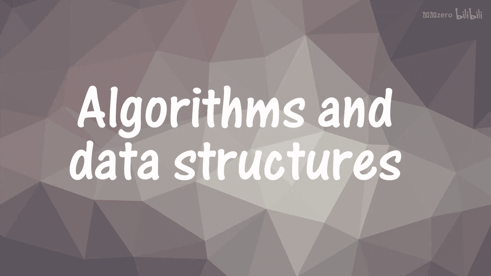
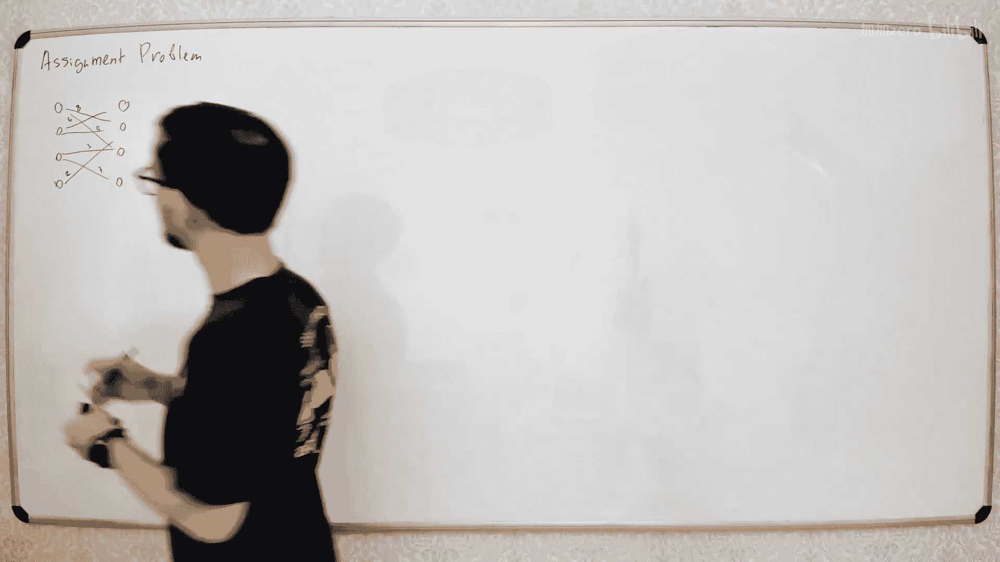
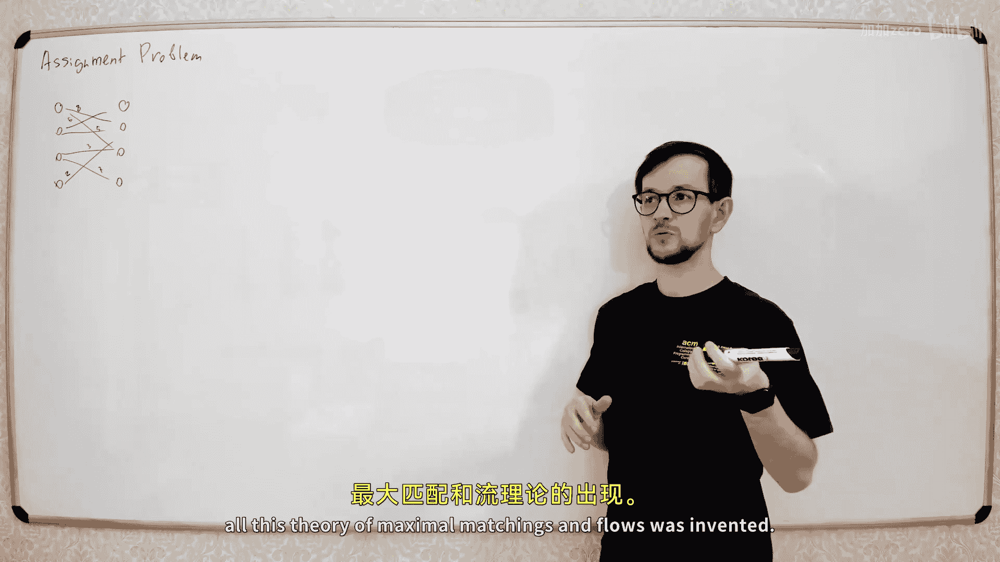
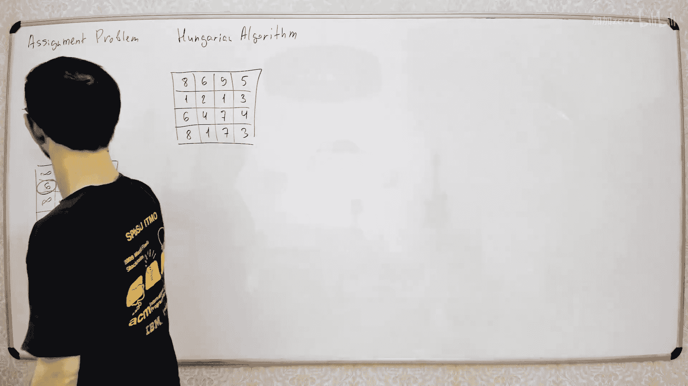

# 【精译⚡算法与数据结构】PavelMavrin p53 p52 A&DS S04E06. Assignment Problem. Hungarian Algorithm -BV1NLB8YfEMq_p53-

So today we continue to talk about matching and we will talk about assignment problem。에 미 안 나튼。

So what is an assignment problem， A assignment problem basically a problem to find the minimal or maximal weighted matching。

 So in all previous problem， we didn't have any weights in our graph。

 So we have capacities for flows but this kind of different thing here each edge of our graph will have some weight and we want to maximize not just the number of edges。

 but we want to maximize the total weight of all edges or minimize usually usually an assignment problem you want to minimize the sum。

It's up to you。 It's actually the same problem。 Maximizing or mini。So what is the traditional。

Statement of the signal problem And in the traditional assignment problem。

 you have something like that。 You have some number of workers。すい。

So you have some workers and you have some jobs。And let's say you have the same number of workers and same number of jobs it's like end workers and end jobs。

And you want to assign a job to each worker。For each worker， you know， the cost of the。

Of of this worker how much money this worker needs to be paid for this job。 Yeah， so you have kinda。

 you have a bipartagraph。But each edge has some cost。Or wait。So it's weighted。

 So each age has some weight same8。7even。初さで。

And what we want to do is to assign the jobs to workers in such a way that the total cost of。

Off the assignment is minimum possible。嗯。Usually it's sorry， yeah then for historical reason。

 basically， this problem was it was my discharge。Actually。

 before all this theory of maximumim matchings and flows was inventeded， so。

The traditional store can problem is you have a matrix。富比符。Mattris， of course。

 So here you have workers。 here you have jobs。And you have a matrix which says how much money this worker is for this job。

First。Worker near for second is A8。the first work and third work is far。s right。P something here。

For here。So second motor is eight goals for the first job， by60 and for those for the second job。

And this brokerer needs fris for the。Ms and7 for these。えと？짜 밖에。And you can。

 you can think that you actually have a full magic， so。

Even if some work don't want to to do some job at also。 So you can just put infinities in this。真好纯生。

Now， what we need to do， we need to assign each job to some worker。 So each worker has only one job。

 each job is assigned to exactly one worker。 So basically， we want to build the matching。For example。

 here what will be the form machine we could take this edge plus this edge。

And say this H and this age， for example。や。In terms in terms of metrics。

 you want to select some cells of the matrix。 So in each row。

 you select exactly one cell and each column， you select exactly one cell。 Well exactly， again。

 for example， for this matching， if you transfer to this matrix。

 you will have the so first work same to the third row。Jo， second work thanks to it。First job。

 This is a full job。 And this is something like that。And we want to minimize the total cost of this。

Wching， so we want to。Minimize the sum of all costs。诶。For， let's say。Worker。

 I and assign Joe policy API。So I want to minimize the sum for all possible preuts of P。嗯。

So that's the classical assignment problem。Yeah， its it's very practical。 so sorry so。For example。

 if you have situation like this， you have these workers and these jobs。

 you want to assign them and many other cases。 So in some cases。

 you need to assign something to something and minimize the total value of sum functions And if this function is just the sum of all different So if if your function of of your total penalty。

 let's say is the sum of。Disting penals between between the for each assignment。

 you have some assign some payment for each pay， you have some penalty and your total penalties the sum of all these penalties。

 then you have something like that。Yeah， yes， yeah。 this is easily just Yes。

 you can test all possible perutations。 Check this， and you have an factorial algorithmthia， yeah。

That's one of the ways this focus on。嗯。Now。Okay， right， so so you can view the problem。

 a second problem like this or like this So this like a graph representation， this problem。

 this is like more complementary conditions。But basically， it is the same。嗯哼。Okay。

 that's plus plus a problem。 in some cases， you want to maximize this numbers。

 And so of minimizing this sum， you can maximize the sum。

 if you want to maximize something you know like in this case， you。

 you can make minus of all the costs so you can you can make negative of all the costs and then solve the minimization problem。

 yeah。So， so so we will never use the properties of all the numbers being non negative。

We will use them， but not not really。 So you can solve the same problem if you want not maximize this does not minimize the sum。

 but maximize the sum。ButThe situation will be exactly the same。In some cases， you may want to。

 for example。You want to maximize this some， but you don't want to have a perfect machine。

 So you may assign something to something， but not exactly assign every every node of the left part to every node of the right part。

 So in some in some problems， you may want to build not the。Perfect matching。 Y。

 not the full matching。 So you sometimes you don't need to match all nodes on left side to all nodes or。

 Sometimes you just need to to make some matching， not not max matching， not simple。

 but some sum matching。 just to maximize this sum。 So in some cases。

 building the perfect matching will not be optimal。no 게 get take。It's all the same problem。

 which skate wheels。It all can be sold by the same algorithm。Okay。

 realistic stick to this we' stick to this problem because it's like the classical one and we'll explain how to solve this problem using something which called Harian algorithm。

Go， so what is a Harian algorithm and how it works。嗯。Idea， idea。

Let's have a very simple idea what we can do。 No， let's， let's。Let's have some metrics。

It's not infinities。 I want some metrics without infinities。 so let's。let's put something here。

 like 8，6，9， and。5 in here something small，2，1。3。And here's something。eight。어 six。4。7。I don't know。

Fu。8，1。So wonderful sounds。嗯哼。So first of all。What we can do。Where is bedroom and business America。

Brich about， no， no， no， no，' not nothing about brush brows。

 This it's like special algorithm everything。 It's， it's actually quite similar for what we do。

 Again， we we want to build some matching。 Sorry， again， let's talk here。So for example。

 if all the edges have the same cost。So if服。For example， in this graph。

 you have costs like ones and infinities。 Then there's just a problem of finding maximum matching。 Y。

 So if you have a maximum matching。So if， if there is a matching。

 if there is a perfect matching between left part and the right part。

Then the total cost will be non inient。 Yeah， and if there is no maximum perfect matching。

 you will have an infinite minimum。 sorry， this minimum will be infinite。

So this problem is not easier than the problem we find in max machine， obviously， right， so。

So the algorithm will kind of use the same process we used in the maximum matching for the bipartite graphs。

 so we discussed bipartgraphs in the first lecture of the semester so we discussed。

Which called spoonon algorithmthia。 So we'll kindly use the same procedure。

 all these augmenting paths and stuff and we'll just apply all this。

E all all this theory and add the costs to this。아그 야깐 같아。Again。熟。十。What we'll do。

 We will try to modify this matrix a little bit。 How to I modify this matrix。

 We can do the following thing， for example。啊。What we can do， is， let's go to this store。

 What we can do。 We can take。Anyote。And add the same value to all the edges。Adjusting to this note。

 for example， you can take。This note。Take these to edges。

And change them by the same de。 so so we can just add。嗯。See real estate plus equal data for all。

For all。아 우리 야。So you take some note in the left part。Take all the edges connected to this now。

And increase the cost of these edges， by the same amount。啊。And idea is very simple。

 If you do the separation， the minimum matching will stay the same。Why is it true。

 Because if you change。All the edges connected to some note。Then in any matching。

 exactly one edge will be changed。So if you look at all possible matchings。

They all will be changed by the same delta。Yeah。And if you have a set and you increase all the elements by the same de。

 you will increase the minimum by the same data。응 어 몇。So if you change all the edges。😡。

Connected to some。You will increase the minimum by the del time， but the minimum will stay the same。

 so the minimum matching will stay the minimum matching in this graph in this modified graph。啊。

So how it transfer to these metrics。 So if you transfer to this matrix。

 So if you want to change the cost of all edges connect to one of the node in the left part。

 it' just changing all the cost in the row。 So basically， you take the row。Of these mattress。有。And。

Delta to this to all costs in Bi。Again， this separation will not change the minimum possible matching it will change the value of this matching。

 but the matching will stay the same because all possible matchings will be changed by the same data。

So minimal will be the same if you change all elements in the set by the same delta。

The minimum element will still be a minimum element。Great。Okay。Hos going吗？On the other hand。

 you can do the same with the right part， so if you take any H A A load in the right part。

And take all the eggs connected to this note。So you can do the same。 You can increase。

All the edges or all the cost of the edges connected to the snow by the same data。 And again。

 it will not change the minimum。By the same reason。

 because only exactly one of these edges was in the matching。

So your menu magnetic get rule stay the same and these transfer those metrics like this So you take a column of this matrix。

I have three。You would take a column on this matrix。 and again， you can add。

Any amount to all elements of this column。Again， with these two operations are safe operations。

 they will not change the minimum matching。So what we'll do？

We'll try to apply the separations to this metrics。How to apply them， first of all， let's。Take。

All are also of this matrix and all columns of this matrix and subtract the minimal element of this row。

So we take the first row， find the minimal element in this row and subtract it from all elements。

 So we will subtract5 from all elements in this row。

 Now we'll subtract one from all elements in this row， subtract。

F from in this row and subtract one from all elements in this。 We will get the following methods。这。嗯。

Okay， our matrixs is hard， okay。8-5 is free。 Okay， I can do it 1，4，0，0，1，0。2，0，3，0。And then， finally。

嗯。7，0，62。M。Thisper is actually not required for our algorithm， but I will do it anyway。

 It's easier to understand what's going on if you make the separation first。Why in the exploration？啊。

We have two purposes for theperation。 Our first purpose。

 it will make all the elements of this metrics not negative。 So right now。

All elements of this matrix are not negative。嗯。Actually。

 for this metrics is it was true even before the separation Yeah。

 but if if you had any negative elements in your matrix。

 then after you apply the separation after you subtract this minimal element。

 all elements will be non negative。Great。Now， the second interesting thing is in this matrix。

 you have a lot of zeros。let's mark them。So you have these， these， these， these。

 these and these elements are all zeros。And haven many zeros， haven't。Big advantage。Do I have a make。

 I think kind lot。어 응。Yeah。嗯。Yeah， so there is at least  one0 in it in each row。

You may apply the same version to all columns to make at least one0 in every column。

 but we we we already have at least one0 in every column so its not important。Now。

 what will try to do。We will try to build a biparta graph。

Containing only zero elements of this matrix。 So we have something like that。

 We have four elements here。4 elements here。And we will connect all elements if the cost is equal to 0。

 So the first。Ament will be connected to four element here， connected to one and3。

 this second can do。4 and this pass connected to。like this。

So we built a graph which contains only zero elements of this row。那。

What's interesting about this graph， The interesting the of this graph。

 that if you find the perfect machine in this graph。

Then you will find the optimal solution for your assignment problem。let's prove it's simple。

 So so if you have a graph and you find the perfect machine in this graph。What does it mean。

 it means that for this problem， you find a solution with total cost equal to 0。

 because we only left the edges with cost equal to 0。So we have a solution for this problem。

 with total cost equal to 0。But all elements here are not negative。So you can not make any。

 any solution of the of total cost， less than 0。So if you find the max perfect machine here。

 it means you find solution of the co 0。 It's definitely the minimal possible solution and minimum possible solution for this matrix is the same as minimum solution for these matrix。

So if if you build a graph and you find the perfect mention in this graph。

 then you solve the problem。그라。But in this graph， we didn't find the dark machine， actually。

 because I was。Actually， trying to build a graph without perfect mention。

 So let's try to build the perfect machine for this graph。 Again。

 you can do it using the standard cool algorithm from the first lecture。So how to find the。

 how to find the maximumim matching。You start。From old notes in left part and try to find the augmenting bed。

So we take the first note here， Find our mat path。 Not simple。 You just take this age。

Now you take the second on find our went in be， okay。Now you take this on final our waiting breath。

 Okay， I can do it。And now now you start from this note and try to find any augmenting path。

 What will happen。ACo algorithm of the first lecture， if you didn't vote the first lecture。

Its maybe good time to which So again， how do we find the maximal machine we start we take any node in the left part。

 which is not used in the machine and try to find which's called augmenting path。

 What is augmenting path， we start from the from the note to the left part and then try to find something like that。

So we try to find path like this。 If we find pathth like this。 So first and last。

 no un obviousous than the matching。 And these edges are alternate。

 So this is edge not from the matching。 This is H from the matching and so on。

 So if we find that path like this， we can increase matching by one。

 which just invert all the edges on this path and find the。M of the size plus one， here。

But what happens if we try to find our mating pair starting from this note。Let see。

 so we started DFs operating from this node。We will start from this note， now we go here。

 now we go here， now we go here， and will go here。And that's all。嗯 哼。

So we didn't reach this free vertex of the right part， so we didn't find any augmenting path。

If we didn't find any amount path， it means we cannot increase our matching， yeah。So。

 so we find the dimension of size free， but we cannot increase it to have a dimension of size 4。有。

That's it。We want to have much inner size for， but we can not find it。

So what we'll do to find the dimension of size4， Now let's see。

We'll try to get some other edges also in this graph， there is no mention of size4。What will do。

 We will modify this graph to find the machine of size 4。话不我。Again。

 let's draw the same picture from the first lecture。 So what's happening here。

 You have some notes in the left part visited by your machine。

 So let's say you have this node visited by your DFS。

So your D has visited this note in the left form。So let's say L plus。

And you have some notes in the right part listed by your T， F， S。And。Yeah。

And we have something not visited here。 El minus。 and we've sent something not visited here。あ、そう。

That's just the picture from the first lecture， again。

So we started DFS and I just put everything marked by the DFS in this L plus and R+ and everything not marked like this node like this node in this L Y minus R image。

嗯。So what want to do。 So what to do， We want our D to visit more Nors。 Yeah。 So， so right now。

 what is what is the。What is the goal， The goal is for our DFS to find our main path。

 so we kind of want our DFS to go to this now so。Yeahや。So we kind of want our DFs to visit this note。

 If we visit this note in our DFs， then we will find this augmenting path。 and were done。 Yeah。

 we will increase matching by one。😊，什东。Will try to modify the graph in such a way that our D F S will visit more notes than before。

How can we do it， no， let's see。So now right now， these nodes are visited from our the interface and these nodes are not visited from this press。

 So if we want to increase the size of the visited nodes。

 we my there are two well there are two ways we can do。 Yeah， we can。

Create an edge from here to here。Or we can create edge from here to here。Yep。So somehow号。

We need to find an edge like this。嗯。Okay， let's see。Well， first of all。

 you can't make H from air plus to L minus。Because there is never edge from our pla L minus。

Sal problem right here。Yeah， okay， if you， if you missed the first part。

 So it's basically described here， we want to max mode and minimize this sum。's， that's the whole。

 that's the whole statement of same problem。嗯。嗯。So。Again。

 if if you if you remember whats happening in the first lecture of the semester。

 there may not be edge from r plus to L minus。Basically because if the edge goes from right to left。

 it's the edge from the matching。And every edge from dimension saw this edge like this。

Every age from the matching。Always go from some visited to some visited。 So if you visit this note。

 you will visit this note so you can have edge like this。

So what we'll try to do is to find edge like this， so we'll try to find a new edge from L plus to r minus。

嗯哼。😊，How to find how to make a U edge from L plus to R minus。 No， we need。 So there are some edges。

 but then not zeros。 Yeah， so we only consider edges with co equal to 0。

So we need to take some edge from here to here and make it zero。How to make this edge 0。

 No Let's look at all possible edges from here to here。So let's take L plus and R minus。So l plus。I。

1，3 and4， and our minus is 3。So this is our milesos。 This is L plus。そう。

Let's look at all intersections of L plasmas。 This is basically these three edges。

So these are three possible edges from L+ to R minuss。Let's take the minimal edge。

 So let's take the edge with the minimal cost going from L plus to R minus。So let's say。

 say deelta is the minimum。Cost U V such that U belongs to L plus。And we belongs to our minds。

And in our case， we have this free。So this is the minimum cost。Now， what we'll try to do。

 we will try to make this edge the cost of this edge equal to 0。

And we'll do our best to not destroy everything else， so。How to make。

The cost of this edge equal to 0。 again， we will do this safe operations。

 So our safe operations is to to change all the values in the row by the same value。

 all change all the values in the column by the same value。 So let's。So well try。

 We try to performing。 Well take all these roles。And decrease them by there。Byy this delta。

 So we'll make -3 to this row，-3 to this row。 come not this。We need only these three wire。

 -3 to this，-3 to。But。If we do theperations， they will affect not only this free。Values。

 but all other values in these row。 So we will make。A correction。

So I want these free values to be decreased by free， so I will decrease these three rows by free。

And Ill make correction to these three columns。 So I will make plus free。

Plus free and plus free to all these pes。응  형。chein。My idea is to make one of these。

Elements equal to 0， and。Probably didn't break anything else。 Yeah， so how to make these elements。

 one of these elements equal to 0。 I take the minimal element。 This free。

And decrease the values in this row by free and increase values in this column by free。

 so I will not break anything。 I still want all elements to be non negative。

So if you just decrease all elements by free， you will have some negative values。

 I don't want to have any negative values。So I will decrease this rows by free and increase this row these columns by free。

What will happen， I will have some。New matrix list here。Okay， so these elements were still the same。

嗯。嗯。M be so。No。In this， these three elements will be decreased by free。 Yeah。

 I So I make mine free for these elements and didn't make plus frame。

 So these elements will be decreased by free。 So I have。1，0， and3。Now。

 all elements in this row will be increased by free because I make plus free to all these elements and didn't make my minus3。

 so I'll have free。Ohu，4 and five。Now， let's release our graph。

 So what will happen to our graph after make separation？After we make a separation。

 we have again these edges equal to 0。Look let's see what changes。

 so some edges are removed from our graph。 so for example， this edge。So here we had  zero before。

 and now we have three。Yeah， so we need to remove this edge from the graph。Let's do with this image。

Its age，221。出处网。Oh， this's strange。What。I make something for wrong。What did I wrong。哎， so被信去。

Why didn't point， Why didn't you point out？I have two points here。 I have。

I have two points here miles。In our minus， I have these two elements。Why didn't point it out。Okay。

We need to fix everything。I have two elements in Ars， these two。有的不我是该说的呢。So minimum almost2。

Need to fix everything。So make-2， minus-2， minus-2。And we fix this by plus 2 and plus 2。Oh。

 now better。O， second take。 Let's， let's try。嗯。Okay， so we didn't change elements。Here。

 so these elements will stay the same。嗯。Which one so this two elements was they same。嗯。

Not only these elements。Yeah， and this owners will stay same。うん。嗯。And 내。Theseさな my。

's solely your fault。 So these elements will stay the same。Right。Right。

1 these studios will stay same yeah。Now what will change so these six elements will be decreased by2 because we make minus2 for these rows and didn't make plus two for these columns。

 so these six elements will be decreased by2 they have one，2，0，1，5 and4。

And these two elements will be increased by2。So instead of one and2， I will have。F and full。Yeah。

那 was bitter。No。What happened？I didn't cost any zeros， right。Sometimes you may lose some zeros。

 We'll talk about later。 So let's see what will be the difference。

 So difference is I added one more0 here。 Yeah so now this element became0。有。

So I will have one more edge in my graph。This edge connected3 to1。One more age， like this。어。Now。

 when I have this edge。And run the same D first algorithm。

The set of visited node will be increased because now I can use this edge to go from here to here。

 so this node is notvis by this DFS。嗯哼。And even more。

 if I continue my DFS from this So I now my DS can go here from here， it can go here and from here。

 it finally can go here。So my dear F S finally visited this。Free note of the right part。

 So now I have some。Where is it？Some augmenting path， augmenting path like， I go here， then here。

 then here， then here。 So this is augmenting path。Now， I can apply。

So I can in this augmenting factors to apply this augmenting pattern to my matching。

So I invert all the edges， and it is augment in path。 So now I take this edge to remove this edge。

There you can see this one。I remove this one。好回事。And finally， take this one。It's almost all。や。

And I can have the perfect mission。Now how this perfect motion looks here。 So perfect mention。

 I connect first to the fourth。 So I take this edge， I take to to second fourth， this edge。3 to one。

 this edge。でしね。So， in this graph， I have a perfect matching which contains only these zero edges。

 so the total cost of this matching is0。 It is minimal possible matching because all the costs are not negative。

So for this graph。This is the optimal matching。Now we'll just translate this same matching to the initial graph。

 So we'll take the same matching and take it in the first graph。So we take this edge， this edge。

These。第。嗯。And now I just claim that for this matching。

 So this is the magic of the minimal possible cost for the initial graph。 Again， why is it true。

 Because all the operation I made did not change the optimal matching。Again， all operation。

 I might just just increase all the values in the row or or increase all the values in the column。

 These operations will not change the minimum matching。

Because you will change all the machines by the same battery。So you apply some of these operations。

 And in the end， you will have somera。Withve perfect mention of of the cost 0。

This perfect machine is an optimal machine for this graph。

 So it is optimal machine for the initial graph。 So you just take this answer and put it here and you're done。

 So this is， this is your final answer。그 다음。That's all。

 that's that's the congren algorithm of Mexican。呃。No。Okay， let， let's prove it actually working。

So what I want to prove， I want to prove that this operation。So again。

 what I did to in this operation。I。I take this L+。All these rose。And add Delta。

To all edges connected to this L plus。Now， I take all the rows or all the columns。

Which are not in in R plus。 So I take all the columns in not in Ar。

 So I take all the columns in R plus。And say-11。So I say minus delta to all these edges and say plus delta for all these edges。

Now， when I apply the separations。My costs will change。

So I will have some additional zeros and remove some of the all zeros。So let's see what happened。

So what happened， Which edges can actually be removed， so you can remove some edges。

If this edge was 0 before and after the separation， it became non0。Okay。

 let me draw it in in the matrix form。Also， so you have Lla。You have R plus L minus and R minus。

So what you're doing here is you find the minimal element。

Between L plus and R minus and plus and R minus。So you find the minimum element here。

Now you add delta to all L plus。 So you see a plus delta to all these rows。And say minus Delta。

 and you say plus delta to all these column。So what will happen to your metrics？

So in this region of your metrics， nothing will change because you add Dlta and your subtract to Dlta so so this region will not change。

For this region will be decreased by delta。This region again， will not change。

 and this region will be increased by delta because you add Dellta and didn't remove it。

So it will be class data for this region。So from this region。Some edges。

 which was zeros before now will be not zeros。 so you will remove these edges from this graph。

All these edges in this region goes from L minus to air plus。

 so actually you will remove some edges on your graph。Born like peace。嗯哼。😊，Clear enough， So again。

 what you're doing here， you apply the separation， you add at least one edge from here to here and you remove all edges from here to here。

And what I want to prove， I want to prove that the set of of the notes visited my D F S will only increase。

After desperation。Why is it true， first of all。This note now will be visited my dear。

 so after the separation， now this note is visited。Now， let's prove that if I remove this edge。

It will not affect my D F S。So all the edges or all the nodes visited before the separationation will also be visited after the separationation。

Now， why it true。 Let's see。 We remove the edge from L minus to r plus yeah。

Why can it affect my dearre。What do you think。Again， again， again。 what What happened？

I have some free。Notode in the left part。 Yeah。 So I start the first from some node here。

 So I start the address from this node yeah。This DfS visited some notes of my graph。

Now I apply the separation。Thisper will not only add some edge， but it also will remove some edges。

All the removed edges go from L minus to R plus。Can it actually affect my DF S algorithm。

 if you remove some edges from your graph。It will actually affect your DF S， right。

 If your DF S use this edge and now you remove it。Then some， some notes which were visit before。

 will not be visited anymore， right。So you need to be careful。 Kindly so you。

 So if you remove the edge。You need to be sure that it will。 it will not affect your D F S。 You。

 you want you want all the notes visit before will also be visit after the operation。嗯。Yeah。

 the idea is very simple， so our D didn't use these edges at all because all these edges were removed go from some non visited nodes。

So our DFs didn't fit this node。 It means our DFS cant use possibly this edge。嗯哼。Okay。

So ourDFS didn't use this edge。 So if we remove it。Nothing will change。 Yeah。

 our dear friends will still be able to visit all these dons here， So again。The foolproof。

You make the operation like this。 Use， you find the minimum element in this set。

And then subtract everything from here and an editor here。

This operationation will will add at least one edge from L plus plus to Armios。

And remove all edges from El minusos to R plus。After the separations。

 all all nodes and L plus and all nodes and R plus will still be visited by D F S。

 So all these nodes are reachable from this initial。

 So we start D Fs from this node and all these nodes as are still reachable from this initial yeah。😊。

And this。One， new note will also be reachable from the starting note。

So the set of reachable notess is only increasing。That's错。

And now we just apply the same operation until we reach this free note in the right part。

 If we reach the free note in the right part， we just stop。

The separation and just increase their size of the current machine。得。Okayk。

 let let's write some silver code here。じゃ什。嗯。So we record all notes in the left part。For all。

 let's say you from the left。Now we try to run DFS from this note。呃。What it's a wild loan difference。

嗯。Again， this's the same DFS from the K algorithm from the first lecture。

 so it's the DFS which tries to find the try to find our wenting path。

So if I didn't find the augmenting path。Then I just。Aly deperation。

So I try to find that that is the minimum。Of all C。 I used you here okay。응 배지 배지 배지 배 명。Let's hold S。

I want to use you here。 C U V such that you belongs to help plususe。V belongs to power minus。

So I'll find this minimal element。 Now I make C。呃呃啊啊啊。有。C U view plus equal Delta for all。

For all you in。L plus。M is sickd it。And C U V plus equal data for all V from。does。

And not continue on same difference。啊，一点。At some point。

 so since the number of nodes I visit only increases， at some point。

 I will reach the free note in the right path so I will find our path and when I find our mounting path。

 I just apply a back here。앤 increased 때 맞추죠。That's basically the whole Hungarian algorithm。嗯哼。

Now let's call Ks time complex。So what is the time complexity of this algorithm， So if。

 if we apply it just like this。If we just implement the hunger and algorithm like this。

 what will be the time complexity。So what we're doing here。

 which rather all nodes in the left part of the graph。 So， so we run these four enzyme times。Now。

 in this while loop， we try to find our we try to find how image map。 So each time we run this D F S。

And if we didn't find our mat path， we apply the separation and increase the size of the visit or of the set of the visited notes。

So how many times can we do these operationsbras。What的。how many durations this wire loop mail take。嗯。

嗯。Thank you。AtMost end right， because each time we apply the separations。

 we increase the size of the set of the business that we have n node。

 so we cant make this while more than10 times。Right。Now。

 what happens inside this loop inside this vi loop， we make separation， Now let's see。

So we need to find the minimal element in this region of the matrix。

 so it will take n square time and we need to apply these operationss。

 both of them take n square time， right？No we into each other all possible U from L plus and all possible V。

 So you make two loops，Nice。And then you need to apply this path。 It's a simple super。

So total time complexity right now is obviously and powerful。No。Great simple。嗯。

Can we do better we actually can， So to improve the time complexity here。

 we need to optimize this part。So this is the bottlene of the algorithm。

 we need to find data structure which will help us to make these operationss first。Wuckly。

We know a lot of good data structures， right？So we need a good data structure。

Which will allow us to find the minimal element in this region of the matrix。

And then to apply the separations。F than just to from all elementss。

Let's talk from these corporations。So let's add these alterations， so I want to make able to。Okay。

 let's make the structure， which is capable to do two types of operations。 So I want。

 I want to maintain some metrics of integers。And I want to apply to the pressure。

 So I want the operation and。呃，猪肉。嗯。아이 삼대 있다 예。I want to be able to add some comb。Yeah。

And I want to be able to get the current value of the element。嗯。L。Is this like right now。

Jill looks fine。So it's not， it's not very stable right now。He嘿。Not sure why。I know。

 maybe be some interesting problems。嗯。No， I have some dropped frames， but not， not， not that many。

Okay 응。So I want to have a bit。 you want to design data structure， Let's design data structure。

 So I want data structure， which maintains the matrix of integers。

And you want to make three types of operations， you want to add the same value to all elements in the row。

 you want to， add the same value to all elements of the columne。

 and you want to find the current value of the element。Can you make such data destruction。Okay。

 we learned a lot of。Very cool data structures， yeah， in this course。Let's design one more。

That' actuallyually a nice problem。Yes， you can。 you， you。

 you can make two dimensional segmentsaries。 It's kind of complicated to apply massive operationss to two dimensional。

 It's possible， but it's yep。You can do it。Using two dimensional segmentsries， but。Yeah。

 the solution is much simpler， actually， what you will do is to maintain two arrays。

Rray is the best data structure scenario。Quite powerful。 So what we'll do。

 you will maintain two arrays。One race will summarize the total total value we added to all elements in this row。

 So so for each row。We will maintain the elements， let's say， A I。

 So this is the value we need to add to all elements in this row。

And for each home will maintain value B J C， so。This is the value we need to add the all elements in this column。

Now， if you want to all add the same value to all elements in the row。

 you just increase the value AI。If you want to add something to all elements in a comb。

 then you just。Increase， this is the value of P G。すこ。

And now when you want to find the current value of the elements。

 you want to find the value of this element。You need to take the initial value， then add。星。

So you take the initial value of this element。Then end。The value need， we need to add to this row。

And then add the value we need to add to this goal。错。Co right。So that's all song。

So you actually don't need any。Sometimes you don't need any special data structure。

The regular arrays work fine。Now all the inspiration work in constant time。Yep。Now。

 using these operations。We can modify this part。So。So what we'll do here。

 instead of changing the values C， we will change the values of a。 So we'll here。

s let me let me fix this。So， here。I want to decrease by that all the rows from L plus。

 so instead of doing this。I will just decrease from all you。I will just decrease all this。

Valueus in in A。And when I want to increase the values in the columns here。

 I will decrease not the values themselves， but this。Rius and the red B。嗯哼。😊，Not in here。

 when I need to use C V， I will actually let you。I will love Siri， but Siri plus A U plus B B。嗯哼。Now。

Now， both these operationss take linear them instead of correct。Okay and here and and here。

But this minimum still costs square。So we fixed only these operationss。 We didn't fix this minimum。

Mmmm。到。How can we find this minimum in linear time No Ram to basic。어。

So let's see what's going on here。Again， we can have this metrics。We have L plus。

Why did I write it okay。I will just draw it again。And so you have this matrix and you want to find。

 where's my green mark。So I want to find minimal element in this region。

So I want to be able to find minimum in this region。Now， let's see how these sets change。 So。

 So what will happen when we progress in this algorithm， Some vertices will move from。

No visited state。 to visited state， yeah。So during the algorithm。

 this sets L plus Ls R plus M will change。But they'll change only one way， so。

The vertzs from L minus will eventually move to L L plus。

And veres from r minus will eventually move to r plus。嗯。So this is your set。

Where you need to find yourmin value。 So you need to find minimum value in this， in this area。Now。

 what will happen？ So when you move vertex from L minus to L plus。This area will be extended one row。

Yeah， here。So if you have some note and it is moved from L minus to L plus。

Then you have one more old to help us。So this is your set。When you define find a。

 it will be increased by these values here。Now， when the node is moved from R minusus to R plus。

You will need to remove these notes these elements from your site。

So your set is increasing this way and decreasing this way。Now， what will do， what we'll do？

We will maintain the minimums。In these columns。So maintain name this rate。

So we'll maintain the right M。Such that M J is the minimum element。C， I J， outs。C， I G。아 어 어。For all。

For all eyes in Ella。Mmhm。😊，So for each column， well maintain of the minimum of all elements from L plus。

Now， how to find the minimum in this area， to find the minimum in this area。

 we need to take minimum in each column and then take minimum for these minimums。Yeah。

 if we take minimum for this minimums， we will get minimum for all these elements。Yeah， clear enough。

Again， again， Liz again。What we're doing。We want to calculate right now we calculate on this medium in n squaredta right here。

So I want to be able to calculate this minimum in linear time。 So if I calculate a linear time。

 so time complexity here will be the same as here。 So now this this is the bottleneck of our algorithm。

 this is the slowest part of this algorithm。坐。How to calculate minimum in in the qua in in rectangle area in in linear time。

 I will maintain minimums in each column。 And when I need to calculate total minimum。

 I will take minimum for this minimums。So I take minimum of all of values M in this region。

And it will give me the in this rectangangleular area。 It's not rectangleular area。 actually。

 it's just set of columns。 So I just put them in the same place just to。

 to make it look rectangleular。 It's not rectangular。It's just set of columns and set of rows。

 So it's just intersection of some rows and some columns， yeah。It's not next。If it was spectacular。

 I can use actually some。Two dimensional trees， but it's actually not。So what do you do here。

So here I will find。Minimal element， just as minimum。Of full element M J。For。R minus。

And it will work an end。多国になた。But now you need to be careful。

 you need to modify your values M because these sets are changing。 Yeah。

 so sometimes you need to modify the values span， how to modify a values span。

 you modify a values of n， when some node is moving from L minus to L plus。

 So if node is moving from L minus to L plus。You need to extend your set。말디 있으니 he。

And dont I will try to。 I will just。Update my minimums for each of these columns。So， here。嗯。

I will iterate for all。You。Move。From。L，-2。L plus。I will update the value M J。

 So I for all these notes， I will iterate。For OV and just update。Re。みに。Of the old radio。And this CU。

What。嗯哼。Now。Each node is removed from。Help- to L plus only once。 So if you visited some note。

 you will visit them till the end of So then。So this operation takes end time per。そうそう。So for。

 for the whole this while loop， you apply the separation and times for each node。

 So total time will be n square。 So you have n square here and square here's going N n square here。

So total and complexity now will be N。Yeah the distribution of Okay， make sense。 Make sense， yes。

Let's fix it， song。So it will be。W。Yeah。I it was here before here。 So we need dots。

 which is C UV plus a。U plus B V。But actually， if you do't like this。

 you need to update all the values because you because you。Yes， for all elements here。

 they actually will be decreased by data。O， let's do it。 Sorry， if you， we you do it carefully。

 you also need， you also need update date values here。Right。

So here we also need to update all the values。Because you will decrease all these values by then。

So you need to update me you。Yeah， I believe it the song。 That's。

 that's the whole hunger in Albert in in N Cup time。You can implement it just like this。 It great。

 you can just take this code and basically transfer to。To your favorite code。

Some parts of these implementations are kind of complicated。 You can。

 you can actually simplify it a lot。So。there are many tricks how how can youve simplifyimified one of the tricks you can do clearly is here。

Here， what you can do is do not。Take all all the notes。Hi， this is not unfortunately。

 And it is so sorry。 I forgot one more thing。 here would have difference。 it。

This interface actually works in in。So。So right now。

 it's n square which divided by M because I have this difference。What you need to do is。Also。

 you need to modify this dear。But it's easy the trick is just to not start DFS from beginning each time。

 but continue DFS from the point you ended before。 So you have some so you're on the DFS it it with some notes。

Then you make these demifications and you don't remove these marks from the previous difference。

 Just continue from this from the point you ended before。

So you don't visit the same node twice in this D， because it if it is was this before then it it will be visited by the next DFS。

 So you just。Keep the notess visited by the previous DFs。And do not start D F S from。

 from being beginningner。Let's， let's say the first。like this。 So So it's not the usual difference。

 It's the continuum of the previous difference， yeah。No。呃。How to implement this yeah。そう。

One of the coolest trick on how to implement the Hungarian organ like this。

You don't actually need to continue the full DFS here。You since you only add edges one by one。

 you can stop the preci and add only one edge to your DFS。

 You don't you don't need to have to have the full GFS to run all this recursion and stuff。

 So what you can do You can start from the simple sensor。 So you can start like this。

 You can add node S to L plus So you say L plus equal to node S。And everything else go to L minus。

 and our plus is just empty set yeah。So you can start from this position。And now here。

 you don't pick the full GFS algorithm。 You just make one step of your GFS algorithm。

So what do you do， Let's see， while。Wild。什么情路。You try to find。EAny age here。

So you try to find minimal age here。 So you try to find。有喂我子。Is the minimum。呃。Hge C。

 U V is such that U belongs to L plus and V belongs to R minus。 again， like before。 Yeah。

 you use the same thing here。So you'll find this minimum edge。Now you apply these operations。

Look again， like， like like here。Are you plus equal to。마이너어 거 아。Do I want this section。

I use values B in U here。I need to， let's say X， Y。So I don't I want to keep U And V like here， yeah。

So you have something visited here， something visited here， something not visited here。

 Something not visit here。So let's find just one edge from L plus to R minus just any edge。

 So take the minimum H from L plus to R minus， then apply all the separations So again you apply M V。

Minus equalql delta for all。If we in our。A was。R minus will say a U minus equal delta for all U in L plus you'll say B V plus equal delta for all V in R plusia。

So I apply all this， all inspirations。 Now， this edge is 0。Y， you're kind not sure about this edge。

 So you have this edge from x to one。Now， this edge is 0。 nothing break。

 So just take this edge and move your D S one step here。Not， not run the full G F S。

 but make only one step of your G F S。So sorry。So this node is an L pass， so it's visited。

 this node is Ar， so it's not visited。 so now let's visit this node only one node。

 So we add this white tool。Our plus。喂。喂。So we' move this y to R plus。Now。

 what will happen if this Y is a free note。Then we find an augmenting path。

 and we apply this augmenting path if it is not。Then we have some edge from the machine。

So we'll take this node。Let's say B or four。Like we did in the poem algorithm again。B of one。

And added to L plus， because it is now visited by the difference。

So make that kinda make two steps of the GFS。 GFS will go here and then here， like and K grid again。

So if y is free。 So if P， Y。Is empty， then we find our main breath。And if not。

 we will add this P Y 2 L plus。诶譬胃。And update。Y yep。I want know right this。

When you move something to L+， you need to do all the things。嗯哼。So okay， why is cool。

 Because because you don't need to remember the state of your GFS。

 You need don't need to make all this recursion from the GFS。 You make only one step of the GS。

 So start from here and make one step。And then either you find the oing breath or you find something here。

 And you in you update your sets L plus info4 plus。Okay。When we'll talk about linear programming。

 So we if if you're familiar with linear programming， maybe you are。

 then what we're doing here is basically we apply something called primal doia to the again。

 So basically what we're doing， we try to build the。Maching。

And we try to build some constraints of this matching。 So this。嗯。This modified matrix。

 So we modify this matrix。 And then we have some non negative values。And in this no negative values。

 we have some perfect matching。😊，So this modified metrics。

Is actually kind of make some restriction on on the value of your。Maching， yeah， because because。

 you know that you can't make it less than 0。 And so if you have matching of value 0。

 it will be minimal possible matching。So， you kind of。嗯。It's hard to explain the Al problem。

 And So what you're doing is you kind of make some adaptations to your metrics。So in the end。

 you will find some another matrix。Which puts restrictions on the value of your solution。

 And that's how， how， how you make it in in the linear programming。 So you have so。

You have your problem， which is to find the matching of the maximum size of the maximum value。

And you have these restrictions。 Yeah， and we kind of move from to。From two sides。

 we kind of want to increase the matching from one side。

 and we want to make better restrictions from from the other side。 So's that's what we're doing here。

 So when we find our mat path， we increase the matching。

 So we we make progress in the in primal problem。 And when you cannot when you can't make progress when you cannot increase the matching。

 you kind of make something like this with dual step。

 So you go from other end and try to adopt your constraints。

So if it will move closer to your current solution and if it will possible。

 it will probably give you some way to increase your primal solution and so on。 And if。

 if each time you make progress in this problem or in this problem， in some point。

 you will find them in in the same spot。 So you'll find primal and dual solution will kind of meet in the same point。

 So in this point， you will find the optimal solution。 So that's how the basically how the。

Prial do organ workshop。 Maybe maybe we'll talk about it later when we'll talk about linear programming。

That's说。Also， what's interesting。 you can solve。 So so this is this kind of good solution。

 So it is an N cube solution。 it's kind of fine。 But if it's here we suppose that we have a full graph。

That we have a graph which contains n square edge。 So each edge。

 each node and left part connect to each node and the and right part。 If you have a sparse graph。

 So if the number of nodes， a number of edges is node n square。So again。

 you may have some small number of edges。 So you have some N。 For example， you may have n edges。

 Yeah， up to end。啊そ。In sparse graphs， you may adopt this solution to make better complexity using again。

 use use using basically hips。 So what we're doing here here each time we need to find the minimum volume。

And then drop to two increment values by the same value。You can use heaps for that。So， in every he。

There is every hip where there is a operation to find the minimal element， right。

 but you also can add the operation to increment all elements inside the hip by the same value。嗯。Yep。

How can you It's clear how you know it。 Okay， if you have some he， let's say if you have binary hip。

And you want to be able to change all the keys inside your inside your hip by the same value。

 What you can do。Look， you can maintain again， you can maintain this volume。

 which is the shift of your values。in the힙투가。I。Just show you what I was talking about。

Imagine you you need， you need a heap。 Let's say buy another heap。

What operations you have in binary you have， let's say， in short。X， and remove me on。Like this。

So just standard he， right？What if so in this problem， I actually need one more operation。 Yeah。

 so I need to find minimal element。 I need to put new elements in my hip。

 and I need to increase the elements here here here。

I need to increase all the elements in the heat by the same because I have these edges。

 and I need to change them by this minus deta。So， I need to change。All elements in the hipap。

 vi and data。嗯哼嗯嗯。So Roseberry， Yes， yes， yes， This's right We adjust control。 So here this， this。

This modified DFS is just to continue the previous DS。

 You can you can just avoid this all this recursion inside DS just by making only one step of the。

 So inside of just continuing this DFS previous， you can just make one step of this D。

 what I'm doing here。 So here I maybe just one step of the DFS here。

 It's the same thing here There's just simplified。Back back。 So imagine you need the binary hip。

 Yeah， so you have the separations insert and remove minimal element。

I want to add one more operation to my my binary hip。

 I want to be able to change all the values inside my binary hip， by the same value。

How can you do it。We do like this。 Okay， you maintain the difference of the elements inside your binary rehib。

To the real values of these elements。So when you change all elements， brand， you just make this。

 let's say， I don't know。I need some value。 Let's say it shift。 So it will be shift will be in。

ltaSo shift will be the difference between the values in my hipap to the real values of these elements。

So here I just say that the shift of the elements in my hip is increased by this data。

So when they remove minimum。I remove minimum， and then modify I it using the ship。

 So so I I use regularly remove minimum。And just add this shift to this manual。

 So all elements inside the hips inside my hip are have values。

 which are shifted from the real values by this value S。And then， I insert the element。

So I want to insert very We made X， but all elements in my hip are shifted by S。

So I shift this x to minus S and then put it to my hip。

So it will have the same shift as all elements。어。嗯。So that's how you implement。 again。

 you can apply the same technique to any hip。 So you can apply to binary hip to even232hi hip， yeah。

The same weight。And it will allow us to do the separations， again。

 why you need the separations because what we're doing here？

We need to take all the edges from L plus。あマイナスそよばマイナス。So what we doing in this algorithm。

 we take all edges from here to here。Yes。Then we get the my minimal element from this set。

So this why I need little meaning， and then we change all this values in this in the set by this delta。

So we need to be able to to to maintain this set of pages。

 We need to be able to remove the minimal elements from the set。 and then we need to to change the。

Weights of all these edges by this delta。So what's I need。So if you do it like this。

 you will get time complexity is something like。쭉뿌청 부청 부청 부청 부청。So again， if you have a sparse graph。

 So the number of edge is not and square is less than n square。 So you can do it like this。 So。

 each time you do all the same things， but you use。Some， let's say。

 binary hip to find the minimal element here。 So youll find minimal element in loggan time in applied patient。

 So total time will be something like N M loggan。Or right talking you can use Fi energyhi。

 If you have Fibon energyhi， you will have something like n multiplied by N loggan plus M li and Fi lin D。

 sorry Fibon hip。So again， this is if you have a dense graph。

 So if you number of edges like n square， if you have a sparse graph。

 you can do something like this using hips to find this minimum。In loggan then。Okay。

 I think it's soft today。🎼Yeah。🎼Yeah。🎼。🎼うん。🎼。

