# 【精译⚡算法与数据结构】PavelMavrin p54 p53 A&DS S04E07. Minimum Cost Flows -BV1NLB8YfEMq_p54-

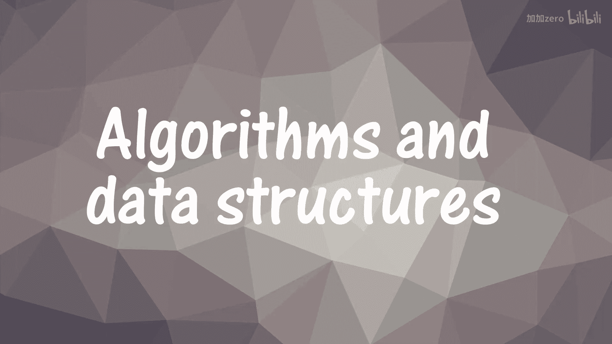

Today， we'll talk about flows again and well talk about weighted flow。

 talk about what's called Min cost flow。

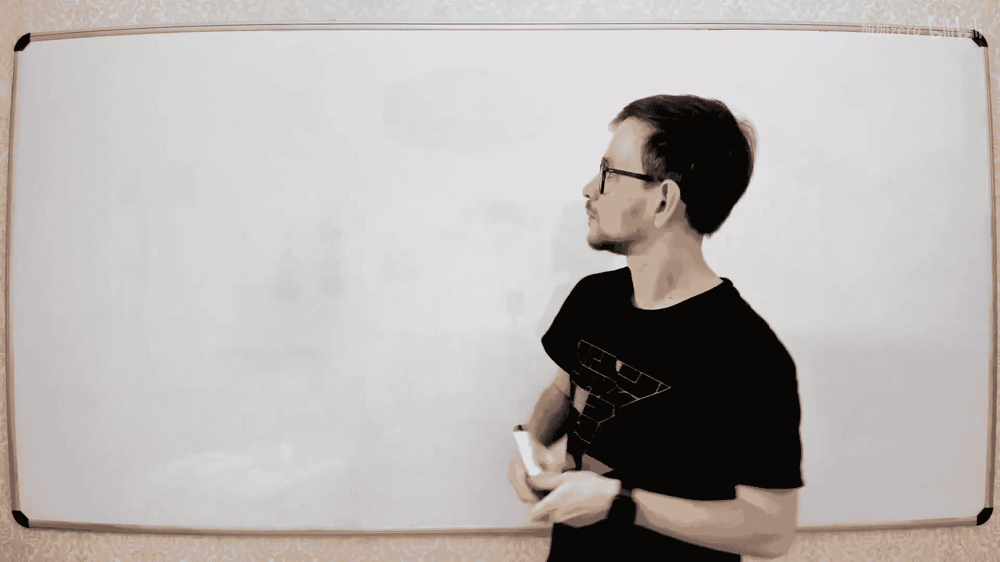

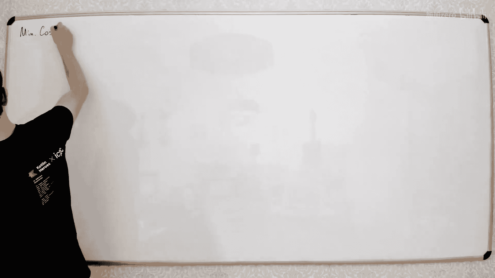

So this is the weight version of the maximum flow problem and maximum flow problem we just have to maximize the flow from one point to another point and all edges are like the equal right so you just have the capacity and you can push the liquid from here to here no more than less capacity。

And immuno cost flow edges are kind of different。 So there's different cost of pushing the liquid through。

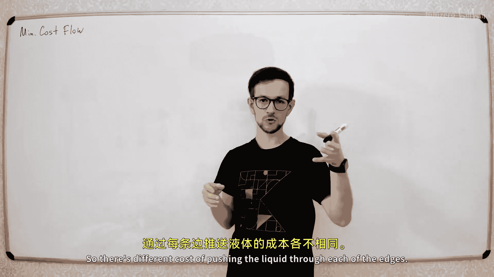

Each of the edges so for each edge， we have two parameters。

 the maximal capacity of the edge and the cost of this。So if we have。随便。Okay have라는。

Will say C U V is the capacity of the edge。

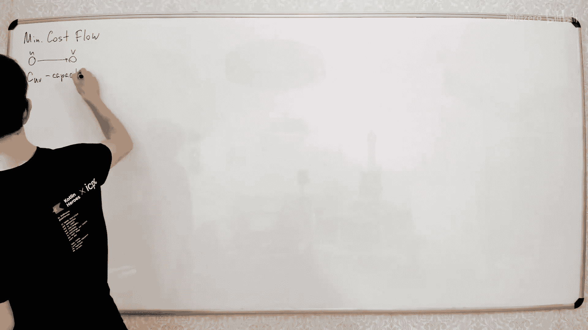

Now， unfortunately。Worse cost and capacity have the same as letters。 So I will use letter W。

Just like it's basically like the weight of the edge， right。

 So if you think about it like a weight problem。 So if you。

 if you move from biparta graph to assignment problem。

 So just you just get different weights for different edges。

 So and if you think about called shortest past problem。

 you can think about the length of the edge or the weight of the edge。

 So it's just different knowledge。 So I'll use I will use the letter W of just for the weight of the edge。

 but I I'll usually say the cost of the edge。

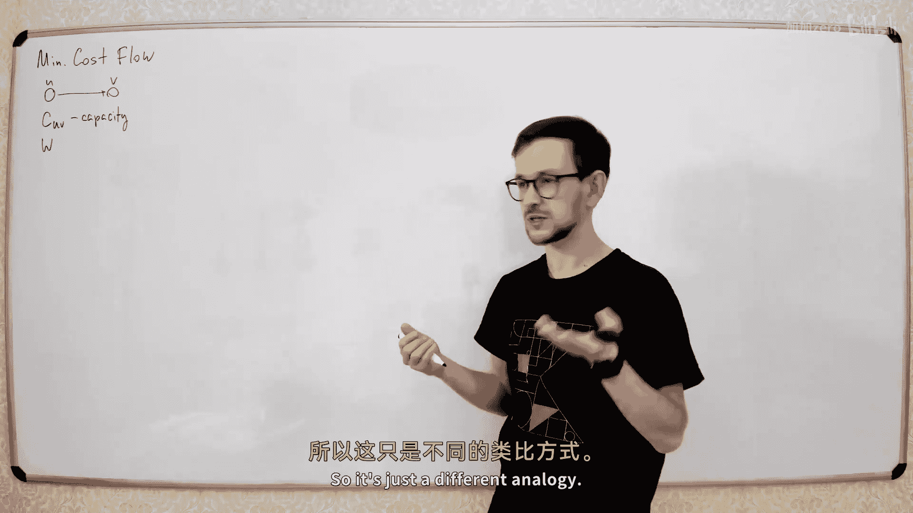

まよろしいでしょう。

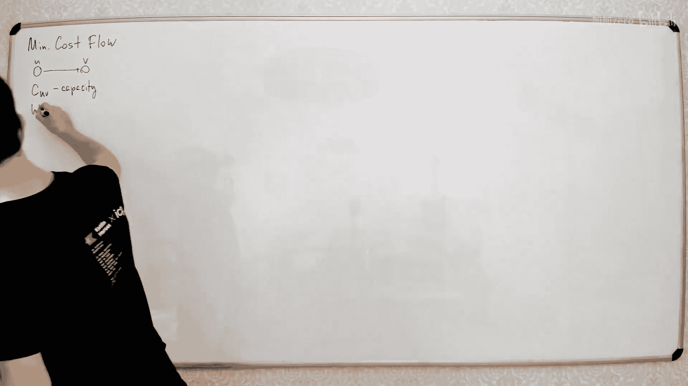

So what does mean each edge has a cost cost is basically the amount of money you need to pay to push one unit of liquid from here to here。

 So each unit of liquid， which is flowing through this edge costs your W UV。嗯。많이啊。Okay。

So what we what want to do， we want to build a flow。 Let's say what of maximum flow。

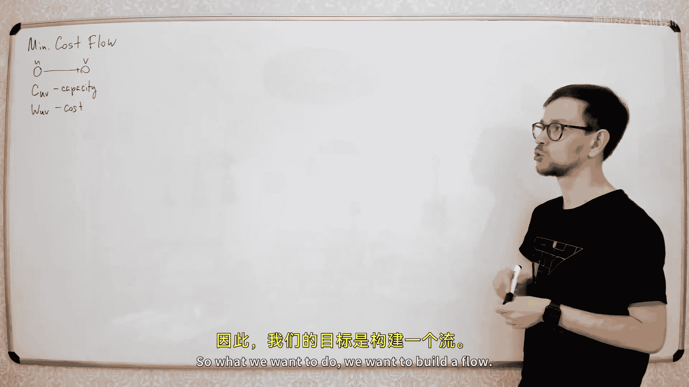

Let'sSo again， amount of flow is the maximum possible。

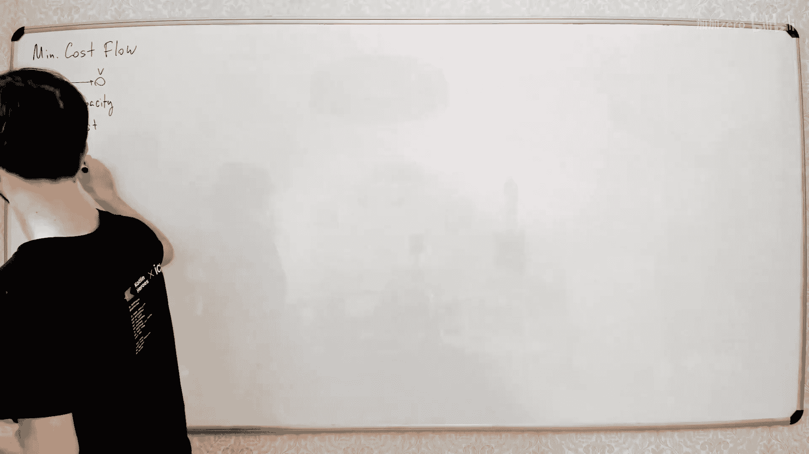

Flow is just regular flow。 Yes， so so we have a balance in in each node except S and T equal to 0。

 And we want to maximize the amount flip flowing from S to T。

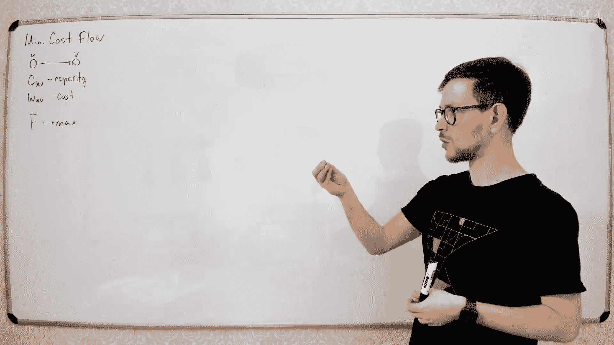

Like an usual maximum law problem。But for this maximum flow。

 we want to minimize the cost of this flow of this flow。 So what is the cost of this flow。

 let's say W。W is just total， total amount of money need spend for this flow。

 How is calculated is just sum for all ages。

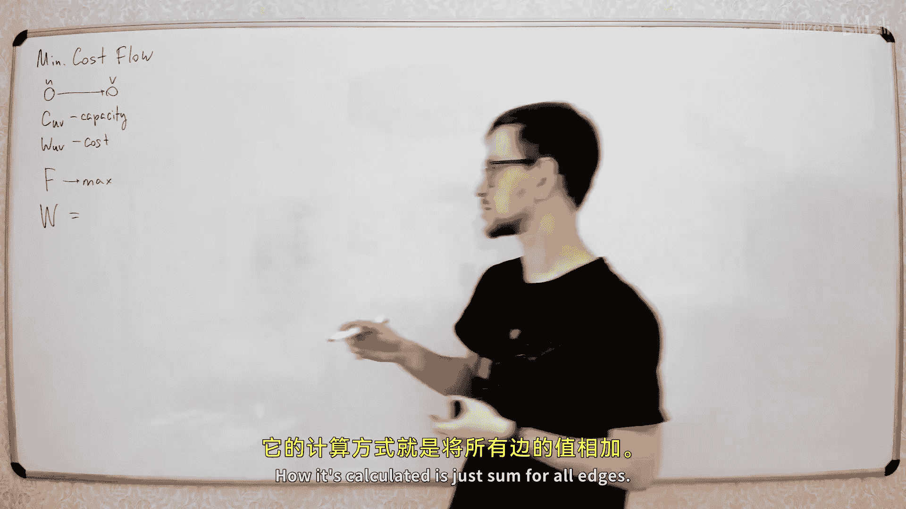

So we take some for all ages。And we just multiply the flow with edge to the cost of this。

And for all maximum flows， we want to minimize total weight of holess。So， we want to。まし。

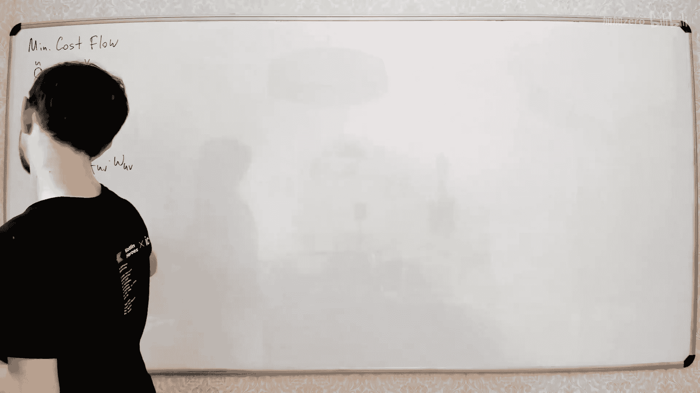

说毒か。So there are different types of these problems。 when some problems。

 you don't want to maximize the flow。 We just want to build some flow。Of the minimum cost。

 in some problems， you want to build a flow of particular size。 So we want to， to build flow of size。

Say X。 and from all flows of this of the size， you want to find the the cheapest one， right。そう。

There are different variations of this problem。 I will consider this variation， just for simplicity。

Okay。Nice。So that's the minimum cost problem。 Min cost flow problem。Okay， let's it go。

Let's start from the simple simple cases， not very simple。

 but the first case is when all costs are not negative， so let's see。Let's say， with all costs。아飲だ。

How to solve this problem？Let's start from the simple things first， let's。

Find the minimal flow of size 0。 Minim flow of size 0 is just the empty flow， right。そう。F 0 is that。

Flow of size 0 with minimal total cost。 Yeah， if you want to minimize total cost。

 you just push nothing。 Yeah。 So all， all costs are not negative。So， you just。Don't do anything。

 Just assign flow for each age equal to 0。 and you will have that flow of the minimum total weight of the minimum total cost there。

So， it's just the。Now， let's try to build the flow of size 1。So。Noも course。Hello。Of size。1。

How to find the minimal cost flow of size 1， you have any ideas。How does it look？So you happy again。

 you you have a network， right， all costs are no negative。

You want to push one unit of liquid from S to T。What will they there。Flow look like。

what does the flow look like if you take any flow of size  one？How does it look like。Then onm here。

Okay。Just say something。Just need to check this。At least。Somebody's。Woqun。So you have your network。

 Yeah， you want to push one unit of liquid from S to T。And you want to minimize。The total cost。

Yum of this floor。坐。What does it what。With me。 Yes， we want to play one augment in path。 Yeah。

 So if you have a flow of size 1， it's basically one path。Not exactly。Again， like we。

 like we discussed when we talk about network flows。

 each flow can be decomposed into paths and cycles， right， So if you take any flow of size 1。

It is decomose into one path。From S to T。Last some cycles。Yep。

any flow can be decomposeded into paths and cycles。Yeah。So if you want to take him。

Flow of the minimal cost。We shouldn't take any cycles because each cycle has no negative cost。

So we can take。 let's take some some flow of the minimum cost。

 Let's remove all the cycles from this floor。The total cost of this flow will not decrease。

Will not decrease scale。So actually， what we proved that the co flow of size one is basically one path。

So if you want to build。The flow of minimum cost of size1， you just need to find a path from S to T。

Yep， and push one unit of liquids from this bag。If you push one unit of liquid， using this path。

What will be the cost of this flow， the cost of this flow again will be just this flow multiplied by the weight of this edge。

 So the total cost of this path is just the sum of cost of all these edges。

And if you want to minimize this cost， you just need to find the shortest path。

So we want to find a path from S to T。With minimal sum of the costs of these edges。

So the flow F1 is just the flow， which contains only the shortest path from S to T。Okay。

 now how to find the shortpan。I want to minimize。The total wait for on， on this then。

How to find the short span。Deek's are all going cool， okay。Yeah。

 Im just I just checked that you're still here， okay。

 so we can use dis allegating to find the shortest path。Moob this video。

 so we'll just use the extra algorithm and find the shortest path。

 and now we know the minimum cost flow of size one， nice。Now， let's move to the next。

How to find flow F2。So again， flow F two is the minimum cost flow of size okay。Minimal cost flow。

Of size。2。How to fight flow of size though。Again， what we need to do。

 what we need to do is to take flow of size one。And then add one more augmenting path to this。Flow。

 right？ So if we want to increase the flow by one， we just need to find some our maintain path。

And then apply this augmenting pad。 Just push one unit of liquid for this augmenting pad。

So to find the best to find this flow， we just need to find the augmenting impact of the minimal cost。

A like aton。喂。Of minimal cost。Do flow F1， yeah。So we just take flow at one。

 build the residual network of this flow。In this regional network。

 we find the augmenting pair from S， O T with minimal sum。And then using this augmenting path。

We increase the flow by one。嗯哼。😊，Go answer on。If you want to move from flow FK to flow FK plus1， y。

You just take the your current flow。 again， the invariant is your current flow is the minimal possible okay。

 flow FK。Is the minimum cost flow of size key。Minimal cost。Of size。Okay， right？

So if you want to increase the size of your flow by one。You just take your current flow。

 take a residual network。Find the shortest path from S to T。

Then apply this augmenting path and increase your current flow by one。And so on。Mmhm。😊，Clear。Now。

 how to find this augmenting perfectly， space okay。If you have your current flow。

And you want to find the shortest path in the augment in the augment。In the residual network。How。

 how can you do it， How can you find the shortest。With in the digital network。

 can you do it using jigstar algorithm？嗯。嗯。No， do I think， can you use the extra or not。Why not。

 it's good pressure。There is a small problem here。 The problem is that in the residual network。

 your costs may be negative。 How could it happen， No what happens when you build the residual network？

😊，You have your initial edges。So you have your edges。Yep。With some capacity， and some weight。

And in the original network， you add backward edges， yes， so for each edge， you add the reverse edge。

From B to U。With capacity is zero。And the weight of this edge and the cost of this edge will be minus w。

Why is minus w。 Because what does mean actually to push the flow back from the destination to the source of this of this edge。

 it means that if you use this edge。In your augmenting path。

 you basically decrease the flow on your normal edge。 Yeah， so in it again。In your group。

 you may have something like this。 You may have some edge。The safe capacity， I know 5 and weight4 y。

And now you have some flow， So actually say flow free。What will happen in your digital network？

you will have the edge with residual capacity，5 minus3 is2 and weight4。

 and you will have the reverse edge。The capacity of the reverse edge will be free。

So you can decrease the flow by free close again， and the cost of this edge will be minus4。Again。

What's the idea of of these reverse edges， this reverse edge means that you can you can find some augmenting path like this。

 so you may have something like this。S， now you use this edge and then goes something。Here。

So you may find augmenting path like this and in this augmenting path， if you use this edge。

You basically decrease the initial flow。 So so if you use this edge。

 this reverse edge in your augmenting path， you need to decrease this flow from 3 to2。 Yeah。

 and if you decrease the amount of flow you push through this hedge。

 then the total cost will be decreased。So the cost of pushing one unit of liquid from here to here is basically minus4。

 So each time you push one unit of liquid from here to here， the total cost will be decreased by4。

Mmhmm。😊，So。Even if the in， in the initial network。啊。All the course was， were not negative。

In the regional network， they may be still some negative costs。Thiss kind of set， right？

So we cant use the extra here。没。Ok， how to find shortest path if you have negative edges。

So if we just find out that we have some negative edges in our。What could， what can we do。

 Can we still find the short spec。What are the algorithms you know about to find short step。嗯。

Beal and for， right， so we can use even if you have， even if you have negative costs。

You can use Belmon for here。It is slower than the extra， but it will work。

 at least let's build some algorithm。 We'll improve a little later， okay。

So here in the first situation， we can， we can use the extra。Yeah， but in this range。

 in all other iterations， we， we have to use Belmon forgon because we have negative edges。

We will improve it a little， little bit later。Okay。

What will be the total time complexity in our So that's the final algorithm here。

So we start from the empty flow， then each time we increase the flow by one。

 we increase the flow by one by fighting the shortest possible augmenting path。

Each time we find the shortest augmenting path increased low by one， rebuild the residual network。

 find shortest path。Applied increased flow by one and so on。

 So what will be the total and complexity。 So we make up to， we will find up to F。

Our remaining B F is total amount to the maximum amount amount of maximum flow， right。So we。

 we find up to have maximum augmenting paths。 Each augmenting path we find using this。Belmont for。

 Belmont fors time complexity is M。So， so this is the time complexity of the current dog。Not great。

 but on O。 Nice time complexity。Cl topic。Now let's try to improve it， let's try to improve it。

How can we improve this time complexity？We will prove it by using the extract here。

Let's try to do something。It will allow us to use digital in this point。嗯。Okay。

 I just said that you have negative edges in this graph right。

 so you can use the extra algorithm when you have negative edges。

 but what if we can modify our graph in such a way that there will be no no negative edges？

We did it in the previous semester when we talked about Belmon photo and shortest paths， Yeah。

 maybe you remember if you watched lectures in the previous semester。

 how can we get rid of all negative edges in our graph？The idea is the following。

 we can assign some potentials to all their notes and modify the cost。So， will assign。Some。

V to all nodes of the graph。And will change the weight function。

 So we'll say that the new weight of the edge。V U， U V， U V okay。

 So the new weight of the edge will be the old weight of the edge。

Plus the weight of u and the minus plus the potential of u and the minus the potential。書れて。

And the cool thing is that this change will not affect shortest paths。

So if you take any shortest path in in this graph。It will still be shortest path in the modified graph。

Again， we discussed it in the previous sales role， as I described briefly。

 so what happens if you take any shortest path from S to T。In the initial graph。

 the cost of this path was just the sum of all。waitais yeah。

This this is the cost of this path in the initial graph。Now， if you modify the costs like this。

What will be the total cost in the modified graph。啊。totalt of modify like this。

So it will be some of all weights。Plus， some of all changes of potentials。 So if you say this is。

 let's say， V0， V 1 and so on V K。能。These differences will give us something like phi of v1 minus phi of v 0 plus phi of v2 minus phi of v1 plus and so on。

B。Phi of V K minus phi of V K minus1， right。No， I just， I just take sum of all these。 Now you said。

 I put all these ws and this sum and all these differences into this sum。Now in this sum。

 you may see it right from here。That I have plus V V1 minus V1 so。 this will be eliminated and so on。

 Everything will be will be eliminated except this some and this。So the total。

So the cost of this path in this modified row。Will be something like。嗯。Some of all weight， plus。Plus。

 plus， plus， plus， plus， plus， plus， plus this。 plus this。Plus， potential of VKS T。

And minus potential of the zero G。有。Mmh哼。😊，So， again。

If you assign some potential function to all the notes。Just take any numbers here。And then。

 modify your。That they are cost of all edges like this。

Then the shortest path will still be the shortest path。Why is it true。

 Because if we take any path from S2 T。The cost of this pathth will be changed by this value。

This value is the same for all bes from S，2 T。So if you change all elements in the set by the same constant。

 the minimum element will still be the minimum element， right。

So me so the shortest path is still the shortest path。

So this constant is the same for all perhapss from as strategic。Okay。Say something。

If it's clear enough， when I'll just see it。It's pretty hard to explain something when you're so quiet。

If you have any questions， just ask the questions， okay。Go。No。What is it， the next idea。

Inter trick is if you don't have any negative cycles。

Then you can find the potentials which will make all your edges ven non negative。So， the it exists。

This set of potential such that there。Weight of all edges is non negative。

So if we don't have any negative cycles in our graph and we don't have any negative cycles in our graph。

 at any point， we don't have any negative cycles。Even in this regional network。

 we have some negative edges， but we never have negative cycles。Because if you have negative cycles。

 you can push the liquid from this cycle and decrease the total weight again so you don't have the negative cycles here and the point is if you don't have negative cycles。

 you can always find the potential which will eliminate all the negative edges in your graph。要。

How to find these potential is very simple。We just assign the potential of the vertex equal to the distance。

From S to this。Let's prove it let's prove it if you assign these potentials to the nose。

Then all these weight will be no negative。 No， why would there will be no negative。

 Because well's say let's see what's for going on。 I want to prove that if you take the weight of the edge plus distance。

From S to you， minus distance。From S to V。It will be non negative。 Let's push this to the left。

And just reverse it。 So the distance。From S to V is no。Greater than distance。

From S to U plus weight of the edge you。And。This is just strranling quality。It's true。 Yeah。

 So distance to don V is no greater than distance node U plus the weight of the edge。

This is one of the paths to node V to node U to node V。

So my shortest path is not greater than some path from S3。

So this is true if I assign potentials like this。Then all the weights of all the edges will be non negative。

嗯哼m。Cool。But what problem here， What's the problem here。

 The problem here is to find these potentials。I need to calculate the distances。

And to calculate the distances in the graph with negative edges。

 I still need to run for the Belmont algorithm。So basically what I'm doing here。

 I'm trying to get rid of for Belmon algorithm。By finding these potentials。

 But to find its potentials， I need to run the for algorithm here。That's kind of the head。

 right this。But the cool trick here is that our graph is not changing a。

 So if if you just have a graph and you want to run deep strings instead of forballon。

 you need to run forbal algorithm but if you here my graph is changing only this slightly。

 So I have some small changes in my graph。 maybe if I apply these changes carefully。

I will make sure I I will not have any negative edge at， at any point。What do I mean here？

you need to raise something。Where is this？Actually， not important。咩先。

So I want to apply these potentials and the potential of the node V is the distance。From S to。Mmhm。😊。

Now， what will happen is if I find the shortest augmentmenting path and then apply this shortest augmenting path。

 Lets let's look at the shortest augmenting path。So I have this S， and then I have。

So this is the shortest augmenting path， the shortest path from Estu team。

What is the modified cost of all these edges， What do you think。So let's take two notes here。

 let's say UVv。So modified weight is the initial weight plus distance。From S to u and minus distance。

From S to be。What will it be on， So if I take the shortest path， not some， but shortest path？

What is the cost of this edge， What do you think。How do see。Okay， let's see。

 this is the shortest path， yeah。说。So this path from S2 T is the shortest path from S to T。

 it means its prefix of this path is also the shortest path。

 so this part is the shortest path from S to V。Yes。那。

So the length of this path is the distance from S to V。Yeah， now length of， again。

 this part is also shortest path。Right。So the this part is distance。From S to u。Mmhmm。😊，Now。

 what is the difference between this distance and this distance is just the weight of this edge。

Again， if you look at the shortest path。Then all the all the edges on the short path are critical ones。

 Yeah， so for each edge in the shortest path。The difference of distances just equals the weight of this edge。

Yeah。So the difference between distances of S to V and distance from S to U is just the weight of this edge。

Now， if you apply this here， what you will have。I know， it should be quite obvious。So okay。

 if I have the shortest path。And for each age in the shortest path， I have this quality。

We will recalulate the ten。 We will reccoulate the right time。

What will be the modified weight of this page。We just saved it okay。

We need to move from here to here at season。 Okay， do it。I'll wait， okay。Okay。

 we just prove this is true。So what's this？Zero， fine looking。Okay， so the rate is it is zero。Yeah。

So if you assign potentials as distance from S to V。

Then all the edges in the shortest paths are zeros。This actually makes sense， right。Again， you。

 you assign the potential as the distance。 If you take the shortest path and then so the length of this path will be。

In the modified graph will be decreased by the distance。 so it must contain all the zeros。Okay。

So we have many edges and all costs of these edges are zeros。

Now what will be changed in how the residual network will be changed when we apply this sources path so when we push one amount of liquid for this path。

 some edges will be removed from the residual network。

 some edges will be added to residual network so if you push one unit of liquid to here then some of these edges will be removed。

Yeah， if the edge was one， that we decrease the residual capacity by  one。

 It would became 0 and is removed from the original network。

And some of the edges like these will be added。Again， if you push liquid here。

 then that's all what will will be changed in the residual network。

 Some forward edges will be removed。 Some backward edges will be added。No。

 these edges were just added。Has zero cost。But because the cost is minus cost of the for。

 so the cost of all new edges you added to your Re network is 0。0 is no negative number。我给。

So when we apply this change？All the costs in our graph in in this modified graph。 So if we。

 if we looking on this cost。So， all these costs。Will still be no negativeglig。M哼m。

And since they are no negative， we can write round di shoulder again。Mmhm。😊。

So the plant is like looks like this we start from the initial graph。Eachタイ。

Let let's make all of everything here。 So， so we start from the flow。Equal to all zeros。你せ的。Now。

 each time we want to increase the low flow。While there is augment path。While there augmenting Perth。

 we run deep algorithm to find the shortest spell。From S。Then we rec potentials。Re calculate it。

As distance。From S to me。Now， in this modified graph， all these costs are no negative。

 so we just push one during the quick here。 All new edges will be zeros。

 so still we have all costs no negative。Then， we apply。augment shop this augmenting bed。い不熟。

That's basically the full algorithm。 You just need to implement right。 It digtrain that's all。嗯哼。😊。

That어 맨 내 내 내 그랬어。You start from this。L of zeros。 Then each time you find the shortest path using the extra apply potentials。

 Now， your all costs are zeros。You， you push one unit of liquid。 All new edges are zeros。 Now， again。

 all edges are not negative。 So again， you are， you run the extra， find the shortest path。

 App new potentials。And push then I can run the extra。Update your potentials。

 push one new into liquid， again， run the extra， update potentials， and so on。要要。

That's all so a second， the idea is just that0 and minus zero are both non negative numbers。

It's only， this's only true for zeros。 So for for all other edges。

 you cannot make both these edges present in your graph。 It's interesting。Nice。So what's next。

 What's next， What's next。Now let's go time complexity。

 time complexity here is just the same as here， but with the extra。

 So this you have something like F multiplied by the time complexity of the extra algorithm。

 So again， if you use Fiac hips， it will be something like M plus n log。For Fibonache hips。

 if you use just regular hips， it will be something like logan。If you just use byhis again。Ok。

 it is better than this of screen。Yes。那。What happens if you have negative edges。

 if you have negative edges， but don't have any negative cycle？Might be negative。

So if we don't if we may have negative edges， but we don't have negative cycles。

Can we modify our algorithm to work in this case？Yes， yes， yes， we just proved from the beginning。

 So basically when you move from flow of size K to flow of size K plus one。

 you need to apply some Perth plus some cycles if your all cycles are non negative。

Then if you want to minimize what you what you add。

 you just need to find the shortest path in the original。

So we just move so the ingredientvari is that at any point of this algorithm。

 we have the flow of maxim of flow of minimal cost from all flows of this size。

 So for this size of the flow， we have the flow of the minimal cost and when we move from one size of to2 when we increment the size of the flow。

So we do it by finding the shortest path because the difference of these flows is the path plus some cycles and all cycles are no negative。

So this all true if you don't have any negative cycles。Again。

 now what if you have negative edges but don't have any negative cycles， what will be the change？

What we need to change in this algorithm to make it work， this case。You can roll the， yes， yes， yes。

The idea is very simple。 Let's run for Belmon algorithm only once in the beginning to assign the initial potentials。

So， first。We， again， we' start from the。Yeah。0 flow。They went完 with。

First time we apply for melon algorithm。Belman fourth， fine potentials。

So what I'm well known for all than once。Find the potentials。And now again。

 now we can do the same thing。 We can run dilog mode all over and the organ can in every point we have all cost non negative。

 So again， we do the same things。W， okay， why lose。Where is our banking path。

We can check it here something the something。We can check if we have a bath in this di drum。

 to make it more simple we run。Dak tro。Update。Otenials。And apply。Our romantic bath。Yeah。Now。

 what will be time complex， andm would be like this。 We run both Belmont。

 Belmont for order only once。 So we need one。Once to run M I N to to run the first four moment。

 and then F times。えラス。A times run digitalography。 What say I looking。If you use regular hips， here。

Nice。Okay， these algorithms actually。Good enough for most of the cases you will see in practice。

 because again， what's the problem here， Problem here is this affection。

This F actually no is kind annoying because I don't want to have this F in my time complexity chain because F is not the size of the graph。

 F is the size of the flow。 size of the flow can be big So So if。Size of hole。

 it actually depends on the course you write on these edges。

So you can write big numbers on these edges， even you have small graph。

The size of the flow can be pretty big。 so this F is not the size of the graph。

 and I want my complexity to depend on the size of the graph。So， it's kind of。

It kind of said I have this F my complexity， but in most cases。

 you have you want to build a maximal flows。 You should have some you in most cases。

 you want to build some small flows。 So in most cases， in real problems。

 you have graph and the capacities are pretty small。 So you have graph of capities say one or two。

 So usually it's not a problem， but sometimes it is a problem。いこ家け。In many problems。

 this algorithm is good enough。So if you know that your size of your flow is pretty small。

 It's actually usually good enough to just use this algorithm。 It will give you。Good enough results。

W is of the architecture purpose and was never better to roll back some perhapss and first English。

Again， again， if you want to roll back some paths， it basically means you want to apply some cycle。

Okay， okay， let's bridge walk carefully。OK我饿。Let's prove it a little bit more carefully。

 Let's look at the difference between flow FK and flow F K plus1。So let's say deta F。

It's the difference between flow of size k plus1 and the flow of size K。

Well the flow of size K is the minimal course flow of size K。即。Is the minimum。Cost flow。Of size key。

好。Let's look at the difference。 The difference of two flows is just the flow in the original network then。

Is the flow。In the digital network of in the。This is your network of flow fk。So we take flow FK。

 take a residual network， Delta F will be a flow in this network。Now。

Each flow can be decomposed into paths and cycles。そう。Let's become comp。Is Delta F。Willll have some。

But。万百。Plus， some cycles。All the cycles have no negative costs because we don't have any negative cycles。

 so cost of this cycle is not negative。Mhm。😊，Now， if we want to find Delta F of the minimal cost。So。

 I want to minimize。Pot。Of this data f。If I want to minimize the cost of deta F， I don't。 I don't。

 I don't。 I can take any of these cycles because all cycles are not negative。So my data f。

Shouldn't contain any cycles and should contain only one path from S2 T。

That's why the difference between two consecutive mean cost flows is just one path from S to T in the digital network。

Again， this short path is not in the initial graph， it's a short path in the residual network。

So it actually works like this。手有。手有。I'm going get list of something like these。

Let's say all capacities are one。And let's have something like。Let's city link。So weights will be。

 let's see。1。And I want hear。Let's see，3，3 and 5。Yeah， I like it。And sounds like6 here。

And all all capacities are one。So capacity for each edge is one。너 완전 또。Well， let's an， Let's do one。

 this capacity is two， for example。嗯。Our capacity of these edges。 Okay。

 let's say capacity of these edge is one。Just to get rid of it。

 Let's the capacities to your capacities。 Okay， let's call the capac is。What I。

 make it also one And these two。Free， Ok， let's make it free。So let's look at the following graph。哦。

Don't be repeat this。嗯。那。When you look at the first path， the shortest path is this path。

So I find this strong。On I social respect。I saw the short path。 My bed， my bed， my bed。

I want this to be a shortest path。啊啊啊。Yes， I need this cost to be。7， right。Okay。

 let's get the school。M。😊，Yeah， like this。So first number is the capacity， second number is the cost。

So the shortest pathth looks like this， the weight of this path is one plus per 7。

So we push one unit the liquid through this pad。Here' is floor1。 Here's floor1。 Here' is floor1。

Now what happens in the regional network in the regional network， you have something like this。

 you don't have this edge because the capacity was one。

So now you have the backward edge with capacity 1 and cost -1。

Here you have forward edge with capacity2-1 is1 and3 and backward edge with capacity 1 and cost minus-3。

And you have these edge。With capacity 1，6。 and you don't have this H。 You have backward H 1-3。

And this inch。Nice。And now in this graph， you want to find the shortest path。

 So the short path you will find is this path。 So you take this edge plus this edge plus this。嗯哼。

And when you apply this shortest path to your flow。

 you will have capacity here or you will have flow here equal to one here you decrease the flow so it will be zero and here you have one。

Basically apply two pers，1 perth like this and another perth like this。

And this time of these two paths will look like this。Yeah。

 and this is the maximum the minimum cost flow of size 2。So perfect。Again。

 the cost of the first path was 7。 Co of the second path will be 6-3 plus 7。So， it is 10。Y。

 so the cost of the next path is 10。So total cost must be 17。 Is it true。eight。It's 14 yeah，17。Okay。

 I hope it's。Clear not be。Okay， let's， let's move next。Next。

 what we do if we have a negative silence？First of all， is the big problem you have negative cycles。

 I the problem even solvable if you have negative cycles When we talked about shortest path algorithm。

 we discussed that negative cycles is the big problem for short for the shortest path problem because if you have a negative cycle。

 then the shortest path is actually a minus infinity you go to the short you go to this negative cycle。

 then use this negative cycle infinly times， and then move to the end。

 So the weight of the shortest path is minus infinity。Basically。

 you don't have any short spec for any short spec。 You could add the cycle and make even shorter。So。

So if you have negative cycles， then the shortest best problem doesn't make sense。

But what happens in the minimum cost。Flow。Is the in soluable， so。

Can we use this negative cycle to make the total cost of our flow be minus infinity。

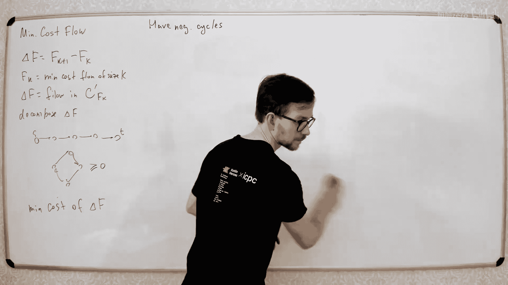

Yes， yes。 The difference is that the capacities are limited。 So yeah。

 so we cannot cannot make the flow of the minus of the cost minus infinity。

That cost of our flow is bounded。 has a lower bound。 Yeah， so， so we。

 we say the total cost of our flow is always no greater than the sum of everything。Well。

 let's say something of everything F multiplied U V multiplied by double U V for all non negative。

 for all negative ages。So we can push can make this cost of his flow lower than this bound。

And since we have a lower bound， we have some minimal value。 So it so the problem make sense， right。

 So we have some minimal cost flow。 Let's just wish to find it。

How we'll find it will do a very simple thing。We will find some， let's find some negative cycle。

What can you do if you have a negative cycle。W you find some negative cycle。

And the sum of weight is less than zero。What can you do it if you have a negative cycle you can push a unit of liquid through the cycle。

 you right。So you can increase the flow by one using this cycle。Yeah。

If you just push one unit of liquid recycl， you will decrease durable cost。

No let's do it until we have no negative cycles so， so algorithm， very simple algorithm。

 Let's find any negative cycle。And then try to increase the flow through the cycle。

It will decrease the， the total cost。Of the flow， right。

Let's do it until we have no negative cycles anymore， so we try to find any negative cycle。

Push the liquid recycle。 Find another negative cycle。 P the liquid， and so on。Yeah。

 it kind of looks weird and actually but from makes sense actually。啊。Actually。

 there are are a lot of problems which can be described as some problem when you have a。Maxical flow。

 not not max flow。 you need to find flow and some you have negative cycles in this problem。

It's actually， pro。It's important to solve this problem。啊 but嗯。Usually what happened。

 you need to find not the flow in this problem， but you just need for a flying circulation。

So let's just find the flow of size zero。Yep。Basically。

 because if you learn how to find the flow of size 0， then you apply all the same technique。

 so you just have your current flow of size 0 of the minimal cost and then you apply all these augmenting paths。

Basically， the the difference is to the first steps。 when we。

 when we try to find the flow of size 0 of minimal cost。

 that's the only difference from the previous problem。So that's what we're doing。

 So we will try to find the flow of size 0 of minimal total cost。Again。

 how you do it you find a negative cycle， P one unit of liquid， Find another negative cycle。

 P one unit of liquid。If you don't have any negative cycles。Then you have a flow of minimal cost。

 Okay， let's。Let's put。If we have no negative cycles。Neジ network。Network。

If and only if we have maximum flow of this size。Minimal cost。For this size。So， for example。

 in the beginning， if we all have negative cycles， we have the minimal cost flow of size 0， right。

 If we just do it in the beginning of the algorithm。Let's forward to。 let forward。Well， first of all。

衣服。😊，We have minimal cost flow。Then we don't have any negative cycles because if we have a negative cycle。

 we can push one unit of liquid and decrease the cost of the flow。So if we have minimal cost flow。

 there's definitely no negative cycles in the Brazil。Lets from from us side。

 if we have no negative cycles， Let's prove that our current flow as minimal as possible。

How to find negative cycle。 Yes， yes you use can do it using for Belmon algorithm。

 Use Belmon for algorithm。Trying to find short this path。

And then you make one more duration of the for。 forob find the verdicts that was changed。

And then from it， you go backward until you find this yeah， just this typical algorithm。 again。

 we discussed it the previous semester。 It's just standard algorithm。A photograph。 Yeah。

 you can do it using in for Bel algorithm。 right。It's kind of tricky， but nothing that complicated。

 Again， you just run Belmon for algorithm n iterations instead of n -1。

 Usually you around n -1 iterations， because the shortest path always contains no more than n -1 edges。

 But you， you're trying to find short perfect size of of the。Of end edges， except。Y， and then if。

 if you find any node。Which was the distance to this note was decreased in the last iteration of the be and for algorithm。

 you just go backward from this node until you find the cycle and this cycle will be a negative cycle。

No，It's not that tricky。啊，我哋。Whatever I want to prove from this together。

 So I want to keep go from here to here。 I want to prove that if I don't have any negative cycles。

 then my flowage actually is actually the minimum cost flow。 how we do it so？Again， again。

Let's see if our cost is not the minimum cost。 So we have our cost ourflow。

 and we have some F 2 is the。Flow of me。미 먹고。지금 어。And the size of this flow is the same。Yep。Now。

 let's look at the difference between these flows。 So let's look at difference between optimal flow and out flow。

Again get 될 day。说嘅一。Again， the difference of V flows is just a flow in the residual network。

 so Delta F。Is a flow。Of size 0。이게시 정도的。Therefore work of flow F。Mmhm。😊，What is the flow of size 0。

 flow of size 0 can be decomposed into a set of cycles。 Yeah。

 usually we decomose flow into a set of paths and cycles。But if eflow has size 0。

 it just a composite set of cycles。So， you got post。D工。오使 거。So less。Now， each cycle。

Has no negative cost。Again， I go from here to here if I don't have any negative cycles。

 then each cycle needs the position has no negative cost。It means that the cost of this delta F is。

小飞。So the cost of this delta f is not negative。It means that the cost of this。F O。

Will be greater or equal than the cost of this Coast app。嗯。Again， what I want to do。

 I want to look at the difference between two flows。 My flow and the optimal flow。

 This difference is just some circulation。 So it's flow size 0。

 We can decompose it into those cycles。Each cycle is not negative， so the difference is not negative。

 It means that the optimal flow is not greater than my flow， not less than my flow。昨。그错。

So the all more like this。Findine negative cycle。 P the liquid。 Find negative cycle。 push the liquid。

Very simple algorithm。What's interesting thing， Intering thing is that you actually can get。

APonomial time algorithm from this point。 So from this algorithm。

 you can actually build the polynomial time algorithm。呃。Is done like this， you need to。

 you need to push liquid。 You need to use not some negative cycle， not any negative cycle。

 but to use a good negative cycle。And the idea is to use the negative cycle of the minimum possible average cost。

So you find the negative cycle， which minimizes the ratio between the sum of all this cost and the number of the edges here。

And if you apply。Of the separation not to any negative cycle， but to this optimal negative cycle。

Then the number of these operationss will be polynomial of the size of the graph。

I will not forward today， but you can read about it is very interesting。

So that's one of the way to build the polynomial time algorithm for this maximum minimal cost problem。

Do we have any more time。 Oh， we have some more time。 Okay， let's， let's do do a final thing。

 And the final thing， I want to， I want to do something more effective than we just we before。

 So again， the best algorithm from we discussed by now。问主题。

The best algorithm is by now has I complexity here。诶诶。By at least。M。

Let's say if kind negative by these deep string。So the best algorithm is created by now something like this。

How to is the option like second， just doing。嗯。I don't know if the easy way to do is。

I know how to do it used in binary stretch plus， find a negative cycle。

It can be done well by the research， but I'm not sure how。Can you do it？ No。

 you can do it in polynoial time now by the research of this but。How to do it first。

 I'm not sure about this。This algorithm is pretty normal， but it's actually pretty slow。So。

 we actually can do better。Not all polynomial algorithms are practically effective。 So in some。

 in some cases， you， you want to run something which is not exactly polynomial， but just。

 it's just fast in practice。This is actually one of these cases。 So sorry， So this。

Al you can construct from this idea will be polynomial， but it， it will be just slow。No。

So let us the algorithm we discussed before when you each time you run the extra algorithm to find their first shortest elementing bed。

 Let's try to get rid of this F。 Let's try to get rid of this。I will do it using the scaling。

Technique scaling。 again， if you watch the first lecture about maximumim flowaws。

Scaling is just basically when you try to。how we do this。 So we try to find the。

Augmenting pathth with capacity at least two in power of k。 Then we decrease this K by one。

 find another short pathth and so on。 so we just。Want to use this power of two to find not some short path。

 but some big short path， but not some amount be， but our beth of a capacity。

And we'll do something similar here。 So so in the end， we will have in depth in the complexity。

 not this amount of law， but the logo formula it。Again， what's the idea？啊。

I'm not sure if we discussed it then or not。I don't remember。How can you do a scaling technique？啊。

Let's， let's have a graph， Let's have a graph。啊。Good。I explained to someone。Nots a long time ago。 I。

 I'm not sure if I explain it to you， but let's just repeat。 So let's have some graph。

With capacities。Let's say，3，5 and 4。Yeah something。So that's my graph with the capacity of the edges。

What I want to do。I want to build this graph from graph with zero capacities。So what is the idea。

I want to start from graph with zero capacities。And then eventually， go to Vi graph。

What operations can I do， I can do two types of operations。

I can increase the size of one edge by one。そで 가봤팅。So first separations just take one edge and include capacity by one。

The second operation is to double all capacities of ultra。So I can increase capacity by one。

 or I can double everything。Now， let's try to build this graph from this graph using minimum number of operations like this。

Why do people want to get rid of global of No's mostly theoretical reasons for theoretical computer science。

 it's like more interesting to discuss algorithms have Poland strongly but none of public。It like。

It's like more cool for theoreticals for theoretical algorithms than you， if you have algorithm。

 which has actually a real。Polynomial and complexity。 If you have log F in the other complexity。

 it's almost linear。 It's almost polynomial， but actually depends on what this F is about。

 So you may， for example， this log F actually implies that， for example。

 your capacities are integers， usually。And if if they're not in registered。

 then you have some fixed number of digits。 So this log F is actually number of digits in your numbers。

 right。And if you have not， not integers and not trivial numbers， but are something strange。

 how can how will it affect your algorithm。So， so if you can get algorithm of 10 complexity here without all this。

Lo F more factors than it actually mean。It iss just more interesting for other theoretical results in the comparison。

If mix it。What I was doingSo I want to move from this graph to this graph using only these operationsations。

What is the minimum number of operations you need？Okay， let's start from the simple problem。

 You have number 0。And you want to go to number5。Y， you want， you can make two types of operations。

 plus one。And multiply by two。What is the minimum number of production。

How to find the minimum number of pressures to go from zero to five。We。

 how to get this number five to get this number five。We need to have the previous number equal to 4。

 right， cause the last separation was plus  one。 So the dec was 4。To get this number 4。

The previous breakfast was free， or two。So the optional obviously will be from two。

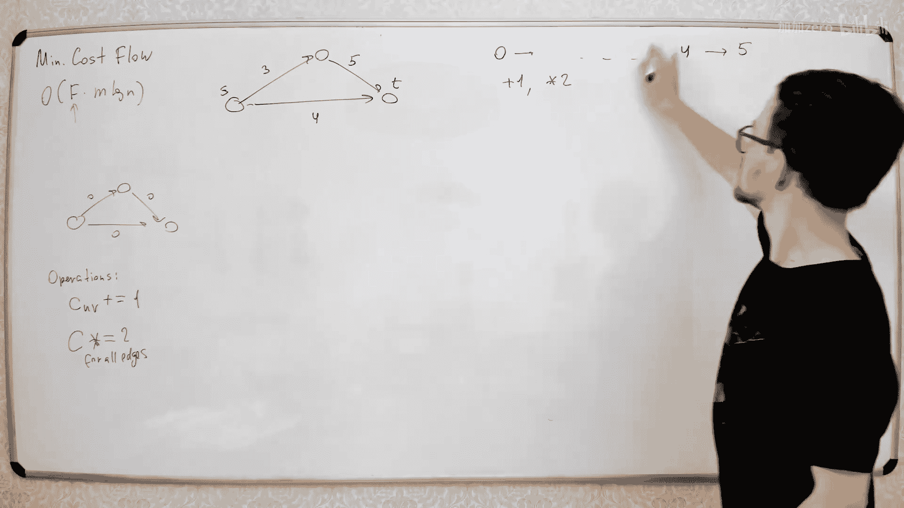

So we have multiply by two here， plus one here。Now to get this two。

The previous number was basically one。 so we， we can have any versions。 Let's have multiply by2。And。

 so this is the optimal way to get number 5。Now we will just apply the same trip to all elements here。

 So what basically happening so let's。Look at the binary representation of each number。

 So number 5 is just 1，0，1，4 is 1，0，0，3 is 0，1，1。

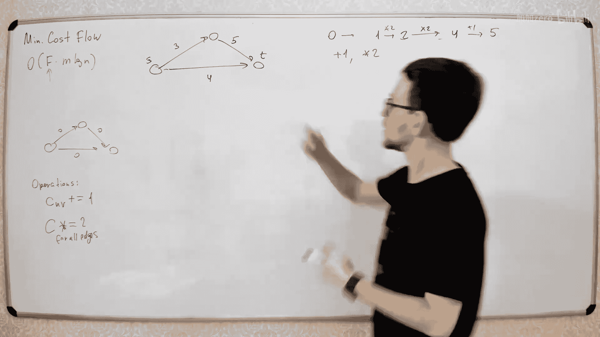

What I will try to do is to first put these first digits in the places then when I multiply everything by two I shift everything to the left。

 then I set the next digits， shift everything to the left， set the next digits。

 shift everything to the left and so on。そ。So I will start by putting this first digit。

 I need put first digit here and here so I。

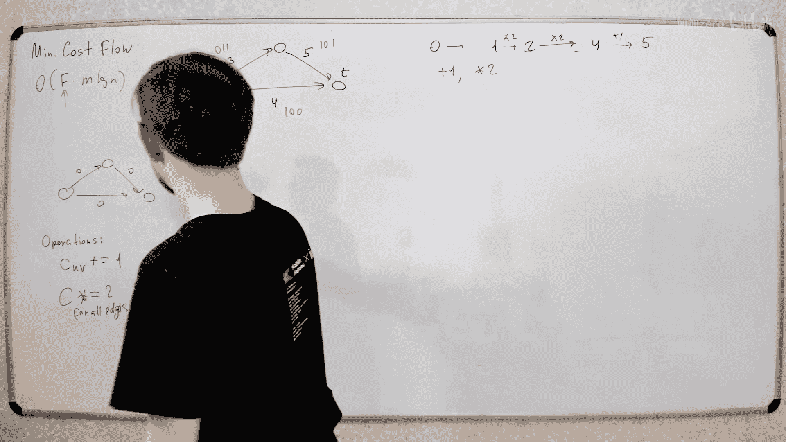

Put one and one here。In two operations。And now I multiply everything by tool。So， I will have。2。

0 and2。お。Now I need to set the second digit。 I need to set second digit only here。

 So I increase this element by one。So I have1，2 and 2。And then again， multiply as by。2，4 and 4。

Let's I increment。This element and this westwe market here I in this element and this element and here I in only this element。

Here， I multipl here。And almost all now now you need to set a set third digit3s here and here。

 so I increment these two elements。We3 and5 here。嗯哼。So this is my graph。

 so I just moved from the zero graph to my graph。Use on only these operationss。

So what will be the number of operations， The number of multiplications here will be just logo from of the size of them No this as the number of digits in a binary representation right so it's logo from of the capacity。

So the number of operations。Second direction， I mean just global from。おしし。Lberry moved sea。

So C is the maximum capacity。そう。I need to double all the capacities at most the number of at most the logo of the maximum capacity。

Let's let's see marks。Now， how many time need I to implementcr elements by one？

Let's see in each in each step。In the worst case， I need to increment each elementil by one。

 So I need to increment each edge by one。So， I have。Lg C steps in each step。

 I may need to increment all the edges of my graph。 So in the worst case。

Number of operations like this is M multiplied by the number of steps。系老士。Mmhmm。No。那我做错误。

Let's start from this graph from this graph。And every time we will try to find the optimal flow for the paragraphgraph。

So we全不看搞。Let's try to find a maximum flow of the minimal cost for the current graph in the initial graph is pretty simple。

 So in this graph。If you want to find the maximum flow of the minimal cost， you just have Oss。

And then we will apply these separations， and each time we will maintain the current optimal flow for the current graph。

 so we will apply these separations， each time we will maintain the optimal flow for the current graph。

So in the end we will find the optimal flow for the photograph that we need。

 so we start from this optimal flow and then we apply separations in the end we will have optimal flow for this graph。

嗯。你要不对。Now how to apply the operationss， first of all， if you apply the second operation。

 that's more simple。No again， let's move from your for this graph， the optional flow will be 001。

 Now if you want to move from here to here， yeah if you double all the capacities of your graph。

How will the optimal flow be changed， how to change the optimal flow if you double all the capacities of your graph。

Can you see it。行，有还不有不上。Yeah， now you double all the capacities。

 The flow actually will also be doubled。 Yeah， so you just double all the flows in us。

 So multiply everything by2。And you will have still have the optimal flow。

So when you move from here to here， you just multiply all the flows by2。It have 0，0，2。

 So this step is actually simple。But you multiply the capacities by two。

 you multiply it by flow by two， and still you have a multi Pochemo flow。Now。

 this step is interesting。What will happen if you increase the capacity by one When you increase the capacity by one。

 you put one extra edge in your original network。So let's see what's going on here。

 So when you increase the capacity by one， you have these node， U and B。Yep。

And when you increase the capacity。If this edge wasn't in the residual network。

 now it is in the network。 So you add one more edge to your residual network。Now。

 I want to maintain the property that my current entries network do't contain any negative cycles。

So when I add this edge。I might get some negative cycle。

So in my current so I might as in the very end。No negative cycles。이。Yeah。So before I edit this edge。

 I had no negative cycles， but when I add this edge， they may have some negative cycles。 also。

 there may be some negative cycle like this。How to check if there is a negative cycle which contain this edge。

跟你 see。So I am trying to add this edge here， but if I add this edge and I have negative cycle。

 is a problem。So before I add this edge， I will check if it may result some negative cycle。

 So how to check if there is a negative cycle which contain this edge。It's quite simple。

So if you want to find negative， negative cycle， which contain this edge。You just take new。

 you need to take this edge。Plus， a pet from V to U。So you take the shortest path from B to U。

If length of the。So if the weight of this edge， U V plus。

The length of the shortest path from v to U is less than0， then you have an negative cycle。M哼m。😊。

Okay， now we have two cases。 if this sum is greater than zero， then we have no negative cycle。衣服。

Ed in this edge not result in in negative cycles。 We just add this edge to residual network and they are done。

 So， so if this is false， we just add this edge and still， we don't have any negative cycles。

 If we don't have any negative cycles。 Sore have the optimal world。Now， if we have a negative cycle。

 let's push one U into the frequency。 So the capacity of this edge is one because we increased it by one。

So for this age。Capacity equal to one。So when we try to push one unit of liquid。For this path。

This edge will become saturated， and it will be removed from the reil。

So we will remove this age from Brazil。So we just added this edge and immediately removed it from the general drug。

 Now， again， since we didn't have any negative cycles before， we don't have any negative cycles now。

昨 down。不从。So again， how to make this separation。 So I want to increase the capacity of this edge by one。

 I check if it will result in some negative cycles。 If not， I just add this edge and that's on。

If I have some negative cycle， I will find this negative cycle。 actually。

 I find negative cycle of the minimal cost。 Yeah， because I take shorts spell。

 I take the minimal cycle of the shorts of of。Of the smallest cost， I have shortest path here。

And push one unit of liquids this path。And when I push one unit of liquid， I will remove this edge。

 so I still don't have any negative cycles。等等。That's all。

So so the cost of de separation is actually a fine in the shortest path。

You can find shortest paths using Belne photo。Or you can apply potentials and run the extra here again。

Sleep with more tricky。 You need run Der from here。 updateate the potentials。 and then again again。

It's kind of tricky， but still， you can use D to find the shortest path。Using again。

 this potential trick。So what will be a lot than complexity， Congress will be like this。

 we need to make M log M M M log C such。Opers， and each time we run the extra all input。

 So all comp below C。Multipliied by Dtra， multi M multi popular sides will be like M square multiply broken。

Something like that。Okay， I think it's。Good enough for today。

 there ra vital algorithms for the for the minimal cost closed， but it。I think， for today， it's。ご知道。

Okay。🎼The。

