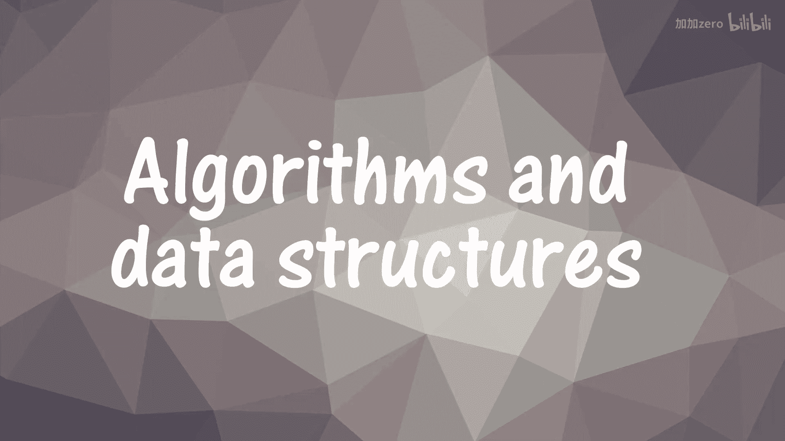
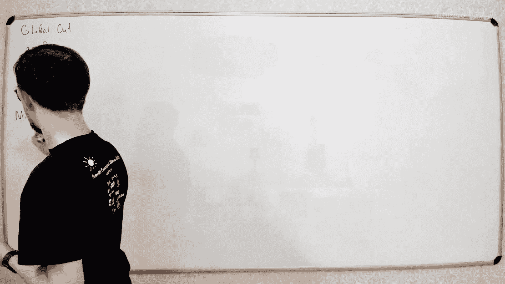
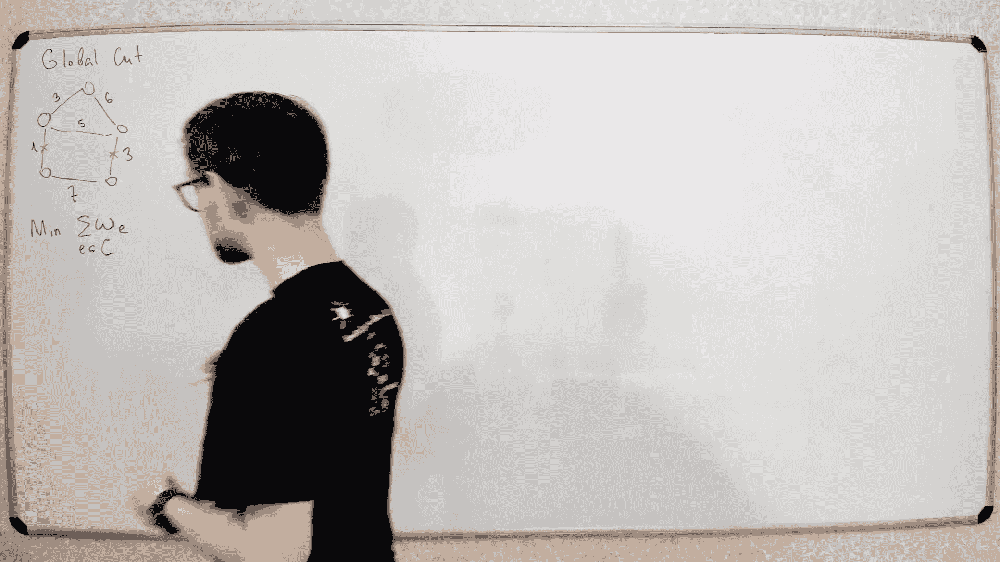
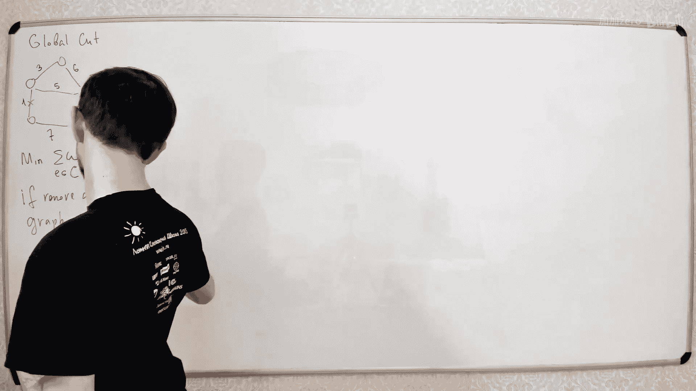
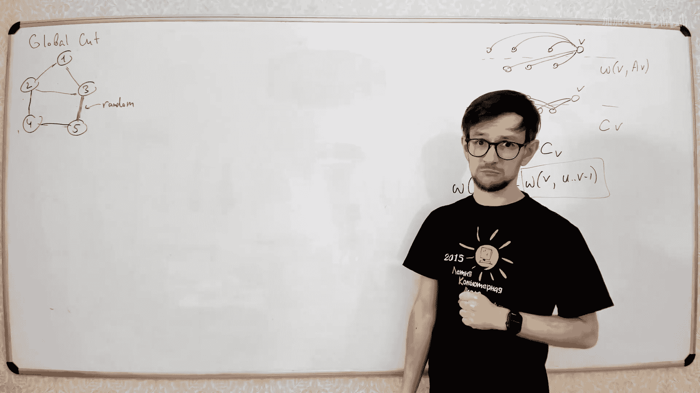
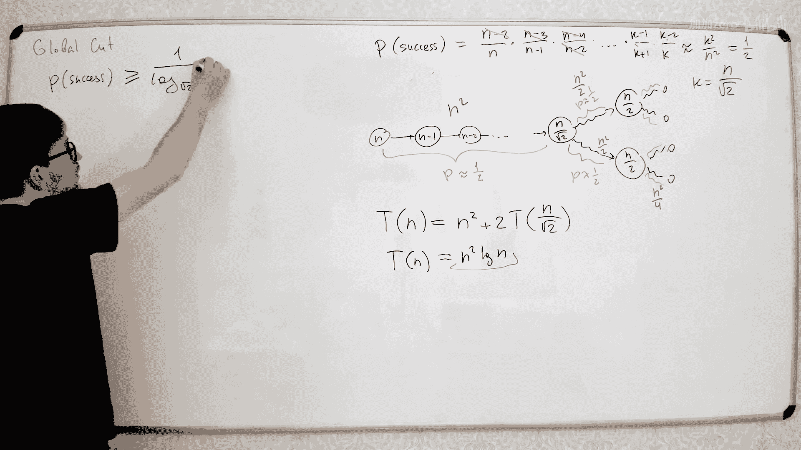

# 【精译⚡算法与数据结构】PavelMavrin p55 p54 A&DS S04E08. Global Minimum Cuts -BV1NLB8YfEMq_p55-

today will talk about something similarlin to all this naturalpl theory but slightly different。

So we'll talk about a global cut problem。So what is this problem about， you have a graph。

 let's say you have a graph， and let's say each node has some cost。Or H H H。そ。Look at some graph。

Let's say something like something like this。And there is a cost for each age。

 Let's say something like。3，6。H。Let's see， one。It's free yeah。对。So。

And the problem is to find this set set of edges。 So if you remove this edges from the graph。

 the graph will be no longer connected。So you want to like break the connectivity of this graph right now the graph is connected。

 but you want to remove some edges of the graph so the graph became not connected。嗯。For example。

 in this graph， you can remove these to edges。If you remove these two edges。

 the graph will be no longer connected right， so we want to find the cut of the minimum total cost of all the edges。

嗯。Minimal sum of all costs。 Let's let see。Let's see that was。Let's see the weight of graph。

 the weight of the age system of the cost of HM。So we want to remove the edges of the minimum total weight。

な度。Such if we remove all。

結婚で。this。

So if remove these edges。All edges from this cut and rough is not connected。Gough。Is not。肛て。

三0。Why is， why is it different from the normal minimal cut problem we've all discussed minimal cut problem when we talk about flows。

 right， The difference is in normal minimal cut problem。

 you want to break an activity between two given nodes。

 So you give you have two given notes S and T and you want to break an activity between this node。

 So you want。So you want to remove some edges of your graph。

 so these two nodes are no longer connected， so you need to apply。

Break this like this and remove all edges in this area， right？

So this is the minimal cut problem we discussed in the lectures when we talk about maximal flows。

And now we just want to break the connectivity of the graph， so we want to。

 we don't have any specific nodes S and T， we just want to remove some set of edges。

 so the graph will be not connected。So what's， what's the difference。Well， first of all， let's。

 let's prove this problem is actually can be solved for normal time。 Can you。

Can you find any polynomial time solution for this problem。So again， what I want to do。

I have a graph， I want to remove some set of edges。

 so there will be like two different connect components， so maybe maybe not two maybe more。

2 minimal cut for all pair of nodes， Y， makes sense， yes。

 so we know how to find the minimal cut between two specific nodes so we can it for all possible pairs of node and find a minimal cut between this so。

So it will iterate for all S from one to n， iterate for all T from， let's say S plus one to n。

And try to find the minimal cut between this one。 So we will just update the result。

With the minimal cut between S and T。Minimal cut between S and T。嗯。No。

 we can't simply reduce the problem to Min cut problem。

Because we kind of want to find specific nodes S T， right， you can adjust。

Put all like make all the nodes S and make all the nodes team because you want to you want to find Yeah。

 the problem is you want to find the maximum for between two specific nodes， right。

So what will be time complexity and what will be time complexity here， so we have these two loops。

These twoluxe work an end square。Iterations， and here we just use the maximal flow algorithm to find this minimal cut。

Let's say so so multi applied by the time see flow。

 So this is the time complexity of the maximal flow algorithm。

So we discuss many different max algorithms。 They have different time complexity。

So let let's say something like anm something like yeah。魅点。Write different max 4 hours。

 for different situations。Again， it depends if your graphic unit。

 if all weights of the edges are just one。 So if you have one。

ForFor each of the weight so are we much flow with faster than in antenna。

So that complexity depends actually on the structure of you graph。Mmhm。😊。

Let's improve this algorithm。 We can improve it。Using a very simple trick。

 we can remove one of these ends。Can you see， how can we do it。So by right now。

 we call this minimal cut sub n n square times。We can actually call it not 10 square times。

 but right just n times。Can you， can you see how how can we improve。嗯。Again， in this algorithm。

We try to select all possible pairs of nodes， Yeah， so if one node。

So if so there is some minimal cut。There is some some minimal cut we want to is sorry sorry if we remove all edges from this minimal cut。

 the graph will be split into two connect components。

 So we try to find some node in these connect components says and some node in this connect component。

そう。인도か？Theyre always if you， if you select some global card。There will be some。

 some connect components。So we try to find two nodes。

 which will belong to different connect components if we select this minimal cap。

If we trade all possible pairs， then at least for one pair。We will。

We will pick two nodes in different components。So there is some global cut and for this minimal global cut。

At least one of these pairs will have two nodes in different connect components。I is a。

It's pretty kind。 No， no， no， no， if you just make what you want to do， yeah。

In your in your suggestion， you want， you won， you want work specific note T and just connect。

So if you do it like these。You will find something strange。

So we want to break connectivity between node S and this node T。That's not what you want to do。So it。

Even if you make all these nodes of infinite capacity。You will find something strange。EFor example。

Let me think。Just because that's not what you want to buy。 So。

 So you want to find the cut between this set of nodes and this set of nodes。 and you also have this。

No， yes， if you add all the edges of infinite capacity。

The minimal cut will always be just to remove all nodes connected to us or all the edge connected to us。

Because if you there is not S， yeah。If you don't remove these edges。

 then you will have path like this。And this edge has infinite capacity。

 So you need to remove all these edges。Yep， makes sense。So with problem。

 can we be solve the single round of maximum flow algorithm。Unfortunately。But it is。

 it can be it can be solved in end round of mini Max flow algorithm。嗯。Yeah， the idea is very simple。

 I is very simple。 we don't need to check all possible pairs。

We just need to check all pairs from note one to all other nodes。Because let's。

 let's take a look and not one。 rest note number one。 It is somewhere in the graph。So let's see。

 say this note has in this1。This first node belong to some connect component in after we apply this minimal cut。

 Yeah， so after we apply minimal card with node 1 will belong to some connect component。

We can use this note， as note S。And only write for not of all possible notes tea。

So willll check only pairs from note 1 to all other nodes。Again。

 note 1 belong to some connect components。We will try to find the node。

 which belongs to a different connect components。So iterate all possible notes。

 at least one of them will belong to different connect components after we apply this minimal global cut。

So we check all these pairs and find the me result。That's错。

In time complexity will be improved like this。Hello。That's the first algorithm。 So again。

 this is some polynomial algorithm。Now， we'll try to。Make better pmo algorithm。Let's go。So。Let's。

Do the following thing。 Let's try it。To try from different angle， so。Let's take the graph。

And if we have。More than two notess in the there。More than three notes actually。야 뭐。At least two。

Yeah。If we have at least two nodes on the graph。Let's pick two random notes in a graph。Some notes。

Let's pick two different notes， just random one。And try to。But not try to look at this now。 So you。

 you have two nodes of your graph。These notes。In the final cut。

 they belong to the same connect component or two different connect components。

If they belong to different connect components。Then you can just find the maximum minimal cut between these two nodes and update your result。

 Yeah， so if these nodes S and T belong to different connect components。

Then well just find the minimum cut between these tos and update the result。Let's update the results。

Now， again， if S and T belong to different connected components， then we found the result。

What if not， what if we select some to node and they belong actually belong to the same component。

Then what we can do is to merge these two nodes into a single node。Again。

 because if they belong to the to the same component。We can track them as a single node， yeah。

We can put both these S and T in in one connect component or to another。

So if they belong to the same connect component， we can remove these two nodes and replace them the single node over same name in the same set of edges。

I sees much。Well let's try， for example for these graph。Let's put some indices here， just doing it。

 so on。不工。Rin。活吗？5。How do merge， we just merge to not into one note and make all the same edges just just。

Con you all the list of edges from this both notes watch。 I'll show you。So。

 we picked two random notes， for example， notes one and three。Yes， and this is the。Now。

 we try to find the minimal cut between S and T。 Minim cut between S and T equal to。9， right。

So we can put six here， plus three here。So Nemo cut here will be。来。

And now we merge these two node into into single node。 So we have this single note。1 and3。

And all these notes。what？Now， we have this age free。And age 5。

We'll have some parallel edges this fine。 We can replace parallel edges in a single edge like I we did in mimoka。

 but's not important。Free。7 and1。Now， again， you select2 random2，2，2，2 random notess。

 Let's say we pick this S and this T。Find the minimum cut between these two node。

 will be it will be4， right。Can then merge them， so we merge notes。2 and 5。

And here we have one and three。 And here we have four。have edges。Oh my去， free。5 and。Free again。

Of ages 1 and7。And just continue until you have only single notes。 you select let say S and T。

I product of minimal cut will be。There will be， eight。And你店里有标吃灯 you have。2，4 and 5。

Here you have one and three。And many inches3，5 and free。Now， we can you select。S send T and cut。

E from better element。And now you simply take the meme of all these values。 So minimum will be here。

Mmh哼m。That's all。 That's all。Let's go do。 So so you start from from your graph。

 select to random random notess。Find the minimal card between these two nodes and then then merge them into one。

 and again select to random nodes， find minimal cut， merge them into one and so on。In then。

 you will have on this single note。Mh哼m。😊，And now we just take minimum of all these Min cuts。

It will be the minimum global cut。Makes sense。Good， what is the time complex of this algorithm？

Why does this work okay， what。I thought I explained it again， why does work？

Because we tried all possible ways of building a global cut again， each time we take two nodes。

And these notes。Let， let's look， let's look at the global cut。 So so there is some global cut。 Yeah。

 so there is some global cut。We don't know。 What is the global cut， but there is some。

So this is the minimum cut。We don't know what is， but there is some global card。Now。

 if you pick two random notes。They may belong to the same connect component or two different connect components。

If they belong to different compound。 So if you pick two random notess and one of them is here。

 one of them is here。Then you will find the minimal cut， and you will just find your result。 Yeah。

 So if you picked two node from different components。

 then here you will just find the minimal global cut。

And if you pick the nose from the same components。Then you can you， you can。쭉。Sorry。

 like my chat is not working。嗯，哦。嗯。那谁呀？They act like a single node。 So they belong to this component。

 all these kind component。 So instead of thinking of them as， two separate nodes。

 we will just think about them as。One note， yeah。Again。

 note is something that we can put into one connect component or another connect component。

 if these two nodes belong to the same connect component， they basically act like a single node。

 We can put them both here or we can put them both here。So we， we can merge them into single note。

And solve the same problem for the compressor。嗯。😊，Again， ones okay。Let's read once again。

 So let's look at this graph。 We have this one S and T。

If they belong to different connect components。Then we will find the result just by using this me cut sub。

And if they belong to second connect component， then the minimum cut in this graph is the same as minimal cut in this graph。

嗯。Because let's look at this graph， we have some minimal cut in this graph。

We will just uncompress this note1 and3 and have the minimum cut for this crop。Clear呢啊。Yes， yes。

 if the nodes belong to the same components merge them they will not affect the minimal cut。

 because minimal cut do not contain any nodes between them again。Okay。那些。

So what's the complexity of this algorithm thing？No less。Let's think。 So we call。

 So we have up to anys of this slope， right。So we have n iterations of this loop because each time we decrease the number of nodes。

Each time we calculate the minimum cut again using maximum floor algorithm， and we merge some notes。

What is the complexity of me the nodes no。A claim is not。The big sign。

 So term complexity of me notes is no more than M， let's see。So， time complexity of。

Finding the minimal flow So here we again， we call the maximum flow algorithm。

 And here emerge some nodes。 We can do it easily just by constructing the whole graph。

 We can construct the whole graph from this graph。In linear time， O。时得 m。

We can actually do it faster time。If you think about it。

 what we need to do when we merge to notess into one， we can just take this notes。Yeah。

Take the list of the edges。Comcate this list to a single list。

And just merge remove two nodes and add a single So again， how to merge notess。

 you remove these two nodes from the graph。And in certain， you note。

 with the same edge list as is as a union of these two sets。You can do it actually in time N。

It's basically removing edge or removing the node oredging the node。Ex down in linear time。 you。

 you add the note and all outgoing edges。 They may be， They may be up to end outgoing edges。

 So the time will be。Yep。So1 complex is basically degree of these nodes。 Maximal degrees n。

 So they may be but no more than n edges。 we have some parallel edges， but there last matter。Okay。

But for this algorithm is not important。 It will be part later but not。 so now。

The bottleneck of the bottleneck of this algorithm is actually this maximum flow。 Yeah。

 so time complexity will be again。It will be and multiplied by flow plus and。Something like that。

Okay， let's say， let's say plus M。 just put simplicity。 Okay， I'll just leave it。

You can do it in time X。It's a little bit， little bit more complicated than just rebuilding the whole graph。

 but its do。But again， in this pair， flow is much slower than this linear1 complexity。 So actually。

 the time complexity is the same as for this over time。啊哼。So we got different algorithm。

 but the same time complexity。Send thank back G for this order And this order is it basically the same。

But。This algorithm can be improved。How can we improve this algorithm。We will improve it by。

Speeding up of baseball。So we will speed up。 We'll do the same thing as here。

 but without this maximumim flow algorithm。How can we do it。Now let's say， what we're doing here。

 we try to find some random node and the minimal cut between them。

But we can select any pair of notes。So we will build another algorithm。

Which will allow we allow the algorithm to select the pair of nodes。

 Usually in the maximum flow algorithm， you're given some node S and some node T。

 and you want to find the minimal card between S and T。But we will build another algorithm。

 We will give the algorithm some graph。And the algorithm will select some nodes S and T and find the minimal cut between these nodes S and T。

And maybe it will be easier because again the graph can pick some good notes。 So for some good notes。

 they may maybe be easier to find the minimal cut。Okay。That's try to you。Once again。

 so what's happening in this minimal cut subroutin？

We take some someang G and some notes S and T and receive the minimum cut。

That's how the usual maximum 4 algorithm works。But we want something different。 We want for graph G。

Find some notes S& T and me more cap in them。And this problem is actually easier。So again， ourgri。

Can pick some good notes， S And T and find the card between these two good notes。

And it will be easier than to find the minimal cut between two specific notess。Mmhmm。😊，不。Let's go。

 So these algorithm it' called allated to me。啊。It works like magic。Absolutely， magical algorithm。

So what we do？We will try to construct the following thing。We will。I' like them direct to here。

Goo will match some notes， and specific order。We let's start from Any。From any note。

 let's take any note of the graph and the market。Let's put it here。So first， we select old one。Now。

 each time we will mark a note， which has there a。Maximal total weight of the edges from this nodes to all the previous remarked notess。

What does mean。Let's look at all unmarked notess。ForFor each note。

 we will calculate the total sum of weights of all the edges from this node to all previously marked nodes for example。

 note here we have for this note。This sum is6 for this slope。 this sum is free， for this two is 0。

So we select the note， which has the maximum total sum of these weights。In our case， it's not free。

So3， this sum is 6。 It's maximal possible。 So mark， we mark this low。哎下不子挺。free。Now， again。

 from all nodes， we select a node。Which has the maximum possible connectivity to total total weight of the edges from this node to all previously marked nodes。

So for this node， the sum is free for this note is zero for this node is3 plus5。

So this note has maximum total weight of the edges。So we select this node two。Mart。And what it here。

mhmm。😊，And so on。Now we have， for this of， we have three for this don't have one。

 This is maximum possible。 mark this5。我得啲啊。And finally， here， we have no4。Market。や。

It can also serve customers， yes。Each time we select some node which is a neighbor of the previously marked nodes and has the maximum total sum of the edges to the previously marked nodes。

Let's try to play。Here of Mr Lster Wood。こする。てこした上にも。So， any point。

 we have some set of the mark notess。Let's go set 80。So that a connect all the smart notess of our。

We select node V。Look at everything。All the edges from V to this set eight。

Let's call the weight of V to a。Is just the sum of all weight V U you belong。

So it's sum of all these notes。Now， each time we do the following。

 we select the node with maximal sum。嗯。嗯嗯嗯。TheA is maximum。And add it to note add to。he。Like please。

So we'll find the note of Marmal sum and market has also put it in the set egg。Now， what's next？

How does it actually connect to all the problem？Right now。

 it doesn't look like like the minimal cut problem at all but。Now it's magic， magic。

 The magic worksrks like this。Let's pick two last notes in this order。 So let's say this notice has。

This is cheap。Now我先唔识。Now I simply prove that they cutt mean。Cd between S and T。い死。Basically。

 equal to the sum of all all the edges connected to us。ね。SB。Okay。

 let's let's teach here So we have this known S。 this is no T。

I claim that the minimal cut between S and T is basically just to remove all the edges connected to S。

So mean cut between these two notess just contains these two edges。So for this graph its true。Yeah。

 so minimum cut between here and here is8。Magic。Mmhm。😊，うmhm。😊。

Just say it's clear enough if it's clear enough or if you have any questions just。Ask them。

I need to have some feedback that it clear cause its， again， it's like。

These algorithms quite magical，At some point， you may lose then。啊。How to Coastco so on。Okay， go。

This episode max software left at the order to give them。No， it's not the cut。

 it's not the minimal global cut， it is a minimal cut between some notes。

So I claim that this sum is the minimum cut between nodes S and T。

 So if I pick two less nodes in this order。So I， I add the notess 1 by one to this day。

 I select two nodes， which was added the last to this set。

And I claim that the maximum mineral cut between these two nodes is easily calculated。

So to calculate the minimum cut between S and T， these two also。

 you just need to cut all the edges connected to S。That's not the me global cut。

 It's just me cut between these two。And after this， I will， I will apply the same loop like before。

 so I no， I can I can I can take this minimal card between S and T。

Update my result and then merge them and continue。 So I do it， merge them， do it again。

 merge and so on until I have single note。Let's draw it， let's draw it。Lookか。So let's be。

 So we have some notes here。So last two notes are S and T。

Let's look at the minimal cut between S and T。 So there is some minimal cut yes。

 so for these notes S& T， there is some minimal cut。Let's say its C。

 So let's the C is the minimum cut。It will ask Thank you。So let's draw it like this。 So。

 so this is the minimal cut。 So above this line is the first connect component below is the second connect component。

 Yeah， so this node S。Belongs to this kind of component。 node T belongs to this kind of component。

Let's look at all the previous notes in this order。 So again， I draw this notes in the order。

 I select them here here。So I go from left to right， add the nose to my set A。

So I have something I see something here， something， something here。Something here啊。Something here。

So again， what this picture says so so from left to right is the order in which I added these nodes to my set a。

 So if I pick the first node， then each time I pick the node which is mostly connected to the previous printer。

啊。Now， above this line is the first set below this line is the second set。Again。

 there's this card between S and T split all the nodes into two sets。 like what。

 one kind component and another a component。So S belong to to disconnect component。

 and T belongs to this component。这是。那。let's go on this order and mark every node such that the previous node belongs to different connect components。

 So we'll mark we have this series right， So for each series we just pick the first node in this series。

吃。しく。Ch。So I just selected the first note in this series。So I。

 I select the node if the next node belongs to the same connect component。 No， No， no。

 no no if the previous node belongs to different connect components。Nice。That's home。 That's home。

Now I will prove the simple feelingorem。Let's pick some interesting circle it's called interesting note。

 Let's pick some interesting note here， not V。Let's look at two videos。

The first value is the sum of all weights of from node V to all previous notess。

 like the same weight as here。So， let's see。えて。ピピピぴ。你该。What the George came。

So let's say a set AV is the set of all nodes to the left from here。So these set of notess。Logo aビ。

Now， let's look at the value of。Wle from V to A。So it is the sum of weights of all edges from this node V to all previous nodes。

Like the same sum as here。 the samples which we minimizes here。哦，好。Second thing。Let's look at the。

All edges belong to this part of the graph， including B。Such that they belong to my minimal cut。So。

 C。Will be。Total weight of edges。Such that this edge belong to the cut belong to C。

And both ends are so so， okay， both ends。And that's it。Less oracle than B。So we。

 we remove all these notess。And look at all the edges in this area。

And the total weight of all these edges is CV， let me draw some picture。So I have this node view。So。

This first thing。Is the sum of everything connected to the。 So we have edges like。Of these。

And we have edges like this。So， this is。Weight of everything from V2。Yeahep。

So this thing is the total weight of all edges from videoo everything to the left。

And now the second thing is。We have this node V and everything。 let's say everything。Second thing。

 this thing。Is total weight of all edges which belong to your car。

And connect the nodes from to the left from the inclusion beam。

So look at pagess like these and these and something here。So， this is Si。Mmhm。😊，可定呢。So， this thing。

Hes some of all these ages。To no total weight of all these things。

And this thing is the total weight of these ages。Now a simple feeling。

This paint is less work than this thing。So weight of wave to A V。

Is less or equal than the weight of city。稍等。Let's prove it。Let's probe this hereem。

So let's take the note view。And look at this thing。

 So this thing is total weight of all the edges connected to node V。

Let's look at the previous interesting notes。 this note。So， this notice its you。Let's look。

Everything build。Before this， you end。Now here I want to calculate the total weight of all the edges from V to everything to the left。

Let's split it into two things。 So I want to have weight of everything connected to A U。

 So to everything。Before you， yeah， to this part。Plus。The weight of everything from V。

To everything like from YouTube， management。Mhm。😊，So I want to calculate total weight of all the edges from V to everything to the left。

These edges may go here， or they may go here。So I just split the sum into two sum。You have to quite。

 say something。Sometimes I'm a friend， but my my stream is not working。

Can you just see you are still here。Just do not make me nervouss， okay。へ。😊，なお。Let's look at these。

 too。Some so， so let's look at these thing。What can we say about the total weight of edges from V。

Do everything here。We can say actually a very simple thing。 So total weight of these edges。

Is less or equal than total weight of edges from you to set a U。Why is it true， No。

 Because each time we select the。Note with maximal sum。 So when we picked this node U。

 we picked node U instead of V， because the sum for node U was greater or equal than sum。

 So this node U has maximal sum。So the same sum for node V must be less or equal on this sum。

And this thing by just is we just proved by induction from left to right。And this sum is great。

 lesser equal than C U。Mmhm。Because this is， this is also some interesting note for this interest note well you proved that some of this note is less recommend you。

And now we have following。 We have C U plus weight of these edges。

And I claim that all of these edges belong to the Kat city。No because again， here I have edges in Cs。

 edges in C are all these edges， right。And edges from V to this thing each set of these imagess。Now。

 all these edges belong to set city。Mmhm。😊，So the sum of these to set is some of these to sets is lessical on the set。

Again， set CV contains all the edges in this area， which belongs to your car。

So these edges belongs to Si。These edges belong to city。

So the total weight of these edges is not greater than CV。That's all， that's the whole proof。

Very simple actually。Mhhum。😊，Now I just claim that this tune。Actually proves what we need to hear。

Why this is true？Can you see it。So I claim if we prove this theorem， we actually proof。

Let the all comes working。And why is it working？Because node S is interesting。

 because the previous notice is T， S and T belongs to different connect components。

So note S is interesting。So for for this node S。We。We know that that。

The weight of this memo cut is greater or equal than the second。

Some of everything which goes out of this node S。But if we cut everything from node S， it is sun cut。

So we know that we have cut of this size。And we know that all other cuts are greater or equal in this cut。

 so this cut must be a minimal cut。Connect everything to S。

 We can just connect everything to S and get a smaller car。Yeah， this also true。

 but basically what we have here is its。There may be some cuts of the same off， of the same weight。

Yeah。Yes， so the cut， which just contains all the edges connected to S， is the minimal cut。

There may be some some other cut， which has the same way。

 but they may they may may not have a cut which is smaller than this cut。

Because any other card will be greater or equal than our card。Mmhm。😊，That's all this。

That's sure about an algorithm thing。No list。Calculate 10 complexity。

 What is time complexity of this algorithm in10 complexity， what we need to do。

 We need to find the node with minimal sum。 And then when we put this V to the set a。

 we need to update everything connected to V。So we need some data structure。

 which can find the maximum value and can update the values。We can use a he。 for example。

 if you just use binary hip， you will have time complexity and log n if you use Fibonacci hip。

You will have M plus Mgan。What of the important but。Wai。So what is do think complexityity？Again。

We have this outer loop from the previous algorithm。 So each time we run all this routine。

 and then we merge S and T into one Noia。So we do it n times。Each time will you do all this thing。

Which is running time is Mloc。Again， it's4。0 heaps。

 If you use people actually it will be something like N M plus and square again。Mm哼m。😊，Please。

Now we' will do something more interesting。Now we will discuss another algorithm。

 which actually works faster。But， it is randomized。

So this one of the it's one of the problems when we have randomized algorithm and actually works faster than。

These are my daughter。 let's go。So the next algorithm will class is car algorithm。

Very simple algorithm。Let's run it on， like。Let's have a graph wheel without weight。

 Let's have always equal to one。Just for simplicity。

We will improve for the weighted graph but right now， let's have some unweighted graph。

So we have some unweighted graph， and you want to find the minimal cut in this graph。

 So you just want to find the minimum number of edges you need to remove。How can you do it。

We'll do it in a very cool way。啊。Let's to random， let's pick random edge。We have some edges。

 Let's select the random edge。 For example， let's say this edge。Let's hook at this edge。

 so this edge connects some to nodes。Now， these two nodes look like they' are connected to each other again。

 so they most likely belong to the same connect component， right？So let's be random edge。

Look at two ends of this edge。They most likely belong to the same connect component。

So let's not run this maximal flow algorithm。 Let's just mergese them。Let's just guess。

So my guess is if we pick some random edge， it most likely connects some nodes from the same connect component。

Mmm。So we'll just guess that these two node belong to the same kind compound。

 we don't run all these routines to actually calculate the maximum flow。

 We just just guess that they belong to the same connect compound and we merge them。

 let's merge them。We have three and five。1，2。嗯。Andful。We have rain here。What please sir。Now， again。

 let's pick some random edge。Let's speak this。Books very random。Picks the random page。

And then guess just guess that this you mean just you need some belief in this so so let's just believe that these two nodes belong to the same kind of component。

If they don't want the same connected component， we can just merge them yeah。Spir the students。

So I note that I have lost one。2 and 3，4，5 here。Now I have two edges between two and three or five。

I will have some parallel edges。 That is fine。And now again， you have some graph。

 let's pick some random notes random page。嗯m哼。😊，And just merge this to into one。Now。

 when you have only two nodes， it's easy to find the minimal cut。 So for this graph。

 minimal cut is free。当当。Very easy。That's the whole algorithm。 Again。

 we start from the this graph each time we pick some random edge。

And we merge the notess of this edge。And continue until we have only two nodes。

 When we have only two nodes， we we can simply calculate the minimum cut just by counting number of edges between these two nodes。

你错。What is that complexity to solving？Do I claim you can do it in and square time？

So in n square time， you can compress everything。Like n times you can press two nodes into one。

 you can do it in linear time。So time connections and square。

What's the problem here problem is that sometimes we actually guess wrong for example， in this case。

 we say that minimum cut is free， but it is actually two。So， sometimes。We just。

I returned the wrong result。Can we do something about it？Let's calculate the probability。

 let's calculate the probability that we will pick the good result。Yeah。

 it's called a Monte carlo algorithm again， so this organ sometimes gives you the better result。

That that's different from the randomized algorithm from which has before。

 So we discussed some randomized algorithm before， but for example。

 in quick sort algorithm in some data structures， like intris。

 we use some randomness but before we had algorithms which which are correct， always。

 but the time complexities， the random value， right， Here is it is different here。

 the time complexity is always and square。So but the result is random。

 So sometimes the result is wrong。So the sad thing is。

 we actually don't know if the results are running wrong。 So out it returns your result free。

 we cannot check that it is correct。This kind of strange。

 strange feeling that when you call algorithm of them， it will show you some result。

 and you don't know thiss rather correct or not。 Let's calculate the probability。

Let's conclude the probability that the result is probability of success。So access。

Let's calculate the probability here that everything will that this algorithm will actually find the minimal cut。

How to go this population。Let's see what can go wrong when can when we get the wrong result。

 we get the wrong result when we pick one of the edges from the minimum cut。

So what what what is our guess， So we pick some random H。

 and we guess that with edge is not an minimal cut。

So the problem is when we pick some random edge and the edge actually belongs to your minimal cut。

So what is the probability？That your random edge belongs to some minimal cut。啊。Some random。

He here belongs to Si。See if random。Good like this。So you pick some random edge。

 What is the probability that this edge belongs to the minimal cut。We will bound it like this。

 so let's bound the value of the minimal cut。I claim that the minimum cut。Is。

Not greater than the minimum degree of the node。That's true， right。

 But because if you have some note of the degree。We can just remove all the edges connected to this note and have some cut。

 So minimum cut is no more than the minimum degree of the note。Mh。😊。

And the minimal degree of the node can be bound for easy。

 So the minimal degree is not greater than the average degree。 the average degree of the notes。

Is 2 m over there。嗯嗯嗯。Yes， for example， if you have if you have a full graph。

 if you have a full graph， then you have N2 n square here N and here have。N square over2 here。

 So it will be n squared over n so。So the size of the minimal cut and the full graph is and。 Yes。

 if you have a spa graph。Then， the minimum cut is small。For example， in plant graph。

 you can always cut some five edges。To make it not connected。嗯。嗯m哼m。😊，저 again。Again。

 the minimum cut is not greater than the minimal degree because you can take this node with a minimal degree and cut all the edge connected to this node。

Minimal degree is not greater than the average degree。 Average degree is thus sum of all degrees。

 some of all degrees is 2 m because every age increases degrees of by oneium。

So it's 2 n divided by the number of of nodes， so this the average degree minimal degree is not written in the average degree。

So the size of minimum cup is not greater than2 M over them。Now。Now。We pick a random edge。

 So there are impossible edges。So what is the probability here that we will pick one of these edges。

It is normal more than the size of minimum card divided by the total number of ages。

So the probability that the random edge will belong to minimal cut is no more than。

2 M over L divided by L， right。It is too or。So， so this is a probability that we will pick the wrong edge。

But。But we do it not once。 We do it multiple times。Yep。

So we need to find the probability that each time we select a good edge。So。

 so this probability is to select the bad edge。 What will be the probability to select a good edge。

No， it will be 1 minus this。So in the first step， we pick some random edge。

 What is the probability here， if we pick a good edge， it will be n-2 or。Its 1， this。

So this is probability that in the first step， we pick the good edge。Now， in the second step here。

The size of graph is n -1。So the probability that will pick a good edge will be n-3 or n -1。

So in the second step， we select a good edge with probability n -3。Or M，-1。

Then it will be n -4 n-2 and so on in the end， it will be have something like。

2 over 4 and one over 3。So this is the probability that in each step we will select some good edge。

Now let's just multiply all of this song。So， in this。In this formula。

 we can eliminate this and -2 and this and-2 this item and minus this and minus-3。 and so on。

 so we can eliminate everything except this。4 elements。It will be 2 over n and-1。 So it's about。关多。

ThePro is quite small yeah， so for Big graph， the probability that we will pick good edges all the way。

 is's quite small。Yep， it's just。W word n squared。But what can we do， if you have some。Alrithm。

 which works correctly， but with small probability。

We can just run multiple times if we run the same of， multiple times。

The probability here will be increasing， right。Mmh哼。😊。

So how many times should we run this algorithm to have some good probability of success？

Have any intuition about this。N square， right， so we can run this same algorithm and square times。

Just the same thing。And just hope that at least once we will succeed。What is the probability？这所谓。

Laund the same algorithm n square times。What will be the probability， probabilities like this。

 what's the probabilitybilities of success？Will be again。

 the probability is one minus the probability of failures， so certainly one。

Minus the probability of failure。 Prorbal failure will be that we failed1 minus。-1。

Probity of one failure。 and we need to fail all n square times。 Again。

 this is probability of one failure。 This probability of n square。Frails， right。So to have。

 we need to have at least one success。So this is the probability of having at least one success。Now。

 this thing。Is actually。About one over。So probability of success will be something like 1-10。

So now this probability here not depend on this and， so probability is the same。It''s not perfect。

But it's something。 Yeah， So we have some constant probability of success。Now what can we do。

 we can run it not n square times， but multiple of n square， so we can not run not n square time。

 but let's say n square multipied by key。If we run k and square time。

 the probability of failure here will be not 10 but one or E power key。Practice。Okay哼。And now we can。

 we can hike。嗯。We can actually control the probabilitybil of failure yeah。

 so if we want probability to be， let's say one over a million cases。

 we can select k as logarithm of million and run this many times if you want probabilitybil to be 1 in billion cases。

 you can select K as logarm of billion and so on。So just by controlling this k。

 you can control the probability of the failure of this account。Mhm。😊，That错。嗯。So again。

 what is total time complexity， totalt time complexity will be something like that。

So we run into n square time。 Now we run the same the whole n square algorithm n square types。

 so it will be n power of 4。And then we just run it until we get the good probability。

 And so it will be multiplied by a log of。One or epsilon if Epsilon is the desiredability of success。

Mhm。😊，Sound like that。Yeah， you， you may think of geometric distribution as well。

 it is just the same thing， but。No here I kind of cheat it a little bit。

 so I go from here to here so that。No it's just a good intuition， but you can do it more carefully。

 yes， but。little bit more cheaper rate to do。嗯。 now what's next？We can improve this algorithm。

So this is categoricular algorithm and classical car moves， but then。There's another guy。呃。

heard statement。かして problem。Staying right。嗯。So let me we improve this algorithm。

A very interesting way。 Let's do it。So we can do the same algorithm， but with better time complexity。

What's the idea， The idea is to improve actually， this probability。So right now。

 the probability of success is pretty small， so we need to run this algorithm n square times。

Let's try to， to improve this probability。 So we' will try to make the same thing。

But with better probability of success。Let's go。So let's start from the you have graph of size M。

Yeahep。Now， you select a random edge。Merch this to nodes into one。

 and you have graphifier size and minus one。Again， you select on the edge。

Get around for n minus2 and so on。 Now let's stop at some point。

So before we just did it until we get the graph of size1， let's stop at some point。

 let's stop at some point so that the probability of success。Will be about one or two。是。왜すそ。

How many steps can we do？Until the probability is。About one half， about 50%。

 I want to have about 50 probability。Of success。So how many steps can I do。Look at， let's look。

 this thick puzzle。So this is our breach of success。 So if we stop at。Point， let's say K。

 So in that we have graph of size K have K minus-2。K plus1 k。M-1， right。

So the probability will be something like。Wais， okay， it's about。

 let's say about K square over n square， right。And I want to be， I want to be one word。What is cake。

Okay。But a simple。Simple task correct。So I want to make these steps。

Until the probability of success will be。1 one or。How many steps can I make？To， this problem。

Can can you find the value of K from this formula。Okay， it's easy。ふふ。Yes。

 Kk must be about n over a square root of n or square root of2。Right。

So I can make these steps until I have the graph of the size and over square root of two。Now。

 the interesting thing， starting from this point。I will do the same algorithm。

 but I will do it twice。So I will call two independence sub of the same algorithm and find the minimal result。

So I will make one branch。In another bridge。So I will just do all the same thing twice。And。

 and get the minimum of the of these two results。So each of these suboutines will again will do the same steps until you have graph of size n over2。

 right？And then， again。Here and here I will make two different courses of the same algorithm。

I have room to do， to do， to do， and so on。嗯。So okay， the algorithm works like this。

 You have graph of size n。You can press it until you have graph of size， and or squared of2。

And from this small graph， you call the same algorithm twice。

So the same algorithm will compress your graph to this size n over2 because n over squared of n squared of2 over squared of 2 is n over 2。

 right？so you compress graph until you have graph of n over 2 and then again call the same algorithm twice and so on。

So we have like。Exponential number of branches in this graph。 Like it's like a bind。

 It's like a binary tree of。Like we'll calculate the height of this row。嗯哼。😊，Again。

 a probability of success in any branch is actually one。 So in all these branches。

 probability is about one。50%。And so on in each of this。そ。

Each of these branches has probability of 50% of success。Yeah。

 now first with support time complexity。 What is the time complexity of this algorithm。Let let's see。

 we need to calculate it。I you complaint graph l。What is the time complexity。

 We need to make all these steps right so we make all these steps in time n square。

So time and square is time for this part。And now we call the same algorithm twice。 so it twice。

Caold the algorithm on a graph of size and was square of two。Get yourself solve this？Yes。

We discussed recas like this in the first semester if you remember， yeah， it was long time ago。

Can you， can you get the time complexity from this regard formula。えとそ問タイミングも。Okay。

 if you don't remember it is， it's like special master theorem。 It's called master theorem。呃。we can。

 We can do it And just。Vis a wing。Yeah， you can use master theum to to。Go go with some places here。

If you remember， how's it working。Okay， I'll just explain that just in very simple， very simple way。

 So， so for this branch， time complex is and square。For these two branches。

 time complex is and square from and over。So we need to take n over a square root of2 and then the square of this。

 So1 complexity of this branch is n square over 2。 and for this branch， it's also n square over 2。

 So we make two branches each branch as then complexity square over 2。

Now here we have four branches and all of these four branches has them complexity and square over four。

Okay。So1 complexity here is n square。Some of these sub complexities n square。

 some of these four complexities also n square so in each layer， total 10 complexity is n square。

Now we just need to calculate number of layers。Number of layers is， is Logan。Yeah。So， we have。

Log and layers and in each layer， total and complexities and square。そた。

Lets see here is actually N square loggan。要。He， is it's really really， that's that'， that's the。Yes。

 very trivial case for， for， for master theorem。 This actually case when the basically what you want to calculate the logarithm of two base square of2。

 it will be2。 and this。Exponent is the same as this exponent。

 So you have n square here and n square here。 So this n square will multiply by a number of layers。

 It basically means that in each layer， you decrease。

Problem is in in such a way that this complexity is the same。 If， if， if it is a small。

 smaller than this， then it will be exponential decrease in some。

 If it is greater than this will be much better than this。 But if if it is the same。

Then you have just log layers in each layer you have n square。Good。So this is technical of。Now。

 what about the probability。 So I just note that it is actually not that slower than the previous algorithm。

 Our previous algorithm worked in n square time。This is just n squared log n。

 So it's almost the same time complex as the appears。But what about。

What about probabilitybil of success？I claim that the probabilityion of success is small or is large。

Much larger this。It's the final thing we want to prove。

I want to prove that the probability of success is actually one divided by logan。Well好。落ちま。

I don't want to make big O in probabilities。What I will prove。

 I will prove it by induction I will prove that the probability of success。Its something like that。

 Ill prove it is greater or equal。Then， one over。AL good， let's say。

So since we have this。Lo graph base squared of2， so I'll prove it like this。Pro induction。

 so let's do it like this。So how this probability is calculated。So's go click like this。

What is the probability of success？Oh， first of all。

 I need to I need to cook kuit here everything correctly。

So my of success is to collect this first time。I need to make all these steps correctly。

The probability of making these steps correctly is 50%。Now。I have these two branches。

 I need to have success in at least one of these branches。

So what's the probability of having at least one success here or here？嗯。Let's see， B of M。B of them。

Is one over two multiplied by a probability of having at least one success？

So what's the probability of having at least one success。啊。

This one minus probability of having two factorss。What is the probability of having both these branches wrong。

 it is。1 minus B of n or square of2。This pro one freedom。We just make square of this。

 this is probability of two failures。 This is one minus probability of two failures is probability of at least one success。

Right。Again。This probability of success in this branch。

Now this one minus this is probability of failure in this branch。

 Now we make it square because we have two branches。 we need to fail in both these branches。

So this is probability of having failure in both these branches。 Now。

 one minus this is probability of not having two failure， basically of having at least one success。

At least one this it just。Of course we have here we have probabilityates5%。嗯。

No let's do it so Let's just prove it。Let's go。 So let's start from this。

 So what's the P of n average tool。 It's just the same thing。

 but here we have n over square root of2。If we take longer， it will just log in -1。

So this field of n is just one divided by。Lg and -1。B base squared of2 everywhere。 Yeah， I'll just。

 y， I'll just emit this squared root of2。 It's for all algorithm is squared of2。Okay。

 so this is a probability here。Of success。Now I need to take one minus this，1 minus this。Will be。

So I need to have loggan minus1 minus1， yeah， so it will be。Log n-2。No。Moba Lo inn， Mi Spa。

SoI calculated this up。Now， I need to make square of this。 So square of this。will be。너。Lock square。

-4， log N。Plus 4， yeah。Square of these will be log square-2 log n plus1。Right。

So I just calculatedulated this square。Okay， not fast enough，That's almost almost it， okay。Now。

 I need to calculate  one minus this。So I need to subtract this。Noめ form from thought。

I need to subtract this nominator from this nominator， right。So I calculate one minus this。

 so I need to take this minus this。 it will be so log square minus log squared is nothing。Now。

 it-2 plus 4。 It will be plus 2。And here I have。1-4。 It will be -3。嗯。So I calculated these part。

And finally。I need to multiply denominator by two。So I just multiply this thing by two。2マイナ。4。我要 do。

嗯。Looks fine， right？I think it's good。And now finally。

 need to I just simplify this formula one and now I just just need to prove that this is greater equal than one right by Lo at。

No， I will multiply this here or this here。I need to prove that's2 log square m minus3 log M。

Is greater or equal than。2 log square and-4 log， N plus 2。嗯哼。Now I just eliminate this。

 eliminate this。 move this thing to the left。And I just have the log and is greater or equal to。

So I can use this how it's called。嗯。How do you call a stay in。Bber inductions。

 you have big transition。 Yeah， so I can use this transition when loggan is at least2。 That's fine。

So I'll just prove the base for for logan equal to one。So if log n equal to1。

 it means I have just small graph。 and I'll just prove that this true。

 It's actually probabilitybil is one when you have a small graph now and now we are just make this transition from from from n over squared of2 to n。

This is。So this transition works for all logars that starting from2。系啊。축こ려 나。That'从。Well。

 you can listen。If you don't， if you want to， to transition words for all algorithm。

 you need to add something here， you can add something some constant here。To make something。

But hear not it's it actually even like this is good enough So this。

 this transition works for all logariths starting from2 for all logariths less than two。

 you can just prove this the base case of re induction。ここれだ。Okay。Induction step， thinking yeah。

Sometimes it forgot code。How to English，'m sorry。嗯。That's all now the final complexity。

 find term complexity is combined from all these steps so。I have n square logm。Soution。

I need to repeated。 Loan times。To have a good time complexity here。And then I repeated， let's say。

 again， one over so。This many times to have a probability of error at most epsilon。That song。

So that's the final time complexity。 Again， let's just see that it's actually better than everything we did before。

 So the best algorithm we had before has1 complexity like N cube， y。

So in the previous algorithm in the store algorithm。

 we had an alterations each time we make all these steps。

So the previous algorithm has time complexity something。 So even if you have fiboma hips。

 you have time complexity to something like that。SoEven if you have Fi Baache hip。

 you have still this N M。Here， so and here we just have n square。

So it's better even if you have manage it。But it is random。It is independent average。

 I calculate this I assume that the number of edges no more than n square。 okay， I everywhere。

 I assume that the number of edges is no more than n square。Yeah。

 if you have more and square numbers， then you can do it。Maybe a problem。

You can modify this algorithm to work with。 I always assume that I have all weights of the edges are equal to one。

You can modify this algorithm to work。 in the case， when you have weighted edges。

How to do it when you have some weights on edges， You just do all the same steps。

 But when you select random edge， you just apply this probability。 So we just select。あ。

A and random and all edges have the same probability。You just need to select the edge。

We based on their weights。Heavy edge must have the。呃。Big， big pencilium in the light edge。

So the actually pro should just be linear household code。

you need to distribute the probability proportional to the weights of the edges and if you just do it。

 then the probability will be what you want。 so this algorithm can be easily adopted to the weight and graph as well。

You can think about it exercise。Just do all the same step and prove that its still correct。

 here you something different。 So province will be the same。

So if you select random edge and the probabilities are distributed。

Proportionally to the weights of the edges， then probability that you select the edge from the minimal cut is still2 or。

You can provide it the next size。Okay， off today。🎼。🎼，🎼。

