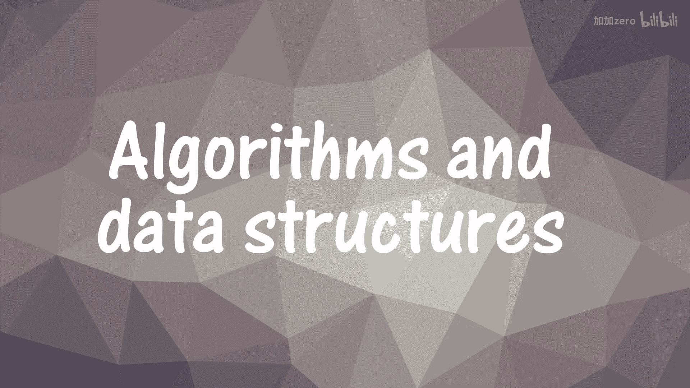
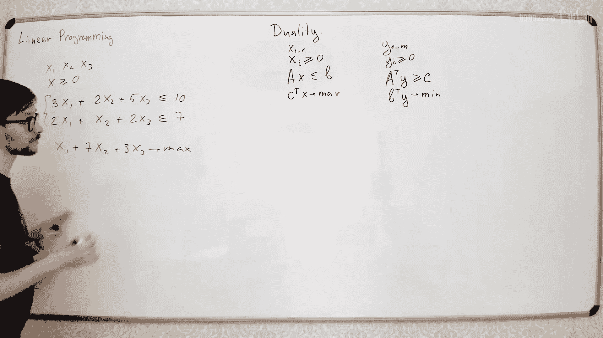

# 【精译⚡算法与数据结构】PavelMavrin p56 p55 A&DS S04E09. Linear Programming -BV1NLB8YfEMq_p56-

Today， we'll talk about linear programming。What is linear programming linear programming is basically a class of problems optimization problems and for this class there are some universal methods to solve these problems and to analyze these problems and so on and as you see as you will see in this lecture some of the problems we discussed in this semester I actually belong to this linear programming problems class。

So what is linear program in linear programming， you solve optimization problem where all the constraints and all the and the。

Oim function of。All linear functions。 Well， for example， let's say you have some。Variables。

 let's see。 you have N variables。X 1， x 2， and， X， N。

And you have some linear constraints on these variables。 For example， you have something like。2 x。

1 plus 3 x 2。Plus7 x5 no more than。And so。So you have a number number of inequalities which can restrict the set of possible variables。

And you won't let's say maximize some function， and this function is also must be a linear function。

 So we have another linear function， which is like a。I was gold。Go function。

 So you want to maximize or minimize its value。say。我夹手边。1 plus。Yes。3 plus 4。5 is no maximum。

Something like that。So。So again， what is important here。

 The important here is you have these variables， you have some number of linear inequs。

And you have some linear function。 You want to maximize。不冲不冲嗯。No， let's see， for for example。

 which problems from this course actually can be。嗯。Can be simulated in this fashion。 So， for example。

 maximumim flow problem and maximumim flow problem。

 What do you have maximumim flow problem you have inequ。 So you have， you have the edges。用不着。嗯。

For each edge， you have a variable， which is the flow。This edge， so we have variable F UVv。

These are your variables and you have some linear inequalityities so yeah QV is greater of0 and less equal than C of V。

These are both linear equations。赢。And you have any question that for each。No。

Origal we the sum of all F U V。Origalのグリにコスト 0。sounds likeた。So this is also some linear in equation。

 It's actually not an equation。 It is equation， but it doesn't matter。So， we will allow this。

To be less or equal， greater or equal or just equal。 This both all three cases are possible。

And we want to maximize the amount of flow。 The amount of flow is just the sum of everything flow from S。

れましまいし。So this is also linear function。So we have some number of variables。

 we have some linear equations here， some linear equations here。

 and some linear functions to maximize。So。这错了给你。Bic combinationation of this。linearer program。

What are problems， for example， you have a matching problem Yeah， for maximal matching problem。

 what's call the maxim matching problem。What's going on the maximum matching problem。

In maximum matching problem， we have， again， we have some edges。And we want something like that。

 so we want， again， for each edge UVv。We will have a variable。 and this variable must be 001。

 So we have my variable X， U V。Which is from。It是と one。

And we have constrain constraint is that for each node， there is only one edge from the。Matching。

 so we will say that for each node， the V， if would takes sum。Of。Everything connected to node V。すよ。

It must be not more than it。So this variable will be 0，0，1。

One means that you take this h into your matching zero means you don't take。

And we want the sum of x for all connect all the edges connected to this node B no more than one means that you take at most one of the edges connected to this node。

And we want to maximize。没有。We want to maximize the sum of everything。

So this is just the number of agents in your machine。So again， what is the minimum。

 We want to assign a variable to each to each edge of your graph。 If you take the edge， it is one。

 If you don't take this edge， it is 0。And we have a constraint for each node。

 a total number of ages connected to this node is no more than one。

And we want to maximize total number of the edges we took in our machine。要。Yes。

 you also spotted there。Important thing， I was。ご引とてあれ。

There is an important difference in this problem。 Important difference is that we want all the variables to be integral。

 So in this problem。We want all eggs。Reve。We long to inter。It let's see zip。嗯我。不是。

That was the question。So。In maximumimal matrix， we don't allow to take half of the edge here。

 so we won't allow these variables to be 001。So this is the important constraint of this problem。

In maximum flow problem， we actually never use this here。 So in maximum flow problem with。N never。

 never ask all all the flows to be integer。 so it doesn't matter。Okay。So it is a big difference。

In these two problems。 So if you， if you alone。く。There are two cases。

 If you allow your variables to be in。Any real number or if you allow your variables only to be in China。

So these are two different types of problems， actually。And this difference is very important。

 if if you allow your variables to be any real numbers， then this problem is actually perennial。

But not all sovable。 So。 So this problem actually belongs to be。

If you ask for solution to be only in integers， it's called integer linear program problem。

 and this problem isn't completete。P complete。It's actually quite easy to show。 You can simulate。

 Let's say， free sad problem。In this fashion， can you can ask all variables to be from zero to one so they are like boolean variables here。

 and then you can simulate free set problem like for each close of your free set problem you want at least one of variables to be true。

So it's not surprising that this problem isn't be complete。

This is actually a surprise that this problem in real numbers is actually in P。

I am not sure if we will discuss the algorithm。Let let's discuss the picture。

And how to solve this problem in polynomial time， I will not discuss these algorithms today。

 but there I basically am。住。Type of algorithms。 first types of algorithms are。

Bker work in normal time。🎼Oh， sorry， sorry， sorry， sorry sorry， sorry sorry。So so so。

So first all everything around in poly time。But they are very slow。 So there are several algorithms。

Which works in polynomial time。But it is phenomenal， but it is very slow。

And there is a simplex method or other types of optimization poly。

 Simx method is actually working pretty good， usually。

But this time complexity is actually a complicated thing。呃。Okay。

 we'll now discuss Sx method today if you can we need special lecture about the Simx method。

But let's say it's not polynomial， usually。Lets let's stop at this point， okay。

So it's not polynomial， but it is fast， usually for some small problems。

 it's fast enough to solve your linear problem problem。オッケー。Now。What to do if you。

 if you want to solve your integer linear programming problem。Sometimes。

 sometimes you can just remove this restriction so for some integer linear program problems。

 you can actually solve the same problem in the real numbers and the result will be the same as for integers。

For example， for the maximum flow problem， for the maximum flow problem。

 we know that if all capacities are integers。If all capacities are integers。

 then your solution must be integer Yeah not like if if you if you remember all the maximal flow algorithms we discussed。

 if all capacities are integers， actually you can think about it like。

 So the value of your max flow is equal to the value of the minimal cut Yeah。

 the value of the minimal cut is always integer， so the optimal solution for maximal flow problem is always integer。

 if you have integer capacities。Mmhm。😊，So， for some problems。

You can actually solve the problem in real number， and the result will be the same as a result for your integer numbers。

 just because the optimal you can prove that for your problem， the optimal result is always integer。

 This happened， for example， for a maxal flow problem。What about matchings， What about matchings？

Again， here is big difference between bipartite matchings and non bipartite matchings。

 If you have a bipartite matching。嗯。If you have a bipart mention。Then again， you can prove that that。

Optimal result of optimal value of the maximum action will all be the integer。 So if， if you。

Just solve the。This linearar program for real numbers， the optimal result will be inte。

Why is it true， You can prove it like this， You can just。Okay， you。

 you can say that the maximum flow max matching problem for bipartgraph is actually a maximum flow problem。

 Yeah， so you have your bipartography。You can add edges like this。 Add edges like this。See this。

 as this is still。 and then solve a maximum flow problem。 And for maximumimal flow problem。

 we know this solution must be integer。So the solution for this。啊。

Bpart problem is the same as the solution for the max flow problem。

 solution to maxal flow flow problem is integer。 So the solution for bio is also integer。

What about non biparted mas for non biparted mas is actually it may be not in。There is。

East example is like this。 So if you have。なんパいバってあるか。Like this。So now you have three edges。

 So for each edge， you have a variable say this is x1。 This is x2。 This is x3。And you have a。Yes。

 you have a constraint that x1 plus x2 is no more than1 x1 plus x 3 is no more than1 x2 plus x3 is no more than1。

 and we want to maximize the sum of x1 plus x 2 plus x 3。뭐 형。Now。

 what is the optimal solution for this problem。不 is to行式。咁四十。1。5 or right。

 so the optimal solution is to assign value。0。5 to all。Variables。Now， all the sums equal to one。

 and this function equals through 1。5。This always been not what we wanted， right？ So。

 so for for this graph there。Maximal matching is actually equal to one， but we have solution 1。5。

What does mean haven any。And in relation to the real solution of the problem。

 it depends for some problems， it may happen that if you just you have your integer linear program problem。

 Yeah， if you solve the corresponding problem in the real numbers。

 it will give you some estimation of the result。Some so this results solution of this problem will be some approximation of your result in some problem。

 it will will be some good some good approximation。 So for some problems。

 it actually makes sense to solve the corresponding problem in real numbers and then take this result as some approximation of your result of your integer problem。

In some problems it is not， so in some problems， so this solution is very simple and this solution is very complicated。

最美害的。So again， it all depends on the problem here， so all the integer linear program problems are different。

No， basically， you can simulate everything here。 right， So for some problems， it may be。

Interesting to solve the corresponding problem in real numbers。 and check the result。

For some problems， it's not。啊。How to see if your problem is how to see if your problem。

Can actually be sold in real numbers and have the same result as the individual numbers。啊。不行坐。

What's actually going on here， so if you look at this construct， again。

 let's write something like so let's have two variables。Let's have variables X 1 and x 2。

 And let's say they both。넌 이득。诶。No negative， and we have some constraints， let's say。U3 x 1 plus。

2 x 2。 no more than。5。Aaron Santa， girl。X 1 plus。4 x。2 is no more than。I don't know。s。

And we're going to maximize， let's say， excellent process。Let's look at the set of possible。

 all possible solutions of these in equations。How does it look like， Let's just write a graph。

 draw a graph。 Yeah， so let's draw a graph。 So let's have。X1 here and X2 here。

What do we have here here， we have some half plain， right， So we have a line and we。

Only allow the area from one side of this line。You could have something like all that。여기지수 또 바。

Something like that。 And here we have。Yeah。I really bit free。Sounds like。Oh that right。

So we have some first line， so we need this region of this line and we have something here。嗯。

Something like like that。赶紧吃吧。not吃去包。How this successes to this one？Good enough。

 So we have some two lines y。Maybe this coordinates around。 but does' matter。

 So you have some two lines for each time。 you allow only the。Okay， let's start。

Let's write a good picture， here。Ppy。Okay， so here we have a line3 x 1 plus 2 x2， no more than5。

This is the line in point0。 it is。2。5 here。See。2。5。And if this is 0， then we have 5 divided by free。

It is。2。Yeah， no， it just one。Po free example。So， this is the first line。And here， if x 1 is 0。Then。

 here we have。1。5。If effect store is 0。 that is 6。上来。嗯哼。So we have these two lines。

And the set of possible solutions， actually， these。Oliggon。So。

Here is a set of all possible solutions of these in equations。Now。

 what we want to want what we want to fight， we want to find the point inside this polygon。

Which maximizes there。Product of this vector multiplied by vector 1，1，0。 So we have vector 1，1。

And we want to maximize the product of the vector X 1 x 2。And Victor for one1。

So we want to find the point which is have the maximumim projection on this vector。It will be。

With this point， par。嗯哼。😊，That's how it looks like。 Yeah， So so you have your set of in equations。

 This set of in equations define some polygon。And you want to find the point inside of this polygon。

 which maximizes the projection on sound vector。Mmhm。😊，4。So。

What happens in if you have if you have high degree of your space。So in two dimensions。

 it looks like this。Why at these points。It looks like it's strong。I'm not sure actually。

I think it might be this point， just because this。Y。So if we go from here to here。

 this will be increasing。 if we go from here， it will be increasing。 So I think this point is right。

Yeah。How do you perform the intersection， this is a good question。So。因为。What， what happens？

What happens on this problem， You have some number of linkages。 so heavy。

 you have some intersection of these half planes。 The intersection of the half planes is some convex polygon。

That's right at。So if you look the at the intersection of your half planes。

 it will always be some convex polygon。Something like that。Now， if you have a problem this polygram。

Then the point with maximize product of will be some vertex of this polygon。Mmhm。😊。

Because if you take any point which is not in the vertex of the polygon。

 you can always improve your solution。 non。No， not exactly。

 So at least one point which maximizes this result will be in there。웨ex of 피 보。

So if you start at any point。And you can， this is the vector you want to optimize。

 you can go until you reach the border of this polygon。Then if you reach out the vertex。

But the edge of the polygon， you can continue in one of these directions。

 So in one of these directions， the function will be increasing， not decreasing。

So you can go along this edge until you find some。The verertex of your polygon。

 So the optimal result is always in some vertex of this polygon。Look again。

 because if you're not standing in the vertex of the polygon。

 there is some direction in which you can move in both directions。If you， okay。

And if you can move in both directions， then one of these directions will be non decreasing because of the function is linear。

So you can move in one of those directions until you reach the border of the polygon。

 Then you reach the border of the polygon。 You can move along this border again in one of this direction function will be non decreasing so you can move until you reach some vertex of your polygon。

So the option will result is always in some verex of the polygon。O。

So how can you solve this problem if you have two dimensional space。

 or if you have only two variables， you can actually solve it like this， you can build this portgon。

 you can intersect all these half planes。Build this polygon and then try all the vers of this polygon and just find the maximum result。

If you have Ns， you will have up to N vertices in your。Porgon。

 so you you can just try all them and find the max result。

This is one of the possible solutions of the sexual the easiest solution for linear programming if you have only two variables。

Y。So basically， you can check all the notices of this poagon。At the。

And you know that the optional solution is one of these measures， yeah。

What happens if you have no two dimensional space， but。More dimensional space of shows。

 So if if you have higher dimension than true， you have the same thing you have。

 but you have not polygon， but you have some。It's called Po。

You have some undimensal polygon basically， so you have some convex figure but which is works like polygon。

 so it has some vertices， it has some edges and so on。呃。And you can solve them in the same way。

 you can find that you can check all the vertices of this polygon of this poly。

And find the maximum result。The problem is that the number of vertices in polyra grows exponentially when you increase the dimensions of your space。

 so in two dimensions， the number of vertices small， but if you have n dimensional polyra。

 the number of vertices in this polyra will be like exponential from n。So。

You can just do the same thing in the multidimensal space。嗯哼。😊，You好 mix mix it。Hope it makes sense。嗯。

 let's talk about this problem seriously it's already here。 So let let's。

Let's try to draw the polyator for this problem， so it's three dimensional problem。

 we have three variables。So here you have three variables。

 So the set of possible solutions is some three dimensional pull。

 so let's try to like this like this like this。's61， x2。TheX screen。So， each of these。

ins define some half space。 Yeah， so it's so it's some plane and you want to look at this one side of this plane。

 So it's half space， right。So how does look， So x1 plus x2 no more than one。

 So it's have x1 plus x2 no more than one， So it's like。These halfling。X1 plus x3 is a thiscal plane。

And extra plus experience whisk， please come。So we have these three vertices of our polyator。嗯哼。Now。

 there must be one more， right。So where will be the fourth this is also the vers of the Poreta。

So we intersect three half planes half spaces。So one has space goes from here， one to from here。

 one around here。And we want to find the intersections of this intersection of all these half spaces。

 It will be some convex for。So you have this pyramid。 And also， you have one more。We have text right。

Where will be one more ver of thisgonpoli。嗯。那겹。Ire just asking questions to check here on the same page so。

Again。I want to I want to construct the set of all possible solutions of these in equations。

So how to do it， You draw all， you draw all this。Planines in free space。

And find the intersection of corresponding half spaces。そう。You have these three half half spaces。

 What will happen if you interect。Then you will have some convex figure， right？

So how how would this look like。So we have， obviously， we have these points。 Yeah。

 So we have this half plan， this half plane and this half plane。

And there is one more ver of this pole leather。Okay， let just take start。

There is one more vertex of this point， and it isnt exactly in this point。

 So if you just intersect all these have plane。You will have one more vertex here。

And the coordinate of these verex will be exactly。t5 or also， it's 1。5，0。5 and 0。5。So。

 the problem is， actually。Why this solution， Why for this problem， solution is not in。

 because we have this。Verex。And for these vers。This vertex has known interteger coordinates。

And our function actually has maximum exactly in this point。So。Sution of this problem is not in。

 because。The function maximizes in some non endangger point because we have some non enddiger vertex in our parameter。

Mhmm。😊，那么。嗯。Why we don't have any problems with badgraph。Because in bipartgraph。

 if you build the corresponding polyeaator， all vertices of this pollator will be integer。

So we can prove that if you build a corresponding problem for bipartgraph。Buildil this spoilator。

All the vertices of this polyatorator will be integer will have integer coordinates。So。

You can prove the bipart graph can be solved using regular linear programming just by proving that all the vertices of the correspondingsing poly of your problem are integers。

So we proved that using some comminical arguments， but you actually can prove the same thing。

 so you can prove that for byparton graph。The solution for the linear program will be integer just by looking at the corresponding poll and just prove that all the vers of this poll are integers if。

 if all。Vertices of your polyator has integer coordinates。

Then the solution will always be in danger because the solution of the linear programming is always is one in one of the ver of this project。

Okay。嗯哼。这边。Hope it's clear enough。 You stop。 You stop saying it's clear。

 So I just assume everything is clear enough。 Yeah， if you don't have any questions。那。呃，王艳丽对你不记。

The great breakfast breakfast this sandwich rich。嗯。Okay。那。No。

How to solve linear programming if you have interest， sorry， So again。

 there are some algorithms with the simplex method。You usually。

 you will not try to to prove right simple method by yourself。

 Usually you just take simplex method from one of the。From one of the libraries， something like that。

So what do I want to do next， What do I want to do next？Let's try to unify the your problem。

 So you have。You imagine you have some problem， yeah， and you want to write it as a linear program。

So you have some variables。You have some inequs， you may have less or equal greater or equal or equal here。

And there is some function。 You may want to maximize function or minimize the function。

Let's try to so it might just it may be maximum or it may be me。所以。Let's write it like this。

So you have variables spec I。嗯。It looks like this one to n y。

Now you have some inequ equations just multiply the matrix a by the vector x。

 and it must be less or equal or greater or equal than some vector B。And you have your function。

 Your function is basically product of vector X by some vector C。So we have vector C was maybe。呃。

By air must be maximized or minimized。Okay。So if you， if you just take some problem。

Usually once you try to write it as a linear program， you will have something like that。

 will here you have some in equation， some of them will be less or equal， some of them greater or。

 some of them will be equal， and you have some function you may want to maximize function or minimize function。

So now if you try to。Find the solution using some standard methods。

 Usually all the standard algorithms take the program as in some standard form。For example。

 you may want to do it like this so。Let's try to rewrite this this problem as another problem in a standard form。

So what is standard form， for example， you may want to have something this So you have variabless1 to M。

All variables are known integers。아 노래 오벨스 안 내개 좀。Now， here。

 we will have lesser info for all integrations。And here we want to maximize。Yeah。

So this is like standard form for the。Lar programming problems。

How to transfer your problem to this telephone？What's。WellFirst of all， you have some variables。

They may be negative or positive。 Yeah， in this form， we want all the variables to be non negative。

How can you simulate any variable using just non negative variables。Again， in this problem。

 you have some valuable ex type。诶。We don to R and here we have variables X and they belong to r plus。

How can we simulate？But。Any real real number variable using only non negative variables。Inude。Yes。

 right。しょ。The answer is pretty simple， you make two variables。

And say that X is actually the difference between X plus minus X minus。

So you just double the number of variables。For issue。For each variable， you make two variables。1。

 one corresponds to the positive part， another can post the negative part。よ。

Shift values shifting values is also possible。 But if you know there。Possible range for the variable。

 Yeah， if， if you know the possible range for the， you can ship it。If you don't know the the。Yeah。

 you can do like this。So now all the variables are not negative。What about equations if you have？

So I want all the equations to be less or equal。What happens if you have an equation。

 greater equal So if you have a greater equal in equation here。

How can you change it to to be less or。Let's say， let's， let's let's。 let's have here。 let's。

2 x1 plus3 x2， great record5。Yeah， you can just multiply both sides of this equation by -1。 Yeah。

 so minus x1 minus x4。2ru is less or equal than -5。よ。

All the coefficients can be negative that's fine。So now all the， all the constraints are less or。

 What happens if you have equal here。 So what happens if you have。一国血。Yes。 It's just simple。 if， if。

 if this equals to 5。ItMeans this less electron con 5 and greater con 5。

 which we will just make two in equations first like this and up like this。M。そ。

These two equations guarantee that this sample be equal to5 because it is less where5 and the greater than 5。

So now all in equations are lesser equal here for this function。

 if you want to minimize this function， again， you just multiply it by -1 and you have something to maximize。

Mmhmm。😊，So any problem if you write it？As， you wish， you can transform a to a problem in this form。

And the size of this problem will be again， it will be poly normal from the size So picture。

 we just doubled the number of orties。Not actually good。

 but so we double the number of variables in this problem。That's fine。Now。

And not the important form of the linear program problem。It looks like this。

Sometimes you want Li linear program look like this。 So you want all day。Variable again， no negative。

But here you have E。That's another important form of them。We air program bubble。

Why we wonder all that was to be posted because of phone。It's a good question。呃。

Some algorithms actually assumed that all variables are not negative。Not that important today。

 but for some algorithms， it's just important thing that all variables are not negative。응 wasn没。

So how can we transfer the problem from this form to this form？

So I want here all the inequalities became inequalities。How can you make quality from inequality。

So what question。Again， let's， let's see if you have some inequality like this。嗯。Basically。

 what you want to do is to add another variable， which is the difference between these two parts。

So what does mean this less or than this It means the difference is less equal 0。

 Let's add another variable， which will be the difference。So let's hear click。 So it's less than 5。

 If so if we add another。Let's say y1， it will be equal to 5。

And this since all the variables are not negative， so this y1 is on zero。

It is the same as if this sum is less reified。So again， we just added few more variables。

The size of the system will be increased by button not much。

 So we just add one more variable for each inequ in our。哎呀。In the system yeah。

Now here the three equation here I have some system of linear equations。

Why can I just solve the system of linear So this is the system of linear equations。

You can solve system of linear regression using on gas methods something like this。 Yeah。

 so you can you can basically use ga elimination。To solve the linear equations and then find the result。

 what will be the problem？Why can't you just solve this in solve these equations， find the result。

 And this will be the result of here。The problem will be that the solution of this system will not be this system not not one solution。

 The solution of this system is just the whole space of solutions。 So it。

So it looks like this system of linear equations， but the number of equations will be much smaller than number of variables。

So the solution of this system is not a single point。

 It's just this the whole subspace of yours and dimensional space。

 And you want to find optimal point in this subspace。 So it's actually the same as this problem。

 So even if you have equations here， the problem is still the same。Okay。Nice。嗯。

I want to talk about something else。 What I forgot。Okay， let's， let's stop。 Let's stop here。到。

Let's talk about cleaner。多完了钱。So do all。All linear linear programming problems always have pairs。So。

 for for every。Lar programming problem， There is a dual programming linearar programming problem。

We this， we actually face some this problem。 So if， if you remember whats。

We discussed when we talk about， for example。Maximal matching problem。

 So if you have maxim matching problem， you have a minimal vertex cover problem。

 And when we discussed it so I told you that these are two dual problems。

 If you have a maximal flow problem， you have a minimal cut problem and this is also a pair of dual problems。

In linear programming was very simple way to find the dual problem for your problem。

It looks like this。 So let's write some linear problem problems。 So again， let's see。Let's say。

 all x are in。A X less one V， and we want to maximize city。The dual problem will look like this。

 We have a dual variables。色数。So let's say x from one to M。In dual problem。

 you will have that the number of videos would be the same as the number of ins in your。

Prial problem， sorry。So even this problem， you have M and equations。

Then here you will have M variables。呃。They also will be in the literature， no negative。Now， that。

In equations will look like this。 We will take these metrics。Transpose it。And then， multiply by the。

So we take transport matrix T 18。Miply by vector。And it will be greater or equal。Then。

 this vector see。Mmhm。And the function will be just the spec tissuesel。 We want to minimize。

So how to make a dual problem。You take this matrix A， transpose it， then take this vector C。

 take this vector B， and just walk them。And change this maximum to minute。

That's how you make the dual problem。For example， let's， let's make some。

 let's make some simple do bubbles。어不不不不。What say you have。Let's say three labels， x1 2 and x 3。

 and they all are non negative。And you have two integrations。 let's say，3 x 1 plus。2 x 2 plus 5 x，3。

This one10 something like。2 x1 plus。2 plus2 x3 no more than7 something like that。Yeah。

 and you have some function let's say will pop boom x 1 plus。7 x 2 plus 3 x 3。

 You want to maximize it。

Then the dual problem will look like this。 So we have two in equations。

 So we need two dual variables。It the variables Y 1 and y 2。So that's a bral problem。

Here are way to dual a problem。So I might do a for each inequ in my problem。And I make。

In equations like this， so I take these metrics and transpose it。 So for for the first variable。

 I need these two coefficients， so it will be。Frely。外话。Plus2， Y2。

Will be greater or equal than this coefficient。For second variable， use this two。No呃。

So be pull Y 1 plus。Y 2， Great rock column in 7。And here is use this too。5，1，1 plus 2 Y 2。

 greater equal than3。Again。These three coefficients are these three coefficient coefficients。

Now I make the function function what this， I use these two coefficients， so I make it1。

10 y 1 plus 7 Y 2 must be minimized。And again。These two coefficients are just from here。

Looks like magic yes， but it's actually not。So let's see why is this camping， what's actually？

What's the meaning of all this stuff， so？Let's take this equation。 Let's take this。

 Let's look at the primal problem。 Yeah， let's take this in equation。

 So I have a X less or equal than B。Now， let， let's multiply both sides of this in equation by y。

Let's transportpose them and multiply solar， like 8 x。P white and and B。어。By喂。No。

What's happening here here I have X， T， A， T， Y， lets going B T Y。Now。

 if I look at all possible wise。Will this constrain。I can write it this thing。

Is actually greater than equal， than。Xt C。嗯哼。So what I have in the result， I have。

 Let's rewrite this as C T X。 Again， this， this is a product of two vectorors， right。

 I can write it like this or write like this。It's the same thing。Is less or equal than B， T， Y。嗯哼。😊。

What的是频。It means if I take any solution of the primal prim mode and any solution of the dual problem。

Then the solution of the dual problem is just some upper bound。Or the solution of the prim problem。

And。What I want to do， I want to find the minimum possible upper bound for the solution of my problem。

The interesting thing it is actually they meet the same point。 I will not prove it。

But I just prove that any solution of my problem is less or than any solution of the dual problem。

The interesting thing is these two solutions actually meet the same point， so。

Here you have all possible solutions of your primal problem。

 And here is here all possible solutions of the dual problem。 They actually have the same。엎もっぽい。

This is kind of magic。 But yeah， I will't approve it today， but。

It uses some more linear output order but。That's the interesting thing。Okay。那。No。

 let's try to build a dual problems from some of the problems we already know。 yeah。

 So let's start from the。Maximal matching problem。 bypack。

Let's talk about wipe up the matching problem。Well， let's write it again。 So so I have。

 I have a variable for each。Edge， so I have labels。X UV。It is。Greater people than 0。

And it is less equal than one。And I have the concern that for each for each very for each all V。

The sum of everything connected。To V is no greater than one。And I want to maximize。Some of。有。Not。これ。

いや。So let linear program for the maximum machine problem。Now， first， let's simplify it， let's remove。

One unnecessary in equations of the， I claim this equation is not important。I can remove it。

Not because if I take any variable than more than one， this an equation will not be satisfied。

 so this equation actually forces all the variables to be no more than one。

So I can safely remove this equation。It's actually a quite important thing when you solve something in linear programming and just to remove everything which is not necessary so you have a much simple linear program。

 it's much easier to work with problem which when you remove all unnecessary ins。Okay。

 now let's try to build a dual problem。So in dual problem。

 we have a variable for each in equation in our primal problem。

 So here we have in equations for each variable。 So in dual problem。

 we will have variable assigned to to all them。Nots of。

We have ins assigned to each node of the graph。So in dual problem， we will have some。

Variables assigned to each node of the graph。So we have this Y V。啊，算来了。I' am to try today， sorry。

ぱりカットスピークオケ。 no。About in equations， we need to transport this matrix。

 So so how those matrix would play this matrix a。Looks like this。So for each。For each note V。

We take the sum of all the edges connected to note V。 So we have this。L V。

 And in this row of the matrix。We have once in all positions corresponding to the edges connected to Nor。

So here we have edge V U， here we have one。So for every note。We have one in position。For the。

Notode can， which is one one of the ends of this。H， red。

So what happens if we just pull this matrix So if we so we need to look at the row of this matrix。

 what happens in the row of this matrix？In the row of this matrix。We have ones。

In the rose crisppon in the column。 So if you look at the column of this mattress。

We have once in in positions correspondinging to the ends of this edge。 right。

 So if we have edge V U， we will have one in row V， and we will have one。Inroll you。Mmhmm。😊。

So now when we construct dual problem， need we need to take the variable from this problem。

And for each variable of this problem for each U。We will have an in equationequ。

In a will look like this， we take the quo of the ss。Take these two variables with these coefficients。

 So。Y U plus Y V。And it must be greater or equal than coefficient from this vectoracy， this deeracy。

So， it is one。Makes sense。Now， the function。 So the function will。

 So we need to take when we construct the function you want to minimize。

 You take the coefficients from vector B。 Here's vector B。

And just so Ill just write some of everything。So just to take care of the coefficient volume must be minimized。

So this is a dual problem for the maximum machine problem。Can you see what problem it is。Yeah。

 this is exactly vector vertex cover problem。Yeah。So what I'm doing here。

 I need to take some variables and assign some values。So that for each edge。

The sum of values on sense is at least one。It means that I actually do the solution is integer。

 so I take the ends of this edge。Assign sum values 001 to the ends of this a。

 and the sum of these values must be released least1。

 It means I mark at least one of the ends of this vector with one。So I mark some nodes of my graph。

 So for each edge， at least one of the ends of this edge is marked。

And I want to minimize total number of the marked ages。Mar notes。This is exactly the Sc problem。

So again， when we discuss maximum emission problem in bipartral graph。

 we discussed that you can solve the ver sc problem in in bipartral graph。

Uing maximum matching algorithm。 and this is actually why so these problems are actually the same problem viewed from different sides so。

primmal dual Pro is the same problem。 just viewed from different sites。

 So here we want to maximize something here， we want to minimize something。

 and then they meet in the same point。 This you can prove it without any combinatorical knowledge about your problem just by constructing the dual problem just from your mattresses。

Oh oh。Okay， let's do something else。또 계속 내줬지。I don't want to the flow。

Let's talk about the assignment problem。Yes， primal dual problems always give the same answer。

 I will not prove it， but it's true yet。Yeah。This is actually a two problem is is actually the same problem。

 You from two different sites。 You you， you would you want。Baically。

 we describe the same set of elements。 one problem describe the set elements from inside。

 another from outside， and they meet in the same point， yeah。嗯，I's talk about the same problem。

Oh sorry。你안 not对。8라不。So we have an assignment problem， what we have an assignment problem。

 we have some， again， biparted graph。어 저번도 꼬을 거야。We have a bybe graph。

 Let's have a full bybe graph again， just for simplicity。And I want to。

 I want to build some perfect nation in this graph。 So I want to matching it。

 which contains hole and also micro。And I want to minimize the total cost of all these edges。

They的标准 no。Actually， no idea。 What is it。We will not actually today we'll talk talk about about algorithms to。

 we'll talk just about how you can analyze your problem using some linear programming methods。Hello。

 I will not discuss any algorithms to solve linearya program problem。

Will will just analyze this problem just to see what's going on inside response。嗯。

So a second problem， again， you have a biback graph。You have the same set of variables。 have X， U V。

So a variable equals to one means that we take this edge in the machine。So I want to buy。

 I want to build the perfect machine。 I want to build the perfect machine。 it means for each。

For each node， the sum of everything connected to this node must be equal to one。

And I want to minimize， minimize。The sum of all weights of the edgeia。

 So I want't minimize the sum of。X U V multiplied by weight of this edge。嗯哼。😊。

So this is your assignment problem。You want to build the perfect machine， with minimal cost。Now。

 how the dual problem looks like in the dual problem。Again。

 you have the variables assigned to your nose。These variables will not have this constraint。

 so these variables will allow these variables to be not to be negative。 Why。

 Because here we have not inequality， but here， we have quality。 So if you have an。Can straight。

 which is the quality。 The corresponding dual variable will not be strict to be to be non negative。

You can just make an。No you。 O， I'll leave your exercise。

 You can split this in equation into two in equations。They will give you two dual variables。

 and like the combination of these two dual variables is actually a variable which is unbounded。

So if you have an equation here， you have an bound variable here。嗯。Now。What about constraints。

 constraints look like this。 Again， I take this matrix and this matrix。

And look at the columns of this matrix。 So for each for each edge U V。

 I will have a constraint which says that y U plus y V。Must be， less or equal than。Cresponding。

Quite efficient here。And what I want to do， I want to maximize the sum。

So I use these coefficient fus for the maxim function。

 So I just want to maximize the sum of everything。So this is a dual problem for the assignment problem。

お。I claim it's somehow connected to the Hungarian algorithms we discuss when we talk about assignment assignment problem。

So let's see what's going on here。So this equation， what is the meaning of this equation。All right。

 let's just。Move it to the right side，W is minus Y U minus Y V is not negative。坐。Wice President。

 So I just take this phone and just constructed。 I didn't think about it。

 So I just constructed using the standard algorithm for building dual problems。这定。

Why I have this constraint， I take the column of this matrix a。Multipliied by Victor White。

And then in the right side， I have the coefficient from this function。

So I use these coefficients here， and I use these coefficients here。

Why it is less original here because I want to maximize。그 육 육 육 육건。You can take this problem。

I rewrite it in in standard form and then write this problem and then simplify。

 I just take all the steps at once。나 그거。Again， you can take this problem。

 write this problem in the standard form， then build dual whole problem and then simplify it。

 You will have this problem。I'll just take all these steps at once。

 So this less or equal because here is I have minimization。不。You can do it like this。

 You can move from this minimization to optimization problem。 Just multiply this by -1， yeah。

So here you'll multiply everything by -1。Then you multiply it again by -1。

 and you will have less recall。Yep。This comes on。Just just like this So in maximization problem。

 you have less for equal in minimization。 You have a great。Now。

 let's remember how to solve a Simon problem using Hungarian algorithm。Yep。So how did it if， again。

 if， if you remember was。What was going on， few lectures。I go， when we sold。Assignment problem。

 We did like this。 We assign some potentials to some notess and then change the weights of the。edges。

Yeah， so we assign some potentials to the notes of the graph and then。

Like subtract these potentials from the weight of the graph。 And then in this new graph， we build a。

Maching using only zero edges。Yeahep。Again， if you， if you forgot how to do it。

 you can rewatch lecture about the same problem。But this actually。

This formal is exactly the formal of from Harian algorithm。So in kindarian algorithm。

 we want to assign some potentials so that the weight of each age is not negative。

So want assign some potentials， so where weight is not negative。

And we want to maximize the value of the potentials because in the end。

 we will have matching of size0 of total weight equal to 0。

So the total weight in this graph will be just some of all these potentials。Okay。

 I'll just leave you on the exercise store。If you don't remember how to solve a second problem。

 this have be good。M。Ok， the final feeling and what I want to tell you is how to check if your solution is optimal。

How to check if your solution is optimal。It's actually quite easiest as my all。

what you can do is to build your imagine you have some solution of your primal problem and some solution of your dual problem。

And you want to check that your solution is actually optimal。W you can check like this。

 you can calculate this result， calculateco this result and check the equal So if。

If these two functions are equal， then you have a optimal result。아 도뚜퉁。小麦下就松。So刘情。乌鸡毛。Means that C。

 D X equal to B T Y， y。So we proved that this part is less or equal this part。 So if we have quality。

 it means we have both， So both problems have optional solution， yeah。But。

It can be written as simpler as。 do。Let's try to rewrite this this。Or but you like this。Now。

 let's do it like this。 let's， let's have a problem。Let's have done one equation。

 So we have x greater equal 0。 We have a X equal to B， and we want to maximize。でした？

Let's take this problem。And let's build the dual problem。 Du problem will look like this。

 I have wise。I have8 Y。 I want maximize， so I want a greater equal than C。 And I want B TY minimized。

So that's my parallel problem， that's my dual problem。What I want to do。

 I want to check that my solution is optimal， like this。How to do。

Let's rewrite this property like this。 So I I want to have C， T X minus B， T， Y equal to 0。Mhmm。😊。

Now， I want to eliminate something from here。 Let me change。응 응 흐 응  흐。Y。

So I want to have this A X somewhere。 So I want to multiply something by a。嘿嘿嘿。嗯。How can I do it。

Sorry， one moment。 One moment。아。嗯。How can I put a here。I want to remove this X up。

 I don't want to remove X。 I don't want to remove X。야 나 아직。I want to put X here。Sorry， at one moment。

 One moment。It's strange。I did something wrong。So want to make face for。Hi， let's try this B。 sorry。

 sorry。One second。So let's use this。 So B T is actually a。A X T， right？ So it is X T 80。

So let's change this beauty of this。So we have C T X minus。X， T， A T， Y equal to 0。Now。

 I will just change this。Again， this is product of two vectors。 I can rewrite it like this。

And now I'll take this episode of bracket So X T C minus 80 now。That's what they wanted。

So let's look at this property。So again， this property means that you have an optimal solution。

 that your primal and dual problem have the same solution。

 if your primal and dual problem have the same solution。

 it means you have an optimal solution in both of them。Now， here， what does mean？

Here we have a product of two vectors。And both the vectors are not negative。Nction， no positive。

 Okay， so this vector x is not negative。And this vector is non positive C minus this。 So its not。

How can the product of these two vectors P equal to 0。It is equal to 0 only if for each coordinate。

We have quality here or here。So for each coordinate， one of these things must be equal to 0。

So it means it means X I equal to 0。Or。C。I equals 2。诶次。Aihui。Oh呀。Clear enough now。So again。

 I want to find the properties when my solution is optimal。

 my solution is optimal when I have the same solution for primal problem and for dual problem。No。

 I just。Make some small changes。 And here I have this equation。 In this equation。

 I have the product of two vectors。One of them is non negative， another is non positive。

The product is 0， only if for each coordinate。I have 0 in one of these。But。Yeah， yeah。

 if both these pars are non zero， then the result will be negative。아 인파스 비 싫어 yeah。Cool。

 and this is actually this this is very cool property。Why is it cool， But Because this property。

 we actually split this property， two and small properties。 So this much easier to check。

 So instead of checking this。Very complicated property chain。 We will check many small properties。

 And if all these small properties are satisfied， then this big is satisfied。嗯哼。Who。Who。This called。

 thiss called。Complimentary slackness， is called complementaryary slackness。 basically mean。

 if you have some two complementary equations。 So I have complementary in equations here and here。

In each pair of complementaryaryequs， at least one of them must must be strict。오케 응？Let's try to。

 Let's try to see what's going on in these two problems when we。I supply this。嗯。Oh， how hows cool嗯。

Sorry。Let's try player these to both these problems。そう。much no mention problem。We have。呃。

So we have these。These were complementary inequs， so what the property is。So， X， V， v equal to。0ero。

Or。I have a quality here， so。嗯。Mhmm。So I have here， I have zero， or I have equals here。

Well let's re writing like ge。So if it ist one， then this is it。Maybe自己。What is the meaning of this？

Or， it means that if you。Have an edge。 This edge belongs to your matching。I'm fan。Bo was，'s 1。

 what is 0， It's 1 one。挂了。Here I come one？What does mean it means if I have a edge from the matching。

 then only one of these ends should belong to your minimum water cover。That's true， yeah。

So if you take any edge from your maximum matching。

Then only one of the ends of this of this edge should belong to your minimal cover。

Other pairs of research take。These and。These complementary equations。啊。そ 있는じよ。

We can take these pairs。 They take this and these pairs。For these pairs。

 we will have something like that。Oh。 So if。So y be equal to1。then。嗯。Yeah。Some off。あ。Of you。

X of v U equal to one， Yeah， like this。那我。What does mean means， if you take。There。

Note into verex color。then。This vertex。Must belong to your maximum machine。そ 이게。

You take some vertices to the vertex cover。Each of the vertices from the vertex color must have an edge from dimension connected to it。

Yes， the dual problem of the dual problem is the original problem here。そ。

We actually use these properties when we discussed the maximum matching problem。

 but we we were written only from the combinatorical arguments。

But you actually can do it just by using this linear algebra。Arguments。You'll have the same result。

The same thing here， let's see。So what do we do here。

We have complimentary in questions we have here and here。So I don't like it。

 So if x U V equal to one。Then here must be also here this。W you plus we must be equal to we。Okay。

 what does mean， It means that here you have。いあります。参ります。以個落と zero。Again， if you。

If you know how to solve them assignment problem， that's exactly what's going on in the Hungarian method。

So if you take any any edge in your mention。The modified weight of this H must be 0。嗯。

So basically basically hung method is just。Primal dual method for that solving this problem。

So so what what happened again。Let me finish this。Soう。How did we solve assignment problem。We。

But at any point， we have solutions of two problems。

 We have some solution of the primal problem and some solution of the dual problems。

 So we have some matching。And we have some potentials。And in the， in the end， we want to。

Again all the proposal， so we want to satisfy all these constraints。

 satisfy all these constraints and satisfy all these constraints if we manage to do it。

 so if you build a solution which satisfies all these constraints。

 all these constraints and all these constraints， it will be the optimal solution。

So what we what we do in the Hungarian method。We have some matching。 So in in the beginning。

 we have empty matching。 so this constraints are not。We have some potentials。

So the weight of each edge is not negative， so these constraints are always satisfied。

And these constraints are always satisfied。So now what would I to do。

We try to modify the primal variables and do variables in such a way that we make some progress。

If we can increase the size of the matching。We make a progress here。

 so we update the matching and we build and increase the size of the matching。

If we can decrease size an image， we make a progress here。

 so we modify these potentials in such a way that we have that our DFS。

That we used to find the augmenting path can make some progress。

So we try to tweak these variables these variables。

 try to and so on in the end we have all these constraints despite it it means that we have optional solution。

The same thing here， actually。So if you manage to build the solution。

 when all this concerns so if you have some matching。And you have。Some vertex cover。 And this。

2 concerns satisfied。Then you have an optional solution。Again， again， you don't you。

 you don't need to。This is enough to prove that your solution is optimal。

Because you have the same solution for minimization and maxization problem。

 and they meet at the same point means they both optimal。What's all。Okay。

 I'm afraid not to have an a， but you can use the same。 What you Sp suppose。

D react minimum span tree。 I'm not sure if we can write it either。Is a linear program。

I don't know how to write a de linear program。It at least of polynomial size。けどの。To control。啊。Okay。

 your final thing。 final thing。Let's go back to nonbipartite mention。嗯。So。

 for non by for non by but mention。So we have a system like this。

 we have some X UV is no greater than zero， and I want to maximize the sum。So in non bypargraph。

 this is not enough。So again， you can have separation like this。Let me grow it again。

And here we have an option point。So this happens when you have a triangle。说。No。

In in non bipartagraph。You may have no danger。V is in your polyator。

 and you may have actually optional solution this。So what was the problem we've known by Patgars？

The problem is that your solution may be in some non integer point。How can we solve it。

 We can solve it by adding more。Constraints， so we we， we can add more linear constraints。

 which will eliminate all non nonlinear vertics from our pollator。For example， for this graph。

What can we do？Is， we can add。Another plane。Which will eliminate this vertex。And you。

 you can simply see that this plane is actually x 1 plus x 3。 x 2 plus x 3 is not greater than one。

So if we add this in equation。To the set of our our equations。

We will remove these vertex from our pollator。嗯。😊，So， we only left with this。We have something。

And now all the verse is integers。啊哼。So that's how you manage situations when you have some known indicator。

그 수。So， you add some more。In equations， solid they remove all and all all these non major points。

What happens in the main historical， what happens if you have a graph？You。

If you have none by paragraph， you need to add this in equation for every odd sized subset of nodes。

So， if you take。Any subset of odd size。So let's take some some said。Youです。

Just subset of V and size of you is old。You， you will。 you need to add a constraint。

Some of everything X U V so that you and V belongs to the you。😔，Is no more than size of set。

You divided by to。Mm。So that's how you remove all non integer points from your solution。

You add some more in equations。 so these in equations eliminate all known in pointss。

The problem here is that the number of in equations we added is exponential。

 so we add new an equation for every odd size subset of thees。Yeah。

 so even if you have a polynomial M solution。The size of your system will be non preliminary。

But we still can't solve this。How to solve this problem。We will to make a dual problem。

In the dual problem， we will have dual variables。那 do problem。We will have variables for each。

 subset you。So we will have a dual problem for each odd subset of， of of， of the ver set of ofgra。

But most of these variables will be zeros。Mmhm。😊，So if you manage to have an algorithm。

Which maintain both these。Solutions in such a way that。At most almost all variables here are zeros。

So if， if only small subset of this do dual variables are on zeros。

Then you still can solve the problem。So you， you don't write this you don't need this system explicitly。

You just know that for each。O size subset， you have this in equation。And then。

You maintain only subsets， which has non zero dual variables of the variables。嗯哼。And now。

If you can do it carefully enough。You can solve the problems。

 even if you have some exponential size system。Okay， this is the story for。Another lecture， but。

That's basically how you solve weighted nonbipart matching problem。So you have an in button。

 none bypart problem。 You have situation like this。

 You have dual variables for some old size subsets。But almost all of them are zeros。

you have only odd you have。You have non zero available only when you have a blossom and when you contract a blossom。

You have a new variable， which is non zero。 so you only have non zero variables for contracted blossoms。

And the number of contract blossoms is。응 보며 그렇지。So the number of down0 variables will always be put on。

So now you have a poly normal algorithm， just from these ideas。But again。

 the idea behind this poly algorithm is to have this exponential size linear program。

You just don't solve it explicitly。You solve it you solve it in smart way。 it shows you just。

 you don't write all these integrations。 You just know that you have these integrations and use only some small subset of these equations。

Okay， this is the story for another lecture。Okay， it's not for today。嗯。

