# 【精译⚡算法与数据结构】PavelMavrin p57 p56 A&DS S04E10. Number Theory Algorithms -BV1NLB8YfEMq_p57-

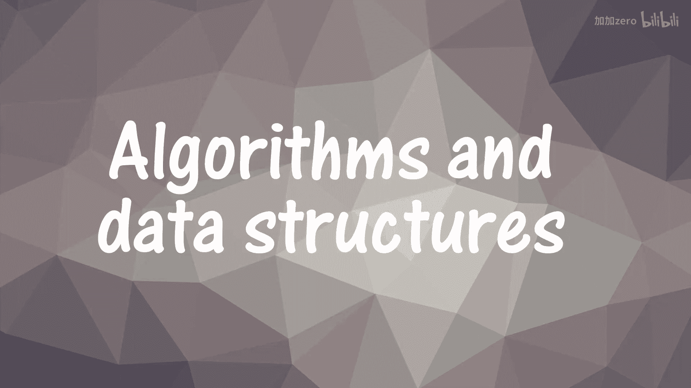

This is the final part of this course。 And in this final part， I combine some random topics from。

Different areas of this algorithm theory just to give you some perspective of what's going on。

 And today we'll discuss number theory algorithms。Computal number theory is a。

Large area of organ theory。 And I'm not a great specialist in this area。

 And so I'll just give you some introduction If you really want to learn what's going on in computational number 3。

 You actually need some。Im be course about this， But today will be just a short introduction。ok。

Now let's start with simple algorithms。 Let's start with finding great common divide of the interger。

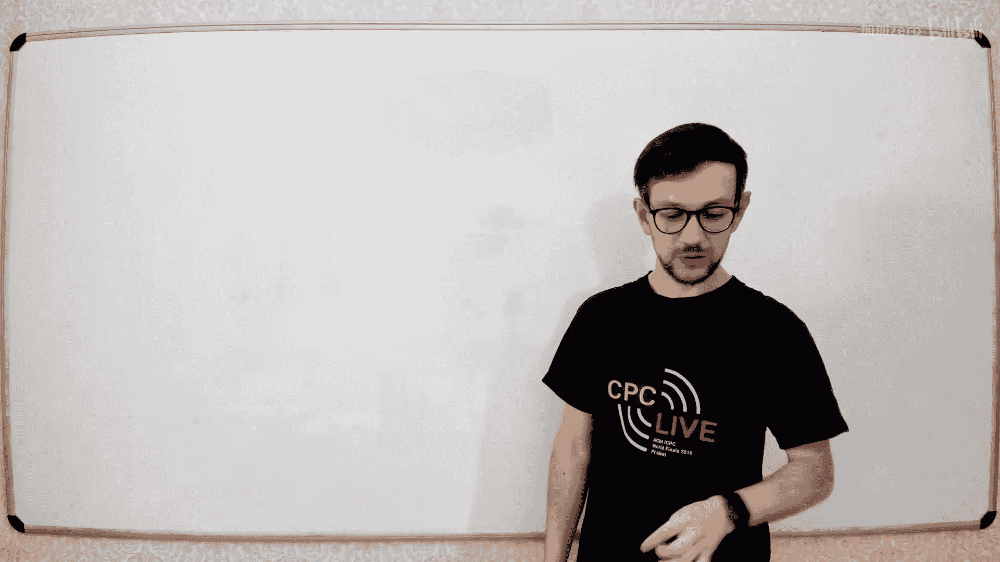

So GC v of A and me。So。Greatest common devicesrs of two industries is just。

What as the same suggests is the greatest number， which divides both A and B。So for example， well。

 let's let's have some numbers say PCB of something like。W and and。64。

It will be something of like four， right？So4 is the biggest number， which device both 20 and 64。

So how to find a great command divide。 is simple algorithm。 This was invented actually。

 a few centuries ago。 It's Euclan algorithm。The algorithm uses a very simple idea。

 Let's look at numbers， A and B。If both these numbers are divisible by。Some number D。Then。

Number a minus a is the by。And b is divis by D， then a minus b is also divvis by the same number of D。

So what we will do， we will get from pair A B。都会白不使。おち？And let's say， hey， I'm paintinging this week。

No， why is it true， Why is it true Oh， Because again， if we have some divisor。

So A is divisible by D and B is divisible by D。 Then a minus B is also divisible by number D。

So each common div of A and B is also a common div of A and A minus B。From the other end。

 if we have some number D。And both a and a minus B is are div visibleible by this number D。

 Then number B is also divisible by number D。Because B is just equals this minus this， yeah so。

B equals to a minus a minus B。So if we have some common divisr here。

 we have the same common divr here。啊。What we basically said that the set of common devices of these two numbers and these two numbers is the same。

So the grade scope device is also the same。That's the whole I get。How to apply this idea。

 So if you just apply this idea like this， Okay， let's try to apply this idea to these two numbers。

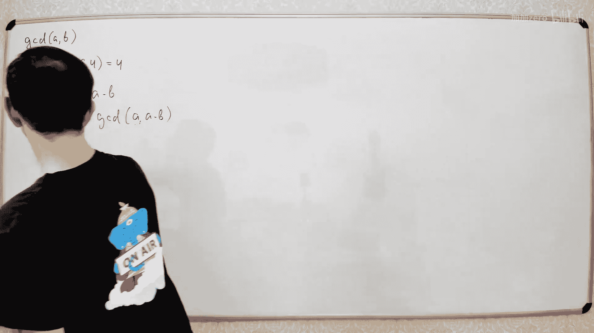

So we start from two numbers。 Let's say 20。And 64。 And then just I apply this formula up over and over again。

 So we take the the。Lary number and subtract this small number。 So get from here to pay。404，20。

Then to pair 40 and24， sorry。20 for 20。 And then to bear。20 and4， and then subtracting here at 16。4。

8，4，4，4， and finally0，4。そう。And then we have situation like this。When one of the numbers is 0。

 then obviously， the common div is the other number。

 So the the great common device of 0 and 4 is obviously 4。 So that's how we find common devices。

If you do it like that， unfortunately， it will be too slow。

Because let's say you have some big number。You cr black number， I thousand00 here and one here。

If you will just apply this formula over and over again。

 then each time you will decrease this number by one。

 So the number of steps will be the same as this。Then is this number is just too slow。

 So we will improve it a little bit。 We will make these steps until this number is less than this number。

 So if a is greater than B。Then we can subtract。B from a as many times as it needed。

 So this number is less than a。ま than。8 freight。So instead of making a minus B， we will have。

Does the remain often binding be like this。Yes， yes。 you couldn't do the same。

 So it's symmetrical formal， so you can subtract B from A or A from B。Yeah， but by the same reason。

 so A and B， I could symmetrically yeah。Why is it true。

 maybe Because what is the reminder of a divided by B， reminder of divide B is just。A minus。A。

 divided by B and around multiplay by B。This's a definition of their mindド， yeah。So we divide A by B。

Get the integer part of this fraction and then multiply by then subtract this menu。Cop of P。

And just by the same reason， if we have common divisor here， we have the same common device here。So。

 so the final algorithm because logo looks like this。Okay， let me just write there。

Uual implementation。 So we will set the following algorithm， willll say just A and B。

We will look at the number B。 If number B 0。Then the grade school advisoror is a。If not。

Then rule divide write A by B， get the remainder and。Qull the request。As是 just two。It it return。

GCD of B and。有。So here I see I swap them because I want the first opera to be greater than the second appearance。

So I want to maintain property that a is always greater equal than B。嗯哼。😊。

So when here when I called aggressivelyively， I say B is greater equal than a reminder of a divided by being here。

 because the remainder is always yes remainder is always between 0 and b minus1 right。So all。

 that's the full algorithm。 a very simple e algorithm。啊。不从。And the first time。 Yes。

 the first time when you call the function， they call the per， you want a to be greater than B。

 if not。Then the the first situation will not satisfy this invari。

 So if you call this function and a is less than B。Then what will happen。

 You will go here and say B and a A mod B， A mod of B， if B is greater than a will be just a。

 So if a。So if here a is less than B。Then here， we will say B and A。So a mod of B will be just a。So。

 so even even if， if you call this function and a is less than B， then in the first situation。

You will go here and call the same function with swapped arguments。So it's a very simple code。

 It works perfectly， actually。One of the simplest algorithms in this building。啊。Okay。

 let's do it again。 Let's do it again。 So sorry， let's say sample like 64 and 20。So， we will。Say B。

 and also have 20 and 64 model 20 is。4， right。Then they take 4 and 20 model of fruit is a0。

 and have zero。Just in two steps， we find the great command divide。Okay。Now。

 let's calculate1 complexity to algorithm。How many recursion steps can we can we make until we have one of the numbers equal to0。

 It turns out we can make at most global steps。In， in this re。Why it is so。

 Because each time we move into this regression， we decrease number eight at least twice。Let's see。

 So I claim that here。A model B is less or equal a over2。Why is it true， Why， Why is it true， No。

 let's see。 So no， let's。Let's make two cases。 So， so if B is less than a or two， lesss say it for。

Then。A model B is less than B。 Those which is less than a over2， right。

So if number B is less than half of a， then this model will be less than half of a。

 So we will decrease number of a at least twice。E is great isn't。8 or2。Then a mod of B。

Is at least a minus B。Actually， equals 8 minus。And it is still Western than a。Oh again， No again。

 Why is it true Because you have。You have some。 So again。

 the reminder of this division is just a minus some copies of B。

 How many copies of B can we fit into one number A， at least at most one。

 because B is greater than half of a。 So we'll put exactly one copy of B inside a， right， So the。

오ケー어 이 애견。A model B is。A minus a over B applied by B。 And D equals to one。

 because B is greater than half of a。嗯。그피。What does mean it means that each time when we call it is function。

 we decrease one of the numbers at least twice。We can decrease number twice at most logan times。

 So then。啊。Time complexity of this algorithm is let see。Lger M。

 where n is something like a and b realisticistic。We can say look， A plus B， something like that。

 let's stop here。I would say that this this algorithm has polynomial type complexity。

What does mean polynomial time complexity in this number theory in number theory。

 complexity is measured usually how cloud you measure complexity you measure complexity compared to the size of your input。

 y size of the input。 if you have only numbers， the size of the number is basically the number of digits in this number。

So we measure complexity from the number of digits in the number and number of digits in the number is basically log if of this now。

 Yeah， so we measure complexity not from n， but from log n。So if we want our timeplex be polynomial。

 we want to be polynomial off there。Loarative of n， not of n， yeah。So this is a polynomial algorithm。

 which calculates the greatest common div of the numbers。 Actually， when you。

 when you use this number  theory， and it's mostly used in something like cryptography and something like that。

 Yeah， So in cryptography algorithms， they use very， very large numbers， they use like。I know。

 500 beats numbers yeah， sorry so this logarithm is actually not small。

 so it's like length of number can be up to0 see。So it's not not like not not we usually see in this。

 So usually in des of C text， n is the size of the graph or n is number of elements in in data structure。

 Yeah， so here number n is actually very large。 So the of the number is actually big。Still。

 this is the port number await for the size of this one。Good。嗯。Yeah。

 actually when you think about these algorithms， you need to consider not only the time complexity。

 but only also the time complexity of these separations and if matrix operations if you have big numbers can make in constant time yeah。

 so even if you want to calculate the sum of two numbers and numbers are really huge。

 then you need to calculate this numbers bit by bit。

 So the time complexity of simple operations like sum of two numbers will be not。Constant。

 it will be loggan。So actually time complexity of this algorithm is logan multiplied by time complexity of this。

Mod of function。 Model of function is has also some polynomal and complexity。Good question。

 whatever temperature will not talk about this as much。

 but you can calculate the remainder of division of two big numbers in polynommal time。Com。

Basically the same like could do in school。 Yeah， so sure。You kind like。

 you can just operate bit by bit in like hence square times and。So in loggan square。Okay。G。Now。

 what's okay， have problem。That's actually not not the best， usually。

 it's not the best organical called grids controversyor。So in practice， this is not a good algorithm。

 Let's let's talk about another good。So usually there is a better way to calculate。

Where common giveバだぞ。Okay， what is the we we， we pointed this algorithm。

 This problem is the calculation of this remainder。 This remainders actually need some。

Some work to do again。 So if you have two big numbers to calculate reminder， it like a long process。

What you can do， You can， instead。Make another。Which doesn't use this model function。呃。

It worked like this。そう。Let's see。 what is the of A and B。不行。So。If one of these numbers is。

Even and another one is odd。 So， for example， let's say this a is even。嗯。Yeah， let's see。뭐 안 진짜 진짜 이。

And bees wont。Then。The greatest common divis of these two numbers will not contain any tools， right。

 So2 is not a divisor of N B。 not It is not divis of B。

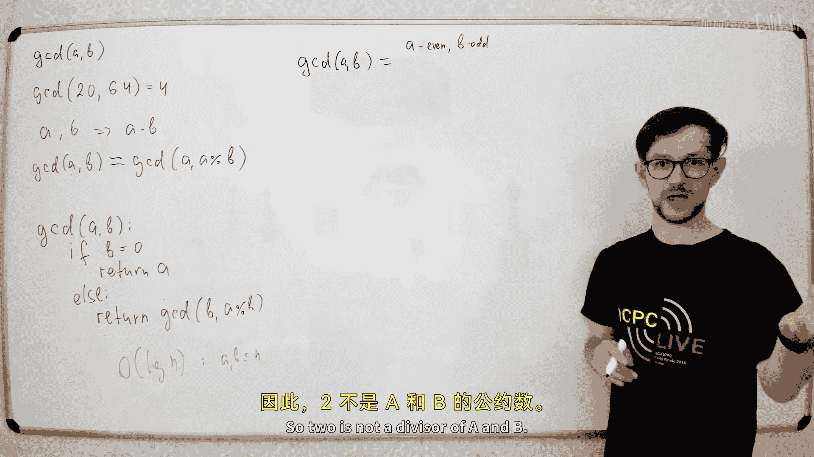

So。So the greatest div of， of A And B。Will be the same as。GCD of A over2 and。So2 is not divis of B。

 so we can divide a by2。And the result will be still the same。哦。What next。If both numbers are even。

If they and B are。Then two is common device of A MP P。

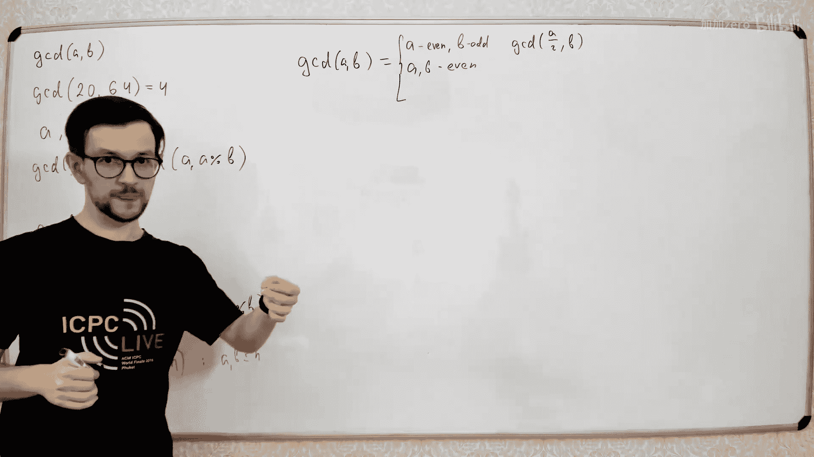

We can get these two out of brackets， and。Say that the grade commor A and B is2 multiplied by GD of A over2 and B or。

So we just know that two is a divisor， so we get two out of this function and calculate grade screen divis of this two thing。

And finally， if both integers are old。Then， we can subtract。Let's subtract A from B。

When we subtract A from B。ButOr B from a。The result will be on。 Yeah， so again。

So G D will be equal to G CD of a minus B and B。This thing is even。 Thiss odd。So again。

 two is not a common divis of these two things。So we can divide this thing by two。

And get the same result。嗯哼。That's all。So。So again， we have three cases。 No。

 actually four cases heroes have the same case and the same concern。And for each of these cases。

 we have one of these formulas in each of these formulas， we divide something by2。

 So the number of steps in this regressioncurs will still be again。But what's。

 what's the difference here we， we calculate the we divide。 we can we divide long integers。

 but we divide only by two here。 we divide integer by B by we divide one one long number by another long number。

You know would you wife long number or buy some shortcut buy two。

And divide number by two is much easier than divide one longang by another longang。啊。Actually。

 if you have bit numbers， you can just shift the number one bit to the right。

 and it will be the result of division by2。そ。So here， the number of steps again is log n。

But instead of calculating this reminder we we。Calculate the result of division by2。

 And it is much easier than calculate the remainder， yeah。Yeah， yeah。

 So this algorithm uses logs square time， I think。 so you， you can divide it。Yeah。

 so you can divide in linear time。 So and here you need to calculate the difference。

 you can calculate the you can subtract one log from in linear time。 So yes。

 so you can make all as in log and time and the number of steps will be log n。

 so it will be a log square right。W。Okay。Next interesting thing。

So your creation algorithm is not only used to create great common divide。It。

 it is multiple interesting purposes。 for example， what you can do using an euclusium algorithm。

 you can solve your fentine equations。What is theant equation。

 Theant equation is a very simple thing。Let's have a equation of this form。

 let's have equation a x plus By equals c。So we have some integer coefficients， A， P and C。

 and we need to find integer values x and y， so this equals to c。Yes， yes。

 important thing that we can solve it。 We should solve it in integers。 Yeah， so if you。

 if you can use real numbers here， it's。Basically too obvious， yes， so we want to find integers。

X and Y， so that this sum equals to C。How to solve the aentine equations using in encrypt algorithm。

 first， let's see if we know the greatest common divr of。If D is。G C，D of A And B。

Then what can we say about this number C？好です。嗯。So D is the greatest common div of A and B yeah。

So if a is divisible by D and B is divisible by D。Then C also must be div visible bedding。 Yeah。

 because this part is the visual， this part the visual orbit C must be the visible beating。そう。

If C is not visible by D， Op， people have no solution。No。

 I claim that if C is divisible by the that is always the solution。Why is it so。

 Because let's solve the following question， let's solve this equation instead。

I claim this solution always， this equation always have a solution。

And if this equation has a solution， then this equation also has a solution。 again。

 because C equals to something like C prime by D。So which if we resolve this equation。

 we will then multiply x and y by this C prime and get solution of this equation。

And I claim this solution is this equation always has the solution。How to find the solution。

 But this not always has a solution。 We can find this solution in polynomial time。嗯嗯嗯。Wch one。Yes。

 okay。 what was the province， So 2 x plus3 y equals to 5。So this is a， this is B。

 So greatest common divor of2 and3 is one。So， so so d equals to 1，5 is divisible by one。 Yeah。

 so so this solution hasn't。 this equation has a solution。There's no problem here。嗯哼。So C。

 should be div by A or B。 It should be visible by a or create great common deviceor。

If you have something like that， let's see。Plus。4 y equals2 7。

Then absorb is no solution because this part is even。 This part is even。 so the result must be even。

 so it， it can be equal to sell。不。Okay。So how to find the solution。

 we will find a solution using the same algorithms here。What will do。We will run the same algorithm。

But we will return not only the value of grade Sc divisor。

 but also the linear combination of A and B， which give you the same connection on。

Let's run this algorithm with。Let's structure write little let's write it here again。

So I want to calculate create the greatest common divisor of A and B。And。

This function will return free values。It will reach on D and also x and Y， such that X a plus。

Thank you for like you。A X plus B， Y equals to the。So my function will return to three values。

 It will return the great command div of A and B， and also the linear combination of A and B。

 which gives you number D。's just， let's just rewite this thing。So， if b equal goess to 0。Yep。

Then the greatest common divor is A。We need to find linear combination of A and B， which gives us A。

It's pretty simple。What linear combination give you A， for example。1 and 0。 cool admit。So。

 we can return。에ワエ지로。Which。Again， create command divor is a and combination of1 multiplied by a plus0 multiplied by v equals to a。

 so it gives you linear combination， which is equal to the grade command divor。Now。Else。

 that was interesting。Let's run this thing and get the result for this BM A model。嗯。Let's let's say。

 okay。Let's say D， X and y equals to GD。Of B And A model。好。We know the Gr Sc divor， it's here。

And we need to find linear combination for A And B。

We already know lead recommendation for B and a model B。

How to find the linear recommendation for A And D。 Let's see。 So what happens here。

 What happens here？ We have x multiplied by B。Equals wait not equals plus。Plus。

 y multiplied by a model B。以こし。Again， what is a modullabi， A mod duabbi。Is just a minus A or B。

Would you play with me？嗯 but but好。Well， let's let's look at this equation。 So let's。Re the brackets。

 So we have X B plus Y A minus thickness this。 So let's combine it。Let's combine it like this。

 So we have x。Minus a over B。Maybe。Plus by a equals to。So now we have linear combination for B and A。

So we have linear sorry this number is integer or the number is integer。

 so we have linear combination which gives us T from this given A and B。Sposed。So， we will return。不。

And linear combination of why。And this thing， X minus a over B。You missed why。Yes， something wrong。

Yeah， I see something on working。X B plus Y minus this Nik D。Im this one Oh， why， my but， my but。

Okay， let's fix this。Let's speak to these。Yesし、マイナス。对。Yeah， now to better。

It looks suspiciousious actually。So， y and x minus y。じゃ。아 어。哦。

So this was like extended version of this euclsium algorithm。

 it calculates not only the great screenis， but also a linear combination of A and B。

 which is equal to this。Great command div。 Actually， if if you have some， some the hunting equation。

 there are many solutions。 So so this is just one of the solutions。

There are many other solutions of this equation， it happens because here we take this zero。Yeah。

 but here we actually can take any number here。Instead of 0， we can take any number here。

And this will give us not one solution of the infant equation。

 but just the set of possible solutions of the event equation。嗯。That's all， that's all。

 that's how we solve your1 questions。 Again， again， you have， you have a question。

 You check that this number C is divisible by create command divis。 If not。

 then there is no solution。 If it is divisible， then you solve this solution this。诶。

This equation is that。 So this this equation then multiply x and y by this。

Number C prime and get solution for this equation。And there are multiple solutions。

 you can find all of them。 actually。 know there is some。Some series of solutions。

 just the periodic substructure of this。That's从别's错。公。Okay， let's go。Let's go next。

The next interesting thing is called the Chinese Roman Theem。It's called Ethereum。

 but we'll use it as。嗯。As algorithmic mixture。🎼あそれ。2了。来。아 하。ちだ 그。그렇죠 그렇 수 없。谁。稍来稍来。

So Chinese remains the third。Very simple fororem。Let's take two co numbers。

So let's take numbers and and M。And corporate。Pro right means just they have no common device other one so So。

Of n and M equals to1。Okay。😊，No。Let's take any number。对。From0 to Nm minus-1。

And then calculate the reminder of like like the click number N， model n and model N。

 So let's have two integers have A1 will be a model N。And a2 is a model A。No。There are。And M。

 possible numbers 8。And an impossible pairs of a 1 and A a2。

And the theorem is that there is a unique procope。好错。

So there's unique to go from a to pair of a1 and a。What is the project between these two sets。咁。

No let's see。So it's easy to get from a to this pair yeah， so each each number is。哦， hospital。

How to it。そう。From number 8， is easy to get this spare a to A A1 and2。

The harder part is to get from this pair a number a vacuum so this side see so this side is a little bit more complicated。

어。삼팔 번 하셔 형 오늘날。It's just simple theoretical lecture remote notoon explain causing problems。

 We can do it in some streams， maybe later。到。Yeah。So how to。

 how to find number a if we know pairs of number a， A 1 and a2。 again， let's let'。

Let's have some example。Let's have some examples here。 for example。

 let's say n equals to2 and n equals to three。So we have all possible as 1，0，2，3，4，5。A 1 will be 0。

 Well， Pa， Pa，1，0，1，0，1， and  a 2 will be 0，1，2，0，1，2。So you may see what for any。

 all these pairs are different。 So So if you take any pair。Of these individualss they response to。

Some unique number a here。So the question will be how to find this number A if we know numbers a1 and A2。

How to do。Lets oh let's write the equations， so what is a1， a1 is a mod n。What is a model or M。Eese。

8 minus something multiplied by n。What is A2。A2 is a model M。

 So it's a8 minus something multipl by M。Now， from both of these equations。

 let's get get the number a。 So here a。Equals a1 plus XM here， a equals to a2 plus Y m。

Now let's combine these three questions here we have a here。

 We have H willll combine them and we'll see a1 plus x n equals to a2 plus YM。Right。

Now let's just just put this to the left。 this to the right。

 So well be some x and minus Y m equals through a2 minus a。And what do we have。

 we have a defantine equation。 Yeah， So again， in this equation， we know number N， we know number N。

 We know this difference。So we can solve the f equation。

It will be solvable because N and N and Emma co。 Yeah， so gradecom div is one。

 So any geoantine equation is solvable we will solve this theentine equation。 find numbers X and y。

And then knowing these numbers X and Y， we can find number A here。不错。So again。

 the algorithm works like this。 You want to solve this。A system of of equations。 How you do it。

 You combine them like this， solve their fing equation。Findine numbers， x and Y。

 and then find number A from this。Quite easy it clean y。Let错 let错。

What happens if numbers are not coraing？So， what if I remove this distinction。

 So what if I allow numbers and an M B not compried。Can you ask see what's going on。

If numbers are not comp， then some of the equations will be not solvable Yeah。

 because this difference may not be divisible by the greatest common div of A and B or N and M。

So this equation will always will only be solvable if this difference is divisible by the C common device of N& M。

嗯。Yes， and be a training camp， this's also， for example， again， let's let's do it， let's do it。

If you help。2 and 4。あ。So we have 3，4，5，6，7。1，0，1，0，1，1，3 is0，1，2，3。Yeah。Yeah。

 so we have multiple numbers which give the same pair of frameers， for example。

 here we have one and one and here we have one and one。Actually， actually， what you can do。

Is to calculate。Yeah， if you take a， not from N L -1， but to lowest common。

Multipplayer of these two numbers。 It will work。So for any number from from 0 to the lowest to minimum common multiplier of the numbers。

 it over。嗯哼。😊，Okay。ま。So what's next， What's next， What's next， What's next， what's next， What's next。

女子中学。😔，Yeah， let's move to some prime numbers here。哦， no， no not not。Let's talk about something。

 Let's talk about model arithmetics。So。Sometimes you want to calculate you want to make arithmetic operations。

 not for all possible integer numbers， but for some small set of integer numbers。

 So we want to make all operations just by some model So how model arithmetics work。そ。

Mine you have only numbers from 0 to n -1。

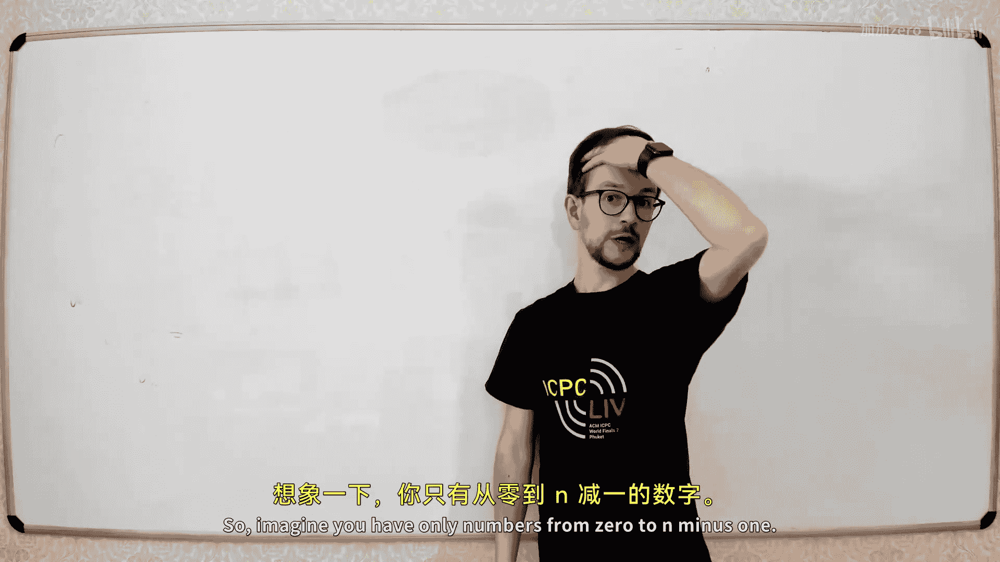

So we have only numbers from 0 to n minus1。

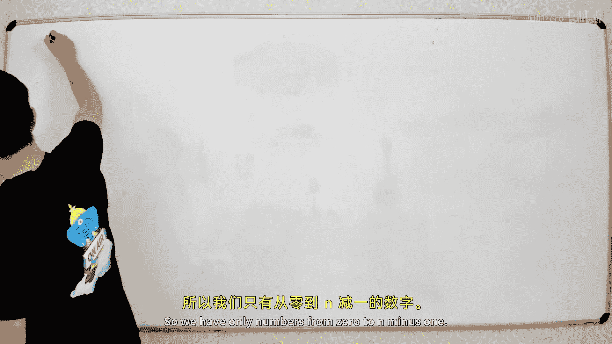

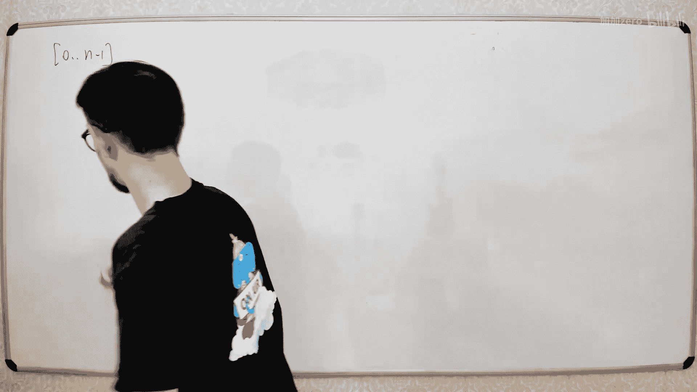

I will not use terms like rings， fields， groups， stuff like that。

 I will just try to avoid all the math terms in this lecture。请可好过去。啊。Yep。那。嗯。B。

I I just think it's interesting thing for study。Again。

 this is just an introduction action to La numberpher to not flick of course about number theory。그咩。

Now， what if you have only numbers from 0 to m -1 and you want to make arithmetic operations only inside this small set of integers。

I will not talk about Fi fields， okay。Okay， let's just stop here okay。到。

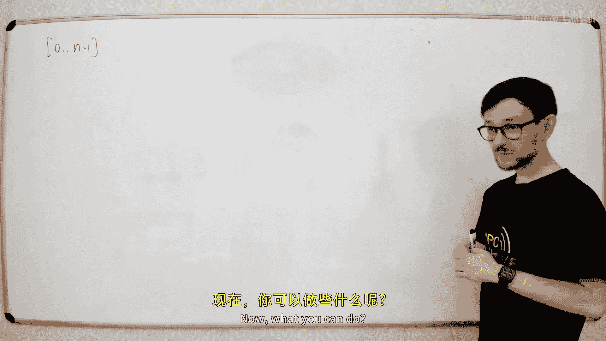

What you can do You， you can do， for example， if you you can sum numbers， yeah。

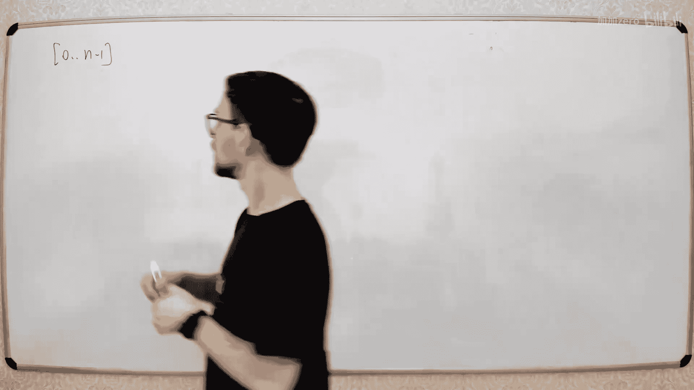

So， instead of having some。Normal sum of integers。 You will calculate sum model M。

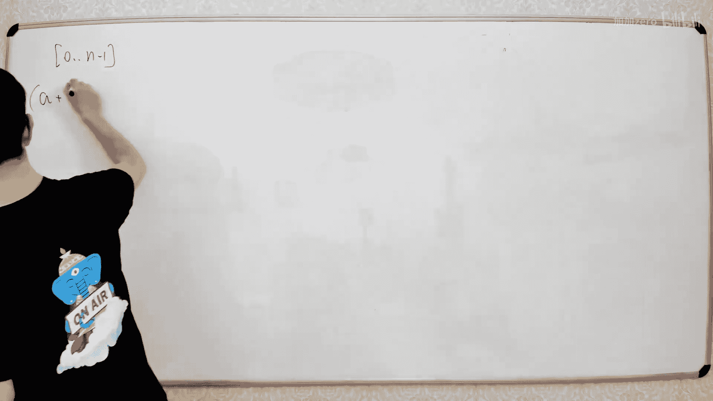

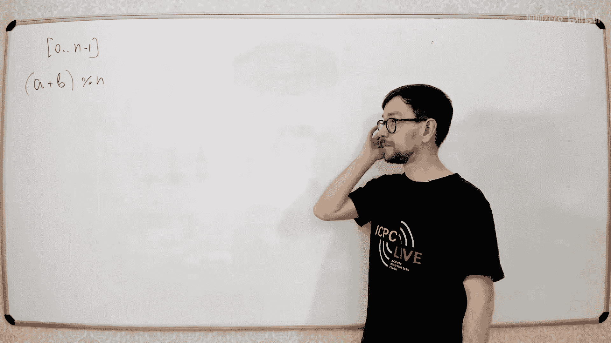

No。If you calculate some mod m， it will get the sum to be in the same small set of integers。

 So if you calculate sum of or sum of two numbers， the usual sum of integers may be out of this set of small integers。

 but if you calculate mod and it will still be inside set from 0 to 1 minus-1。That's cool thing。到诶。

If you use this。Some operation， it will maintain all the common properties of， of plus operation。

 For example， you can use say that it is associated。Plus C equals to a plus E plus c。야。

So a social activity of of of some is still here。 It's commut。SoA plus B。Is still B plusk。

 and so on all the common properties of the class operation are still here。

 even if you take model operation after each sum。You can support numbers。So what if you sub number。

이기합니다。Mdal M。And again， you have all the common properties of the practice， for example。

 if you take a minus a。

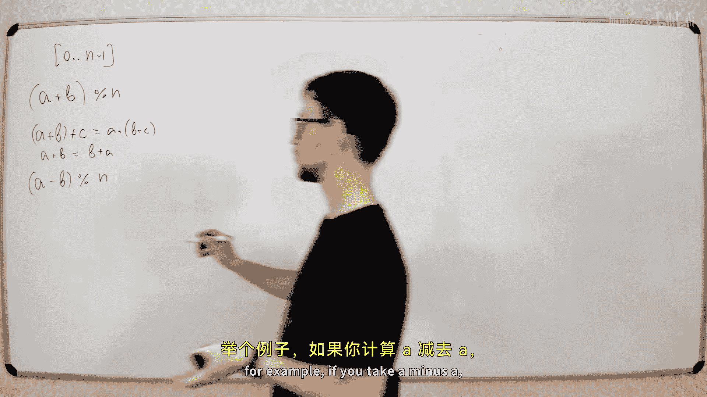

I for it like like， let's say let's say A plus B minus B will still equal to a。

And so so all the common properties of these arithmetic operations will be still will still be here even if you take model after each operation。

那。You can multiply。 You can multiply numbers again。You can take a model after multiplication。

And you will have distributivity， for example。 Yeah， so example A plus B。

Multiply by sea will still be equal to A C plus PC。냥。

So this model of matrix keeps all the same properties as for usual operations like for usual output。

 but it will keep all the numbers in this small set of integers。Okay。

I didn't use termer group or field or ring hero。 Okay， let's go。Now。Can you doub。

How to divide in this set of features。 So I want to calculate something like A or B。Yep。

Is it possible to divide dangers or not， No sometimes it's possible， sometimes it is not。

Let's do let's。 instead， let's go one over。What's a be， Let's call the be。Or minus one。

How to calculate B power -1。 again， just by definition。

 being in power -1 is the number such that if we multiply B by this B power my will get1。

Let's try to find number B B B B inverse such if we multiply by B， we will get one model M。

 We can take all allaciers model M。What does mean if it equals to one model N。

 it means that if we have been multiplied by B， we will have one plus something multiplied by N。

For some integer x。What do we have here？We have a def integration， right？Like before。

 we know let B1 mean minus x n equal。This is again， a different equation， so we know number B。

 we know number N， we know number one。And we need to solve these different authentic equation。

When is toable。Can you see。So when can we solve this data integration？Okay， this easy question。Yeah。

 then， then great command div is one， great command divis of what great commandvis from B and N。😊。

So this equation is hoable only the ifb。Is co with them。So what what does mean。

 it means we can divide numbers。If， if the number is comped with the model So we have model N。

 If number B is coed with N， then we can divide by number B。

And we can actually do it in polynomial time again。

 we can do it in polynomial time just by solving this theentine equation using Euclidean algorithm。

 which I discussed before Yeah so use the Euclidean algorithm to find this B power minus1 and then you calculate this this B inverse and then you can divide by the number B。

Nice。For example， if n is prime， example， if n is prime。Then you can divide by any number except0。

So if n is prime， then all integers from1 to n -1 are prime with n， just because it's prime， yeah。

 So if n is prime， you can divide by any number except 0。One of the cool things about division inn。

And this okay。Me。Yes， yes。 If， if any is prime， we can calculate the inverse in the the integer easier。

 We can。 We can。 We will do it。Okay， we will do it in a few minutes。Now， let's report prime numbers。

What about primamals？So you have a brand number， B。Let's see how to check if it is problem。Actually。

 quite common problem is to find a good prime number。 So for many I know。

 for many cryptography algorithms， sometimes you just need to pick some big random prime number。

And usually how you do it is just to pick random numbers。And check if this numbers， if。

 if the number is prime。It's a common way to find the praum。

So how to check if the number is prime or not。嗯。Again。

 easy algorithm is just to check all the devices with somebody。 So if we check all the devices。

For from， let's say， from 0 to from 1 to not from and from 2 to M-1。

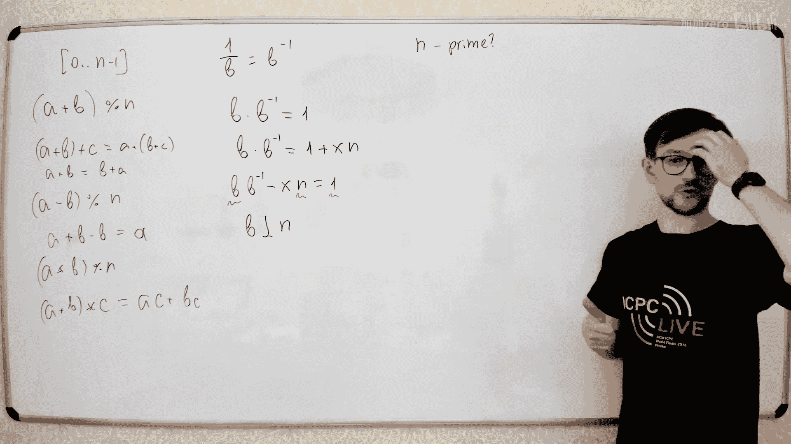

There。 We can use formal li serum if we， if we work in， if any is prime， we will do it in a second。

Now， if n is now if n is prime。How can you check the numbers per， Yeah。

 you can you can check all the possible dividers up to square root of L。So in time。

 square root of n is pretty similar so we can check all the possible divideisrs up to square root of n。

 if none of them divides n， then n is prime。Why show， Because if n is not prime。

 then any is product of some P and Q。And at least one of them must be less than squared of n。So any。

Non prime number。Is it a jump for non prime in English， I don't know。

 So any non prime numbers have a divisor which is less or equal than squared root of n。

So you can just do it like this。Yes， you can use sea dis fence Yes though。 is also possible。

I want talk about C of because it's。Not that interesting。 but we can talk about you。Okay。

我 give多 later job。Yes， the sea we used when you need fine small numbers。

It's pretty hard to use it when you when you want to find like thousand0 beats brand number。那。

So composite also。Composite number， yeah， so if n is composite number。

 then it has a divisor which is gl or equal square of cool yeah。No。So this grade is not pretty no no。

Like we discussed in beginning， the polynom algorithm means it should be per of the size of the integer。

 Yeah。 So size of the size of the numbers loggan。 So this is not polynomial logan。

 So it is slow algorithm。 You cannot use it to find really big， prime numbers。

How to find really big problem numbers。Hello， it's a good question。Rs several goods。Tests。

 which checks if the given number is prime or not。Well discuss one of them。' will discuss me Re test。

Let's start from the simple theorem。 Let's start from the fair mathematical little theorem。

 The mathematical tells you that if number L n is prime。Okay， let's make an expand version。

Let's do it for away。Ls。See then oil function。 So what is oil function of of number M。

It is the number of integers co with them。TheNumber of， let's see， a co with N A from。0 to n -1。

So phi of n is basically the number of integers coed with n。Now， if n is prime。

 then the of n is actually equals to。And this prime。Right。Then the n equals to n minus one。到。

ReRe simple theorem。 Really simple theorem。 If you take any number。A， co with M。

And put it to the power。three of men you get one。Very is simple feeling。Let's prove dictionary。

 Let's prove it。yes we have time。 So let's prove the theorem。 it's easy。

 So I won't prove any hard to， but this theorem is really simple。啊。How can they prove it。No。

 let's take all possible comp numbers。 So let's take numbers x 1， x2， and so on， x。And。So。

 this is set of all。All numbers co with M。好。Ex I brand。So let's take all numbers compd with N。

And let's multiply them all by this number  a。W，1， Y2， Can1 Y why。Why is the of end。H Y， I is just X。

 I multiplly banana number。No。What can we say here so。Now， all numbers， y are co within。So， first。

First observation is why I is always comped with pen。Look why is that true。

 Because we multiply two numbers， both of them are coed with n。

 So if you multiply two numbers comp with them， you will get some number which is also compr with n。

YouYou don't have any common devices here。 You don't have any common devices here。

 If you multi like them， you will not have any common devices。那。

Second observation is that all these numbers， white are different。Why is it true。

 because we can get from number y to number x？Just by dividing by this number a。

 so number a is comped with n， so we can divide by this number a。

 so we can calculate this number x from number y just by dividing by this number a。P， number x。

Is number Y multiplliied by a much？And since the number of these integers is the same so for each number here。

 we have a pair here， for each number here， we have a pair here。

 so these both sets are actually the same set。So here we have a set of all possible co numbers within N。

M。Again， what does mean， It means that x and Y actually contain the same set of integers。Now。

Since we have the same set of integers， let's calculate the product of this integer。

 So the product of all integers in set x will be equal to product of all integers instead set y。

Just because we have the same set of integers here。No。And now this is just。

A product of everything is X multiplied by y and power of the Earth。

So and now in this equation we can just divide both sides of this equation by this product because this product is product of numbers co with n。

 so sum this product is also comp with n so we can divide by so we can divide by this product。

See that one equals to，8 power，0gram。well talk about generator in we will do it in just a few minutes。

What is。The4。喂。This is Pete。 This is Pete。Which one。This， this is the product。

 So I use want to get the product。 So I will want to multiply all numbers in Cex。

I this the sample but product you big P。Yes， Capital P is used for product of set of inters，啊。No。

Yeah， now to to to the test。So how to test if the number is prime， what you can do。

So if you want to check， if your number is prime。What you can do。

You can take some random number a Cora piano。 check for cora。So let let's look at。

 be cr some random number。From zero zero。知讲。From  one to n-1。

Then check if it is comp with N if it is not comped， then N is not not prime。

So if G CD of A and and is not one then。そた。通 faults。Let's called East prime。All라。

So take some random number， if it is not co prime then n is different than the prime。

 if it is coprime， let's put it in power and minus1。So if a empower power n -1 is not one。

Then n is definitely not prime。Because if n is prime， then the P of n must equal to n -1。

 Then we put any number。In power n -1， we should get one if it is not one， it stop right。If not。

 let's say it's true。P贝。It's called F test。Very simple test。 So again， what we do。

 we pick some random number and check this basic processes。 If its right， we see would say what。

 okay， it may it may be it may be prime。Now， if。Now， if this function returns false。

It guarantees that the number is composite。 Yeah， so if now if I return false here or here。

 I guarantee that number is composite。If I return true， it may be a mistake actually。

 also this is a randomized algorithm。So sometimes it returns true， even if the number is composite。

For example， if you pick a equals to one here。Then it is definitely a co prime and these powers actually。

Definitely goes to one。 Yeah， so if you， if you pick one here。

 then here both of this probaable is5 here。No， you。

 you can pick round of you can pick number from 2 to n -1， actually， just to avoid the situation。

But it's not that important。 You still， they will be some corporate numbers。

 which will give one when you put them in the power and-1。

So it may happen sometimes you get wrong result from this algorithm。

And that's very common in this number theory， actually。

 many algorithms in number theory do something like that， they pick some random numbers。

 do some random things and then hope that everything looks go。啊。What's bad about this algorithm。

 This is called Fma a test。What's better about for some numbers。

The probability of success is very small。So there are some。Bed， composite numbers。

They called carammichael Las， that matter。So for these numbers， if you pick any。

Co prime number with n and put it in power n -1。 You still have one， but number still。

 the number n is not prime。 So there are some composite numbers which fails this formatas。Oh。

 it actually happens like because。Because fear fan is actually divisible is a divisor of n -1。

So if P of N is div find minus-1。Then if you put it in power N -1， it will still。 it。

 It will always be equal to one。So it happens， sometimes it happens。What you can do about it。

 what you can do about it。Noち。So there is it？Now， they are different。Tys of。But promise test。 I will。

Yeah。I'll tell you how how the Miller rabin test works。 I will not prove it is。 it is。

 It has good probability， but I'll just shall tell you what's going on in Miller Rabin test。

 There some magic happens， actually。So how meteorad test works？Let's do all the same steps。

 all the same steps。 but make one more check。Let's do the following and check， let's。So here， here。

 I want to calculate a and power n -1。Let's split this power and minus1。And much。

In some power of two。어 막 그런 뭐。And why is going。So let's just just grab all all power max possible power of two from this number of n minus-1。

And now let's calculate the following sequence。 Let's put calculate So n power n minus-1 is just N power y。

And then power this。Soで。And power N -1 is。8 in power wise。Then， power。그 나 먹 씨。

And now we can split it into systems， power 2 and power 2， power2 and so on。Your exercise。

So let's calculate n power and -1 like this。 calculate n power Y and then。Calculate square each time。

So we have like sequence hopefully sleep a power Y。やっぱと系。4 wire and so on， a power。

Let's complete this sequence。Now， in this sequence， this number should equal to one。Definitely。No。

Let's go back。Here， until we find any number， which is not one。So this number is one。

 This number is one。 This number is one。 This is not one。Let's look at this summer。

So let's find the first number， which is not one。Here。Oh， let's say we have some number。

Which letter do have？I have too many letters here。嗯。I need one more item。 Was there a key。

So lets have not let's have it into theger key。So again， wait。Calculate this sequence。Of powers of a。

 And now go back from here and find the first integer， which is not one。Now。

 if this K is not equal to one and not equal to -1。Then a n is not prime。 So if K。

It's not equal to plus or minus1。Then， n is composite。Why is it true Let not see， So if K。here。

 what what do we have here， We have K and then one。 So this next number is k square。

So we have K squared equals to one。Model in。Let's put it to the left。 So we have K。

Let's do it in two steps。Have K square-1 equals to 0。Now， K square -1 is k -1。Mulipied by K plus one。

Now， if k is not equal to plus or -1， then this part is not 0， and this part is not 0。

 So we have product of two non zeros equal to 0 model n。It can't happen if n is prime if n is prime。

Then， if you take。Product of two numbers， weight。None of them is divisible by n。

And the product is also not divisible by end。そう。Again， so this is non zero， this is non zero。

If you have product of two numbers， not zeros， equal to 0， then n is not prime。Fom。

Make sure you can calculate the device of N can takeity of this and this take calculate the device of N。

that's one modification to this parameter check， so we'll do all these checks and also take this check。

And the magic part is that we do， if you do it like this。

 then probability of failure will be something like one4。そうあ。Like 75% times will be accurate， so。

It's hard to prove。We need to go deep in this。Number 3 we will not do it today。

 but the idea is if you take at the set of all possible bad numbers。

 they liars in this so there are witnesses and liars。So。

 so if if number n is composite and you pick some random number here and you have all these checks past it's called the number A layer so give you the wrong result for this test。

And then。So major result of the mill arrival test is that the number of possible layers is no more than n over 4。

 So the at most。25% of all integers in the set are lis。

So the probability of your peak one of them is25%。Yeah， so basically what it can do。

 you can run the same test like 20 times。And if you do 20 times per， you will to in power of 40。

It's usually good enough。Sorry。No， again here you can mod it socially again， you can。Like the。

see there's a good probability。's some probability here。 So。

 so if you want to increase the probability of success。

 you just run the same algorithm over and over again。 and just the more you run the algorithm。

 the probability of failure will be decreasing in exponential exponentially， so。

You can run a hundred hundred of times and be totally sure that your number is prime。Nice。Oh， okay。

What's next？Let's talk aboutization。ization is all different。So factorization is a problem。

 you give a number n and you want to split it into some product of some primes。 So again this。

Main theory motors to。Any individual number can be decomposed into some product of brands。

So it's like P1 power Le on A1， multi play by P2， power， A 2， and so on。

So any initial number can be composed into some product or some primes。

And the problem of authorization is so of you given you given a number n and you're going to find the set of these prime numbers。

 actually， even if you find at least。If you can find。At least one divis of n。

 it' still be good enough because if you， if you manage to find at least one， if you， if given some。

Composite number。 And you manage to find at least one of his common devicesrs。

 You can then you can then repeat the same process。 So if you give a number N and you have algorithm。

 which gives gives you any divis of number N。Then you can take this device divided by this divide and then repeat the same process。

So the problem will be you given a number N， and you want to find any div of this number。

 N if it is not， if it is not prime。What's interesting about precision problem is that we don't know any polynomial time solution for this problem。

 and we actually hope very much that there is no polynomial time solution for this problem。

Because if there is relevant solution， then we will have very big problems in modern cryptography。

 and we'll discuss it next week。啊，そ。So we don't know any remember solution for theization problem。

 there is， okay， there is algorithm for quantum computer。 This quantum algorithm switch。

 which claims to。Factories numbers in poly time。But。There is no， okay。

 quantum computers are not ready yet。 We really hope maybe in some secret laboratories。

 there are big quantum computers which able to factorize big numbers， but。

There is no evidence of this， right now。If it will be， it will be a big problem。Okay。そう。Okay。

 how to perfectize， how to factorize number， if not preliminary。 again， you can， you can do it in。

We can do you can do it like like we did promise this。

 You can check all the devicesisrs up to square root of n。 So in time。

 square root of n is quite simple。 Yeah， so so you can era all possible device up to square root of n。

 And again， you if it is not if it is not primeed， you will find some divide you then divide by this number and so on。

嗯。Can you do faster， There are faster algorithms。So there are pretty fast algorithms to factorize numbers。

 not polynoial， but pretty fast。 click still can factorize this thousand bit numbers， but。We。

 we hope they will not， but。There。Pretty first， actually。Should we discuss polarization or not。

I'm not sure we have time enough for it， but。Ok， we may discuss custom some port of algorithm or not。

按m sure。You have enough time to discuss problems。I actually want to discuss generators more， okay。

 let's talk about generator stuff。Sorry， so this is not polynomial algorithm again。

 like we discussed in the beginning of the lecture。

 the polynomial algorithm must be polynomial of logarithofen。

 so the size of the problem is the length of the number。Oh，Let's talk about generators。

Let' take number's take problem let's take some problem number。

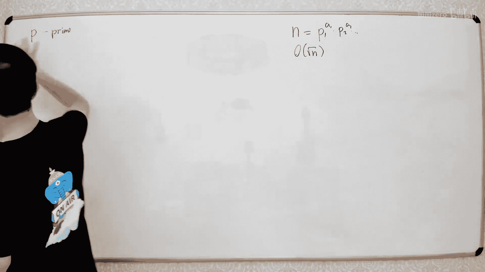

Let's take some bread on them。What is the generator， Gen is very simple thing。 Gen is the number。

Such that， if we。Let's look at all possible powers of this number。0ero， Z power 1， Z power 2。

 and so on， Z power P minus1。そう。This number is definitely one， This number is definitely one。Mmhmm。

So if you continue the sequence， you will have the same periods， right， So J power P。

Will be the same as GP1。So if， if you， if you look at the infinite sequence of these powers of G。

 you will have some periodic sequence with periodical 2 P P -1。You。Here， you have some period。

What's the generator， Gene is number， such that in this period， all numbers are different。そう。

I want all。Numbers from g 0，2 G P，-2。Different。And G is it's a called generator prim rural language depends kinds of。

Let is called Ju。So the generator is a number such that if we look at all powers of dec number from 0 to p minus-2。

 we'll have all possible numbers from 1 to p minus-1。Well， for example， let's take rhyme。ナンバー。

好 what's it 11。Now， let's take any number。 Let check if the number is generator， for example。

Let'sing number two。E East to generator Mo  11。 Let's check。 Let's check。

So let's calculate all all powers of this number two。 we'll have。把我。0 is  one。

 G power 1 is 2 and so on。 So we have 1，2，4，8。Then we have 16 model 11 is。5。Then multi by do have 10。

Multiply 10 by 2 is 20。Modular 11 is 9。9 those 18， model 11，7。7 with 14 millions free。아。6ix。And one。

Keep G power1。 And so this G power 1。嗯。So we can see that here we have all possible numbers from。

From 1，2 P-1。If you have situation like this， then trees generator model。

How to find a good generator。 good news and bad news。

 Good news is there are many generators for each prime model。 So for any prime number。

 there is a big number of good generators。あ。The best thing。

 we don't know how to find them efficiently so。We will just pick random number and check if this number is a generator。

嗯。Very simple algorithm， we know there are many many generators， so we'll pick random number from。

Again， from one to P -1。And check if this number is a generator。

And since the number of generators is pretty， then we will find the good generator with good probability。

그 승。Now。How to check if the number is generator。Why isn't every number generator no。

 because sometimes it's not。Oh。let's find some number， which is not the generator。Well， let me see。예。

I want change。그 수 푸。Good， for example， for。Let's see for4 p equal to 7， le we take G equal to 2。

 yeah。And what will help。We have Repower 0 is  one。 Repower 2 is 2。 Repower3 is。1。

2 is4 G power free is。1。而且。But let's put all， all all of them。There is6。Some do。W， yeah。

So the length of this period is less than。So I want the period to be of length 6。

 but here I have period of length3。So it happens for some numbers。

 the length of this period will be node 6， not p -1， but small。Okay。So not every number is generator。

 but but there are many generators， so if you just pick random number with good probabilities。

 you will pick a good generator。The only thing we need to do is to check if the given number J is a generator。

How to check your cheese generator。嗯。What you can do， Ha if you have some， if you have some number P。

 you have some number G， How can you check if G is the good generator。What you can do。 first of all。

 you can。You can check all possible power searching And just check that all of them are different。

But it's too slow。 Yeah， if you just check all possible powers that P minus-1 powers P is。

 big numbers of it。 this is just too slow。The idea is that it is enough to check not all powers of G。

 but just some some important powers of G。What do I， what do I mean。不行。Oh。

 here is actually clear you。So。Let's take， just look at all these numbers yeah。

So that we know that for any number G， even if it's not a generator。

 dream power P minus1 will be equal to one。So we know that p minus1 is actually a period of p minus2。

피マの人。-1，-1 P-1 is actually the period of this sequence。 Yeah， so， so if I pick any number G。

 not only generator， but any number G。P -1 will be a period of this sequence。What's problem here。

 problem here again， like here，6 is also a period of this。寄过来。

problem here is that I have a smaller period， So I have period 6， but I also have period 3， yeah。

So if I have， if if I have a period which is shorter than P -1， then it is not a generator。

So what I need to do， I need to check if my sequence is sequence。Has period less than P -1。

What can be the length of the period。What do you think。If the length of the period is not p -1。

 then what can be the length of this period。过就听。But here is actually quite clear。Yeah。

 it should be some factor of P -1。So， I can check not all possible。Not all power on。

 but only check the powers which are divide of p -1。So if I have p minus1 equal to no here。

 if I have p minus-1 equal to 10。Then the possible periods periods will be2 or five so if period is not 10。

 it must be1，2 or5。So how to check if the period is。How to check if video this one。

So if period is one， then I need to check this position。

I need to check this position and check if it is not 0， not one。If P is one。

 then GP power1 must be one。I check this this power check。 It is not one。Now， if Peter is2。

Then G power 2 must be one。 Yeah， so I check this position。If period is 5， then G power 5， then 1，2。

3，4，5。This ball。So。To check if number G is a generator， I only need to check these three positions。

Yeah， the problem is that the number of post number of dividers is still very large。

 So for for number P-1， there may be big number of。Possible devices items。So there's the whole。

It is sufficient not to check not all the devices， but only some devices。Thats here。Let's say。

 for example， Ps to 61。Yeah。So I have E-1 equal to 60。I have my period。 I， I， I have my period of 16。

 so I have this。G power，0， G power 16。Mmhm。😊，I claim there is a small number of devices。

 I need to check。And it will guarantee that there is no period of length， less than 60。

What do you think which， which video is actually important to check。Okay。

 listen this stuff from here， so。So what do I want to do， I want to check all possible devices。

Toy free。 Not， not， not， not exactly。It's close， but from opposite side。So for example。

 I check that there is no period2， and there is no period4。Okay。

If my sequence is periodic with periodical to two。Then it is also period periodical to form。So。

 if I have period 2。Then I will also have a period form。Okay。If I have something like this。

 or if I have one and here I have one。Then in position 4。

 I also will have one because I have pillow to go to2。So if I have period 2。

 I will also have period 4。So I don't need to check period 2。 I can， I can check only period 4。

 and if there is no period of length 4， then there is no period of length 2。Right。Mmhmm。

So if I need to check periods2 and four， I actually need only check period four。

 if there is no period of length4， then there is no period of length2。嗯。But then。

If I have period of land。Then。I must have period of length， let's say。12。Right。Okay。

 if I have period of length 12。Then I have period of length 4。 Then I have period of length2。

So it's enough to check period of length 12。Yes， what you need to do is to check periods which are fraction of so。

So you only need to check periods。Which is p-1 divided by some prime。Whats time D。

Was G is a prime factor。All P -1。そ。For example， for 16。そう。What is 60。

60 is some power of two multi by power of three multi by power of5。

 So there are three prime devices of 60，2， three and 5。So it's enough to check only periods。

Our lengthth。20 or 30。Divide by 2，12 and 12。Mh。😊，So we only need to check these free length。

If we don't have period of land 30， we don't have period of land 20。 We don't have period to32。

 then there is no。Bd of length， lesser than 60。Because any other length of the period will be part of this periods。

If you have period of length6， for example。Then you will have period of112。

 and you have left period of length30。If you have period of length for。

 then you have period of length。And so on so on。For each small period， if you have this small period。

 then you have this period as well。 So you only need to check these free values。嗯。😊，And now。

 since the number of prime factors is no more than login。You， you may have more than logo if。

Devisors of prime devices， again。So you only need to check after log in。

The place is in this sequence。And if there is no period in this， if you， if this power are at once。

 then you have period only of length P -1。 then it is a good generator。

The only problem here is that to find these prime factors of P -1， you need to factorize number P -1。

And as we discussed before， there is no good way to factorize numbers。So you。

 in order to find a good generator and just do it like this， you kinda need a good prime number。

 You need prime number P， such that P-1 have some good ferization。Sometimes you like it。

 sometimes you not。It depends。So sometimes it just happens that p minus-1 have a good ferization so you can find it fast。

If not， then it's better price number you。Can I find good generator。Okay。Uses an enough for today。

Yeah， I think it's enough for today。Al， I want to discuss support There's a shot。 Let's。

 let's discuss support for all everything。 Yeah， let's do。Okay， let's discuss。Facttizational rhythm。

 which works in time。呃。Please。So I want the root of fourth degree。 So it's faster than just。

 it's rather all。Divids up square of them。So I want to factor as number N in this time complexity。

Very cool out 그랬。そうだほど。Let's do check this， so。First idea， if n is composite。

 then n is product of sum P and Q， and one of them is less than squared of n。え哼。😊。

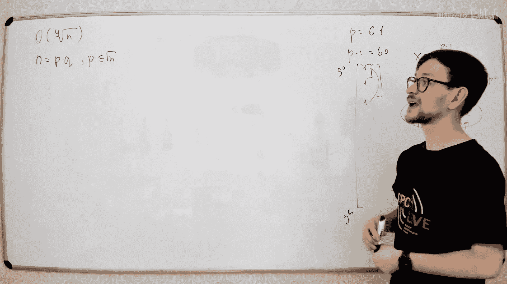

No。Let's do some magic stuff。Let's take some function。F of x。Let's say， for example。

And number X plus 1。Something like that。Let me check。Quickly。Plus 1 or -1。It's magic。

 So sometimes you need to check if your magic is right。M。-1， okay。マイ-1。Maybe plus one or all sorts。嗯。

Yeah， the say plus one also works。Okay， now。Let's put it back。嗯。Now， there is some function。

 This function is pretty much sh。Like the behavior of this square function。

 Model L is everything happens Model L。The behavior of square function model n is pretty much kotic。

 So it will give you some， something very much random result。For different numbers。

And who will use it。到。Let's。Calculate the sequence， so we start from sum number x0。And then。Ccolate。

 standardx1， and so on。Each next number will be just f of x minus1。

So let's calculate the sequence of numbers。Youは increase。And so on， and so on， and so on， and so on。

Let's calculate the sequence until we find some loop， sorry some point we find the cycle。

So we have the numbers we already have before。Now， the interesting observation。啊。

What will be the length of this cycle， What do you think。So if you have some random function。

 let's believe that this function is pretty random。SoThen you it some numbers， some numbers mod n。

 So there are n possible numbers。And you just jump between these numbers since using some random function。

How many jumps will you make until you will find the number you all in before。Again， basically。

 what happens， You jump into some random points from one to end， here。From r to from 1 to n 1。

 from0 to n -1。 so you jump into some random points from 0 to n -1。

And you stop when you jump into some number， which is already seen before。So how many jumps can you。

 How many random jumps can you make。Until you visit the same point， twice。How many in。

I believe we discussed it when we talked about hash tables like that。Yes， maximum is N。

 but what is the average size。 So if， if if function is really random。

So what is the expected number of jumps？Yes， yes。 it was long time ago。

 It was at the end of the first semester when we discussed the。Hsh tables。啊。

The interesting thing that the number of jumps will be about square root of n。

So the left of this loop will be about squared root of n。

Why is it true because of what's called belt products？So if you just pick random values。

If you pick some square root of n random values from one to n， then with good probabilities。

 you will pick the same number twice。That's actually because if you have square root of n numbers。

 then you have n pairs， yeah。The number of pairs in your group is square of the number of the size of the group。

So if you have square of fan numbers， then you have n pairs。

So each pair made made make big have collision。So if you have squared of numbers。

 there is a good probability of collision in your set，And that is exactly what happened here。

 So we just pick random numbers until we find some collision。

 and we will find a collision after about square of steps。

That's not all so this how will it help us to factor this number， first of all。

We will find a cycle in square of elementss and I promise you based some complexity so this starts up here。

Secondary。How actually this cycle will help us to factorize number， but it will， it will help。

Let's look at the following。 Look， look at the values。Y equals to x， I model a B。

So we have some divisor of N。So we know that we have some divisor。

 which is less record than square root of n。Let's look at the numbers X Y model of this device often。

We don't know where UF P。 We don't know where U of P， but lets just imagine we know the UF P。

What will happen if we look at the same situation for numbers Y？So we have number by0。Weiwan。

Why2 and so on。What will be the length of this period。

The length of this video seems we take all the numbers model P。

The length of this period will be square root of P。Again， we have P possible values for the number y。

So after this many steps， we will have some collision。

And squared root of p is about squared root of P。SoSince P is less than squared of。Now。

 it's interesting。So if we look at this。If you look at these sequence， model a P。

Then well have loop after。Ro of fourth degree of man。Mmhmm。😊，Now， the tricky part。

 tricky part is that we don't know P。 if we don't P， it's quite obvious how to factor right。

 so we don't know number P。But we know that there is number P。And after this many steps。

 we will find the loop model。So how to find this loop？Well。There are many ways to do it actually。No。

 one of the ways to do it is the following let。Make two pointers。嗯。Mmhmm。😊，ほほふほ。Yeah， what happens？

 What happens if I have period。If I have a period model P， it means that I have some X I。

Equals to some X J。Model it be。I don't know。 Woodlope。 Don't know。But what I can do。

 I can make different， take difference of these numbers expire months and change。Yeah model bit。

And now， I have some difference。Which is divisible by this P。야。So how to find P。

 I can calculate greatest common divr。Of X， I。Minus X， J and N。Mhm。😊。

And it will give me some div of pen。哦。It's also a case that I have period mod N。 That's a bad case。

 Sometimes you have a period mod N。 Then you just pick another random number and start process all over again。

But if you have period model P， but not period model N， then you have two different numbers。

And theyre divisible by this P。So you take difference of the numbers。 This number is not0。

 So if this， if this difference is 0， then you failed， you just start over again。

If the difference not 0 and this divisible by this P。

 then you can calculate densityity of this number。 And then it， it will give you some。Devisor of N。

Not P， maybe， but some div of friend。It will be something K and K， P。So put some device of hand。mhu。

Now， how to find out that we actually have a period model P。Weekend。

But we can look for the period using follow algorithm， pretty simple algorithm。

Let's take two pointers。X one X one， x2 and one。serious。嗯嗯嗯。Let's take two pointers and put。

So first where theres here a second for。Now， each time we make one step。

In first the first first first point to remove one step forward and second point the put two steps forward。

So we。So we move to this point there here。And this pointer。Here。Then I get a move this pointer here。

At least point。Here。So basically， we consider only pairs。X， I and X2 my。

It consider only pairs like this。What will happen？At some point， there is a period。

 So there is a period of some size。At some point， I will be somewhere here and2 I somewhere here。

 Now， the difference between2 I and I is I。 So it is difference between these two indices is increasing。

 So at some point， this difference will be divisible by the length of this period。 Again。

 we don don't know the length of this period。 So we just increase this difference。

Until it will be divisible by the length of period。At some point， it will be。

So when this length is divisible by the length of the period。

We will we will have two numbers with different zero modlo P。 Again， we don't know modlo P。

 We don't know the length of this period。 but if we just check these pairs。Then at some point。

 we will find。Put elements in the same position。In this period。

So we have two numbers with the same remainder modely。Yeah， despite the fact。

 we don't know a model P and we don't know left period。And since the length of the period is about。

A rule of the4 degree of M。The total and complexity will be the same， yeah。那'走。So。

 this is one of the easiest algorithm to factor a number of faster than just iteration overall squared of n device also。

Okay， that's definitely enough for today。I you soon next week。🎼Yeah。

