# 【精译⚡算法与数据结构】PavelMavrin p58 p57 A&DS S04E11. Basic Cryptography Algorithms -BV1NLB8YfEMq_p58-

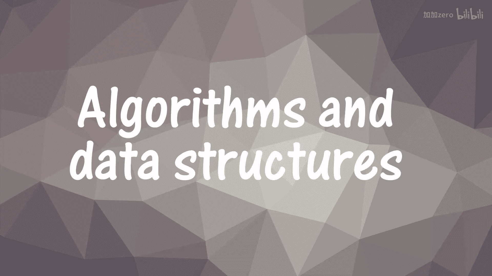

Today， I want to discuss some cryptography algorithms。Again， I am not a specialist in cryptography。

 I am even not a real mathematician， so。Just some basics just to show you how to use the algorithms we discussed in the previous lecture。

 so in the previous lecture we discussed some number theory algorithms and a lot of involving cryography based on these number theory algorithms。

 I just wanted to show how to use all this number theory to build modern cis。够。

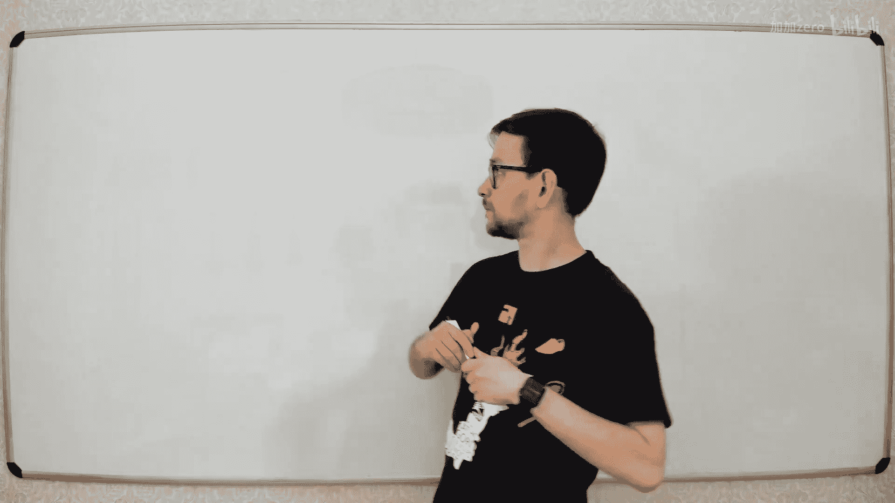

So what is cryptography， How do you cryptography， No， basically， what happens， There are two。Persons。

AMG。

They usually refer as Aliceison Bo。But you can pick other names。 You can say you have angle and boys。

Why not？ So you have two persons A and B， and they are exchanging some messages。

 So they have some messenger or something。

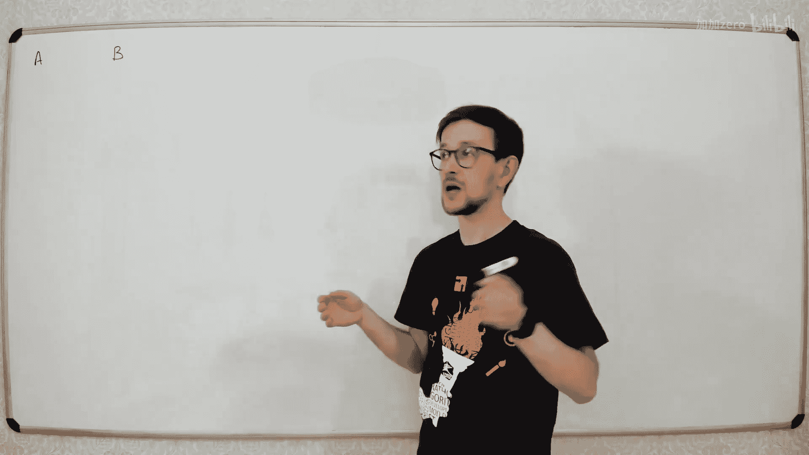

So they want to send each other some text messages or some files， some cute pictures of some cats。

 anything。 so they have just common conversation， right？

I send messages here and I send messages here。

And a。If they close to each child， they can just exchange messages physically。

 but if they are using some global network like internet。

 they send a message using this global network。

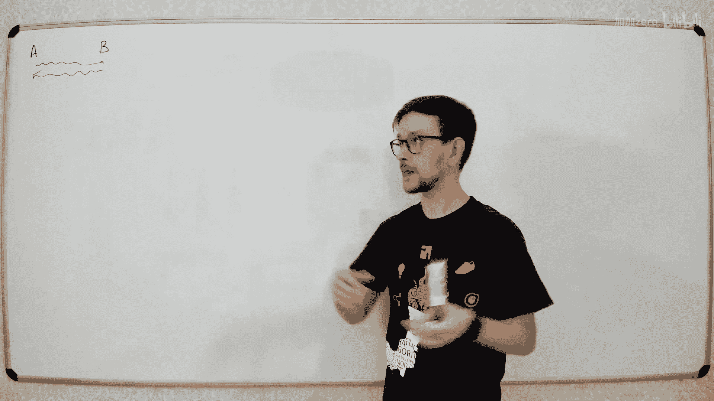

So what happens when you send message in the Internet？ So it's not like。

You send the message directly to your to to your。Partner， you send the message to their network。

And inside this network， So there are multiple nodes。有。

So when you send the message from here， it passes many internal nodes of this network。

 and in this internal notes， some other people can actually read your messages。

If you're not get careful of。 So let's say in this network， there is some。

 it's called attacker that doesn't matter。 So some some other question。Im from Mr。 Putin。 Yeah。

 and he wants to。Read your messages。Again， it's quite a common situation。 So it really happens。

 So the network are pretty open。 So if you don't use any cryptography。

Then some people in your network can actually read your messages。Actually， when I was。

When I was young， we had fun like this。h so like 20 years ago。

All these cryptography protocols one of that popular So everybody uses just pure HTTP protocol。

 HTP protocol is basically a plain text protocol。 So you just send you a message in plain text。And。

If you just scan the packages inside your local network， you can。

Learn many interesting about your neighbours。It's actuallyly hadn y。

So if you don't use any cryptography， then you can actually think that everybody can see your messages。

那。What to do。啊。How to prevent any other person to read your messages。

You shouldn't encrypt them so you can。 You can use some cir to encrypt your messages so that no one except your partner can read your messages。

No， I'm not a real hair car yeah。It's only for F Kongong。啊。そううん。For example， what can they do？

The easiest size work like this。 Let's say they have some message。

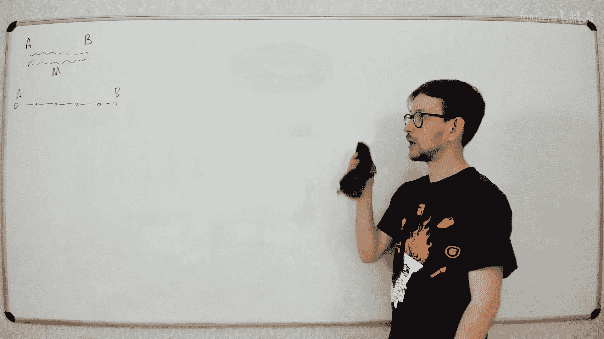

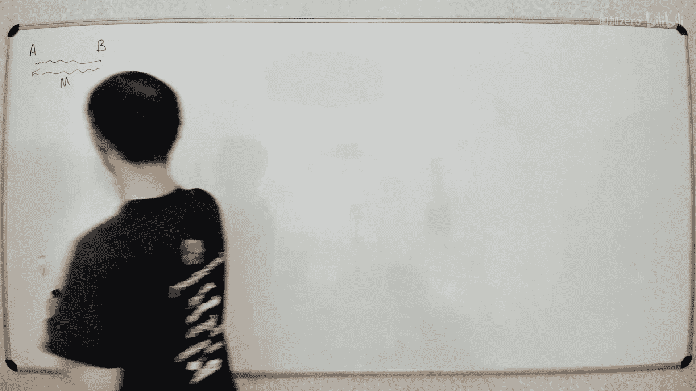

So they have some message and let's look it from here。Let's take one direction。

So I have a message M and I want to transfer this message from A to B so that M doesn't know this message。

What I can do。 Let's see if this M。Look， what What is M M basically sequence of bits。

 So let's say M is a sequence。Of end bits with zeros and ones。

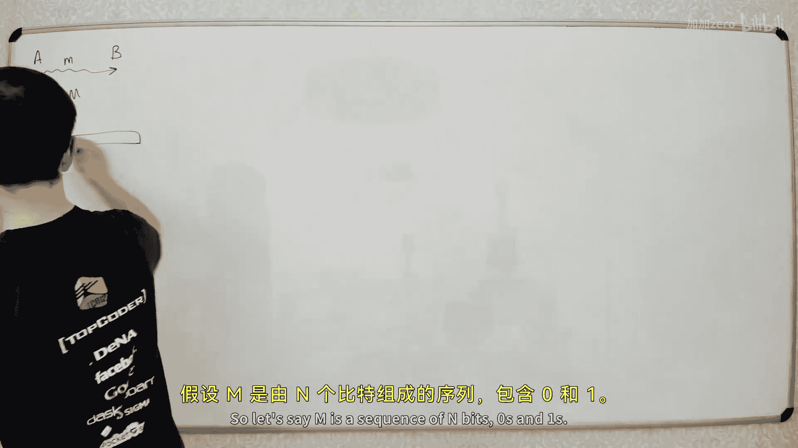

What if A and B both know some secret key， So they both know some secret key of length M。

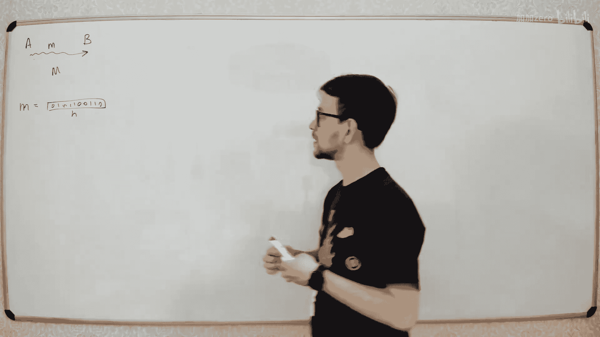

So。They both have this key。

And the length of this key is the same as the length of the message。So the left is key is M。

So somehow， both A and B。Find the same sequence of Mbits。

And they know this sequence and no other know this。 And M doesn't know the sequence， yeah。

So what going。You can send message like this。 You can calculate a sort of this message with your key so you can calculate M right。

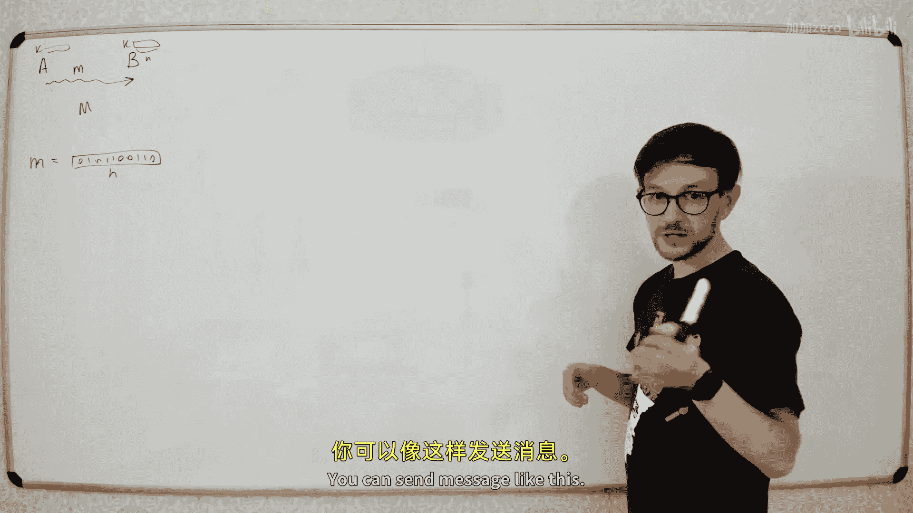

Yes。诶。This extra key。

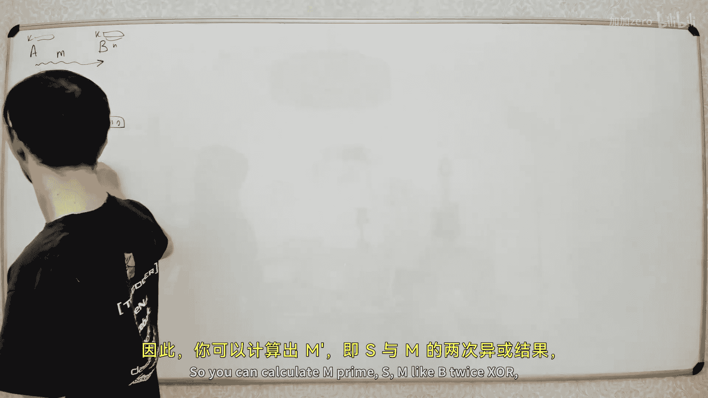

Like a beat rice sort。

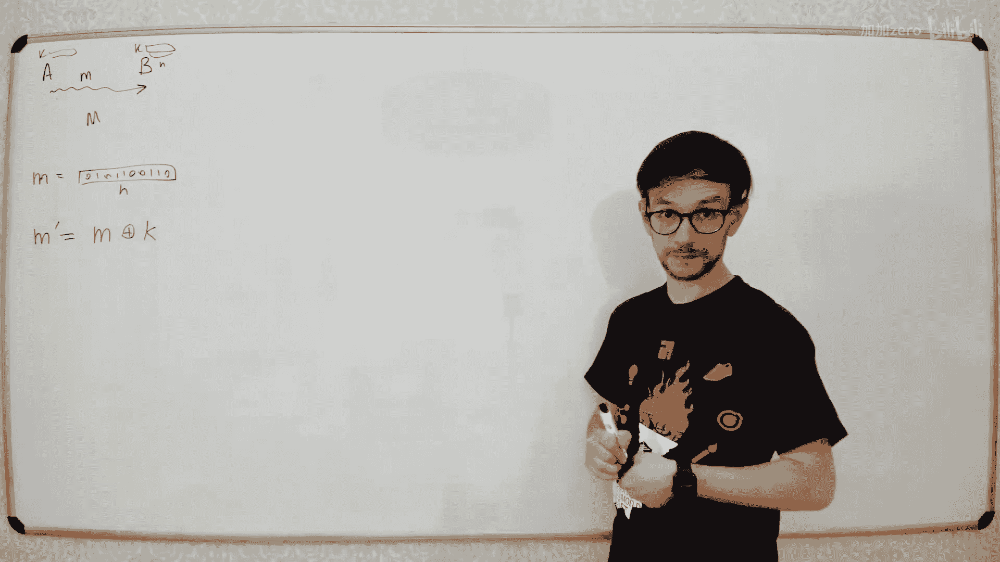

Then， send this em。Through this open network。And then B receive this M prime。

 he simply calculates M as M prime。Okay。

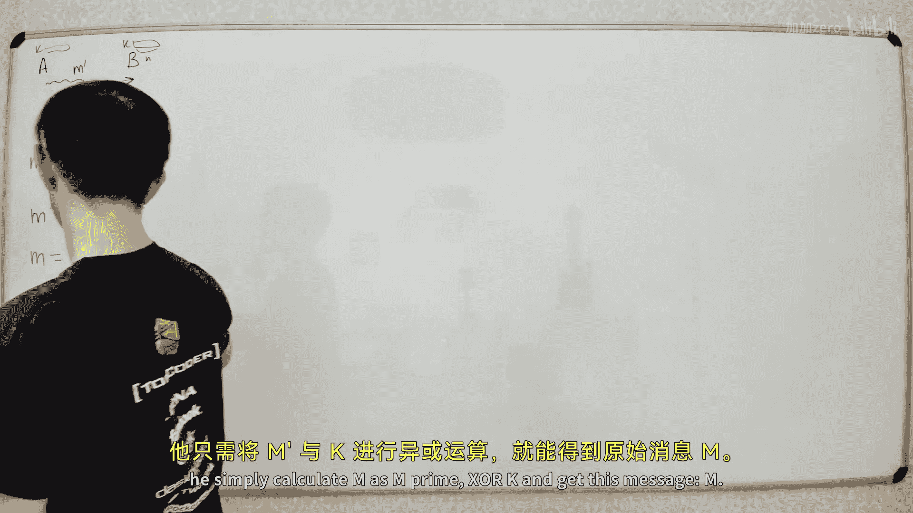

And get this message count。Very， very simple size。 So here， here's how how you encrypt the message。

 Here's how you decrypt the message。What happens？ What M C is so， So if。If you。

 if you are the customer M， if you want to actually read the read this message from this open network。

 M knows only this source。This is the only thing。Which is visible to this， M， yeah。

So what can he get from this information， No， basically nothing。 So if K is some random。

Sequence of bits。Then if you explore any sequence with random sequence。

 you get a random sequence of bits。 So this number m K is some random sequence of bits。

 Not basically any bit can be 0 or1 with equal probability， right。

 So if this key is some random sequence of bits。Then this number is also some random sequence of bits。

 So M doesn't get any information from this sequence。Yeah。

 so so M receives some sequence of M random bits。He doesn't know anything about this message， M。

That's all。But it's simple safer。It's actually working。 You can do it like this。right two problems。

Problem number one。A and B， somehow。Should get this shirt key。 So somehow this A And B。

Should get the same。Sa key before they start the conversation。If they can meet in this course。

 So if you just meet in some secret place and exchange the key。

Or just use some secret protocol to exchange the key and so on so。

 So if they can exchange the key without using this global network， just use some another network。

 which is secure。To exchange it key， that's fine。But usually it's not the case。

 usually when you you then write two persons in different parts of the world。

 they can just meet in the same point and exchange the keys， so that's one problem。

Another problem is that this key is only for single use。

 so you only can use these key onces because if you try to use it multiple times。

 So if you could play， let's say M M1 prime as M1 sorry k and then M2 prime。As M dor。

And send these to。These two sequences using this open network， then Mm actually。

Can get some information。 So， so this me he receives these two sequences。

 and they are no trendent sequences。 They correlate each other， right， so。

Just knowing these two sequences， he can get some information about your messages。 So， for example。

 he can sort M1 prime and M2 prime M gets sort of M1 and M2。

 That's some information about your messages。 So if you just quickly it M1 prime。And M2 prime。

 you will hit M1 so M2。There's not your messages， but it's something。 Yeah， sorry。

 So get some information about your messages。 That's bad。If you get。

 you have much information about your messages， you can actually find the contents of your messages。

Okay， no， for example， you can make some。 You can calculate frequencies of different characters and then match them to the。

Frequs of different characters in your messages and so on。

 So there are some methods to retrieve some information from these data。 So on so if you， if you。

 if you receive like at least some data about your messages。There are some other methods， like。

And there the frequencies and so so。 so you can get some information later on so。It's， it's better。

Now， so again the two two problems， first problem， how to get the shared key and second problem that keys only can only be used once。

嗯。Oh。What to do if if you want to send multiple messages， you can you can get multiple keys。

 So if you want to send multiple messages， you can you you can generate not single key。

 but the big array of keys。 Yeah， so you complete keys， K1， K2 and so on K。嗯。What number will have k。

とと？What's the B M， yeah。So let， let's calculate a big number of keys。 Share them between A And B。

 Now， they can。Sent the messages until they。诶 get诶。So until until you use all the keys。

 you can send the messages。嗯。What's the problem， the problem is this set of keyes also is still some finite set of keys。

So you can send the messages， but when you run out of keys， you don't you can do anything。

 So thiss still some no is still still not permanent solution， right， so some temporary solution。

 you can you can do it until you run out of keys。啊。This problem actually happens。So。嗯。

I'm not sure when， but。Long time before， when spies use keys like this。

 they actually get problems like this。 so they have some limited number of keys。

And they use these keys to cipher their messages to the headquarters and then run out of keys。

 they still need to send some messages。And they reuse the same keys over and Oregon。

 and they get caught because because against this this messages was。Read it and a day。

Some house called animal。 So some people who caught spies。

They actually can retrieve information from these encrypted messages just because they use the same key。

 tool。嗯。Yeah。Another solution is to have some。Infinite sequence。 So let's。

Say that A And B both have the same random generator。 Yeah， so they have a random generator。

 So this sequence is actually infinite。嗯。Anl。So if you have a random bits generator。

You can generate infinite number of bits。The problem is that A and B need to have the same generator yeah。

 So so you must give A and B exactly the same random generator so they generate the same bits。啊。No。

 there are some random generators， right， So so usually in your computer you use some Pdo random generators。

 right， So you use something like no usually how the Podor random generator works。 It has some seed。

 and then you generate each time you you use this seed to generate the next see using some simple formula and then and then and so on。

 So you generate an infinite list of something which is。Actually， you usually pretty random。

The problem is that if you use generator if your generator is not specifically built for cryptography。

It may have some how cold can。Some flows。 Yeah， so， so if。

 if your generator is not built specifically for cryptography。Then something like that will happen。

 So if you。Somehow， if M。Somehow gets a。Some first bits of this sequence。 and it may happen because。

 for example， you send some file。 This file have some heater。 Yeah。

 so this header is always the same。 So if you know the featherer of your file。

 you can sort and get the first bits of your key。And if you get enough bits of your， of。

 of your random sequence。Since your random sequence is not actually random。

 it's pseudoodore random yet。 So if you get enough bits in the prefiix of the sequence。

 you can retrieve all other bits。 so you can retrieve the seed of your pseudood random generator。

 And when you get have the seed of your generator， you can all other numbers。Actuallyly could happen。

So。But it it is， again， it is this problem is also solved mostly solved。

 So there are some specific generators built specifically for cryptography。

So they doesn't have this problem。 So they they even if you。

 even if you have some bits in the perfect， you will not get the future bits。啊。

Theyre pretty complicated but。Let's believe they they are working。And now the solution is。

Do you sound mis like。There are other cs， which are actually works simple than this。

 But there are some cphers， which is block cs。 Yeah， so there are standard cis， which。이上是可呢。

Trenrange operations， but they work with you。プレ시こそ我 what what's。Okay。

 that's hard to explain how to say if cpherrus is good or bad， but there are some good cphers。

Which works with the given key。 So if A and B share the same key。There are some good cis。

 which can encrypt your data， and it it is pretty secure。 So they can， they can shuffle the bits。

 They sort them with something randomend。 So in the end。

 you have no any no patterns in these bits and so on。 So， So this problem is actually。

Pretty much solvable。 It's it's not that complicated as。

 but there there are some different ciphers for this。 But again， if A and B have the same。Shirkey。

Then they can actually exchange the message using some Sha key cipher。

 there are a lot of them and they are pretty good。 they are cool and they actually what's even more important they are pretty fast so you can use them basically tools tool cipher anything。

 you can use them to encrypt。Your file system。Just in modern computers。

 the whole file system is encrypted。And you use some fast cycles for this。 And you can encrypt。

Like all your network connections。 So， So if you use VPN， for example。

 VPN is encrypted or if you just。Watch the videos on YouTube or on which。 So the。

Hlls YouTube stream is encrypted。 Yeah， so you watch the video this whole hole all this video stream is encrypted。

So they are pretty fast and they are pretty good， so this problem is pretty much solvable。啊。

What about the next part。 So， so the， the only problem with left， actually。

 is how to get this share key。 So， so if A And B managed to have the same key。

The problem is pretty much solvable。 The problem， The problem now is how to get this share key for above M B。

그거。So to get this3 key。We will use something， which called an。Open encryption here。Yeah。

It's called like。So what is open encryption， It works like this。You have not a single key。

 but you have pair of keys。 One key is public。 Another key is。Secret， yeah。So， we have k public。

And case secret。And you use one of the keys to encryptulator and another key to include the deculator。

 So you have basically two functions。 You have M prime。Encrypt。에 한。あ。From M using this public key。

And when you decre your data。왜리 그리 붙땐。You take this encrypted message and this secret king。Like this。

So it's not symmetrical here， so to encrypt the message， you use only this public key。

But to decrease the message， you need to know the secret key。Now， what happens if you。

 if you have situation like this， If you have stairs like this， you can exchange message。

 For example， let's say， let's say a want to say message to B。So I want to say message M。To boys。

 And I don't want anyone else to see this message。So I contact Boris。And tell him， Boris。

 I want to send you a message。 Yeah， so Boris generates public and security。 So， So he has。

Publicity and security。Yeah。So what is generate pair of keys？Now， he sends this public key。

Back toア say k public。有。Anngea uses this public key to encrypt this message。

 So So she calculates M prime as。Enrypt of M， and。Public key。Now， she sends this。And Brian am here。

Now， Bo use this secret key to decrypt this message back。 Yeah， so。

 so he calculates M S decrypt of M prime and key。K secret。That'sBasically how it works。어 哼。So again。

 what do you know if you listen for the messages in this network， you so， so， so I have this M here。

So what does he know， He knows the public key。And he knows an encryptive message。

And this information is not enough to retrieve the message itself。

 because to retrieve the message you need to dec to decrypt the message， you need secret key。

 M doesn't know secret key， He knows only encrypt message and public key that's not enough to decry the message。

That's the whole idea of this。ポ的こ。Now， how to build particle likees？To be a protocol like this。

 you need something which called the how it's called English， say one directional function。

So you need some function， which is easy to calculate one way， but hard to calculate other way。So。

 let's see。F x is easy complete。But in other way， this hard。呃で。So to build this protocol。

 we need some function， which is easy to calculate one way， but hard to complete other way。嗯。

What has been easy cculating hardware， But you it actually means that you。

You can calculate this function， first enough。And you can calculate this function first enough to use it in practice。

So， so this function can be calculated first。And this calculation can't be for calculate fast enough to use it in practice。

 right。嗯。Ideally， ideally， you want to be。F you go clip。Easy to calculatecolate。

 And this option is not calculate。Not possible to calculate at all， but it's。It's impossible， right。

 So if you can calculate function， you can always calculate the inverse function。

 You can just check all possible arguments of your function and find the argument which matches here。

 So again， what you want to do here， you want to find。Y is such that F of y equals to x， right。

So this is what the wordsverse function means。 And so if you can calculate function F。

Then you can just enter all possible values of y and check each value room that the function equals to x。

So it's always possible to calculate in instruction。

The idea is this is very hard to calculate function。

 So you need to spend a lot of time to calculate this function and this。Time is so large that it。

 it is practically。Impossible to calculate this function。 Yeah， for example， get white。

Why the problem， Why the P And P problem is important here， Because if this。

If you can calculate a function in poly melt time。 So this problem is in P。

Then comp the inverse functions obviously an NP。So if you can calculate something。

 put them melt time。You can calculate inverse function in polynommal time on nondiminal machine。

 Yeah， no， no how you can just yes number why in your nondimin program and then check that it is X。

 Yeah， so it's it's obviously is in an N P。So what if P equals  to N B， if P equals  to N B。

 it means。If we can calculate any function in per time。

 we can calculate the inverse function in per time as well。So if p equals MP。

 it's pretty hard to get。A good one direction of function。

So we pretty much hope that P is not equal gold in P。嗯。

Well even if it is equal So even if B equals in B。Prinoial time doesn't mean that。

It is fast enough in practice。So it it it it's a good sign that we can find the best program。

 but polynomial doesn't always mean the program is fast， right。

 So if this big polynom is power of this polynomous too big。

They still may have problems to calculate the instruction。Okay。You to quite say something。

I it clear enough by now。あ、そう。What's next？Let's give you some example of today we'll discuss two examples of one directional function and build some crypt schemes from this we will build two cryptography protocols using two one directional function。

First one direction function very is simple is multiplication。 So if you have two prime numbers。

Then you can complete M from， let's M by M。And S product of P， LQ。It'sVery simple， one dimension，1。

 one directional function。 So if you know two primes， you can multi multiply them。Very easily。

 And get the number N。On the other hand， if you have number N。How can you get。This P， N Q。

 do you need to factorize this in。And like we discussed in previous lecture。

 we cannot characterize numbers。First， so， so we can move from pair of P and Q to this number N。

Very fast。 And we can go back。Yep。Second example is discrete log。So second example is you have。

 let's say you have。 you have some prime。And you craft some Ju regime。Remember what's a generator。

 we just discussed last lecture， so generator is basically a number。

 so if you take all powers of this number， you get all numbers from1 to P -1。嗯。そう。

Let's take some intro packs。And complete gene power effects。

It's another example of one directional function。 So so it's quite easy to calculate a green power of x if you know number x。

 So you just use this。Again， we discussed it。Last week。

 so you just use this binary binary modification to calculate dream power effects。啊。

But it's hard to get to go back。 So if you know the number G power of X， yes smooth everything。冇到嗰边。

So if you know the number， gene power of X model P。It's hard to get the number X from integration。So。

 all these powers of G。Yi。So， just。Yeah， buy the expectation good order。

So it's pretty hard to get this number X from from this number。 thats what I mean。

It's called discrete log。 And again， it's one of the problems we don't know how to solve in billion real time。

Okay， so right。Sor of two hundred functions， and we will build two crypt protocols using these functions from this function we use protocol which cost R。

From this functional build protocol is called Alga Mal。Go。嗯，哼哼嗯哼。's let's build policy。楽し。Whats go。

 So how to generate。Keys for our sake。呃，帅一份。Let's generate two primes pin。So you generate， P and Q。

Big random price。아래 너무。Perhaps。Again， a week ago， we discussed how to generate bigger random prime。

 You just pick random number。 check if its number is prime。Now， let's go G N。As product of P N Q。Now。

 let's， let's see how the order function of this M looks like。 So what is P of M。Again。

 fee of n is the number of。Number of integers from one to n -1， which are co co with M。

So how many interiors are co primeed with M if M is product of two prime numbers。It。

 it's quite easy to seriously the number of these copyright numbers is。P -1 multiplied by  Q，-1。

だけどこしとしく。You want to calculate number of integers co with M。

These are all integers except all integers divisible by P and all integers divisible by Q。

 So you just calculate number of these integers and you get this formula。啊。No。What next。Let's take。

Randdom number 2。Coop private with。F。It's really quite easy to pick in your number。Usually can you。

 you usually can pick number free。In this come of your， sometimes not co。 You can pick 5。

So there are many numbers for prim field them， so you just pick any of them。And now。

 you calculate number D。As。Inver modelum。有费。Mm哼。How you calculate this number。

you you use query algorithm from the previous lecture。 So in the previous lecture。

 we discussed how to divide by in in the field of models。

 So so you just use this algorithm to calculate this number again， just remind you。

 So to calculate this number， you solve the G equation like this。 So this G E equals one。

Modelular fee of M。 It means D， E。Plus， something The of M。Eals to one。 So it's theant equation。

 You hold the theant equation using includes algorithm and you。Get the number D。Lets on。

And now you just say that the public him。Is N and E。And。Secret king。Is N and D。

That's how would circle the whole argument。Now， how to encrypt your data using this。

Using this protocol。Let's say you won't encrypt cry the message。 And let's say this message。

Is the number from one to。And -1。And M is co。No， there are many co numbers of N。

 So usually it's not a problem。 So you can encrypt all all possible messages。

 You can encrypt messages， which are co co with N。 It's not a big problem because almost all numbers are comppried with n。

 So M has only two big。Brian factorss。So it's pretty hard to pick number。

 which is not comped with end。Now， how to encrypt。インクリポツ。Second can frame。嗯K部分。

So we'll encrypt data like this。 We will calculate the number which just spa。Orいもで。Yep。Again。

 we'll just use binary Exp tool to calculate this number。嗯哼。How to equi them up。So totally 그。

TheThe gripies Em bred and his secret。We will just take this encrypted message。

 put it in power D model end。Yeah，特别。ま true。That' all it's the whole project。

So let's prove it's actually correct， let's prove that if we encrypt mesh like this。

 we can decorgrade it like this。 let's see。So if we calculate M， power， power E。Module M。

 and then take it in power of tea。Moral n。And what happens， We have M in power E D。More land。

What is E D， E D is just one model fee of N。 So we have M in power 1 plus sample multiplied by P of N。

Mmhmm。😊，So it's M。Multiplily by M in the power K theoen。This thing is one so down。你从。那得行。そう。

Why can you decry the message using just public key if you have only public key。Then。

To decrypt the message。Youか内にテスタンボルティ。So to know this number D， you need。

You need to calculate in power-1 model， if you of end。

To calculate in power of my power model F friend。 you know you， you need to know fear friend。

To know fee of N， you need to find the caization of number N。

And we don't know how to findization program。 So， to decrease create the message。

 You need number D to get number D。 You need P of N to get P of N。 You need authorization of N。

If you don't haveization of N， you cannot find the number D。哎呵。你错真错。那。Let's move for the second。

 second。Or thing。Hey， come on。check out。Sure。Just like this。Okay。let's talk about di helmet first。

 Let's talk about dihel Pro。Del protocol， a very easy protocol and so on。 I have a Mvy。Y。

 and I want to find some sha cake。So I want this kid to be the key to be the same for A And B。

How can I get get the same key for A And P。You just kid。そう。Let's take some big prime number。

And they can gene with them。We can actually use the same generator for for everything。

 It's not a problem。So we generate like we last week。

 So it's sometimes we have problem to find the generator。 So to find the generator。

 you need to factorize P -1。 So， so you need to get the number P， which is prime and such that P -1。

 iss easy to factorize。 So's kind。So let's see we have some number P and some number G。Now。Now。

 what can we do？え。Coco you write some random number X。And peoplele play some another random number。

Oh， glads see from。Last matter from。1 to P-1。Now， a calculates number。G power X and send it to B。B。

 calculates number。Gan power Y and send it to a。那我。A。Nse number gene power of Y。And。Number x。

So in gene power of y in the power of x， which is gene power of xy。B。

 we can calculate number G in power of x。Put it in his power Y and calculate number of gene power of X Y。

 So we have the same number for A and B。We will just say this number is the key。

So just call this number key。Now， A and B have the same sharp key。Very easy for the culture。あ。

What about the manmeter also if we have some somebody here。So。The man here。

 he sees this number gene power of x， gene power of y。

It it turns that it's pretty hard to get the number G power of X Y from these two numbers。Yeah。

So to get this number from from this hours you need either to get x or y but。

 but it's hard to get number X from here and it's hard to get number Y from here。

 So you you can get number gene power of X Y from these two numbers。Hi， the special shade generator。

 I this we can use the same generator for everything， actually。So in this protocol。

 we don't use that the generator is random， we don't use that the number P is random。

 We use only that numbers x and Y are random。So we basically can use the same number。

 P and G for everything。We can generate them once， and then use it。For old。Possible conversations。

I don't know how it was done in the practice section。How is that in practice？

So this protocol is actually widely used。 I believe they use some constant numbers。

 P and G for everything。看不出。Again， I'm not a crypto specialist。I'm just。嗯。So I can know the prim。

 Yes， even if M knows numbers P and G， it does' matter。Even if you know number P andG。

 you can get a discrete logarithm and you can this callography， you can calculateulate this number。

Do ship some oven every week。I stream lectures every week。嗯。No。Again。

 this protocol is used when you need to have shared key， actually。

So it's actually a quite cool protocol what' about what's very cool about this protocol is that you it's very fast。

So we only need to send one message here and one message here。 And we can do it simultaneously。

So there。Delay is very small。 So so， so if A and B wants to， it's like a handshake， right。

 So they want to share this key， they just send one message here one message here。

 And exactly one't the way get this messages。 They both have the share key。

 So it's very fast way to get the same share key for。Two partners。啊。Now。

 how to build encryption for this， you can actually build an encryption scheme for this。Oh。

So you want to encrypt the message。てや。And you want to encrypt the message。Message M。

 you want to send it here。そうビ。He generates number X。And then calculate number， let's say。Why。

 which is Jean bottle effects。Now， y is public key， X is a secret key。So he sends number Y to a。那。

How can a send this message using this public key。Theses don like this。A January8endum number。Yeah。

 let's calculate some random number。 and say S。And then calculate two numbers。 First number is。

Let's see A is G power S。Yeah， and B。Ease。Right， and B is M multiplied by y in power request at this。

And then send both this number， A and B to。Yeah good嘟な goodな。So again， the protocol works like this。

 I want to send message M to bo。So Bob generates number x。And number Y is gene power effects。

 send number Y to L。 So So she sit number Y she generate number S。Just some random numbers， S key。

 So generate some random number S， calculate gene power of S。

 calculate M multiply by one power and send both these numbers here。How can bo？

We keep this information about message。From this numbers， A and B。不是要死我我。Let's see if we are mailers。

 So sorry， so， so if you stand in the middle， what do we know， We know numbers why。Weow number。

 A and B。你。What do we know we know the gene power of x。

We know gene power of S and we know M multiplied by so y in power of s is basically gene power of x multiplied by of the gene multiplied by x。

So if you're in the middle， you can calculate these three numbers。

How can you get number M from these three numbers？ So again， to calculate number M。

You need to know number G and power of X S。And you know。

 gene power of x and gene power of S from these two numbers。

 you can get number of gene power of x so M。can not find any information about your message。

What can do both？嗯。So both can get the message like this。So what those number。A is gene power of S。

 and no power， no number B is M， most Y power of S。 So what is B。

 B is M multiplied by y in the power of S。What is y and power of S again， Y is gene power of x。

 So it's M。Multipliied by G。Power X， S， right。那？Both nose number X。

And he knows number G in power of S。So， he can calculate。G power X， S S。A。In power。

So a gene power of S， I put it to power X。 I would get number G power X。

And now I can just divide this number by this number。So I can get message M S B。

Divideed by this number。 So I will put in power of x in power -1。Any have what of message。Mmhm。😊。

This， this home， that's how El scheme works。嗯哼。😊，Nice。What's next。Let's talk about。

Let's start boat seat in the chairs。As business as El encryption。This。

 is called algaamine encryption。This called Dfi I'm not good about spelling names。 G P E Hillman。

like this。爱下。Let's talk about signature insurance。嗯。Let's say again， I want to send a message。

Let's look。嗯。Let's say if Alice wants to。So send a message to Bob。And。

How can Bob actually check that this message comes from。Als。そう。So we want to send， again。

 we want to send the letters to somebody。And you want you want him to know that this letter is actually from you。

 So what you do， what you do in physical or in physical。

 you put this you put your signature in this lecture on this letter Yeah。

 So you put this your signature below， this letter and your partner can read your signature and check it is actually your signature。

 So this letter comes from you。What how can we do it in electronic world。 So and in terms of。

 we can do the same thing， Sch， we can make something result electronic signature。

So and here answer again， let's say。Let's say Alice has a message M。

And she want to sign this message somehow and send this signed message to to Bob。

How can Bob can check that。This message comes from Alice。 let's say Alice has some secret key。 Yeah。

 let's use， for example， let's use L key。So in our essay， Alice knows numbers A and E and D。

And Bob knows only those A and E。So and let's know this secret number G。

So to show that this message is actually from Alice。

Alice will prove Bob that she actually knows number D。So number D only known to else。So。

 if he somehow。Proves， Bob， that she knows number G。 It means that this is。

 because she is the only one who knows number D。そう。Soハくねる。We going look like this。

 So you just calculate you encrypt this number using your secret key so you can calculate this number M prime。

Using your secret key instead of public key。 So you calculate em power tea。More pen。

And then send both these numbers to both。So they send numbers M。And am right。对吧。Now。

 Bob receives these two messages。Planin text message and message encrypt of this secret key。

So what can do both， he can check that this message was actually encrypted with the secret key of Alice。

So， what can calculate number。Empri。Power E。And check is equals to M。

So book checks that this encrypt message， if we dec using this public key。

 we get the same message as M。It means。But that if someone get this message prime。

He might know he he must know this number D because you can get from number M to M only if you know this number D and number D is a secret K。

 which is only。Yeah， so。Alice is the only person that can knows MRty。

So if he managed to get this number and Brian。It means he knows knows。

 It means he knows this number D。 And Alice is the only person who can knows this number D。

So that's how you prove that this actually message belongs to you。嗯哼。Good。What was please。Okay。

There's no problem。 Another problem is that pops on how to check that this message comes from Alice。

Bothob need to know the public cure。And how can he get the public here of Alice if he doesn't know about anything。

啊。Again，If there are just two persons and they want to communicate。

 they can somehow share this public key before。 So again。

 you need somehow to get this key So you need this public key of else somehow transfer to to B。啊。

If there is something in the middle soul， what might happen， What might happen。

You have this Alice here。 You have this pop here， and you have someone here。It's前's called見。

So Alice wants to send message to Bob。He send the message using some encrypt protocol。

 but he actually is communicating not with B， but with M。So they have very secure。

An encrypt encrypted communication channel between n and M。And。

Meory make the same encrypt connection here。So we have very strong encrypt connection here。

 Very standard connection here。And Alice thinks that the way she's talking to Bob。

 Bob thinks that he's talking to Alice。But actually， they both are talking with this and memory。

 Yeah， that's the problem。 So if you don't know anything about your partner and you just。

Send in message through through its open network。 You， you have， you have actually。Actually。

 if you don't know anything about your network。There is no way you can check that the person you're talking to is the person you're supposed to talk to。

Hes clear enough。Its clear enough what they want to say here again。Re。

Imagine you have a public network， and you have some friends。Who lives far away？ And you want to， to。

Again， you want to send us some message to this spread。

So you have all the encryption protocols and so on。

 so you try to encrypt channel between you and him。Spot。But you can， You basically can't do it。

Because if you try to send anything to， to， to， to the open network。Inside the open notebook。

 there may be some。前 in the middleぐらわ here。And he will communicate with you just。嗯。

She's mimicking there your conversation with Bob。Yeah， is it clear what the problem is， Yeah， So you。

 you cant do anything about this。 if you don't know anything about your network。

 you don't know anything about Bob， you can't do anything about this。嗯。

What you can do what you can do。You can share the public key before。 But again， this problem。

 if you cannot。If your public can work the only way to communicate， you can do it。啊。Ura。 for example。

 what can you do？ You can publish your。Open key in some place， which is only available to you。Like。

 you can take your code forces account if you confirm from code forces and put this。

A hash of your public key in your handle。Or if not somewhere in your， in your profile， so。

So if you want to send your。Public key to book。 You can send this public key。

 then calculate hash of this public key and put it in some public place。

 like like your codefor profile on something。So it's actually working。

 It's one of the ways to prove someone that you are you。

But it's only working when you have few people and they know each other。 So if you know。

 if you know the person， you know， you know the your person you're talking to has called for。

Or account or something like that。Or profile anywhere。In Facebook， in anywhere。

So if you know something about a person， this， that's fine。 But in， if you have。

Global letwork plate pin death again。And there are many。Actors in this network。

So like every website want to have a secure connection to all its clients。

 so you want to have secure connection between any two clients in your network and without knowing any information about them。

ね。嗯。非三拳。I'm talking too much。啊。Okay。So how the internet actually works。So， imagine you have you are。

So you want to connect to some code forces，So let's see。 let's see you Alice。

And you want to solve some problems on cold forces。So you connect to side code forces forces。Yeah。

So again， what's happening in the， you send some。Pets of information to the side port forces。

 the same as just send information I Aliceice。 I want to solve the problems。

 Give me the problem statement。This side this is called to solar in I or solar of code forces it。

Receives your messages。 Ok， Ok， you want to solve the problems。 Here is the statement of the problem。

You received this sample of a problem。 solved this problem。Put your solution in some packet。

Send this packet to code forces。 code forces receives your packet， check your solution。

 sendend your feedback again， so。So let's some some communication between your called forcess。啊。

You want to make sure that you actually talking to code forces， using some secure channel。

So before you start the secure channel， you want to make sure that the seller you are talking to is actually a show of code forces。

 so there is no somebody here in the middle who mimicking this code forces activity and just send you the same messages。

嗯嗯。So what actually click happening。Every site who uses a H S protocol。

 So H HPS S protocol is basically H TP protocol with some security layer ordered。

So every HP site has some something called certificates so sorry。

Ca for the site has some certificate。Which certifies that this site with this public key is actually called for the site。

 So in this code in this certificate， there is public key， actually。으 기밥。嗯。So a special certificate。

Which says that this public key actually belongs to court forces。It's certified。

 so you can use this public key to talk with code forces set。So， code forces。

When you first access this site， he sends you this certificate。

 You check that this certificate is avoid that。This public key is actually belongs。

 actually belongs to code forces。 And after this， you actually can start your messaging with code forcess because you know that this public key actually belongs to code forces。

咩没。そう。How did the court get this certificate， No， are special centers for this certificate， Sir。

I few sentence， which actually。how电脑。は。There are some。

 some special centers which issues these certificates to different websites。

 So you so if you own some website， you can go to the certificate center and。Basically， buy from。

Small amount of money some this certificate。 will literally cerify that this time belongs to you and you use this public key for your。

诶知条钱音。So how to check the certificate， so to check the certificate。

 you actually need to go to this certification center。Sber。I don't know how it's cold。 That's clear。

So quote for the sale you his certificate。You go to certification center。

And check that your certificate is actually valid。So if your certificate is valid。

 you know this probably key below the code forces， so you can continue to talk with force forces。

How can you contact the contact this。Cerification center to contact the certification center。 Again。

 you need， you need some。Enncrypted connection here。To have this encrypt connection。

 you need to know the public key of this certification center。So you have the same problem again。

 so it ends at some point， let's say it ends like that。

 So some certification centers actually are installed right in your computer so your computer actually knows some public keys of some certification centers。

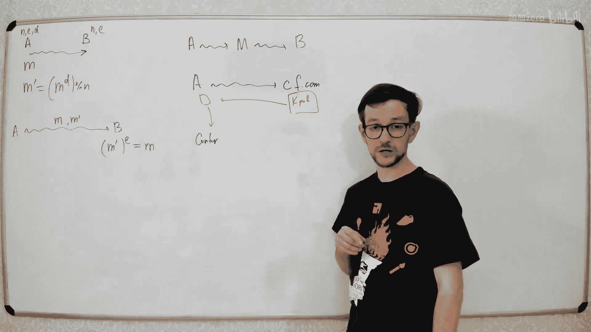

So you can so so you can。You can check the certificates local， actually。

 so you don't need to connect the certification center using some secure channels。

 or you can open the secure channels using these public keys you have on your computer locally。Ok。

 you stop talking So its it's。Souspicious。 say something。

I'm just telling the same thing over and over again。嗯。Okay。I finally。

 I want to talk about some interesting attacks about for example， the system。

Everything which has today is basically theory in practice in practice。

 everything is much more complicated。For example， let's talk about RA cryptography。

So in our secret photographyography。We just proved that you don't know。

 You can find number T if you can factorize the number and。So， if you know number E。

You don't know how to find number D。In， in， in reality， everything is much more complicated。

 What you can do， for example， what you can do is actually working。what you can do。

 So you send some message to Sarah。So will receive your message。And to dece your message。

0 calculates and prime power G。我都は。

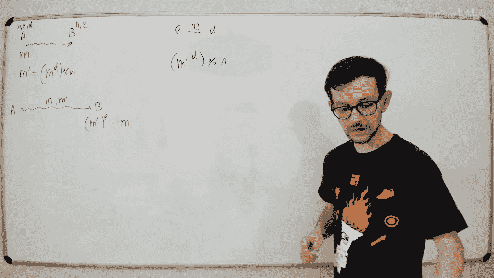

So what's happening， You send the fer some message encrypt message and prime。

To you create your message？Sir needs to calculate this number。No。How how calculated。

 How calculate proper policy can I get like risk so power。A B。

So if we want to calculate a power B Model N。How can we do it， So if， let's say a。诶。No， what， it's。

's look like this。嗯。Okay， let's do carefully and just for simplicity。 if because 0 return。1。

If B modular 2 equals to 0 return。播放。A square。Yeah。Else。Okay， let's，s not not that。 Let's make it No。

 not。It will be a little bit more visual。So how to calculate A in power of B。

Let's make C equal to one。 now while。B is greater than 0。 You calculate。 So if。If B is odd。

Then you calculate C， C multiplied by a。Model what m。And then B is B divided by2， and a is a。Square。

Moや。有。没东西。So let's how we calculate a out of B。What's interesting about this code in this code interesting that the。

Time you spent in this code is actually depends on the numbers you input。 So。

 so number of operations in this code is actually different。For different numbers。For example。

 in this， if， this inspiration。It is only executed when we have when when B is odd。

So it's actually insec only when we have B1 in this by the annot of B。そう。So again。

 the number of res of this procedure depends on numbers A and B。So what happens in our case。

 in our case， number of operations of this procedure depends on number m prime and D。

 and we know number m prime。So if we can measure the time spent by server。

 use calculating this result。We can get some information about number D。

 So again can different numbers， D。Will produce。Different number of operations of this code。

So if you can measure very accurately， the number of operations。

And we can actually so so we can we can measure time we can measure time and computers very precisely。

 So if we can measure the time the server spend to calculate this number。

We can get a lot of information about this number D。And by giving him different numbers， M。

And prime so， so we just give them different numbers and say decrypt this， decrypt this。

 decrypt this and can measure time he spent to calculate this to decrypt these numbers。

And just by giving this。The times， we can get a lot of information about the。

 and we actually can retrieve the number team if you， if we give enough。Ined messages。

We had a problem about this in some of the original ICPC contests few years ago。

 It's actually working。 You can do it。Alternatively。

 you can do the same thing just by calculating all the time complexity， but the power consumption。

So if you have some small。So crygraph used everywhere。 It's used again。

 it's used in file systems in networking。 It's used even in your creditaz cards。 you know。

 So so if you have some creditazz card。It has some cryptography protocols inside it。

 So what you can do is to measure that。Power consumption of your。Reading device。

 which read the information from your credit card and using this。Power consumption。

 you can calculate again， number of operations of this procedure。

 And when you get number of operations here， you can get information about number  D。So again。

 even if in theory。It's hard to get number T from number E in practice。

 there are a lot of other suspects you need to consider so。

In practice that usually all the attacks in in practice are。

Not connected to the theory behind this cryptography。

 So usually there are some much more simple ways to attack your cryptography protocols than just trying to solve this problem by itself。

Mhmm。😊，又给开不到。We want another thing or not。For example， okay， let's make one more example。

 for example， you want to。Let's say， let's say what may happen。

Let's say you have some message and you want to send it to multiple friends。So， you have。

Different friends。 And you want to have send the same message。 So you want the message。

 and you have three friends。 One friend has an。1 and E1 and 2 and8，2， and 3 and E3。

You want to send them all the same message。So what you do。You calculate your message power1 want。

뭐 n one。야 나 너 너 너 너 너한테게 시작해。So in practice， it's。Often the case that that。

To make the encryption first time， you use very small number E。It's actually widely used number free。

 So if all these numbers equal to3，So yeah， number E is not very important in the cryptography of in R cryptography。

So important thing that we cannot take number D from number E， even number If number E is not random。

 If you just take number 3 S E。You still， you still forget number D。

 You need to calculate the inverse number， modular P of N。 You don't know P of n。

 but so you can calculate number D。So even， if you know， even the number a is small。

 it's hard to get number D， but。And it is used in practice because it's easier to calculate。

 So to encrypttri the number， we need to take the power of A E。 So if number E is small。

 it's faster to calculate M power A E yeah。So it's actually its， it's quite real。 It's happening。So。

So we want to encrypt our message for free friends。 So we calculate M power free modular N1。

 we calculate M power free modular N2， and power free。Mel and free。Do we see the problem？

How can I get number M using these three numbers。我系十二十毫十 one。や 부。So。

So if you receive all these three numbers。How can you get number M？都行。No。Again。

 we discussed it last lecture。What， what do we have here， We have some number， model N one， number。

 model N 2 and the same number， model and 3， We can use Chinese remainder theorem。

 So using Chinese remainder theorem， we can calculate number and3。Modelular and1 M2。E。

And since M is smaller than all these numbers， then we actually calculate great number M Q。

Now we take cubic root of this number and get the number M。

So reality is a little bit more complicated than than theory。 Again， for all these problems。

 there is a lot of practical solutions。 So basically what you do what what you need to do here is to add some random bits。

 So you don't want to to encrypt the same data using different keys。

 So you want to add some random bits to your message and then encrypt different messages So it the salt of the mess。

 So So when you encrypt message， you actually want to add some random bits in the beginning of your message。

 So it will be it will be impossible to。Did decocodeed using some something like that。嗯。I it enough。

It was one more interesting。 I would。I forgot。I wanted to talk about something else， but I forgot it。

어。Okay， I think it's actually enough。So it's just introduction to some cryptography。 So again。

 it's not the cryptography course its just some。Examples of how to use this number theory algorithms in cryptography。

So I think it's， okay， I think it's enough today， okay。🎼。

