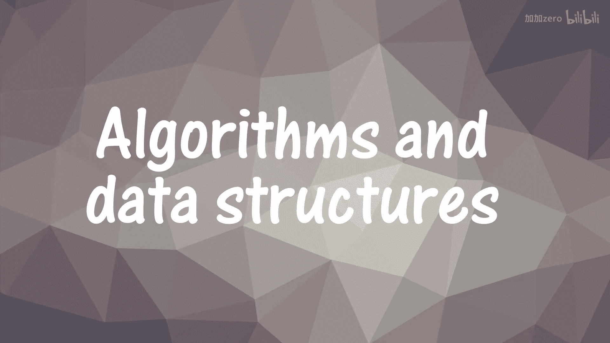
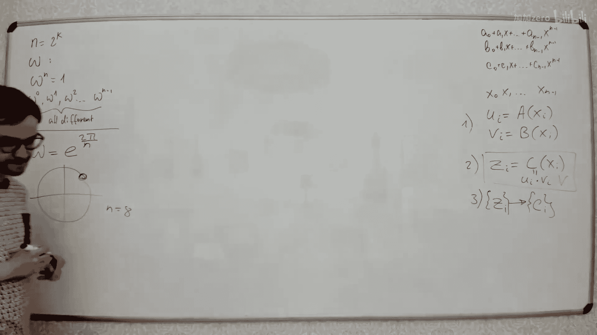

# 【精译⚡算法与数据结构】PavelMavrin p59 p58 A&DS S04E12. Fast Fourier Transform -BV1NLB8YfEMq_p59-

Today we'll talk about the fast food term。啊What is the why。Let's solve easy problem。

 You have two integers。 You want to calculate the product。 So you have。You got some that are A。

It also integer B。And let's say the length of this individual is empty。So they go to ends。

And you wonderful grade。Rroner。Okay。嗯。What will be a that complexity if you just？

Cculate the multiplication using some maybe all that。So what you do when you multiply to integers。

 you take each digit of one integer multiply it by another integer and then take some of all these。

Most products。 Yeah， So you take any。 you take each each dig of B multiplied by a。 get some number。

 then calculate some of these numbers。 So you have。

And integers of size M that I calculateulate some of these integers will calculateulate some in linear time。

 so the total10 complexity of multiplication， if you just do it like usually multiply numbers will be n squared。

Okay。And the interesting question is if it is possible to calculate the product of two indigenous faster and ask time。

answer is yes， yes。嗯。So how to calculate a product of two long cleans， fresh than and n square time。

First of all， let's think not about integers， but about polynomials， because it's slightly。

Easier to calculate polynomials， not integer。 So let's say you have two polynomials of size M。只不看嗯。

But you know okay of X。Let's say， a0 plus。Yes。A1 x plus a2 x squared plus and so on plus A M X O M。

 And random l B， let's say of the same size。そ。Okay。Okay。

And you want to calculateulate the product of this planet。C of x equal to a of x multiplly by B of x。

So the product of two prenoials is a prenomial。So I want to find the coefficients of this polynomnoia。

Sure。The split C is something like C0 plus c1 x plus sensor1 plus C。

 So the degree of the alone be 2 m x power 2 m。So how to find the coefficients of this poly？

Any ideas， say something， Okay， just。I just want to check that。

Anyone is listening what I'm talking about。So how to calculate coefficient coefficientency of this phenomenon？

哎。😮，嗯。Okay。今日四十平。Nice， okay， finally， yes， yes， we need need multi we need to take some of all possible products of2 k fuions。

Of A And B， such that the sum of this。Of this of the powers of x will be equal to I。 so I need to。

 for example， if I want to calculate the first coefficient will be just。

Product of these two coefficients。 Second page will be sum of this pair and this pair。 And so。

 so each coefficient is some。Of all products， A。 And let's say J and B， I minus J。Good。嗯m哼。😊。

So to calculate to calculate the functions of C， we need to calculate these sum。 But again。

 if you don't just do it like usually calculate this sum。 and you have again you have。

Qudraological there you need to calculate n coefficients for each coefficiention to incorporate the sum and linear time here。

 so total time complexity again will be n squared。So the idea is to calculate to calculate this sums faster than an S n square time。

Nice， let's go。 So the first all I want to discuss is the katu algorithm， So how can algorithm works。

It works using time divide and concourse。So let's say you have oneon A。

Let's split each prenol into the house。 So let's say pial a。

Is sum of prenoial a1 plus so let's take this lower coefficient。

 one prennoial and higher efficiency algorithm， also plus x in power N over2。8。参同嘅。Okay。분。Yeah。

So these coefficient will be a1， and these coefficient will be8。

So here here the powers of x from 0 to n over2 minus-1。 and here powers are from n over2 to n。

And do the same for the second time So for the second point， I'm going only have B1 plus x or L2， B2。

Now what happens if I multily these two， if I multiply these two things。

 I will have something like a1 B1 plus x power and over2。A 1， B2 plus A2， B1 plus X power N， A 2， B。

Here。Now， again， I use D control second here so why I。Now。

 I want to calculate the problem of two polynomials of degree M。So I split each pmial in house。

And now， I have。4 repcis。1 two， three four bicycles。So each of these。

 because the goal is to calculate a product of two p polynomials of degree and over2。

 so what I all have， so to calculate you not to calculate this product。Oto memmos of degree M。I。

Made something linear plus two recursive calls。It。Or fours。

Plus four reive course of poly degree elevator。那。If I hear the request。

 what will be a time context change？Okay。how to calculate complexity here。

 you have four con Each time you divide problem you divide the size of problem by two so the depth of your equationcurs will be a lower bit different ways2。

Y， and the number of callss will be four in power。Lo different based2。 Yeah。

 so it's for and power of log base of M。And what's this？对。嗯。😊，Once again， what's happening。

 I have problem size M。Yeah， I make four aggressive calls。You should goals so on。そう。

The size of this exccursion will it be a lot very store。

And the number of recurs pole will be4 in power of equal regressioncursion。 Yeah。

 so4 in power of lower base2 is just n square。So again。

 we found another algorithm of time complexityion square。What we can do， We can broker。

So let's see what's happening here here we need we don't need to have these two products。Separately。

 we need to complete only some of these two products。Yeah， so to calculate some of these to progress。

 we will do the formry query also。So instead of coculating these two products separately。

 we will calculate the product of a1 plus a2。Multipied by B1 plus V2。If we go to this product。

 we will have something like A 1， B1 plus a2， B，1 plus A 1， B2 plus a2， B。Okay。Now。

 from this product。We can subtract A1， B1 and A 2 B2。And if we subtract this and this。

 we will have exactly the sound winning need。嗯。😊，Second， once again。

We'll make three different circles。1。😮，Two and free。From these three decursive course。

We will get this product， this product and some of these two products。

Because we will get these products subtract A1 to one subtract AW2 and get this time。

So instead of four acres of course， we'll have only three acres of calls。Like this。

And like deia will be different。I'm complexity now will be M in power。Low free vegetables like this。

嗯哼。😊，That's how， that's how we improve time complexity。 So we have。Algorithm。

 which multiplies two polaros of degree M in this tank。ここからそを出れて。

Tecically one of the first algorithms。Known for multiplication to Polno's festivalsburg。No。

Now let's discuss fast rate transform。So fast for transform is another for multiplication to polynomialous and it works even faster。

Using fast create transform， we can multiply two polynomials in almost1 loggan time。

 So our goal today will be to calculate product of two polynoials in end loggan time。抱。不子公错。

So what is the idea of high fast rate transformer for the approach of tos？We will do the following。

I don't need anything read。First of all， I have here I have three polynoials and they have different degree。

 so these two polynoials have degree M， these polynomials has degree to n。It's not very useful。

 So so let's extend bananas A and B。2，2 degree n just just adds zero coefficients in the end。

 So all three bananas have the same degree and call is great n。 just cross increases。

 So I have polynomial a。A0 plus a 1 x plus and so on plus A and minus-1 x or and1。

So I want all my pianos to have M fus。It's now be 0 plus B1 x plus M so1 plus B n minus1 x and minus1。

 and product will be0 plus C。Yeah。Yeah。嗯。哎。Okay， this n is different from this n。

 This n is basically2 n plus one。 So the number， maximum number of coefficients。

In polynomial C is 2 n plus 1， so I will just redefine this m to be m2 n plus 1 just to have all coefficients have the same number all polylennoials have the same number of coefficients now all my polylennoials have m coefficients。

Now， whats that idea？The idea will be from， so let's。Pick some。An。So let's decrease use。X 0， x 1。

 and so 1， x M-1。Okay。はい。And now let's calculate the value of phenomenals A and B in these end points。

 so if I will calculate values。For say U， I will be the value of phenomena A in point X I hence say V。

 I will be value of phenomena B in point X。Okay哼。So I will just pick sum and values。

So can coordinates。And calculate the values of these two polynoials in this m coordinates。Now。

Now I need calculate values of per C。So， I intercalulate when。W he that I。

It will be the value of phenomenal C， CCC。Yeah。Okay， this is step one， this is step two ineno next。

No。When I know the various per C in some endpoints， my per has m coefficients。

 so if you know the values of your polynomial and endpoint you can reconstruct your polynoial using some lag repos and that。

Now， using these values， I can reconstruct the values of。So from， I will reconstruct values of。It。

W this。行。That's the whole。Again， three steps。First。

 I will calculate the values of my value of my polynomials in n given points。Now using these values。

 I will find the values of pannoal C in this poem now using the values of panno C。

 I will reconstruct the coefficient of this para。P行。Okay， what is the easiest step from this thing。

 or do you think。I claim one of these steps is really simple。We创这个 thing？票。

So most step is actually not that simple， so if you just try to calculate the value of pnoials in each point。

You actually need to follow all the coefficients and calculate this sum。

 so you will calculate the value in linear time and you have linear number of a linear number of elements here。

 So if you just do it like you usually calculate the values， it will take n square time。Yeah。

 the easiest step is actually a step two。Step2 is really simple so again pnoial C is product of pnomous A and B。

 so to calculate value of pnomial C， you just multiply values of pnomial A and B so in any point。

Where your funeral see？Will be just value of pial A multiply by value of phenomenaial B。

 and we know value per A and B。 So so it's just。Product of you and。没。说第次事就行。Yeah。快。

Steps 1 and3 are actually complicated。 And that's where where we need something like first rate transmit。

 So this is called。This this basically called free transformation。

 this is the of free transformation。こ。今ます么。So to make the fast rate transformation。

 we need two things。First。First。We want to， we want our end to be a power of two。

So I want number N to be phone power。No， it's easy。 So if n is not power of2。

 we will just extend all the polynomials to the closest power of2。

 the size of the polynomial will be increased at host twice， right。

 So it's how we usually get same something and power of2。So it's easy yeah， so again。

 you have some polynomials if the size of your polynomial is not power of2。

 you will extend your polynomial with zero coefficients。So you have not obsessed obsessed power tool。

Now， second thing is interesting。 Now， we need something old is called I was called prim more root of。

Of what problem of one。 So we need some special number。 We need some special number。Okay。

This number must have in poll properties。I want。Wle power N， equal to what。And I。

 I want all the powers of when will from， from 0 to n minus1 different。 So if I take。

The power0 the power 1， power2， and so on， W power M1。They must be all different。Yeah。

How to get this summer。So the problem is that in real numbers， you don't have the number。

 so in real numbers， if。Were greater than 2， right， So if n is greater than 2。

 then you have only like only roots of one1-1。 if you have only 1 -1。

 then here we have only two values。 So if n is greater than 2。A lot of few in yeah。

 so that's how it goes，Yes I rule of one of degree。So in real numbers， we don't have this number。

 so we now have two possibilities。We can go to complete numbers， or we can go to。

Let's say model of matrix and generators and stuff。So first， if you use complex number。

How to find the stuff。そ。And complex number， you can take。Let's see。And find in power。

To be divided by M。Like this。So it's basically now right， like if n' equal to a。

 so it's this number right？

Okay。If this is your double room。Then if you take the powers of this W or here。

 you will have W squared here。 you will have W Q， You will have W W4。5。W power 6， power 7。

 And you have number of0 equals to number power 8。So in complex order。

 you can take this number as you are。没意思。嗯。And now the。

Possibly is to work in some models by social you think all your calculations by some prime model。

所以说得哆拉 model到嗰边。How to find this number。 If you have prime models。 So we discuss prime models。有。

AndLet's just be。ま意。InBy model， you， you have generator。 Yeah， So you have generator。

And write about B minus one equal the one。So I have a generator。

 if I take the powers of this generator， I take all the numbers from  one to p minus1。啊。Now。

 I won't such that this now， please number double， you must have period N。

 and my generic has period with P -1。So to have a number which has period n， first of all。

 I need this p minus1 to be divisible by M。So it only works if p minus-1 is divisionible n。Oh。Oh。

Okaymm。If it is visible by M， then I I can take gene power of P-1 or M is my question。

So you you can take a prime model and take this generator。And if p minus1 is divisible by n。

 you can calculate a base like this。ああ、そう。The interestingter thing that is it's not working for any prime model。

 so it's only working for prime models， so again we want this end to be a power of tune。Yeah。

 so this。B。Must be sample like2 power of K by some。诶，不好不好。第三天。Yeah， last what。

So I need not some prime model， but the prime model of this form。

 so I need I need I need prime the prime number such that p minus1 is the people divisible by big power of two so begin。

2 power of K is a power of two， which is bigger than my initial size of colons。 Yeah， so。

 so I want not， not some， not not any prime number， but the prime number， which is divisible by some。

Big power of two fortunately there are some prime numbers of this like this。

 so it's usually not a big problem， but again fast react transformation is not working for any prime model one it's working only for prime models like this。

啊哼。😊，どか。そ。Let's imagine you have all all these frequencies， so you have N as the power of two。

You have number levels like this。Now， no what not。What we'll do， so let's go back here。啊。

For this algorithm， we need to pick these numbers x。And we can pick any numbers here。

 so the idea just to pick good numbers access we'll pick good coordinates here。

 such that for these good coordinates， we can calculate this polynomials efficiently。

What but is just some number， It doesn't matter。Because its just P P minus one divided by them。

Some some integer number。Okay， let's think mostly about。About complex numbers just。

 but if you you can do the same trick in using for prime models， I'll just resist to keep some space。

 So I will think about complex numbers， but you can do the same with prime models。

If you have a good problem， if you have a good problem。那。啊。

What number I will pick is It's not my It my as my number is X， I will pick just the powers of W。

 So I will pick X。 I is w on power I。So these eight numbers will be the numbers I will use here to calculate these values。

What's interesting about this numbers， interesting about this numbers is basically when you they close to era。

So when I calculate this phenomenons， I need to calculate these axis in some powers。

And if you complete these numbers。If you calculate powers of these numbers。

 they will still be in this set。So all the powers of this。Numbers will be in the same set of numbers。

So that's basically why it works fast。So I don't need to again to calculatelate the values of Pol A in this point。

 X。I need to go play。Pows of this X， yeah。And what what's， what's interesting about here， So。

 all the powers of this axis will be inside the same set of valuess。 Yeah。

 so if you look if you take。Let' say x squared and as the second x will be this and calculated square。

 it will be this image。So we again you calculate。Let's see。 you want to go X square。So， it will be。

帮帮 just don帮。So again， all the powers of this axis will be in the same set of elements。

So that's why it's watch first actually。Yeah。Oh。主要几个补充。那。No， let's let's complete this。

 So I I'll calculate calculate this part。 I will take elements coefficients a of open ML A and calculate。

でごろし。Okay。Iり。Let's put here。So the algorithm， that my algorithm will take some polynomial a。Okay。

A0 plus a1， X plus and a one plus  A M-1。Okay。X and-1。Oh。And we'll calculate the valuess。

U I such that U I equals total the a in0 or。Okay。😊。

So my algorithm takes n numbers like coefficients of this polyno and returns n numbers like these values。

X is the bestlo。No it is just a free variable， so I don't want you have sex。

 I don't need this access。I don't give this X， I need to only the coefficients of this para。

 so I take the area of coefficients and I return an array of values。哎。Yeah。Thanks。Okay。😊，Once again。

 my algorithm。Take values a 0， a1 and so on， A and minus-1。And construct the list of values U0。

 be1 and so on， U and values1。嗯。Yes， yes， yes。 if you， if， if you think about multiplicationating。

Multiplying if you think about multiplying ins。Then you just construct polynomial from each integer and your value of the integer will be the value of this polynoial for x equal to1。

 if you work based time。Yeah so if you want to multiply long integers。

 you may think about the long endteger as in polynomial when your digits of your integer is the coefficients and x equals to 1。

That's why it's basically the same to calculate the product of polyennoials and calculate product of intes。

对。Now we will use dividing vs to again。But slightly different。

I want to take my polyennomial and divide it into two polynomials。But。

Sly different light in I will divide it into polys in one polynoml。

 I take all the even coefficientfis and another preno the odd coefficients。So本 okay one。

As a 0 plus a 2 X plus， and so on plus a。不不不不不不不。Even so it's M2。X power and-22。

And polynoial a2 will be the phenomenanoial of even coefficient of all coefficients A1 plus a free x plus and so1 plus a and -1。

マイナス。前が何前の人。Yeah。不。So I take all the even coefficients in one poly and all the all the coefficients in another。

Next， please。Now。What do we say about the value of phenomenal day？When is final aid will。

So I need to calculate a value of pan a1， but instead of putting x and need to put atx squared definitions。

 so it will be value of pan a1 andpoint the x squared。Right。Plus， so here I want to put。Yess。

X power free and so on。 Yeah， so let's just put this x to register I x multiplied by a2 in point x squared。

Right。😊，嗯哼。😊，Now， if you calculate this， what you have， you will have。

These coefficient with x in power2，4 and so on。And these coefficients with x in power  one。

 free and so on。 so you complete one plus double the power of the x here。嗯。Clear enough。Mmhm。😊，Mmhm。

Just say everything is clear。 have clear as well。哎。Little nervous when you're so quiet。

 say something。Now。I want to use divide con versus pink。So you great my billion a。In this points。

I need to calculate whether Sp a1 and a2 in this points。嗯哼。😊。

So I want to split my problem into two problems again。My problem is to take the coefficient of pre A。

Andlelate this。I want to split this problem， divide this problem into two problems。

So I will divide the coefficients of my polynomial into two separate polylennoials。Say something。

m very nervous again， I will， I will repeat until you say anything good。So let's say by minimum a。

 something like let's say，3 plus4 x plus 7 x square plus5 x。呃。Yeah。So I want to split it into polyno。

 so I have the first polyno node。Its3 plus 7 x， and second per。Is4 plus 5 things。Now。

 if I put x squared here， I will have three plus7 multiplly by x squared。

 and if I I have four plus5 multiplied by x squared。

Now if I deploy this for x squared and multiply by x。有。So。

 so a1 of x squared is just3 plus 7 x squared。 A2 of x square is just4 plus 5 x squared。

Now I multiply it by x。 So I have for x plus5 x cube。Now。

 I take some of these people numbers and get my。嗯。얘到是这先我种。Oh。What's the problem。

 I want to divide my problems into two problem。I would divided coefficients into two numbers。

But I still need to calculate n values， so for this polynonos a1 and a2。

 I still need to calculate this n values。 So I divided the number of coefficients by2。

 but I didn't divide the number of values I need to calculate by2。

And to make a proper divide conquer， I need to divide both these arrays in by so again。Right now。

 what we we divided two polynomial into two polynoials of half size。But now for these two point。

 we need to calculate the values。For all， for these endpoints。That's not good。

 I want to calculate weights for all the and over two points。But。而且。😊。

I need to calculate values a1 and N2 only in squares， so I need to calculate。For， for each X。

I need to go great ways off this banana and say you not pay one。Only in point X， I squared。

 So I need to complete values of these parameterss only in in points which are squares of my。

Exis him。Now， let's see how many different squares are。If you take these numbers as your axis。好。

Well let's look at here， so these are my coordinateorins。If I take square of this per。

 which numbers I have？我是做什么。Picture here。Yeah。So this is my大。Okay。So these are all powers of my。Okay。

Now， if I calculate this square number， I will have some this name one， so basic。すです。

So this number is W squared。Right。Please number。不6逼。W the。This number will be in double power 6。

And this number will be double by。Okay。And now when you continue。

 you have the same four integer or four numbers here。

 So so this number will be2 in power of it will be2 double in power of10。

And the double also that went power 12。And also， power。不不不不不不冻死这。you。嗯。😊，So again。

 I need to calculate the values of this to numbers。And endpoint。But in this end。

 I only have four different values， and over two different values。

So I need to calculate create values of randoms a1 and A21 in m over 2。Points。Yeah。Okay。So I will。

 I will call universal the same function。 I will calculate when use。嗯。I need no letters。You。嗯。

I couple is you want you。Okay， let's go this to one。You want it， and will be。Okay。No。Okay， okay。

 let's use more letters。We cover the whole alpha trade。 So let's use letters。嗯，嗯哼。K what。

So let's say K I is the value of per a in point。X， I squared。有。看谢。Again。

Here I have on the N over two possible letters。对。Okay。そ。

I will calculate these values only for n over two coordinates。So Ill course call the same function。

 So I will give this function。Preics， a 2， a 4， instrument on。

And it will produce me the list of this case。Yeah。K a one k。然后。Again。

 why we need to calculate only and or two values， we need calculate n values。

But these valuesius will be the same。So I need to calculate the values of perial a1 in these eight points。

 but from these eight points， there are only four different points。

Because W in power2 will be the same as power power and1 and so on。W down way for those list。

Layers write it like this。If you take number double your in power M or2 plus1 y plus I。

 you's see plus I squared。It will be W power N。Yeah。Plusス to。Wubing power L is one。

So it is the same as W and power2 I。嗯。So w in power n over two plus one。

Square is the same as W in power I squared。So forway。

And these are the points where I need to calculate my。So from these end points。

 there are only n or two different points。So I will calculate the value of this phenomenon in this and the work components。

And now I have divided proper divide code。So now I divided my problem into two problems of size n or2 so for both these problems。

I take n coefficients and I calculatelate the value of pre endpoint。不当。没错。Let's try to go big。

Let's write the cold。嗯。Yeah thanks to enough。Let's going F of T of。Yeah。Let's give it theory A。嗯。

Let's give an N and this。Yeah。So。So again， this is the cursive procedure。

 It takes coefficients of pernoial of size N。And returns the values of this polynomial in this point。

Lets say， so if then it goes to one。What you do the n goes to one。If I have polynomial of size  one。

 polynomial of size 1 is a very simple thing。 Yeah。

 polynomial of size  one is just this single coefficient。So what is the value of this piano？Actually。

 value is the same for every point there， so it's just， but normal of size one is just a constant。

So if n equals to one， then you just return。The single value， which is the value of the thing。Okay。

嗯哼。😊，那。一分的多床。Then I will split my let want to two bananas。他回了没有？哦。嗯。I use big and small a。 Okay。

 let's use small age for everything。 So pernoial a1 will be a polynoial。Of coefficients， a，0，8，2，2。

 and so on。永远唔嘢。Yeah。And pen a2 will be pan nano coefficients a 1， a3 so。

Now will wecurively calculate the values of this polynomial in N two points。傻喺嗰铺嗯。Okay， what do you。

不用变。The result of F for normal a1。In and two boys。那 square。Andと need another another。Yes是。What？Okay。

So， so K is the value is array of values of prenoial a1 and。They also here K1， K2。

 and K2 is the array。Of finals they do in every week away。And now we're just using this。

To areas of values。 I will find the values of my present。Nothing姓。嗯。嗯。veryね。不。

So how to find the value of pannominial A， I need to take value of pannominial A1 and value of pannominial a2。

R of phenomena a 1。This an they one。So the result from point I。Will be the vitalphial A1。

Which is K1 inposition， eye moder and over。Okay。Plus。诶 double your multi double。So this is my。

Multiply by rail用。Of but I'm okay to and position I one。Yeah。That's错。

That's basically the whole pho transformation。Yeah。Okay哼。关系嘅 let me关系 it。Let's have a phenomenal of。

 let's say egg coefficient， so you have eight coefficients。We have a 0， a 1， and 2， a 3， a4， a 5。

 A a 6。And pay so。But。I want to calculate the values of this pl in some8 points。

 So I want to calculate p A in point W phenomenal A in point。他不有啊。Overer 0， that believe over one。

2 and so on。Okay。To calculate this value， I need to know the values of pannoial A1 and A2 in thispo。

So I need to find polynoial a1 in point W power power0 squared。What was0， A1 in point W。2。

A1 employed W about4， and so on。But。if you look at the powers of Ws。

 the first four powers will be the same as second of power。啊。Comtable airs。So。Yeah。And。4。Yeah。系はは。

I like。有。I want to calculate when a1 and。W is power 0， W in power 2， W power 4， W power 6。

 double power 8。Then double double4。Yeah。So I need to calculate again， I need to calculate。

Values of polynomin a1。In this for these powers。系い。Not the strange。嗯。那那就事行。这点说。So this is X squared。

Right。So I need to calculate various ofquionial a1 in0 x squared， so these are all squares of my x。

In this array， there are only four different ways。These values are the same as these values。

Becauseuse W power A is the same as W and。Yeah， again， n is n is 8， so double in power8 is 0。

 Well looks that is one double in power8 is one， one is double power 0。

And this is the same as double in power2， the same double power form。's the same double power seat。

うh。😊，So to calculate my valuess， I need to goulate with spread， but in this values。

 I only need to calculateulate this part， this part will be the same。Yeah。

So I run the same because the precision give it the only。

Ha halflf of my divisions and ask to calculate only half of my values。So， both these。

Because of course， take。N over2 coefficients and return N N over2 values。And here。系有。Yeah。

This K1 and the K2 returns by your connoial a1 in this point。

And I want to have complete in all these points。To calculate all this points I here。

 I take I model and 2。 So for small， I will take this one for big， I will take this one。Yeah。

Makes sense。Okay。四十停。W were the difference not powerful tool because I need exactly those printed in the half。

啊。Here， here， I， I kind of need that。I have。嗯，行。Here， because of this element。

So what I use here here， I use the doubleubling power S over2 square is one。

So if if n is a node number， I cant do this， so I can do this only if n is an even number。

So I want in all steps of my recursion， I want M to be an even number。

If and is oh yeah I can't do it like this。嗯。啊。Yes， and to if n is even in all steps of my recursion。

 I needed it to be power of doing the in the very beginning， right？

So always was divided by two and I must always have n as inner number。

 so it only works when n was the power of two integral。Well actually。

 you can improve it if n is power of free， for example。So if L is power free。

 you can divide it in three parts。If n is divisible by free， you can do the same trick。

 but divide not in two parts， but in three parts。不账好。

So it's not only working for powers of two partss。For some integers。

 which are product of some small prime numbers is the same。WellIf if it is prime， for example。

 it doesn't work。 Yeah， so if n is a big prime， you can split it like this。

 So you you will not find Google power， which has square good1。Okay。没错。So。

That's how you calculate these elements in aing。Yes again。

 time complexity will be n Lo pretty obvious So again。

 time complexity for n will be n plus twice plus different。그 왜 한 거가요？W래你 don忘就就。

We need to multiply by x here x。And for I for this element， x is double and power I。Okay。Yeah。

Makes sense。Okay。Okay。Now， we can collect these values。Where is Para A and B。

 Now we calculate what is Para C。Now， from these valuess， we need to reconstruct the precy。

How would you construct the criminal scene？You make the free transformation。

 you basically do the same thing。Okay。Let's say that the I is the value of p normalal C in coin doubleubling power。

And I claim that the coefficientfus of prenol here could simple so confus of prenol C and the CC gene。

时间冇时间先间。The coefficient of nominial C can be go gld like this as a 1 over M。By the sum of Z。

 J in power and W in power。系多。Like this。Yeah。W。I'll just prove it。

 I will I but Ill I'll prove in the second。 So again。We couple。Of paranomal C。

 I want to reconstruct the coefficients of paramal C。 I claim it can be done this way。 So。

 so if you have this values pronoal C， you can reconstruct it like this。

How to do it youre using the same same thing。 So so this formula is basically the same as whether you complete the better supplement。

 So if you look at the。呃，不就是。These values as coefficients of some perammal。

 and what you want to calculate here again， you want to calculate values of your pannoel。

And you can do it using the same algorithmithth as before， we just do all the same thing。

To calculate these values， and then in the end， we will divide it by n and have the coefficient on。

Why is this true， No， let's see。Ill destroy。Again， there is unique polynomial with these values。

 so if I prove that the values of polynomial with these caps equals to z。

 then it proves that I have the correct polynomial。让操。

Let's try to go plate by your pronoial scene point。Double power plants。What it will be。

 It will be the sun。Of all C J by W power， I power D， right。Yeah。Now let's put these values here。

What will have， will have one over M。By some， some。I need another available。

 So I need to have some of。Let's say key。So it will be the key。Multipipied by。喂个不哥复公。W。Or minus I。

And Iine cheap minus J K。Yeah。Okay， this is James also lets be human straight。Yeah。

Just to have the same variables。So I just take this。Creation other place of this this form。

And multiplied by di power IG。Okay。let's look at this thing。 So this thing is W。 let's。Oh。Yes。

So this thing is wling in power。Let's put the j。I minus K， right here？Okay。😊，Yeah。Now。

 let's swap the sum one and sum for all Z， K， Okay， sum for all J W power I K。 That's all。

Let's try the link this。Yes。Oh。那从。Now let's look at， let's look at this for a moment。 So again。

 I just calculated the value of fundamental C in some point。 and this is the value。Now。

 what what do we see， So this thing is the sum of geometrical progression。

So this thing is sound geometrical progression， I have some。Of something in biology。

 So what is the sound geometric operation， Some is。呃。Dooule用。Yeah。

So what is the sum geometry progression is W power I minus K。By M。-1 divided by W I minus K minus1。

Okay。Right。This's called we called colgeal provisions， yeah。それ again thisす。You have some radio。

You take it in power of endless size of your progression， might as one away by this time。Yep。

And now I claim that this number is actually zero， because what we have here。

 we have w in power of M。W in power of n is0， where is one one。Doubling power of n is1。

 So we subtract one from one and have zero。 So this sumject0。Where's the trick？I have zero p。

 It does make sense， right？What grim is？Yeah， just put here So W in power n equals to one。

So here I have something power of n， it must be1， so here 1 minus1 it is0。What is the trick？嗯嗯嗯嗯嗯。

Q less than one。What is Q。Hi， you mean this for。The problem is when you have this number equals to one。

So if you have geometrical progression， if the just number in your progression is household called。

 so it's one， so you have not increasing in progression， not decreasing in progression。

 you have a constant progression。So if this number is one， you can calculate a progression like this。

 you will have zero divided by zero。So it's only zero if I is not equal to k。

So if I is not equal to K， then I have non0， not one， here here is not one。

 something that matter what。谢是。What that's only important this is not one。三天好即熟。Well。

 it will be zero。And if I equal equals to K。Then I have one， so this sum will be equal to n。Okay。

So this sum equals to0 for all pairs。When I is not equal to k and equals to n if I equals to k。嗯哼。

Okay， let's put it length。首先 in there， you will have here。So， in end， we'll have。Oh。

Elements of this sum removed， except。The elements when I equals to k， and when I equals to K。

 I have one over M。Again， I goes O where I have Z I。

Multiply by this sum and this sum is sum of n units so what I have。Yeah's。嗯哼，出嘅。

If I if I calculate the value of my polynomial in points。X I， I will have values high。

 it means I have the pernoal which have the values I need here。

And since they're only unique phenomenon sorry this is exactly the phenomenon I want to find。嗯。😊。

so let's come the for transformation box， so for the of create transformation。

 you need to book play these formal again。Go great like this。And you do it exactly the same way。

 Like you go with the。They this for the transformation。 So they do all the same things。

 except here you have wub in power minus-1， but they everything else the same so peculiar justice。

It was Paul Ja Sute。No， I just take this as a sum of geometrical progression。

So Jay is here So this thing。おて。This whole sound is the sound of geometrical progression。

And the sum is either zero organ。け。お気した。Oh。So this sum equals to0 for I not equal to K and equals to n for I equals。

不错。Yeah。You can get the same result if you know how to calculate little lar interpretationlation。

 so it will be the same if you just take。But take this various co astronial。

 you will have the symptom。Slight here。's like you've already those。请明。

That that's how you want multiply bananas。Yeah let'。It only is everything one more time， so。

We have to play the house。We extend the size of bananas to the nearest power of two。Now we take x as。

W。Now we calculate the various super A and B in these points。요즘는 내죠。

Now we can play range pl C in the same points， just by multiplying based values。

And then we use inverse transformation like this。2， let you construct the peral C from this virus。

So both these parts are actually the same。They both works in。And look at them。没错。Okay， let's。

 let's rewrite the texture You can rewrite it slightly less ugly like this。更对。こ。

You can drag up to M over 2-1。 And here have I-1。And calculate areas in position and over two plus one is K1。

 I。マイナな powerパイ。Oh。や。Just the same， the same thing just。A little bit。

Less elderly so it's called butterfly information。 So it's very easy so to view。

Because you take these two numbers and calculate these two numbers。It's not for today。啊。

What is this history to digital to beginning？I。Again， if you working in complex number。

 just you just calculate as in power like this。 so they just need like。Sus and Cass of this。

To B or M。And if you're working in。Prime modular， you need to find generator this prime modular and put this generator in power P minus1 over n。

啊。How to get generated we discussed in previous lecture。Again， first of all。

 you need to find a good prime model or you need find prime model。

 such as PP minus1 is divisible by big power tool。And then you need to find a generator using this model like like we discussed。

 usually it simple because to find the generator， you need to factor p minus-1。

 but we know the p minus1 has many many powers of doing it。

 so it's usually easy to factorize p minus-1。So again， you can call a P minus one。Factor is it。

And then to find generator， you just pick random numbers and check if the sample is generated。

Then you find the generator put is in power P minus1 over M， and you have your number that way。差。Yes。

 easy by to find a generator， is just to pick around the number and check if the sum is。No。万别分客。

Whats that photo today again。

