# 【精译⚡算法与数据结构】PavelMavrin p60 p59 A&DS S04E13. Approximation Algorithms -BV1NLB8YfEMq_p60-

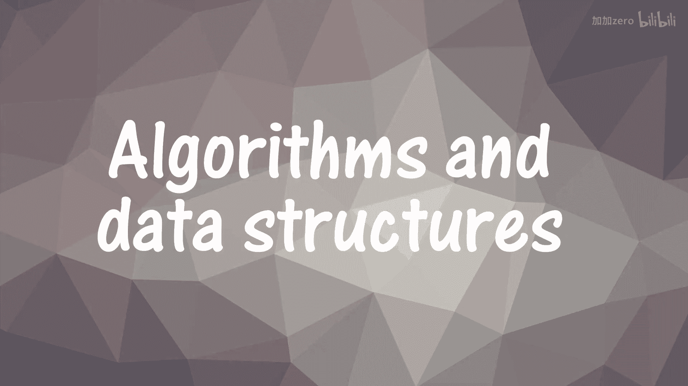

Today， we'll talk about approximation algorithms。 So what are approximation algorithms。

 Why do you need the approximation algorithms。So there are some problems which people don't know how to solve。

 for example， there are some NP hard problems for NP hard problems。

 we don't know any per time solution， So what do scientists do when we don't know how to solve problems they just find another problem and solve these problems instead。

So what we do for sal P half problems。Let's say there are some hard problem。 And in this problem。

 you need to minimize something。 So you want to minimize some function。 you want to find。

Shortest path or some minimal packing of something。

 So there is some problem which wants to minimize something。

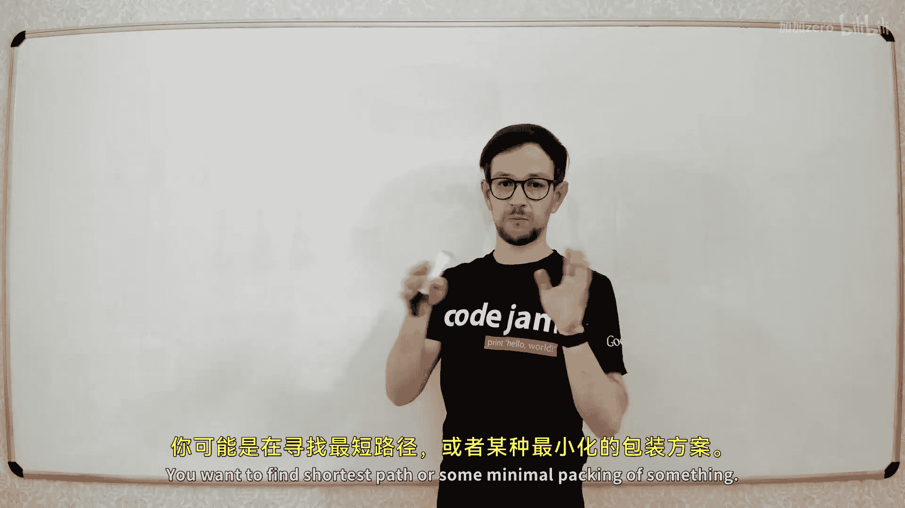

And there is some optimal solution，おお気持そでしょ。

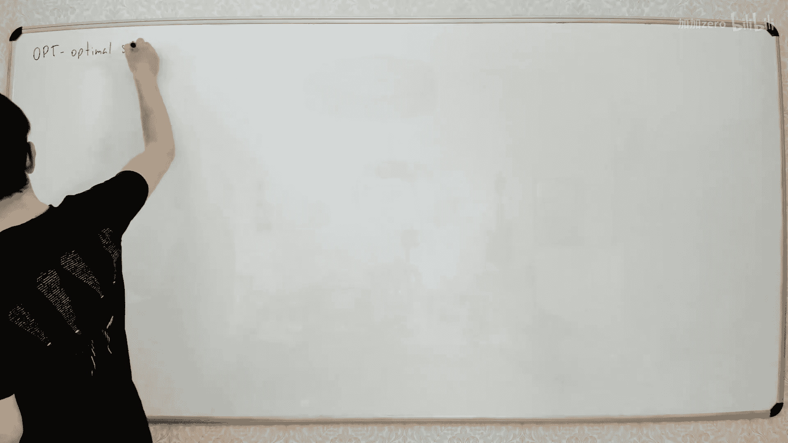

We don't know how to find optimal solution for long time， but we can find some another solution some。

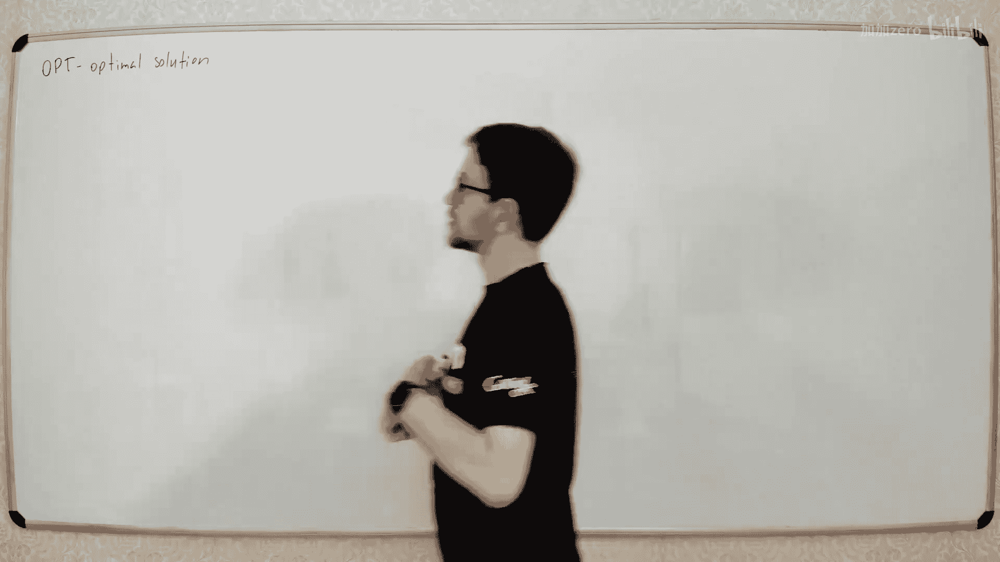

That。It's our solution。And our solution will call it olive optimal， if our solution。Let's say。

 is it least I opt。

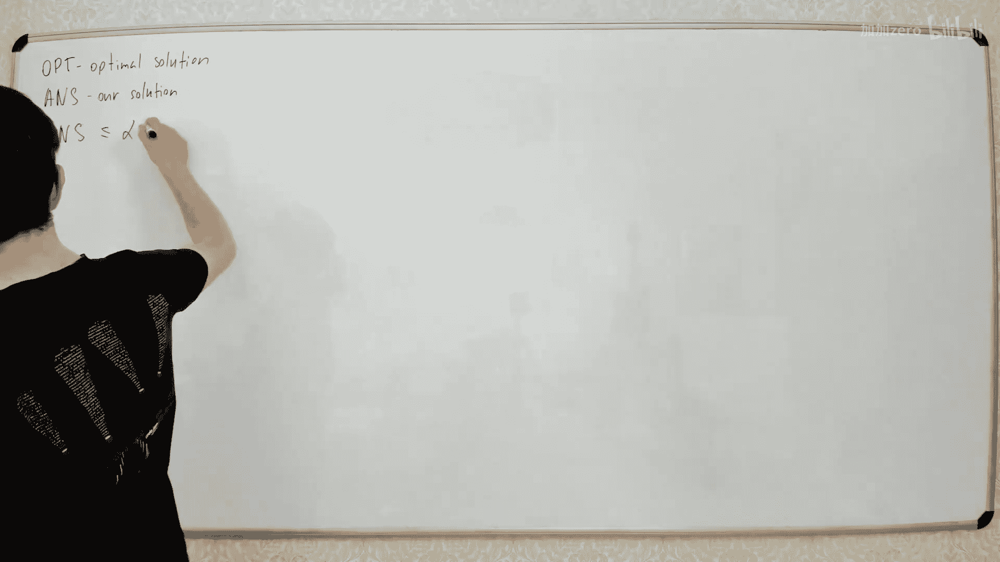

So if we can find some solution， which is at most alpha greater than the optimal solution。

 well call this algorithm alpha optimal solution。Alpha optional algorithm。For example， what。

 what can happen。 So if you want to find a shortest path。 So the shortest path is p mouse available。

 but in some， in some strange。Models， they may be hard to find optimal path。

 So you want to find the shortest path。 And for example， if you can find the shortest path， which is。

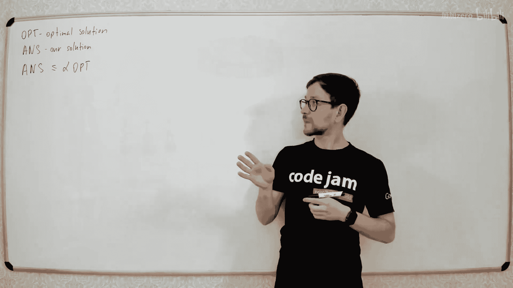

I file， let's say。But one point one。

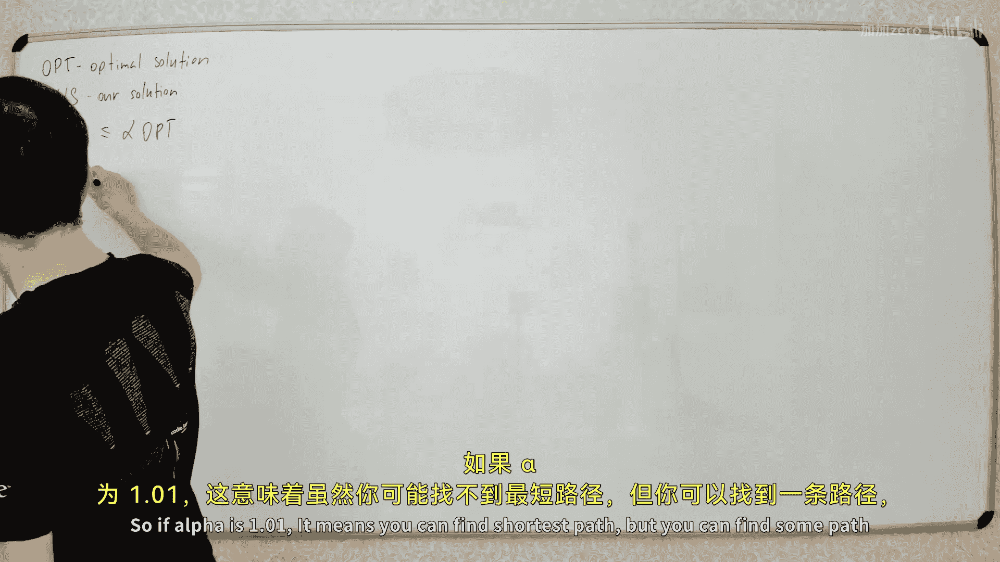

So if Ali is 1。01。It means you can find shortest path。

 but you can find some pathth and this path you found is just1% longer than the optimal path。Hm。嗯。

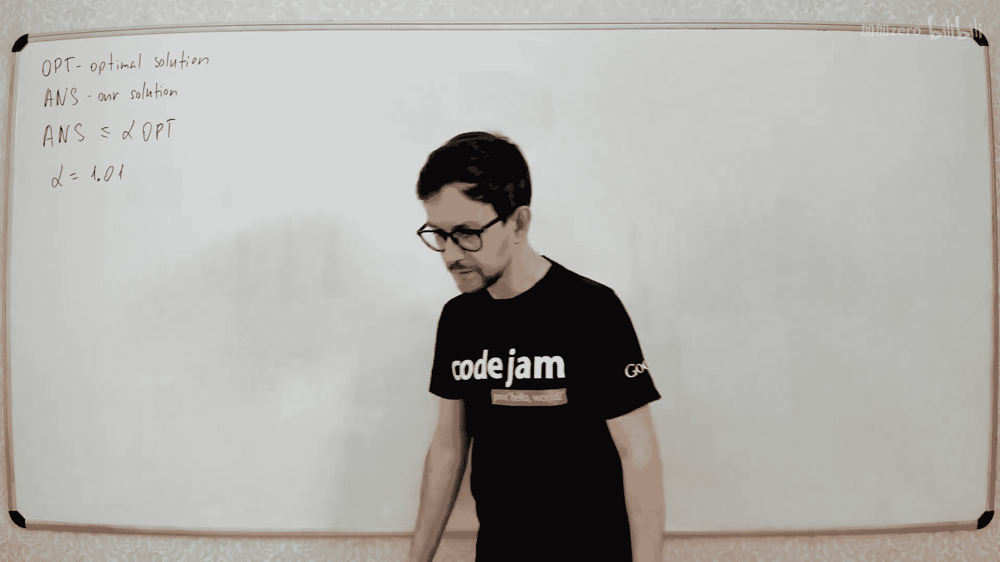

No， it's working， but。No idea。Some bikefi tunnels那边。So thiss pretty good， right。 So you find。

 you can find some solution， which is which is at most 1% worse than the optional solution。So。

 that's pretty good。In some other cases， you may find something like iPhone。Like two。

What does mean So you find some solution。 And this twice worse than optimal solution。

Is it good or bad， it depends。 So， so if you find a shorter， if you want to find a shortest path。

And your program says that this is some path。 And I know this path is like twice longer than optimal path。

Not very good， but not terrible。 So it it give you some information about optimal paths only。

 So you find some path。 And you know that the optimal path is at most twice shorter than the path you found。

It's， it's some information。 So， okay， it's not， not， not great， but not terrible， okay。嗯。

In some cases， situations is even worse。 In some cases。

 there are algorithms with alpha and alpha is not a constant， but some function。

 So for some algorithms， alpha they say something like loggan。

So the bigger your problem is the worse your solution became， som sorry for some small problems。

 you you have pretty good approximation for some big problems， you have worse approximation。

Also happens。そ。So it， it all depends on what problem you actually solve for different problems。

 So it's not， it's not like。There's no yet like unified method for solving NPhar problems for each NPhar problem not not only NPhar for any hard problem。

 There may be different approximational rhythm， and we will talk about different。

Way is how to build approximation1。Well， so let's start with something simple。 Let's solve。

We have to capital problem。So what's happening in your cover problem in the Earth cover problem。

 you have some graph。Let beautiful some gross。Something like that。嗯 응 응。응 응 응 응 응 응 응 응。응 let I see。

Sounds like this。So kept some off。And you want to find the minimum number of nodes。

 such as if you take this nodes， you cover all the edges of your graph， so you mark some nodes。

For example， this note。At least at least not。So every edge of your graph has at least one of the ends in this set。

 so it's minimal possible set of nodes。Such that for each edge。

 at least one of its end is covered by this set。It quote me all color problem。

Minimal vertical cover problem E MP P， heart problem。So we don't know how to solve this problem。

 you could solve problem for a bipartgraph and we discussed it when we talked about about maximal matchings。

 So if you have a bipartgraph， it's actually possible to solve this problem per time using just maximum matching problem。

It's actually dual to the maximum matching problem， like we discussed in linear program。

But for for non bihograph， it's simply hard problem。 We don't know how to solve it。

So let's try to build some approximate algorithm。So how to build the approximate algorithm for the vertical scale particle。

Very easy。So， let's。Let's do it like this。I'll just raise this。Let's take any edge of the graph。

For example。This age。 So this is nice age。We need to cover this edge， so at least one of these ends。

Must be in the author's cover。What can we do， We can take both ends of this of this edge to our set。

 So let's mark both ends of this edge。Yes。Now， let's take again。

 let's take any edge which is not covered by our vertex cover， for example， let's take this edge。

For this edge， again， at least one of its end must be in the ver cover。

 so let's take both ends of this edge to our ver cover。Like this end and this end。Metro， nope。

 all edges occurred。So we have some doctors color。Let's prove that we have two optimal solution。

So again， we'll find some vertex cover， and there is some optimal vertex cover。

 I want to prove that my answer。Is at， oh no， more than two point times or total。

So I take at most twice of the number of the nodes in the optimal answer。No why it's true。

 no it's quite obvious actually what do you do in implement， we take some edge。

 so every time we take some edge， which is not covered。And take both these handss。2 hour water cover。

 And then again， we take some edge， which is not covered。And cover both its each。

In both of the stamp。And so。So every time you take some edge。

Which is not covered by your current set and take both its ends to your card。Now。

 let's see if we take K Hs here。Then we take。So if we have K edges。Then the answer is K。 answer is。

Then， our answer is。Okay， right。What about optimal answer in the optimal answer。

 We need to cover all these edges。But this edge is not sure any ends。 so so。To cover this K edges。

 we need at least K。诶。Vertices in our vertex cover。 So for eachch of this edge。

 at least one of its ends must be in the in the optimal vertex cover。

 So at least one of these ends is。So， this red is optimal vector scatter。

So in the optimal graphic color， there must be at least。K edges A K norm。

So the optimal answer is at least k， and our answer is2 k。

 So means that our answer is at most twice worse than the optimal cancer。That's all。

 that's how we build that。2 optional algorithm for the doors discover problem。Okay。

 this was quite simple algorithm。 So so sometimes。You have very simple algorithm。

 which gives you some approximation of of your optimal solution。Sometimes it's a little bit worse。

For example， let's solve the weighted ver cow problem。

 So in the weight in the weight v scale problem， you have， again， you have some graph。

 but each node has a weight。And you want to minimize not the number of nodes in your vertical cover。

 but the total weight of your notes。So each node has some weight wing。And we want to minimize。

The sum of weights。Of your nose from your gut camera。

Is there a about approximation for herex cow problem， I am not sure about this。It's a good question。

I don't know。 What's the best known approximation for this car roll。哼。No idea。

Maybe theres somebody from。No， I， I don't think random will help you。Ok， you can Google it。

 I'm not sure about what， What is the best known approximation for your exc problem。

Nowever think about it， okay。Good questions。 Okay， so let's go next。

 Let's go to a weighted vertical problem。 So in the， in the weighted vertical problem。啊。You have。

 again， you have weights and you want to minimize not the number of nodes in your vertical cover。

 but the total weight of your nodes in the brush cover。What you can do this， in this case。

You can do very cool trick。You can use linear programming， like we discussed in the。

A few lectures ago。Linear programming is polynomial solable。 So if you write a polynomial。

 if you write a linear program， you can solve it in polynomial time。 It's pretty high。

 but it's possible。啊。So what we can do， we can write a linear program for this problem。

 So what is linear program， No， we want。Let's say， X V。Yeah， belongs to0，0，1。And we want to。

 for each edge。Yeah power graph。We want at least one of its ends b to this set。 We want X， U plus X。

 V， B， at least one。And we want to minimize the sum of X v multiplied by weight of this。Mニマ。

So that's the integer linear programming right so this again。

 we have linear in equations here and we have linear function to minimize The problem is it is a linear integer program so linear integer programming is again in Phar。

Obeistic， yeah， but what you can do， you can。嗯。Here。You can modify this。These things。

 so you can think not about integer solutions， but about any solutions。 So what if。We say that。

X is not the integer variable， but it can be some real variable， so it belongs to say from 0 to 1。

Then this is a real number in your problem in the linear program。

So linear linearar program for real variables is solvable per normal time so we can solve this。

Lar program in Pno time， using some。Again， we didn we didn't discuss any polynomial algorithms following our programming。

 but Ra some。But in normal all time， all items have to solve the linear program。

 linear programming problems。啊。What， what next， What next。You can seem to expect as。No， maybe。

 but no So simply not exactly putting algorithm。 Again， you can use it in practice。

ItIt usually works pretty good， but it's not exactly a little multi algorithm written。啊。No。

 we discussed it last time。 so So there are some para algorithm， which does not usedable practice。

 but they are still pmal。 And the simple method， which is not not paramal， but。Pretty fast practice。

So you can， yeah， you can use a simple method to solve this problem in practice。Now， what next。

 You solve this linear program， and you have some real numbers here。But you want not real numbers。

 you want integer numbers。 So what you can do， how you can get from these real numbers to some integer solution。

You can round these real numbers。 So let's round these real numbers to the integer numbers。

 So let's say that X prime v is equal to one if X v is at least。0。5 and the0 if X v is less than 0。5。

So， if we look at these。Interger numbers。Then all these equations will be satisfied。

 so for each equation， if we have some of two real numbers， at least one。

 then one of these numbers open here。So here is X U， at least 0。5。Or。X V is at least 0。5 the。

So for each this equation， we have at least one of these variables， at least 0。5。

So this thing will give you some feasible solution for this linear program。What about optimal no say。

 So if we take us， if we look at this variable x prime and this variable x。

 let say that this new variable is no more than twice。next week。Yeah。It means that， in this。嗯。

Function will have at least twice the optimal solution means the solution we have by solving this linear program and then rounding all the variables like this。

We will have two optimal solution for this problem。

And that' is actually quite universal method for solving for some sum for building some approximation algorithms。

So for some problems it's actually useful so you just take your problem。

 build a linear program for this problem， solve this linear program for real numbers。

 then round these real numbers to some integers， then you have some integer solution and this integer's solution will be quite close to the optimal solution。

Mmhm。😊，ほ。So again， again， there is optimal solution， Yeah。

 optimal solution is a feasible solution for this system。

So we find the optimal solution for the system。 So optimal solution cannot be less than this。Yeah。

 so we find some solution。It is less or equal on the adoption social。

And then we find this integer solution， which is at least at most twice larger than this solution。

Pizz all。So this is how you build this。That's， that's how you build top your solution for weighted。

The that comparable。后边。Let's have some problems。Yeah， yeah， yeah yeah。

 it happens because we only only round it up when we have at least the the worst case is when x equals 2 0。

5。 then we increase it twice。 Yeah， it's the worst case。Cool， let's go next。

Next problem we discuss is the travel and sales phone problems。

So what about driving and sales bank problem？We have some look let's lets let's say we have a full graph。

 so we have a full graph of end notess。And we have some costs of moving from one node to another node。

C is the cost。오 뭐。For。要都。有とり。And we want to do， we want to visit all the node exactly once and minimize the total distance。

So we want to build some plant U1 P2 and so1 Pm。And minimize， minimize sum。シビアイビアイコスマね。Yeah。

 so this is。Classical travel and sales problem。 Yeah。

 so you have some cities and you want to visit all the cities exactly once and minimize the total distance you travel。

Unfortunately。This problem is not。So this problem is obviously be completelete。

But what's worse for this problem， there is no any。Approximate， let's prove it。

So you cannot build approximate algorithm for this problem for any value of uniform。No。

 why is it true？Because any approximation of this problem is authentic complete。Let's prove it。

What you can do， let's say you build some approximate algorithm for this problem。

So you build some algorithm。Which finds the alpha optimal。solutionlution for this problem。

What you can do， you can reduce the problem of fineatorial path in a graph。To this problem。So。

 let's see。Let's say you have a graph， y。You have some graph。응 그 또 해요 그래도。Like face。

Let's favorite people， let's say we have some drive。

And you want to find a graittonial path in this graph。It isn't becomplete。

 So if we manage to find gual path， it means we solve this problem in P Mountain， right。そ。

So how to find a climmetonial path in a graph using approximation algorithm for this trivallon sales problem。

It's quite easy。 So you build the following graph。 You build a graph。 So you make the cost of the。

H equal to 0。 if， if there resist edge。 So for any edge， you make you， you set cost to 0。

And for all other edges， you just make cost equal to one。You add all other edges with cost  one， so1。

1， here one， and so on。So you just make all ups and edges with one。And so on。

 like think one and so on。So build the full graph。Each age from your initial graph。

 you set cost equal to 0 for all other edges， which not exist in your initial graph。

 you set cost equal to  one。Now， if in this graph， there is Menno path。

Then the optimal solution is 0， yeah， so。嗯。で？Ease， is。人民这种不。Then optt is0。When O is 0。

 then any approximate solution。Must。Your return solution with value equal to 0， right？

 So if optical to 0， then your ends。Must be no greater than alpha opt。And since up is 0。

 it must be 0。So you build this graph。Around your approximate algorithm。

 and if your approximate algorithm turns 0， then you find the meial path。

And if your approximate algorithm is non0， it means that optimal answer is non0。

And if optimal answer is not0， it means your graph doesn't contain any comm path。

So we just solved the Hamilton path problem using our approximate algorithm of travel sensor problem。

It isn't be completete。 So if it means our problem is also emptycomplete。

 So finding any approximate solution for the travel and sales problem isn't a complete problem。得得。不错。

But。Whats。Good news。Sometimes we can find the approximate algorithm for the problem。

And it's case when you have a what whats called metric trailer problem。嗯。

Let's say we have a travel sense problem again， like this。But we have， we have a dnangle equation。

 So for any three those， we have C， let's say U V is no greater than C， U， W plus C， W and V。

So we have some metric packet， Basically， we have some。this is called the metric space work， right。

 So you have some you have this coast and this course satisfy this triangle in equation。It's。

Sly pretty common。 So just think about so if you travel from U。

It must be not greater than traveled from U to W and then from W to V。For example。

 if you just want these all the notess。And you want to visit each node， not exactly once。

 but you want to visit all nodes at at least once。 Yeah。

 so if you want to visit each node at least once。Then， you can reduce your。

Costs to the shortest path from U。 So if this U is not a cost， but the shortest path。

 then for shortest paths is actually you have a triangle equation， right。So again。

 if you have travel and sales problem and you have dangle in question。

 then we can build a two approximate solution， Let's build the two approximate solution。Nice。

 so how to do it。What it， how to build approximate algorithms。You need to build something。

Which kind then get you some information about optimal answer。 So what's what。

 what's the problem here， We want to find some answer， which is close to the optimal answer。

 But we have no idea about optimal answer。 So we need to build something which gives us some bound of the optimal answer。

In our case， we will build a minimal span tree。 So let's build this minimal span tree in our graph。

So we have some graph。 We build some minimal pentry。It。你。ご用人さんクラ考でおいも。嗯。프림마들 그냥。그럴 수까。Okay。

 so let's build a memo spinning tree。I claim that。The optimal solution cannot be less than the minimum span entry。

Why is true？ Now let's see the optimal solution。嗯。Is a path which contains all the nodes of the graph。

 Yeah， the path is a tree。It's quite simple tree， but it still is， it is tree。

 So the gumtonial path in the graph is some span tree of the graph。

 So if we build the minimum span tree。It will be less or equal。Then the optimal answer。Right。Okay。

 because if you take the gumentatorial pathth， gumentatorial path is a tree， some spinningning trick。

So build the minimal span tree。 Minim span tree is less than some span tree。

 So minimal Sp tree is less reasonable。 Now we have some bundle on on on the optimal answer。

 We know that the optimal answer is at least the。The value of this minimal pentry， yeah。Now。

 what we you to do？We need to build some answer。Which is at least twice the total length of this minimum span entry tree。

Can you see how to do it。So I built this this minimum spinning in tree。

 I know that the optimal answer is greater or equal than my spinning tree。Now， what I will do。

 I will build my answer。W will be no more than twice minimum range。If I manage to do it。

 then my answer will be at most twice minimum pantry。 It will be at least twice an optimal answer。

 So I will build two optimal solution。Yes， and the way you do it you just。

Just make a trailer of this tree， basically， so。Again。

 why you must stay is less remote because again， what is an optimal answer。

 Op answer is some guatorial path here。 So there is some optimal answers。そう。Optal answer is a path。

 Pth is a tree。 So Op path is some guintonial path， where some， some spinningning tree。

We build a minimal span tree。 Minimal span tray is less re than a sub spinning tree。

 The optimal answer is the path path of some spinning tree。😊。

So so the the total length of the edges in the minimum span tree is let's the total length of your gramenttonial path。

 just because again， graintonial path is a path which works through all the nodes of your graph。

 So you visit all the nodes your graphs。 You have some span。 You have some span path Basically。

 So path is a tree。そう。So how to build the answer at least twice at most twice the size of this minimum pen tray。

 you start from from some node and just make reverse of your trees let start here。

Basically you make a deep first of your finger。Like please。

So total length of this path will be twice the size of MST。

And now we now we get we to visit each node each node at least once。

 and we want to visit those node exactly once。 So to visit each node exactly once。

 we will just shorten this path。By eliminating any duplicates so we start from here again we visit this node Now here I already visit this node。

 so I will just go from here straight to here。 Now I visit this node， visit this node。

 I will go straight to here， I visit this all goes straight to here and then straight to here。那。

This bathroom， this bathroom will be my answer。 of this sense。

And since I have this triangle inequ quantity， total length of this path will be at most twice the size of the minimum span tree。

嗯哼。So again， my my path is at least twice less of minimal painttry。 Min paint is it。

And let's recall the optimal solution。 So my solution is no more than twice the optimal solution。

 That's all。Let'走 miss事。That's how you build the two optimal solution for the travel and sales one problem in this metrics。

But we can do even better。 We can do even better for challenge service problem we can build 1。

5 optimal solution。So how to how to build better solution What。We can。 Yes。

 we need to receive if we want to build them not cycle， but per。 you just remove  one edge。 Yeah。

 yeah。I build the cycle。 If you want to build a path， you just remove one H M。No， no。We can do even。

 we can do even better So So let's again， let's start by building there。Let's do something like that。

So this is your asking。Again， I want to build my answer。啊。Which is not a particular。Again。

 why I have two here？I have to here because of what I did before I doubled all the edges and then build the oiler cycle so what we did here。

 we doubled all the edges of the graph like this and then then build the oiler cycle of this graph。B。

We can build order cycle without doubling all the edges。What do I want to do。I want to build a。

Order cycle of this trim。Yeahep。But without daubling all the edges。How to build the oiler cycle。

 to build the oiler cycle， you need all the degrees of all the nodes of your graph B even， yeah。

So what's the problem here， Why can I build the order cycle without divubing all the edges Because I have some odd nodes and graph。

 So let's mark all nodes of the graph。 So I have these nodes of degree 1， this node of degree1。

 this node of degree1 here， degrees4 it's even node it's fine here I have even node here I have some odd node and these nodes are odd nodes。

So I have like one the previous。 I have 8 odd nodes in Mincraft。Now， what can I do next？

I want all these nodes to be to have even degree。 So right now all these nodes has have or degree。

 and I want to have even degree。What I can do， I can connect these nodes。

So I can make pairs of these notess and connect them in pairs so that the degree of all these notess will be even。

So give me。I make something like that。 I connect， let's say， these nodes， these nodes。 and。

 for example， these nodes and these nodes。Sounds like that。So if I take the tree。Plus， these notes。

 I will have some ordergraph。 So now decrease of all notess are even。So in this graph。

 I can build oil cycle。This motorcycle will connect all the notess of this graph。嗯哼。😊，小办。

The length of my path。Will be equal to length of M T plus。The total weight of these new edges。

 These new edges is some matching， yeah。So， we actually take some。

Minimal spending tree plus some matching here。 So let's find the minimum possible matching。

We did discuss this algorithm in the course， but it's possible to fight the matching of minimum weight。

 even if the graph is non bipartite。 we talked about con method for bipart graphs。

 but it also can be extended to non bipart graphs。 So for non bipart graphs。

 you also can find the minimal possible matching。So what is the So now our answer。

I is no more than length of M T。Plus， the weight of this match。Y。No。

 we already know that length of MST ist at least all。So what about the length of this matching？

I claim that the length of my matching is no more than half of the weight of the optimal answer。

OhWhy is this true， Because let's look at the optimal， let's look at the optimal answer。

 So optimal answer is that no。我 had赛考。Let's not about cycle， it's true for pets also。 I believe。

 I believe it's also true for。Cyes， let's talk about cycles。It will be easier， so。

So let's have some optimal answer。Yes， it。 yes， if you want to find an optional path。

 it's a little bit。Little bit different， but it still the same。So this is the optimal else。

So optimal answer is some commintonial cycle， which offer all the or all the notess of your ground。

So， in this。Optimal cycle。 There are these eight nodes somewhere。 So somewhere on this cycle。

 there are these eight nodes，1，2，3，4，5，6。7，8。嗯。So these eight odd nodes are somewhere in this cycle。

So what I want to do， I want to build the matching。

 which has a weight at most half of the size of the optimal pads again。

This fault is the left of this cycle。I want to find the matching。

 which has weight half of this cycle。 Can you spot this matching in this picture。응 응。

What we going to do， what going to do， We want to build a matching Yeah。

 So how to build a matching from a cycle。So yes， we can just make that just on you。

 so let's take this， next this and this。So it looks like half of this cycle， right？

It actually actually maybe， but since we have weight graph。

 the size of this matching maybe be more than half of this graph。

 but if we look at another matching like this，So let's take another machine like this。Now。

 one of so the sum of these two matchings is opt， so one of these matchings has weight half of the object。

Again， we have two matchings。So， we have M1。Plus， M2。Read an opt。mean， is where the minimum of this。

Minimium of M1 and M2。It will be no greater than half of result。And since here。

 we findd the minimum possible machine。It will be it will be no more than half of the optimal half of the optimal solution。

 So now we have the answer will be no more than optimal solution plus half of the optimal solution。

 So that our answer will be。No more than。お気もするでしょう。That's all。 That's all。

So that's how you build the 1。5 approximation of the traveling and sales problem。

And for the long time， it was the best。 so for this problem， I actually know the story。

 so for this problem is actually for long time， this was the best known approximation for this problem。

About a year ago， I think。Yes， something like that。

 Some found the better approximation for this problem。

So the best known approximation for the travel size problem is like three or two minus epsilon。

 And this epsilon is really small epsilon。 So so there is some algorithm。

 which is polynomial and which give you a slightly， better approximation。

 but this epsilon is really adjust。 So it's good and theoretical sensor。 So in theory。

 there is some algorithm， which is slightly better。 But in practice。

 this is like the best known algorithm for this。Yeah， yeah， yeah。 Exact But yeah。

I am talking exactly about this thing。So how long ago was it。一。Theres no date here。

That thousand'2 anything0 yet。Okay， two years ago， long， what 1。5 years ago， it was in October。嗯。

They came even better s or I didn'。 I didn't know。O， I need to investigate it。

They found even better pers， school。嗯。Next。Next。Let's move to the napsick problem For the napsick problem。

 situation is even better。します。Cool， I'll read it。7，5% photograph。Nice。Okay， I'll the。On。

 it012 PM yeah。Okay， I'll investigate。So。Let's talk about Nepsick problem。

 So what is the classical Nepsick problem， You have some。Items。Each item has weight， and。

Some value some cost。嗯。Some bracece。So we have the weight of the a。And we have some sea items then。

What's called the course？not the question。 It's like like the value part。嗯。

What we want to do is to put some items in an E of the size S so that the total weight of these elements on S。

 I want to find some subset of elements。 So the total weight。Is no more than s。

 and the total value is maximized。It was classic o problem。Maps the problem isn't be complete， again。

I believe for his customerss。Year ago。So what's， what can we do。But first of all。

s let's build some simple organ。So let's try some crazy approach。 Let's try some crazy approach。

Let's build some really simple gridy algorithm。To solve naick problem。

So we will sort all the items by the like。How's cold。I know how cold buy the like。That's right。

So let's sort there。So all the items by the ratio of the cost divided by the weight。So。

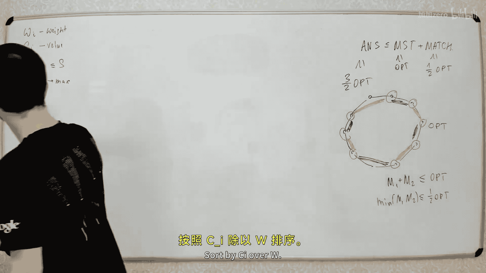

My 씨 오。And now let's put all the items in an Epps in this order。Mm哼。

Will it be some up some if optimal solution， What do you think。

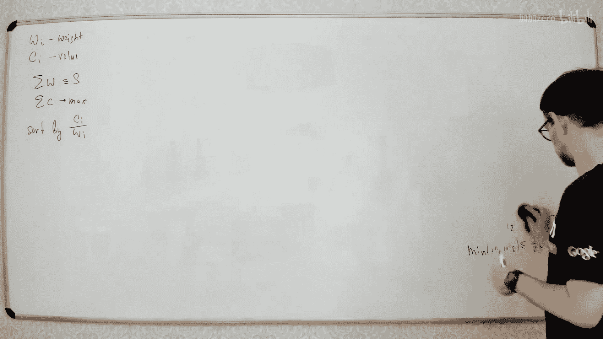

So again， I sort the items by this ratio and then add them one by one in the next。If I can。

 if I can add the item in next， I just added and so on。Will it be talk tomorrow or What do you think。

Unfortunately， not。This algorithm is not optimal。For any other form。

Can you find the bad example for this problem for this algorithm。

What is the best test what is the worst test case， So let's not stretch to build。

Let's have let's have flexible。 let's say， for example， S equals to 1000。

So I have an episick of size thousands。And let's have two items。So the total side， total To。

 total weight of these two items is greater than 1000。

 So I can't put both these items in an websiteack。But in optimal solution， you need to buy。

 you need to put second element， and my solution will put the first element。

Can you build this example？嗯。So yes try to go。 So let's have two items， first item。

Ass weight of one and。AVal of two and second item has weighed thousand and value0。

So in the ratio here is two ratio here is one， so why I sort them like this。

And try to put them in an Epsack in this order。 So I put this item first。

 and this item I can put since it will not fit in my Nepsack。 So I will put on。

 So my solution will put only this first item。 So the answer will be2。But the optimal answer is 1000。

 Yeah， so my solution is like 500 times worse than the optim solution。

 and you can put any numbers here actually。 So this this solution is not alpha optimal for any value of alpha。

不能。Let's improve it， Let's improve it。 Let's do it。 So how to improve the solution。

Let's do it like that。 let's run this gridy algorithm and then take maximum of two things。

Maximum of a result of this great solution。And the value of the maximal element。そ sea。

So let's find one item with maximumimal value and take maximum of result of this British solution and this maximumim element。

嗯哼。And I claim this solution is actually too optional。So this solution is actually too optimal。

Why is it true。 No， let's see。嗯。OhLet's see。 So let's solve the other problem。

 let's solve the problem。 an napsick problem when you can split the element。

 So let's say you have no integer problem， but again。

 you have some real number problem So you can for each element you can split the element in the person。

 take some part of the element。 and if you take some part of the element， you will have like。

Again if you take part of the element you。B。Then the value， the weight will be P V I。

 and the cost will be PC I。So for each element P I can see。Let's say for each element。

 we can take a part of this element。So the weight of the value will be scaled proportional to this part。

How to solve this problem， So what， what， what， what what is the optimal solution for the problem if you can take not the whole element。

 but but the part of the element。For this problem， it's easy to see that the greed solution actually works。

So if you can take not the whole element， but the parts of the element。

 then the grid solution is the optimal solution。 again， because you take the elements。

 that's what you wouldnt do。 Yeah， So so you want to sort the elements by this ratio and then take the elements in this order。

 Last element will be just for the last element you take not the whole element。

 but the part of the elements。Something like that。 So this is your napsick。

 So you take the first element， then the second element， the first element and so on。

 So for the last element， you take only。Only this part of your element。嗯。And this。

 obviously will give you the optimal solution。 No， No， again。

 because each time you just maximize the ratio of your current value over your。

Over the weight you use， yeah。嗯。Again， if， if you look， if you look at the like there。

 if you look on on the function， if you look at the function of your。Current value。

 So it grows like this。 So first， you take the optimal element， then less optimal， less optimal。

 less optimal and so on， something like that。And just， you just stop your function here， so。

So this is the sum of radioius。 and this is the。Some of weights。 Yeah。

 so this how thats how your value grows when you put your elements and you want this function to grow high here。

 And so so your short element by this ratio。到。What happens here， So here， So these elements。

 actually so this sum is actually my green solution。Yeah， and this last element is just one element。

So the length of this element is great， less local than seams。So， my optimal solution。

There is no more than greed solution。Plus cax。お。And now， again。

 if I take maximum of these two values， I will have at at at at most half of this optional version。

 So maximum。Of great。And C marks。Will be at least half of the actual solution。Mhu。Yeah。

 you can think， yes， this's another way to think about it。 Yeah。

 so if our really solution didn't find the half of the optimal solution。

 then this last element must be greater than the half of the optimal solution。

 That's another way to think about it， yeah。So we find some really solution。

 and this element didn't fit。 So if if this value is less than half of the optimalim solution。

 then the weight of this element must be greater than the half of the optimalim solution。

It's another another way of saying the same thing action。Nice。

 so that's the optimal solution for the Napsick problem mechanism。But for an next problem。

 situation is even better。What interesting about Nepsic problem for anepsic problem。

 you can build alpha optimal solution for any value of alpha。 So for any value of alpha。

 you can build approximate solution per normal time。😊，Let's say so。お。Any epsilon， let's say。

You can find。Answer， which is at least。Let's say 1 epsilon。In pernoial time。嗯 哼。Again。

For next problem， for any epsilon， you can build 1 minus epsilon。

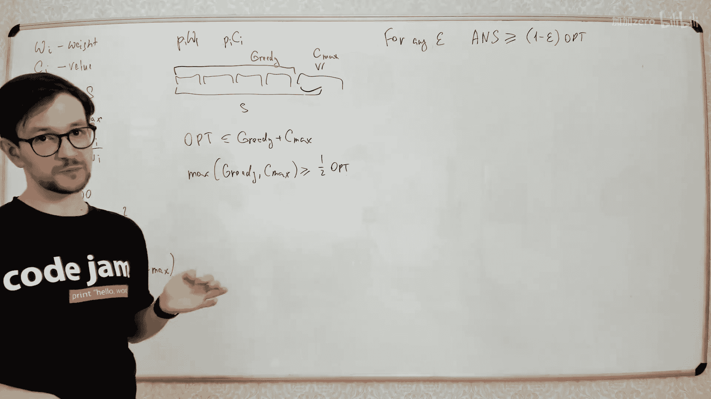

ASolution in polynoial time。 That's interesting。 I will first。

 first will discuss cancel one algorithm So。 that's to it。Just， just to show you the difference。

 first， let's discuss the order sometimes for some problems。You have situation like this。

 so for any epson， you can build a polynomial1 approximation for this epsilon。But。

It is polynomial for any epsilon， but the degree of your polynomial depends on this epsilon。

So well talk。 So if you have some， if you pick some constant value of this epsilon。

 let's say Epsilon equals to。 let's say 0， you1 like this。So I want to find a solution。

 which is like 1% less than optimal solution。Then， for this。For this value of epsilon。

 you will have some polynomial time solution， but the degree of this polynomial will depend on this epsilon。

 So if you take smaller value of epsilon， you will have slower solution。You，less。

 I'll just throw the algorithm just to see what what I mean。Let's do click bit， let's do click bit。

Soution。Let's look at all there。Items。Let's split them into two groups。Group number one。

 all the elements。With costs less or equal than epsilon。Now， let's see what you can do。

If all your elements。Have。But you less than apps multily by orbit。How。

 how can you get Eps approximation for this problem。嗯。What do think。Let's see。

 Let's see if all my elements have value less than absolute out。

How to find why my sectionon Op solution。It's exactly here。Yeah。

 you just build the same greedty algorithm， but in our case。

 this last element will be less than epsilon opt yeah。So， can。

So I just make this the same criteria algorithm。 So my， again， my opt。Will be。

 I just make the simple one。 greedy。Plus， Epson opt。It means my greedy solution is less1 absolute。

So lets make the same crazy solution。And it will give you 1 Epsilon approximation。Quiteed。Now。

 what about。What about elements？We of course great absolute。Let's see。

If the value of the element is greater than epsilon by optt。

 an optimal this opt is the sum of values of all elements I take。😊，Then。

I can take no more than one divided by epsilon of elements。 So number of elements。Like these。

 number of these big elements。Is no more than one over Epsilon。 Yeah， so I can in optimal solution。

There are no more than one over epsilon elements。有。Okay， opt is the sum of values of this element。

 If each value is greater than Epson optt， then I have no more than one over Epil element。Now。

 epsilon is some constant。 So one over epsilon is some constant。So what they can do。

I can generate all possible sets of these number of elements。嗯哼。So， I can。

I can try all possible subsets of elements。Or of sizely at at most， one over epsilon。

How many success should I try， I should try about。K M power one over E subset。Yeah。Now， again。

 epsilon is a constant。 So this is some polynomial， right。

 but the degree of this polynomial is increasing when I decrease the epsil。For example， again。

If I take epsilon。Equal to one11。 So here I will have M power  hundred。

It's not exactly what you want。Yeah， so it's still put a normal solution。But but quite smoke。

 quite slow solution。 So not all polynomial polynoial assertion doesn't mean it is fast in practice。

 right。 So some polynomial solution。Not usable in practice。

 So if you have minimal solution like this and for any big value of N， it is。Just， it just it not。

 not practical。But still with this piano no。That's interesting。Again。

 interesting thing that for any epsilon， you can build a pretty normal solution。So。

 so any approximation ofnapsick problem is prely solvable。The degree of pnoial is bad。

 but it's still pnol。Yes， there's number of sub sections。 yes， yes。

 it's number of ways to choose from N1 version。 that is basically the same。 So if epsil is constant。

 they're just the same as hyps。そう。Yes， so it's a number of ways to choose elements if you can duplicate the elements。

We don lot do duplicate elements， but asim is the same， yeah。So slightly less。

 but the asymp project is the same。 whole solution。 How to solve Napsick problem。

For the given eson volume。Let's split all elements into groups，1 group of elements。

 less than Eppsilon opt， another group of of elements create an Epsilon opt。Now。

 for the second group， we rate all possible subsets。Now， for each subset。

 we are on the grid algorithm。So we take this subset around the grid algorithm。

 find the optimal solution for this subset。Now， when we will try all these subsets。

 we will try So there is an optimal solution in the optimal solution， they have some subsets。

So we'll all possible subsets。 So we will over the subset， which is in the optimal solution as well。

 So we take this the subset， which is in optimal solution， then run the gridy algorithm。

And add all other elements， so the total answer will be no more than alpha minus epson。Mh。

That's almost all。But in reality， it's little bit。It's literally more complicated。啊。

What's wrong this solution， Can you see problem。It's almost good， but it， it has some small weakness。

Again， what happens if you try to program this algorithm。

So imagine you want to program this algorithm， So you want to split all elements into groups。

 one group of elements， less than a objects， another group of elements greater than a objects。

What problem will you have。The problem is the problem is you don't know the value of opt。

 so you want to split all elements into groups， but you don't know this value。으 흐으。그？No。

 the optional solution has has elements in both groups。 That's true。 That's true。

But that's not a problem。We can it through all subsets here and then for each subset around the grid algorithm。

 Yeah， so in optimal solution， you take elements in both these groups。But that's not a big problem。

 So you run your iterator with this subset for each subset around the crazy algorithm and then take the minimum。

Yeah。The problem is， you don't know the value of opt。

So you can split the elements into the these two groups， but。We find some approximation of O。

So let's run this first approximation， find two approximation of O， so let's try this thing。

Let's call it somewhere。8。Is call this。 this value a。And let's use this a here instead。

 So we will try this， not Eppsilon， but Epilon。えい？So what we can know， what we know about this A。

 We know a is at least。Orop。And it is definitely less opt。Yeah。So， here。I have。

So less than excellent。 So if it is less than Epil， A， then it is definitely less than Epilon output。

무시 a is。Here， I know that C A is great on Epon O。 It means Eon A。

It means it is greater equal than2 Epsilon。No我 반。Apsilon opt。So in my optimal solution。

 there are not one over Eon， but two were Epson。It's slightlylightly worse。But still I don't know。

 So here not。So if I， if I want to have error at at most 1%。

 I need to have solution of and and power 200。Let's him in the workss， right？バ steelサンプルなの。Okay。

So this approach has built you some polyam solution for each value of Epon。

 but it's completely unpractical。So it it's nice in theory for。 and for some problems。

 thiss the only。Th we can do actually。 So there are some problems when you can find any better solution than something like that。

 but for an website side problem situation is even even better。 So for website side problem。

 we can build。AndEpsilent approximation for any value of Epsilon without this stuff。

 so we can build up it's called's。It has some name。 I don't remember。

 so we can build solution with time complexity。 So so the power of hand do not depend on this epsilon。

That's even in even more interesting。Use item a multiple time with river specialation。

How did it have so So So if you run multiple times。

 how how can it give you better approximation here。So you can。

 you can run them make better value of A and then run it again。嗯。😊，Maybe it it。

 maybe it can improve something。So you just choose different epon here。

 find some better epsilon approximation。Yeah， maybe maybe you can improve the search this。 Yeah。

 so if you first pick some small epsilon。Find the solution， then put this solution here。

 find it decrease the epsilon， and then find another solution。 Yeah， it， it may work。没包。But again。

 next a problem situation is even better， so let's build much more interesting order thing for that problem。

First of all， we discussed Napsick problem in the first semester when we talk about dynamic programming。

So， sometimes you can solve。Nepick problem。Using dynamic programming， right。Mm。😊，그 베이갔 근데。TheBook。

Hello。缩到所就好湿。What I was talking about。Sometimes you can solve an Epsack problem using dynamic programming。

 right。 So we discussed it in the first semester。To make it solvable using dynamic programming。

We need our values to be small integers， so if。Don' usually usually you solve Napsack problem when you weight a small integer。

 so you have a dynamic programming when your state of your dynamic program is the current weight of your elementsil。

 but you can do it from the other end so you can make this state of your dynamic program current value of the elementsil。

And it will allow you to solve Nepsack problem when you have small values。 So if I have small values。

Small integers。F the per approximation。 Yeah， it's nice for。It's a nice name。啊。はいそう。So。

If my values are small integers， I can solve Nepsick problem exactly using。Dynamic programming。

So how to use dynamic programming to solve Nepsepick problem。

 basically you make a state of of your dynamic programming is the current sum of the values of your elements in your Nepsack。

So you look like something like D。We x for x。Is some of your babies， yeah。

And then you take the element and try to put it in your Epsec or node。

 So if you put the element in Epsick， you increase this x。 look， again。

 the value of D is some like minimal weight of the elements with these st very well。So。

 is D X is the minimum weight minimals， the total weight。Minimal total weight of elementsilments。

B la in the sun with。Okay。Total value equals 2 x。Time like。

And then you take element and if you put it in abstractack， you increase this x if you don't。

 you just get the same x and so on。 so you have this dynamic programming in the end。

 it will give you the maximumimal value。 So and then you just take the maximumim value of x。

 such that d of x is less or equal than S。Yes。Is maximum x such that D of x is less equal。

Pretty simple with dining program。Now， what's the problem here， problem here in my。

 my values are not small interest。 They may be not small and maybe even not in。So what I can do。

 I want to build another problem。We have the same bras， but。With small interiorte values。

How to do it。Oh， let's。Modify my values。 Let's say， let my modify value。嗯 아。Let's do it like this。

Yeah， like this。So let's take the value。Divide it。Byi。앱쇼。Mimal value my at like this。Yes。

 I go on the down， but I want to I want to build a small in here。

 So I actually let let's put it here。 So I want to see I， I want to divide it。

Buy the value Eilon over and less less's do practice。to make it more clear。

 so I want to see I divide by epsilon over n。呃します。まで。嗯哼。So， so this will give me small numbers。

 and this will give me in the Germans。 Yeah。 So the numbers will small in the Germans。Nice。

So what what's next， what's next， Oh actually， I okay let me draw a picture。 So。

 so these are my values。These are many values yeah。So what I'm doing here。

 I measure these values using some so this is my unit of measure right so I take this this like the size of the block。

And I measuring this。Vus using these blocks。So， it's。So， so this value is some blocks。 So in each， I。

 I have this some blocks here。 I have two blocks here， one blocks here， like three blocks here。

 two blocks here and two blocks here。So my new values will be like 2，1，3，2， and 2。

Something like that。And the length of this block is exactly this so it epsilson over N Cmax。No。

Now I have small in values。Let's solve the problem using dynamic programming。What we will have。

 And let's see。So what is time complexity of my dynamic programming， My dynamic programming。

 I have this state X。X is no more than total。Cost of all element， total， total radio of all elements。

 So in my in my diagram here， this x is no more than sum of all C。So。

What is the maximum value of C prime here， So C prime I。So， we get eight。I divide this C I by C max。

 So this value is less than the one。Here。I have Epson over N。

 So the value of C is no greater than n over Epson， right。No， when I run dynamic programming。아。

Com complexityities of this dynamic programming will be。Again， I。So。

 so this sum of C prime is no more than n square or epson， right。Make sense。Looks fine。So。

 it's N square or Epson。So the total and complexity of my。

Dynamic programming will be total value of all M which multip play by n。

 So time complexity of dynamic programming will be like n power free divided biopsy E。Using bits。

 I want to find。 So I want to find here。 I want to find some minimums。Yeah。

If I only is the problem is I have both weights and valuesius。If I have， if I have the same weight。

 So if， if haven， if I just want to find。If I have only weights， or if I just want to。

it's another just of the Ne problem。 If you just want to put the elements。

 So the total weight of these elements is maximum possible。 then you can use bit set and stuff。

 But here I have both valuess and weights。 so I can use base bits sets here。嗯。Now， no。

 this might have complexity。Now， what is there？E。Again， this that's a whole solution。

 That's a whole solution。So， how to solve Napsack problem。

You modified your values like this and then run dynamic programming。

 D programming will give you some optimal answer for this modified problem。

You use this modified solution as as solution for your initial problem。And this。

 this solution will give you some good approximation of your optimal solution。

Why is the approximation， It will give you some set of elements with total weight， no more than S。

What will be the total cost of this element， Total cost of this elements will be just some of these blocks。

So what about the what about the difference between your solution and optimal solution。

 Your solution may be different from the optimal solution because you have these leftovers here。

 So So in in each book， you have this leftover here。 So this list and this and this and this。

So we just remove this。Tales， because we rounded it down right here。So what is the size of this。

 So the size of this thing is less than Epilson over N Cmax。Yeah。

So the optimal solution is no more than our solution。Plus。

The number of elements multiplied by this error。 So for each element。

 give us some error to the solution。 So we have at most n elements in Eec。

So it will give us the most Epon over N Cax。Now， C max is obviously obviously less or equal in the optimal solution。

Right。So I have epsilon opt here。 I move it to the left， so I have Ns。section of。That's all。

So that's how you build Eom optimization solution in this same complex。 Again， this is much better。

Well is what。Let's try to think about it。That's right to think about， again， for example。

 if you make epsilson equals to the E。And here I have。And cube。Divided by these things。

 So I have hundred by N Q。So， it's just1 hundred times slower than just your regular Napsack problem。

It's not again， it's not not great。 So it so you multiply your time complexity by 100。

 but it's much better than what we had before before we had N power 200。

 And just here we have multiplied by 100。 It's much better。 It's actually using build practice。

 So you actually you actually can build approximate solution for nextpsec problem using this approach。

Yes， and you can modify this for some variations of Npsack problem。

 so this is just a classical NA problem if you have some variation of Nar problem you can prove it for your variant。

Mmhmm。😊，Okay， okay， this offer today。 Okay， so we discuss some。

Different types of approximation algorithms and so again， for some problems。

 we have some simple two optimal solutions。 For some problems。

 we have some complicated solutions which give us some approximation and for some problems life canaps problem。

 we can build approximation solution for any epsilon and it sexually pretty fast。So， so。

 so different problems may have different approximate solutions。 It depends from problem to problem。

Okay。Okay， so let's all see you next week。嗯。🎼うん。🎼お。🎼。🎼，🎼The。🎼。

