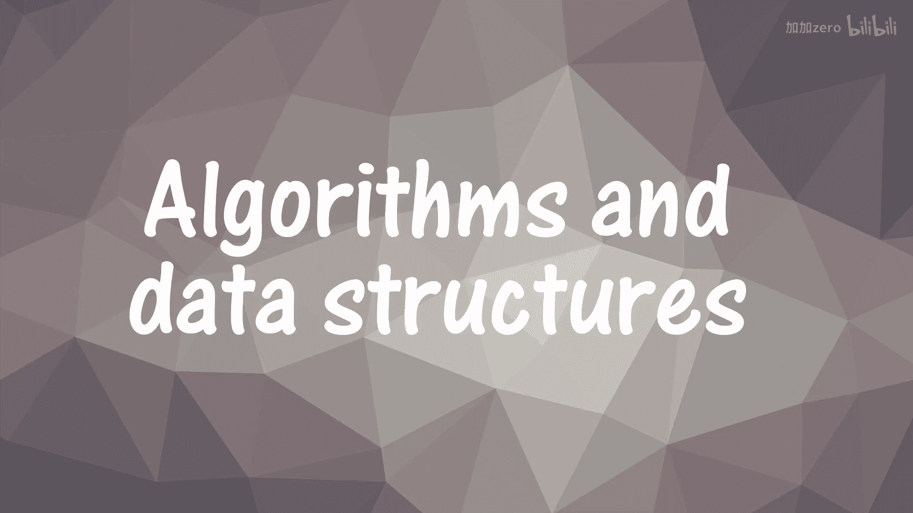
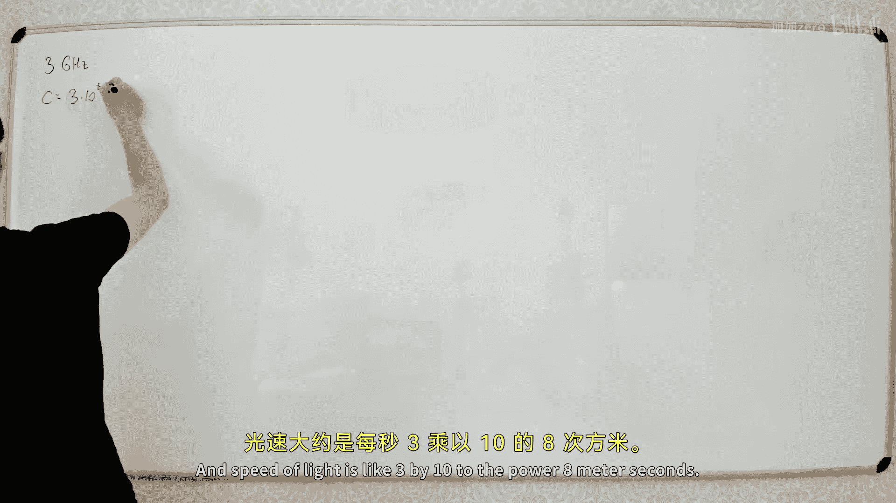
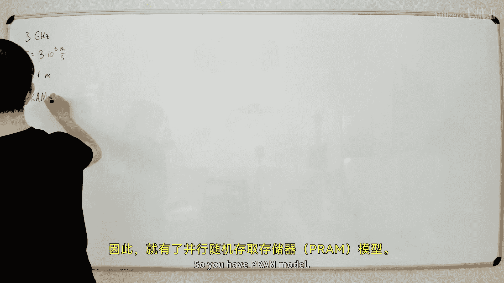
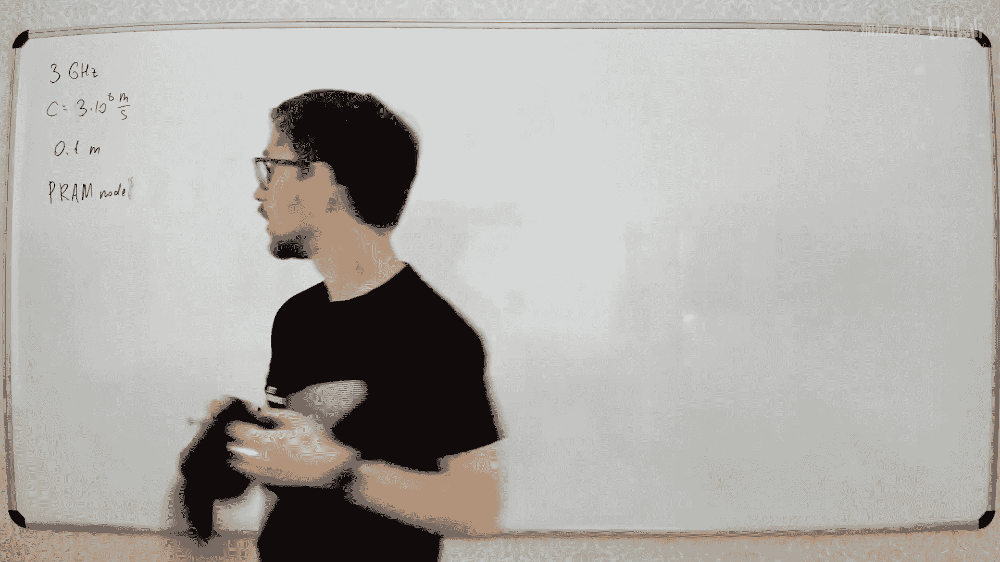
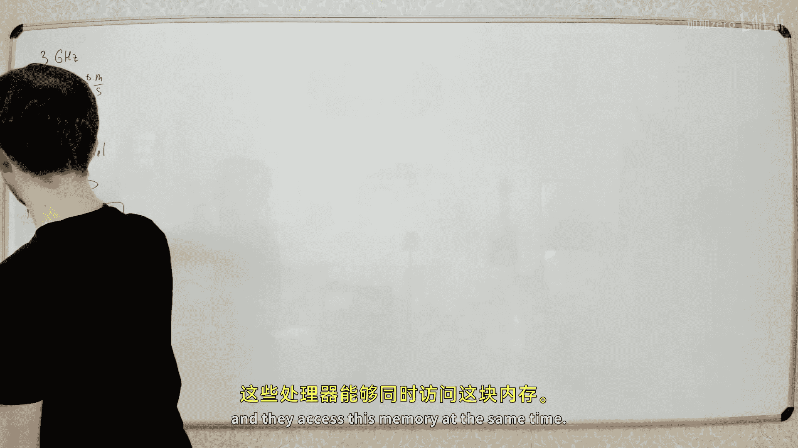
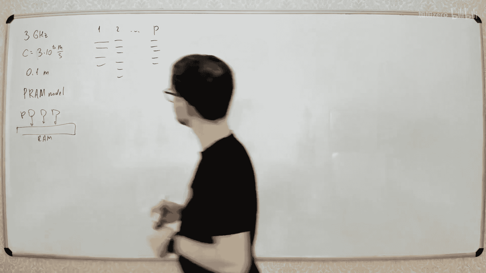
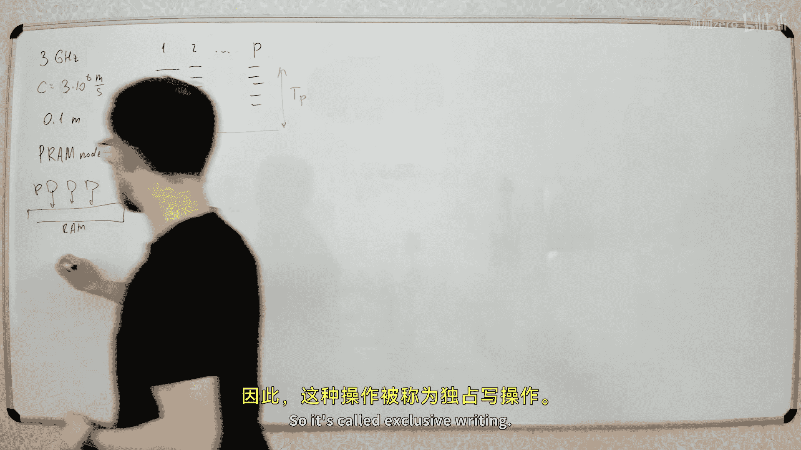
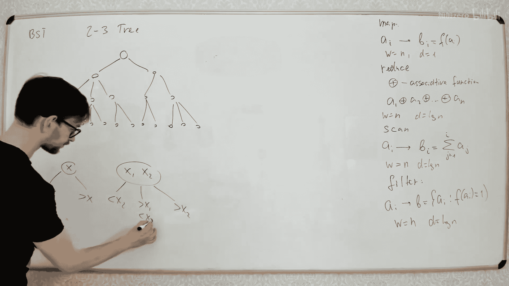

# 【精译⚡算法与数据结构】PavelMavrin p61 p60 A&DS S04E14. Parallel Algorithms -BV1NLB8YfEMq_p61-

对。So they will talk about parallel algorithms。Slightly in。Different topic are。

What's the story about all the modern computers have parallel computers。 So in even if your laptop。

 there are not single processor， but they are multi core processor。

 your processor contains multiple cores， and they make calculations simultaneously。

And that's basically because we kind of reach the limit of the speed of the processor。

 So when I was young， the speed of the processor meters by the number of like number of how it's called。

I'm not sure。 numberumb of steps that your processor made in each each second。

 So there was like 100 megaHtz computers， then like 200 mehertz present then gigyte processors。

 And now we had some like free ra processors and。Why don't we have more than  three gigabit processors。

 basically because we reach the limit of the like physical limits on the speed of the processors？

Let's say。Let's talk about let's talk about physics a little bit。 So in physics。

 you have a certain limit of the speed。 so you have a like speed of light so you can pass the signal from here to here faster than speed of light。

And。If you have like free gad processor。

フ리 리이 었어。や。Then it means each second， you make 3 billion operations。So and speed of light is like。F。

Like then about eight meter sand， yeah， something like that。

So if you just measure the distance， the light travels when you make one operation in your processor。

 the distance is about you need to divide like this by three billions so if you divide this up by three billions。

 you have something like one。

It means that when your processor make one operation， that light traveling like 10 centimeters。

And the size of your processoror is like few centimeters。

So you basically cannot make it much faster than it is it is now。

 So all the modern processes basically reach the limit of the speed of the process。 You can。

 you not exactly， but quite close， yeah。So what they are doing they， instead of increasing their。

Number of operations per second。 They increase this the number of different course in your process。

 So all the modern products have like four course，8 course and so on。 And you have your。

Hows called GPU in GPU， there is much more small processors。So basically。

 what we're doing is we increase the speed of calculations not by increasing the number of operations per second。

 but increasing the number of cores which is simultaneously。

 lets you like solve your problem in parallel。So， it's。

Very interesting to learn how to make your algorithm work on parallel for parallel processors。

That's what we talking to about。嗯。Let on。 So what is the parallel around we will talk we will first let's talk about parallel around model。

 So you have。Pgram model。

冇豆。So what is it。

So Ramma is just random of memalia and P means parallel。So what we have。

 we have our realm and we have some number of processors， so we have some realm。

And we have some number。Processors， and they access this memory at the same time。

Let's see if have people boxes。So what algorithm like your algorithm look like all your processors make some operations simultaneously。

We have first professor saying and so on。

Each processor has some operations。

嗯。And we we kind of won't optimize there。Time when all the process is finishing during the operation。

 So we will find the maximum number of operations here and calculate this time T P like this。

So T P is just a time that P processors need to solve problem。Now， what about the memory。

 it's slightly more complicated than before。 So when you have multiple processes where access the same memory。

 what happens if several different processes try to access the same element of your memory。

It depends。 So again， it's some point of your model。In some models。

 we only allow each element of your memory be accessed by only one processor。

So we don't allow to read the same signal of the memory by two processors at the center。

 and we don't allow the cell of your memory be written by two processors。

So it's called exclusive freight， exclusive free， exclusive freight。

Exclusive means only one poster can read the same element of the memory。呃。That's。

Sometimes this it's enough for some algorithm is enough， actually。

 to allow only one person to read same element。each time。 again， again。

 each cell can be read can be read right only only by one processor at each moment of time。

 So so you can read the element here。 And then in the next step， you can read it here。

But you don't allow to do it single， right？In some other models。

 we actually allow this the same cell to be， for example， read by cic properties So if we allow。

Two process to read the same element of the memory same time。 It's called concurrent read。

And exclusive right。Actually reading the memory is not a big problem， yeah。

 so if you have some elemential memory， you can read it by two processors。

 they just have the same result。It's not a big problem， y。

Much more interesting in what happens when you try to write the same element of memory at the same time by several different processors。

 It's called Kkan recent Kan right。What happens when you try to write the same element of the memory at the same time by two different processors。

 What will happen to this element of the memory。E depends。So again。

 it's just some parameter of your model in some models。

Let's say when you try to write the same element at the same time。 then， for example。

 any of the processors can write so。 So the final result in the cell will be just。

A randomandom one of the elements you want to write。 So if you， if， if， if one plus surprise。

 if you have some element here。And one element， one processor tries to run here one。

 and another element tries to write here too。Then the final result in this cell will be either one or two。

It random。In some other models， we actually write the， let's say all the processors have some Is。

 so the only processor with the smallest ID writes this data to do this element。So again。

 it's like slightly deep difference between the different models。In our case， it will be。

 I believe in algorithm we discuss today， it's not a big difference， but for some algorithm。

 it may may make a big difference actually， actually。It can be proven that。

If you can write algorithmithm in this model， you can write in this model。

 just the time complexity will be multiplied by some logariths。So。

 so the difference between these model between these models is at most logarm。

 but still the logarith is is like important。 So if you have linear algorithm or n logan algorithm。

 it's kind of it's different， right。We don't want to have extraities。Okay， that's all。 So。

 that's what that's how the parallel algorithm works。 So you have several processors， each person。

Make some instructions and the total time is the time when all pre processors finishing doing their instructions。

Okay， this model is fine， but it's actually pretty hard to implement。 For example。

 not hard to implement， but hard to。错。Howd to implement the algorithm in in this model。

 So you kind of want to， if you want， if you have some algorithm。

 you want to you want to manually assign the。Different operations to different processors。

 And to keep track。What processing is doing， What stuff。It's kind of complicated。So instead。

 sometimes we use different model。Slight different。ULet's let's what I just like these。

Imagine you have a graph of all operations you need to perform。 So you have some graph。

Like this and they have some depends。嗯。And so warm some here。And something here。

Yeah something here or not。So we have some number of durations。Again。

Each node of this graph is somewhat single operation。 Basically， you can do it in constant time。

And these the arrows。Express some dependencies between the separations。

 so you can't make these separations until you make these two operations。It's actually quite。

 we quite。Quite 130， freight。So if we look at the graph of all operations and depend between them。

Let's think about how much time we actually need。To implement all， to execute all the separations。

If we have some number of processors。For example， if we have only one processor。这个我。

If we have only one processorer， then how many operations do we need。嗯，那谁上去？Again。

 you have a graph of all operationsations you need to perform and some depend between them。

If you have only single processor。How to calculate the total time you need to implement to to execute all theses。

嗯。No seven， okay case for this graph is seven， but for in general， if you have some graph。

 it's just the number of nodes on this graph， Okay， just I'm just checking your this thing Okay。

 so it's just number of nodes。This number of notes。Bear of notes。Okay， this parameter。

 the number of operations you need to perform is called like it's called worker。

So number of operations we need to perform is just called W，W for work。

 so it's total work we need to do。Now， if we have infinite number of processors。

And how much time do we need to execute all depers。What the what do you think。

How to go this's actually a nice graph problem， you have a graph。

You have some dependencies and you have infinite number of processors。

 Then how much time do you need to execute all these operations。嗯。Any ideas？

One is not enough so you can make all decorations at once because you have these dependencies。

So to exclude this operation， you need to exclude this operation before and to exclude this person。

 you need to exclude this operation before， so you can't exclude all operations at once。Yes， yes。

 actually the time you need is the maximum distance in this graph。

 So in this graph we have this like critical path like this。So this path contains four nodes。

 so we need at least four operations to execute all this thing here。So minimum possible time is four。

Now， now， let's try to find all all such paths and calculate the longest path。

 So the longest path corresponds to the max minimal number of operations you need to make。Doいたで。呃。

Mars with。It's called Bethff。那从。And no。We have these two paners。 We have this W and this D。

 work and death。It's actually work。 It's called work death model。Now， I clean。That this to。

Valius is actually enough to calculate the time complexity for any number of processor。 Now。

 imagine you have some P processors。Imagine you have P processors and unique and you have some automatic scar。

 so you have some some special algorithm which assigns these operations to some processors。

So when you have some free processor and you have some operation。

 you can perform you just give this operation to this processor and so on。

 so you have this just automatic schedule。Let's see we have this。It's， it's。Quite interesting topic。

 how to do Mbu color， but not really。 So imagine we we can assign。

 We have automatic schedule which assigns these operations to some processors in optimal way。

So if we have P processor。啊。If it was how do right。What will vehicle。

Let's think about how many operations we actually need。To implement or auto to， to。

 to execute all this。 How much time do we need to execute all these operations。Well， first of all。

 let's。Make two。Op your lower bound。 first of all， these must be at least a S， this list D。Great。

So if you have peak processors， you can make it faster than in in the operation trip。

Second limit is that Tp must be at least w divided by P。That's right。So， we have。

So W's total number of operations if we have P processors， we can make it faster than W divided by P。

Right。そう。I claim that。T B is， at least maximum。Of D and W。

And maximum is actually as the same as the sound。 So， so this maximum。He's at。

like is at least one half of。D plus W or P。So the number of operations we need is actually a big omega of d plus w divided by。

嗯哼。And now the interesting fact， the interesting fact is actually。

 we can implement this algorithm in this number of operationss。

 So interesting fact is T P is actually big O of G plus。

So this lower bound is actually reachable in like the same asy's actually reachable。why is it true？

 Why is it true， let's see。呃。Let's see have let's say we have P processor。

And we want to implement this algorithm as fast and possible。So let's split all there。

Tusaskks in in some layers。So let's say the layer of the north is the distance from S from the startingino。

 who have the startingino。So let's say the the layer of the node is the distance from S to Bi。

 like not the distance， like length of the longest path from S to this snow。

So here we have distance  one， here were distance 2， here were distance two。

 here we're distance  three。Now we split all， all operationss into some layer。방 two。Now。

 how many layers will we get， So if we split all there。Yeah。

 if we split all the elements by by distance from S。We will have have D layers。

So here we have D layers of operations。We can we can execute operationsations layer by layer。

 so we first execute all all operations in the first layer， then all operations in the second layer。

 then if your layer in one。So let's try to execute all operations layer by layer。No。

 let's say we have。诶。N eye operations。In layer。Leer I。

Then how much time do we need to execute all operations in layer I？What do you think。

So we have people systems。And in there eye， we have an eye。

How much time do we need to execute all these operations。嗯。

And I over P that's that thats more precise number of operations is actually an I over P。

 but it should be round up like this。 So it's cell of an output。Now we need to calculate this sum。

 so this is the total number of operations we need。Now。

 this thing is no more than an I over P plus one， right？

And now we could calculate this sum with sum all these things。

It will be just W over being and some of these things， so we have d elements in this sum。

 so in each element of sum we have this one， So if we sum1 details we have D。是。

So if we just execute all operations layer by layer， total time we need is just w over P plus D。

And the minimum time we need is this half of this。 So we have like asymmetricically optimal way to assign decorations。

不错。What's it so about， What's so about。啊。What's the interesting thing。

 interesting thing is actually that you only need to analyze these two values。

If you optimize these two valuesius。Then， you will optimize the。

Time complexity of your algorithm for any number of processors。 So if you just find these two values。

 then you basically need you know the time time complexity of your algorithm for any number of processors。

That so。Let's write the flag here。Now。What happens in practice， In practice， What happens？

 You have some number of processors。This number is actually usually pretty small compared to the size of the input。

So yeah。Well， let's say， let's say you have two different algorithms。

 So you won't optimize two parameters of your algorithm。That's a little bit complicated。

 Let's say we have two different algorithms。 One algorithm has work。Oh and and let's see。

Death of log square n and another algorithm algorithm has work of N log n。And 내가。Sound like。嗯。

So an I is number of operations in the layer。So if I just sum all these things。So， some of all。

SoSo N is the number of operations in the layer， and W is total number of operations。

 So some of all N equals to w。P， P P is a constant， so I can move this constant away。 So。

 I I have some of all an arms。 It is double your divided by P。Mhhum。😊，说。

So let's say we have two algorithms。One algorithm has total number of operations n and depth log squared。

And an algorithm has number of operations and loggan and the logan。

 which algorithm is actually better。 What do you think。Such not an equation， not an equation。

 In some situations， both of these algorithms can be optimal。所以。So， for some inputs。

You may have this algorithm optional for some another impulse， you may have this algorithm option。

So it depends on number of processor and the size of your input。So it's not that easy。

 but usually what happens， Usually what happens。 Usually。

 this P is much smaller than the size of your input。 So usually you happens like。

If you want to make a parallel algorithm， it's usually when you have very large input， right。

 If you have small input， you can solve it in one processor fast enough。

So usually the size of the input is pretty large， so comparing to this number of processors you have。

So usually in practice， this for sum is much more interesting than the second thing。

So usually you won't optimize this。Part first， and then optimize this part。

So you want what we will try to do in this lecture， we will try to make algorithm。

 which has the optimal work time。And some good death。

So if we have this what will ideally what we want to achieve。

 we want the work be the same as for the one processor algorithm。

And this depth would be something like logan or log square， or。Okay。

 even squared root of n is usually good enough， so I want this work to be the same as for the single processor。

And I I want this depth to be as small as possible， usually log log is enough， log square is enough。

Again， square root of frame is slightly slightly worse， but still pretty good and so on。

And usually this part is much smaller than this part， so I kind of want to optimize first。First。

 I want to optimize this work， and then I want to optimize that。Not always。

 but usually as that's what happens。Whats going。Let's start from something simple。

Let's have an array and try to calculate the sum of this array。So let's say you have a。嗯。

And I want to find the some of all the illnesses。So what is my goal。

 My goal is to make algorithm which have the same time complexity as the single pro algorithm。

 So I want my work be the same as the time complexity of the single proor algorithm。

 The single par algorithm will basically be linear so you can calculate sum and linear time So I want the algorithm of linear time complexity。

Liumable， linearar work。And small depth。So how can you parallelze the calculation of the sum in the？

Any ideas。What can you do。If you want to calculate the sum of many elements。Break into parts。

 So this's a good store start so we can break the array into some into some。 But what happens next。

You you， you break the you break your arrangemental parts。 Let's say you have1 processors。So you。

 okay， break your array pass each part and there is a single element， what to do next？How to yes。

 yes， if you have small number of products， you can break your array into parts and each processor calculates sum in each part。

 but then you need to combine all these sums into some big sum。Yeah， yeah， but maybe again。

 that's a good start， that's a good start， so you have the array you want to break it into parts。Now。

 each processor calculated a sal in his part。But what next， you have many you again。

 you have the same problem。 You have many elements here。And you kind of want to calculate this one。

Actually you can do it， you can do the same thing again， can again again you have these sums。

 you can break them into parts of global by tea， but yeah。Yeah， yeahや， yeah。

 we'll do it'll do easy wage。So what we can do， we can build this actually is a segmentary for the sun。

So we have these elements， let's go create the cuts， let's put some elements。Let's say，3， five，2，6。

Dboang。3e4。So， we have this array。What we can do is first of call build。

 but basically we need to build a segmentary。So first， we calculate sums of all pairs here eight。

Here was it a。 He was it free。So。😔，Then calculate some of pairs like this。Jin。

 we have1 and then Google this。Now， how can we do it in parallel？ First。

 we can calculate all elements here in parallel。 Yeah， then we calculate all elements here。

 then we calculate elements here。 So all decorations。In the same layer are independent。

 so we can quote we can calculate them in borrow。So we can play all all elements here。

 then all elements here， then all elements here。Total number of this steps is logan。

What is the total number of reations， To number of operationsations is number of nodes in your segmentary。

 number of numbers of segmentsries to n。So you have two n operations， not actually n yeah。

 if we ignore this first thing， so we have linear number of operations。And log in steps。

So we have algorithm with work near and。De log。That's actually pretty cool。 that's what we wanted。

 right， so we have the algorithm with the same number of operations as the single processor algorithm。

But with very good polarization。 So the login is actually usually the best you can get。都一P我看很少。

So you usually you want something like that。 So you want the algorithm with the same time complexity as the single pro。

 but they like log n or log square and。对。Nice。Okay， okay。Okay。That's， that's this one of the。

 one of the most important algorithms actually in this case。

 So we usually will make something like that when we try to calculateulate。Go， so next。嗯。Okay。

 let listen reduce to on。Important decorations。W is linear。

 There just number number of node in the segment three linear。

 So we have n plus n over 2 plus n over 4 and so on。 So if you complete some of these。

 you will have two n。So number of number of nodes in the73 is to2 n。This wise is Leo。五そ。

First important operation is a map。My app inspiration。

 which just takes the array and applies some function to all elements necessary。

So we have like array AI， and we want to make array B equals to F of。AI something like that。

It's actually a pretty simple operation you can do since you can calculate all these values and parallel。

 then actually it's max part of the last。 So you can just calculate all these functions in the same time。

So。Here。The work will be linear， and the depth will be just one if you can。It actually depends again。

 sometimes So if you can make end processors at the same time。Then you can do it to one operationss。

 actually in practice， make you can create and processor in constant time。诶。Yeah。

 so usually slightly more complicated， usually you allow only two fork in two processes。

 so if you can fork only you can in each fork you can make only two branches。

 then you actually need to log in fork system to make it work。Next， next portion is reduced。

What we want to do is to calculate some function。 So we have some。Let's see。

 plus sum asciative function。Our saw she8。F。And we want to calculate like a 1 plus a2。Plus。

 and so on， plus again。Knowing the way you do it is the same as here。So we just do the same thing。

 but instead of sum， you take this as associatedty function and calculate the value for the whole。

It's actually quite cool。 so you can calculate， you can calculate some。 You can calculate minimum。

I don't know。 No any other associated function you can imagine。

 So you can calculate any associatedative function for the array。In the linear work and log in depth。

Yeah。The work will be in， and therefore will be looking。Now， let's do something more interesting。

TheNext version is called Sc flow， I don't know why。For some historical reasons。啊。What want to do。

 I want to calculate the perfect sums in my ring。 So I have already a。And I want to calculate A A B。

Such that B， I is some of all elements， A J， which's say J from one to。It's perfectly perfect sums。

 right， So for each for each pre， I want to calculate the sum of elements and this perfect。

How you do it when you have a single processor， when you have a single processor。 Okay， let's， lets。

 let's do it for this。All these great。So how you do it for single post， you have this array。

You go from left to right and calculate perfect sums。 So first。

 you calculate the first perfect sum is。Then you calculate the next one just by  adding the next element。

 so you get 3 plus5 is 8， then 8 plus2 is 10， then 10 plus 6 is 16 and so on each time you take the previous perfect sum and then your element calculatec the sum and you have the next perfect sum。

Like this。Okay， it's it's。Now we need to do the same thing， button in parallel。

So I here I I obviously move from left to right。 Each new element depends on previous previous element。

 If I just want to make make it parallel， the depth will be end right， So I guess go from left right。

 each new element depends on the previous element。So again。

 I want to do it slightly different to make it more parallel。And the way I do it is again。

 by building that semetery。这 again。Let's， let's build a segmentary for the sun， for this rain。again。

 okay， I will do it again。Store sal pres and something like that， yeah。そな。Now we have this。Sventry。那。

Let's try to go again， we build this segment three in linear time and log and depth。

 so let's always go from root to the leaves and try to build the perfect sums。So we start from here。

So the sum in the left part is 16。So I want to add this 16 to all elements in the right section， y。

So again， again， it's like divide it's like divided on conquer， right， so I take I I take the root。

Look at the left part， C 16。 I want to add this 16 to all elements here。So let's just put it here。

 so plus 16。Now， now I go here， so I see this8。 so I want to add this8 to all elements in the right sub。

Do it， so take this eight and add it to all elements here lastly。Now。

 here I want to add 16 to all elements。But I also need to add this free to all elements in this sub。

 So I go to the left sub and add this 16 to this sub。

And I go to the right substream and add this like 16 to plus three。 So here I add 90。嗯。

And so on so each time each time you you have some node， Yeah。

 so you want to you want to recordcur go to here and here。When you go to the left sub。

 you just apply the same。 When you go to the right sub， you apply this plus the sum on the left sub。

So I go here， I add 16。I go here and S 16 plus2。So from here， I go here and at 19。

I go here and I add 19 plus 3。 So it's plus 22。So and same here go here plus 8 here plus 10。

Here plus something so plus next day plus0。So I go here plus0， I go here，0 plus three is plus3。

And finally， you calculate this very， so it's 22 plus for its 26 here set 22，1918，1610。10， eight。

 three， that's on， and that's your final degree。And again。

 you do all operations in each layer at the same time。

 so all operations in each layer are independent so you can do all all these operations。

 then all these operations or total number of operations again is linear。

And the number of these steps is loggan。So that's how you can make this separation。

 It's actually one of the most important operationss in this this。In this hearing。嗯。M。Well finally。

 let's make one operation let's make feed operation。So again， we have some array egg。

And we want to build A P。Which contains all the elements from array A such that F of a A equals to1。

Again， for example， let's have some8 again。 Let's have 3，5，2，6。1，7，3。Dowang。And let's say， many。Not。

 good enough。 So let's say I want to filter all even elements from this array。

So F of x is x2 equals to 20。So what I， I want to find all the even elements in my already。

These elements， these elements are these elements。小没ま。And I want to build the rate be like 2，6 and 2。

没错。Nice， y。So first of all， how to find the size of ra。

 so how to find the number of elements such that this function returns true。C博格式。So first of all。

 I want to find the length of AB So length of Ab is the number of elements such that this function returns from。

How to find the number of these elements。Apply the function and then calculate the sum， yes。

So you first apply the function， you can do it in parallel， so it's independent for all。

 basically you make this my preparation。主要不的方式。Lets use some other color。So it's 0，0，1。1 zero， zero。

 zero one zero。Then I calculate some of all these booles you have three。

 so three is the size of your。Nice， nice。Now。We know that in the final rate。

 there are three elements。 So lets us know。How how's going？

So less in initial is the array of three elements。 So now we have this array of three elements empty。

Now， what I want to do， I want to put this element in the first position。

 this element in the second position and this element in the first position。

How can we find the position of the element in the Abi， So I have this free interesting element。

How to find the position of this element in a ra。嗯。Perfect sounds， true。

So you make this array of booles and then calculate perfect sum。 The perfect sounds will be。0，0，1，2。

opop，2，2，2，3，3。So these will be positions of your elements in there。And now you just。

 you can do it in parallel。 You can take the elements。If the function is true。

 you put this element in this position of of ra。So you take this element and put it in the first position。

Take this element and put it in the second position。Take this sound and putment first。And again。

 you can do it in parallel。 All thes are independent。别错。没错。所 again。How to filter elements。

 You first you apply your function， then you calculate perfect sums。

 calculate the total number of elements in Arabia， then you initialize the array。For each element。

 you know itss position in a ra。 So you just take the element and put in the corresponding position ra。

This all can be done in parallel， so。So the total work will be again。Right it here。

Total work will be in。And total death will be in broken。YeahYeah。嗯hu。那。Now。

 let's do something more interesting。 Let's make a sourcing algorithm。Let's make a part source color。

嗯。Where也没事。对。那。Remember how merge sort orbit works。

 so I want to take the merge sort algorithm and make it parallel。Let's make well。So， that sorry。

So how the merge shot algorithm works。The cooperation of the northern sort algorithm is just to merge two sorted arrays。

So I have this one array。Secondary rate。ちょっとた。So I have a right day。Sorted。Yeah， I have every beer。

Soution。I want to combine all these elements in summary sea。Where does I play pro。Lets get。

I didn't up play part onism anymore。I just， I just。I just say how to how the me of organ works。

The me of algorithm worked like this。 You have this cooperation is to merge two areas。

When we learn how to merge to a race， then we will apply all the same technique from the merge autoogram and in merge autoogram。

 you you call recursory for the left part and the right part， you can do it in parallel， obviously。

And then you take the sort array from the left part and sort array from the record。

 and you need to merge this array。And this is interesting。这嘅。

What happened what happens in North Sho You have the whole。You split it into two parts。

Then you recursively call for both these parts。This can be done independently so you can by part also for the left part and the right part。

And now finally， you need to merge these two sorted arrays into single sorted array。

So this is how the merge， you split your end into two parts。Call recurs for left rent part。

 And then when you return from the re， you need to smurge this to aocing。We may break into be。Yeah。

 this that's。스스코도 불어。Let's talk， let's not think about P。 Okay， let's。

 let's talk about the death amount。 Imagine you have infinite number of processor。So if you。

 if you think about P if you think about like constant number of posters it a little bit。Yes。

 usually it's easier to think about how， how can I。

Implement this algorithm if I have infinite number of processors。What is my time complexity。Again。

 you can split your old just， you can split both arrays into some parts。

But what next what will happen next。不给他。Why， why this idea doesn work so if I split？

Erase in part and secondary input partss。 and then merge these two arrays， these two arrays。

 these two arrays， these two arrays。And then just canmate them， will it work or not？

What do you think。And the's so each level is done to put。Yeah， don you okay， Yes， you know， yes。

 you can do it Yes， if you get， if you， if you make merchant linear time。Then again。

 you have end depth。 end depth is kind not。No end depth。 Okay， okay。

 the work will be N log N and depth will be N。 It's interesting， but not not much。So I wanted。

 I wanted depth to be less than n。 D N is a little bit not。 It's not that interesting。

Elements are free about this small elements， but yes。Exactly。

 what can happen that here you have all small elements。And here you have some big elements。

So which if you just combine these two parts， you will not have the pre of your array。

 So what I want to do if I want to take these two arrays and put them here。It will not work。

Because here it might have elements like  one，2，3，4，5， and here elements like 10 11，12。and so on。

 so if I just merge these two parts。Then here I have element 4。

 element 4 must go before all elements here。So it's not working， okay。

But it's pretty close to that tro。Let's look like this。O。Id number one。

Let's try to find the position of each element in the final array C。So again， okay。

 let's put some right here。Let's put some bracelet，1，2，4，7，10。1725 and something here， like 3，5，6。11。

2，20。えと一はさ。Let's try to find the position of each element in a ra。So I have this era here。

 I know it's length again。Let's try to put each element into。Corresponddent position in the R C。

 So how to find the position of element in the R C。 So let's take some elements。

 So let's take this one。Okay。'Let's take this1。How to find the position of element 10 in the final R C。

To find the position of element in receiver， I need to find the number of elements。

Which must go before my element。そう。So which elements must go before my element 10。

 These are all elements in array A。All these elements。

So all these elements must go before my element then。And some elements in the secondary。

Those are all elements which are less than 10。So these elements must go before my element 10。

 so my position of my element will be 1，2，3，4，5，6，7，8。 So position of my element is 8 right。い、 now。

To find。This number， we need to make a binary research。Right。

So we can do it by making binary search for each element again， for each element。

 we make a binary search in in another array When we make this binary search。

 we can calculate the position of this element in the final array。Now， in the end。

 we take each element and put it in this corresponding position。NowNow。

 all these binary search can be done in the same time。If we， if， if we allow concurrent read， Yes。

 if if， if we allow concurrent read， we can do this binary search at the same time， so。

So we do this binary switch for each element。Find the position。

Find this position and put this element in a corresponding position。What would be the complexity？嗯。

What will be they work and what will be death。What do you think。Of this single me operation。

 not of the whole me sort， but of this single me operation。If I have n elements here。

 what will be the total 10 complex of this？Whats of course work。

Work is just total number of operations for each number of operations。

 for each element we need to make binary research， binary research then logan operations。

 so the total number of operations is in log angle。

And the death will be loggan because for each element we make binary research。

 but we make all these binary search in parallel， so total number of steps we need to take is logan。

Now， if we do it like this and then apply our me algorithm， the total complexity of the me algorithm。

Willll be again， it will be more。Will be in log square。An bathroom from De Square。有。Okay， in the me。

 we just apply the same thing in each layer。 So in each layer， we have this time complexity here。

 So we just combine this for loggan layers。 We have this。No， what's here， What's here。呃。Okay。

 this log square is not a problem， actually。But this log square is a problem。

So we know that we can sort elements in loggan time， in end loggan time。

But here resort elements in analoglock Square time。That kind of。This is gonna good。

 So our sourcing is actually slower than the single process sorturcing。We can do。 We can improve。

 We can improve it。How can we get rid of this log square？To get rid of this log square。

 we we will get rid of this loggan。 So our plan is to eliminate this loggan factor from here。

How to eliminateinate Loan factor。 No， we did multiple times。To eliminate some logan factor。

 you just split all elements in。In groups by log n and then do the same operation for these groups。

So what we'll do， I'll take both my arrays and split them into groups of loggan。No。

 let's say logan is。Free。気いい？2 pointers， you cant make two pointers and parallel。

 I want to make it for each element independently。Not도わ데。嗯。

So2 point or result business is basically sequential you cannot do it in parallel now。

That's actually sad， but。骨て。啊，手 what。Let's split the first array into groups of sizeismorgan。

First group， second group， third。那。For each group。Let's find the position in the next array which splits in the same way。

 So I want this split between these two groups and find this split between four and 7 in this array So I basically I will find all elements less than7 in the second array。

 so I will try to fix this same。I find these elements are less than 7。Now。

 I will find all elements less than 25。 So these elements are less than 25。嗯哼。Any idea what 어？我在问这读。

I want to align these to arrays kind。 So I want to align these two arrays， then these two arrays。

 and then these to nothing。So I have these two arrays， then these two arrays， and then this one。Now。

 what I will try， what I will do to do next。I will nurdge these two arrays。

 then merger these two arrays and then merger these two arrays。And then just concusinate the results。

The the blendness。But the problem is right now。I want all the smaller arrays have sized at most Lo。

Now all the rice。In the array， all this sub array in array A has length logan。

 but sub array array B has length more than logan。And I want all this smaller rays to be u most Loan。

So what I will do next， I will do the same trick for RA B， so I will take RA B。

Split it into parts of Loan。Okay， click this， take this， take this。And again， for each array。

 I will align it to some sub of RA A。谁嘅呢。This the same thing。 So 2。

 so I need all elements less than 2 inches。 It's here。 It's boring and array。My that's so boring。

Let's do something interesting。Theseari a boring， let's do something。Let's do something。1，2，3。

 then T。Well。1727。手机fi。Heres something like。5。6ix。야 왜 번。14。呃。28。姉さんとな。405。6。Some。Yeah， one more time。

So yet I split the top element in groups of women。Now for each group。

 I find the position in the second direction， so it's here。And this position is before 27， its here。

嗯哼。🎼So I need to merge vi array array to nothing， vi array to this array and vi array to this array。

And now will do the same for the bottom for the secondary， so for the secondary。

 I will split it here。Here and pepper。So for this position。

 I find the wrist one version here for so it before 13 is here。For this position be D4，45 each here。

最近。I split。My secondary groups of loggan。And I split my topright groups of women。Does make any sense。

Again， what I just did， I take some positions in the toppper array。

And find the corresponding positions in in the bottomary using binary research。

Then I took these positions in the secondary aid。And final corresponding point positions the first rate using binary research。

没错。No no。嗯。Yeah， now I split both my arrays into groups and the size of each group is at most log。

 so。what I need to do， I need to align this first group to this first group。

Then this second group to this second group。Then this third group do this third group。

This four group。 these four group。And this five group，5 group2 is nothing。Mmhm。😊，아 이런 받을 수 없어。Now。

To co the final array， I need to nur these two parts， then these two parts， then these two parts。

 then these two parts， and I can do it in parallel。So in my final array。

First three elements will be a result of this merge， this。Wang。Then I have four elements here。

March of these two。Then I need to merge these two elements that have another four。

Then they merge to these three elements。4， and then final here，5。

So I can calculate size of each of these groups just by looking at these two array。And again。

 that you just goulate the perfect sums off a bit。Now， I will just calculate each of these groups。

In in a single processor， because the size of which group is at most。

So I can conclude can I can merge this this array in in a single processor in logan time。

Just because size of this group is looking。So。That on。

 so I split both arrays into groups in parallel and then assign each pair of groups。

To a single processor。Because the size of the group is logan。The total time。

 the price need will be at mostlog。So the first person took these two groupss and put one to three here。

The second processoror take this to group and put like 5，6，10 them here。

 The third processor take these two groups。And so。お。

So each of these parts is calculated by a single processor。No。

Total work is we total work is actually the oldest binary searches。

 Each binary search take loggan time， but we have n divide by loggan positions。

 we need to make binary search。 So so we make n or log n binary searches Each binary search to and log time is loggan time。

 So the final work will be just n。And the death will be loggan because this binary showsistic andlogan time。

 extended logan time。And then this mes， each of them take loggen time。

 and we do them all in parallel。So the death will be the slogan plus slogan。就잖。That's all。

 that's how you make merge in。Linear linear work and log and depth。 And if we just， if。

 if we use this modified algorithm for merging， then the total notch。

 then the me will work like in this。没事。That's all。 Let's make。Can we eliminate this look square。

So can we make a certaining algorithm which takes end loggan work time and loggan depth？

The answer is yes， we can。We can。But it's very complicated。 So there is no simple algorithm。

 which has log n depth to sort the array。But it's possible。

It's even possible in the comparatorss network。We discuss some compators networks in。

It'ss called sourceurcing。I believe we discussed safetying networks in the first semester。

So Sourcing network is basically a part a sourcecing algorithm。

 so it's possible to build sourcecing network with depth of and loggan comp。It's possible。

 but it's really complicated。너 나 not 빨리 막。If we use divine conquer array of oh， you can do it。 But。

 but why do you need to， sorry。Whats think。Okay， if we do it again。

No we already spent Logan spent time。Just by doing these first binary researches。

 we already spent and work and log and depth。We can do recurively the same thing we can do for each for each small sub。

 we can do the same thing， we can split it again main binary searches and so on。

 but it will not affect time complexity since the time complexity even after the first binary searches will be like this so if。

There's nothing to improve。嗯。有。It is pretty hard to eliminate eliminate his first binary research。

So we kind of need to make at least one binary research this algorithm。

And binary storage will take longer and time。 So this death is hard to。

How to eliminate this Loan from here。Okay， next thing， let's talk about bio the discharge trees。

Let's talk about binary short trees。그。W， no no no me shorts done as the end loggan its just linear thing complexity for the merch operation。

 But in N sort， you need to make mer in each layer and you have loggan layers， yeah。So 수 있어。

Total time will still be elegantgan。啊。Winine the district trees。

So let's try to do something parallel in binary trees。Le's blewho。Let's solve this problem。

 We have a binary search stream。Lets type of size M。And you have some。Aray of an elementsilments。

And they're all distort sorted， so you have sorted array of n elements。

So you have element n elements in your bio3 plus n elements in this sort。

And what you want to do is you want to add all these elements into your binary search tree。

So you have some soary of n elements， and you want to add all these elements to your binary search string。

嗯。嗯哼。OhSo how can you do if you just do it sequentially you just take each element。

 put it in the binary search tree， it will take loggan time so total time complexity will be en loggan obviously correct so in one part so you can add all elements into binary search  tree in N loggan time。

啊。So I want to audit work time egan andgan。How to do it faster？First， first。

We need some good binary research tree。 Not all binary research trees are good enough。

 So let's use three which calls 2，3，2，2，3，3， K what also say。So it's pretty simple binary industry。

 it's basically like a B3， but with B equals to2。So each element of if each note of this binary history history is not actually binary has two or three children。

SoSometimes you have two children， sometimes you have three children。上诉人。

And is very simple properties that all。All the leaves of the tree are on the same layer。

 so the distance from the roots to all the leaves of this tree is the same。

Its easy to prove that if you， if this is satisfied， then the。height of the tree is logan， yeah。

So again， what is the，2，2，3，3？You have。Tre， you have a binary choice tree， but for each element。

 you may have two or three children。Okay， like if you have two children， you have a least single key。

 if you have three children， you actually need to have two keys in this， if you have three children。

 you have two keys in this note。You have node like this， so here are elements less than x。

 big greater than x， and you have elements like x1 and x2。So here elements less than x1。

 here are elements greater than x1 and less than x2， and here are elements greater than x2。

有。He we discuss beachries。 I don't know much。So if you know how Bea3 is works， it's actually B3。

 but but with small， small size。And this is balanced because all the leaves of this tree are on the same layer。

So if all leaves are on the same layer and you have n leaves here。

 then total of number of layers can be more than login。Here is M。This is logo。예 네。게 집 틀。我 you。last。

Yes， know how to build successes， how to build this balancer straight， Yes。

 if you just have an array。Yeah， I believe physically。 If you have the same size of the or tree。

 is actually quite easy， but。Yes， it's little more complicated when you have M elementss。Oh， okay。

 okay。If you have， if you just have an array， you can build the binary search tree from array in linear time。

 obviously。It's not it's not hard。 but the problem is you already have some binary research tree。

 So you want not build the new binary tree。 You want kinda to add all the elements of your array to the binary research tree to all the existing binary search tree。

 You have some preexisting binary search tree， and you want to add all elements into this binary search tree。

So it's not just just building elements。 So yes building a binary search tree from the given array of elements can be done in linear near time。

 That's that's true。嗯。Yeah， so how you usually add elements into into 230。

 You just imagine you need to add one new element to your binary to your binary tree。

 So you add new element。 These new element will be in some will be a new leaf。

 So you just add them you leave here。Now。If the， if your parent now has two or three。

 no so it must be two or three。 So if your parent before had two children now it has three children。

 now it's a correct binary research string again。What happens if you add new element and now your parent has four children？

So if you have four children， that's that's not good。 You， you may。

 you may have two or three children。 Yeah， so， so if your parent now has。For children。

 we will just split these parents into。2。 So I take this note。

And make two notess instead of one and two。And give them both to counter。

Now this element has four children。 So again， we take element report for children。

And to replace it through two elements。And we do it and show the root of the trade。

So you can you add new element to the bottom layer。Now， while you have an element with four children。

 you just split this element into the tool。Give two children to one o。

 two children to another element。啊。No， invari is very simple。 Invari this all there。

All elements has two or three children， except one。 one element may have up to four children。

And you kind of you kind of promote this problem to the top layer。

 so if you have the problem on some layer， you split the element now your parent may have four children so you kind of move your problem up to the tree。

And so on， until you reach the root of the tree。 So if Ro has four children。

 you just split the rot cr in your route。 So that's how you increase the height of your tree。

So let's how you add new elements to the。No。那。What happens when you have many elements？

Smooth back is smooth back。猪猪猪。Do。motion什你 just motion什。哦。So了。Now。

 what happens if we want to add many elements？So now I have many elements。

We sort the array and I wont add all these elements to my ring。First of all。

 let's think about what happens if。What what may be the problem， What may be the problem。

 Why can I just add all these elements to array and then fix all the problems。

The problem is that all these elements may try to go to the same point of this tree。

 so if my array may array sorted， but all elements are close to each other。

 so it may happen that all my elements will be put in the same point here。

 So here I will have many my menu elements。So this now， now， this element will be far from。

From north normal state。 So before it has just two2 two children。

 But if we add all these elements as children to these elements with the。That it's cold。

Total degree of this element will be。2 large。 so I have if I have 10 elements here， I can just。

Do bit that。嗯。So let's solve the form problem first。

 What if my elements are such that they there's no situation like this。

 So if I take any two elements here。P X way。Then I have some elements that from my tree。

Such that let's say x is less than z and less than one。So for any two elements of my array。

There is an element of the tree which is between these two elements。Wder for this property satisfied。

 What can we do。we can actually end all elements。Do the tree at the same time。What will happen？

So you have some note of your tree， it has the says free children。If for any two elements。

 there is element between them。Then we will add that most three new elements to。Yep。We actually four。

 but okay， let's delete the first element separately。

Thiss slightly different when you have the leftmost element。Let's say we have element。

 minus infinity in our train always。 so， so I can't put elements before my first element。嗯哼。😊，Second。

 E for each pair of elements in my area， there is an element of the tree。

 Then when I add these elements to my tree。I will increase the degree of each note at most twice。

 So so this really has had three children。 I cannot add more than three new children to this element。

Mmhm。😊，Again， I add element to the closest element to the left。

 I find the element maximal element less than x。 So again， you add element X。 I find element maximal。

Less than x yeah。And add this element right after this element。 So I。

 I find kind of the lower bound of how it's called nonsense。 No doesn' matter。

 So I find the greatest element B X and add my x to the same parent。If I do it like this。

 I will increase number of elements of it of each of each know that most twice。

I can't add two elements here because between these two elements must be an element from my3。Now。

 the degree of each node is at most 6。 Yeah， so it was at most free。

 I added at most three new elements。 So now the degree is at most 6。

What can you do with element of who has six children。Like before。

 you can split it into two elements of degree free。So again。

 you add all this element in parallel to my tree。There are some new elements。

 we have some new elements here， some new elements here， some new elements here。

 and so are many new elements。Now， in this layer。For each， each noteob has at most6。Children。嗯哼。

So what you can do， you can split the node into if， if no has more than three children。

 you are split not2。嗯哼。You can always do it you can always split the node into two nodes of degree it most free。

 so here it agree is5。 you just split your node into two so first class degree2。

 second has degree free。Now here we a note of degree4。So I split it into two nodes。

 first of degree2 and cycle bound degree。Anor。And so here you have degree 5， again split it。

Do it free。Now you go to the next layer。In the next layer again， you still have the same now now。

Here everything is cool。 yeah， but here you have some bad notes， which has degree more than three。

 You apply the same thing。 Again， you can do it in parallel。

 You can do it in parallel for for all nodes in the same layer。So， again。First。

 we add all the new notes in the bottom layer。 We can do it in parallel。It's all independent。

Now we go to the next layer and fix everything in this layer。

 so we find all the nodes which has degree more than three and split them into two nodes Now we go to the next layer and fix everything here so here we have two nodes。

 they have degree form so we split them into two nodes。いなんです。

Now here everything is called here and it's cool here， everything it's called。

 now well go to the top layer and here we have the root， root has degree  four， so we split the root。

And finally， look have。Finally， we have a village。ree。Okay， this picture is kind of messy， but。

I hope you got the point。 Yeah， so， so if this property is satisfied。

 then we can easily add all the elements at the same time。 So again。

 we take all the elements of the array， add them in the bottom layer in parallel。

Now we go from layer to layer and try to fix all the nullles of the green mountain tree。

So we take all the node of degree model3 and split them into two nodes。 then go to the next layer。

 fix everything here。 go to the next layer， fix everything here。We have at most logan layers。

So that depth of this algorithm will be。So it's布上 here。So work is on logogram and the physicalogram。

But now。That's only only true if I have this property。 So if I for each two elements。

 I have elements in a entry between them。What if not， what if not。

So let's say you have some random array of soft tones。What can we do？First。

 let's add the middle element to， so let's take this middle element。

And add this single element to my binary history。We can do， yes。 we can add one element。

Now we can get two elements。We can add these elements and these element。

Because they know that for these two elements， there is element which is already in the tree and which is between them。

 So we first add this element。 Now we can add these two elements because they know for these two elements。

 we have the element which is already in the tree between them。

Wch the split knows more than free shield of the great most。 No， what， why can about most yet。

 Tras balance because all the leaves are on the same layer。

We all we always add leaves on the same layer。 so the length。

 the height of the three can be more than longer。Not， the degree of each node is at least two。

 So degree is for two or three。So degree of each node is at at least2。

And all the leaves are on the same layer。 So here we have n nodes Here we have at most n over 2。

 here we have at most n over 4 and so on。 So the depth will be the depth the height of the tree will be log。

에 리님。那。So I add this element first， then I can add these two elements。

 then I can can add these four elements， then I can add these eight elements and so on。嗯哼。

So in loggan steps。I will add all elements to my buy search screen。So again。

 I kind of do it in waves。 So in first wave， I add this one element。After I add this element。

 I can add these two elements because this element is between them。After this。

 I can add these four elements because for each pair of elements。

 there is the elements which is already in the tree。And so on。 So I add this element。

 then this elements and so on in log and steps， I will add all my elements to the publish section。No。

If you do it like this， then you have log and steps。But let's say look M just。yeah。

So length of is M just to have two different concepts， right，If I have areas of length M。

 I have logm steps here for each step。I make all this thing。 This thing has a complexity log。

And that will be a log multipied by log。Like this。没错。That's what。Can we do better， We actually can。

 We can， We can improve this depth slightly。 We can do it。

I think it's called pipeline and something that matter。收。What we can do。

We can kind of cascade all these changes。So first， we add the first single element。

We add this element。And then we will fix the binary search tree from bottom to top。Well be fixed。

Two bottom layers。We can start adding these two elements。So pray， so we've added the first elements。

 first element。Then go up and try to fix everything。 And while we're going up， we can add。

These two elements。And。Try to fix everything。 So， so， so we kind of have these waves。哦。

So we add the first element and go up fixing everything and when we reach this like layer from so。

This first wave， we add two new elements here， these two elements。Then I can go up。

 try to fix everything， and we have a new wave of fixing。And so on。 So we in each step。

 we can actually parallelize these steps。嗯。So we make first step。

 then fix everything then take second step， fix everything and so on。

 So we have these waves and theyre going up simultaneously。If we do it like this。

 the tap depth will be like loggan to us loggan。It's slightly hard to implement， but again。

 time complexity will be slightly。Slightly better。嗯哼。Okay， I think it'snuff today。

Okay， so thank you for coming。Was nice to have this course for these two years。

 I hope I see you again sometime。W。Any thanks。그 그。Just thank you， like。

