# 001：课程概述

在本节课中，我们将要学习普林斯顿大学COS 217系统编程课程的总体介绍。我们将了解课程目标、教学资源、评估方式以及本课程将使用的核心计算环境。

## 课程介绍与目标

我是Christopher Moretti，计算机科学系的讲师。这是我在普林斯顿的第11年，也是第5次教授COS 217课程。我的背景是分布式计算系统，但目前专注于计算机科学教育。

本课程的目标主要分为两大方面。

### 目标一：大规模编程

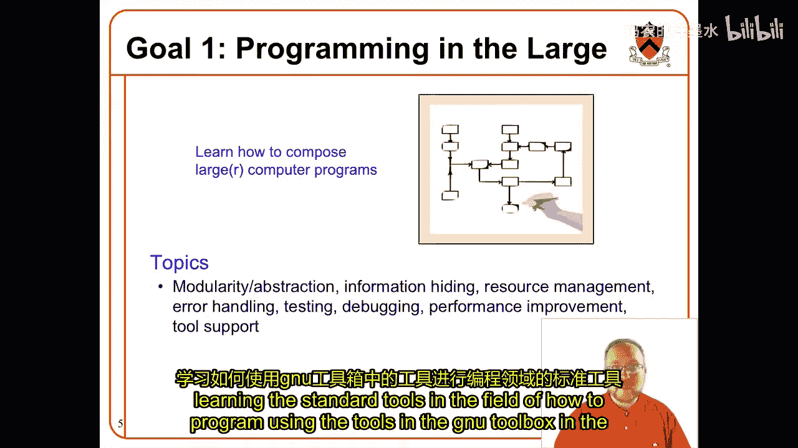

第一个目标我们称之为“大规模编程”。这指的是软件工程技术，旨在帮助你编写比COS 126课程中规模更大的程序，并在设计上拥有更大的自主权。

以下是五个我们希望帮助你掌握的具体事项：

*   **编写模块化代码**：代码应能体现抽象概念，同时隐藏实现细节。
*   **测试代码**：不仅仅是检查网站上的几个样例是否能通过，而是采用更严谨、结构化的测试方法。
*   **调试代码**：不仅仅是到处插入`print`语句来发现问题，而是使用该领域标准工具进行更严谨、结构化的调试。
*   **提升代码性能**：并判断何时不值得进行优化。
*   **使用工具支持上述活动**：学习在Linux环境下使用GNU工具箱中的标准工具进行编程。

### 目标二：接触低级语言

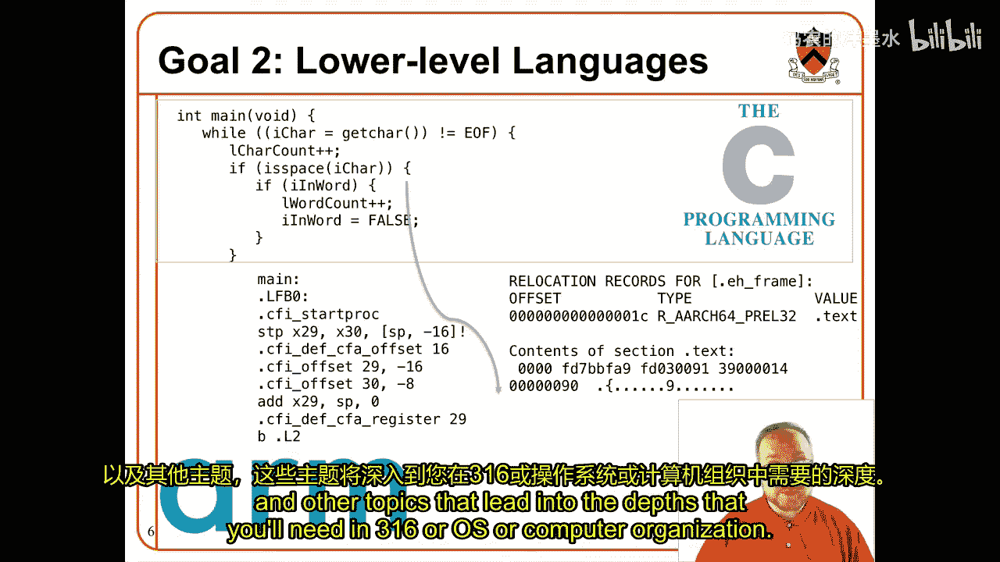

第二个目标是让你接触一些低级语言。这既是为未来课程做实际准备，也是为你打开一扇可能从未深入思考过、但值得探索的窗口。

在COS 126中，你经常听到“Java会做...”或“计算机会做...”这样的说法，但很少深入探究“为什么Java会那样做”以及JVM底层发生了什么。本课程将探讨一些低级语言，包括那些没有现代高级语言那么多便利功能的老式语言，甚至包括完全不可读的机器语言。

通过这种方式，我们希望揭开引用类型如何工作、内存分配与回收的真实过程等奥秘，为你学习COS 316（操作系统）或计算机组成等课程打下基础。

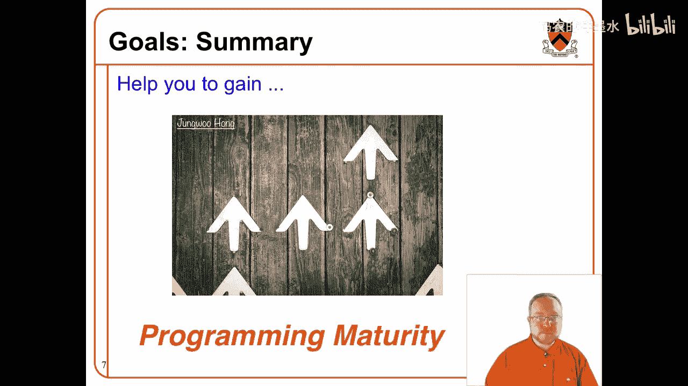

## 课程核心理念

计算机系的这三门课程（COS 126, 226, 217）各有不同，但有一个共同目标：帮助你真正获得编程上的成熟，或者说提升你的编程技能。

我们希望你能自信地处理非平凡问题的新规范，能够以结构化的方式编写大型程序，能够将大问题分解为合理的模块化组件，能更了解程序内部运行机制并以此指导编程设计选择，并能熟练使用行业标准工具。

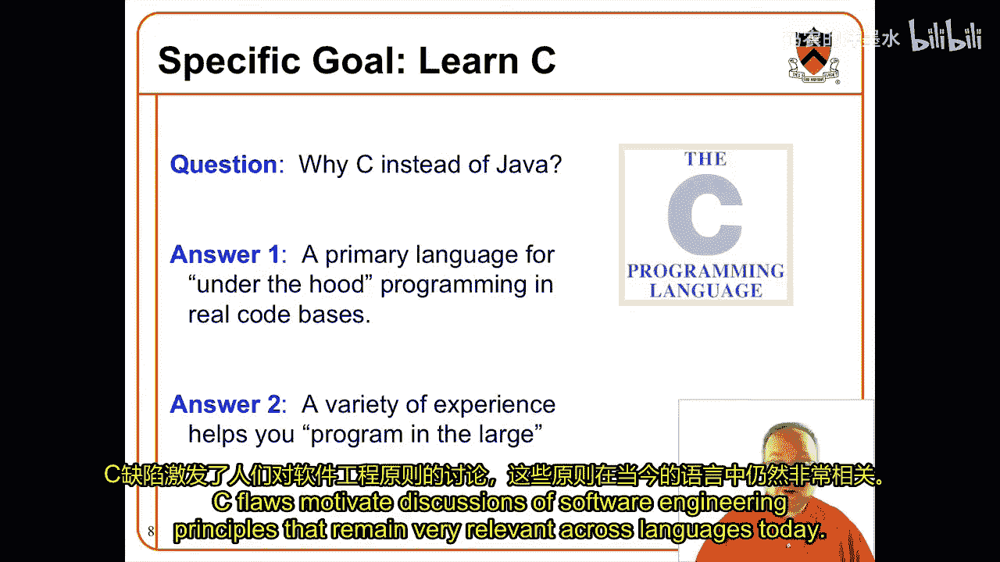

本课程的核心是确保你掌握必要的编程技能，以便在未来的系统和应用课程中表现出色。当你掌握了编程技巧并熟悉了环境和工具，你就能更专注于课程内容知识，而非编程的机械操作。

## 为什么选择C语言？

一个常见的问题是：为什么选择C语言，而不是Java、Python或Go？

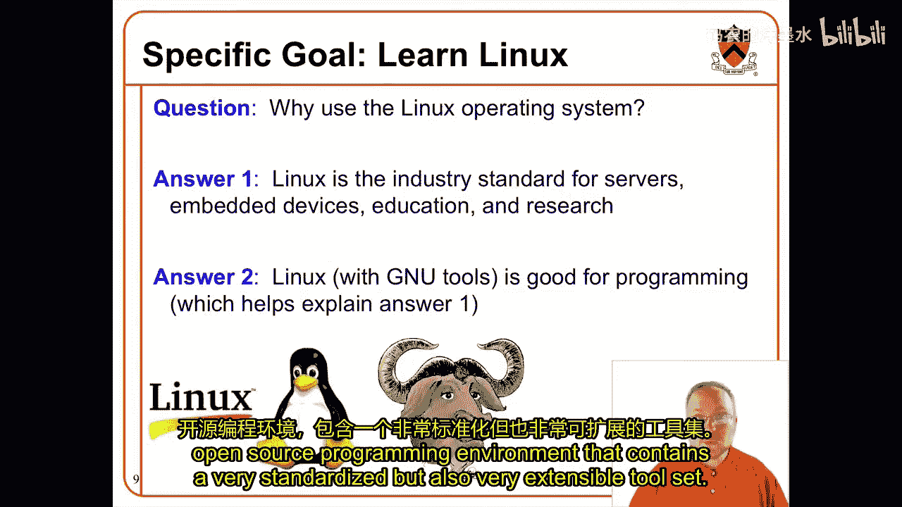

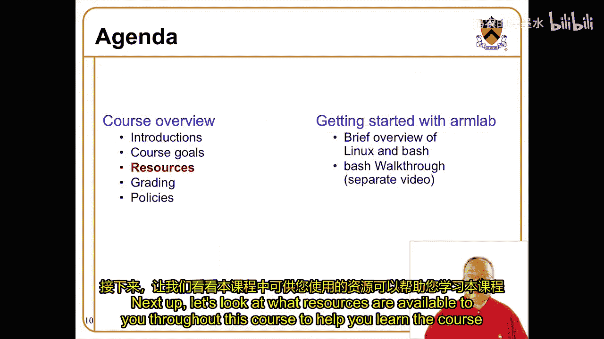

*   C语言支持“向下探索语言栈”的理念。它比Java更底层，与汇编语言关系密切。
*   它为系统编程提供了一个良好的基线，让你全面了解内存分配、指针类型、位运算等知识，从而能更好地理解本课程也将涉及的汇编语言。
*   如前所述，它能为你应对像操作系统这样的系统编程课程（无论是用C++、C、Go还是其他系统语言授课）做好准备。
*   C语言也间接支持“大规模编程”的目标。作为一种低级语言，C提供了更多创建抽象的机会。
*   C语言存在一些缺陷，这些缺陷促使我们讨论软件工程原则，而这些原则在所有语言中仍然非常相关。

## 学习Linux环境

另一个具体目标是学习Linux。需要明确的是，我们不会深入编程Linux内核本身，而是编写作为操作系统客户端的程序，并使用通常与操作系统捆绑的工具。

Linux及其变体是工业界的绝对标准，特别是在使用GNU工具的Linux环境下编程。Linux的开源和良好规范特性也使其非常适合教育和研究。

Linux环境与GNU工具一起，构成了一个丰富、开源、标准化且可扩展性强的编程环境。

## 课程资源

接下来，我们看看在整个课程中，有哪些资源可以帮助你学习课程材料。

### 讲座与观看派对

每周会有两次讲座发布。每次讲座都会有一个“观看派对”，这基本上是我坐在Zoom会议室里，等待大家就讲座主题提问。这是最接近线下讲座问答环节的方式。

讲座内容混合了不同层次的细节，以及C语言特定主题和更广泛的软件工程主题。即使主题层次较高，我保证它们仍然与当前作业材料相关联。

关于如何观看讲座的一个建议：当幻灯片上出现“iClicker”问题时，请暂停视频，思考答案，并最好以某种物理形式（写下来、说出来）记录你的答案，以确保你真正理解了内容。

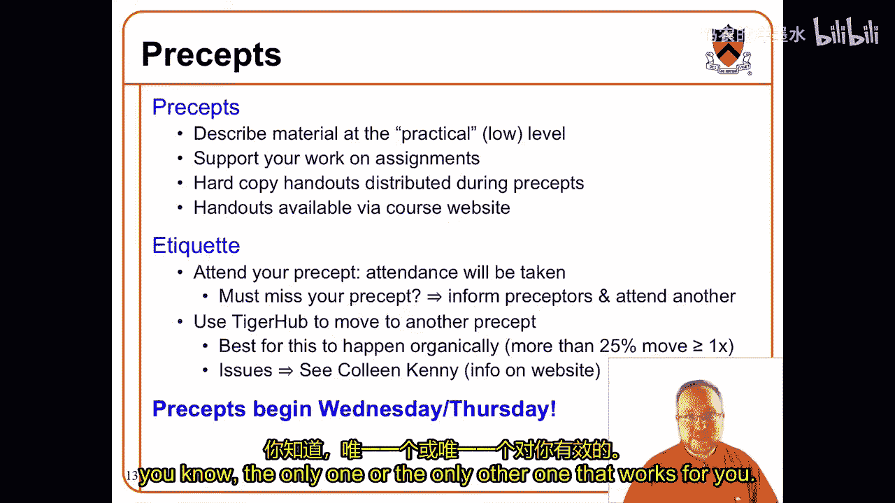

### 预科课程

与讲座混合高低层次内容和语言细节与软件工程不同，预科课程更侧重于语言细节，并且与作业直接相关。成功学习本课程的最佳方式就是参加预科课程，积极参与，并在课后学习预科笔记。

### 课程网站

本课程主要涉及三个网站：

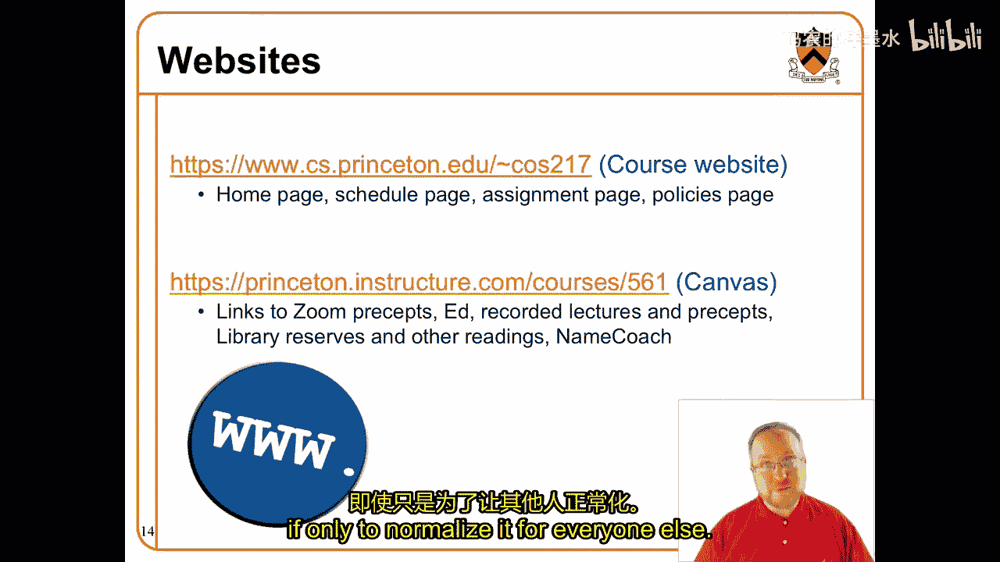

1.  **课程主网站**：包含所有课程工作人员的联系方式、预科课程和办公时间安排、作业说明以及课程政策。
2.  **Canvas**：普林斯顿新的学习管理系统。你可以在这里找到预科课程的Zoom链接、Ed讨论论坛的直接链接、阅读材料链接以及NameCoach的链接。我们强烈建议你使用NameCoach录制你的名字发音。
3.  **Ed讨论论坛**：这是一个问答讨论网站，学生可以提问并从同学和课程工作人员那里获得答案。请注意礼仪，不要随意刷屏，并且务必遵守课程交流政策，不在Ed上透露你的解决方案。

### 教材与参考资料

本课程有三本核心教材：

*   **《C程序设计语言》**：一本全面的C语言教科书。
*   **《ARM汇编语言》**：一本ARM汇编教科书，与本课程使用的汇编特性非常匹配。
*   **《程序设计实践》**：一本软件设计入门书，作者是历史上为数不多的真正“10倍效率程序员”之一，书中高层次的软件工程智慧对本课程很有帮助。

此外，课程网站上还链接了一些权威的硬件架构和指令集手册，供课程最后几个作业查阅。在整个课程中，你还会大量依赖Linux的`man`页面来了解工具和库函数的描述。

### 办公时间与实验室助教

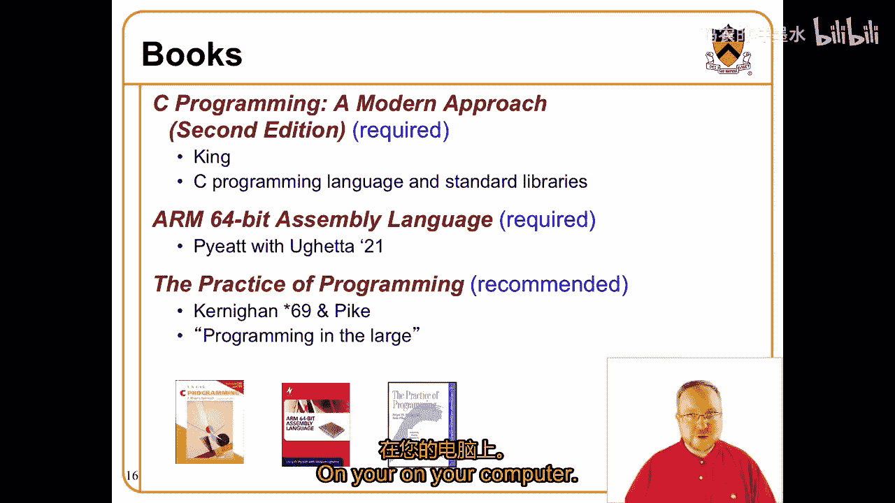

寻求帮助的次佳方式是参加办公时间。课程团队的每位成员每周至少有2小时办公时间，覆盖除周六外的每一天。本学期，Anne将在周日提供办公时间。

我们采用Zoom会议加排队表单的方式。你还可以向实验室助教寻求帮助，他们是学过本课程并表现优秀的本科生，每天提供4-6小时的调试帮助。

## 课程评估

本课程的评估方式和权重今年有所变化。为了强调在线环境下变化最小的部分，**作业占课程总成绩的三分之二**。我的座右铭是：提高编程能力的唯一途径就是编程。对于COS 217，只有通过实际完成作业，你才能开始培养编程成熟度。

此外，还有期中考试和期末考试。你的参与度分数将基于预科课程的出勤和参与情况，以及其他可能因素（例如在Ed上积极帮助他人）。

### 编程作业

有一个介绍性作业（作业0），你应该尽快完成，因为它能帮助你设置计算环境。之后有六个实质性作业，前三个是个人作业，后三个可以与伙伴合作完成。

作业是课程中非常重要的一部分。第一个实质性作业（作业1）的截止日期是9月17日。**请务必尽早开始**，不要拖延。COS 217的作业比COS 126复杂得多，调试也更为耗时。早开始意味着你有更多时间陷入困境然后摆脱困境，也能利用更多的办公时间和实验室助教时间。

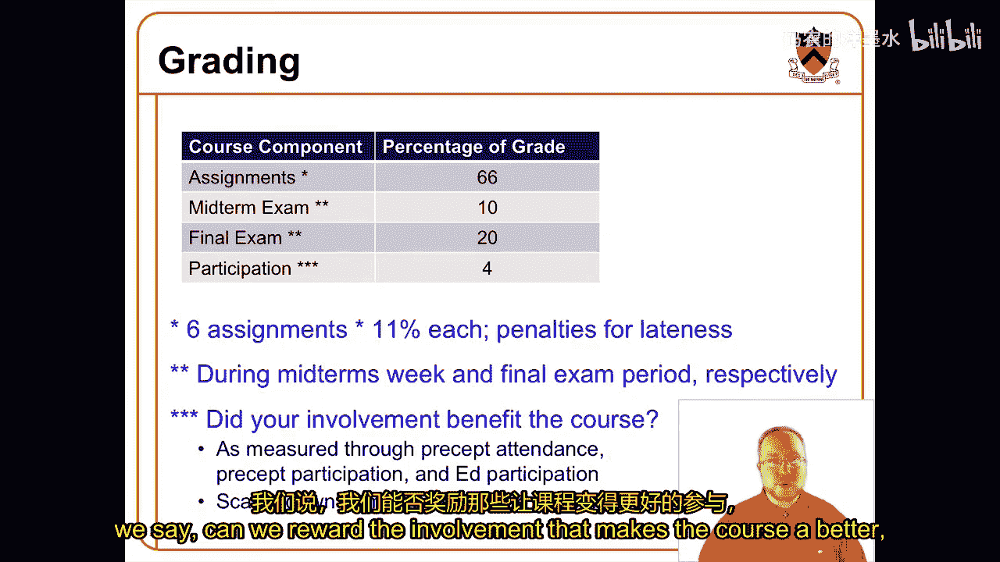

## 学术诚信

最后，关于课程政策，我想恳请大家：**不要作弊**。学术不端听证会会耗费教师大量时间，并很可能导致你失去一年的学业时间。请不要这样做。

以上就是管理部分的内容。我知道有些繁琐，但这是确保我们建立正确期望并让你了解可用资源的最佳机会。如果你对这部分内容有任何疑问，请随时在Ed上提问。

## 计算环境介绍

现在，我们开始深入本学期的第一个真正主题：我们将要使用的计算环境。

如前所述，我们将在整个课程中广泛使用Linux操作系统和GNU工具。Linux是一个操作系统，开源且免费。虽然许多人认为Linux只是超级程序员使用的黑色命令行窗口，但实际上它是许多常见系统（如Chromebook）的支柱。

为了简化并保证所有学生环境一致，本课程主要通过命令行访问Linux服务器。我们采用客户端-服务器模型，作业最终在服务器上运行，这很好，因为C和ARM汇编代码是不可移植的。

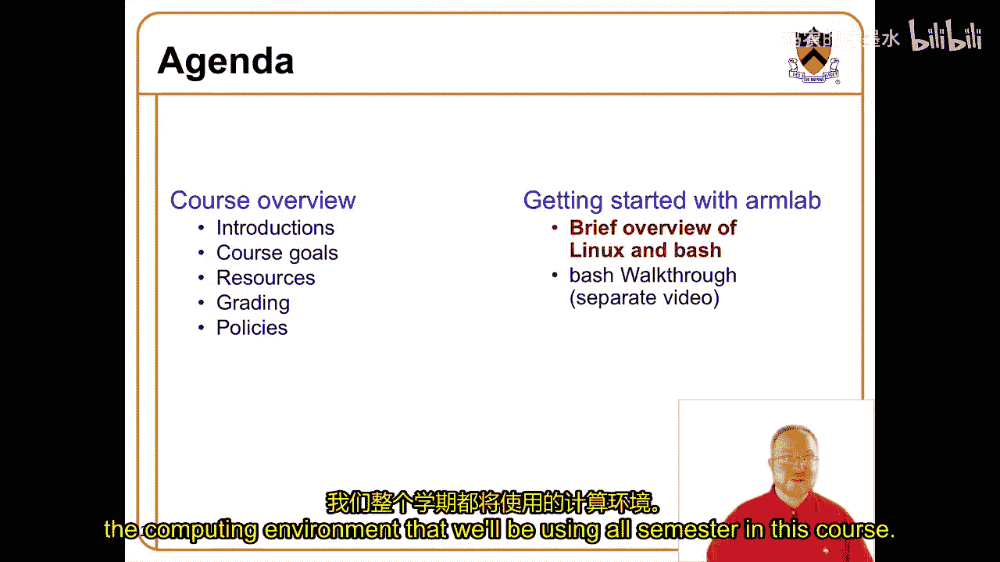

我们的服务器名为“armlab集群”，实际上是两台功能强大的机器（armlab01和armlab02），通过别名`armlab.cs.princeton.edu`进行负载均衡。

客户端是你的电脑。你只需要能够使用安全外壳协议连接到armlab。

### 术语澄清

需要澄清一些经常被混淆的术语：

*   **终端模拟器**：你用来SSH连接到服务器的程序（如PuTTY、Mac终端）。它提供键盘和屏幕之间的输入/输出连接，以支持文本用户界面。
*   **Shell**：一个接受指令以运行其他程序的程序。我们使用的Shell叫做`bash`。

所以，流程是：打开终端模拟器 -> 通过SSH连接到armlab -> 登录后，Shell启动 -> 通过Shell在armlab上获得操作界面。

### 工作流程

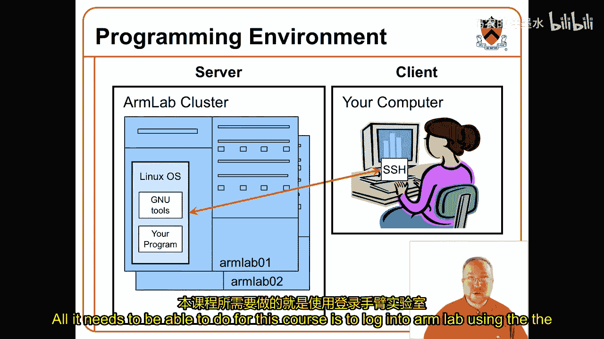

因为你只需要能通过互联网SSH连接到armlab，这意味着本课程的工作可以在任何地方完成。

*   许多学生选择在服务器上进行所有开发：SSH登录，使用服务器上的编辑器（如`emacs`或`vi`）编写程序，然后直接在服务器上编译、测试、运行和提交。
*   许多其他学生选择在自己的机器上编写所有代码（可能使用Sublime或VS Code），这完全可以。但你需要找到一种方法将文件传输到armlab上进行构建、测试、调试和最终提交。

构建和测试必须在armlab上进行，因为之前提到的可移植性问题。提交也在armlab上进行，因为文件是提交到该集群的文件系统。

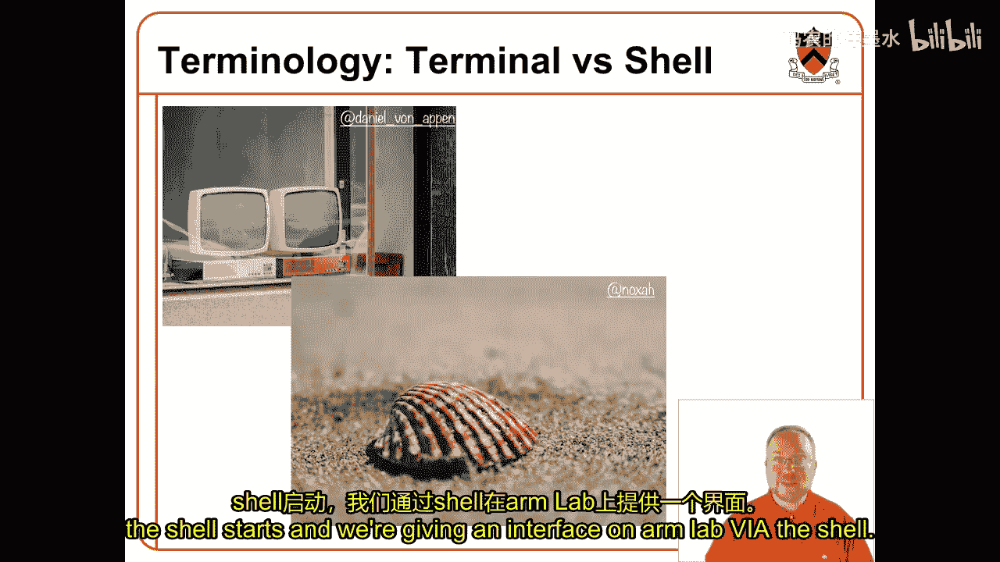

你完全可以找到适合你的工作流程，作业0将通过提供一些合理的选项供你练习来帮助你做到这一点。

## 总结与待办事项

本节课中，我们一起学习了COS 217课程的总体框架、目标、资源和核心的计算环境。

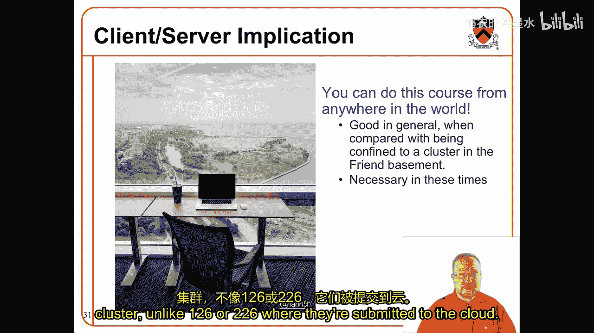

**本课后的待办事项：**
1.  浏览课程网站，阅读那里的大量信息，特别是课程政策。
2.  登录armlab，开始熟悉该环境。

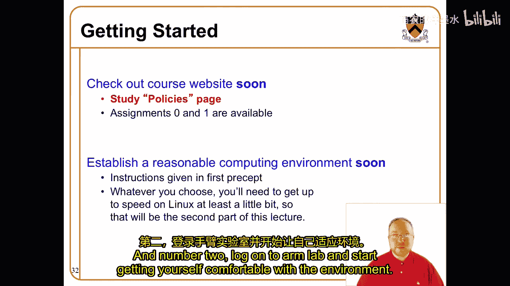

课程的第二部分将深入帮助你完成这些任务。