# 005：C语言导论 🚀

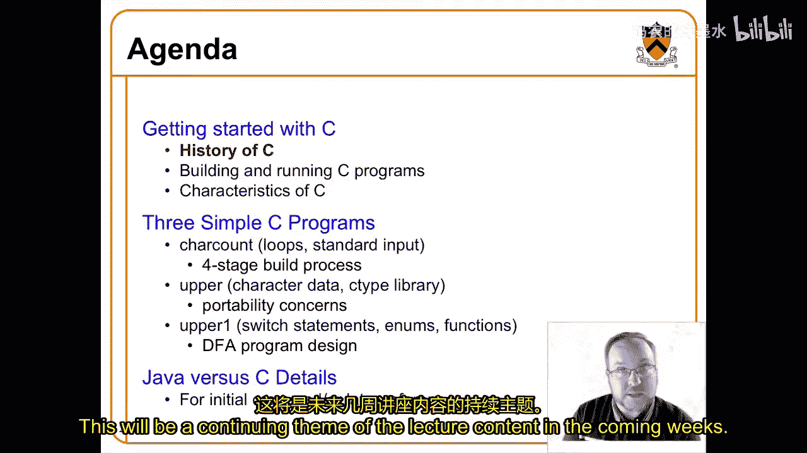

在本节课中，我们将要学习C语言的基础知识，包括其历史背景、设计目标、与Java语言的核心区别，以及如何从源代码构建可执行程序。我们将通过三个具体的C程序示例来逐步讲解，为完成作业1打下坚实基础。

## C语言的历史与设计哲学 🏛️

上一节我们介绍了课程背景，本节中我们来看看C语言的起源。C语言诞生于新泽西州的贝尔实验室，它是AT&T的研究部门，后来成为朗讯科技，现已被诺基亚收购。C语言最初是作为构建Unix系统工具的工具而设计的，最终它取代了汇编语言版本，成为重新实现Unix内核的语言。这是实现可移植Unix环境的第一步。

C语言的发明者是丹尼斯·里奇。他在其著作《C语言的发展》中的回顾，很好地契合了本课程对C语言的使用定位：它的主流成功、低层级的访问能力（尽管牺牲了可移植性），以及它鼓励程序员简洁地表达自己。

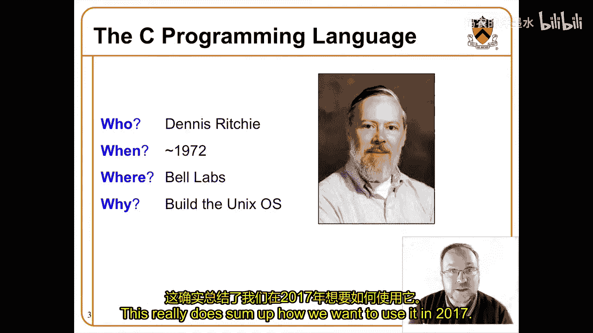

他的观点是：C语言从不试图束缚程序员。它一直吸引着系统程序员，他们喜欢用简洁的方式编写强大的表达式。它允许程序员在牺牲可移植性的同时，直接访问许多机器级特性，否则这些特性需要使用汇编语言。他著名的总结是：**C语言古怪、有缺陷，但却取得了巨大的成功**。虽然历史的偶然性确实有所帮助，但它显然满足了对一种系统实现语言的需求：效率足以取代汇编语言，同时又足够抽象和流畅，能够在各种环境中描述算法和交互。

## C与Java的对比 ⚖️

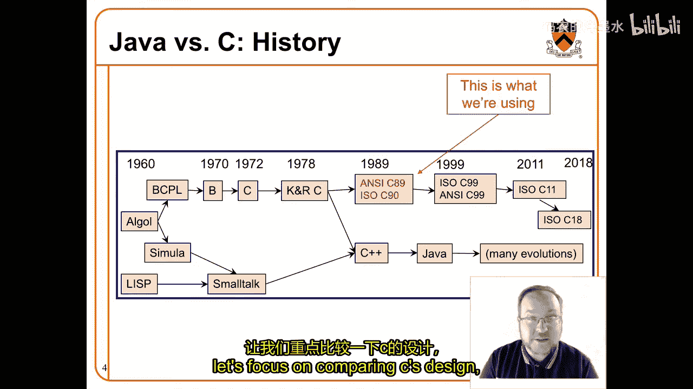

C语言相对古老，诞生于20世纪70年代初，在70年代末非正式标准化，80年代末正式标准化。此后有各种语言扩展和新标准，直到几年前，还有新的标准在制定中。但这些新标准要么完全是表面上的（例如，注释的认证方式），要么专注于并发编程（例如，可重入安全性和线程效率）。我们课程有意选择使用较旧的版本，以避免新标准的复杂性。

大多数进入217课程的学生都了解Java。因此，本讲接下来的部分将重点比较C语言与Java的设计和基础。

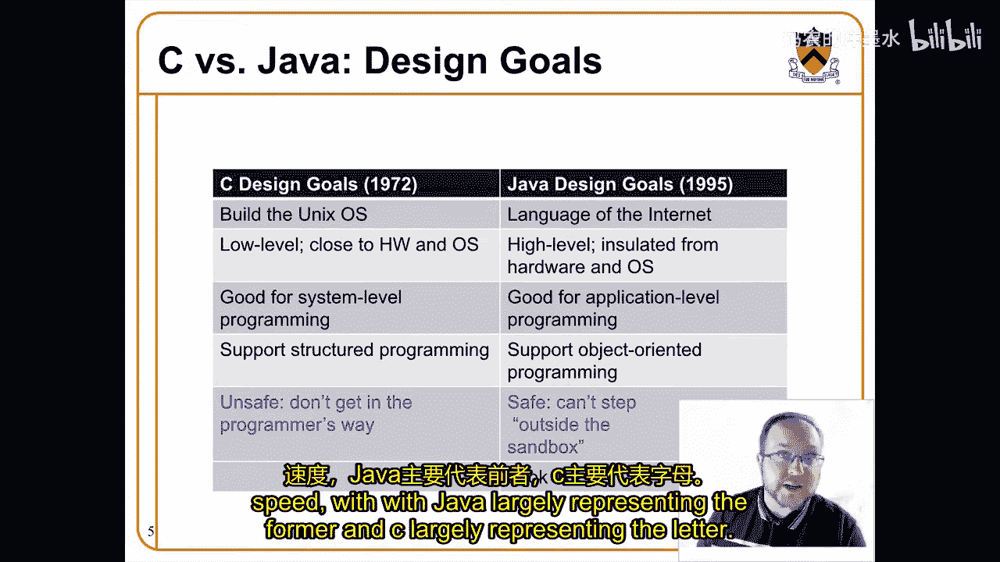

历史上，C和Java是为非常不同的目的而设计的。C被用作构建操作系统及其工具的系统编程语言，而Java最初被认为是下一代伟大的Web语言（尽管结果并非如此）。最终得出的结论是：C语言在设计时不太关心安全性，它被专家用来创建替代本身就不安全的汇编语言工具。同样，对于可移植性，它替代的是完全不可移植的工具。而Java，由于其Web应用的初衷，至少在一定程度上考虑了可移植性和安全性。

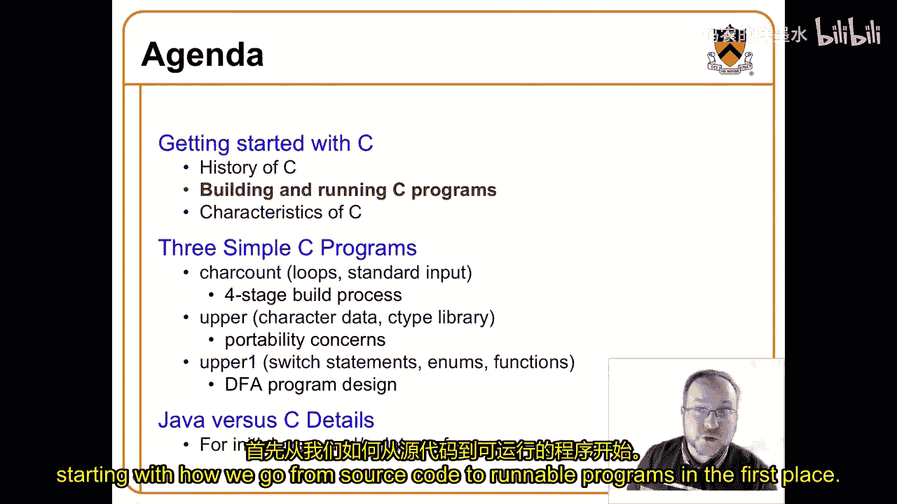

一个持续的冲突将是**安全性与可移植性** 与 **低层级访问和速度** 之间的权衡，Java在很大程度上代表了前者，而C语言在很大程度上代表了后者。

## C程序的特点与构建过程 🔧

沿着这个思路，我们来谈谈C程序的特点，首先从源代码如何变成可运行程序开始。

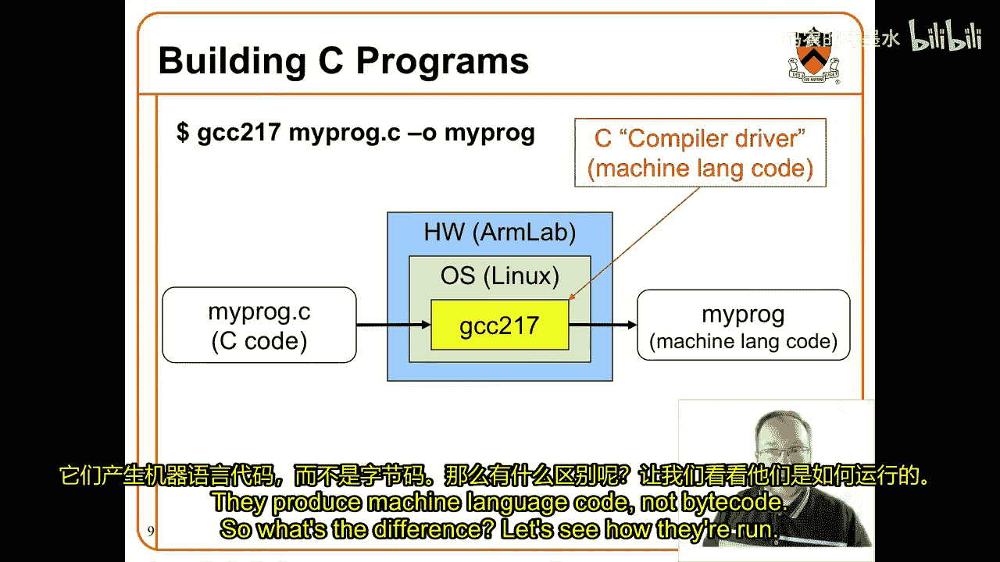

在我们深入C语言细节之前，让我们退一步，回顾一下我们对Java的了解，以及Java程序是如何构建和运行的。

如果我们有一个程序 `MyProg.java`，我们会执行命令 `javac MyProg.java`。这会调用Java编译器 `javac`，它生成字节码，这是程序的一种与机器无关的表示形式。然后，`javac` 本身是一个机器语言代码程序，它特定于特定的硬件和操作系统。在我们的例子中，它特定于ArmsLab。它会读取 `MyProg.java` 作为输入，并写入 `MyProg.class` 字节码作为输出。当我们运行它时，我们会执行命令 `java MyProg`，这会再次调用Java解释器 `java`。同样，这是一个特定于我们机器的机器语言代码程序，但它读取的是可移植的 `.class` 文件。

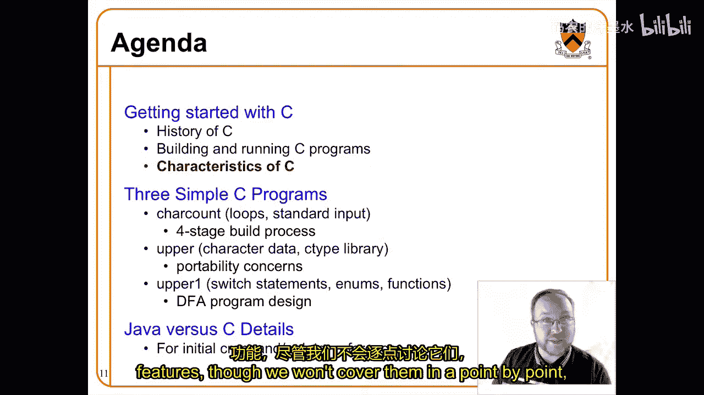

与C语言对比，C语言的可执行文件（或由C程序生成的可执行文件）是使用C语言工具（俗称“编译器”）构建的，但这个术语并不完全准确，我们稍后会讨论。它们生成的是机器语言代码，而不是字节码。

与Java不同，在Java中我们必须运行 `java` 和我们的 `.class` 文件，而在C语言中，机器代码可以直接由CPU执行。在Java中，字节码是一个中间步骤，字节码本身不可运行，它是在虚拟机上执行的，这增加了一层间接性。JVM的额外间接层增加了复杂性和潜在的低效率，但带来了标准化和可移植性的好处。

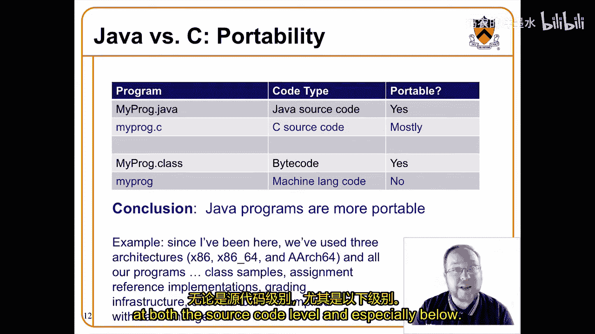

## 可移植性、安全性与效率的权衡 📊

我们提到了可移植性，现在来详细讨论。在源代码层面，Java理论上完全可移植。C语言大部分可移植，但稍差一些，我们很快会看到一些可移植性障碍。在源代码层面以下，Java字节码再次理论上完全可移植。Java解释器的接口在所有平台上都是一致的，即使实现不同，也能将字节码与底层硬件隔离。然而，机器语言程序 `MyProg` 完全不可移植。机器语言代码特定于特定的硬件平台和操作系统。因此，结论是，Java程序在源代码层面，尤其是源代码层面以下，比C程序更具可移植性。

我们提到的另一个特性是安全性和效率。因此，可移植性显然是Java的优势，我们将在安全性和便利性（如边界检查和垃圾回收）方面看到同样的情况。Java有很多很好的特性，但它们确实有代价：速度和可预测性。将Java视为嵌入式系统的语言。想象一下，你驾驶着高科技汽车，带有自适应制动系统。就在你猛踩刹车的瞬间，你的制动控制器决定这是清理它认为永远不会再使用的内存的好时机。当然，C语言的反驳点是，C语言可能超级快，但如果你从不释放任何内存，它最终会耗尽并崩溃，在这种情况下，可能是字面意义上的“崩溃”。所以这些都是设计决策，不一定有绝对的正确或错误方式，但必须根据语言的用途来考虑。

以下是C语言与Java在关键特性上的对比：

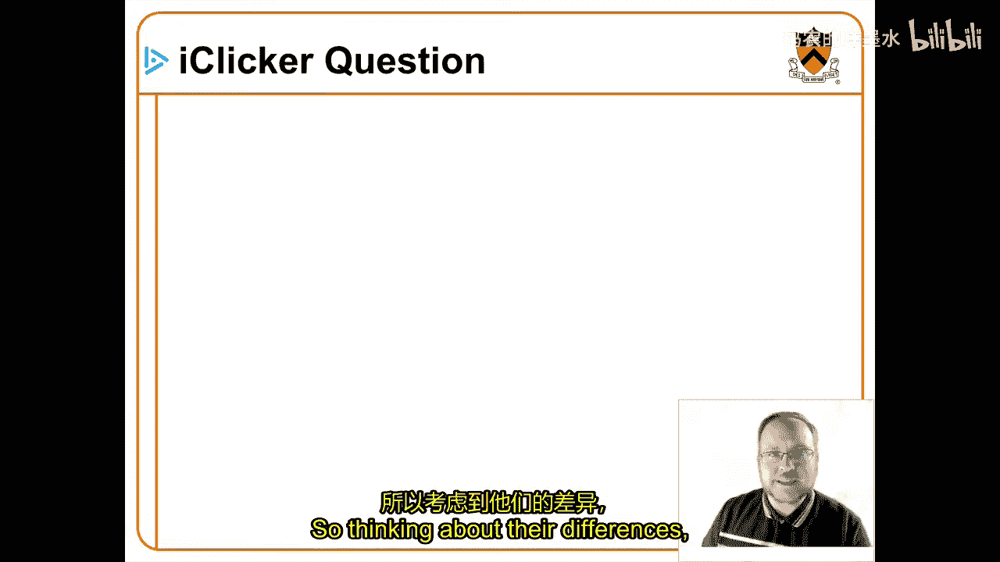

*   **边界检查**：Java自动进行边界检查，如果越界则抛出异常。C语言不进行边界检查，越界访问会导致未定义行为（通常是崩溃或数据损坏）。
*   **内存管理**：Java使用垃圾回收器自动管理内存。C语言需要程序员手动管理内存（使用 `malloc` 和 `free`）。
*   **速度与可预测性**：由于缺少运行时检查和管理开销，C语言通常比Java更快，执行时间更可预测。

它们很好地互补，都是在你最初几门编程课程中学习的好选择。

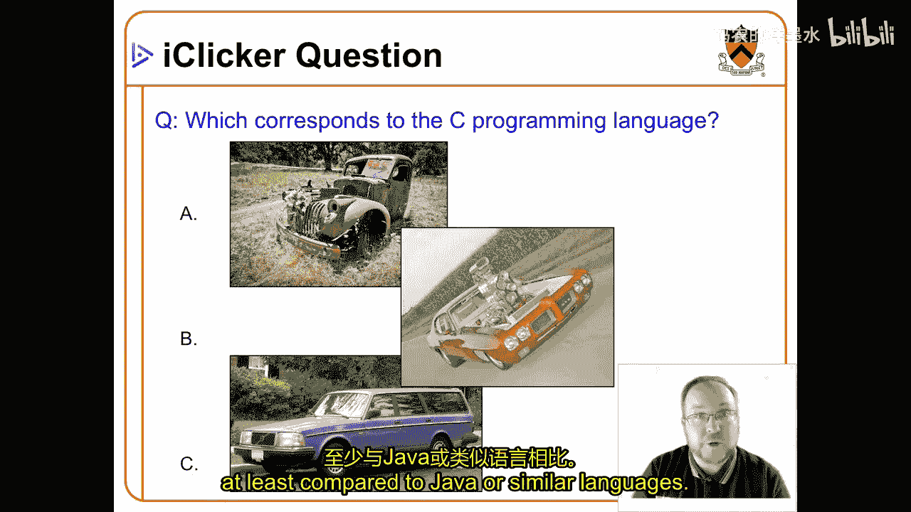

## 类比：C语言像什么车？ 🚗

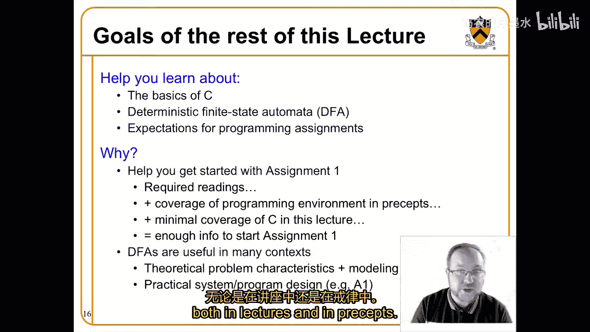

想一想它们的区别，采用这个类比：哪辆车可能让你联想到C语言，而不是Java？

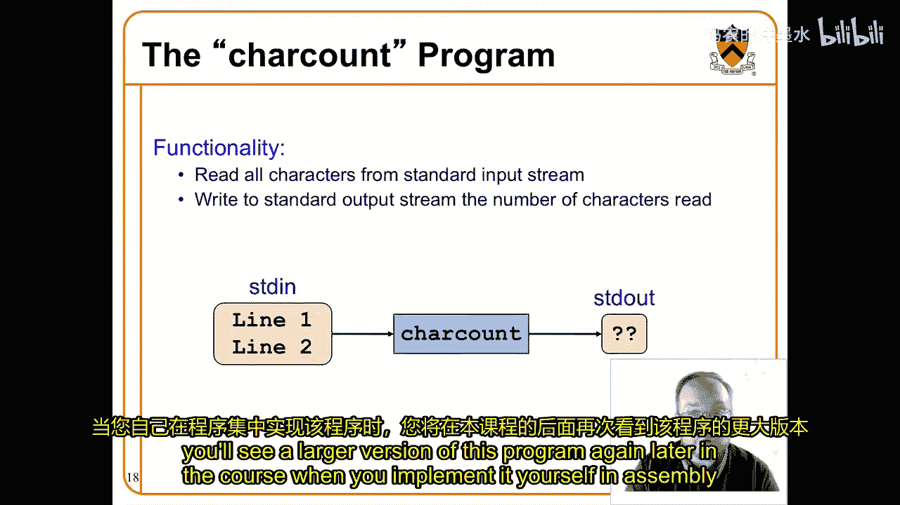

许多人可能会选择A，那辆生锈的旧卡车。是的，C语言古老，不太现代，肯定不可移植，那辆卡车当然也不可移植，所以这不是一个坏答案。但C语言仍然运行并被广泛使用，而那辆卡车肯定不是。沃尔沃也不是正确的类比，沃尔沃传统上是安全汽车，它们在50年代末率先使用三点式安全带，有时被认为是无聊的“妈妈车”。所以，如果非要选，这更像是Java，而不是C。那么剩下的就是B，那辆改装过的汽车。它更快一些，但代价是风险更高。这就是C语言，至少与Java或类似语言相比是这样。

## 第一个C程序：字符计数 📝

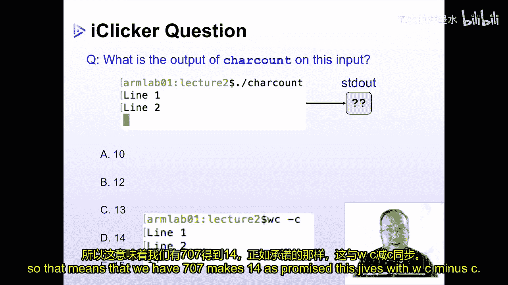

如果C语言是你的“热力改装车”，那就让我们开始编程吧。作为警告，本讲剩余部分节奏相当快，请做好准备。它会抛出完成作业1所需的所有内容，希望有足够的内容能让你掌握。但请放心，后续的讲座和辅导课中会有更系统的C语言覆盖。

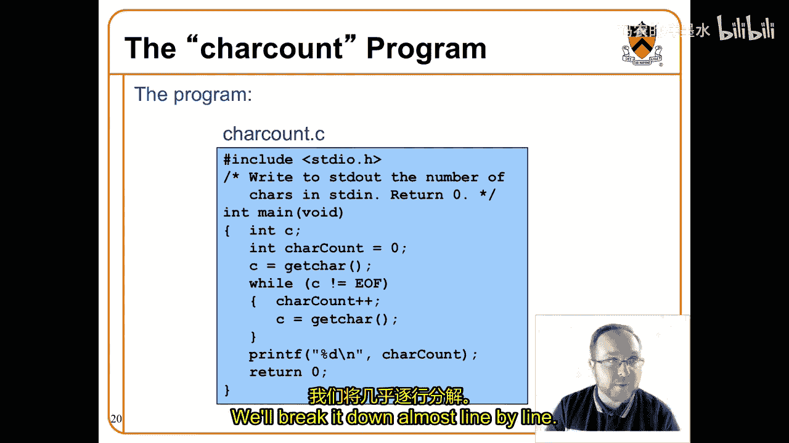

本讲剩余部分将围绕三个小型C程序展开，它们将作为我们C语言的初始示例，并再次为你完成作业1取得进展做好准备。

我们的第一个程序是 `charcount`，它相当于你在Linux和Bash概述中看到的 `wc` 程序，当使用 `-c` 参数调用以计数字符时。在本课程后面，当你自己用汇编语言实现它时，你会再次看到这个程序的一个更大版本。

`charcount` 在这个输入上的输出是什么？我们运行它，然后键入标准输入：第一行，回车键，第二行，回车键。然后我们发送信号表示“标准输入完成”。花点时间，暂停视频，做出你的选择并说出来，答案是什么？在第一行，我们有 `L I N E`、空格、`1`，然后是换行字符。所以当你按回车键时，它实际上是在流中插入了一个叫做换行符的字符。所以那是7个字符。第二行有 `L I N E`、空格、`2` 和换行符，又是7个。EOF，你发送的表示“输入完成”的信号本身不是一个字符。这意味着我们有7加7等于14个字符。正如所承诺的，这与 `wc -c` 的结果一致。

以下是程序代码，快速浏览一下。有些行对你熟悉Java的眼睛来说会非常熟悉，其他的可能看起来相当陌生。但没关系，我们将几乎逐行分解它。

当你要求shell运行一个可执行文件时，它会加载构建系统生成的机器代码。按照惯例，机器代码以一个运行时系统开始，该系统包含一些我们称为 `_start` 的基本启动代码。`_start` 的主要工作是调用 `main` 函数。因此，对于我们编写的代码，执行从 `main` 开始。在这个意义上，这就像Java一样。

但请注意，在Java中你有 `public static void main(String[] args)`，而在C语言中它简洁得多。我们将在课程后面学习如何复制Java中的一些冗长描述，但现在，我们只有一个简单的 `main` 函数，它不接受参数并返回一个 `int`：`int main(void)`。

进入 `main` 函数，这看起来像我们期望从Java中看到的变量定义，除了C语言中 `c` 是 `int` 类型，而不是 `char`。当 `c` 表示字符时，看到 `int c` 是一件奇怪的事情。但这里的原因是，我们将用来填充 `c` 值的函数 `getchar` 返回一个 `int`，而不是一个 `char`。你可能会自然地追问：好吧，那为什么是 `int` 呢？原因是我们希望能够识别任何有效字符，同时也能识别我们是否完全未能读取一个字符。这意味着我们需要比 `char` 更多的空间。如果任何有效的 `char` 都可能被返回，我们就填满了 `char` 所有可能的值，但仍然没有办法表明我们未能读取一个字符。因此，我们应该将 `getchar` 返回的值赋给一个 `int`，因为它返回一个 `int`，因为它需要那个额外的值来表示：“我没有给你返回一个 `char`，我做不到。”如果你将返回值赋给一个 `char`，可能会导致麻烦，因为不一定清楚你读入的值是与“无法读取字符”对应的值（被强制转换为 `char`）还是字符本身。我们稍后会更详细地看到这一点。

`getchar` 是来自某个标准库的函数。我们的程序知道它的存在，是因为我们使用了 `#include` 包含了一个头文件。我们稍后再谈这个。正如前面的例子提到的，没有所谓的EOF字符，EOF只是头文件中定义的一个数字，它是表示“无法写入字符”的值。也许有比EOF（代表文件结束）更好的方式来思考这个问题，你可以称之为“读取失败”或“输入结束”之类的。在我们的系统上，EOF被定义为-1，它在 `stdio.h` 头文件中，但我们实际上不需要知道或关心这个，我们只使用EOF作为语义上有意义的常量。

此时，我们进入循环，即我们函数的核心。我们使用初始读取（在循环前）的结果，并比较我们是读取了一个有效字符还是从 `getchar` 得到了那个非字符状态。如果我们读取了一个字符，那么我们就增加计数以匹配。完成递增后，我们将再次调用 `getchar` 以复制初始读取，并为循环的持续条件重新设置。最终，我们将耗尽标准输入，`getchar` 将失败；即它将返回EOF。这应该结束循环。循环之后，我们使用 `printf` 打印结果，这与你从126课程中熟悉的 `System.out.printf` 或 `System.out.println` 没什么不同。最后，我们返回。返回的工作方式与Java中相同，它们返回到调用此函数的位置，如果函数未指定为 `void` 返回类型，则发回一个值。如前所述，`main` 的调用函数是 `_start`，这意味着当我们返回到它时，我们回到了 `_start`，而它所做的只是清理它为 `main` 设置的任何状态，然后立即以 `main` 返回的相同退出状态退出。

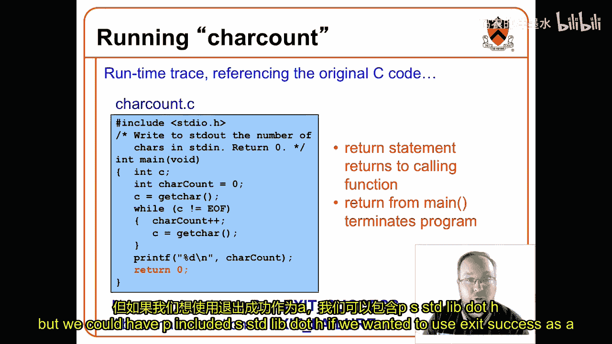

我们在Linux和Bash讲座中讨论过退出状态。C标准规定，成功的程序必须以退出状态0结束，这与我们在Linux和Bash中讨论的一致。C标准规定，任何失败的程序都应该以退出状态 `EXIT_FAILURE` 结束。但 `EXIT_FAILURE` 这个值依赖于系统，在我们的系统上，它是1。值 `EXIT_SUCCESS` 和 `EXIT_FAILURE` 定义在 `stdlib.h` 中，所以这里我们直接返回字面量0，但如果我们想使用 `EXIT_SUCCESS` 作为0的语义上有意义的常量，我们本可以 `#include <stdlib.h>`。

## C程序的构建过程详解 🛠️

好了，这就是我们之前在高层次上看到的程序，与看到Java构建其程序文件的区别。但之前的讨论集中在GCC创建一个可执行文件，而不是字节码。现在，有了一个用作示例的程序，我们准备更详细地深入研究如何构建C程序，我们将看到为什么称GCC为“编译器”并不完全是全部真相。

在这个幻灯片上，你可以看到快捷命令，这是默认情况。它在一个调用中完成构建过程的所有阶段，从源代码开始，最终生成可执行文件。使用 `-o` 选项，下一个参数是可执行文件的名称。如果没有 `-o` 选项，可执行文件将由于奇怪的历史原因被命名为 `a.out`。请注意，在Linux中，如前一次讲座所述，文件扩展名仅用于人类可读性，通常不赋予可执行文件。我们可以称它为 `charcount.exe`，这并不比 `charcount.out`、`charcount` 单独或 `charcount.` 有任何更大的意义，任何字符串直到总文件名限制（根据情况是256或4096）都可以。因此，我们实际上通过调用其名称来运行 `charcount` 可执行文件。回想上一讲，`./` 表示“在此目录中查找程序”。

因此，`charcount` 从标准输入读取字符，直到达到EOF。如何获得EOF的故事与你从126课程的Java中习惯的一样，默认情况下，标准输入绑定到键盘，因此我们可以通过按 `Ctrl+D` 来指示EOF。再次注意，EOF命名不当，所以如果它绑定到一个文件，我们实际上不必发送 `Ctrl+D`，当文件结束时就会达到EOF。

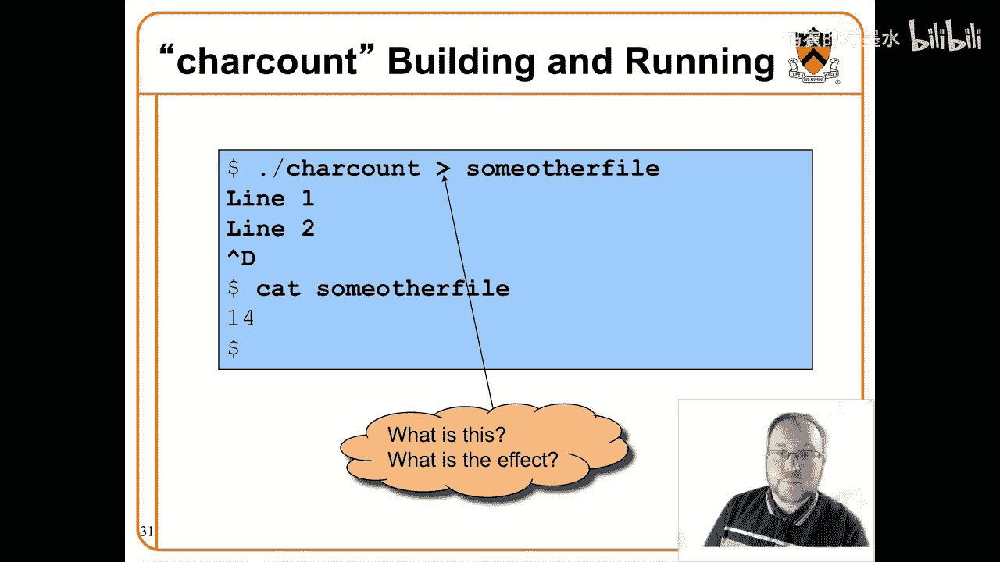

再简要提醒一下126课程和之前讲座中的一些内容。我们可以重定向标准输入，从某个文件读取而不是在程序中键入。我们也可以重定向标准输出，让程序写入文件而不是写入终端。

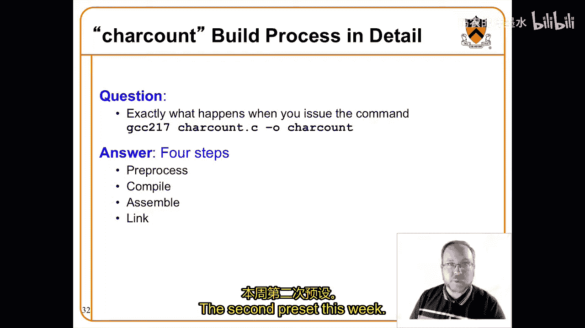

现在为了说明，让我们单独执行每个步骤。我们说过构建过程更复杂，有一个快捷方式可以执行所有步骤。让我们逐个步骤来看。请注意，这是作业1所要求的。我在这里讲得很快，但你会对这些阶段有一个概述，你也将在本周的第二次辅导课中更详细地看到它们。

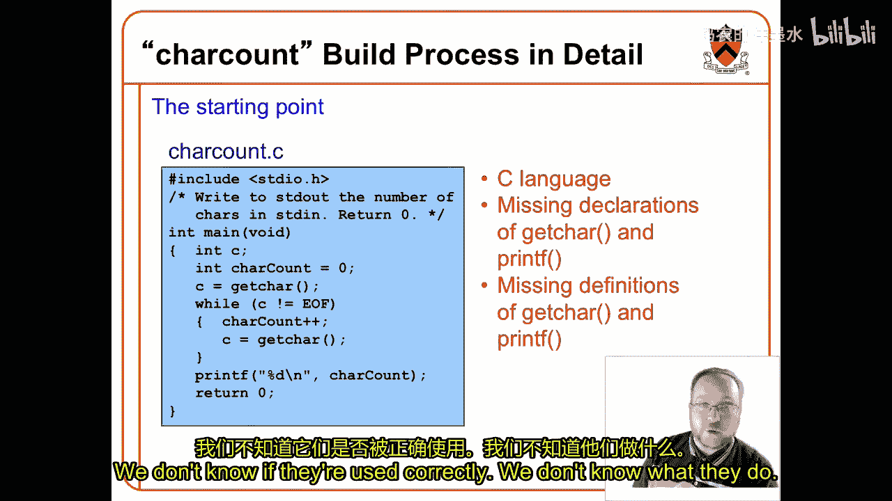

## 构建过程的四个阶段 🔄

我们从之前用C语言编写的初始程序开始。对于 `getchar` 和 `printf` 的语法，除了知道它们是函数之外，没有任何其他指示。我们不知道它们是否被正确使用，也不知道它们做什么。

构建的四个阶段中的第一个阶段是**预处理器**。它通过 `-E` 选项调用（没人记得这个，但我喜欢把它想成E代表“额外的东西”）。这是因为预处理器会在你的源代码中放入一些额外的东西。按照惯例，它生成一个带有 `.i` 扩展名的文件，所以你可以记住它处理了 `#include`。因为它所做的是：它从源代码中删除一些注释，并处理预处理指令，即那些以 `#` 号开头的行。

我们将看到其中的几个，但这里又是我们的第一个 `#include`，它表示程序依赖的一个接口。预处理器处理 `#include` 的方式是用整个 `stdio.h` 文件的内容（加上一些元数据标记）替换那一行。请注意，这个新内容实际上是给编译器的信息转储，告诉它其他接口中可用的一大堆符号（如函数和常量）的详细信息。在 `#include` 添加之后，预处理器接下来会扫描以替换所有的宏，这里宏用于符号常量。用它们代表的值替换，所以这里的EOF实际上是 `stdio.h` 中定义的一个宏，它被替换为-1。好了，这就是我们在 `.i` 文件中拥有的内容，它仍然是C语言，大约如此，那里有一些标记。我们还可以看到另一个使用 `int` 的原因：`getchar` 的返回。在我们的系统上，没有字符-1，`char` 是无符号的，最小值是0。如果我们给-1，它会溢出，从0回到最大的可能 `char` 值，因此它将不明确。如果我们把 `char` 放在那里，我们会说，嗯，我们是指最大的 `char` 值还是指负一？这就不清楚了。这就是为什么我们使用 `int`。我们还可以看到 `#include` 是如何工作的。顶部的这些行是声明，它们是给编译器的关于某个符号存在的信息。可以把它看作是：“嘿，编译器，`getchar` 是一个函数，它不接受参数并返回一个 `int`。” 这允许编译器最终进行类型检查，并确保它被正确使用。

我们说过编译器是构建过程的第二步。编译是将C语言翻译成汇编语言。调用是通过 `-S` 选项，我的助记符主要是基于我们实际上将在本课程中编写汇编语言并为其使用 `.s` 后缀，但你也可以把S看作是同步到一种更低级的语言，这是我们第一次向更低层级下降。

因此，这两个声明是预处理器给编译器的“情书”，告诉它 `getchar` 和 `printf` 是存在的。这意味着编译器可以验证对它们的任何调用是否类型检查正确。然后编译器逐步进行翻译。它开始并说，我能生成汇编代码吗？指示 `main` 的定义。在块内（这里是一个复合语句），编译器将生成汇编语言代码来为变量分配空间，然后生成完成块其余部分的指令。请注意，与Java不同，在C89中，声明必须出现在块的顶部，而不是在块体内其他代码之后。这也是编译器使用声明来完成类型检查的地方，因为它看到了对 `getchar` 和 `printf` 的调用，所以它可以检查并确保调用具有它从声明中期望的相同类型。

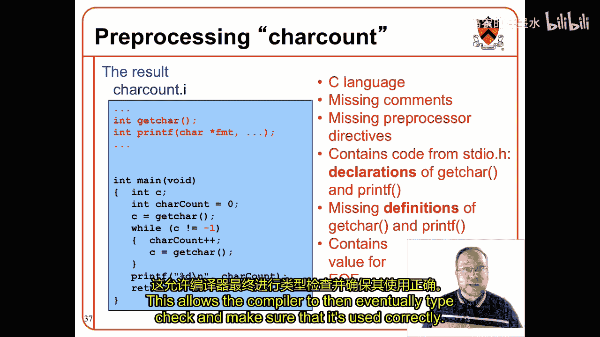

好了，所以编译器只是一个C代码的类型检查器和语法检查器，然后将C代码翻译成汇编语言。请注意，此时，`getchar` 和 `printf` 仍然只是我们被告知是函数的符号，但我们仍然没有它们实际的代码。

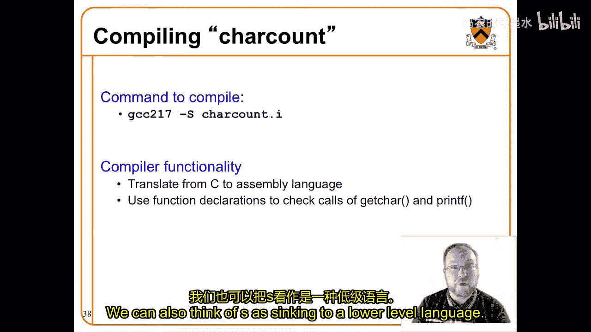

编译器之后是**汇编器**。汇编器只是另一个翻译器，这次是将汇编语言翻译成机器语言。请注意，一个常见的术语混淆是认为汇编器必须生成汇编语言，但事实并非如此，汇编器接受汇编语言并生成机器代码。如果你一直喜欢（而不是抱怨）我对GCC选项的奇怪助记符，这次我喜欢 `-c` 代表“无法再阅读了”。

因为确实在这一点上，我们有了机器语言，它只是一堆二进制，我们无法再阅读它了，尽管请继续关注，到课程结束时，我们实际上将学会逐位解释一小部分机器语言及其指令。所以这里我们只有一堆二进制，但此时，我们仍然不知道 `getchar` 和 `printf` 在哪里，我们只有调用它们的机器语言代码，我们没有它们本身的代码。我们最好尽快找到它们，因为这是四步构建过程的第三步。

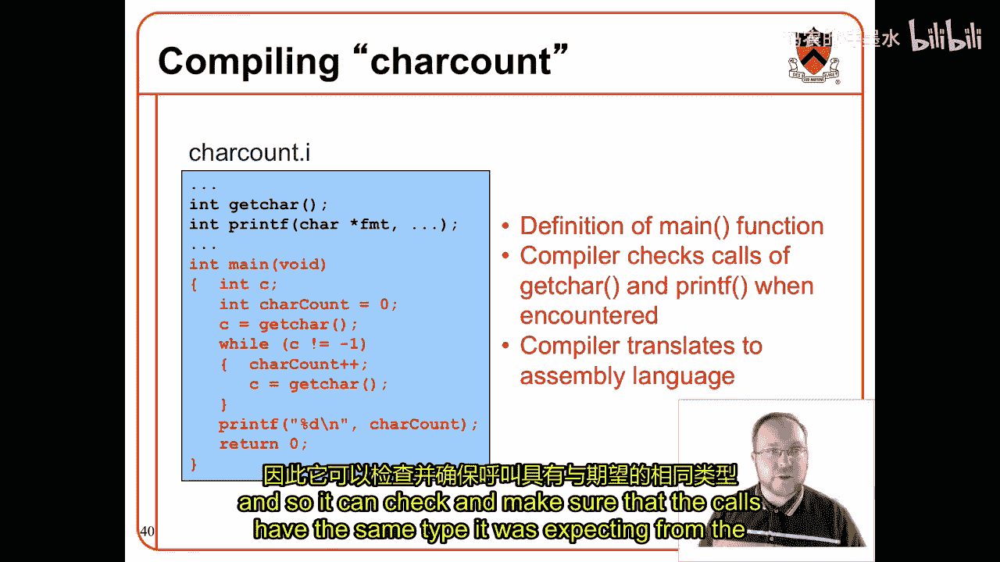

最后，构建过程中的第四个工具是**链接器**。链接器的工作同样是最终去查找程序中尚未解析的机器代码引用。在这种情况下，`getchar` 和 `printf` 都存在于标准I/O库中，在我们的系统上，该库与所有其他标准库一起被塞进一个存档文件中，位于 `/usr/lib`。因此，它将从该库存档中找到正确的代码，并将其合并到最终程序中。链接器运行后，我们就拥有了所需的一切，我们有了一个完整的可执行程序。

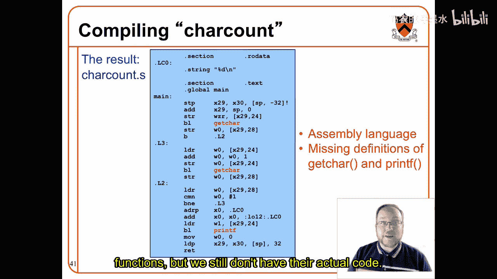

这就是构建过程。在前几个作业中，我们将要求你单独完成这些步骤中的每一步，以便了解当你神奇地键入 `gcc` 时，幕后到底发生了什么。

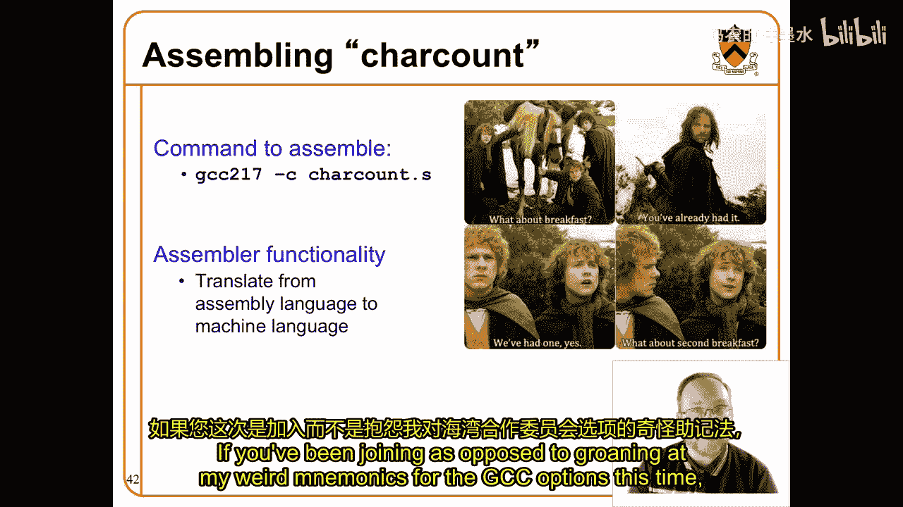

## 程序结构优化思考 💡

在我们继续第二个小程序之前，暂停视频，花点时间思考是否有更好的方式来构建我们的 `charcount` 程序的主体。请注意，这里的D是现有代码，只是使用了奇怪的分页，以便我的脸能放在角落。

暂停视频，看看你是否喜欢其中一个胜过其他。

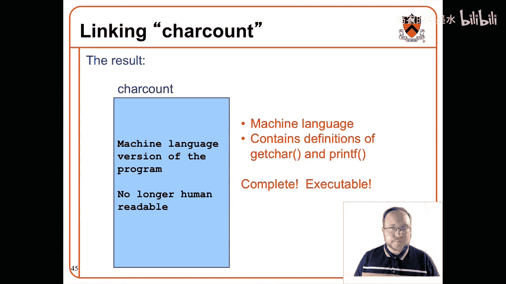

这是一个判断性的问题。查看每个选项，A和D在不同的地方有 `getchar`，这有点奇怪。C有一个无限循环和一个 `break` 语句。有些老师，尤其是高中老师，会抓狂地说：“不，你绝不能使用 `break`，有更好的方式来构建程序。” B在循环条件内部有一个神秘的赋值语句。B实际上是最地道的C语言写法，尽管有些人可能会说它是最特殊的C语言或最不可读的C语言。我确实倾向于最喜欢B。接下来我会选择D，只是因为我倾向于不喜欢那些没有数学表达式说明循环将执行多少次的 `for` 循环。但这真的都是判断和个人风格问题。

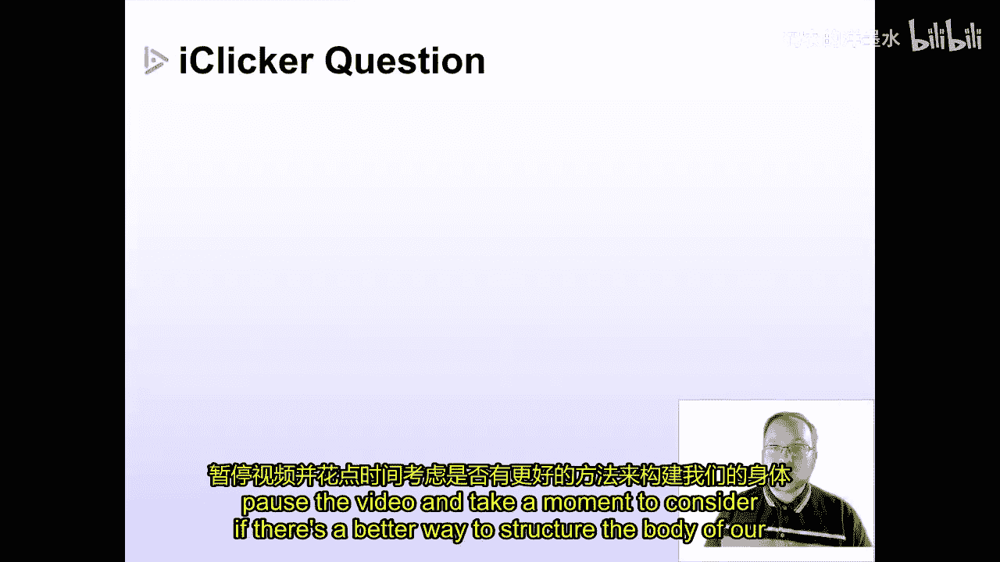

## 第二个C程序：转换为大写 🔠

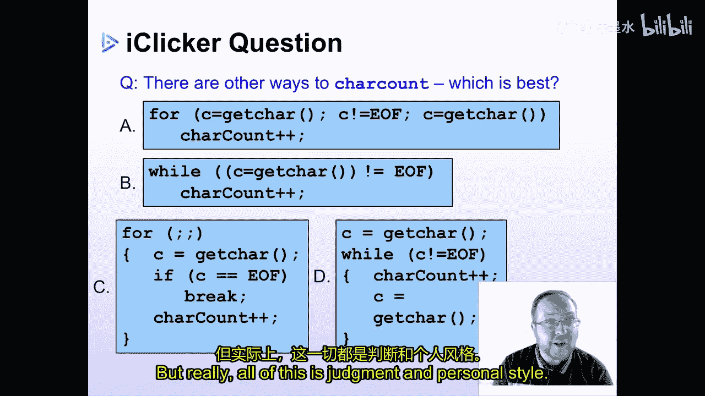

我们的第二个程序将是一个将其所有输入转换为大写的程序，也许我们可以称之为“喊话器”。

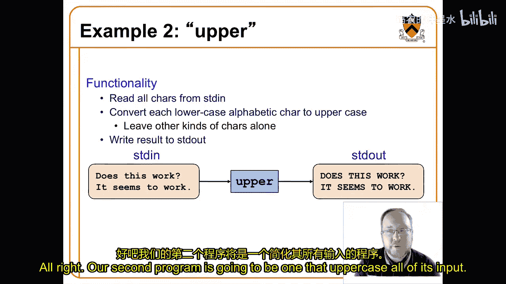

要编写这个程序，你必须知道如何识别小写字符。这引发了对字符如何存储的讨论。每个字符实际上存储为一个整数，只是一个非常小的整数，计算机系统的字符代码将每个字符映射到一个唯一的整数。我们的系统对单字节字符使用ASCII，这在大多数现代计算机上通常是一个很好的假设，但事实上不是唯一的选择。那么，看看这个程序的第一个版本。

我们再次声明 `int c`，因为我们将 `getchar` 的结果存储在其中。我们有那个神秘的、特殊的、地道的（随你喜欢哪个词）`while` 循环和赋值语句。然后我们有一个 `if` 语句，其中内置了97、122和32。从126课程中学到的东西应该跃然纸上。那就是：**魔数**难以阅读和理解。更糟糕的是，这些魔数是ASCII码。因此，它们不仅难以阅读和理解，还带来了可移植性问题。ASCII很普遍，但并非无处不在。例如，这在一个使用另一种编码（如EBCDIC）的系统上就行不通，因为值是硬编码的。算法本身对于大小写字母不是相隔32个字符的任何编码都不起作用，而且没有理由它们必须如此，所以这是算法的一个相当强的假设。

我们可以通过使用字符字面量来绕过这些魔数，字符字面量像在Java中一样，用单引号表示，一些特殊字符由以反斜杠开头的转义序列表示。所以这是我们的第二个版本，它使用字符字面量。它比前一个版本更好，因为它不假设ASCII。然而，它确实做了这个奇怪的事情，即对 `char` 进行算术运算。在C语言中，我说过字符字面量与 `char` 变量相同，它只是一个数字，一个非常小的 `int`。所以在ASCII上，小写 `'a'` 等同于97，因此我们可以从中减去东西，我们可以用它进行大于或等于比较，这完全没问题。立即在另一个我提到的系统EBCDIC上，小写 `'a'` 是129，再次表明我们不能仅仅假设值本身，但我们确实通过使用字符字面量在两者中都绕过了这个问题。因此，对 `char` 进行算术运算完全没问题。但现在有什么问题呢？嗯，它仍然有我提到的另一个问题，它假设大写字母的数字代码相对于小写字母的数字代码有某个恒定的偏移量。好吧，这里不一定是32，这更好。但有什么能说明它们有恒定的偏移量呢？它假设它们是连续的，这对于EBCDIC来说是不正确的，如果我们想制作一个通用程序，事情真的会很快变得复杂。

## 使用标准库函数 📚

幸运的是，有一个更好的方法。看手册页。有一个库可以做到。这里的库是 `ctype.h`，其优势在于你知道标准库已经为你运行的机器配置好了。除了上一张幻灯片上用于识别字符是否属于某个类别的 `is` 函数外，我们还有两个函数来对字符执行转换。因此，如果我们试图“喊话”，我们在这里自然要做的事情是将 `islower` 与 `toupper` 配对使用。

以下是最终的样子。快速回顾一下之前的程序，如果我们省略了 `#include <ctype.h>` 会怎样？暂停视频，回答它，大声说出来，让自己承诺，然后重新开始。如果我们省略了 `#include <ctype.h>`，编译器在遇到对 `islower` 和 `toupper` 的调用时会生成一个警告，因为它说：“我从未被告知这些东西存在，所以我无法对它们进行类型检查。” 但它不会生成错误，因为它们实际上可能被链接器找到。在这种情况下，它们来自一个标准库，链接器可以找到它们，因此构建将在没有错误的情况下成功。但我们确实希望有这个 `#include`，这样编译器可以更早地发现我们是否犯了类型错误，也因为通常打印出大量警告似乎不雅观。

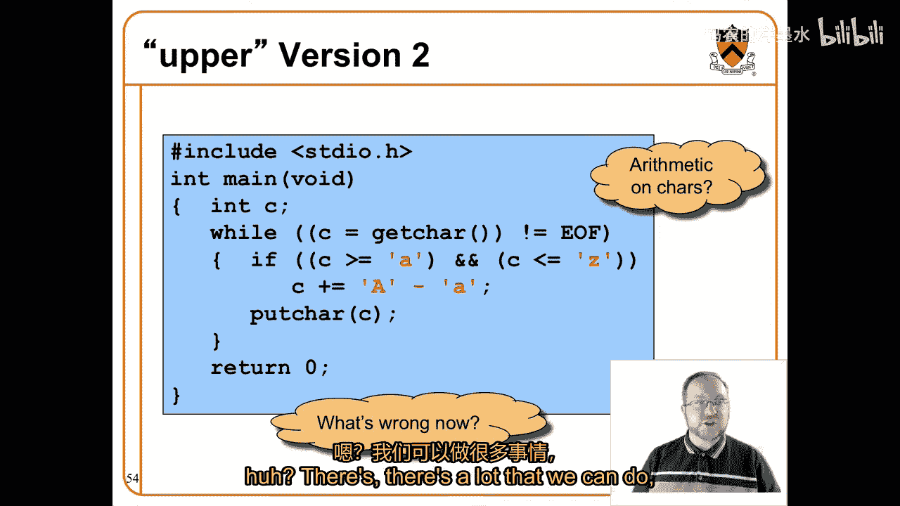

好了，关于这段代码还有一个脑筋急转弯，但我会立即揭晓答案：`if` 语句真的必要吗？这个问题的正确答案是：我不知道，让我去查一下手册页。

在这里的 `toupper` 手册页上，“返回值”部分说 `toupper` 不会改变不是小写字母的字符。现在回到完整的问题：`if` 语句真的必要吗？暂停视频，自己决定这对于正确性是否是必要的，不必要但你会保留它，还是不必要并且你会去掉它。从手册页来看，不是A，它不必要，因为如果它不是小写字符，`toupper` 无论如何都不会对它做任何事。所以A不是正确答案。B与C，正如我们所见，是一种趋势，是一个判断性的问题。B可以说更不神秘。C可能更快，因为每次循环少了一个函数调用和一个条件分支。但这真的取决于你，我可能会选择B，仅仅是因为如果对所有内容都调用 `toupper`，你现在依赖于阅读你代码的人去阅读手册页，尽管我一直强调“读手册页，读手册页，读手册页”，但我知道你不会去读手册页，所以我们可以在代码中加上它，代价只是几个时钟周期。

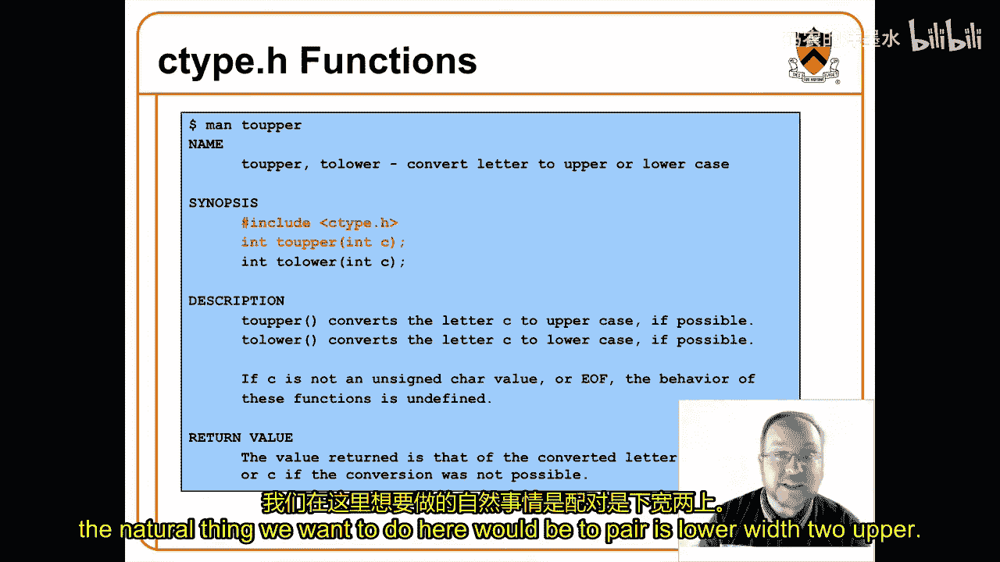

## 第三个C程序：单词首字母大写 🆒

最后，让我们看第三个程序，它将为你提供几乎所有作业1所需的C语言组件的示例，甚至更好的是，你的程序的总体设计。

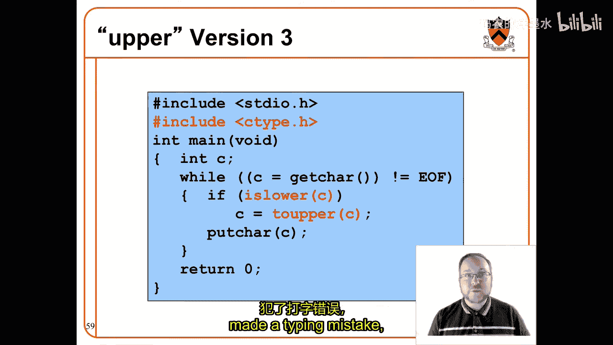

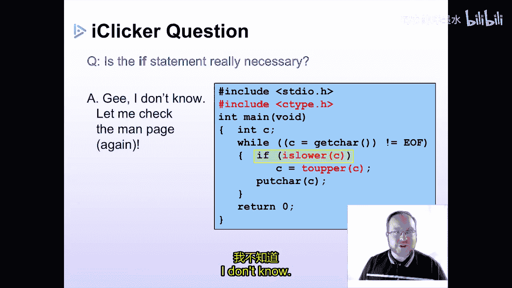

我们的第三个程序将是将每个单词的首字母大写，而不是每个字母。为了简单起见，让我们将一个单词定义为一串由空白字符分隔的字符，这是对英语用法的模糊近似，无意进行语言上的诡辩，争论什么 exactly 是单词。

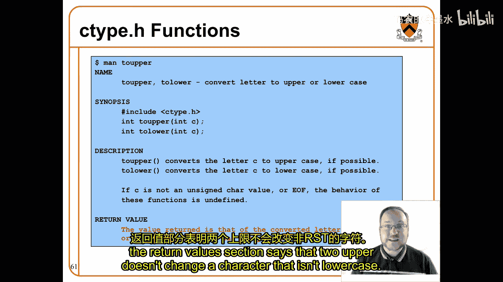

因此，要设计这个程序，我们需要决定每个字母是否应该大写，只有当它位于每个单词的开头时才选择这样做。这听起来像是126课程的考试题，要找出需要大写的字母的正则表达式。但如果它是正则表达式，那么，我们可以构建一个DFA（确定性有限自动机）。感谢Stephen Kleene，34届毕业生。

## 确定性有限自动机（DFA）设计 🤖

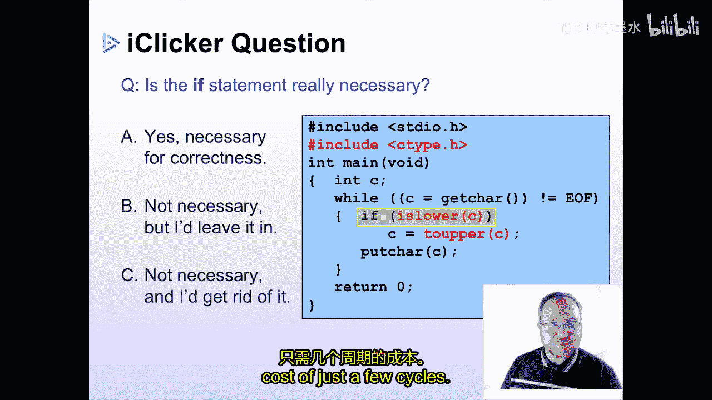

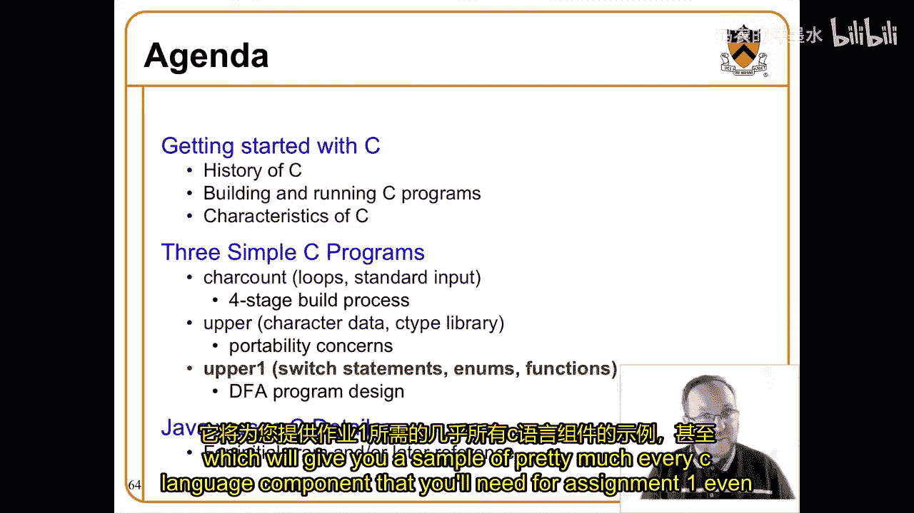

快速回顾一下126课程，确定性有限自动机是一种计算机器，它按顺序处理字符串，只考虑字符串中的每个字母一次，通过随着字符串的每个后续字母在状态之间转换。在126课程和作业1中，每个状态都有一个状态，指示它是接受（成功）状态还是拒绝（失败）状态。这仅适用于机器在该状态停止时，并不是说你一旦到达接受状态就成功了。不，每个状态要么是接受要么是拒绝，只有当机器停止时才重要。好了，但对于这个问题，我们实际上没有成功或失败的标准，我们只是完成每个字符的动作，所以我们不会将任何状态标记为接受或拒绝。

那么，考虑使用这个DFA的算法，我们从“正常”状态开始。只要它不是字母字符，我们还没有开始一个单词，所以我们只是打印它。一旦我们遇到一个字母字符，那就是一个单词的开始，所以现在我们需要将其大写，但从现在开始我们在一个单词内部，所以我们应该转换到另一个状态。在那个状态中，每个字母字符我们都将原样打印。最终，在那个另一个状态中，我们将读入一个非字母字符，在这种情况下我们说：“啊哈，这是一个单词的结束”，所以让我们转换回“正常”状态，我们将打印出非字母字符，现在我们处于“正常”状态，等待下一个单词开始。我们继续这个过程，直到输入耗尽。这是一般算法。让我们看看这在代码中如何实现。

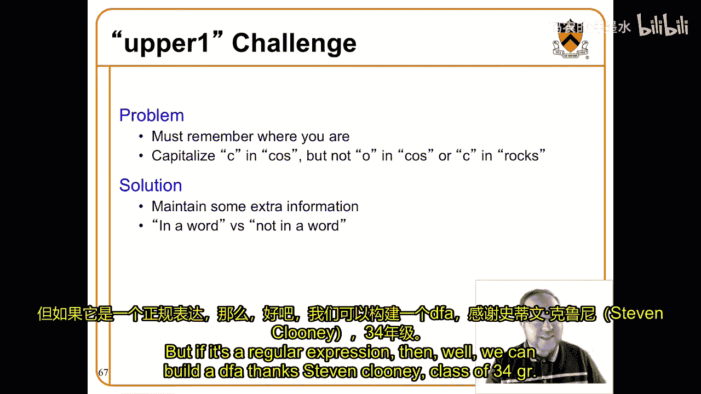

## 代码实现与优化 🧑‍💻

这是使用 `int` 表示状态的DFA的第一次代码尝试。由于这个设计选择，我看到一大堆0和1，没有真正的意义表明哪个是哪个。我的意思是，我知道我曾经有“正常”和“在单词中”。那么，哪个是哪个？我可以回去看看，说：好吧，默认状态、起始状态是“正常”，所以0是这里状态的初始值，所以0必须是“正常”。但真的，有更好的方法。我们可以做得更好。

我们应该力求使程序符合明确指定的原始DFA，原始DFA确实使用了像“IN_WORD”这样语义上有意义的名称。我们可以在C语言中使用枚举类型来实现。枚举类型（或简称 `enum`）允许你指定自己的命名整数常量，可以显式指定，或者由于我们实际上不关心这里的值是什么，873和4126和0和1一样好，我们可以隐式指定。在这张幻灯片上，我们实际上是隐式的，但方便的是，当没有显式定义时，C语言将从0开始，每个新成员比前一个多1，所以这段代码将给我们0和1，就像硬编码的版本一样。

好了，所以这是我们的程序，使用枚举去除了魔数。它更好。但这里仍然有一个问题。有什么问题？请随时暂停视频，看看你是否能识别出这段代码有什么不太好的地方。

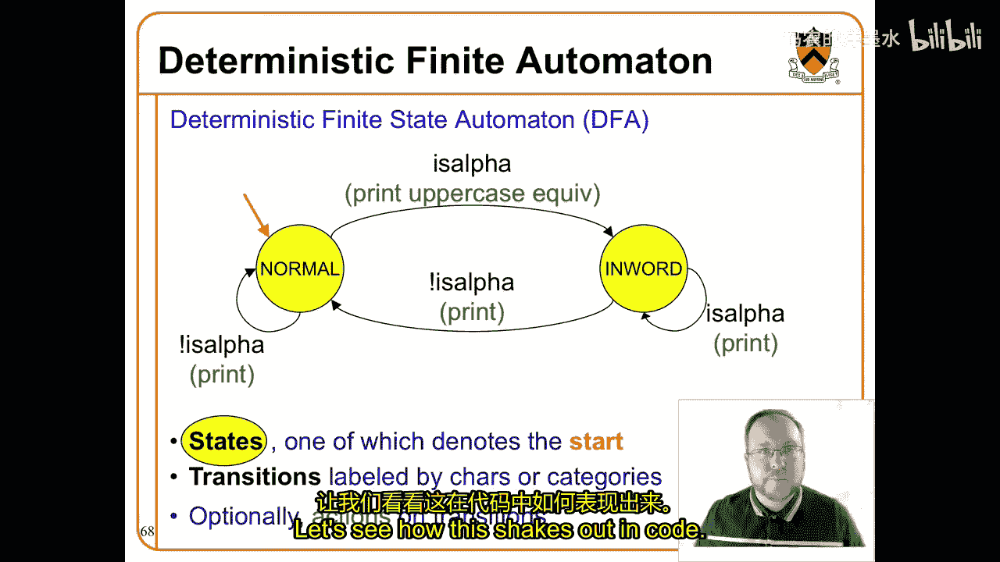

这段代码嵌套得非常深，我们越来越向右移动。也许对于这个每个状态只有一个 `if-else` 的两状态情况来说，这还不是世界末日，但如果每个状态有更复杂的逻辑要处理，并且如果状态数量激增怎么办？这里的 `case` 代表DFA中的不同状态。那个 `switch` 语句会变得非常糟糕，因为没有模块化。

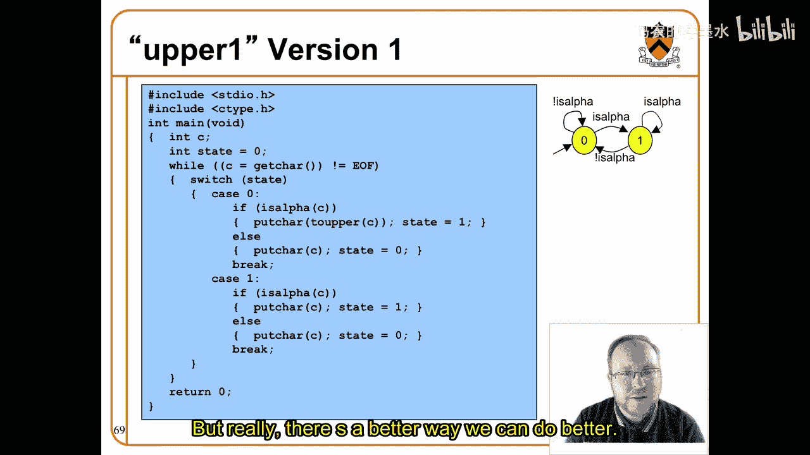

没有模块化的解决方案是，我知道这会让你震惊，**模块化**。在这种情况下，如果我们担心处理任何一个状态的逻辑变得足够复杂会成为问题，我们可以将所有实际逻辑推入每个状态一个函数中，并使 `switch` 语句只是一个最小化的框架，它只是说：我应该调用哪个函数？调用它。

让我们看看那是什么样子。我们的代码在这里变得更长了，因为模块化有一些额外定义函数的开销，但这没关系。代码行数并不意味着程序更差。我们的 `main` 函数现在在每个 `switch` 分支中都有最少的代码：调用与当前状态和输入字符相关联的动作函数。然后它获取函数返回值并设置新状态，然后是一个 `break` 来隔离各个分支。这相当不错。但如果我在考试中把它交给你，你需要多长时间才能弄清楚它是做什么的？我相信如果它有描述不同部分的注释，它会读起来更好。

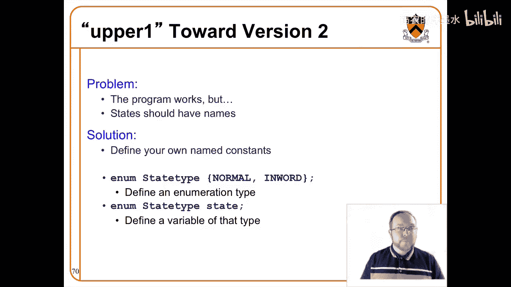

所以让我们称之为A-， admittedly 这是吹毛求疵，因为我们一直从示例中省略注释，只是为了适应幻灯片。但在你的作业代码中，这不会是吹毛求疵，我保证。好了，无论是否夸大其词，这确实作为一个方便的过渡，来谈谈我们的内部文档要求，即，你应该在代码中放什么注释？

函数注释应从调用者的角度描述代码的行为。调用者传递给它什么，函数做什么，以及它返回给调用者什么？这些注释适合用于API，因此不应揭示函数的实现细节。

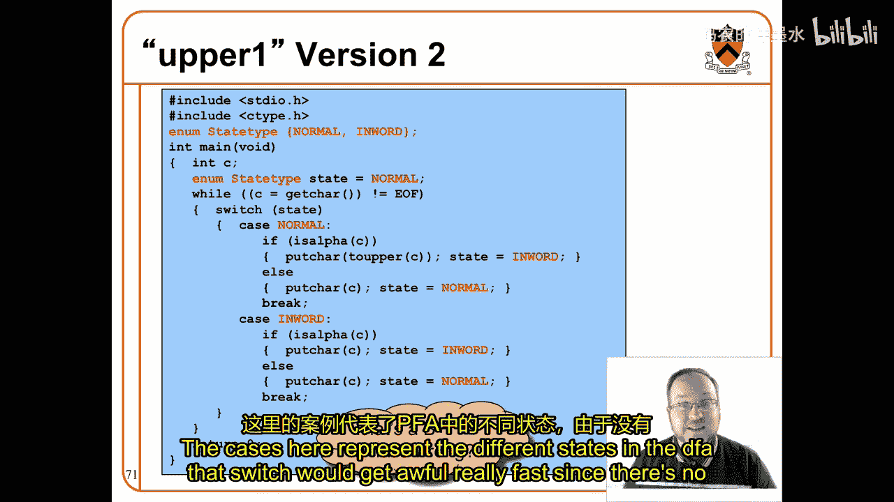

## 代码注释规范 📝

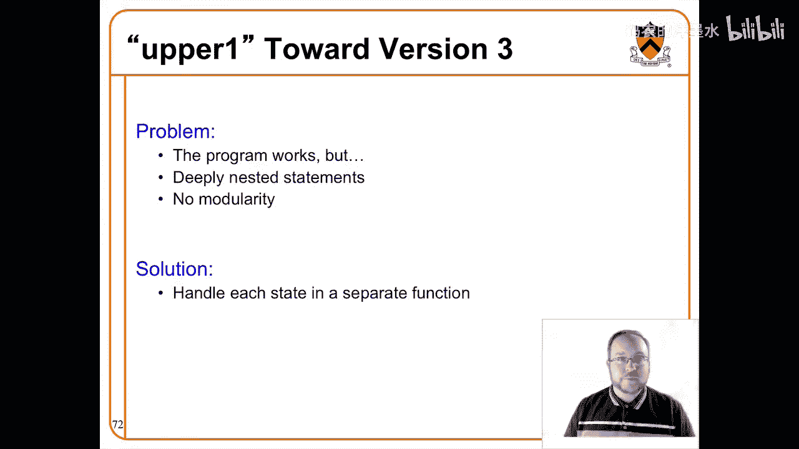

这里有一个例子供你思考，请随时再次暂停视频，以便完整阅读两条注释。

第一条注释过于深入地涉及了调用者甚至不需要知道的其他函数的交互细节，以及该函数的内部设计。它几乎就差说“这个函数使用了一个 `while` 循环”。而后者则只列出了相关信息：函数影响哪些全局状态（标准输入和输出流），函数从其参数和输入计算什么，以及它返回什么值。这正是函数调用者需要知道的。

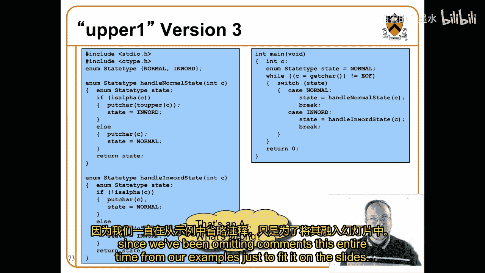

接下来的四张幻灯片是程序的完整版本，修复了之前版本的一系列问题。一旦你为作业1编写了DFA，你可以使用这段代码作为在C代码中实现DFA结构的绝佳起点。

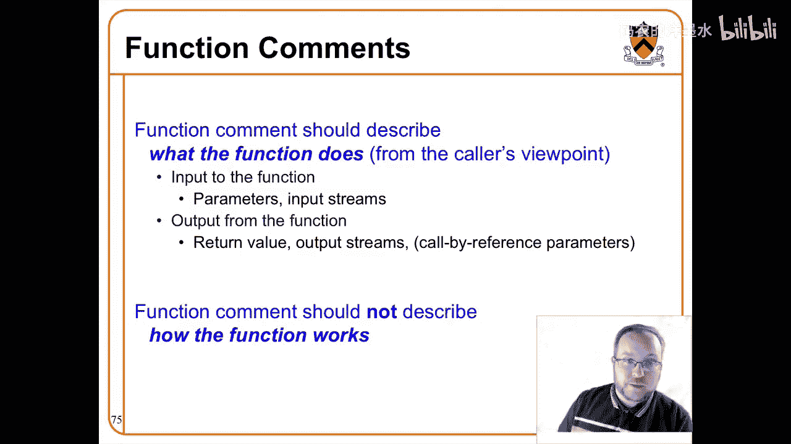

## 总结与作业指引 🎯

好了，所以我保证，通过将你的程序设计成模仿 `upper1` 的最终版本，只是为你将在作业1中需要的更复杂的DFA进行扩展，你将在A1中取得很大进展。

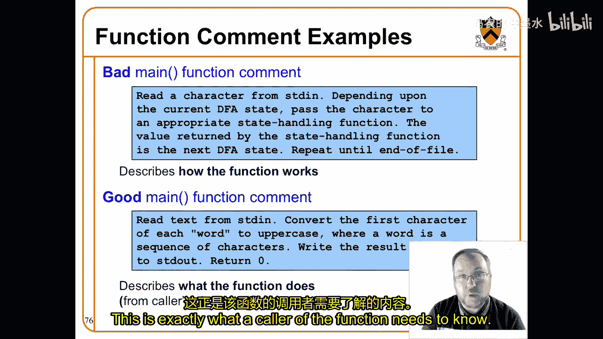

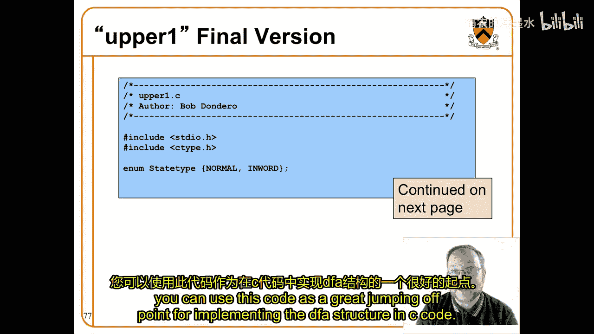

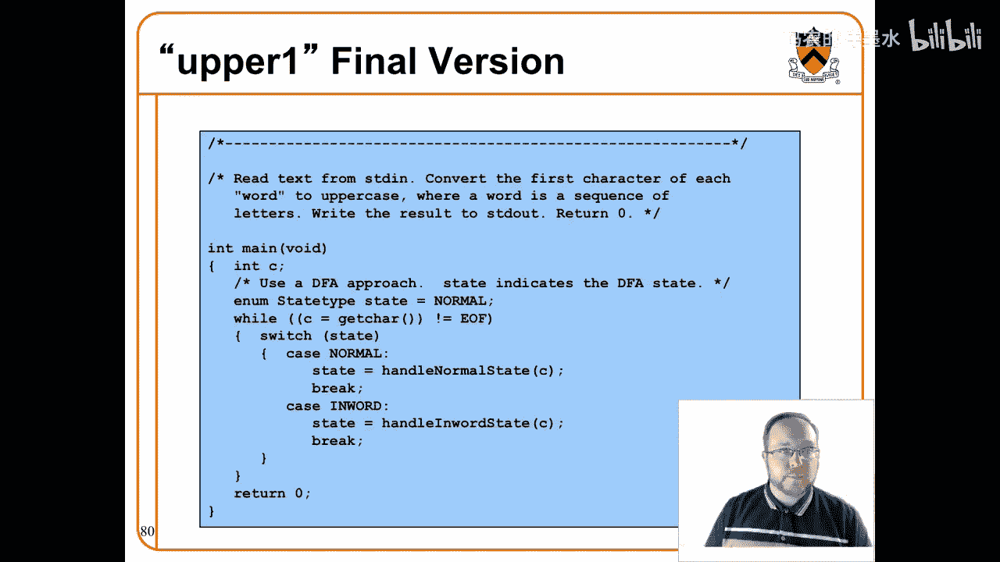

因此，我鼓励你尽快开始作业1，它截止日期是17日星期四，也就是一个半星期后，但你现在已经拥有了完成该作业所需的一切。

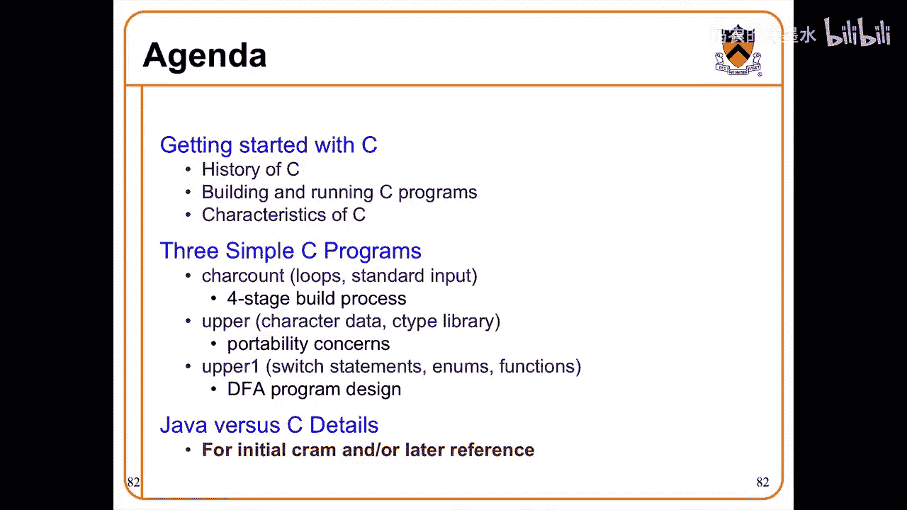

在本节课中，我们一起学习了C语言的历史与设计哲学，对比了C与Java在可移植性、安全性和效率上的核心差异，详细剖析了C程序从预处理、编译、汇编到链接的完整构建过程。我们通过字符计数、转换为大写和单词首字母大写三个示例程序，逐步讲解了C语言的基本语法、控制结构、函数使用、标准库调用以及模块化设计和代码注释规范。这些知识为你完成作业1奠定了坚实的基础。