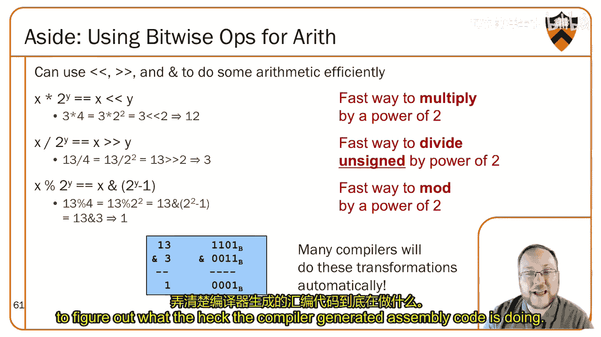
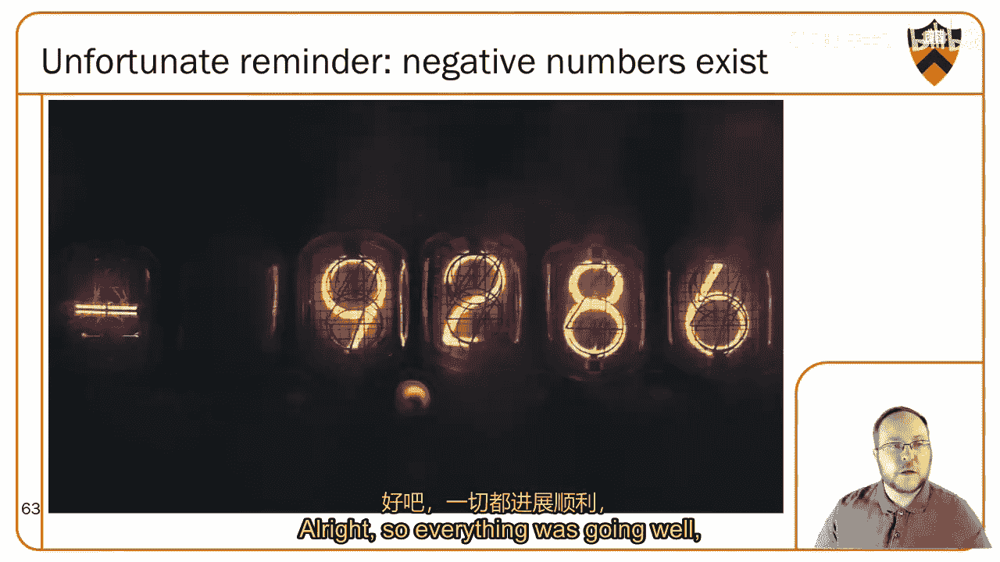
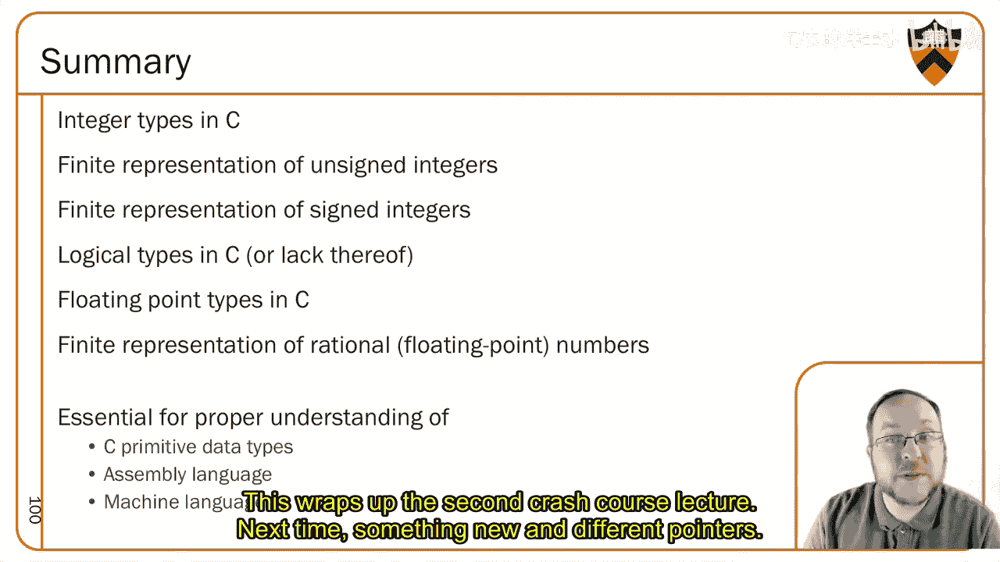

# 008：数字类型 📚

在本节课中，我们将要学习C语言中的数字类型，包括它们的声明、操作以及内部表示方式。我们将从整数类型开始，逐步探讨其有符号与无符号的表示、位运算，最后介绍浮点数类型及其特性。

---

## 概述

上一讲我们介绍了变量声明、赋值、控制流结构以及C标准I/O库的接口。本节中，我们来看看C语言提供的数字类型、它们的运算规则以及内部表示方式。我们从整数类型开始。

---

## 整数类型

C89标准提供了多种整数类型。每种类型都有两个变体：`char`、`short`、`int`和`long`。`char`类型占用一个字节，其他类型的确切大小未指定，但彼此之间存在相对大小关系。`int`通常被视为默认类型，其大小通常与机器的自然字长（如寄存器大小）匹配，但这并非强制规定。

Java语言在设计上做出了不同的选择，它明确指定了所有类型的大小。在Java中，没有“自然字长”的概念，因为底层硬件对Java程序不重要，程序始终运行在JVM环境中。此外，Java将`byte`作为占用一个字节的基础类型，而`char`实际上是两个字节。

C语言不设定绝对大小牺牲了可移植性，但考虑到C是作为系统编程语言设计的，这似乎是一个合理的选择。然而，通过提供更多样化的类型（如`int8`、`int16`、`int32`、`int64`）来同时支持系统和应用编程，成本似乎也很低。

---

## 字面值表示

在代码中表示字面值时，需要注意以下规则：

*   一个看起来像整数的数字字面值隐式地具有`int`类型。
*   可以通过前缀指定其他进制的整数字面值：`0`表示八进制，`0x`表示十六进制。需要注意的是，八进制的前缀`0`容易引起混淆，因为数学中前导零通常是多余的。
*   对于`short`类型的字面值，没有特定的后缀表示。同样，`byte`大小的字面值也没有后缀，这可能是因为设计者将其视为字符，而字符字面值有其他表示方式。

Java语言继承了C的这些特性，这表明要么新语言未能纠正旧语言中的这些“缺陷”，要么它们本身并非缺陷，我们只需接受这种不完全平行或一致的设计。

---

## 无符号整数

C语言允许类型仅表示非负整数，这是与Java不同的设计选择。C语言更古老，设计时考虑了更多的内存限制。在Java中，如果一个`int`存储约负20亿到正20亿，要存储30亿就需要使用`long`。而在C中，设计者允许你将任何给定类型的最大值范围翻倍，将其范围从大约负X到正X，变为0到2X。

C语言也是一种更低级的语言，经常涉及位操作（例如位掩码）。当我们将这些值视为位串而非实际整数时，将整数值视为有符号的没有太大意义。因此，拥有一个在表示中完全不包含符号信息的类型是很方便的。

无符号整数的字面值与有符号类型类似，但需要用`U`后缀表明其无符号性质，并且`short`类型仍需要进行强制类型转换。

---

## 字符类型

`char`数据类型属于整数数据类型，因为它们本质上就是非常小的整数。尽管其名称暗示其设计意图是用于处理ASCII字符，但它们只是8位整数。或许它们应该被称为`byte`或`int8`。

关于有符号性，`signed char`的概念可能令人费解——“负A”究竟是什么？对于实际的ASCII字符，有符号和无符号值之间的差异并不重要，因为最高的ASCII字符是127，所以有符号或无符号都可以。但是，如果你需要一个字节类型进行计算，可能应该使用`unsigned char`，因为任意数据的正负性质更没有意义。

使用`char`处理任意数据的一个例子是Base64转换算法，该算法必须处理不仅仅是ASCII的任意数据，并且使用一个字节中的所有8位，而不仅仅是ASCII使用的0到127的7位。

尽管我们将`char`视为小整数，但语言设计者确实提供了表示文本字符用途的字面值。字符字面值使用单引号，例如 `'A'`。有些字面值在单引号内包含多个字符，但这只是我们表示字面值的方式。例如，`'\n'`表示换行符。如果我们想通过按回车键来输入一个字面换行符，代码会变得混乱。因此，语言设计者使用反斜杠作为转义字符，提供了一种唯一标识这些字符的方式。

转义指示符表示下一个字符不一定是它看起来的样子。由于每个字符字面值都指代单个字符，因此与字符`\`后跟字符`n`的情况没有歧义。类似地，要表示引号字符，我们必须做一些特殊处理，因为我们不能使用三个单引号。第二个单引号会关闭第一个，然后第三个将打开一个永远不会结束的新引号。我们使用反斜杠来表示序列中的第二个引号不意味着关闭字符字面值，因此第三个引号会关闭它。更进一步，反斜杠的字符字面值需要一个反斜杠来转义反斜杠字符，否则它将被解释为转义结束引号。

这些例子带来的另一个重要点是字符字面值`'1'`和整数值`1`之间存在很大区别。字符字面值`'1'`是表示ASCII值为49的`char`的方式，即字符`'1'`的ASCII值。这与整数`1`不同，整数`1`对应于ASCII值为1的非打印字符。类似地，字符字面值`'0'`的ASCII值是48，而不是`0`。值`0`（即空字节）由带有转义字符`\0`的字符字面值表示。

还有一个注意事项：奇怪的是，`char`字面值实际上是`int`类型。我们从不这样认为，但实际上，在底层，它们是`int`。C语言能够正常工作只是因为C支持自动降级。这是一个奇怪的选择。你会认为明确与`char`绑定的字面值应该是`char`，但它们不是，它们是`int`。考虑到我们可以对字符进行算术运算，必须做出选择。语言设计者选择在赋值时进行隐式降级，而不是在算术运算时进行隐式提升。这至少在我看来，并不以任何方式影响我们作为程序员，但这是一个有趣的设计怪癖，它让我们必须理解语言设计者在没有明显正确答案的情况下做出决策的考量。

---

## Unicode 与字符编码

那些名字中带有变音符号的人已经痛苦地意识到，ASCII是一组相当有限的字符集。Unicode具有表达更多字符的能力。Unicode定义了超过14万个字符，并有能力容纳超过一百万个字符。标准ASCII字符使用一个字节，大多数基于拉丁语的字母使用两个字节，中文、日文、韩文字符使用三个字节，一些历史文字、数学符号和表情符号使用四个字节。

Java可能会批评C语言的`char`太小（只有一个字节），但事实证明，Java的两个字节`char`同样不够。实际上，任何由语言设定字符大小的语言都会遇到这个问题。这回到了语言设计的理念：我们应该基于计算的基本类型来构建语言，也许这些类型会以不同的方式适应不同的应用程序。如果我们为应用程序设计，随着应用程序的发展，我们注定会失败。

既然我们无法改变C语言中`char`的大小，C如何实现像Unicode这样的变长编码呢？它不在语言本身中，而是在库中实现。在这种情况下，大多数库使用字节字符串。

---

## 整数类型总结

以下是C语言中所有整数类型的便捷总结：

| 类型 | 说明 |
| :--- | :--- |
| `char` | 1字节整数，通常用于字符 |
| `short` | 短整数，大小 >= `char` |
| `int` | 默认整数类型，通常匹配机器字长 |
| `long` | 长整数，大小 >= `int` |
| `unsigned` 变体 | 对应类型的无符号版本，范围从0开始 |

---

## 无符号整数的表示与运算

现在我们已经了解了所有整数类型，接下来讨论它们在底层的表示方式。我们从无符号整数开始，因为它们实际上比有符号整数更容易理解。

自然数的范围当然是无限的。但在有限的宇宙中，特别是在有限的数字计算机中，我们无法很好地处理无穷大，因此任何给定整数类型的范围都受其表示中位数的限制。对于我们的32位或64位计算机来说，这个范围太大，无法真正理解所涉及的过程。因此，让我们想象一个用于此目的的简陋小计算机。我们将使用一台4位机器，找出正确的特性和算法，由于我们可以理解那16个可能的值，然后希望（事实上也会）将其推广到像ARM/Lab这样更大的机器上。

让我们从我们的4位计算机开始。我们将尝试为这16个值中的每一个分配一个在这4位中的唯一表示。从0开始。对于0，我们可以使用全零。接下来是1，不妨从`0001`开始。这看起来很熟悉。没错，这只是4位二进制。很好，我们对此了如指掌。现在让我们看看对于我们想对这些整数进行的操作，它是如何运作的。

如果我们只使用二进制作为表示形式，那么二进制算术就是我们将进行加法的方式。很简单，对吧？3加10等于13，用二进制表示，我们可以使用与小学十进制相同的从右到左进位算法进行加法运算。

但有一个问题。当我们超过可以存储在4位中的最大值时会发生什么？在数学中，这是溢出。我们可以任意向左进位。但在这里，我们有一组有限的列。溢出是指当我们进位并耗尽列时。结果是，我们绕回0开始。这里的效应是所有结果都对2^4（16）取模，因为我们有4位。这意味着，如果我们不考虑位数进行加法运算，但之后取模16，我们将看到结果。这里的例子是7 + 10 = 17，我们对其取模16得到1。

暂停视频片刻，思考一下如何以编程方式检测溢出？如果和小于其中一个或两个加数，那么就发生了溢出。我们不能将两个无符号数相加得到一个更小的数，除非发生了溢出。

二进制减法同样如此，就像你在小学学习的减法一样，从右到左，必要时借位。如何以编程方式检测溢出？这里的直觉是，我们想要得到负数的结果，这在无符号领域是无法做到的，因此，如果第一个操作数小于第二个操作数，就会导致溢出。

我们想要为无符号整数查看的最后运算符是按位运算。让我们从移位开始。这只是将每个位按指定方向移动。例如，`1010`右移1位。我们将个位的0向右移动，它从数字的末端掉下来并消失。然后2^1位的1填充到个位，2^2位的0填充到2^1位，2^3位的1填充到2^2位，而2^3位则没有留下任何东西。所以我们只需用0填充。如果我们右移2位，我们将再次执行相同的过程。从结果`0101`开始，个位的1消失，2^1位的0最终位于个位，2^2位的1最终位于2^1位，2^3位的0最终位于2^2位，我们再次用0填充，得到`0010`。

左移的工作方式相同，只是它从2^3位向左移动，所以我们反而掉入了那个方向的数字以太中的巨大位深渊。当我们到达已被腾出的最右边的位时，我们必须在那一侧用0填充。

暂停幻灯片，确保你掌握了重现这些计算的算法，并思考每种操作的算术效应是什么。答案并不神奇。事实上，你从小学就知道这个，只是常规的十进制计数。当你移除最后n位数字时会发生什么？嗯，你是在除以10的幂。例如，`12`。当我们移除最后一位数字时，我们得到`1`，那就是除以10的整数除法。这里也是一样，右移n位就是除以2^n。对于左移，同样的逻辑也适用，在十进制数字的右侧添加零就是乘以基数，每次乘以10。所以在右侧添加n个零就是乘以2^n。

但请注意，在小学时，你从不需要处理溢出，而在这里我们需要。这是最后一个例子。当我们从`0011`（3左移两位得到）开始时，我们再左移一次。`1`从左侧掉下来。那就是溢出。但与加法一样，如果我们进行不考虑溢出的计算，然后取模16，我们得到适当的答案`11000`是24，取模16是8。

好的，这是最长的按位运算，让我们快速浏览剩下的四个。按位取反（`~`）字面上就是翻转每一位。但警告：记住，我们也必须翻转前导零。在4位算术中很容易记住这一点，但在64位算术中有时很难记住。这可能是期中或期末考试中关于这个主题的最常见错误。

按位与（`&`）孤立地查看每一列。对于每一对位值，它计算它们之间的与运算，其中`1`为真，`0`为假。所以两个`1`得到`1`，其他任何组合都得到`0`。这里的例子展示了一些常见用法：用一个比2的幂小1的数进行与运算，可以将高位清零，只留下位的后缀。用第k个2的幂进行与运算可以隔离第k位，使其单独保留，同时使所有其他位为`0`。

按位或（`|`）同样孤立地查看每一列，对于每一对位，这次计算它们之间的或运算。因此`0`或`0`得到`0`，其他任何组合都得到`1`。在例子中，我们有一种与2的幂进行与运算相反的操作。这将第k位打开为`1`，同时不影响其他位。

最后是按位异或（`^`），对于每一位，如果它们相同，则产生`0`；如果它们不同，则产生`1`。这有几种用途：与`1`异或会翻转该位的值；与自身异或会将值设置为`0`（我们会在汇编语言中经常看到这一点）；我们也可以用`0`异或以保持值不变，但这有点不寻常，除非可能是位掩码中的单个位，即便如此，我们通常使用与`1`进行与运算，而不是与`0`进行异或。

---

## 有符号整数的表示（补码）

不幸的是，负数确实存在，因此有符号整数类型必须表示它们。既然我们现在处理的是位，我们不能只用一位表示负号吗？实际上，我们能吗？也许我们可以让一位表示负号。在有符号幅度表示中，最左边的位现在是符号位，`1`实际上表示负号。乍一看，情况看起来不错。它甚至有一个很好的特性，即计算负数很简单，只需翻转高位。但等等，我以前不知道这个，负0到底是什么？如果有两个零，这将对我们用无符号整数看到的标准数学运算造成问题。考虑一下，-5 + 5 等于，嗯，`0010`是2。所以那既不是两个零中的任何一个。而-0 + 1是-1。是的，这将需要完全不同的算法，必须有更好的方法。

因此，与其仅将最左边的位用作负号，不如让负数转换每一位怎么样？反码取反就是翻转每一位。所以如果5是`0101`，那么-5就是`1010`。这仍然有非常简单的取反操作，只需翻转所有位。它在简单运算方面表现稍好一些。-7 + 6 是 `1110`，即-1。很好。-5 + 5 是 `1111`，这是一个0值。是负零。这不太好，因为这意味着我们仍然有负零，但它是有效的。然而，并非所有的加法运算都得到了修正。溢出可能是一个问题。考虑-4 + 6，`1011`加`0110`得到`0001`，即1，而不是2。所以我们仍然可以期待更好的东西。

最后一个有希望，如果我们能消除双零，我们就能成功。我们可以通过让负数比正数多一个，或者正数比负数多一个来消除双零。一旦我们做到这一点，加法问题也应该消失。为了解决这个问题，我们将把溢出作为我们的朋友而不是敌人。我们采用反码中翻转所有位的想法，但为了摆脱对两个零的担忧，我们在翻转所有位后加一。这意味着`0000`翻转为`1111`，然后加一又变回`0000`。更好的是，这是一个对称且自反的函数。

考虑5和-5，`0101`变成`1011`，即-5，很好。而`1011`变成`0101`，即5。所以它反过来也成立，太棒了。这里剩下的唯一怪癖是我们的额外值`1000`。它的二进制补码是什么？我们翻转所有位得到`0111`，加一回到`1000`本身。由于这是我们通过去掉负零得到的一个额外值，这是有道理的。从我们将溢出视为从最高值重置到最低值的角度来看，这也说得通。对于无符号数，这意味着回绕到0。但现在它意味着从+7回绕到-8。-8的负数将是+8，这会溢出回-8。这可以工作。

事实上，二进制补码不仅是一个可行的系统，今天几乎所有的计算机都使用二进制补码来表示有符号整数。它具有良好的特性，这里列出的缺点实际上根本不是缺点，而是一个仍然符合算术和我们溢出直觉的额外数字。但需要注意的一点是，我们必须知道一个数字有多少位，否则当我们翻转所有位然后加一时，我们不知道有多少前导零需要翻转。这同样是考试中常见错误的原因。

另一件很棒的事情是，无符号整数仍然使用完全相同的算法，即我们直观的十进制计数算法，只是列数有限。在这种情况下，有限的列数使算法正常工作，如幻灯片上正数加负数以及负数加负数的例子所示。不过，它仍然提出了溢出的问题。暂停视频，思考如何以编程方式检测溢出。我们这里的答案是如何以编程方式检测溢出：如果加数的符号相同，而结果的符号不同，则发生溢出。例如，如果你将一个正数和一个正数相加，却得到一个负数，那就是溢出。

对于减法，情况类似，我们有两个选择：我们可以执行我们习惯的借位减法算法，或者我们可以将第二个操作数转换为其二进制补码值并相加。因为减去一个正数等于加上一个负数，减去一个负数等于加上一个正数。任何人都可以遵循翻转所有位并加一，或者翻转最右边`1`左边的所有位的算法，但你的分析能力现在可能正在警觉，心想：但为什么它有效？首先，我们可以证明它确实对每个操作都有效。幻灯片上的第一个代数推导表明，对一个数取负然后对其进行二进制补码运算，等价于模2^4，这是其他推导的基础。然后第二个推导表明，例如，有符号整数减法在模2^4下有效。我们可以对每个操作进行类似的推导。乍一看可能不明显，但如果我们进行一系列操作，在不溢出的情况下将被证明是等价的。例如，X + 3，然后X + 2，然后X * 2，与X * 2，然后X + 10。在存在溢出的情况下，它们也将被证明是等价的。就像我们在更简单的情况下看到的那样，溢出后的结果值将恰好是未溢出值取模2^位数后的值。我们可以像上一张幻灯片那样通过推导再次证明这一点，或者我们可以仅仅依赖定义良好的数学性质而不去推导，例如模算术是一个环，并且有一个很好的性质。

---

## 有符号整数的位运算

接下来，让我们看看有符号整数的按位运算如何进行。左移是相同的，实际上算术效应也是相同的，即乘以2^n。再次，我们必须考虑溢出。将-3左移两位应该得到-12，但这会溢出，因此我们剩下-12模16等于+4。

然而，右移就不那么简单了。之前我们在左边填充零，这对于非负数继续工作得很好，但对于负数，它会改变符号。此外，因为数字是倒着数的（即全`1`是-1，而一个`1`后面全是零是最大的负2的幂），算术效应就不那么明显了。另一种选择是只在左侧用符号位填充。这具有除以2^n的良好特性，就像无符号整数一样。在Java中，实际上有分别对应这两种算法的不同运算符。`>>>`三重右移将`0`移入最左边的位置，而`>>`双重右移将符号位移入最左边的位以保持符号。然而，在C语言中，标准实际上并未在这两种选项之间做出规定。包括ARM/Lab在内的大多数机器实现算术右移，但由于这不是标准，它是语言的一个不可移植的元素，因此应该避免使用。

按位取反（`~`）、或（`|`）、与（`&`）和异或（`^`）没有这样的复杂性。它们的行为与无符号整数相同。幻灯片上写着最好避免对有符号整数使用这些操作，但我可能会重新表述并扭转一下：如果你想进行这种位操作，你几乎总是不使用整数本身的整数值，因此你可能希望一开始就使用无符号整数。当你真的只是孤立地或组合地查看位时，进行算术操作就好像它有负号潜力一样是没有意义的。

如前所述，Java本身不支持无符号数据类型，这可能反映了稍高的抽象级别，并且你不像传统上C程序员那样需要在Java中进行那么多的位操作。因此，在结束有符号与无符号类型的讨论时，对于Java来说，它还有一个好处，即不必担心有符号和无符号整数之间的转换，在转换中，大的无符号整数实际上会产生溢出，导致负整数。也就是说，我个人喜欢同时包含有符号和无符号数字，即使混合类型表达式带来了复杂性，它至少符合这种自由奔放的精神。如果我必须吹毛求疵，我可能会说对于混合符号表达式，我可能要求显式类型转换，但这是一个相当挑剔的抱怨点。总的来说，即使Java有一些很好的理由说明为什么它没有无符号类型，在这方面我必须支持C。

---

## 赋值运算符与自增/自减

我们将以一些与这些类型相关的更多语言特性来结束对整数类型的讨论。C的设计者选择添加特殊用途的赋值运算符，以使用变量作为操作数，然后将操作结果存储回同一个变量中。Java通过C++从C继承了这一点，所以这是你所知道的全部，但即使没有这种经验偏见，这似乎也是一个好的设计决策。第一，这是一个非常常见的代数习惯用法。添加的特性可能被常用而不是很少使用。也许有人会对一些扩展吹毛求疵——你知道`<<=`有多常用？但一旦它成为一种数字运算符的语法，其他运算符实际上也免费获得了，即使它们的使用频率要低得多。第二，它有利于简洁性。`i++`比`i = i + 1`简洁得多。第三，它有利于明确性。`i++`肯定表明了程序员的意图。`i = i + 1`，变量`i`或增量值实际上都可能是一个拼写错误。`i++`则没有歧义。

也就是说，存在前缀和后缀自增和自减运算符可能比它的价值更令人困惑，并且它引发了一些神秘的习语，程序员会将太多操作都塞进一行，依赖于它们的副作用，这使得代码难以阅读，即使对专家来说也是如此，对新手来说更是完全 bewildering。说到这里，让我们看一些其他例子。再次暂停视频，看看你是否能准确弄清楚这段代码在第三次执行后`i`和`j`的结果是什么。

最初`i = 5`，所以`i`是5，`j`是一个未确定的值。`j = i++`表示`i`将自增，所以`i`变成6，但它返回`i`的旧值，所以`j`是5。现在，`j += ++i`。让我们从右向左读。`++i`再次自增`i`，所以`i`变成7并返回`i`的新值。所以现在`j`加等于7，因此5 + 7 = 12。所以`j`是12，`i`是7。答案是D。

再花一分钟。答案在这里。但花点时间弄清楚为什么答案是E。如果你在追踪时选择了B，恭喜你。你刚刚被`switch`的贯穿（fall-through）特性坑了，我保证每个人至少会错过一次。希望这是你的第一次。但逐步分析一下：在`switch`内部，我们将`i`自增到2，但这是一个后自增操作，所以它评估的是旧值。因此我们根据值`1`进行切换，而不是新值`2`。但因为我们根据值`1`切换，我们执行`case 1`。我们自增`i`，所以它现在是3，并且前自增操作评估的是新值，这就是传递给`printf`调用的值。所以我们打印`3`。没有`break`，所以我们贯穿到`case 2`。再次，这是一个容易错过的地方，如果你在这里被坑了，以后仍然要小心。这里我们再次自增，所以`i`现在是4，但它是后自增，所以我们评估`i`的旧值，并将`3`传递给`printf`，因此我们打印`3`。`i`现在是4，这里的答案是E。

类似地，几乎是相同的问题。即使你以全新的眼光看这个，你可能不会再在贯穿上犯错，但这种奇怪的常规赋值与特殊用途赋值相结合呢？花点时间看看，如果答案不在这里，你会认为这会如何工作。这将`i`自增到2，然后后自增评估为其旧值，因此赋值的右侧，我们赋值为`1`。是的，我们立即覆盖了自增后的值。现在我们根据`1`切换，进入`case 1`，我们自增`i`，这是前自增，所以它查看新值，因此我们将`2`传递给`printf`，我们再次贯穿。但现在是后自增，所以我们打印`2 2`，正确答案是D。

正如你在做作业1时可能已经感到沮丧，GCC 217及其所有的警告和严格性。然而，GCC 217在这里做了一些超级 sensible 的事情。它正确地报告，将变量赋给一个自增表达式可能是实现相关的，或者至少可能不是你真正想做的。除非你认为C在这里不合理，请注意Java具有完全相同的行为，并且在Java的情况下，语言规范中严格定义了这是应该发生的事情。但FindBugs和SpotBugs会指出此类情况，并发出与GCC 217编译器调优类似的警告。所以在两种情况下都很奇怪，但至少你的编译器可以拯救你。

---

## `sizeof` 运算符

整数类型的最后一项实际上适用于所有类型，但由于除了`char`之外，整数类型的大小完全不是由C标准规定的，因此这里特别相关。在一个程序中，我们经常想知道一个变量需要多少内存。典型的情况是动态内存分配，我们将在第8讲以及第8和第9次预修课中深入探讨。提供此功能使我们能够编写更具可移植性的代码，因为我们可以通过局部值来参数化我们的代码，而不是硬编码一个假设的值作为变量的大小。

因此，`sizeof`运算符（是的，它看起来像一个函数，但技术上是一个编译时运算符）接受一个表达式作为参数——这有点奇怪，可以接受可以是变量的表达式，但也可以是类型本身——`sizeof`将返回给我们一个表达式或类型等在内存中占用的字节数。

最后一个小难点。在ARM/Lab上，`sizeof`表达式的值是多少？这里我们将`int i`提升为`long`，因为我们将其与一个`long`字面值相加，所以我们有一个`long`和一个`long`，结果是一个`long`。`long`的`sizeof`是8。所以即使值是3，`long`的`sizeof`是8。

---

## 逻辑（布尔）类型

接下来我们应该讨论的数字类型是逻辑类型，我知道你可能会说，等等，如果是逻辑类型，它怎么是数字类型？嗯，在C语言中，没有内置的布尔类型。相反，我们使用其他类型来表示逻辑数据。当运算符产生逻辑结果时，它们发出的特定值是`int`类型的`0`（假）和`1`（真）。当我们想要表示逻辑值时，通常我们做同样的事情，使用`int`或`char`，其中`0`被解释为假，非`0`被解释为真。这虽然可以，但并不理想。例如，`char`类型的`T`和`F`都是真的，因为`F`的ASCII值是非`0`，这有点令人困惑。实际上，情况更糟，因为不仅仅是整数类型。我们同样可以做一些像`#define TRUE 6.02e23`这样的事情，或者`#define TRUE 0.0/0.0`，因为NaN毕竟不是`0`。

这也意味着，对于习惯像Java这样具有适当逻辑类型的语言的程序员来说，存在一些陷阱。因此，缺乏逻辑类型意味着来自其他语言的常见习语，例如`if (i)`或`if (!i)`在这里常用，但涉及奇怪的转换。在C语言中，这实际上并不被认为是好的做法，因为这对计算机没有好处。一个合理的编译器将为`i`或`i != 0`生成相同的代码。并且可以说，如果某人仍在追踪`i`是一个`int`，它会损害代码的可读性。所以这除了对那些已经适应布尔习语的人来说，是一种可疑的价值。

然而，更大的问题是诱惑在同一变量中混合逻辑和数字含义。考虑这里的第二个例子，其中`i`最终成为真子句的计数器。这很奇怪，也很难阅读。习惯布尔类型的人会对此犹豫，而C程序员可能不得不查阅手册来确认：等等，关系运算符是返回`1`和`0`，还是只返回某个非`0`值和`0`？最好不要冒误解或给代码阅读者增加额外工作的风险。

除了允许可疑的代码之外，缺乏真正的布尔类型也使编译器的工作更加困难。考虑这个片段。想象它是C代码。它做什么？现在提到Java代码。有什么区别？这里的问题是条件应该是`i == 5`，而不是`i = 5`。由于Java有一个真正的逻辑数据类型布尔值，它不同于整数数据类型，Java检测到`if (i = 5)`会发出一个`int`，因此是错误的，但C不会，所以C认为这完全有效。这是一个真的条件，因为`i = 5`，而`5`是非零。所以这里的效应是`i`的值被改为`5`（可能并非本意），并且语句1总是被执行（也可能并非本意）。

最后，因为逻辑类型只是`int`，我们得到了逻辑运算与按位运算的奇怪重载，这可能导致混淆。如果你将逻辑与应用于`2 && 1`，那么结果是`1`（真与真是真）。但如果你将按位与应用于`2 & 1`，那么结果是真与真是假，因为`2`按位与`1`是`0`。所以`&&`和单个`&`是非常不同的，其他逻辑和按位对也是如此。当你想要一个时使用了另一个，可能是一个非常难以追踪的错误，要小心这些。

---

## 浮点数类型

这就是我们对整数类型、它们的运算符和表示的介绍，但这并不是数字类型的结束。我们在这节课中已经看到了C语言中的整数类型和某种逻辑类型，但还有一个超越整数的世界。接下来就是这个。再次，我们从一个在物理数字机器的有限范围内无法真正工作的无限数学概念开始。因此，计算机科学和计算机工程领域必须设计在这些约束下尽可能接近数学理想的方法。在这种情况下，概念是浮点数。

浮点数引入了这样的思想：通过将非常大或非常小的数字分解为符合给定模式的表达式，我们可以将大部分信息用于变化的细节，而不是模式中相同的部分。在这种情况下，它是一个乘数乘以一个公共基数的指数。由于指数的快速增长，幂本身自然相当小，而基数是常数。因此，我们剩下大部分数据来存储乘数，这是变化最大的部分。

我们从整数类型开始，不妨对浮点类型进行类似的探讨。C提供了三种浮点类型：`float`、`double`和`long double`。与整数一样，大小未指定，但受顺序约束。浮点数字面值包含小数点、`E`或两者。默认情况下，它们是`double`类型，但可以用`L`后缀使其成为`long double`，或用`F`后缀使其成为`float`。

再次反思这里的设计决策，我认为`double`类型提供了大多数应用所需的范围和精度，所以这说得通，`double`应该是默认的浮点值。这也符合`int`作为默认整数值的情况，即有一个默认的中间立场，我们可以向上或向下，更大或更小。然而有趣的是，对于`float`，为较短版本的字面值定义了后缀，这与整数和`short`不同。名称也有点奇怪，更多的是历史产物。至少，它们本可以与整数类型保持一致，称为`short float`、`float`和`long float`。或者更好的是，再次像我们讨论整数时那样，类似`float32`、`float64`和`float96`。但无论如何，C++和Java继承了这些相同的古怪类型名称，所以无论我们喜欢与否，似乎都被困住了。

---

## 浮点数的表示（IEEE 754）

现在让我们更详细地看看浮点数的表示，而不仅仅是一种模糊的感觉，即我们需要保存一个尾数和一个指数。1976年，英特尔开始计划生产一个浮点协处理器，威廉·卡汉（他最终因在数值分析和数字表示方面的贡献而获得1989年图灵奖）是首席顾问。1977年提出了一个标准草案，1980年的处理器8087是第一个实现它的芯片。该标准于1985年正式通过。因此，IEEE 754标准基本上是现代系统中表示浮点数的唯一方式。有一位用于符号，三分之一或更少的位构成指数，其余位用于构成尾数的二进制小数。所以IEEE 754将其标准化，但这个概念并不新鲜。这个术语本身比IEEE 754早了100多年，而根据值保持可变精度的想法甚至可以追溯到更早。

这是一个浮点数表示中位的具体例子，在这种情况下是一个`float`。别担心，我们不会要求你计算这个，但我们在这里可以看到，我们有一位留作符号位，这里`1`表示它是负数；有8位用于指数，它是相对于127的；我们有23位用于尾数，它只是一个指数和，所以在这个意义上是一个二进制小数；当我们把它们放在一起时，我们可以得到最终的表示。

这里需要注意几点：因为这些都只是实数的数值近似，所以有一些不同的规则，我们不能仅仅假设精确性。你可能在126课中学到不要比较浮点数是否相等，因为你最终可能会问像0.999998是否等于1.00002这样的问题，而这两个数字很可能是代数上应该等价的计算结果。正确的方法是使用各种表达式，利用区分1.0与另一个浮点数的最小值，称为机器epsilon，但细节超出了本课程的范围，因为x与下一个高于x的浮点值之间的差异根据x而变化，所以机器epsilon是针对数字1特定的。例如，它不适用于区分0与下一个高于0的浮点数。然而，有一些关于这些近似的体面的近似，因此，如果你想大致了解`float`或`double`的精度，可以使用幻灯片上的经验法则。

因此，除了语言中可用的类型以及它们如何表示的模糊概念之外，你真正需要了解的强烈要点是它们表示方式的这些含义。如前所述，相等比较是 fraught 的，此外，你可能在126课中学到，可能存在灾难性抵消和类似问题，其中一个或多个操作会显著增加近似中的相对误差，因此由于小误差的复合，计算可能 wildly 不准确。在实际系统中，通常尽可能使用缩放整数而不是浮点数。

以下代码打印什么？花点时间看看你能想出什么。这实际上很难说，因为除非你真正尝试过，或者除非你非常深入地了解标准，否则有两件不同的事情在进行，你无法真正预测。我们有一个循环检查是否不等于10.0，然后我们有一个总和检查是否等于1.0。结果，循环确实终止了，因为我们可以通过每次加1.0来精确表示10.0。但总和不是1.0，因为我们不能通过每次加0.1来精确表示1.0。同样，这些是你不需要知道具体细节的细节，但这些都是你应该了解并至少能够讨论你需要考虑的因素。

---

## 总结

在本节课中，我们一起学习了C语言中的整数类型，包括有符号和无符号的表示方式；了解了C语言中的逻辑类型（无论其价值如何）；以及C语言中的浮点数类型及其表示方式。这结束了第二次速成课程讲座。下次，我们将学习一些新的和不同的内容：指针。