# 010：使用make构建

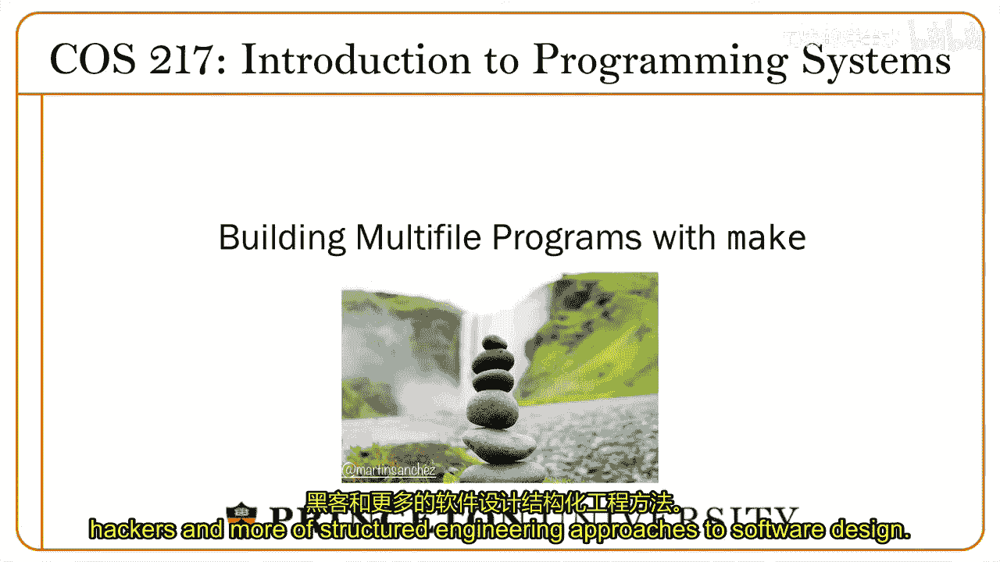

在本节课中，我们将暂时放下C语言的设计细节，转而关注本学期的另一个核心主题：编程工具。我们将学习如何从“随意编写代码”转变为采用更结构化、更工程化的软件设计方法。具体来说，我们将深入探讨一个名为 `make` 的强大构建工具，它能帮助我们高效管理多文件项目。

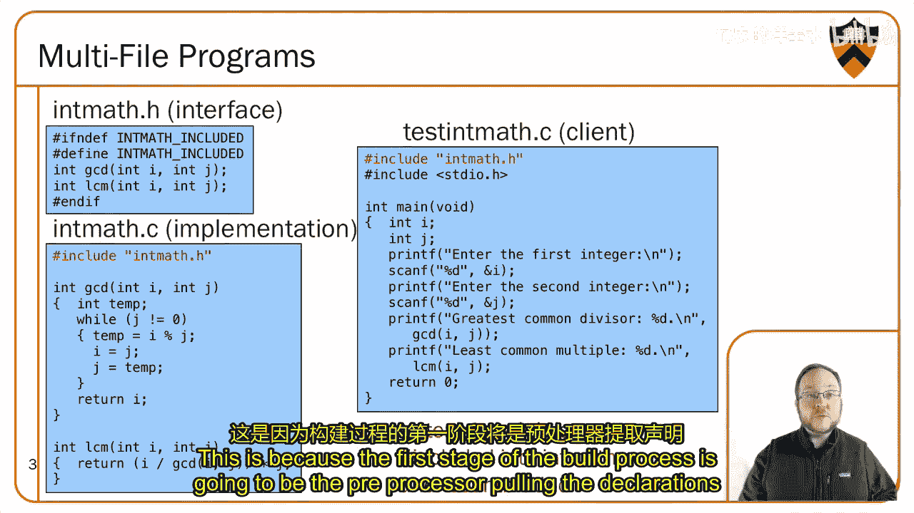

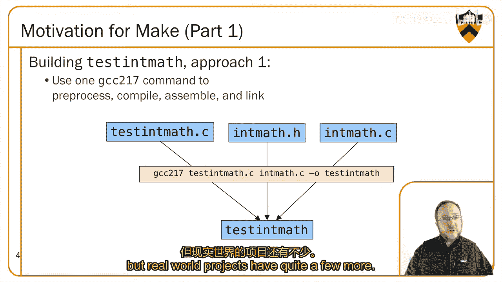

## 多文件项目的构建挑战

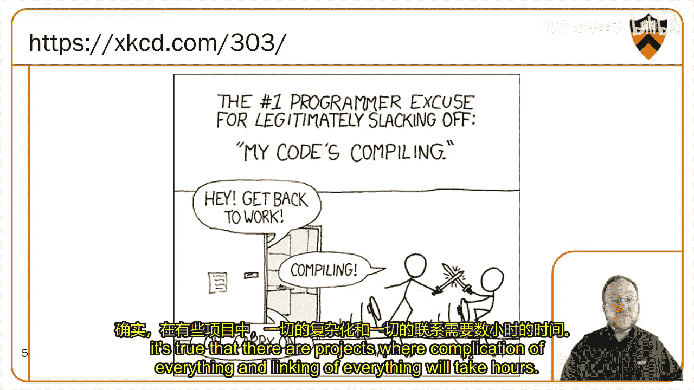

上一周的课程中，我们接触了一个多文件C语言程序的例子。该程序包含一个接口文件 `intmath.h`，它声明了 `gcd` 和 `lcm` 函数。函数的实现在 `intmath.c` 中，而客户端程序是 `testintmath.c`。`intmath.c` 和 `testintmath.c` 都通过 `#include` 包含了 `intmath.h` 头文件。

这意味着，如果 `intmath.h` 发生改变，实际上相当于 `intmath.c` 和 `testintmath.c` 都发生了改变。因此，我们需要重新编译这两个 `.c` 文件，然后重新链接生成可执行文件。对于小型项目，一次性编译所有文件（例如使用 `gcc217 *.c`）是可以接受的。

然而，现实世界中的项目可能包含成百上千个文件。例如，Linux内核有超过25000个C文件和20000个头文件。在这种情况下，每次修改都完整编译整个项目可能需要数小时，这严重阻碍了开发效率。

## 分步构建与部分构建

为了解决这个问题，标准的构建过程分为两步，而不是一次性完成。

1.  将每个 `.c` 文件**预编译、编译、汇编**成独立的 `.o`（目标）文件。
    ```bash
    gcc217 -c testintmath.c
    gcc217 -c intmath.c
    ```
2.  将所有的 `.o` 文件**链接**在一起，生成最终的可执行文件。
    ```bash
    gcc217 testintmath.o intmath.o -o testintmath
    ```

这种分步构建的关键优势在于**部分重建**。如果我们只修改了 `intmath.c`，那么只需要重新生成 `intmath.o`，而 `testintmath.o` 无需变动。最后，只需将新旧 `.o` 文件重新链接即可。这可以节省大量编译时间，尤其是在项目庞大时。

但是，手动跟踪哪些文件需要重新编译既繁琐又容易出错。我们需要一个工具来自动化这个过程。

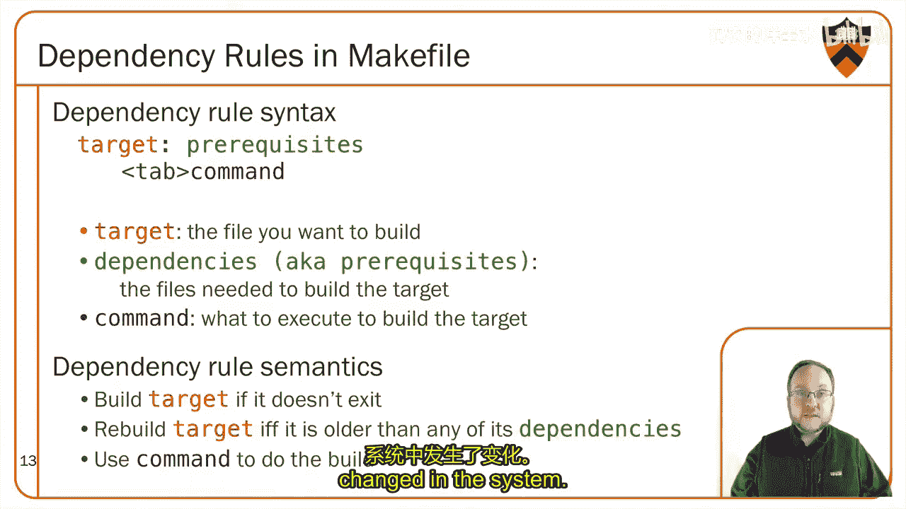

## Make工具简介

`make` 正是这样一个工具。它通过读取一个名为 `Makefile` 的文本文件，其中定义了项目中文件的**依赖关系图**。`make` 会检查文件的修改时间，并自动判断哪些目标需要重新构建，哪些可以跳过。

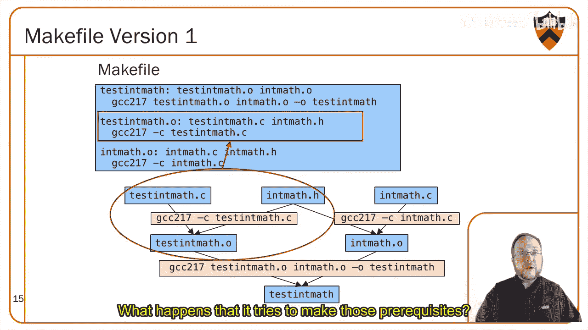

`make` 命令本身很简单。通常，你只需在项目目录下运行：
```bash
make
```
默认情况下，`make` 会寻找名为 `makefile` 或 `Makefile` 的文件，并执行其中定义的第一个目标。

## Makefile 基础语法

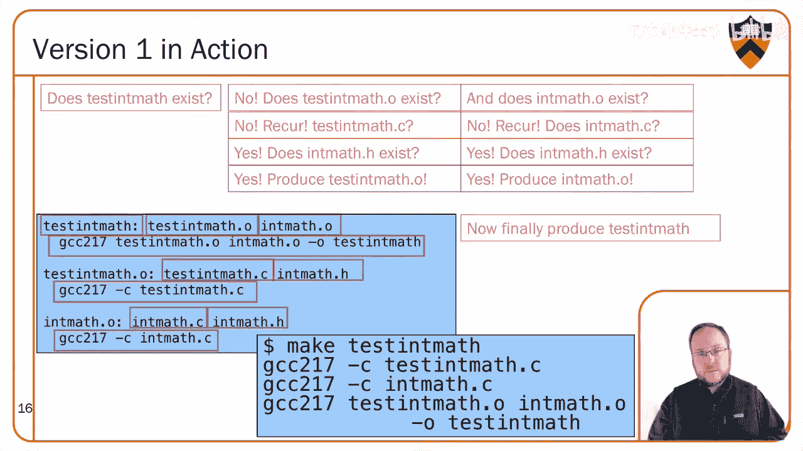

Makefile 的核心规则由**目标**、**依赖**和**命令**三部分组成，格式如下：
```
target: dependencies
<TAB>command
```

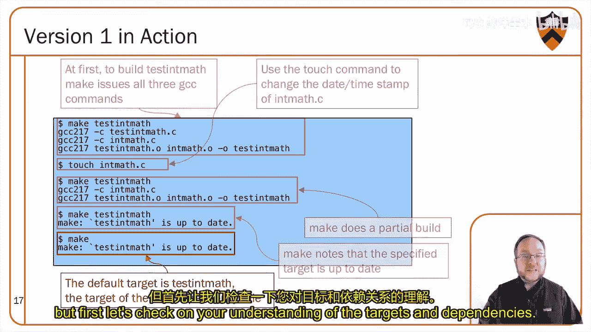

*   **目标**：通常是要生成的文件名（如 `testintmath`）。
*   **依赖**：生成目标所需要的前提文件（如 `.o` 文件）。
*   **命令**：生成目标需要执行的具体 shell 命令（必须以 **Tab** 字符开头）。

`make` 的工作原理是递归的。当要求构建一个目标时，它会先检查其所有依赖项。如果某个依赖项不存在或比目标“更晚更新”，`make` 会先尝试去构建那个依赖项，然后再执行构建目标的命令。

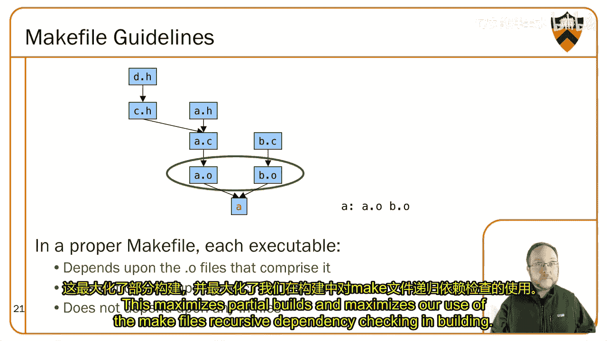

让我们为之前的例子编写一个基础的 Makefile：
```makefile
testintmath: testintmath.o intmath.o
	gcc217 testintmath.o intmath.o -o testintmath

testintmath.o: testintmath.c intmath.h
	gcc217 -c testintmath.c

intmath.o: intmath.c intmath.h
	gcc217 -c intmath.c
```
运行 `make` 时，它会按照依赖关系递归地构建所有必要的 `.o` 文件，最后链接成 `testintmath`。之后，如果只修改 `intmath.c` 并再次运行 `make`，它将只执行 `intmath.o` 和最终链接的命令，实现部分构建。

## 伪目标

并非所有目标都是为了生成一个同名文件。有些目标只是为了执行一系列操作，例如清理构建文件。这类目标称为**伪目标**。

常见的伪目标有：
*   `all`：通常作为第一个目标，用于构建所有主要的可执行文件。
*   `clean`：用于删除所有构建过程中产生的文件（如 `.o` 文件和可执行文件）。
*   `clobber`：更彻底的清理，可能包括删除编辑器生成的备份文件等。

以下是包含伪目标的 Makefile 示例：
```makefile
all: testintmath

testintmath: testintmath.o intmath.o
	gcc217 testintmath.o intmath.o -o testintmath

testintmath.o: testintmath.c intmath.h
	gcc217 -c testintmath.c

intmath.o: intmath.c intmath.h
	gcc217 -c intmath.c

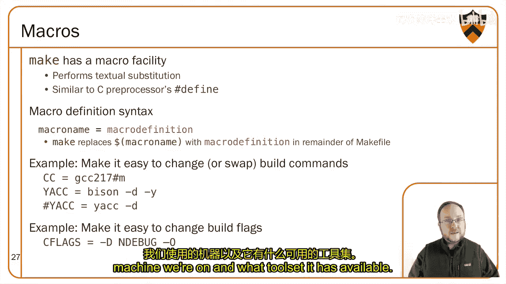

clean:
	rm -f testintmath *.o

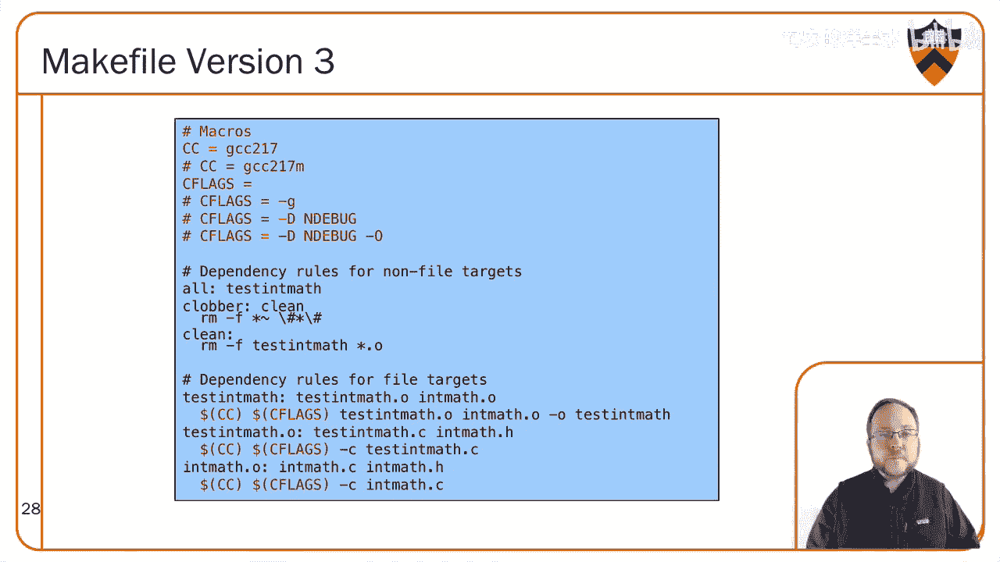

clobber: clean
	rm -f *~ *# .#*
```
注意，`clean` 和 `clobber` 并没有创建同名文件。运行 `make clean` 后，即使没有 `clean` 这个文件，`make` 也会成功执行删除命令。伪目标极大地简化了常见的项目维护操作。

## 使用变量

Makefile 支持变量（有时称为宏），这可以提高可维护性和灵活性。定义和引用变量的语法如下：
```makefile
CC = gcc217
CFLAGS = -g -O2

testintmath: testintmath.o intmath.o
	$(CC) $(CFLAGS) testintmath.o intmath.o -o testintmath
```
这样，如果需要更换编译器或调整编译选项，只需修改变量的值即可，无需在多个地方修改。

## 隐式规则和模式规则

`make` 内置了一些**隐式规则**，可以自动推导如何从一种文件构建另一种文件。例如，它知道如何用 `$(CC) -c` 从 `.c` 文件生成同名的 `.o` 文件。

我们还可以使用**模式规则**来进一步简化。例如，可以用一个规则处理所有 `.o` 文件的构建：
```makefile
%.o: %.c intmath.h
	$(CC) -c $< -o $@
```
这里，`%` 是通配符，`$<` 代表第一个依赖文件，`$@` 代表目标文件。

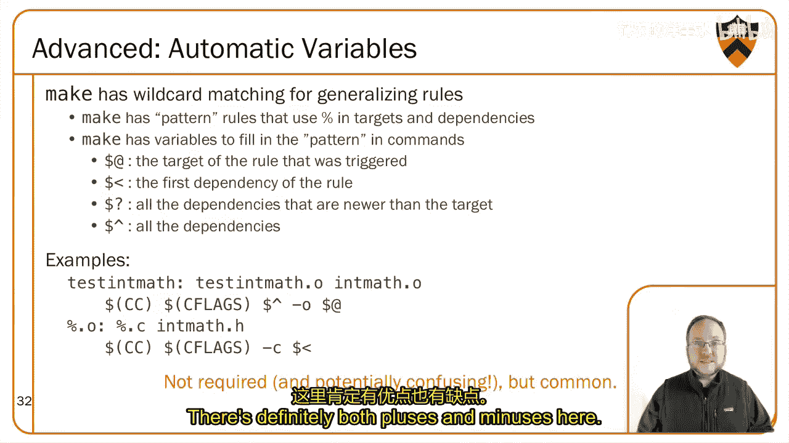

虽然隐式规则和模式规则能让 Makefile 更简洁，但过度使用可能会降低可读性。对于初学者和课程作业，建议优先使用显式规则来确保清晰理解构建过程。

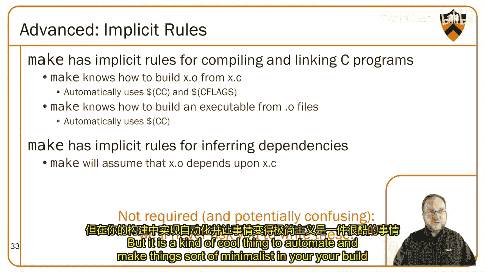

## 注意事项与最佳实践

1.  **命令必须以 Tab 开头**：这是 Makefile 的硬性规定，使用空格会导致错误。现代编辑器在编辑 Makefile 时通常会正确处理。
2.  **第一个目标很重要**：直接运行 `make` 时会构建第一个目标。通常将 `all` 或主要的可执行目标放在首位。
3.  **小心自动化命令**：像 `rm -f` 这样的命令在 Makefile 中很常见，但要确保其正确性，避免误删重要文件。
4.  **从简单开始**：建议从清晰、显式的规则开始编写 Makefile。在熟悉之后，再考虑使用变量和模式规则来优化。

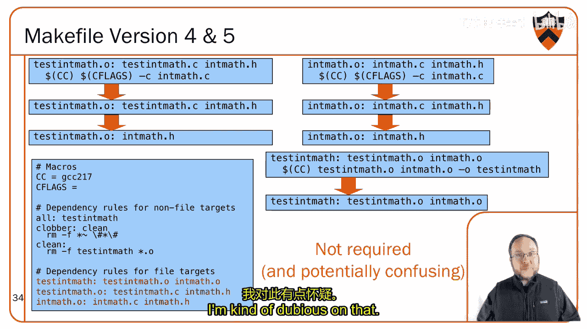

## 总结

本节课我们一起学习了如何使用 `make` 工具来管理C语言项目的构建过程。我们了解了分步构建和部分重建的重要性，掌握了 Makefile 的基本语法，包括目标、依赖和命令的编写。我们还探讨了伪目标、变量以及隐式规则等高级特性，它们能帮助我们编写更强大、更灵活的构建脚本。

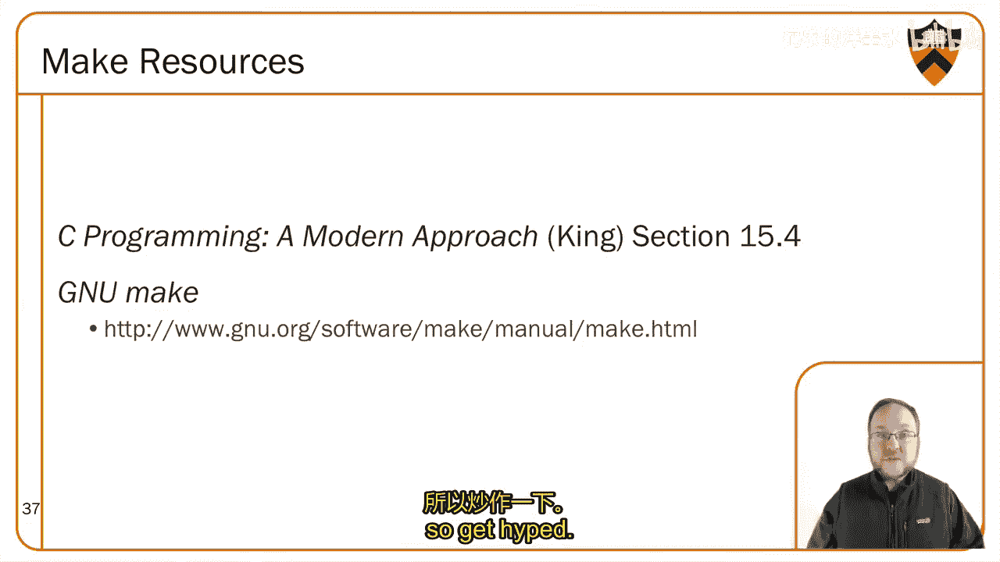

`make` 是提高编程效率和项目可维护性的关键工具。掌握它将使你从“随意编写代码”迈向更工程化的软件开发。在接下来的课程中，我们将回归C语言本身，深入探讨动态内存管理等核心主题。