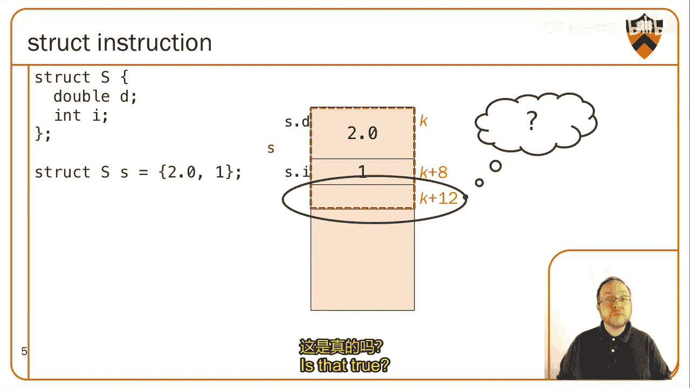
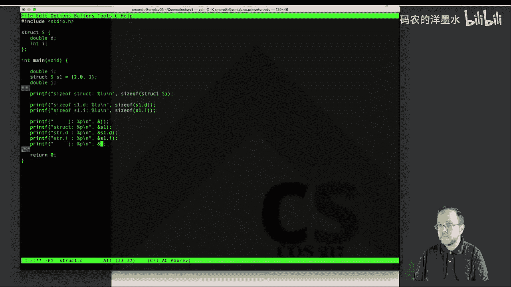
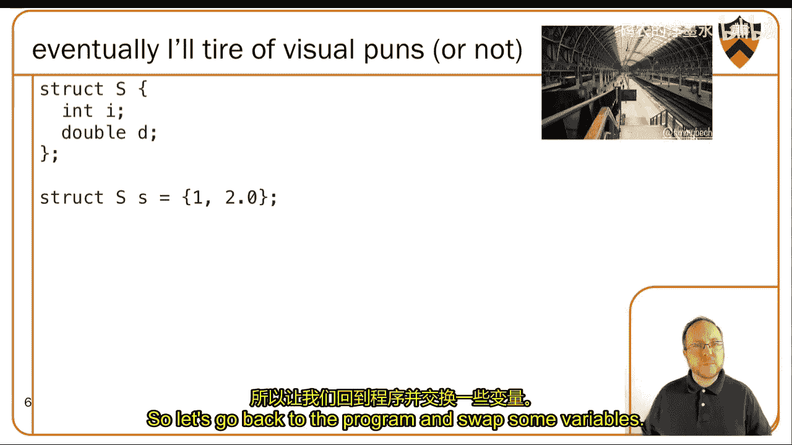
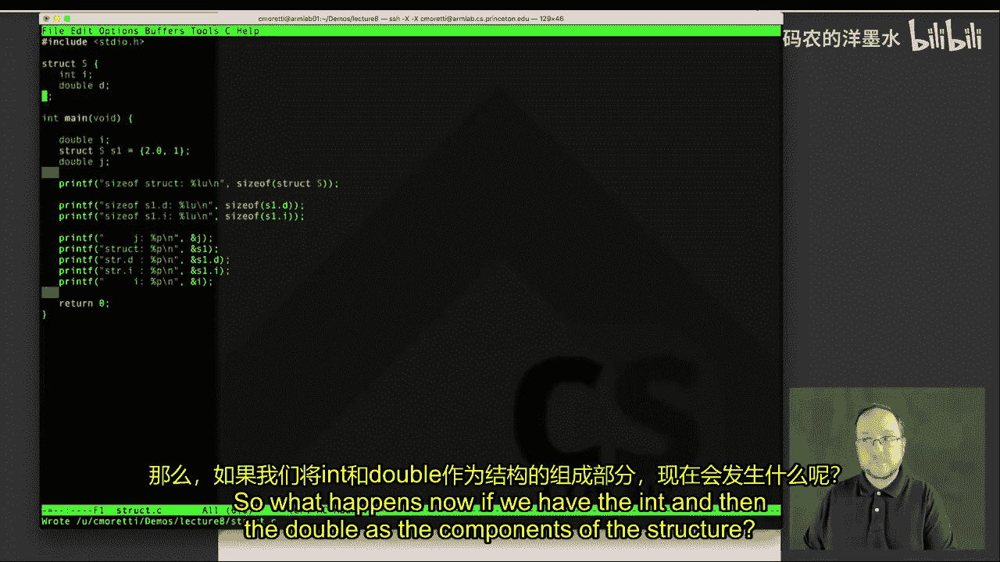
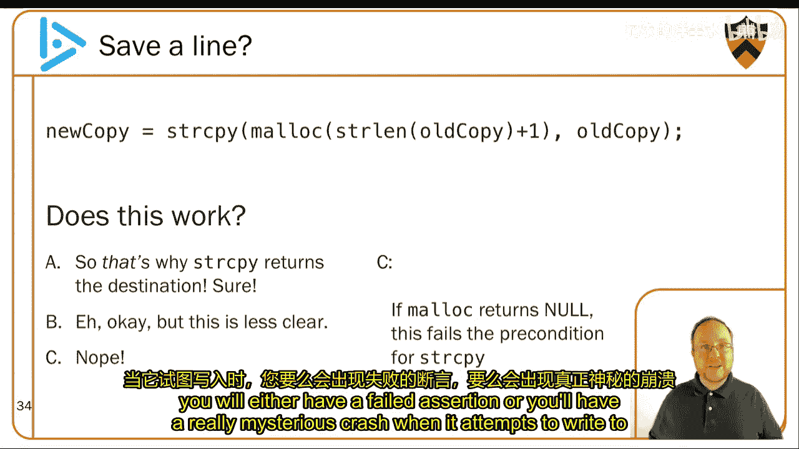

# 011：结构体、命令行参数与动态内存 🧩

在本节课中，我们将学习C语言中的三个核心主题：结构体、命令行参数以及动态内存管理。这些概念是构建复杂程序的基础，能帮助我们更灵活地组织和处理数据。



## 结构体

上一节我们介绍了数组，它可以存储多个相同类型的数据。本节中我们来看看结构体，它允许我们将不同类型的数据组合成一个单一的复合类型，类似于Java中的类（但没有实例方法）。

结构体类型的声明使用关键字 `struct`，后跟结构体名称和其内部的字段列表。声明结束时必须加上分号。



```c
struct point {
    double x;
    int y;
};
```

我们可以像初始化数组一样，使用初始化列表来初始化结构体变量。也可以声明指向结构体的指针。





访问结构体字段使用点操作符 `.`。如果有一个指向结构体的指针，则需要先解引用再使用点操作符，或者使用更简洁的箭头操作符 `->`。

```c
struct point p1 = {3.14, 5};
struct point *ptr = &p1;
int y_val = ptr->y; // 等价于 (*ptr).y
```

以下是关于结构体大小和内存布局的重要说明：
*   结构体的大小至少是其所有字段大小之和。
*   但编译器可能会在字段之间或结构体末尾插入“填充”字节，以满足特定架构的内存对齐要求，这可能导致结构体实际大小大于字段大小之和。
*   C语言标准规定，编译器不能重新排列结构体内部的字段顺序。

结构体可以组成数组，也可以作为值传递给函数，或从函数中返回。与数组不同，结构体支持赋值操作（`=`），这会执行所有字段的深度拷贝。

```c
struct point arr[3] = {{1.0, 2}, {3.0, 4}};
struct point a = {1.0, 2};
struct point b = a; // 深度拷贝
```

## 命令行参数

到目前为止，我们的程序输入方式有限。现在我们来学习如何通过命令行向程序传递参数，这是与程序交互的常见方式。

在C语言中，`main`函数可以接收两个参数：
*   `int argc`：参数计数，表示命令行参数的数量。
*   `char *argv[]` 或 `char **argv`：参数向量，是一个字符串数组，存储了每个参数。

需要注意以下几点：
*   `argv[0]` 是程序自身的名称。
*   `argc` 的值至少为1（因为程序名算一个参数）。
*   最后一个数组元素 `argv[argc]` 保证是一个空指针（`NULL`）。

以下是一个遍历并打印所有命令行参数的程序示例：

```c
#include <stdio.h>
int main(int argc, char *argv[]) {
    for (int i = 0; i < argc; i++) {
        printf("argv[%d] = %s\n", i, argv[i]);
    }
    return 0;
}
```

也可以使用指针算法来遍历：

```c
#include <stdio.h>
int main(int argc, char *argv[]) {
    char **p = argv;
    while (*p != NULL) {
        printf("%s\n", *p);
        p++;
    }
    return 0;
}
```

## 动态内存

迄今为止，我们程序的变量大小都是在编译时确定的。动态内存管理允许我们在程序运行时按需分配和释放内存，这解决了处理未知数量数据的问题。

程序的内存布局通常包含几个部分：
*   **文本段**：存放程序代码。
*   **栈**：存放函数参数和局部变量。
*   **堆**：用于动态内存分配的区域。

我们通过栈上的指针来访问在堆上动态分配的内存。

### 分配内存：`malloc` 和 `calloc`

`malloc` 函数分配指定字节数的未初始化内存块。

```c
int *arr = malloc(3 * sizeof(int)); // 分配3个int的空间
if (arr == NULL) {
    // 处理分配失败
}
```

`calloc` 函数分配指定数量和大小的内存块，并将所有位初始化为零。

```c
int *arr = calloc(3, sizeof(int)); // 分配并初始化为0
```

**关键点**：必须检查 `malloc` 或 `calloc` 的返回值是否为 `NULL`，这表示内存分配失败。直接使用返回的 `NULL` 指针会导致程序崩溃（段错误）。

### 释放内存：`free`

使用 `free` 函数释放之前动态分配的内存。忘记释放内存会导致“内存泄漏”。

```c
free(arr);
```

**注意事项**：
*   只能对由 `malloc`, `calloc` 或 `realloc` 返回的指针调用 `free`。
*   `free` 之后，指针变成了“悬空指针”。最佳实践是立即将其设为 `NULL`，以防止后续误用。
*   对同一个指针调用两次 `free`（双释放）可能导致堆损坏，是严重的错误。

### 调整内存：`realloc`

`realloc` 函数用于调整之前分配的内存块大小（可以增大或缩小）。

```c
int *new_arr = realloc(arr, 5 * sizeof(int));
if (new_arr == NULL) {
    // 调整失败，原指针arr仍然有效
} else {
    arr = new_arr; // 调整成功，更新指针
}
```

**关键点**：
*   `realloc` 可能返回一个新的指针地址（如果无法在原地扩展）。
*   必须将 `realloc` 的返回值保存到一个**临时变量**中，检查是否为 `NULL` 后再决定是否更新原指针。直接覆盖原指针，若 `realloc` 失败，会导致原内存块丢失（内存泄漏）。

### 常见错误示例

以下是两个常见的动态内存错误：

1.  **分配字符串空间时忘记为终止符 `\0` 预留位置**：
    ```c
    char *new = malloc(strlen(old)); // 错误！少了一个字节
    strcpy(new, old);
    ```
    正确做法是 `malloc(strlen(old) + 1)`。

2.  **将 `malloc` 调用直接嵌套为函数参数，未检查是否失败**：
    ```c
    strcpy(malloc(strlen(old) + 1), old); // 危险！
    ```
    如果 `malloc` 失败返回 `NULL`，`strcpy` 会尝试向空地址写入数据，导致崩溃。

---




本节课中我们一起学习了C语言的结构体、命令行参数和动态内存管理。结构体帮助我们组织异构数据；命令行参数提供了程序交互的入口；而动态内存管理（`malloc`/`calloc`, `free`, `realloc`）则赋予了程序在运行时灵活管理内存的能力，但同时也要求程序员谨慎处理分配失败、内存释放和指针有效性等问题。理解并正确运用这些概念是进行C语言系统编程的关键。