# 012：测试 🧪

在本节课中，我们将要学习软件工程中至关重要的一环：测试。我们将探讨测试的重要性、不同角色的职责、以及如何构建结构化的测试策略，包括外部测试、内部测试、单元测试和测试覆盖率等核心概念。

## 概述

在编写软件时，除了掌握特定语言的细节，还需要掌握大规模编程所需的技能和技巧。本周的第二次辅导课和下周的第一次讲座将讨论调试。但除非首先知道程序存在问题，否则你甚至不知道需要调试什么。而要做到这一点，就需要了解测试。

对于足够复杂的程序，很难一开始就知道自己做的事情是否正确。以我们的`decomment`程序和作业1为例，就有很多边界情况。对于一个像shell这样的程序，边界情况会更多；对于一个操作系统，其复杂性几乎是难以想象的。此外，即使你知道一个算法是正确的，这也与保证该算法的特定实现是正确的完全不同。

Dijkstra在其关于Van Emde Boas树的笔记中的名言在这里很贴切。更进一步，在一般情况下，你甚至无法编写一个程序检查器来确保任何给定程序会终止，更不用说确保它做你想做的事情了。这就是你在126课程中学到的图灵停机问题。

尽管停机问题是不可判定的，但我们确实知道如何进行一些程序验证。实际上，在形式逻辑和编程语言领域有一个丰富的研究领域，致力于为程序规范构建和应用证明辅助工具。不过坦白说，大多数软件工程师并没有在他们的代码中使用证明辅助工具，这当然也超出了这门系统编程入门课程的范围。

尽管如此，如果你对此感兴趣，我鼓励你去选修Co 326，在那里你将学习函数式语言。函数式语言的一个关键原则是，不可变状态的缺失使得推理程序变得更加容易。在326之后，还有两门研究生课程，本科生也可以选修，它们涉及编程语言理论和软件的自动推理。

另一方面，通过测试，我们并没有一个证明。我们只有一些至少是部分正确性的证据，我们甚至可能对自己的正确性有相当合理的信心。但对于一个足够大的程序，很难说服自己对于输入的每一种可能排列都做了正确的事情。

不过，不要认为测试完全不提供任何保证。如果你有一个失败的测试，那么有一个绝对确定的事实：存在一个错误。但并不能确定错误具体在哪里。错误可能在你的程序中，也可能在测试本身中。

因此，我们希望在软件设计过程中关注测试，并希望采取结构化的方法来构建测试基础设施和探索规范空间以设计测试用例。

## 测试的重要性与职责

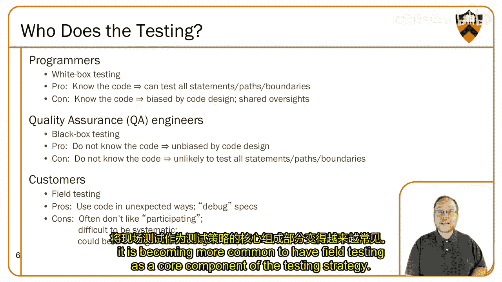

这就是为什么测试很重要，但这是谁的工作呢？虽然软件工程师、软件设计师会进行大量的自我测试，这有好有坏。好处是他们最直接地接触代码，并且在实现时了解规范的所有细节，知道哪些是棘手的部分，哪些地方做了不寻常的事情。但坏处是没有人会故意编写错误。这意味着如果存在错误，那么一定有某些地方被忽视了。可能对规范有隐藏的假设，可能对输入有隐藏的假设，这些假设泄露到了代码中，然后如果编写代码的同一个人也在编写测试，那么这些假设也可能泄露到测试中。

另一方面，质量保证人员（QA）能对实现有一个全新的视角，因此他们对开发过程中的假设没有偏见。他们不受实现偏好的影响，无论是实现起来最容易的部分，还是最新的部分，或是个人偏好。但相应地，他们对代码也没有完整的了解。此外，因为开发人员和QA往往在同一个团队、同一个组织工作，他们也往往受制于相同的规范及其缺陷。

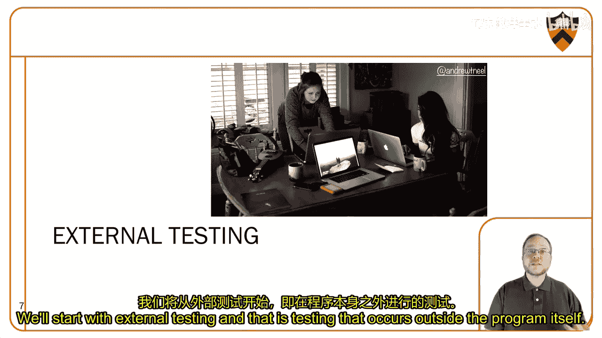

这就把我们带到了客户面前。客户不受相同规范的约束。客户倾向于以非常有创意的方式使用程序。但让客户成为测试基础设施的支柱也很困难，因为仅通过错误报告很难实现系统或系统的覆盖。此外，如果太多错误流入实际使用环境，肯定会疏远客户。

尽管如此，尤其是在当今的网络编程中，将现场测试作为测试策略的核心组成部分变得越来越普遍。

对于你在我们课程中的程序，客户就是评分脚本，所以你绝对不想依赖现场测试。相反，让我们看看作为开发者，你如何构建你的测试。

## 外部测试

我们将从外部测试开始，这是在程序本身之外进行的测试，但稍后我们将讨论程序内部的内部测试。

### 手动测试与自动化

我知道这是大多数人在他们短暂的编程生涯中迄今为止最常用的测试方式。但坦白说，我很惊讶你的手还没有掉下来。我在普林斯顿大学基于大约1000小时的证据得出的假设是，你的手之所以没有掉下来，主要是因为你懒得回去检查，在修复一个错误或添加一个新功能后，所有以前能工作的东西是否仍然能工作。

所以，让我们看看如何让这件事变得更容易，而不是在合理的测试纪律和不得腕管综合征之间做出选择。

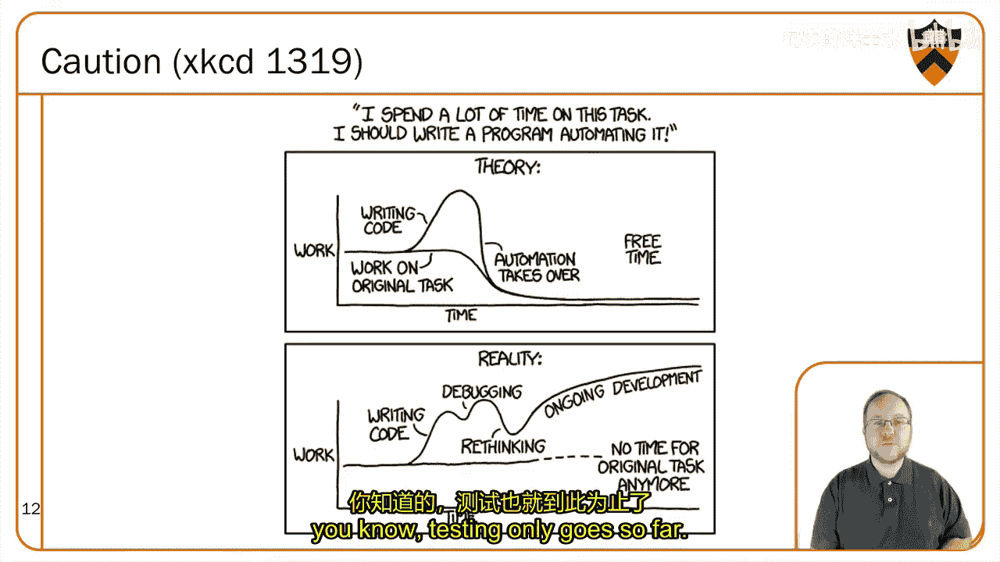

第一个改进是将所有测试放入文件中，包括输入和正确的输出。现在我们可以一遍又一遍地运行它们，而无需重新输入。通过很好地使用历史记录或命令行快捷方式，你可以相当高效地完成这项工作。

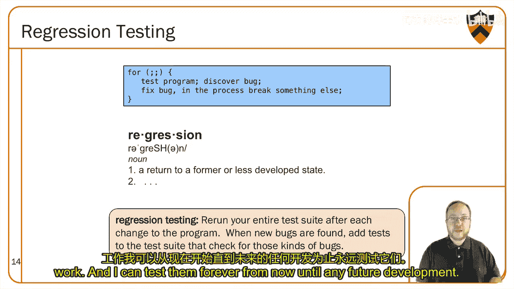

但是，如果有很多测试，多到你甚至不想一次运行一个呢？这时Shell脚本就派上用场了。坦白说，这应该是课程的一部分，但某种程度上它不是。这是333课程中一些讲师教授的内容，作为成熟计算机科学家应该知道的东西，但你从未在任何地方学过，所以我们不妨在这里提一下。简而言之，Shell脚本只是一系列Shell命令，它们会像在命令行执行一样运行。

因此，我们可以将一堆原本要在bash提示符下输入的东西打包成一个命令。我们可以比这里展示的更复杂、更系统化。正如你在学期初的Linux讲座中简要看到的，Shell脚本可以包含变量、循环和各种好东西。也许你不知道，但你实际上已经用过一些了。你在作业1中使用的`test_decomment`程序就是一个Shell脚本。第一行`#!/bin/bash`表示使用bash shell来解释这个脚本，所以每一行都像在bash提示符下输入一样执行。

这个程序的核心在于它遍历当前目录中匹配某个模式的所有文件，即以`.txt`结尾的任何文件。它对每个文件做什么呢？它运行命令`test_diff`。而`test_diff`，你猜对了，是另一个bash脚本。

所以很容易让人想：我永远编写超棒的测试脚本，我就永远不会再有错误了。但首先，编写自动化软件并非易事。其次，你怎么知道脚本里没有错误呢？当然，一个选择是说递归，然后你为你的测试脚本写一个测试脚本。不过说实话，这实际上是我们为像这样的课程和作业扩展到数百人规模而做的准备工作的一部分。我们会说，好吧，我们现在有一个脚本，我们如何测试它呢？我们会用完全相同的操作集来测试它。但总的来说，你知道测试只能做到这一步。

### 回归测试

一个常见的工作流程是编写一个自动遍历一系列测试的脚本。这就是回归测试的总体思路。这有助于实现一个目标：当我编写新代码时，以前能工作的东西仍然能工作。当我发现一个错误时，我需要添加一个测试，以便将来可以测试我修复的错误是否仍然被修复。当我修复那个错误时，如果我有新测试和旧测试，那么现在它能工作了，以前能工作的东西也能工作，我可以从现在开始一直测试它们，直到未来的任何开发。

否则，你最终会陷入这个梗图所描述的情况。或者如果你觉得我太老了不应该在幻灯片上放梗图，我就默认回到我通常做的XKCD漫画。所以这里，回归测试对于确保你不会因为修复而无意中使情况变得更糟很重要。在大型代码库中，回归测试可能会在后台持续运行，以确保代码的实时版本和仓库版本仍然通过测试。在某些情况下，回归测试甚至被内置到代码提交过程中，这样推送到仓库的操作实际上不会发生，除非自动回归测试通过。

但回归测试只能测试我们已经知道要寻找的东西。我们如何添加新的测试呢？一种方法是有机地发现错误：有人注意到某些地方不对，提交错误报告，QA或开发人员添加一个能重现该错误的新测试用例。这就是错误驱动开发或错误驱动测试，它相当被动。

不过，也有一个主动的版本，叫做故障注入。它在原则上很有意义，对于测试测试本身很有用。但它对开发过程有帮助吗？它的实用性不那么明显。很难预测未来某个程序员可能会犯什么错误，因此很难基于故障注入为这些错误预先编写测试。

尽管如此，应用于本课程的作业一和作业二，多年来我们某种程度上采取了这种方法。参与本课程工作的各位教职员工以非常被动的模式设计了数据文件：评分员手动检查代码，他们发现一个现有测试文件没有捕获的错误，我们改进测试文件，在未来的年份里，我们将能够为所有未来的学生测试之前遗漏的相同情况。从这个意义上说，把这门课作为一门已经存在一段时间的成熟课程对你来说有些不利，因为评分可能更难一些。但另一方面，希望我们在许多其他方面已经做得更好了。

不过，我鼓励你期待作业4，它对学生有一个主动模式：我们将给你一些程序的有错误版本，然后最终测试你捕获错误的设计。

### 测试驱动开发

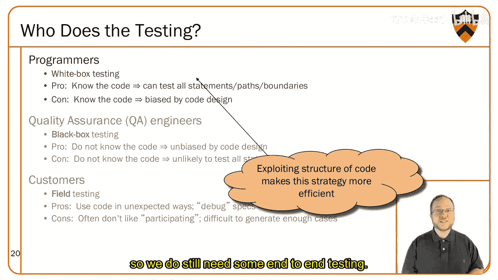

另一种有趣的形式是测试驱动开发。它基本上是自底向上的：你写一个会失败的测试，然后写代码让它不再失败，然后重构你的代码。所以在这里，“我要写代码”和“我要写测试”这两个步骤是交织在一起的。这是一个有趣的想法，原则上我喜欢它，即测试应该是一个早期集成的一等公民。但也许说“在实现新功能之前，必须先写一个会失败的测试，直到它工作为止”有点太极端了。

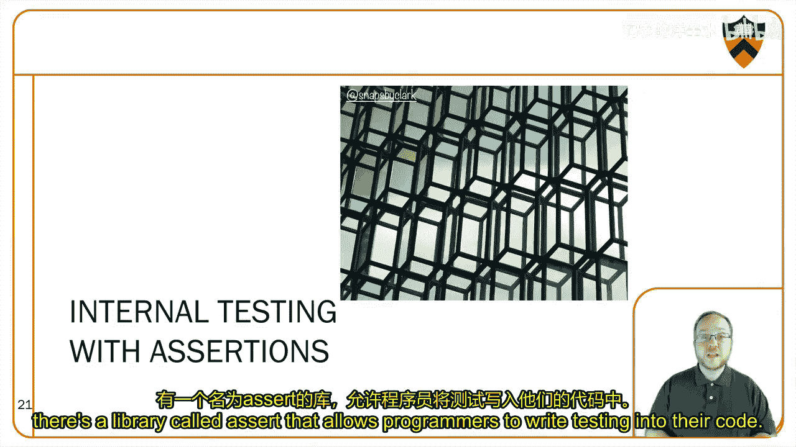

## 内部测试

到目前为止，所有讨论都集中在端到端的整个程序测试上。对于像作业1这样的东西，这很容易。但对于许多程序，没有明确的解决方案。也许总体答案是未知的，或者这是一个非常大的问题，我们无法在端到端的基础上进行测试，因为耗时太长，或者也许规范本身就不清楚。正如本课程中一贯的答案：模块化。我们已经在217课程中频繁使用了模块化这个关键词，而且频率不会随着时间的推移而降低，我保证。这是我们的核心理念之一。因此，如果核心理念之一是我们应该将大型系统分解为更小、更简单、更容易理解的原子组件，那么将同样的理念应用于测试它们以及构建它们，也就顺理成章了。

回到谁来做测试的问题，到目前为止我们讨论的所有测试都可以由幻灯片上的三方中的任何一方完成。但现在，随着将程序分解为更易于理解的部分的目标，我们将深入程序内部。因此，程序员是了解模块、边界、结构的人，从而可以设计测试，以最大限度地利用这种对结构的了解。

不过，在继续之前，我应该指出，模块之间的接口和边界可能是最常见的误解所在，因此也是最常见的错误点，所以我们确实仍然需要一些端到端的测试。

### 断言

好了，让我们来谈谈内部测试。我们将从C语言中的断言开始。C语言有一个名为`assert`的库，允许程序员将测试写入他们的代码中。

该库定义了一个宏`assert`，它会像函数调用一样被处理。这个宏，如果参数表达式求值为真，它什么都不做。但如果参数表达式求值为假，它会终止你的程序。你可能会想，等等，这是一件好事吗？为什么我希望我的程序死掉？这是一个相当强硬的测试结果，不是吗？但至少一般来说，带着关于哪个断言在哪里失败的信息明确地终止，比在未知情况下在其他点任意崩溃要好。此外，带着关于哪个断言在哪里失败的信息明确地终止，比带着错误答案运行到完成要好得多。

因此，通常程序员选择在问题不是我们这个特定模块的程序员的错误，并且我们对此无能为力时，通过失败的断言中止程序。或者当问题是我们自己的错误，并且是我们应该尽快捕获和修复的时候。

更一般地说，我们将讨论使用`assert`来处理编程错误，这些错误要么来自作者，要么来自调用者，而不是来自输入的用户错误。但让我们看一些例子。

我们可以使用断言来验证我们的参数，你已经在作业2中看到了这一点。我们不允许坏数据进入。有一个原则叫做“垃圾进，垃圾出”，而这有点相反，这是“垃圾进，程序死”。这在编写模块化代码时尤其重要。你编写了函数，但你可能不是编写调用它的函数的人。事实上，对于一个足够大的程序，你几乎肯定不是。所以一个合理的问题可能是：为什么要让程序死掉？为什么不返回一个错误状态？但这里的问题不是我们的错。我写了一个完美的`gcd`函数，但有人调用它时没有遵守我在头文件注释中规定的契约。

所以在`gcd`中我们无法修复这个问题。如果调用者传递了坏数据，我们凭什么认为调用者会查看我们信息丰富的错误返回并对此做出合理的处理呢？此外，错误返回可能很难维护，回想一下`getchar`返回`int`所带来的复杂性和混淆。如果几乎每个函数都开始返回某个有效值或某个错误状态，这种情况就会变得普遍。

因此，在缺乏像C语言所没有的异常机制的情况下，一个选择是：直接说不，你没有遵守我的契约，我不会做任何事情，事实上我会终止程序。

下一步是，如果我们说不让坏输入进门，那么我们也不让坏输出出门。你知道你的函数应该做什么。它做到了吗？也许我们不知道确切的正确答案应该是什么，但我们可以找出一些后置条件。在这个例子中，`gcd`显然必须小于或等于每个输入且大于零。再次，为什么用断言？为什么不返回一个错误状态？在这种情况下，我们得到了好的输入，这就是为什么我们没有死掉。如果我们返回了错误的东西，这意味着错误是我们的错，我们希望尽快注意到并修复它，最好是在发布之前。如果我们这里有断言，那么只要我们进行任何测试，无论是我们作为开发者，还是开启断言的QA运行它，都会注意到我们的程序死了，我们会说，嘿，去修复这个。这给了我们一个机会，避免因为发布错误代码而尴尬。

第三件事，我们可以测试程序的一些假设或不变量。在C语言的情况下，也许我们没有像Java语言那样免费获得数组访问的边界检查，如果违反，Java会用数组索引越界异常终止你的程序。在C语言中，没有这样的保护。但你可以合理地编写自己的检查。对于下界来说很容易。在这种情况下，如果数组大小已知，检查上界也可以，但作为参数传入时更难，因为正如我们所见，除非我们通过另一个参数或类似的东西得到一些信号，否则不可能确切知道传入的数组参数有多长。

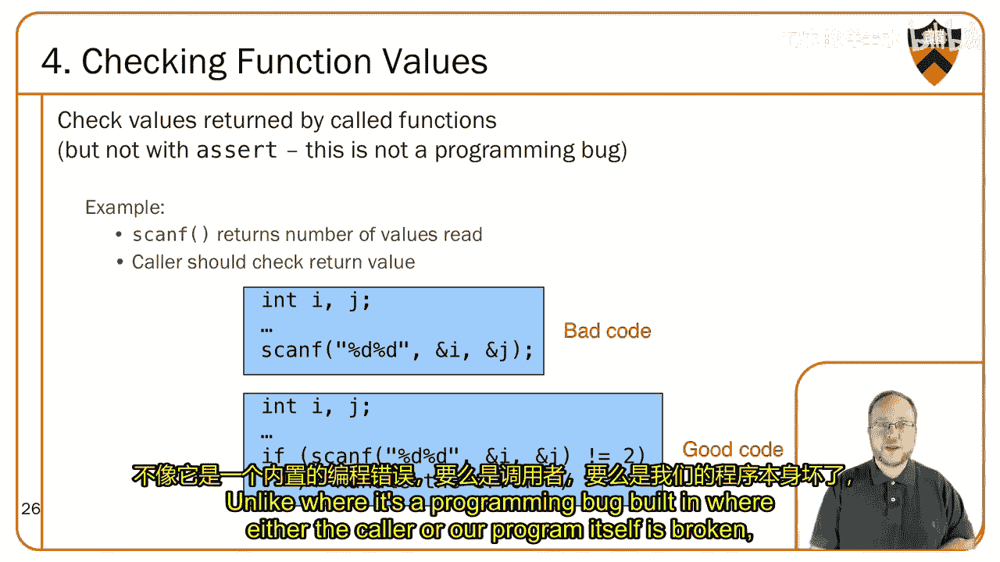

所以再次，我们问在这种情况下为什么用断言？嗯，这里是我们自己的错。如果我们越界了，那是我们的错，我们必须注意到并修复它。

### 表示不变性

当我们检查值的有效性时，我们还应该确保我们调用的任何外部函数行为正确，并给我们留下我们知道如何处理的后置条件。例如，当我们从标准输入读取时，我们最好检查我们是否真的能够读取我们想要的东西。

所以再次，这里我们要检查这个，但现在我们要用断言以外的东西来检查，因为这不是一个编程错误。如果我们只得到有效的输入，这段代码会正常工作。因此，如果`scanf`没有返回2，这意味着我们没有得到我们期望的输入。这是一个输入错误，一个用户错误。在这种情况下，我们可以尽力获取新的输入，打印错误信息，尝试各种其他方式让用户配合我们，因为这个错误可能是可以修复的。不像当它是一个内置的编程错误，无论是调用者还是我们的程序本身坏了，在运行时我们对此无能为力。

好了，沿着同样的思路，但更深入一点，我们有表示不变性。这是我程序的内部状态。问题是，它是否处于我所知道的应有的有效状态？这对于数据结构特别有用，我们下周会讲到数据结构，但你已经从126课程中了解了它们的要点。所以这些是抽象，数据结构是抽象，因此它们具有与构成它们的底层原始类型不同的有效性。

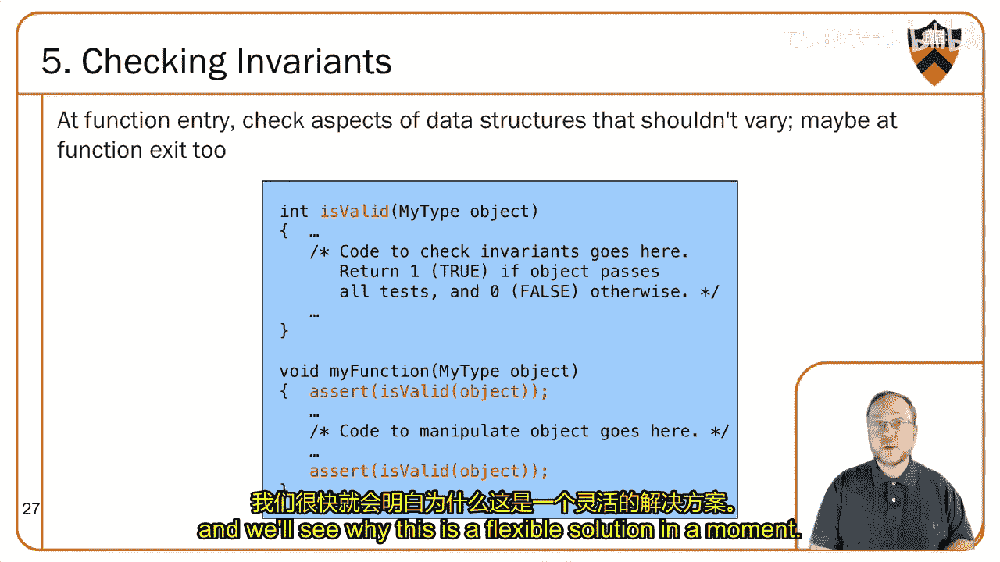

例如，如果一个对象仅使用一个`int`来表示217作业成绩，那么不变性可能是它是非负的。尽管C语言中的`int`当然可以是负数。是的，我知道，在这种情况下，我们应该直接使用`unsigned int`。另一个例子，如果它代表一个学生，表示不变性可能是学生的姓名非空且不是空字符串。

那么我们如何使用表示不变性呢？一个创建数据结构的函数可能会在继续之前确保数据结构是正常的。因此，如果传入一个数据结构，它会说，你给我的东西有效吗？否则我对此无能为力。一个创建或修改数据结构的函数可能会在返回之前确保数据结构仍然是正常的。所以如果我从头开始创建东西，我们最好从有效状态开始。如果我接收一个东西，改变它，然后继续，那么再次我应该检查，在我完成了函数所做的任何修改之后，它是否仍然有效。

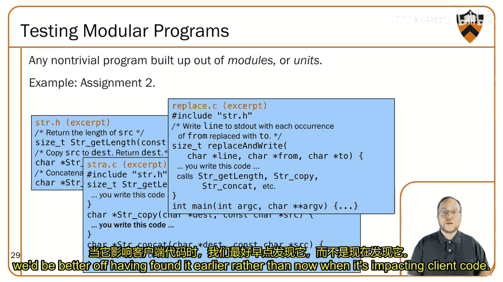

需要注意的是，如果我们检查数据结构的整个状态，这可能会很昂贵，你可以想象数据结构是一棵树或一个很长的列表。因此，这里一个常见的技术是将检查代码包装在断言中，我们稍后会看到为什么这是一个灵活的解决方案。

## 单元测试

好了，一旦我们有了一些内部测试，我们需要一个结构化的方法来继续。单元测试是与其他部分隔离地测试各个部分。考虑一个模块，例如作业2。你从一个接口开始，这是实现与其客户端之间的契约规范。你构建实现，试图匹配接口的契约。然后你或其他人编写一个客户端程序，再次试图匹配接口的契约。

但如果我们运行端到端测试，发现程序得到了错误的答案。我们知道存在一个错误，但我们没有任何关于其位置或如何修复它的提示。例如，如果`replace`不工作，嗯，也许错误就在`replace`里。但也可能是在`str_copy`里。如果我们在这些底层函数中存在根本问题，我们最好早点发现，而不是现在当它影响到客户端代码时才被发现。

然而，测试每个部分很棘手，因为我们需要能够单独调用它们。但这些部分在构造上是相互关联的。增量测试通常涉及创建脚手架和桩。

脚手架是一个临时的或不完整的函数甚至程序，它调用被测试的函数。像Python这样的语言允许任何函数被交互式调用，因此它们消除了对脚手架的许多需求。但在C语言中，要测试一个函数，例如这里的函数2，你可能需要编写一个调用它的脚手架，也就是一个包含`main`函数的东西。

桩位于我们关心的函数的另一侧。它是一个临时的、虚拟的或不完整的函数，我们实际测试的函数会调用它。为了测试函数2，我们可能需要编写一个它所调用的函数的最小版本。有几种方法可以做到这一点。我们可以硬编码它应该返回的值。我们可以做一个“绿野仙踪”式的解决方案，即幕后有人，不从函数计算返回值，而是从标准输入或文件读取，类似这样的东西。这有点像硬编码，但它是数据，而不是在程序本身中。然后还有另一个选择，可能是我们可以生成正确答案，但速度很慢，假设我们还没有为那个聪明的快速算法编写代码，而是用暴力方法。

我们在这些框里用斜体标出了“临时”，因为它往往不是临时的。Ellen Cooper在90年代中期写了一篇非常有影响力的论文《原型设计的危险》，其中说到，当你编写了非常好的脚手架和非常好的桩时，你会说，哇，这真的很好。我不想扔掉我努力工作的成果，它结果真的很好。所以你倾向于保留一些你的代码，通过扩展它成为更完整的版本，即使实际上你应该从头开始构建更完整的版本，而不是围绕那个桩添加一些原本并非为此设计的额外部分。所以这里有点棘手。我们想编写非常好的桩，我们想编写非常好的脚手架。但你不应该屈服于诱惑，让那些桩和脚手架成为应该从头开始结构化设计的东西的原型。

这是一个单元测试框架的例子。它隔离一个函数，并在各种参数上测试，但框架本身有点像脚手架。它当然不是真正的客户端代码，但它充当了足够小的客户端，以访问我们感兴趣的模块。

## 测试覆盖率

我们今天倒数第二个主题是测试覆盖率。我们编写的测试应该单独和集体具有哪些不同的属性？

首先是语句测试。总的来说，所有测试应该至少执行程序中的每个语句一次。这很有道理，如果你没有测试导致某段代码运行，你怎么可能知道那段代码是否工作呢？所以这里有一个例子，一段伪代码。语句测试应确保在测试套件中至少有一个测试执行了所有四个语句。

确实存在开源和商业工具来测量语句测试，测量测试套件对给定代码的覆盖率。这样，当你的代码比我们在这里看到的要复杂得多时，尤其是比这两个连续的`if-else`复杂时，你就不必太费脑筋去手动计算你的代码有多少被覆盖了。

也就是说，对于简单的例子，自己推理是完全合理的，所以尝试一下前一页幻灯片中的相同代码。这里的答案是B。给定的伪代码需要两次通过代码才能实现最小的语句测试。一个最小的两次通过的例子是：条件1为真且条件2为真，这将执行语句1和语句3；然后在另一个测试中，条件1为假且条件2为假，这将执行语句2和语句4。无法在一次通过中完成，因为语句1和语句2是互斥的，语句3和语句4也是。

语句测试之后的下一种代码覆盖率是路径测试。路径测试类似于语句测试，但更彻底，现在每个可能的语句序列都必须出现在一个测试中。正如你可能想象的那样，这比语句测试要密集得多。与本课程相关的是，坦白说，这太多了，我们没有尝试为你的作业做路径测试，我们也不会要求你为你的作业做路径测试。

但再次，在简单情况下是可行的，所以再看一下这段代码，试一试。这里的正确答案是D。给定代码的路径测试需要四次通过代码：条件1为真且条件2为真；条件1为真且条件2为假；条件1为假且条件2为真；条件1为假且条件2为假。

### 边界测试

测试的第三个标准是边界测试，即程序行为以某种方式改变的边界情况。几乎所有的错误都发生在边界条件下。如果你的程序仅对边界条件有效，它很可能对所有其他情况也有效。如果你的程序对所有边界条件和至少一个非边界条件都有效，它很可能对所有其他情况都有效。请注意，可能有多个轴来衡量边界，因此可能有多个轴来进行测试。

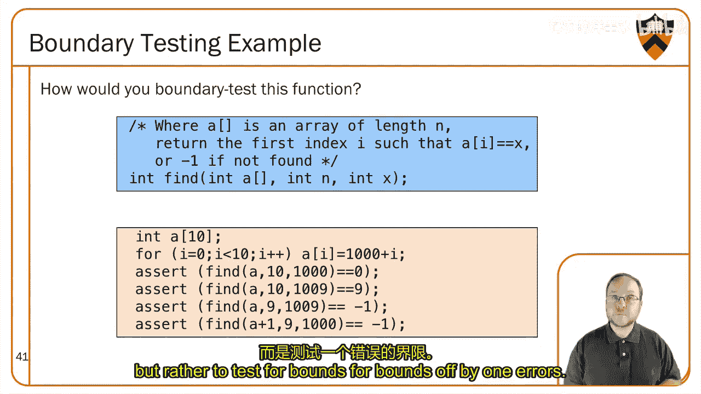

考虑以下函数声明，你应该考虑哪些边界测试？再次，把它当作一个点击器问题，花点时间写下跳入你脑海的边界情况或阶段转换。

我们当然应该检查当我们找到元素并且它作为数组的第一个项目返回时，那是我们的下边界。还有我们的上边界，当我们找到元素并且它作为数组的最后一个项目返回时。但也应该检查边界的另一侧。我们应该检查当它刚好超出边界一个位置时。所以我们有一个测试说，哦，它刚好超出数组起始位置一个。我们还有一个检查，当它刚好超出数组末尾一个位置时。我们想要测试这个的原因不是我们想要检查声明范围之外的任意内存位置，而是为了测试边界，测试差一错误。

### 压力测试

除了语句、路径和边界测试，我们还应该考虑压力测试。这是当事情在数量、种类或其他因素上达到最极端的时候。这些测试可能看起来不像你的典型输入，但这是一件好事。开发人员倾向于关注典型输入，可能会完全忽略输入空间中的大片区域。系统地遍历输入空间或从中均匀随机选择，是获取开发人员或QA可能想不到自己编写的测试数据的合理方法。

所以这里有一个合理的压力测试：我们选择10个长度为10000的字符串，并用随机数据填充这些字符串。我们假设`random_string`函数就是做这个的。然后至于测试本身，我们与一个参考解决方案进行比较。这可能会让你觉得有些虚假。如果我们已经有这个函数了，为什么还要写一个新的？但我认为这实际上相当合理。我们可能正在改变算法，我们有旧版本，它慢或占用太多内存等等。我们可能正在新环境中重新实现算法，而我们在旧环境中已经有它工作了。或者我们可能正在内部化一个标准工具。例如，可能有一个Linux命令，但我们不想总是去请求操作系统或shell来做这件事，所以我们将在我们的程序中编写自己的函数。

当然，也有时候你没有参考实现。所以测试确实涉及检查合理的输出属性，即使确切答案不可用。我们在`gcd`的例子中看到了这一点。所以这里是另一个例子。再次暂停幻灯片，思考一下我们在这里可以检查哪些属性。花一两分钟头脑风暴一下。

结果必须是非负的。结果必须小于基于我们与`random_string`假定的接口的最大字符串大小。并且直到字符串长度为止的字符都不能是空字符。否则，至少就字符串长度而言，那将结束字符串。并且索引处的字符必须是空字符，这是我们定义的字符串结尾。

## 测试实践与总结

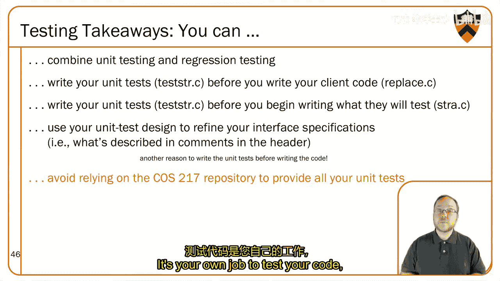

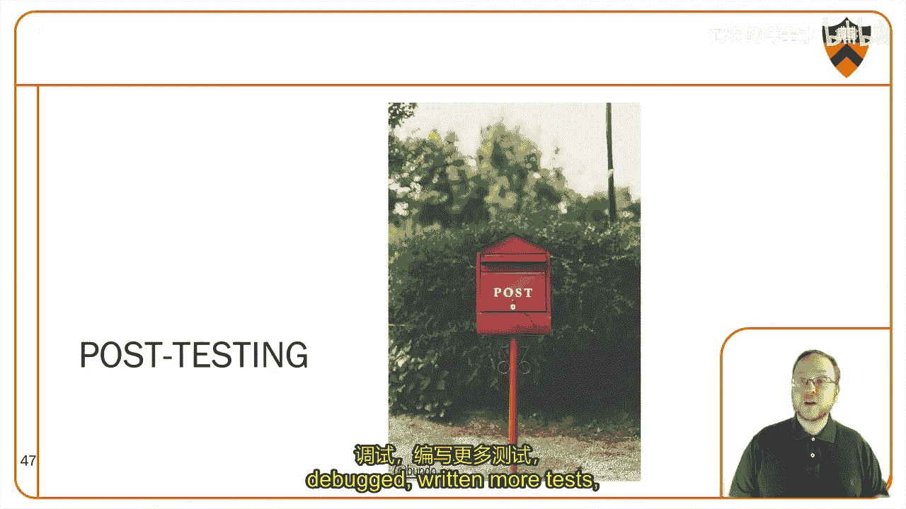

我真心相信测试是人们应该开始使用的东西。我主张编写测试，至少是基于接口的基本测试。是的，甚至在实现本身之前，当然也在你的外部客户端之前。事实上，当事情不像作业2和3那样有不可违反的标准时，我甚至主张编写测试作为接口本身的健全性检查。当然，作为本课程和许多其他课程的实际情况，我们的评分系统中有比我们在仓库中给你的或在ti文件中展示的更多的测试。测试你自己的代码是你自己的工作，但至少现在，你知道了一些结构化的方法。

好了，现在你已经迭代地编写了测试，编写了软件，运行了测试，调试，编写了更多测试，等等。现在你准备好发布你的代码了。那么现在怎么办？

不要扔掉你的单元测试框架。记住关于原型设计的担忧，它存在的时间比它应该的长，这并不意味着你的单元测试框架应该成为你实际的发布代码。但这也不意味着你应该扔掉它们。不要扔掉你的断言。不要扔掉你的表示不变性检查。你投入了时间和精力来制作它们。此外，即使你可能正在发布代码，这也不是软件生命周期的结束。在某些方面，这只是开始。对于大多数项目，我们当然希望其有用寿命远远长于开发阶段。因此，维护阶段也要长得多。现在你已经发布了，你将开始收到错误报告或新功能请求，而回归测试的整个理念需要现有的基础设施仍然存在。

但仅仅因为你不应该扔掉所有东西，并不意味着它仍然必须在发布版本中运行。彻底的测试基础设施可能很昂贵。对内部表示和不变性的测试可能会遍历大型数据结构或长列表。每个函数中的前置条件和后置条件检查，如果我们经常调用这些函数，会变得非常昂贵。

所以我们需要一种方法来禁用测试代码，而不是丢弃它。但在我们学习那是什么之前，请注意不要移除测试代码和不要移除调试代码是有区别的。良好的结构化测试基础设施是有价值的。到处打印“我到这里了，X的值是D”的调试代码，价值较低。那些应该完全移除，除非它们结构特别好，并且可以以类似于测试代码的方式被禁用，但这不常见，几乎闻所未闻。

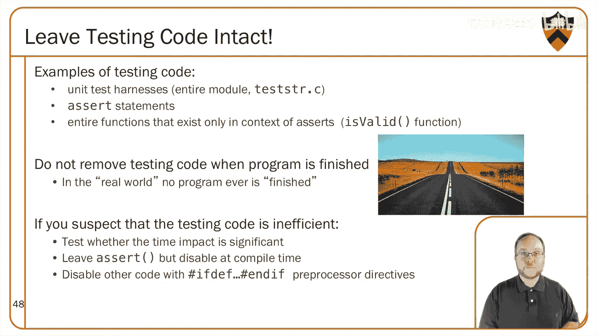

### 禁用测试代码

好了，现在让我们谈谈禁用测试代码。如果断言很昂贵，我们可以在程序中关闭它们。我们可以通过更改代码来实现。宏`NDEBUG`被`assert`库用作条件，以检查我们是否应该将`assert`视为一个函数式宏来执行语句，然后要么继续要么终止，或者是否应该将其视为一个完全不执行任何操作的空操作，它甚至不计算语句。更好的是，我们可以在不更改代码本身的情况下，仅通过构建命令来触发`assert`的这种行为。GCC接受一个构建选项`-D`，这相当于在我们程序顶部的一个`#define`。

应用于本课程，你经常会想说，我必须写我的断言，但也许我正在测试一些密集的东西，例如在作业4中，你将编写自己的`is_valid`表示不变性检查。所以在你的最终版本中，你将构建它以禁用它们，这样程序就快了。但在你开发它时，或者在你用它来测试我们给你的有错误版本时，你会希望它们开启，以便获得测试的全部好处。

请注意，我们可以为自己设置与`assert`库相同的东西。我们已经看到用于防止多重包含的`#ifndef`和`#endif`配对，我们可以使用它的正版，`#ifdef`，来测试是否给出了`#define`以启用我们的测试功能。这正是`assert`库用上面的`NDEBUG`所做的。事实上，我们可以完全按照`assert`的做法，直接使用`NDEBUG`本身，但这意味着你无法将你的自定义功能测试与程序中的其他断言解耦。所以前一页幻灯片的方法更通用。

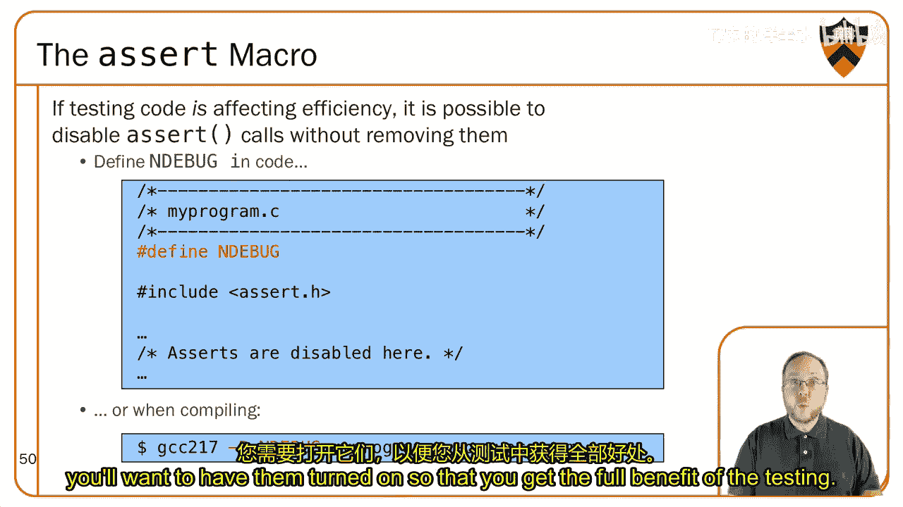

## 总结

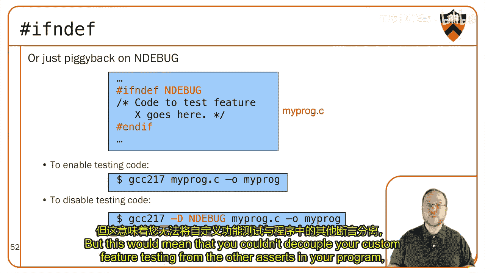

本节课中我们一起学习了软件测试的核心概念与实践方法。我们探讨了测试的重要性，了解了不同角色（开发者、QA、客户）在测试中的职责。我们学习了外部测试，包括手动测试、自动化脚本和回归测试，以及如何利用Shell脚本提高测试效率。我们深入探讨了内部测试，特别是C语言中的断言机制，用于验证前置条件、后置条件和表示不变性。我们介绍了单元测试的概念，包括如何通过脚手架和桩来隔离测试模块。我们还讨论了测试覆盖率，包括语句测试、路径测试、边界测试和压力测试，这些都是设计全面测试套件的重要考虑因素。最后，我们强调了在发布代码时不应丢弃测试基础设施，但可以通过条件编译（如`NDEBUG`宏）来禁用昂贵的测试代码，以平衡运行时性能与可维护性。

测试很容易被忽视，调试可能被视为某种终极的逻辑谜题挑战。但我确实希望你能考虑一个全面测试套件的价值。特别是，你在测试上花费的时间，可能会为你节省同样多甚至更多的时间，相比于你似乎无法摆脱的一个接一个的错误打地鼠游戏。

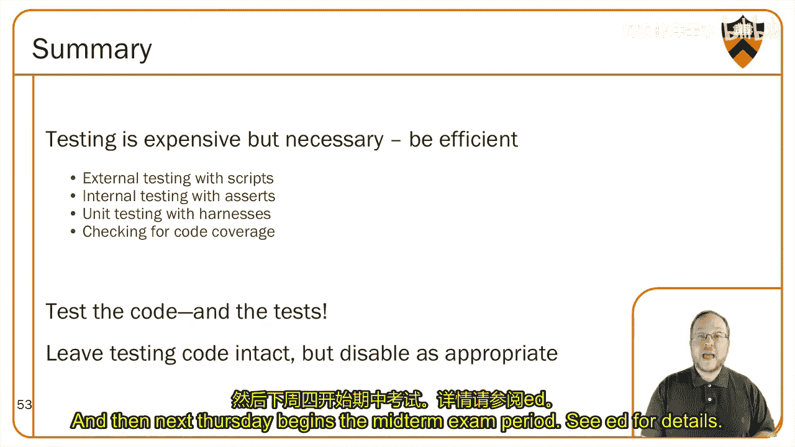

下次我们将讨论数据结构，然后下周的第一讲也是唯一一讲将再次讨论调试，就像今天的测试一样，旨在给你一个结构化的方法，以取代新手程序员常用的低效技术。然后下周四开始期中考试期，详情请查看课程网站。