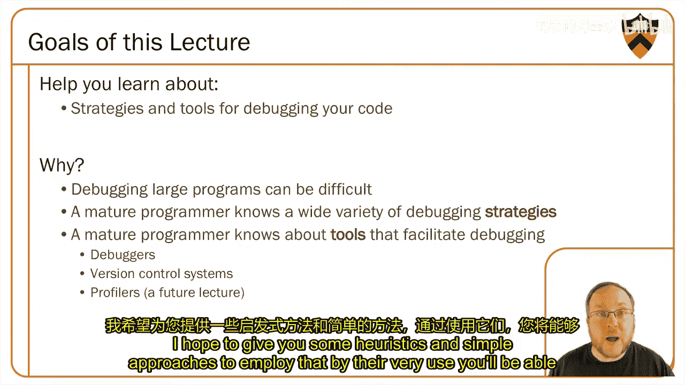
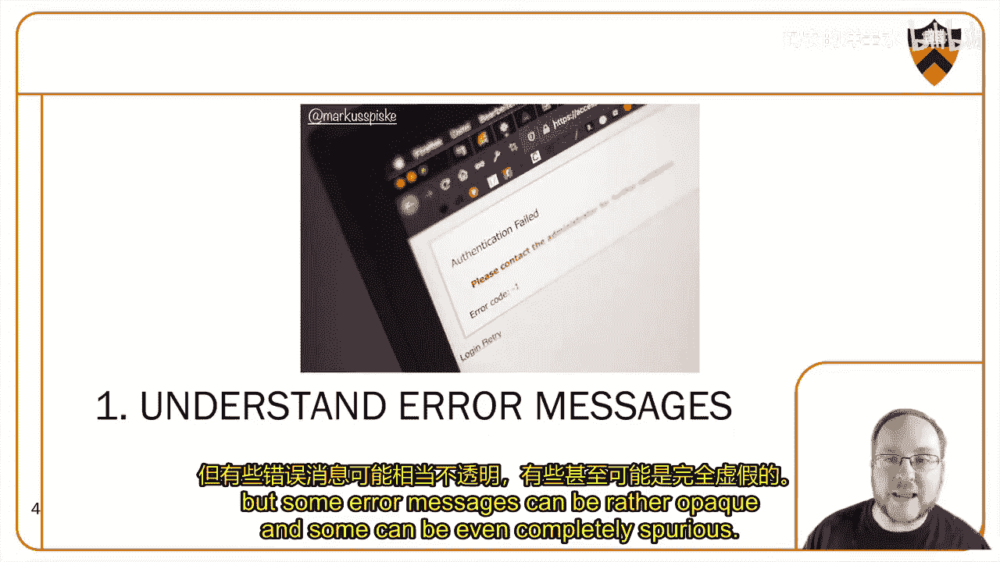
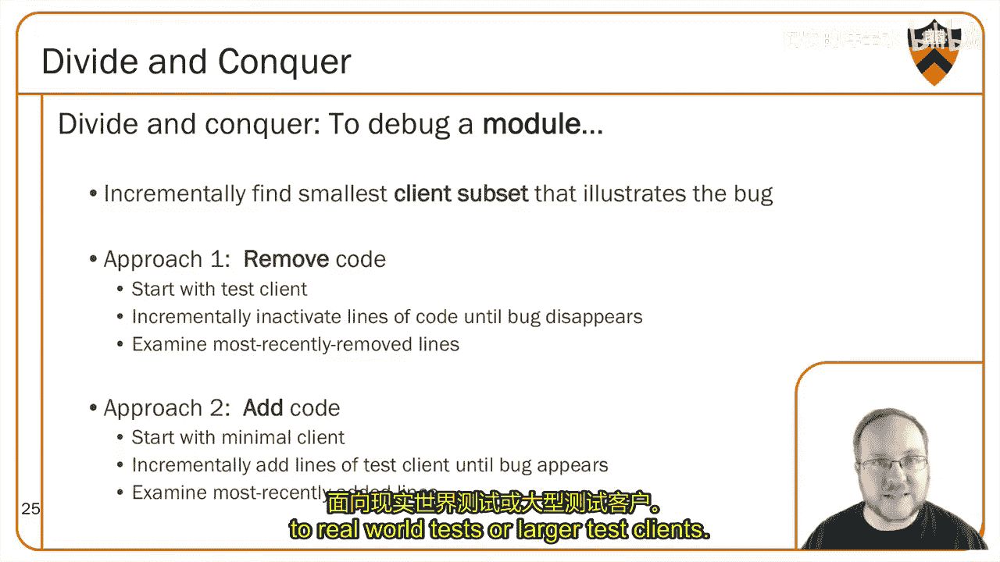
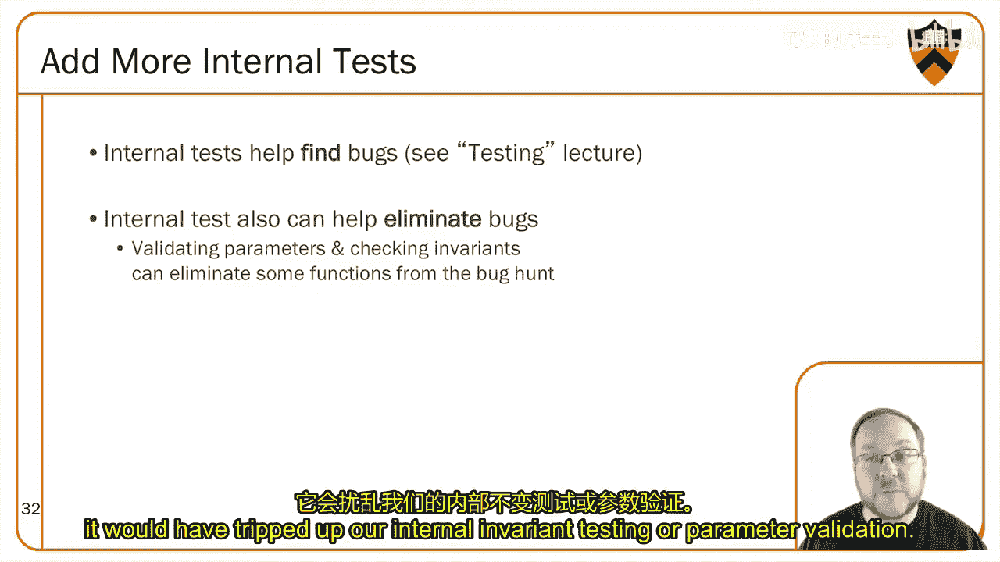
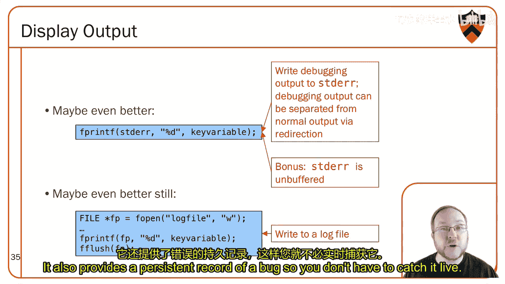
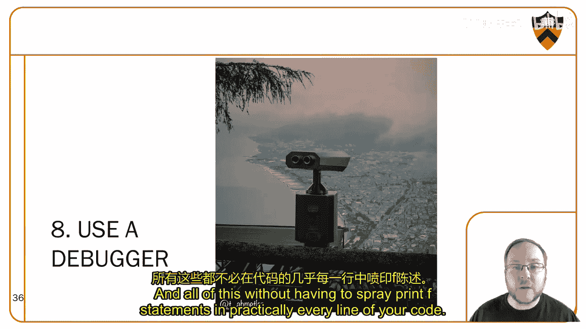
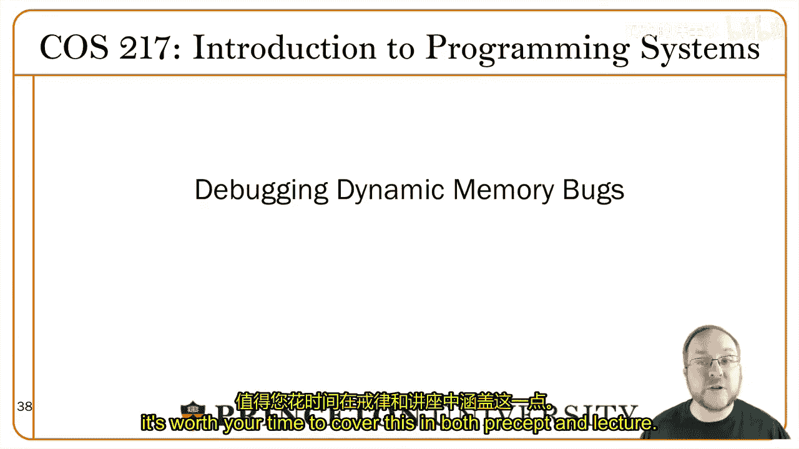
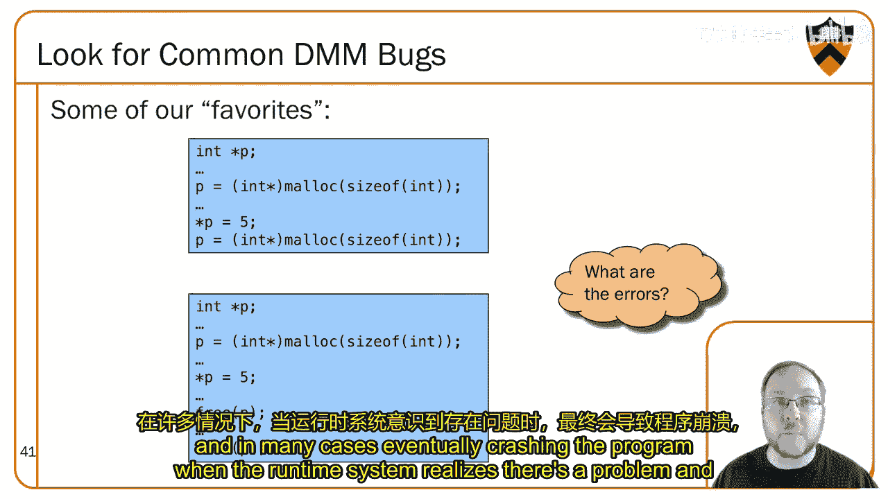
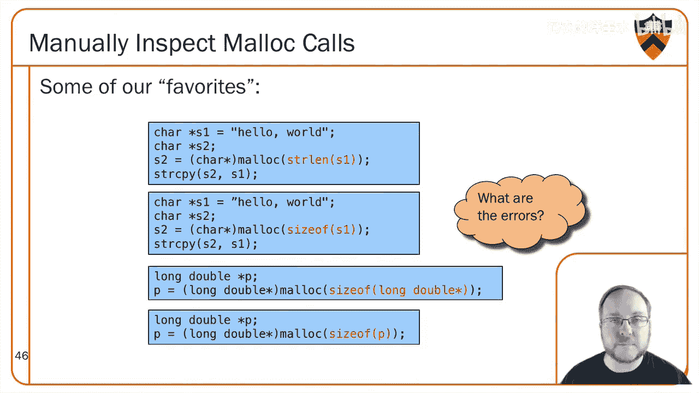

# 014：调试 🐛

在本节课中，我们将学习如何系统性地查找和修复程序中的错误（即“调试”）。我们将从理解编译错误信息开始，逐步探讨一系列调试策略和常见错误模式，特别是针对动态内存管理中的问题。掌握这些技巧将帮助你更高效地定位和解决代码中的缺陷。



## 理解错误信息 📝

上一节我们介绍了调试的重要性，本节中我们来看看调试的第一步：理解编译器给出的错误和警告信息。




当构建程序时，编译器或链接器可能会报告错误或警告。错误意味着程序不符合C语言规范，无法生成可执行文件。警告则提示代码中可能存在潜在问题，但程序仍可编译。

以下是几个常见的构建时错误示例及其分析：

*   **错误：`#include <stdio,h>`**：预处理器报告致命错误，因为头文件名中的逗号应为点号。正确的写法是 `#include <stdio.h>`。
*   **错误：未终止的注释**：预处理器发现 `/*` 注释没有对应的 `*/` 来结束。
*   **错误与警告的误导**：有时编译器报告的错误位置可能因代码格式而偏移。例如，某行缺少分号，但编译器可能在下一条语句（如 `return`）处报告错误，并附带一个关于函数可能未返回值的误导性警告。修复原始错误（加上分号）通常能使警告消失。
*   **警告与链接器错误**：如果函数名拼写错误（如 `printf` 拼成 `prntf`），编译器会给出“隐式声明”警告，而链接器则会报告“未定义的引用”错误，明确指出找不到哪个标识符。
*   **不清晰的错误信息**：对于某些语法错误（如 `enum` 定义后缺少分号），编译器可能只给出晦涩的错误信息，提示“某处期望某个符号”。这通常意味着存在语法错误，需要仔细检查指示区域附近的代码。

**调试建议**：
1.  善用编辑器的自动缩进功能（如在我们的Emacs设置中使用 `Ctrl+X P`）。错误的缩进往往能直观地提示语法错误的位置。
2.  一次只修复一个错误。后续的某些错误可能是前一个错误引发的假象，修复前者后，它们可能会自动消失。

## 先思考，再修改 🤔

在尝试修复错误之前，进行系统的思考至关重要。盲目地修改代码通常会使问题复杂化。

**有效的方法包括**：
*   **逐行朗读代码**：向自己、同学甚至一个玩偶解释你的代码。这个过程能迫使你放慢速度，仔细审视每一行，常常能发现之前忽略的错误。
*   **形成假设，再验证**：不要进行无目的的随机修改。首先，根据观察和分析，形成一个关于错误根源的假设。然后，设计一个代码修改来验证这个假设。如果修改后问题解决或变化，说明假设可能是正确的。

如果你发现自己开始进行无纪律的修改，这通常意味着你对问题缺乏清晰的理解。此时应该暂停，并寻求帮助。

## 识别常见错误模式 🎯

许多错误都属于常见的模式。了解这些模式可以帮助你快速定位问题。

以下是C语言中一些频繁出现的错误：

*   **`switch` 语句贯穿**：在 `case` 分支后忘记写 `break;`，导致执行意外地流入下一个分支。
*   **遗漏取址运算符 `&`**：在需要指针的地方（如 `scanf` 的参数）使用了变量本身，而不是其地址。
*   **变量类型过小**：例如，用 `char` 类型变量接收 `getchar()` 的返回值，无法正确处理 `EOF`（它是一个 `int` 值）。
*   **运算符优先级错误**：因省略括号而导致表达式求值顺序与预期不符。
*   **误用赋值运算符 `=`**：在条件判断中错误地使用了 `=`（赋值）而非 `==`（比较）。
*   **误用逻辑与位运算符**：在条件判断中错误地使用了位运算符（`&`, `|`）而非逻辑运算符（`&&`, `||`）。
*   **链式比较错误**：表达式如 `5 < i < 10` 在C语言中是合法的，但其含义并非判断 `i` 是否在5和10之间。它实际等价于 `(5 < i) < 10`，而 `(5 < i)` 的结果是0或1，它们都小于10，因此整个表达式恒为真。

**注意**：使用 `-Wall` 编译选项可以让编译器对其中一些错误发出警告。

**关于“整体性错误”**：在编写嵌套循环等模式化代码时，大脑容易忽略细节。例如，内层循环错误地使用了外层循环的计数器变量。这种错误在复制粘贴代码时尤其常见，需要格外小心。

**关于作用域**：C语言允许在内部代码块中定义同名变量，这会遮蔽外部变量。例如，在函数内定义的变量会遮蔽全局变量，在更内层的块中定义的变量会遮蔽函数内的变量。这与Java中局部变量遮蔽实例变量类似，但C语言允许更多的遮蔽情况。

## 分而治之：简化问题 🔍

面对一个复杂且出错的测试用例或庞大的代码库时，采用“分而治之”的策略非常有效。

**简化输入**：
*   如果一个大测试用例失败，尝试不断裁剪输入数据，直到找到一个最小的、仍能触发错误的输入。最后被移除的那部分内容很可能就是触发错误的关键。
*   反之，也可以从一个能成功运行的简单输入开始，逐步添加内容，直到错误出现。最后添加的部分就是问题所在。

**简化代码**：
*   如果一个大程序失败，可以尝试注释掉部分函数调用。当注释掉某些代码后错误消失，那么被注释的部分很可能就是问题的根源。
*   同样，也可以从一个极简的、能正确运行的程序开始，逐步添加功能模块，直到错误重现。

**重要提示**：在注释或移除代码时，请保留原始代码（例如使用注释或 `#if 0`），以便在需要时恢复。



## 聚焦于最近的更改 💾


这条建议有两层含义：一是要在开发过程中持续测试和调试（即“聚焦于最近的代码”）；二是一旦出现问题，应首先检查最近所做的修改。

这体现了**回归测试**的原则：确保新的更改不会破坏之前正常的功能。为了实现这一点，你需要有可靠的版本控制。

**使用版本控制（如Git）**：定期提交代码，即使它还不完美或存在已知问题。这为你创建了一个个“安全点”。当你后续的修改陷入混乱时，可以轻松地回退到之前一个已知的状态进行比较，或者重新开始。这远比在未版本控制的代码中迷失方向要高效得多。

## 增加测试以定位错误 🧪

有时，解决测试失败的最佳方法是增加更多、更细粒度的测试。




内部测试（如断言、参数验证）能帮助你：
*   **主动定位错误**：通过添加更多检查点，可以精确缩小错误发生的范围。
*   **被动排除嫌疑**：如果代码的某个部分通过了严格的内部测试，那么你就可以更有信心地暂时将其从怀疑列表中排除，将调试重点转向其他区域。

## 使用打印语句进行调试 🖨️

对于简单的调试，在代码中插入针对性的打印语句（`printf`）是一种直接有效的方法。它可以帮助你了解程序执行到哪一步，或者特定变量的值在何时发生了变化。

**注意事项**：
*   **输出缓冲**：标准输出（`stdout`）通常是缓冲的，这意味着 `printf` 的内容可能不会立即显示在终端上。如果程序在缓冲区刷新前崩溃，你将看不到这些调试信息。
    *   **解决方法**：在格式字符串末尾添加换行符 `\n` 通常可以刷新缓冲区。更可靠的方法是调用 `fflush(stdout)` 强制刷新。或者，将调试信息输出到无缓冲的标准错误流（`stderr`）上。
*   **输出到文件**：对于长时间运行的程序，将调试日志写入文件非常有用。这提供了一个持久的记录，便于事后分析，也避免了与程序正常输出混在一起。





**示例代码**：
```c
fprintf(stderr, "调试信息: 变量 x = %d\n", x); // 输出到 stderr
// 或
printf("状态: 进入函数 foo\n");
fflush(stdout); // 确保立即输出
```

## 使用调试器 🐛➡️🔍



作为打印语句的替代，使用调试器（如GDB）能提供更强大、更交互式的调试体验。它允许你：
*   逐行执行程序。
*   随时查看任何变量或内存位置的值。
*   设置断点，在特定条件满足时暂停执行。
*   无需修改代码即可获得所有这些信息。

**强烈建议**：花30分钟到1小时认真练习GDB的基本用法。这将在未来的调试工作中为你节省数十小时的时间，也能让你在寻求帮助时更高效地与助教协作。


## 动态内存调试专题 💥

动态内存管理是C语言中常见的错误来源。错误通常围绕几个核心操作（`malloc`, `realloc`, `free`, 指针解引用）和几种错误模式（悬空指针、越界访问、内存泄漏、重复释放）。

以下是几个动态内存错误的例子：

1.  **解引用未初始化的指针**：指针变量未赋值，其值是随机的。解引用它可能导致修改任意内存位置或引发段错误（Segmentation Fault）。
    ```c
    int *p; // 未初始化
    *p = 5; // 错误：解引用未初始化的指针
    ```
2.  **解引用已释放的指针（悬空指针）**：指针指向的内存已被 `free`，但后续仍通过该指针访问内存。
    ```c
    int *p = malloc(sizeof(int));
    free(p);
    *p = 10; // 错误：解引用已释放的指针
    ```
3.  **未检查 `malloc` 返回值**：如果 `malloc` 失败并返回 `NULL`，解引用这个空指针会导致段错误。
    ```c
    int *p = malloc(sizeof(int));
    *p = 5; // 如果 malloc 失败，p 为 NULL，此处错误
    ```
4.  **内存泄漏**：分配了内存，但在程序结束前丢失了所有指向它的指针，导致无法释放。
    ```c
    int *p = malloc(100 * sizeof(int));
    p = malloc(200 * sizeof(int)); // 错误：第一块内存的指针丢失，发生泄漏
    ```
5.  **重复释放**：对同一块内存调用 `free` 超过一次，这会破坏堆的结构。
    ```c
    int *p = malloc(sizeof(int));
    free(p);
    free(p); // 错误：重复释放
    ```



## 利用段错误进行调试 💡

段错误（Segmentation Fault）通常由解引用无效指针（如空指针、悬空指针或越界指针）引起。虽然它导致程序崩溃，但**这是一个好消息**，因为它明确地指出了错误发生的位置，远比程序静默地产生错误结果要好。


**如何利用GDB定位段错误**：
1.  使用 `-g` 选项编译程序：`gcc -g -o program program.c`
2.  在GDB中运行程序：`gdb ./program`
3.  输入 `run` 命令，让程序运行直至崩溃。
4.  程序崩溃后，输入 `where`（或 `bt`）命令。这将显示程序崩溃时的**调用栈**，即导致崩溃的一系列函数调用。
5.  调用栈最顶部的行就是崩溃发生的位置。检查该行代码中涉及的指针变量，然后沿着调用栈向下回溯，分析这个指针是如何被赋值和使用的，从而找到错误的根源。

## 诊断内存分配大小错误 📏

分配不足的内存是一个常见错误。可以通过以下方法诊断：

**手动检查**：使用搜索工具查找代码中所有的 `malloc`、`calloc`、`realloc` 调用，逐一核对分配的大小是否正确。

**常见的大小错误示例**：
*   **字符串分配少一个字节**：为字符串分配内存时，必须为结尾的 `\0` 空字符预留空间。`strlen(s)` 返回的是字符串长度，不包括 `\0`。
    ```c
    char *str = malloc(strlen(s)); // 错误：少1字节
    char *str = malloc(strlen(s) + 1); // 正确
    ```
*   **对指针使用 `sizeof`**：`sizeof(pointer)` 返回的是指针本身的大小（通常是8字节），而不是它指向的数据类型的大小。
    ```c
    long double *arr = malloc(10 * sizeof(long double*)); // 错误：分配了指针的大小
    long double *arr = malloc(10 * sizeof(long double)); // 正确
    // 或者更佳：
    long double *arr = malloc(10 * sizeof(*arr)); // 正确：使用解引用指针的类型
    ```



**系统化测试法**：如果手动检查无效，可以尝试一个系统化的方法：
1.  临时将所有 `malloc` 调用替换为分配一个非常大的固定值（例如 `malloc(1000000)`）。
2.  运行程序。如果错误消失，说明问题很可能出在某个分配大小不足的 `malloc` 上。
3.  逐个将 `malloc` 调用恢复原状，每次恢复后都测试一次。当错误再次出现时，最后恢复的那个 `malloc` 就是有问题的。


**类似地，对于 `free` 相关错误**：如果怀疑是双重释放或悬空指针访问，可以尝试注释掉所有 `free` 调用。如果错误消失，再逐个恢复 `free` 调用以定位问题所在。

## 使用内存分析工具 🛠️

最后，可以利用专门的内存分析工具来检测动态内存错误。

*   **Meminfo**：由普林斯顿大学的教员编写，专门为COS 217课程设计，用于检测内存泄漏和堆损坏。
*   **Valgrind**：一个功能强大且广泛使用的免费工具套件。其中的 `memcheck` 工具可以在程序运行时检测多种内存错误，包括内存泄漏、越界访问、使用未初始化的内存、重复释放等。

在课程作业中，通常会要求你提交干净的Meminfo报告。但在自己调试时，强烈建议尝试使用Valgrind，它能提供极其详细和有用的错误信息。

---


本节课中我们一起学习了系统性的调试方法。我们从理解编译器信息开始，探讨了思考策略、常见错误模式、分而治之的技巧、版本控制的重要性，以及针对动态内存错误的专门调试技术，包括使用打印语句、调试器（GDB）和内存分析工具（如Valgrind）。掌握这些技能将极大地提升你诊断和修复程序缺陷的效率。